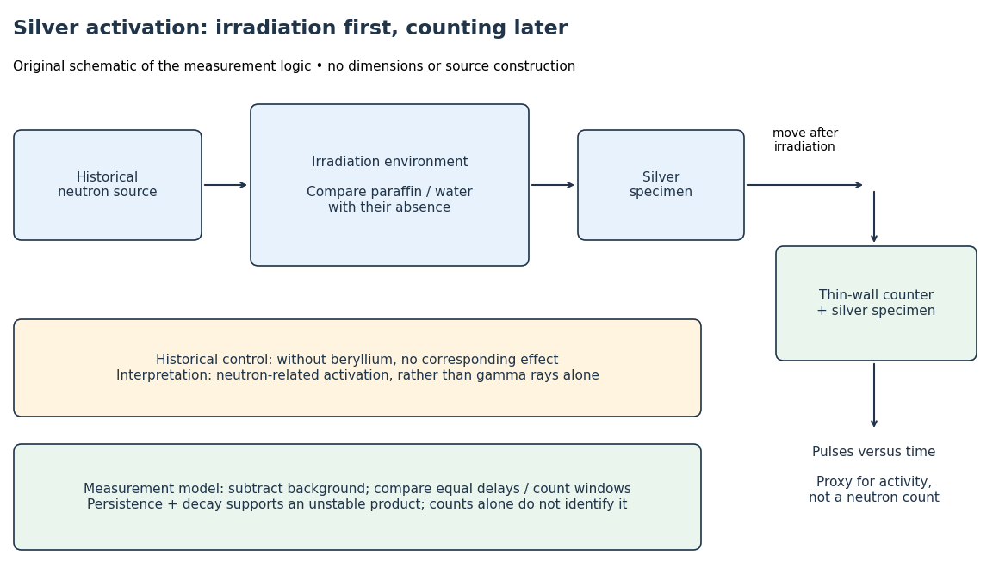

# Fermi slow-neutron activation experiment

↑ **Parent:** [Neutron activation](neutron-activation.md)

[Enrico Fermi](enrico-fermi.md)'s May 1934 report describes cylindrical specimens irradiated by a [radon](radon.md)-[beryllium](beryllium.md) [neutron](neutron-split.md) source, then placed around a thin-[aluminium](aluminium.md)-wall [Geiger-Müller counter](geiger-counter.md) to record pulses per minute. The irradiation and counting were successive operations.[Radioactivity Induced by Neutron Bombardment, Nature 133, 757 (1934); specimen irradiation and subsequent counter readout](radioactivity-induced-by-neutron-bombardment-by-enrico-fermi.md)

The October paper by [Enrico Fermi](enrico-fermi.md), [Edoardo Amaldi](edoardo-amaldi.md), [Bruno Pontecorvo](bruno-pontecorvo.md), [Franco Rasetti](franco-rasetti.md) and [Emilio Segrè](emilio-segre.md) reports that interposed [paraffin wax](paraffin-wax.md) increased [silver](silver.md) activation; surrounding blocks enhanced it further, depending on geometry. [Water](water.md) gave a comparable effect. A preparation without [beryllium](beryllium.md) gave no effect, arguing against [gamma rays](gamma-ray.md) alone. Oxygen-containing material without [hydrogen](hydrogen.md) did not give a comparable enhancement, and not all activated elements responded alike. Repeated collisions with [hydrogen](hydrogen.md) were proposed to slow the [neutrons](neutron-split.md).[Azione di sostanze idrogenate sulla radioattività provocata da neutroni. I, Ricerca Scientifica 5(2), 282–283 (1934); English translation no. 105b, pp. 761–762, observations (a)–(c) and interpretation](azione-di-sostanze-idrogenate-sulla-radioattivita-provocata-da-neutroni-i-by-enrico-fermi-and-others.md)

The University of Pisa's account of [Bruno Pontecorvo](bruno-pontecorvo.md)'s work with [Edoardo Amaldi](edoardo-amaldi.md) describes stronger [silver](silver.md) activation on wood than on marble. This is a retrospective account; the October paper above directly documents the deliberate [paraffin wax](paraffin-wax.md) and [water](water.md) comparisons.[The scientist; September–October 1934 silver activation and wooden-table passage](the-scientist-by-the-bruno-pontecorvo-department-centre.md)

**[Figure 5](#image-silver-activation-as-a-delayed-measurement-of-the-response-to-neutron-irradiation). Silver activation as a delayed measurement of the response to neutron irradiation**. Original schematic separating irradiation, later counter readout, a historical comparison and the measurement model. The arrows show stages of inference, not a scale drawing of the apparatus.

To interpret this readout, compare an irradiated specimen with an unirradiated specimen or empty-counter background, using the same counting geometry. Compare irradiation conditions at matched irradiation durations, delays and counting windows. These are requirements of the measurement model, rather than a claim that every such control is documented in the short October letter. Otherwise ordinary [radioactive decay](radioactive-decay.md) during transfer can imitate a change in activation. A persistent, decaying excess after irradiation supports an unstable product; neither a larger count nor a fitted [half-life](half-life.md) uniquely identifies an [isotope](isotope.md).

In his 1938 Nobel lecture, [Enrico Fermi](enrico-fermi.md) distinguished single and superposed [exponential decay](exponential-decay.md) curves and described chemical separation to identify their carriers. His slowing interpretation connected [elastic collisions](elastic-collision.md) with enhanced capture. The lecture also described [neutron capture resonances](neutron-capture-resonance.md), so its account cannot support a universal rule that slower always means more reactive.[Nobel Lectures, Physics 1922–1941; Artificial radioactivity produced by neutron bombardment, lecture delivered 12 December 1938; pp. 415, 417–418, 420–421](nobel-lectures-physics-1922-1941/artificial-radioactivity-produced-by-neutron-bombardment.md)

The 1934 assignments of some [uranium](uranium.md) activities to elements beyond [uranium](uranium.md) were mistaken interpretations, not a discovery of [nuclear fission](nuclear-fission.md). The published lecture's later footnote explicitly calls for reexamining the transuranic assignments after evidence of splitting. Distinguish that correction from the lecture as delivered.[Nobel Lectures, Physics 1922–1941; Published lecture, p. 417 footnote correcting the transuranic interpretation; this note refers to subsequent evidence](nobel-lectures-physics-1922-1941/artificial-radioactivity-produced-by-neutron-bombardment.md)

## ↑ Ancestors (8)

1. [Neutron activation](neutron-activation.md)
2. [Neutron](neutron-split.md)
3. [Nucleon](nucleon.md)
4. [Baryon](baryon.md)
5. [Hadron](hadron.md)
6. [Subatomic particle](subatomic-particle.md)
7. [Physics](physics-split.md)
8. [Codex Wiki](split.md)

## ← Incoming links (2)

- [Neutron moderator](neutron-moderator.md)
- [Slow neutron](slow-neutron.md)
