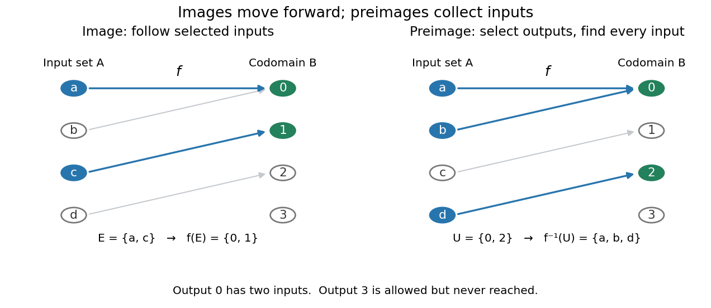

# Fiber of a function

↑ **Parent:** [Function](function-split.md)

For a [function](function-split.md) $f:X\to Y$ and $y\in Y$, its [fiber of a function](fiber-of-a-function.md) over $y$ is the [set](set-split.md) of all inputs producing that one output:

$$
f^{-1}(y)=f^{-1}(\{y\})=\{x\in X:f(x)=y\}.
$$

Here $f^{-1}(y)$ is shorthand for a [preimage](preimage.md) of a [singleton set](singleton-mathematics.md), rather than a claim that an [inverse function](inverse-function.md) exists. A fiber can contain several inputs or be empty. It describes exactly which distinctions the [function](function-split.md) forgets.

For the finite [function](function-split.md) under [image and preimage of a function](image-and-preimage-of-a-function.md), the fibers over $0,1,2,3$ are $\{a,b\}$, $\{c\}$, $\{d\}$ and the [empty set](empty-set.md), respectively. The nonempty fibers form a [partition of a set](partition-of-a-set.md): they are disjoint [sets](set-split.md) whose [union](set-union.md) is the [domain of a function](domain-of-a-function.md). Every input belongs to the fiber over its unique output, and two fibers with distinct output labels cannot share an input. A [function](function-split.md) is [injective](injective-function.md) exactly when every fiber has at most one member; it is [surjective](surjective-function.md) exactly when every member of its specified [codomain](codomain.md) has a nonempty fiber.

**[Figure 2](#image-a-preimage-collects-complete-fibers-the-outputs-0-2-select-the-fibers-a-b-and-d). A preimage collects complete fibers: the outputs $\{0,2\}$ select the fibers $\{a,b\}$ and $\{d\}$**.

More generally, $f^{-1}(U)$ is the [union](set-union.md) of the fibers over all $y\in U$. The relation $x\sim x'$ defined by $f(x)=f(x')$ is an [equivalence relation](equivalence-relation.md), and its [equivalence classes](equivalence-class.md) are precisely the nonempty fibers. The resulting [quotient set](quotient-set.md) is naturally in [bijection](bijection.md) with the [image of a function](image-of-a-function.md). This links an input partition to the output values actually reached, without choosing one representative from each class.

Fibers are useful when an output is known but the input is not uniquely determined. A [solution set](solution-set.md) $g^{-1}(\{0\})$ is one fiber, and [factorization through a surjection](factorization-through-a-surjection.md) explains when another [function](function-split.md) depends only on the retained output. Quantum [hidden subgroup problem](hidden-subgroup-problem.md) algorithms use [functions](function-split.md) whose fibers are [cosets](coset.md), giving the same idea a structured form in [group theory](group-theory-split.md).

**Table of contents**

- [Factorization through a surjection](factorization-through-a-surjection.md)

## ↑ Ancestors (6)

1. [Function](function-split.md)
2. [Set theory](set-theory-split.md)
3. [Foundations of mathematics](foundations-of-mathematics-split.md)
4. [Area of mathematics](area-of-mathematics.md)
5. [Mathematics](mathematics-split.md)
6. [Codex Wiki](split.md)

## ← Incoming links (10)

- [Critical value](critical-value.md)
- [Factorization through a surjection](factorization-through-a-surjection.md)
- [Fiber of a function](fiber-of-a-function.md)
- [Function collision](function-collision.md)
- [Kernel of a linear map](kernel-of-a-linear-map.md)
- [Nullity of a linear map](nullity-of-a-linear-map.md)
- [Solution](past-exam-of-the-mathematics-course-of-the-university-of-cambridge/2009/ia/paper-4/5e/a/solution.md)
- [Solution](past-exam-of-the-mathematics-course-of-the-university-of-cambridge/2009/ia/paper-4/5e/b/solution.md)
- [Preimage](preimage.md)
- [Right-inverse characterization of the axiom of choice](right-inverse-characterization-of-the-axiom-of-choice.md)
