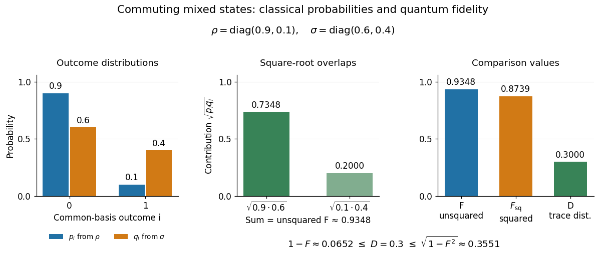

# Fidelity of commuting mixed states

↑ **Parent:** [Fidelity of quantum states](fidelity-of-quantum-states.md)

When two [density operators](density-matrix.md) are [commuting elements](commuting-elements.md), choose a common [orthonormal eigenbasis](orthonormal-eigenbasis.md) and write $\rho=\operatorname{diag}(p_i)$, $\sigma=\operatorname{diag}(q_i)$. Their [quantum fidelity](fidelity-of-quantum-states.md) becomes the classical overlap of the two [probability distributions](probability-distribution.md), while their [trace distance](trace-distance.md) becomes [total variation distance](total-variation-distance.md):

$$
F(\rho,\sigma)=\sum_i\sqrt{p_iq_i},\qquad F_{\mathrm{sq}}(\rho,\sigma)=\left(\sum_i\sqrt{p_iq_i}\right)^2,\qquad D(\rho,\sigma)=\frac12\sum_i|p_i-q_i|.
$$

This follows by computing the [positive square root of an operator](positive-square-root-of-an-operator.md) entry by entry in the common [eigenbasis](eigenbasis.md). For the [qubit](qubit.md) [mixed states](mixed-state.md) $\rho=\operatorname{diag}(0.9,0.1)$ and $\sigma=\operatorname{diag}(0.6,0.4)$,

$$
F=\sqrt{0.54}+\sqrt{0.04}=\sqrt{0.54}+0.2\approx0.934847,\qquad
F_{\mathrm{sq}}=0.58+0.4\sqrt{0.54}\approx0.873939,\qquad D=0.3.
$$

The two contributions to [quantum fidelity](fidelity-of-quantum-states.md) are about $0.734847$ and $0.2$. In contrast, the chance that two independent [computational basis](computational-basis.md) measurements, one on each preparation, print the same label is $0.9(0.6)+0.1(0.4)=0.58$. That particular event has a specified [probability](probability.md); neither $F$ nor $F_{\mathrm{sq}}$ is that probability.

**[Figure 3](#image-commuting-mixed-state-probabilities-square-root-overlap-contributions-to-unsquared-fidelity-f-squared-fidelity-fsq-and-trace-distance-d). Commuting mixed-state probabilities, square-root overlap contributions to unsquared fidelity F, squared fidelity Fsq, and trace distance D**.

Here [trace distance](trace-distance.md) $0.3$ means an equal-prior [quantum state discrimination](quantum-state-discrimination.md) success of $0.65$ by the [Holevo–Helstrom theorem](holevo-helstrom-theorem.md). Measuring in the common [computational basis](computational-basis.md) and guessing $\rho$ on outcome zero and $\sigma$ on outcome one achieves $[0.9+0.4]/2=0.65$. Also $\sqrt{1-F^2}\approx0.3551>D$: the [pure-state trace distance and fidelity identity](pure-state-trace-distance-and-fidelity-identity.md) is an equality for [pure states](pure-state.md), rather than a formula for arbitrary [mixed states](mixed-state.md).

## ↑ Ancestors (6)

1. [Fidelity of quantum states](fidelity-of-quantum-states.md)
2. [Quantum information theory](quantum-information-theory-split.md)
3. [Quantum theory](quantum-theory-split.md)
4. [Branches of physics](branches-of-physics.md)
5. [Physics](physics-split.md)
6. [Codex Wiki](split.md)

## ← Incoming links (3)

- [Bhattacharyya coefficient](bhattacharyya-coefficient.md)
- [Fuchs-van de Graaf inequalities](fuchs-van-de-graaf-inequalities.md)
- [Measurement characterization of quantum fidelity](measurement-characterization-of-quantum-fidelity.md)
