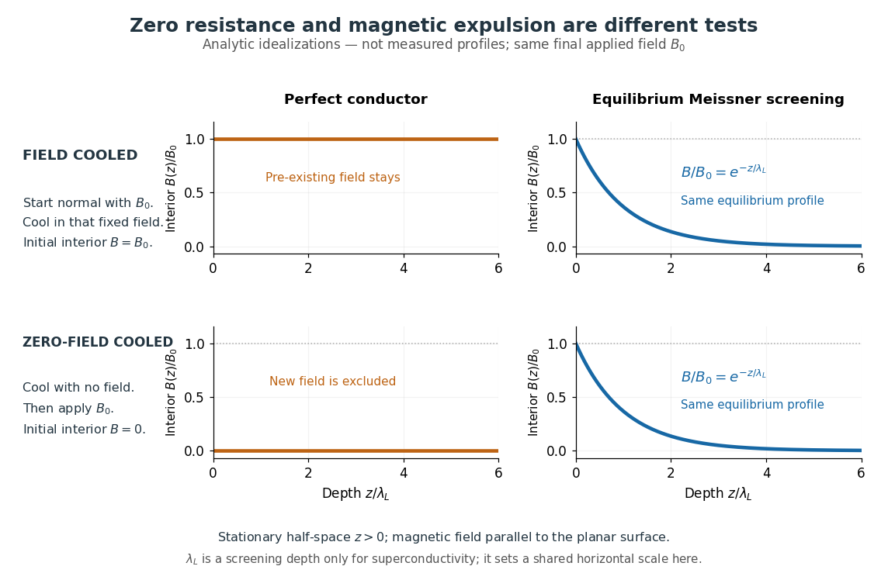

# Field-cooled Meissner experiment

↑ **Parent:** [Superconductivity](superconductivity.md)

The [Field-cooled Meissner experiment](field-cooled-meissner-experiment.md) starts above the [superconducting transition temperature](superconducting-transition-temperature.md) with a weak, steady applied [magnetic field](magnetic-field.md) already penetrating a solid sample. Cooling while keeping the applied [magnetic field](magnetic-field.md) fixed tests whether the interior [magnetic flux](magnetic-flux.md) changes. This is the decisive contrast with cooling in zero [magnetic field](magnetic-field.md) and switching the [magnetic field](magnetic-field.md) on afterwards. The diagram shows the two histories for the same final applied [magnetic field](magnetic-field.md).

**[Figure 6](#image-field-cooling-distinguishes-equilibrium-meissner-screening-from-perfect-conductor-flux-memory). Field cooling distinguishes equilibrium Meissner screening from perfect-conductor flux memory**. Analytic idealizations, not measurements: a tangential [magnetic field](magnetic-field.md) beside a planar half-space. The [perfect conductor](perfect-conductor.md) preserves its initial interior [magnetic field](magnetic-field.md); equilibrium [London equations](london-equations.md) instead give exponential screening in both histories. $\lambda_L$ is the [London penetration depth](london-penetration-depth.md) for [superconductivity](superconductivity.md) and merely a common plotting length for the [perfect conductor](perfect-conductor.md).

Meissner and Ochsenfeld reported magnetic expulsion in 1933, showing that the transition involves more than vanishing [electrical resistance](electrical-resistance.md). A modern motivating version appears in MIT's lead-sample experiment: surround the sample with a [solenoid](solenoid.md) supplying a steady [magnetic field](magnetic-field.md) and a separate pickup coil connected to a recording instrument. Apply the [magnetic field](magnetic-field.md) while the lead is still normal, then cool through its transition without changing the [solenoid](solenoid.md) [electric current](electric-current.md). Expulsion produces a transient pickup-coil [electric potential difference](electric-potential-difference.md); warming through the transition produces the opposite sign as [magnetic flux](magnetic-flux.md) returns. MIT also checks the signal direction by switching off the applied [magnetic field](magnetic-field.md) while the sample is normal. [Hoffman laboratory, magnetic-expulsion discovery](https://hoffman.physics.harvard.edu/materials/SCintro.php) [MIT Junior Lab, §5.2.2: Meissner effect in lead](https://ocw.mit.edu/courses/8-13-14-experimental-physics-i-ii-junior-lab-fall-2016-spring-2017/ec45c3030c7ec2ba0f0537ab84d09c17_MIT8_13-14F16-S17exp39.pdf#page=10)

[Faraday's law of induction](faraday-s-law-of-induction.md) explains the readout. For a stationary $N$-turn pickup coil, with the same linked [magnetic flux](magnetic-flux.md) $\Phi$ per turn and a fixed orientation,

$$
V_{\rm pick}(t)=-N\frac{d\Phi}{dt},\qquad
\int_{t_1}^{t_2}V_{\rm pick}(t)\,dt=-N[\Phi(t_2)-\Phi(t_1)].
$$

Thus a transient measures a change in linked [magnetic flux](magnetic-flux.md), not directly the static [magnetic field](magnetic-field.md) at every point in the sample. For stipulated $N=100$ and $\Delta\Phi=-2\times10^{-8}\,\mathrm{Wb}$ per turn, the signed pulse area is $+2\times10^{-6}\,\mathrm{V\,s}$. The apparatus geometry determines how a change in interior [magnetic field](magnetic-field.md) contributes to that linked [magnetic flux](magnetic-flux.md). Keeping the applied [magnetic field](magnetic-field.md) fixed, repeating on warming, and checking a normal-state control make the expulsion interpretation testable; a stationary pickup coil has no sustained signal after the [magnetic flux](magnetic-flux.md) has stopped changing.

Why does the preparation history matter? In the stationary, ideal [perfect conductor](perfect-conductor.md) model, the interior [electric field](electric-field.md) is zero. The differential form of [Faraday's law of induction](faraday-s-law-of-induction.md) then gives

$$
\frac{\partial\mathbf B}{\partial t}=-\nabla\times\mathbf E=0.
$$

If the interior [magnetic field](magnetic-field.md) was $\mathbf B_0$ when perfect conduction began, it remains $\mathbf B_0$; if it was zero, it stays zero when an external [magnetic field](magnetic-field.md) is subsequently applied. Both a [perfect conductor](perfect-conductor.md) prepared in zero [magnetic field](magnetic-field.md) and a sample exhibiting the [Meissner effect](meissner-effect.md) can therefore exclude a newly applied weak [magnetic field](magnetic-field.md). Only the field-cooled comparison tests expulsion of an already present [magnetic field](magnetic-field.md). This argument concerns a stationary sample and the ideal zero-[electric field](electric-field.md) model, not a moving conductor.

The equilibrium [London equations](london-equations.md) supply the additional constraint. In a homogeneous region without penetrating flux tubes, they imply $\nabla^2\mathbf B=\mathbf B/\lambda_L^2$. For a half-space $z\geq0$ with a [magnetic field](magnetic-field.md) parallel to its flat boundary, fixed surface value $B_s$, and a bounded solution deep inside, this gives

$$
\mathbf B(z)=B_s e^{-z/\lambda_L}\,\widehat{\mathbf x}.
$$

At $z=5\lambda_L$ only $e^{-5}\simeq0.00674$ of the surface [magnetic field](magnetic-field.md) remains. The screening [electric currents](electric-current.md) near the surface produce this reduction. Unlike the frozen interior [magnetic field](magnetic-field.md) of a [perfect conductor](perfect-conductor.md), this equilibrium profile does not retain an arbitrary initial $\mathbf B_0$. The extra constitutive relation, and not zero [electrical resistance](electrical-resistance.md) by itself, selects the screened state. Expulsion occurs during the transition, when transient [electric fields](electric-field.md) can be present; the steady-state zero-[electric field](electric-field.md) argument does not describe the process of establishing [superconductivity](superconductivity.md). The diagram gives equilibrium end states, not transition kinetics. [F. and H. London (1935), magnetic screening beyond the acceleration equation](https://doi.org/10.1098/rspa.1935.0048)

These ideal comparisons concern a solid sample in equilibrium and a sufficiently weak [magnetic field](magnetic-field.md). Stronger [magnetic fields](magnetic-field.md) can destroy [superconductivity](superconductivity.md) or permit [magnetic flux](magnetic-flux.md) to penetrate parts of a sample, so complete bulk expulsion is not a claim about every superconducting state. [Terry P. Orlando, Applied Superconductivity, Lecture 1 (2005), mixed-state magnetic penetration](https://www.ocw.mit.edu/courses/6-763-applied-superconductivity-fall-2005/41b2882232b1b43823ec488969c21b6d_lecture1.pdf#page=6) A hole in a superconducting loop can retain [magnetic flux](magnetic-flux.md) even while the material surrounding it screens its own interior; see [flux conservation in a superconducting loop](flux-conservation-in-a-superconducting-loop.md). The hole is not superconducting material, so its retained [magnetic flux](magnetic-flux.md) does not contradict the [Meissner effect](meissner-effect.md). [Feynman, Leighton and Sands, III.21.7: field cooling a superconducting ring](https://www.feynmanlectures.caltech.edu/III_21.html#Ch21-S7)

## ↑ Ancestors (5)

1. [Superconductivity](superconductivity.md)
2. [Statistical physics](statistical-physics-split.md)
3. [Branches of physics](branches-of-physics.md)
4. [Physics](physics-split.md)
5. [Codex Wiki](split.md)

## ← Incoming links (5)

- [Field-cooled Meissner experiment](field-cooled-meissner-experiment.md)
- [Meissner effect](meissner-effect.md)
- [Meissner effect discovery](meissner-effect-discovery.md)
- [Resistance-versus-temperature experiment for superconductivity](resistance-versus-temperature-experiment-for-superconductivity.md)
- [Superconductivity](superconductivity.md)
