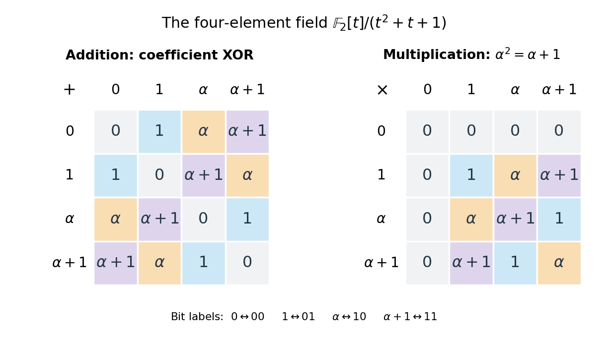
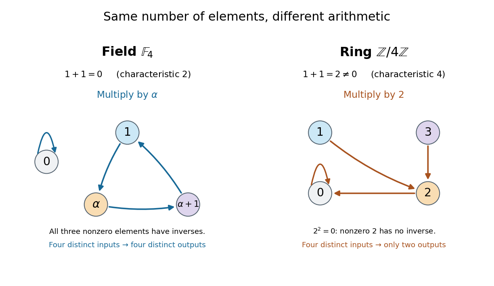

# Field with four elements

↑ **Parent:** [Finite field](finite-field.md)

Build this [finite field](finite-field.md) by taking a [quotient ring](quotient-ring.md) of a [polynomial ring](polynomial-ring.md):

$$
\mathbb F_4=\mathbb F_2[t]/(t^2+t+1),\qquad \alpha=[t].
$$

The [polynomial](polynomial-split.md) $f(t)=t^2+t+1$ has $f(0)=f(1)=1$ in the [prime field](prime-field.md) $\mathbb F_2$. A [polynomial](polynomial-split.md) of [polynomial degree](degree-of-a-polynomial.md) two is an [irreducible polynomial](irreducible-polynomial.md) exactly when it has no [polynomial root](root-of-a-polynomial.md) in the [coefficient](coefficient.md) [field](field.md). Thus the [quotient by an irreducible polynomial is a field](quotient-by-an-irreducible-polynomial-is-a-field.md) construction applies. Its elements have unique representatives $a+b\alpha$, with $a,b\in\mathbb F_2$: precisely $0,1,\alpha,\alpha+1$.

The defining relation is $\alpha^2+\alpha+1=0$. Since this [finite field](finite-field.md) has [characteristic two](characteristic-two.md), every element equals its [additive inverse](additive-inverse.md), and the relation becomes $\alpha^2=\alpha+1$. [Addition](addition.md) acts separately on the two [coefficients](coefficient.md):

$$
(a+b\alpha)+(c+d\alpha)=(a+c)+(b+d)\alpha.
$$

All [coefficient](coefficient.md) calculations use [modular arithmetic](modular-arithmetic-split.md) modulo two. For example, $(\alpha+1)+\alpha=1$ and $(\alpha+1)+(\alpha+1)=0$. Encoding $a+b\alpha$ as the pair of [bits](bit.md) $(b,a)$ gives $0\leftrightarrow00$, $1\leftrightarrow01$, $\alpha\leftrightarrow10$, and $\alpha+1\leftrightarrow11$; [addition](addition.md) is [bitwise exclusive or](exclusive-or.md). These are coordinates in the [basis](basis.md) $1,\alpha$, so the label $10$ does not make $\alpha$ the element $1+1$.

For [multiplication](multiplication.md), expand using the [distributive property](distributive-property.md) and replace every $\alpha^2$ by $\alpha+1$:

$$
(a+b\alpha)(c+d\alpha)=(ac+bd)+(ad+bc+bd)\alpha.
$$

For example, $\alpha(\alpha+1)=\alpha^2+\alpha=1$, while $(\alpha+1)^2=\alpha^2+1=\alpha$. The following complete tables are computed from the [coefficient](coefficient.md) rules. Colors identify results, rather than their numerical sizes. Every row of the [addition](addition.md) table lists all four elements, and every nonzero row of the [multiplication](multiplication.md) table does too: adding an element, or multiplying by a nonzero element, can be undone.

**[Figure 6](#image-computed-addition-and-multiplication-tables-for-the-field-with-four-elements). Computed addition and multiplication tables for the field with four elements**.

The nonzero [multiplicative inverses](multiplicative-inverse.md) are $1^{-1}=1$, $\alpha^{-1}=\alpha+1$, and $(\alpha+1)^{-1}=\alpha$. Consequently the [equation](equation.md) $\alpha x=\alpha+1$ has the unique solution $x=(\alpha+1)^2=\alpha$. Repeated [multiplication](multiplication.md) gives $\alpha^0=1$, $\alpha^1=\alpha$, $\alpha^2=\alpha+1$, and $\alpha^3=1$. They cycle through every element of the [multiplicative group of a finite field](multiplicative-group-of-a-finite-field.md).

Compare the [ring](ring.md) $\mathbb Z/4\mathbb Z$, also with four elements. Its [addition](addition.md) satisfies $1+1=2\ne0$, and its [multiplication](multiplication.md) satisfies $2^2=0$. Thus $2$ is a [zero divisor](zero-divisor.md), with no [multiplicative inverse](multiplicative-inverse.md), and this [ring](ring.md) is not a [field](field.md). Multiplying by $2$ collapses different inputs to the same output: both $0$ and $2$ give $0$, while both $1$ and $3$ give $2$. In the [field with four elements](field-with-four-elements.md), multiplying by $\alpha$ instead rotates the three nonzero elements, preserving their distinctness. The figure makes visible why counting four elements alone does not specify their [arithmetic](arithmetic-split.md).

**[Figure 7](#image-four-elements-with-different-arithmetic-a-field-and-integers-modulo-four). Four elements with different arithmetic: a field and integers modulo four**.

## ↑ Ancestors (5)

1. [Finite field](finite-field.md)
2. [Algebra](algebra-split.md)
3. [Area of mathematics](area-of-mathematics.md)
4. [Mathematics](mathematics-split.md)
5. [Codex Wiki](split.md)

## ← Incoming links (5)

- [Field with four elements](field-with-four-elements.md)
- [Finite field](finite-field.md)
- [Multiplicative group of a finite field](multiplicative-group-of-a-finite-field.md)
- [Solution](past-exam-of-the-mathematics-course-of-the-university-of-cambridge/2014/ib/paper-2/11e/solution.md)
- [Prime field](prime-field.md)
