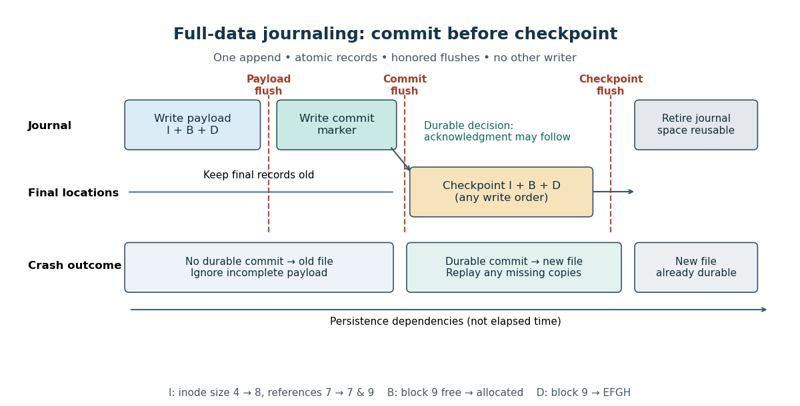

# File-system journaling

↑ **Parent:** [File system](file-system-split.md)

[File-system journaling](file-system-journaling.md) makes a group of related [file system](file-system-split.md) updates recoverable after a crash by recording them in a journal before changing their final storage locations. The useful promise is [file-system crash consistency](file-system-crash-consistency.md): after [journal replay](journal-replay.md), a protected [file-system transaction](file-system-transaction.md) has taken effect completely or has not taken effect. [File-system transaction durability](file-system-transaction-durability.md) adds a different promise: an acknowledged update survives the crash. The protected group can contain only [file metadata](file-metadata.md), or both [file metadata](file-metadata.md) and [file data blocks](file-data-block.md), depending on the [file-system journaling mode](file-system-journaling-mode.md).

Consider a tiny [file](computer-file.md) containing `ABCD` in four-[byte](byte.md) [file data block](file-data-block.md) 7. Its [inode](inode.md) records size 4 and a reference to block 7. Appending `EFGH` in previously free block 9 requires three new stored records: $I$, the [inode](inode.md) with size 8 and references to blocks 7 and 9; $B$, the [block allocation bitmap](block-allocation-bitmap.md) marking block 9 allocated; and $D$, [file data block](file-data-block.md) 9 containing `EFGH`. An [inode](inode.md) reference to a block still marked free lets a later allocation overwrite live contents; allocating a block without recording its owner can leak space. Even mutually consistent [file metadata](file-metadata.md) can expose stale contents if $D$ has not reached storage. Chapter 42 of [Crash Consistency: FSCK and Journaling](operating-systems-three-easy-pieces-by-remzi-h-arpaci-dusseau-and-others/crash-consistency-fsck-and-journaling.md) (section 42.1, pp. 2–4) develops this three-record append problem; the names, block numbers and tiny contents here are original teaching choices.

The first diagram protects all three records with [write-ahead logging](write-ahead-logging.md). Each [journal payload](journal-payload.md) record identifies a final destination and its complete new contents. A [storage flush](storage-flush.md) makes the complete [journal payload](journal-payload.md) durable before a separate [journal commit record](journal-commit-record.md) is written and made durable. Only then may a [journal checkpoint](journal-checkpoint.md) copy the records to their final locations. The journal remains available until those copies have themselves passed a [storage flush](storage-flush.md); it can then be retired and its space reused. [Journal replay](journal-replay.md) repairs an interrupted [journal checkpoint](journal-checkpoint.md) using the retained new contents.[3.6. Journal (jbd2) by The kernel development community](3-6-journal-jbd2-by-the-kernel-development-community.md)

**[Figure 5](#image-write-ahead-logging-separates-durable-journal-commit-records-from-journal-checkpoints-and-safe-journal-reuse). Write-ahead logging separates durable journal commit records from journal checkpoints and safe journal reuse**.

These are persistence dependencies, not a claim that issuing writes in this order is sufficient. A device can report completion while its volatile [memory cache](cache-computing.md) still holds the only copy. The [Linux kernel](linux-kernel.md) documents both flushing earlier completed requests and making completion of a particular request depend on persistence. The timeline uses separate [storage flushes](storage-flush.md) to make the dependencies explicit; an implementation can use equivalent device-supported operations. A commit write can persist before its [storage flush](storage-flush.md) returns: recovery uses the actual durable marker, while acknowledgment waits for successful completion.[Explicit volatile write back cache control by The kernel development community](explicit-volatile-write-back-cache-control-by-the-kernel-development-community.md)

The appeal is that recovery knows exactly which updates to finish. It does not have to infer a user's intended contents from contradictory [inodes](inode.md) and [block allocation bitmaps](block-allocation-bitmap.md). The cost includes writing the [journal payload](journal-payload.md) as well as its final copies and waiting for persistence boundaries. The journal records a recent transition, not a historical collection of recoverable [files](computer-file.md); [file-system journaling](file-system-journaling.md) is not a [file-system backup](file-system-backup.md).

**Table of contents**

- [File-system crash consistency](file-system-crash-consistency.md)
- [File-system transaction](file-system-transaction.md)
  - [File-system transaction durability](file-system-transaction-durability.md)
    - [fsync](fsync.md)
- [Write-ahead logging](write-ahead-logging.md)
  - [Journal payload](journal-payload.md)
  - [Journal commit record](journal-commit-record.md)
  - [Journal checkpoint](journal-checkpoint.md)
  - [Journal replay](journal-replay.md)
- [File-system journaling mode](file-system-journaling-mode.md)

## ↑ Ancestors (4)

1. [File system](file-system-split.md)
2. [Operating system](operating-system-split.md)
3. [Computer science](computer-science-split.md)
4. [Codex Wiki](split.md)

## ← Incoming links (5)

- [Buffer cache writeback](buffer-cache-writeback.md)
- [File-system journaling](file-system-journaling.md)
- [File-system transaction](file-system-transaction.md)
- [Solution](past-exam-of-the-mathematics-course-of-the-university-of-cambridge/2007/ia/paper-5/8/e/solution.md)
- [xv6 buffer cache](xv6-buffer-cache.md)
