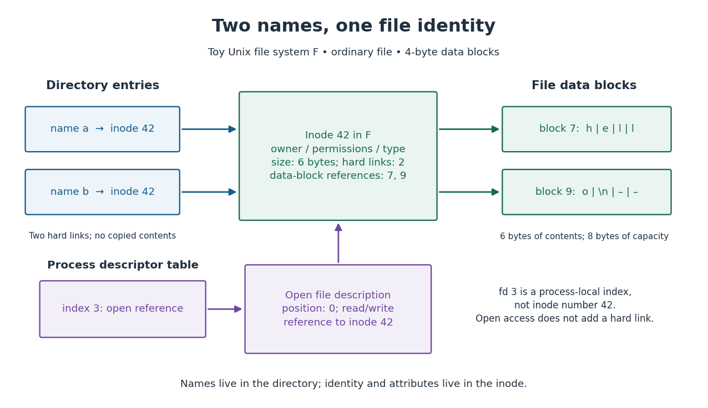

# File system

↑ **Parent:** [Operating system](operating-system-split.md)  
ⓦ [Wiki](https://en.wikipedia.org/wiki/File_system)

A [file system](file-system-split.md) organizes [files](computer-file.md), their [file metadata](file-metadata.md), and the names through which they can be found. In the [Unix](unix.md) model used here, a [file-system directory](file-system-directory.md) contains [directory entries](directory-entry.md) associating names with [inodes](inode.md); an [inode](inode.md) describes the underlying [file](computer-file.md) and how to locate its contents. The [file-system namespace](file-system-namespace.md) answers "what does this name reach?", while the [inode](inode.md) answers "which [file](computer-file.md) is it?". These are distinct responsibilities, even though they cooperate on every lookup.

For a computed toy example, let one [file-system directory](file-system-directory.md) contain names `a` and `b`, both referring to [inode](inode.md) 42 in the same [file system](file-system-split.md). That [inode](inode.md) has size 6 [bytes](byte.md) and two [hard links](hard-link.md). Its direct references lead to four-[byte](byte.md) [file data blocks](file-data-block.md) 7 and 9: block 7 holds `hell`, while block 9 holds `o` followed by a newline, with two unused slots. Reading either name therefore obtains the same six-[byte](byte.md) contents `hello` followed by a newline. There is one [file](computer-file.md) with two names, not two copies. This direct-reference layout and tiny block size are teaching choices, not requirements on every [file system](file-system-split.md).

**[Figure 1](#image-two-hard-links-reach-one-inode-a-file-descriptor-reaches-it-through-an-open-file-description). Two hard links reach one inode; a file descriptor reaches it through an open file description**.

The separation is useful because a rename within this [file system](file-system-split.md), from `a` to a previously unused name `c`, can change a [directory entry](directory-entry.md) without copying the six [bytes](byte.md) of contents. The remaining name `b` still reaches [inode](inode.md) 42. A successful write changing the first [byte](byte.md) through either name changes what both names subsequently read, to `jello` followed by a newline. This sharing is the attraction of [hard links](hard-link.md), and also why a [hard link](hard-link.md) is not an independent backup. A program that replaces a named [file](computer-file.md) with a different [file](computer-file.md) can instead make the names diverge. [The Open Group, POSIX.1-2024, rename: changing names and replacing directory entries](https://pubs.opengroup.org/onlinepubs/9799919799/functions/rename.html)

**Table of contents**

- [Computer file](computer-file.md)
  - [File offset](file-offset.md)
  - [File metadata](file-metadata.md)
  - [File data block](file-data-block.md)
- [File-system directory](file-system-directory.md)
  - [Directory entry](directory-entry.md)
- [File-system namespace](file-system-namespace.md)
  - [Hard link](hard-link.md)
    - [Unlinking an open file](unlinking-an-open-file.md)
  - [Symbolic link](symbolic-link.md)
- [Buffer cache](buffer-cache.md)
  - [Buffered device block](buffered-device-block.md)
    - [Buffer cache key](buffer-cache-key.md)
    - [Buffer cache validity](buffer-cache-validity.md)
    - [Dirty buffer](dirty-buffer.md)
    - [Clean buffer](clean-buffer.md)
    - [Pinned buffer](pinned-buffer.md)
  - [Buffer cache writeback](buffer-cache-writeback.md)
  - [Buffer cache eviction](buffer-cache-eviction.md)
  - [Buffer cache state model](buffer-cache-state-model.md)
    - [Buffer cache access trace](buffer-cache-access-trace.md)
  - [xv6 buffer cache](xv6-buffer-cache.md)
  - [Page cache](page-cache.md)
    - [Linux buffer head](linux-buffer-head.md)
    - [Linux folio](linux-folio.md)
    - [iomap](iomap.md)
- [File-system journaling](file-system-journaling.md)
  - [File-system crash consistency](file-system-crash-consistency.md)
  - [File-system transaction](file-system-transaction.md)
    - [File-system transaction durability](file-system-transaction-durability.md)
      - [fsync](fsync.md)
  - [Write-ahead logging](write-ahead-logging.md)
    - [Journal payload](journal-payload.md)
    - [Journal commit record](journal-commit-record.md)
    - [Journal checkpoint](journal-checkpoint.md)
    - [Journal replay](journal-replay.md)
  - [File-system journaling mode](file-system-journaling-mode.md)
- [File-system allocation bitmap](file-system-allocation-bitmap.md)
  - [Block allocation bitmap](block-allocation-bitmap.md)
  - [Inode allocation bitmap](inode-allocation-bitmap.md)
- [Storage flush](storage-flush.md)
- [Atomic storage write](atomic-storage-write.md)
- [ext4](ext4.md)
- [File-system backup](file-system-backup.md)
- [Access control list](access-control-list.md)
- [File Allocation Table](file-allocation-table.md)
  - [FAT32](fat32.md)
- [NTFS](ntfs.md)
- [Inode](inode.md)

## ↑ Ancestors (3)

1. [Operating system](operating-system-split.md)
2. [Computer science](computer-science-split.md)
3. [Codex Wiki](split.md)

## ← Incoming links (20)

- [Buffer cache](buffer-cache.md)
- [Data compression](data-compression-split.md)
- [Directory entry](directory-entry.md)
- [ext4](ext4.md)
- [File system](file-system-split.md)
- [File-system crash consistency](file-system-crash-consistency.md)
- [File-system directory](file-system-directory.md)
- [File-system journaling](file-system-journaling.md)
- [File-system transaction](file-system-transaction.md)
- [Hard link](hard-link.md)
- [Inode](inode.md)
- [Kernel (operating system)](kernel-operating-system.md)
- [Linux kernel](linux-kernel.md)
- [Memory-mapped file synchronization](memory-mapped-file-synchronization.md)
- [Microkernel](microkernel.md)
- [Microkernel file-read example](microkernel-file-read-example.md)
- [Operating system](operating-system-split.md)
- [Page cache](page-cache.md)
- [User-space service](user-space-service.md)
- [Write-ahead logging](write-ahead-logging.md)
