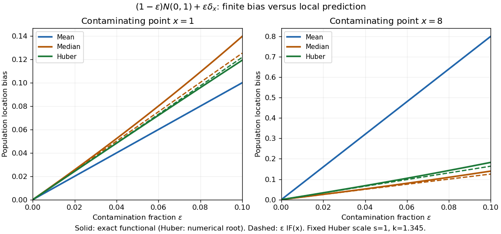

# Finite contamination bias of normal location

↑ **Parent:** [Influence function](influence-function.md)

Consider the population [statistical model](statistical-model-split.md) $F_{\varepsilon,x}=(1-\varepsilon)N(0,1)+\varepsilon\delta_x$. The following are deterministic [statistical functional](statistical-functional.md) calculations, not observed contamination experiments. Compare the actual location bias with the [linear approximation](linear-approximation.md) $\varepsilon\operatorname{IF}(x;T,F)$. The [mean](expected-value-split.md) bias is exactly $\varepsilon x$. For positive $x$ exceeding the shifted [median](median.md) and $0\le\varepsilon<1/2$, the generalized-inverse [median](median.md) bias is exactly

$$
b_{\operatorname{Med}}(\varepsilon,x)=\Phi^{-1}\!\left(\frac{1}{2(1-\varepsilon)}\right).
$$

This formula applies to both $x=1$ and $x=8$ throughout the plotted interval $0\le\varepsilon\le0.1$. If the contaminating atom lies inside the [quantile](quantile-function.md) jump containing probability $1/2$, the generalized-inverse [median](median.md) instead equals that atom.

For the [Huber location estimator](huber-location-estimator.md) with $s=1$ and $k=1.345$, solve its actual population equation, rather than substituting the [influence function](influence-function.md):

$$
(1-\varepsilon)g_k(t)+\varepsilon\psi_k(x-t)=0,\qquad g_k(t)=\mathbb E\psi_k(Z-t),\quad Z\sim N(0,1).
$$

Writing $a=t-k$ and $b=t+k$, integration of the [normal distribution](normal-distribution.md) gives

$$
g_k(t)=\phi(a)-\phi(b)-t\bigl[\Phi(b)-\Phi(a)\bigr]+k\bigl[1-\Phi(b)-\Phi(a)\bigr],
$$

where $\phi$ is the [probability density function](probability-density-function.md) of $N(0,1)$. Its [derivative](derivative.md) is $-[\Phi(t+k)-\Phi(t-k)]<0$, so the mixture score is strictly decreasing for $\varepsilon<1$. For $\varepsilon<1/2$, its limits at negative and positive infinity have opposite signs even with arbitrary distant point contamination. The displayed examples use the unique root, evaluated by the [bisection method](bisection-method.md) to numerical precision.

**[Figure 2](#image-exact-population-contamination-biases-and-first-order-influence-predictions-for-normal-location-at-contaminating-points-1-and-8). Exact population contamination biases and first-order influence predictions for normal location at contaminating points 1 and 8**.

At $x=8$ and $\varepsilon=0.01$, the exact [mean](expected-value-split.md), [median](median.md), and [Huber location estimator](huber-location-estimator.md) biases are $0.080000$, $0.012660$, and $0.016541$; the [influence function](influence-function.md) predictions are $0.080000$, $0.012533$, and $0.016375$. At $\varepsilon=0.05$, they become $0.400000$, $0.066012$, and $0.086241$, versus predictions $0.400000$, $0.062666$, and $0.081875$. The bounded alternatives control the effect of the distant atom, but their actual response curves bend away from the tangent.

The nearby atom $x=1$ gives a useful comparison: at $\varepsilon=0.05$, the [Huber location estimator](huber-location-estimator.md) bias is $0.060237$, slightly below its [linear approximation](linear-approximation.md) $0.060874$, whereas the [median](median.md) bias is still $0.066012$. The direction and size of approximation error depend on the contaminating location. Even accurate local influence calculations must specify $F$, the scale, the cutoff, and the actual contamination fraction.

## ↑ Ancestors (7)

1. [Influence function](influence-function.md)
2. [Robust statistics](robust-statistics-split.md)
3. [Statistical inference](statistical-inference-split.md)
4. [Probability and statistics](probability-and-statistics-split.md)
5. [Area of mathematics](area-of-mathematics.md)
6. [Mathematics](mathematics-split.md)
7. [Codex Wiki](split.md)

## ← Incoming links (1)

- [Influence function](influence-function.md)
