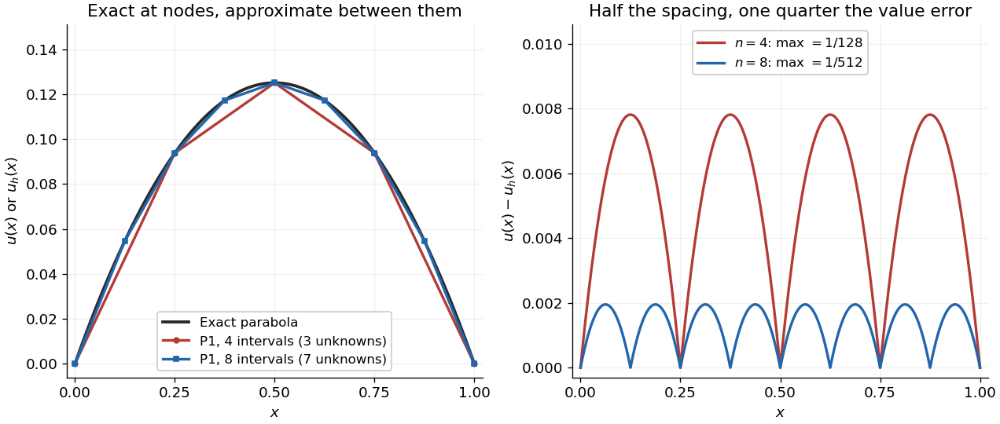

# Finite element solution of the one-dimensional Poisson equation

↑ **Parent:** [Finite element method](finite-element-method-split.md)

Consider the [Poisson equation](poisson-s-equation.md) on an [interval](interval-mathematics.md) with homogeneous [Dirichlet boundary conditions](dirichlet-boundary-condition.md):

$$
-u''(x)=1\quad(0<x<1),\qquad u(0)=u(1)=0.
$$

Two [integrations](integral-split.md) and the endpoint conditions give the exact solution $u(x)=x(1-x)/2$. To approximate it, multiply by a [test function](test-function.md) $v$ that vanishes at both endpoints. [Integration by parts](integration-by-parts.md) gives

$$
\int_0^1(-u'')v\,dx
=\bigl[-u'v\bigr]_0^1+\int_0^1u'v'\,dx
=\int_0^1v\,dx.
$$

The boundary term is zero. Thus the [weak formulation](weak-formulation.md) is to find $u\in V=H_0^1(0,1)$ such that

$$
a(u,v):=\int_0^1u'v'\,dx=\ell(v):=\int_0^1v\,dx\qquad(v\in V).
$$

The [zero-trace Sobolev space](zero-trace-sobolev-space.md) $H_0^1(0,1)$ consists of square-integrable functions with square-integrable [weak derivatives](weak-derivative.md) and zero endpoint values in their continuous representatives; it does not require a classical second derivative. This is why continuous [piecewise linear functions](piecewise-linear-function.md) are admissible despite corners. The [Poincaré inequality](poincare-inequality.md) makes $a$ a [coercive bilinear form](coercive-bilinear-form.md) on $V$. Strang derives this one-dimensional [weak formulation](weak-formulation.md), the [piecewise-linear hat functions](piecewise-linear-hat-function.md), and their load and derivative-product integrals in the cited lecture; its endpoint example uses a free left endpoint, while both endpoints here are fixed.[Strang, MIT 18.085, Lecture 18, transcript pp. 2–8: weak form, hat basis, and assembly](https://ocw.mit.edu/courses/18-085-computational-science-and-engineering-i-fall-2008/676ba0a00eef45a6cb3823c4da61ee11_18-085F08-L18.pdf)

Take the uniform [finite element mesh](finite-element-mesh.md) $x_j=jh$, $j=0,\ldots,n$, with $h=1/n$. The continuous $P_1$ trial space is

$$
V_h=\{v_h\in C([0,1]):v_h(0)=v_h(1)=0,\quad v_h|_{[x_j,x_{j+1}]}\text{ is affine for every }j\}.
$$

Here $P_1$ means [polynomials](polynomial-split.md) of degree at most one on each [interval](interval-mathematics.md). This is a [conforming finite element space](conforming-finite-element-space.md) in $V$, with $n-1$ interior [piecewise-linear hat functions](piecewise-linear-hat-function.md) $\phi_i$ as a [basis](basis.md). Their endpoint values enforce the [Dirichlet boundary conditions](dirichlet-boundary-condition.md) automatically. Set $u_h=\sum_{i=1}^{n-1}c_i\phi_i$ and test the [weak formulation](weak-formulation.md) against each $\phi_i$:

$$
K_{ij}=\int_0^1\phi_j'\phi_i'\,dx,\qquad
F_i=\int_0^1\phi_i\,dx=h,\qquad Kc=F.
$$

Each interior hat has two slopes $1/h$ and $-1/h$, each over a length $h$. Its squared derivative therefore integrates to $2/h$. Adjacent hats have opposite slopes on their one shared [interval](interval-mathematics.md), giving $-1/h$. All other derivative products vanish. The [stiffness matrix](stiffness-matrix.md) is the [tridiagonal matrix](tridiagonal-matrix.md)

$$
K_{ii}=\frac2h,\qquad K_{i,i+1}=K_{i+1,i}=-\frac1h,\qquad K_{ij}=0\quad(|i-j|>1).
$$

The load $F_i=h$ is the area of a triangle of base $2h$ and height one, including hats next to the boundary. Boundary hats are omitted because the boundary values are prescribed. The [piecewise-linear hat function](piecewise-linear-hat-function.md) article explains how the same entries arise by adding local two-node contributions.

With four [mesh](finite-element-mesh.md) intervals, $h=1/4$, there are three unknowns:

$$
K=\begin{pmatrix}8&-4&0\\-4&8&-4\\0&-4&8\end{pmatrix},\qquad
F=\begin{pmatrix}1/4\\1/4\\1/4\end{pmatrix},\qquad
c=\begin{pmatrix}3/32\\1/8\\3/32\end{pmatrix}.
$$

For example, the first row gives $8(3/32)-4(1/8)=1/4$ and the middle gives $-4(3/32)+8(1/8)-4(3/32)=1/4$. The [coefficients](coefficient.md) are the nodal values $u_h(x_i)=c_i$. At $x=3/8$, [linear interpolation](linear-interpolation.md) gives $u_h(3/8)=7/64=0.109375$, whereas $u(3/8)=15/128=0.1171875$: exactness at the nodes still leaves a visible error between them.

In this model the [Galerkin method](galerkin-method.md) solution equals the nodal approximation $I_hu$ obtained by [linear interpolation](linear-interpolation.md) on any [finite element mesh](finite-element-mesh.md). Indeed, on each [interval](interval-mathematics.md) $[a,b]$, $(I_hu)'$ is the average of $u'$ and $v_h'$ is constant. Therefore $\int_a^b(u'-(I_hu)')v_h'\,dx=0$. Summing proves [Galerkin orthogonality](galerkin-orthogonality.md) for $I_hu$, and uniqueness gives $u_h=I_hu$. This argument relies on the constant diffusion coefficient, conformity and exact integration; nodal exactness is not a general promise for [finite element methods](finite-element-method-split.md) with other operators or integration rules.

On a uniform [mesh](finite-element-mesh.md), direct subtraction of the chord from the [parabola](parabola.md) gives, on every element $[a,b]$ of length $h$,

$$
e(x):=u(x)-u_h(x)=\frac{(x-a)(b-x)}2,\qquad
e'(x)=\frac{a+b}2-x.
$$

The largest value error is at an element midpoint. Its size and the [energy norm](energy-norm.md) error are exactly

$$
\|e\|_{\infty}=\frac{h^2}{8},\qquad
\|e\|_a^2=\int_0^1|e'|^2\,dx
=n\int_{-h/2}^{h/2}t^2\,dt=\frac{h^2}{12},\qquad
\|e\|_a=\frac{h}{\sqrt{12}}.
$$

Thus $h=1/4$ gives $\|e\|_\infty=1/128=0.0078125$ and $\|e\|_a=1/(4\sqrt{12})\approx0.0721688$. With eight elements, $h=1/8$, these become $1/512=0.001953125$ and $1/(8\sqrt{12})\approx0.0360844$. Halving the [mesh](finite-element-mesh.md) spacing quarters the maximum value error but only halves the [energy norm](energy-norm.md) error: values and slopes converge at different rates. The figure shows the small value error at its own scale, where the four-to-one reduction becomes clear.

**[Figure 1](#image-exact-poisson-parabola-and-continuous-piecewise-linear-finite-element-solutions-on-four-and-eight-intervals-with-midpoint-errors-shown-separately). Exact Poisson parabola and continuous piecewise-linear finite element solutions on four and eight intervals, with midpoint errors shown separately**.

## ↑ Ancestors (6)

1. [Finite element method](finite-element-method-split.md)
2. [Numerical analysis](numerical-analysis-split.md)
3. [Analysis](analysis-split.md)
4. [Area of mathematics](area-of-mathematics.md)
5. [Mathematics](mathematics-split.md)
6. [Codex Wiki](split.md)

## ← Incoming links (4)

- [Finite element mesh](finite-element-mesh.md)
- [Finite element method](finite-element-method-split.md)
- [Galerkin orthogonality](galerkin-orthogonality.md)
- [Piecewise-linear hat function](piecewise-linear-hat-function.md)
