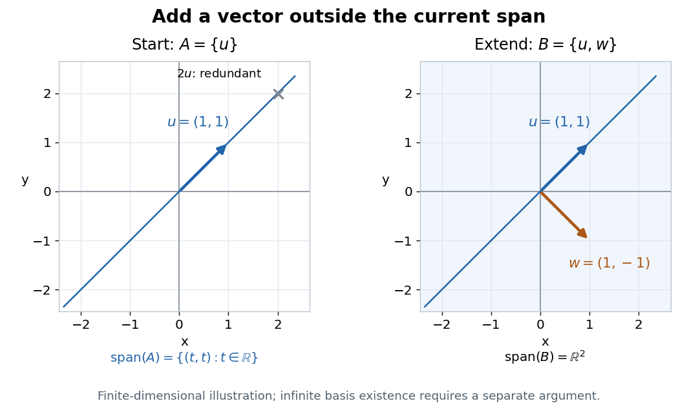

# Finite greedy basis extension and choice

↑ **Parent:** [Zorn's lemma](zorn-s-lemma.md)

For an explicit [basis extension](basis-extension.md) in $\mathbb R^2$, start with $A=\{u\}$, where $u=(1,1)$. Its [linear span](linear-span.md) is the line $y=x$. Adding $w=(1,-1)$ preserves [linear independence](linear-independence.md), because $w$ is outside that line, and gives a [basis](basis.md). Every [vector](vector.md) has the finite [linear combination](linear-combination.md)

$$
(x,y)=\frac{x+y}{2}u+\frac{x-y}{2}w.
$$

The [vector](vector.md) $2u=(2,2)$ cannot be added while preserving [linear independence](linear-independence.md): it is already in the [linear span](linear-span.md). Many choices outside the line work, so maximality does not select a unique [basis](basis.md).

**[Figure 4](#image-extending-one-independent-vector-to-a-basis-of-the-real-plane). Extending one independent vector to a basis of the real plane**. Left: u spans only the blue line, and 2u is redundant. Right: adding w outside that line yields a basis spanning the entire plane. This finite-dimensional illustration is not a proof of basis existence in arbitrary dimension.

For a [finite-dimensional vector space](finite-dimensional-vector-space.md) with a supplied finite [spanning set](spanning-set.md), a [greedy algorithm](greedy-algorithm.md) scans the list, retaining each [vector](vector.md) precisely when it is outside the [linear span](linear-span.md) of those already retained. Starting with a [linearly independent](linear-independence.md) $A$, the same scan adjoins only the needed [vectors](vector.md). Retained [vectors](vector.md) remain [linearly independent](linear-independence.md), and every skipped [vector](vector.md) is in the final [linear span](linear-span.md), so the result is a [basis](basis.md) containing $A$. Finite reasoning needs no [axiom of choice](axiom-of-choice.md).

For an arbitrary [vector space](vector-space-split.md), this finite stopping argument is unavailable. Accepting [Zorn's lemma](zorn-s-lemma.md) asserts existence of a [maximal element](maximal-element-of-a-partially-ordered-set.md) once every [chain in a partial order](chain-in-a-partial-order.md) has an [upper bound](upper-bound-in-a-partially-ordered-set.md); it supplies no general computational recipe. Over [ZF](zermelo-fraenkel-set-theory.md), [Zorn's lemma](zorn-s-lemma.md), the [axiom of choice](axiom-of-choice.md) and the [well-ordering theorem](well-ordering-theorem.md) are equivalent. Particular infinite [vector spaces](vector-space-split.md) can still have explicit [bases](basis.md), such as $1,x,x^2,\ldots$ for the [vector space of univariate polynomials](vector-space-of-univariate-polynomials.md) over a specified [field](field.md); infinity alone does not force a nonconstructive argument.[How to use Zorn’s lemma, “Further general remarks”, immediately after Example 1 continued: equivalence with choice and well-ordering](how-to-use-zorn%E2%80%99s-lemma-by-timothy-gowers.md)

## ↑ Ancestors (6)

1. [Zorn's lemma](zorn-s-lemma.md)
2. [Set theory](set-theory-split.md)
3. [Foundations of mathematics](foundations-of-mathematics-split.md)
4. [Area of mathematics](area-of-mathematics.md)
5. [Mathematics](mathematics-split.md)
6. [Codex Wiki](split.md)
