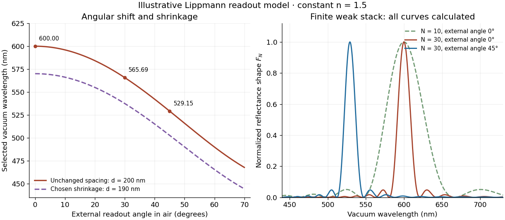

# Finite-layer model of Lippmann reflection

↑ **Parent:** [Lippmann plate](lippmann-plate.md)

To isolate the readout mechanism, replace the processed [photographic emulsion](photographic-emulsion.md) by $N$ equally spaced, identical weak scattering planes, with separation $d$. Take the readout [refractive index](refractive-index.md) $n$ to be real and independent of [wavelength](wavelength.md), and let $\theta$ be the internal [angle](angle.md) from the plane normal. Adjacent specularly backscattered contributions differ in [wave phase](phase-waves.md) by $2k_zd=4\pi nd\cos\theta/\lambda_0$. Their [geometric series](geometric-series.md) gives

$$
r_N=a\sum_{j=0}^{N-1}e^{ij\delta},\qquad
\delta=\frac{4\pi nd\cos\theta}{\lambda_0}-2\pi,\qquad
F_N=\frac{|r_N|^2}{N^2|a|^2}
=\left[\frac{\sin(N\delta/2)}{N\sin(\delta/2)}\right]^2.
$$

Here $a$ is a small plane reflection [wave amplitude](wave-amplitude.md), assumed constant in this illustrative band; $F_N=1$ at $\delta=0$ by continuity. Since incident and reflected waves occupy the same external medium, $|r_N|^2$ is the model [reflectance](reflectance.md) when transmission factors are absorbed into $a$. Require $N|a|\ll1$ for the weak-scattering sum to remain self-consistent. Normalizing to $F_N$ discards absolute brightness; it does not predict a highly reflecting historical plate.

The first-order peak obeys

$$
\lambda_B=2nd\cos\theta.
$$

This is [Bragg's law](bragg-s-law.md) with an [angle](angle.md) measured from the normal, rather than the glancing [Bragg angle](bragg-angle.md). For external viewing [angle](angle.md) $\alpha$ in air approximated by [refractive index](refractive-index.md) one, [Snell's law](snell-s-law.md) gives $n\sin\theta=\sin\alpha$, hence

$$
\lambda_B(\alpha)=2nd\sqrt{1-\frac{\sin^2\alpha}{n^2}}.
$$

The expression describes specular readout: illumination must supply the matching incident direction. Tilting a plate under fixed narrow illumination can make the signal disappear as well as change its selected colour.

For the chosen $n=1.5$ and $d=200\,\mathrm{nm}$, calculated peaks are $600\,\mathrm{nm}$ at $\alpha=0$, $565.69\,\mathrm{nm}$ at $30^\circ$, and $529.15\,\mathrm{nm}$ at $45^\circ$. Greater obliquity selects a shorter [wavelength](wavelength.md). Uniform shrinkage to $d'=sd$, with unchanged $n$, multiplies every peak [wavelength](wavelength.md) by $s$: a chosen $s=0.95$ moves the normal peak to $570\,\mathrm{nm}$. More generally, $\lambda'_B/\lambda_B=(n'/n)s$ at [normal incidence](normal-incidence.md). A change of thickness alone is insufficient if processing also changes the [refractive index](refractive-index.md).

Finite $N$ gives a finite spectral response. The nearest zeros satisfy $\delta=\pm2\pi/N$, giving $\lambda_\pm=\lambda_B/(1\pm1/N)$. At the normal $600\,\mathrm{nm}$ peak, $N=30$ gives neighbouring zeros at approximately $580.65$ and $620.69\,\mathrm{nm}$; $N=10$ gives $545.45$ and $666.67\,\mathrm{nm}$. Thus greater sampled depth narrows the central band in this model. The small-detuning distance from peak to a nearest zero is approximately $\lambda_B/N$; it is not the full width at half maximum.

**[Figure 22](#image-calculated-angular-colour-shift-and-finite-stack-reflectance-shape). Calculated angular colour shift and finite-stack reflectance shape**. [Source](lippmann-angular-colour-finite-stack.py). Original weak-scattering finite-grating model with chosen $n=1.5$ and $d=200\,\mathrm{nm}$. Left: predicted first-order peak versus external [angle](angle.md), with a separate illustrative 5 percent shrinkage calculation at unchanged [refractive index](refractive-index.md). Right: normalized $F_N$, comparing $N=10$ and $N=30$ at normal readout and $N=30$ at $45^\circ$ external readout. Every curve is calculated; none is a measured spectrum.

Real processed [photographic emulsions](photographic-emulsion.md) have a continuous, irregular depth response rather than identical planes. Absorption, wavelength-dependent [refractive index](refractive-index.md), unequal scattering strengths, a nonideal exposure reflector, changes during [photographic processing](photographic-processing.md) and multiple [scattering of light](scattering-of-light.md) can alter both peak positions and shapes. A transfer calculation with measured material parameters would be needed for quantitative [reflectance](reflectance.md). The present model explains the phase-selection mechanism and the tradeoff between depth and spectral width; it cannot establish faithful reproduction of an arbitrary incident [optical spectrum](optical-spectrum.md). Its useful lesson is that a photograph can record colour through sub-[wavelength](wavelength.md) structure, while its eventual appearance still depends on illumination, viewing geometry and processing.

## ↑ Ancestors (5)

1. [Lippmann plate](lippmann-plate.md)
2. [Optics](optics-split.md)
3. [Branches of physics](branches-of-physics.md)
4. [Physics](physics-split.md)
5. [Codex Wiki](split.md)
