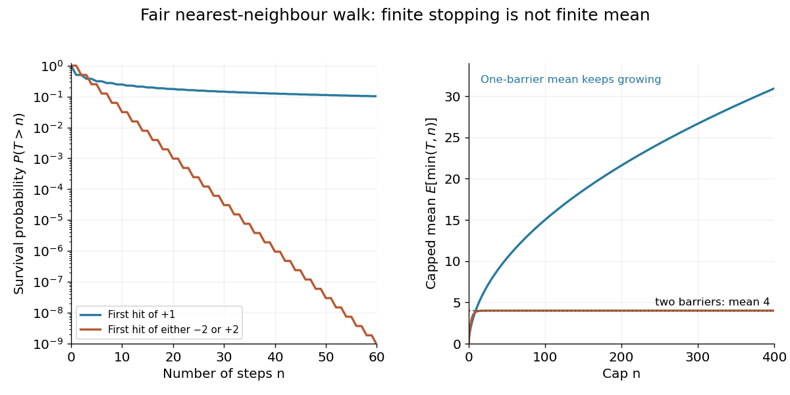

<h1 id="finite-mean-matters-in-wald-s-equation">Finite mean matters in Wald's equation</h1>

↑ **Parent:** [Wald's equation](wald-s-equation.md)

For a [simple symmetric random walk](simple-symmetric-random-walk.md) starting at zero, let $T_1$ be its first [hitting time](first-passage-time.md) of $1$. The [infinite mean first passage of a simple symmetric random walk](infinite-mean-first-passage-of-a-simple-symmetric-random-walk.md) shows that $T_1<\infty$ [almost surely](almost-sure-convergence.md) but $\mathbb E[T_1]=\infty$. Since $S_{T_1}=1$, assuming a finite [expected value](expected-value.md) for $T_1$ would let Wald's equation assert $1=0\mathbb E[T_1]=0$, a contradiction. The formal expression $0\cdot\infty$ is not an allowed use of the theorem.[§4.3, Problem 4.10 and its solution](lecture-notes-for-introduction-to-stochastic-processes-by-gordan-zitkovic/more-about-random-walks.md)

Compare $T_{\pm2}=\inf\{n\geq0:|S_n|=2\}$. From every surviving position in $\{-1,0,1\}$, three consecutive positive [increments](increment.md) force absorption within three steps. Each fresh block has [probability](probability.md) $1/8$ of this event, so $\mathbb P(T_{\pm2}>3k)\leq(7/8)^k$ and $\mathbb E[T_{\pm2}]\leq24$. This establishes finiteness before invoking the theorem. If $e_j$ is the average remaining time from position $j$, the [law of total expectation](law-of-total-expectation.md) gives

$$
e_{-2}=e_2=0,\qquad e_0=1+\frac{e_{-1}+e_1}{2},\qquad e_{-1}=e_1=1+\frac{e_0}{2},
$$

so **$\mathbb E[T_{\pm2}]=4$**. Symmetry gives equal exit [probabilities](probability.md) at $-2$ and $2$, and $\mathbb E[S_{T_{\pm2}}]=0$, as Wald's equation predicts. This is a small [gambler's ruin](gambler-s-ruin.md) problem with two absorbing barriers.

**[Figure 20](#image-almost-sure-stopping-can-have-either-a-finite-or-an-infinite-mean). Almost sure stopping can have either a finite or an infinite mean**. Original exact [simple symmetric random walk](simple-symmetric-random-walk.md) calculation from zero. The left compares survival [probabilities](probability.md) for first hitting $1$ and first hitting either $-2$ or $2$; the right sums these tails to obtain capped average waiting times $\mathbb E[\min(T,n)]$. These are calculated laws, not simulated measurements.

Even for $T_1$, each bounded [stopping time](stopping-time.md) $T_1\wedge n$ satisfies $\mathbb E[S_{T_1\wedge n}]=0$. The [stopped process](stopped-process.md) tends to $1$ [almost surely](almost-sure-convergence.md), but its [expected value](expected-value.md) does not tend to $1$. Rare long negative excursions retain the balancing contribution. The existing [stopped-walk martingale with almost sure but not L1 convergence](stopped-walk-martingale-with-almost-sure-but-not-l1-convergence.md) explains the related failure of [uniform integrability](uniform-integrability.md); almost sure convergence alone does not permit exchanging a [limit](limit-of-a-function.md) and an [expected value](expected-value.md).

## ↑ Ancestors (6)

1. [Wald's equation](wald-s-equation.md)
2. [Probability theory](probability-theory-split.md)
3. [Probability and statistics](probability-and-statistics-split.md)
4. [Area of mathematics](area-of-mathematics.md)
5. [Mathematics](mathematics-split.md)
6. [Codex Wiki](split.md)
