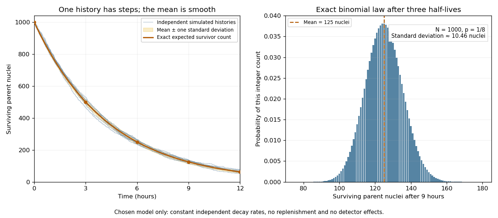

# Finite-population radioactive decay

↑ **Parent:** [Radioactive decay](radioactive-decay.md)

Take $N_0$ independently decaying [atomic nuclei](atomic-nucleus-split.md), each with lifetime $T_i$ drawn from an [exponential distribution](exponential-distribution.md) of rate $\lambda$. With no replenishment, the survivor count is

$$
N(t)=\sum_{i=1}^{N_0}\mathbf1_{\{T_i>t\}},\qquad
p(t)=e^{-\lambda t}.
$$

Each [indicator variable](indicator-variable.md) has success probability $p(t)$, so the [binomial distribution](binomial-distribution.md) gives

$$
\boxed{\mathbb E[N(t)]=N_0p(t),\qquad
\operatorname{Var}(N(t))=N_0p(t)(1-p(t)).}
$$

The smooth population law is the [expected value](expected-value-split.md) $\overline N(t)=\mathbb E[N(t)]$, satisfying $\overline N'=-\lambda\overline N$. One realization instead loses whole [atomic nuclei](atomic-nucleus-split.md) at discrete times. An observed count above the smooth curve need not contradict the [mathematical model](mathematical-model.md).

For an original chosen example, let $N_0=1000$ and [half-life](half-life.md) $3\,\mathrm h$. Then $\lambda=\log2/(3\,\mathrm h)$. After $9\,\mathrm h$, the survival probability is $1/8$, giving

$$
\boxed{\mathbb E[N(9\,\mathrm h)]=125,\qquad
\operatorname{SD}(N(9\,\mathrm h))=\sqrt{109.375}\simeq10.46.}
$$

The [standard deviation](standard-deviation.md) describes variation between repeated populations governed by these assumptions. It is not an uncertainty interval for a noiseless deterministic curve.

**[Figure 7](#image-random-survivor-counts-and-the-smooth-radioactive-decay-law). Random survivor counts and the smooth radioactive-decay law**. Original constant-rate model with $1000$ independent parent [atomic nuclei](atomic-nucleus-split.md) and a $3\,\mathrm h$ [half-life](half-life.md). Simulated histories are compared with their exact [expected value](expected-value-split.md) and a one-[standard deviation](standard-deviation.md) band. The second panel shows the exact [binomial distribution](binomial-distribution.md) after three half-lives. These are model calculations, not measurements from a historical sample.

The [half-life](half-life.md) and the mean lifetime answer different questions:

$$
t_{1/2}=\frac{\log2}{\lambda},\qquad
\mathbb E[T_i]=\frac1\lambda.
$$

The first is the [median](median.md) of one lifetime, or the time when half the population survives on average. The second is the lifetime's [expected value](expected-value-split.md). In this example they are $3\,\mathrm h$ and approximately $4.33\,\mathrm h$.

## ↑ Ancestors (4)

1. [Radioactive decay](radioactive-decay.md)
2. [Nuclear physics](nuclear-physics.md)
3. [Physics](physics-split.md)
4. [Codex Wiki](split.md)

## ← Incoming links (1)

- [Radioactive activity](radioactive-activity.md)
