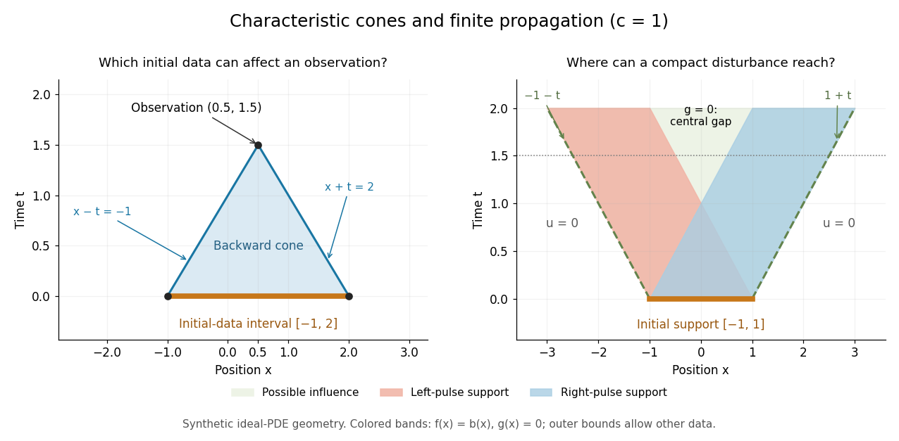

# Finite propagation speed

↑ **Parent:** [Wave equation](wave-equation-split.md)

For the unforced, constant-$c$ [one-dimensional wave equation](one-dimensional-wave-equation.md), [finite propagation speed](finite-propagation-speed.md) says that changing [Cauchy data](cauchy-data.md) outside $[x_*-ct_*,x_*+ct_*]$ cannot change the solution at $(x_*,t_*)$, where $c>0$ and $t_*\geq0$. This interval is the initial-data [domain of dependence](domain-of-dependence.md). Its endpoints are found by following the two [characteristic lines for the one-dimensional wave equation](characteristic-line-for-the-one-dimensional-wave-equation.md) backwards from the observation. [D'Alembert's formula](d-alembert-s-formula.md) makes the dependence sharper: initial [displacement](displacement.md) is sampled at the endpoints, while initial [velocity](velocity.md) is integrated over the entire interval.[5 Wave Equation in R](math-220a-partial-differential-equations-of-applied-mathematics/5-wave-equation-in-r.md)

**[Figure 1](#image-synthetic-constant-speed-spacetime-geometry-backward-dependence-and-widening-support). Synthetic constant-speed spacetime geometry: backward dependence and widening support**.

For the synthetic choice $c=1$, $(x_*,t_*)=(0.5,1.5)$ has initial-data [domain of dependence](domain-of-dependence.md) $[-1,2]$. A change confined near $x=3$ is irrelevant to that observation, however large it is. If both [Cauchy data](cauchy-data.md) vanish outside $[-a,a]$, their [compact support](compact-support.md) can influence only $[-a-ct,a+ct]$ at $t\geq0$. Thus an observer at $x>a$ sees exactly zero [displacement](displacement.md) for $0\leq t<(x-a)/c$. There is no nonzero precursor beyond this [causal cone for the constant-speed wave equation](causal-cone-for-the-constant-speed-wave-equation.md) in the ideal model. This is an exact statement about the [partial differential equation](partial-differential-equation-split.md), stronger than an experimental failure to detect a small [signal](signal.md).

[Support widening for the wave equation](support-widening-for-the-wave-equation.md) is a bound on possible influence, not a claim that every point inside the expanding interval moves. A [bump function](bump-function.md) released with zero initial [velocity](velocity.md) splits into two separated [travelling waves](travelling-wave.md); the middle can become empty. An initial kick can instead leave an interior tail, as in the [D'Alembert formula with initial velocity](d-alembert-formula-with-initial-velocity.md). Consequently [finite propagation speed](finite-propagation-speed.md) does not imply the [Strong Huygens principle](strong-huygens-principle.md). A finite string needs [boundary conditions](boundary-condition.md), and the whole-line formula applies locally only until its backward [causal cone for the constant-speed wave equation](causal-cone-for-the-constant-speed-wave-equation.md) encounters an endpoint.

**Table of contents**

- [Causal cone for the constant-speed wave equation](causal-cone-for-the-constant-speed-wave-equation.md)
- [Support widening for the wave equation](support-widening-for-the-wave-equation.md)
- [Weak Huygens principle](weak-huygens-principle.md)
- [Shrinking cone energy argument](shrinking-cone-energy-argument.md)
- [Characteristic diamond for speed one minus y squared](characteristic-diamond-for-speed-one-minus-y-squared.md)

## ↑ Ancestors (6)

1. [Wave equation](wave-equation-split.md)
2. [Partial differential equation](partial-differential-equation-split.md)
3. [Analysis](analysis-split.md)
4. [Area of mathematics](area-of-mathematics.md)
5. [Mathematics](mathematics-split.md)
6. [Codex Wiki](split.md)

## ← Incoming links (29)

- [Acoustic time-of-flight speed measurement](acoustic-time-of-flight-speed-measurement.md)
- [Characteristic diamond for speed one minus y squared](characteristic-diamond-for-speed-one-minus-y-squared.md)
- [D'Alembert formula with initial velocity](d-alembert-formula-with-initial-velocity.md)
- [D'Alembert's formula](d-alembert-s-formula.md)
- [Entire wave cosine multiplier](entire-wave-cosine-multiplier.md)
- [Exponential initial-velocity tail for the Klein-Gordon equation](exponential-initial-velocity-tail-for-the-klein-gordon-equation.md)
- [Finite propagation speed](finite-propagation-speed.md)
- [Infinite propagation speed](infinite-propagation-speed.md)
- [Local L1 contraction for scalar conservation laws](local-l1-contraction-for-scalar-conservation-laws.md)
- [Local wave energy estimate](local-wave-energy-estimate.md)
- [Localized ordinary differential equation blowup for a wave equation](localized-ordinary-differential-equation-blowup-for-a-wave-equation.md)
- [Solution](past-exam-of-the-mathematics-course-of-the-university-of-cambridge/2005/ii/paper-4/30c/solution.md)
- [Solution](past-exam-of-the-mathematics-course-of-the-university-of-cambridge/2006/ii/paper-4/30a/a/solution.md)
- [Solution](past-exam-of-the-mathematics-course-of-the-university-of-cambridge/2008/ii/paper-3/37b/solution.md)
- [Solution](past-exam-of-the-mathematics-course-of-the-university-of-cambridge/2011/ii/paper-1/39b/solution.md)
- [Solution](past-exam-of-the-mathematics-course-of-the-university-of-cambridge/2014/iii/paper-5/2/g/solution.md)
- [Solution](past-exam-of-the-mathematics-course-of-the-university-of-cambridge/2015/ii/paper-2/36b/solution.md)
- [Solution](past-exam-of-the-mathematics-course-of-the-university-of-cambridge/2015/ii/paper-4/29e/b/solution.md)
- [Solution](past-exam-of-the-mathematics-course-of-the-university-of-cambridge/2015/iii/paper-10/1/1/solution.md)
- [Solution](past-exam-of-the-mathematics-course-of-the-university-of-cambridge/2015/iii/paper-10/1/2/solution.md)
- [Solution](past-exam-of-the-mathematics-course-of-the-university-of-cambridge/2015/iii/paper-10/2/2/solution.md)
- [Solution](past-exam-of-the-mathematics-course-of-the-university-of-cambridge/2015/iii/paper-10/3/1/solution.md)
- [Solution](past-exam-of-the-mathematics-course-of-the-university-of-cambridge/2015/iii/paper-10/3/3/solution.md)
- [Solution](past-exam-of-the-mathematics-course-of-the-university-of-cambridge/2016/ib/paper-3/15b/c/solution.md)
- [Solution](past-exam-of-the-mathematics-course-of-the-university-of-cambridge/2018/iii/paper-105/4/b/ii/solution.md)
- [Solution](past-exam-of-the-mathematics-course-of-the-university-of-cambridge/2019/iii/paper-105/3/e/solution.md)
- [Solution](past-exam-of-the-mathematics-course-of-the-university-of-cambridge/2023/iii/paper-105/3/b/solution.md)
- [Ray asymptotics of a clamped elastic waveguide mode](ray-asymptotics-of-a-clamped-elastic-waveguide-mode.md)
- [Wave equation](wave-equation-split.md)
