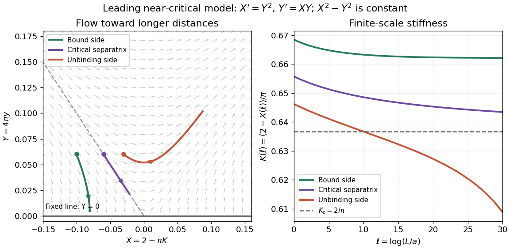

# Finite-scale vortex renormalization

↑ **Parent:** [Vortex-pair renormalization flow](vortex-pair-renormalization-flow.md)

An experiment of size $L$ stops the [renormalization-group flow](renormalization-group-flow.md) at a finite $\ell_{\max}$. In the leading scaled model take the original initial conditions $Y_0=0.06$ and $X_0=-0.10,-0.06,-0.03$. The invariant is respectively $0.0064,0,-0.0027$. The first approaches $X=-0.08$, hence $K=(2.08)/\pi$; the second follows the critical [separatrix](separatrix.md); the third eventually leaves the small-[vortex fugacity](vortex-fugacity.md) regime. These are chosen model trajectories, with no fitted experimental parameters.

On the critical [separatrix](separatrix.md), $X=-Y$ implies $Y'=-Y^2$, hence

$$
Y(\ell)=\frac{Y_0}{1+Y_0\ell},\qquad
K(\ell)=\frac2\pi+\frac{Y_0}{\pi(1+Y_0\ell)}.
$$

Even a critical finite sample therefore has a [phase stiffness](phase-stiffness.md) above its asymptotic jump value, with a slow logarithmic correction in $L$. Slightly above the transition, a sample with $L\ll\xi$ can resemble the algebraic phase before the flow reaches unbound [vortices](phase-vortex.md). A trap additionally varies the local density and [phase stiffness](phase-stiffness.md); neither its whole-cloud coherence nor a finite observation window automatically measures the homogeneous [thermodynamic limit](thermodynamic-limit.md).

**[Figure 1](#image-original-scaled-vortex-flow-and-finite-scale-stiffness). Original scaled vortex flow and finite-scale stiffness**. The arrows increase observation distance in the leading near-critical model $X'=Y^2$, $Y'=XY$. All three colored trajectories start at $Y_0=0.06$. The right panel uses $K=(2-X)/\pi$ along the same trajectories. The plot is a mathematical illustration, not historical data; the dilute model must be abandoned when the vortex fugacity grows large.

## ↑ Ancestors (8)

1. [Vortex-pair renormalization flow](vortex-pair-renormalization-flow.md)
2. [Berezinskii–Kosterlitz–Thouless transition](berezinskii-kosterlitz-thouless-transition.md)
3. [Lower critical dimension](lower-critical-dimension.md)
4. [Critical phenomenon](critical-phenomenon-split.md)
5. [Statistical physics](statistical-physics-split.md)
6. [Branches of physics](branches-of-physics.md)
7. [Physics](physics-split.md)
8. [Codex Wiki](split.md)

## ← Incoming links (1)

- [Berezinskii–Kosterlitz–Thouless transition](berezinskii-kosterlitz-thouless-transition.md)
