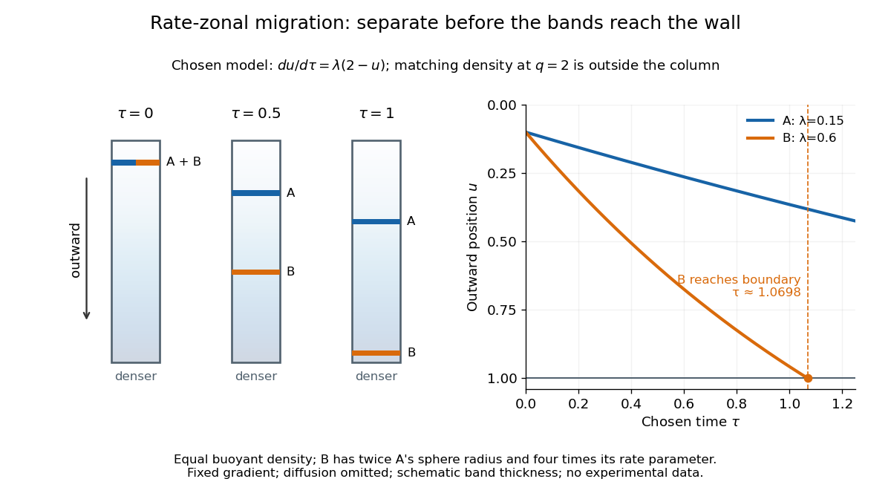

# Finite-time rate-zonal separation

↑ **Parent:** [Rate-zonal centrifugation](rate-zonal-centrifugation.md)

Consider two dilute populations of [spheres](sphere.md) with the same [buoyant density](buoyant-density.md) and radii $b$ and $2b$. Adopt the fixed linear [density gradient](density-gradient.md) and constant local [centrifugal acceleration](centrifugal-acceleration.md) of [linear-gradient isopycnic focusing](linear-gradient-isopycnic-focusing.md), with constant dynamic [viscosity](dynamic-viscosity-split.md) and negligible [diffusion](diffusion.md). [Stokes's law](stokes-s-law.md) makes $V/f$ proportional to $b^2$, so doubling radius multiplies the migration rate parameter by four, although the [mass](mass.md) increases eightfold.

Use $u=z/L$, $\tau=t/T$ and $q=(\rho_b-\rho_0)/(GL)=2$. The liquid occupies $0\leq u\leq1$, so the matching [density](density.md) position lies beyond its outer boundary. Both populations begin at $u(0)=0.1$; choose $\lambda_A=0.15$ and $\lambda_B=0.6$. Their band-center trajectories are

$$
u_A(\tau)=2-1.9e^{-0.15\tau},\qquad u_B(\tau)=2-1.9e^{-0.6\tau}.
$$

At $\tau=0.5$, they lie at approximately $0.2373$ and $0.5924$; at $\tau=1$, at $0.3647$ and $0.9573$. Equal [buoyant density](buoyant-density.md) has not prevented a useful finite-time separation. Solving $u_B(\tau)=1$ using the [natural logarithm](natural-logarithm.md) gives first boundary arrival at $\tau=\ln(1.9)/0.6\simeq1.0698$. The corresponding arrival for A is $\ln(1.9)/0.15\simeq4.2790$. Trajectories describe migration only until contact with the boundary; subsequent collection into a [centrifugation pellet](centrifugation-pellet.md) is not represented by extending the curve beyond $u=1$.

**[Figure 21](#image-rate-zonal-centrifugation-equal-buoyant-density-different-finite-time-migration). Rate-zonal centrifugation: equal buoyant density, different finite-time migration**. Original schematic tubes and trajectories for the stipulated [finite-time rate-zonal separation](finite-time-rate-zonal-separation.md) model. B represents [spheres](sphere.md) with twice A's radius. Both matching [density](density.md) positions lie outside the column. Tube shading shows an imposed increasing [density gradient](density-gradient.md); band thickness is schematic. The marked boundary-arrival time is calculated from this model, not an experimental run time or an operating instruction.

This is the useful contrast with [isopycnic centrifugation](isopycnic-centrifugation.md): stopping time helps determine the recovered positions in [rate-zonal centrifugation](rate-zonal-centrifugation.md), whereas a stationary matching [density](density.md) position sets the limiting band center in [isopycnic centrifugation](isopycnic-centrifugation.md). Real resolution also depends on initial zone width, [diffusion](diffusion.md) and variations in particle properties; distinct calculated centers alone do not prove that fractions will be pure.

## ↑ Ancestors (5)

1. [Rate-zonal centrifugation](rate-zonal-centrifugation.md)
2. [Density-gradient centrifugation](density-gradient-centrifugation.md)
3. [Centrifugation](centrifugation.md)
4. [Biology](biology-split.md)
5. [Codex Wiki](split.md)

## ← Incoming links (2)

- [Density-gradient centrifugation](density-gradient-centrifugation.md)
- [Finite-time rate-zonal separation](finite-time-rate-zonal-separation.md)
