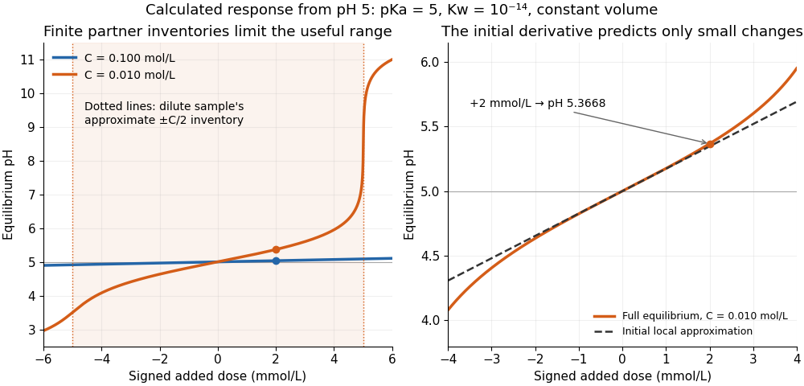

# Finite titrant response of a buffer

↑ **Parent:** [Buffer capacity](buffer-capacity.md)

Prepare the same ideal [monoprotic acid](monoprotic-acid.md) model at initial [pH](ph.md) $5$, with appropriate accompanying [ions](ion.md) to balance [electric charge](electric-charge.md). To predict the new [pH](ph.md) after a finite signed addition $\Delta b$, solve $Q(\mathrm{pH}_1)-Q(5)=\Delta b$ using the [chemical equilibrium](chemical-equilibrium.md) expression above. For $\Delta b=0.002\,\mathrm{mol\,L^{-1}}$ of added [chemical base](base-chemistry.md), the calculated final [pH](ph.md) is $5.366798$ at $C=0.010\,\mathrm{mol\,L^{-1}}$, but $5.034749$ at $C=0.100\,\mathrm{mol\,L^{-1}}$. The initial local approximation gives changes of about $0.34605$ and $0.034730$, respectively; its accuracy decreases as the partner balance changes appreciably.

**[Figure 75](#buffer-finite-titrant-ph-response). Equal finite additions produce different changes of pH in dilute and concentrated buffer solutions**. Calculated constant-[volume](volume-thermodynamics.md) [chemical equilibrium](chemical-equilibrium.md) responses, initially at [pH](ph.md) $5$, with stipulated [pKa](pka.md) $5$ and $K_w=10^{-14}$. Positive dose means added [chemical base](base-chemistry.md), negative dose added [strong acid](strong-acid.md). The left panel includes exhaustion of the dilute sample's useful pair inventory; the right panel compares its finite response with the initial local [derivative](derivative.md) approximation. Free [hydrogen ions](hydrogen-ion.md) and [hydroxide](hydroxide.md) are included throughout.

For the dilute example, additions beyond approximately $0.005\,\mathrm{mol\,L^{-1}}$ in either direction exceed the initial inventory of one partner. The full [chemical equilibrium](chemical-equilibrium.md) calculation still produces a finite [pH](ph.md); an inventory-only [Henderson-Hasselbalch equation](henderson-hasselbalch-equation.md) calculation would attempt to use a negative partner quantity. At $+0.006\,\mathrm{mol\,L^{-1}}$ the dilute example reaches [pH](ph.md) $10.99564$, whereas the concentrated example reaches only $5.104698$. This demonstrates a finite operating range, not an abrupt cessation of all [buffer capacity](buffer-capacity.md).

## ↑ Ancestors (5)

1. [Buffer capacity](buffer-capacity.md)
2. [Buffer solution](buffer-solution.md)
3. [Acid-base chemistry](acid-base-chemistry.md)
4. [Chemistry](chemistry-split.md)
5. [Codex Wiki](split.md)
