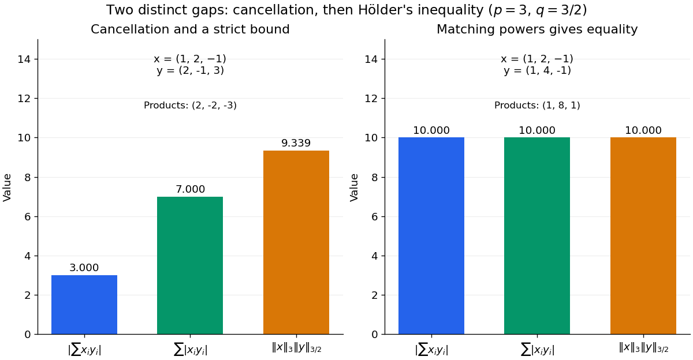

<h1 id="finite-vector-example-of-holder-s-inequality">Finite-vector example of Hölder's inequality</h1>

↑ **Parent:** [Hölder's inequality](holder-s-inequality.md)

Take $p=3$, $q=3/2$, and [vectors](vector.md) $x=(1,2,-1)$ and $y=(2,-1,3)$. Their coordinate products are $(2,-2,-3)$, so

$$
\left|\sum_i x_i y_i\right|=3,\qquad
\sum_i|x_i y_i|=7.
$$

Their [Lp norms](lp-norm.md) give the larger bound

$$
\lVert x\rVert_3\lVert y\rVert_{3/2}
=10^{1/3}(2\sqrt2+1+3\sqrt3)^{2/3}
\approx9.338662.
$$

Thus cancellation explains $3<7$, and [Hölder's inequality](holder-s-inequality.md) explains the remaining gap between $7$ and the norm product. Small signed [sums](sum.md) need not imply small individual coordinate products.

Now keep $x$ and choose $y=(1,4,-1)$. The coordinate products are $(1,8,1)$, with no cancellation, and

$$
\sum_i x_i y_i=10
=10^{1/3}10^{2/3}
=\lVert x\rVert_3\lVert y\rVert_{3/2}.
$$

The matching powers are $|x_i|^3=|y_i|^{3/2}$, namely $(1,8,1)$.

**[Figure 20](#image-cancellation-and-holder-s-inequality-account-for-two-different-gaps). Cancellation and Hölder's inequality account for two different gaps**. Two original finite-vector calculations with $p=3$, $q=3/2$. The first pair has signed [sum](sum.md) $-3$, absolute-product [sum](sum.md) $7$ and norm-product bound approximately $9.339$. The second pair attains equality at $10$. The diagrams show calculated values, with no simulated data.

## ↑ Ancestors (7)

1. [Hölder's inequality](holder-s-inequality.md)
2. [Lp norm](lp-norm.md)
3. [Real analysis](real-analysis-split.md)
4. [Analysis](analysis-split.md)
5. [Area of mathematics](area-of-mathematics.md)
6. [Mathematics](mathematics-split.md)
7. [Codex Wiki](split.md)
