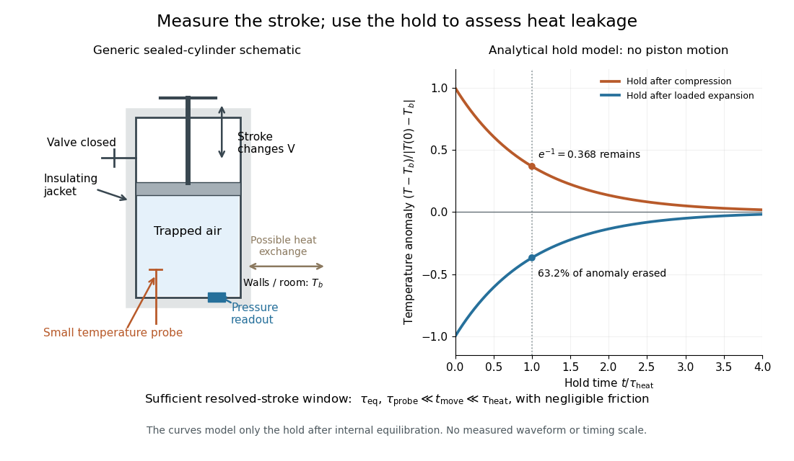

# First law of thermodynamics

↑ **Parent:** [Thermodynamics](thermodynamics.md)  
ⓦ [Wiki](https://en.wikipedia.org/wiki/First_law_of_thermodynamics)

The first law applies [conservation of energy](mathematical-physics.md#conservation-of-energy) to a thermodynamic system. For a [closed system](thermodynamics.md#closed-system) with unchanged bulk [kinetic energy](energy.md#kinetic-energy) and [potential energy](energy.md#potential-energy), write

$$
dU=\delta Q-\delta W,\qquad \Delta U=Q-W.
$$

Here $U$ is [internal energy](internal-energy.md), $Q>0$ is [heat](heat.md) entering the system and $W>0$ is [work](energy.md#work) done by the system on its surroundings. Compression therefore gives negative $W$. Some references define [work](energy.md#work) positive when done on the system; their plus sign represents the same balance with a different convention. If bulk [kinetic energy](energy.md#kinetic-energy) or [potential energy](energy.md#potential-energy) changes, include it in the total [energy](energy.md) balance. [MIT, First law and work sign convention](physics-bibliography.md#thermodynamics-and-propulsion)

Supplying $1000\,\mathrm J$ of [heat](heat.md) while a gas does $300\,\mathrm J$ of [work](energy.md#work) increases its [internal energy](internal-energy.md) by $700\,\mathrm J$. Compressing it with $200\,\mathrm J$ of input [work](energy.md#work) in an [adiabatic process](#adiabatic-process) instead gives $Q=0$, $W=-200\,\mathrm J$ and $\Delta U=200\,\mathrm J$.

The distinction between $d$ and $\delta$ records state versus path: [internal energy](internal-energy.md) is a [state function](thermodynamics.md#state-function), whereas [heat](heat.md) and [work](energy.md#work) depend on the process. For an [ideal gas](ideal-gas.md) expanding reversibly at constant [temperature](temperature.md), $W=Nk_BT\log(V_2/V_1)$ and $Q=W$, since [internal energy of an ideal gas](ideal-gas.md#internal-energy-of-an-ideal-gas) depends only on [temperature](temperature.md). Choose $Nk_BT=1000\,\mathrm J$ and $V_2=2V_1$: then $Q=W=693.15\,\mathrm J$. An insulated [free expansion](thermodynamics.md#free-expansion) into vacuum between the same equilibrium endpoints has $Q=W=0$. Both have $\Delta U=0$, yet their transfers differ. Their common [entropy](entropy.md) increase is $Nk_B\log2$. [MIT, Ideal-gas entropy differences](https://web.mit.edu/16.unified/www/FALL/thermodynamics/notes/node40.html)

For a simple compressible equilibrium system of fixed composition, combining the laws gives

$$
dU=T\,dS-p\,dV.
$$

Here $p$ is [pressure](pressure.md) and $V$ is [volume](geometry-and-topology.md#volume). This identity relates neighboring equilibrium states. Identifying $T\,dS$ with actual [heat](heat.md) and $p\,dV$ with actual [work](energy.md#work) requires a suitable [reversible thermodynamic process](second-law-of-thermodynamics.md#reversible-thermodynamic-process); an irreversible piston calculation uses the external resisting [pressure](pressure.md) for boundary [work](energy.md#work). This distinction prevents applying a [reversible ideal-gas adiabat](#reversible-ideal-gas-adiabat) to an [irreversible adiabatic piston compression](thermodynamics.md#irreversible-adiabatic-piston-compression).

**Table of contents**

- [Heat-flow reversal along a thermodynamic path](#heat-flow-reversal-along-a-thermodynamic-path)
- [Adiabatic process](#adiabatic-process)
  - [Adiabat](#adiabat)
  - [Adiabatic compression](#adiabatic-compression)
  - [Adiabatic expansion](#adiabatic-expansion)
  - [Isentropic process](#isentropic-process)
  - [Reversible ideal-gas adiabat](#reversible-ideal-gas-adiabat)

## Heat-flow reversal along a thermodynamic path

↑ **Parent:** [First law of thermodynamics](first-law-of-thermodynamics.md)

For a quasistatic simple compressible system with only pressure-volume [work](energy.md#work), the direction of [heat](heat.md) transfer is determined by $dU+p\,dV$. A reversal occurs where this vanishes and changes sign. It need not coincide with a maximum or minimum of [temperature](temperature.md), because the substance can still do [work](energy.md#work) when its internal [energy](energy.md) is stationary.

## Adiabatic process

↑ **Parent:** [First law of thermodynamics](first-law-of-thermodynamics.md)  
ⓦ [Wiki](https://en.wikipedia.org/wiki/Adiabatic_process)

An [adiabatic process](#adiabatic-process) has no [heat transfer](heat.md#heat-transfer) across the chosen boundary throughout the process: $\delta Q=0$, rather than merely zero net [heat](heat.md) after incoming and outgoing transfers cancel. It is a condition on [energy](energy.md) transfer, whereas an [isothermal process](second-law-of-thermodynamics.md#isothermal-process) holds [temperature](temperature.md) constant. A sealed cylinder can approach an [adiabatic process](#adiabatic-process) through insulation or through motion short compared with the time needed for appreciable [heat transfer](heat.md#heat-transfer). Its [temperature](temperature.md) can nevertheless change because [work](energy.md#work) crosses the boundary.[§§4.2–4.3: work, heat, and adiabatic legs of a cycle](physics-bibliography.md#statistical-physics-by-david-tong/4-classical-thermodynamics)

Take the trapped [gas](thermodynamics.md#gas) as a [closed system](thermodynamics.md#closed-system), with fixed [amount of substance](physics.md#amount-of-substance) and composition and no net change in bulk [kinetic energy](energy.md#kinetic-energy) or [potential energy](energy.md#potential-energy) between the endpoints. Define $Q_{\rm in}>0$ as [heat](heat.md) entering and $W_{\rm out}>0$ as [work](energy.md#work) delivered to the surroundings. The [first law of thermodynamics](first-law-of-thermodynamics.md) gives

$$
\Delta U=Q_{\rm in}-W_{\rm out},\qquad
Q_{\rm in}=0\ \Longrightarrow\ \Delta U=-W_{\rm out}.
$$

Here $U$ is [internal energy](internal-energy.md). An [adiabatic compression](#adiabatic-compression) normally supplies [work](energy.md#work), so $W_{\rm out}<0$; an [adiabatic expansion](#adiabatic-expansion) against a resisting load delivers [work](energy.md#work), so $W_{\rm out}>0$. An [adiabatic process](#adiabatic-process) need not preserve [internal energy](internal-energy.md) and need not make the [closed system](thermodynamics.md#closed-system) an [isolated system](thermodynamics.md#isolated-system). [MIT Unified Engineering, §2.5.2: heat inward and work outward in the first-law balance](physics-bibliography.md#thermodynamics-and-propulsion/2-5-control-volume-form-of-the-conservation-laws)

For a [reversible thermodynamic process](second-law-of-thermodynamics.md#reversible-thermodynamic-process), $dS=\delta Q_{\rm rev}/T$ at positive absolute [temperature](temperature.md) $T$. A reversible [adiabatic process](#adiabatic-process) therefore has $dS=0$: it is an [isentropic process](#isentropic-process). Irreversible [adiabatic processes](#adiabatic-process) can instead generate [entropy](entropy.md); [free expansion](thermodynamics.md#free-expansion) is the existing counterexample, with its calculation in [entropy change in free expansion](thermodynamics.md#entropy-change-in-free-expansion). Conversely, constant [entropy](entropy.md) alone does not certify an [adiabatic process](#adiabatic-process) or reversibility: outward [heat](heat.md) can export the [entropy](entropy.md) generated internally. For a [closed system](thermodynamics.md#closed-system) the macroscopic [entropy](entropy.md) balance is

$$
\Delta S=\int\frac{\delta Q_{\rm in}}{T_b}+S_{\rm gen},\qquad S_{\rm gen}\geq0,
$$

where $T_b$ is the absolute boundary [temperature](temperature.md) where each [heat](heat.md) transfer occurs and $S_{\rm gen}$ is internal [entropy production](stochastic-thermodynamics.md#entropy-production). With no [heat transfer](heat.md#heat-transfer), this reduces to $\Delta S=S_{\rm gen}$; reversibility makes $S_{\rm gen}=0$. [Ling, Moebs and Sanny, University Physics Volume 2, §4.6: reversible heat and irreversible entropy increase](https://openstax.org/books/university-physics-volume-2/pages/4-6-entropy)

A motivating experiment measures the [gas](thermodynamics.md#gas) [temperature](temperature.md) directly during compression and expansion, instead of inferring it from how warm a cylinder feels. PASCO's authored TD-8565 manual describes a sealed piston cylinder, a fine nickel-wire [thermometer](temperature.md#thermometer), an absolute [pressure](pressure.md) sensor and a position readout for [volume](thermodynamics.md#volume-thermodynamics). A computer records all three channels together. The wire's [electrical resistance](electric-charge.md#electrical-resistance) changes with [temperature](temperature.md); its small size permits a rapid response. [PASCO scientific, Adiabatic Gas Law Apparatus, guide 012-05110D, pp. 1–2: apparatus and readouts](https://cdn.pasco.com/product_document/Adiabatic-Gas-Law-Apparatus-TD-8565-Manual.pdf)

Use ordinary trapped air and the apparatus's designed travel stops; mount the base securely, close the valve during a stroke, and record the actual [volume](thermodynamics.md#volume-thermodynamics) limits. John Hart's university demonstration uses a large transparent cylinder with a low-[heat capacity](heat.md#heat-capacity) [thermocouple](thermoelectric-effect.md#thermocouple), a [pressure](pressure.md) sensor, a travel gauge and a safety stop. It explicitly keeps the release valve closed during the demonstration. The basic observable is a rise in [temperature](temperature.md) on compression and a fall on loaded expansion, alongside the corresponding [pressure](pressure.md) and [volume](thermodynamics.md#volume-thermodynamics) changes. Hart discusses wall [thermal conduction](heat.md#thermal-conduction), sensor response and leakage as reasons real records differ from the reversible model. [John Hart, University of Colorado (2000), Adiabatic Expansion and Gas Law Physics: sensor demonstration and limitations](https://atoc.colorado.edu/TeachingandLearning/Demonstrations/AdiabaticExpansion/Adiabatic_expansion.htm)

For a proposed rapid-versus-slow comparison, let the air and walls return to the same initial [thermal equilibrium](thermal-equilibrium.md) before each run, then compare the same starting and finishing [volume](thermodynamics.md#volume-thermodynamics) values with different stroke durations. Read [temperature](temperature.md), absolute [pressure](pressure.md) and position continuously, including the hold after motion stops. A rapid compression gives a temporary [temperature](temperature.md) rise; holding the smaller [volume](thermodynamics.md#volume-thermodynamics) lets [heat](heat.md) leave and the [temperature](temperature.md) approach the surroundings again. Slow compression in good thermal contact allows that [heat transfer](heat.md#heat-transfer) during the stroke and approaches an [isothermal compression](second-law-of-thermodynamics.md#isothermal-compression). Loaded expansion reverses the signs: the rapid stroke cools, while [heat](heat.md) entering during slow motion reduces the cooling. PASCO explicitly supports rapid nearly [adiabatic processes](#adiabatic-process) and slow [isothermal processes](second-law-of-thermodynamics.md#isothermal-process); the matched-run controls here are a proposed extension, not a reported set of measurements. [PASCO scientific, TD-8565 product documentation: simultaneous readouts and adiabatic/isothermal comparisons](https://www.pasco.com/products/lab-apparatus/thermodynamics/gas-laws/td-8565)

Insulation suppresses [thermal conduction](heat.md#thermal-conduction); it does not prove that [heat transfer](heat.md#heat-transfer) vanishes. As proposed controls, repeat the matched strokes with and without a removable insulating jacket, record room and wall [temperatures](temperature.md), measure fixed-position drift, and check valve closure and seal leakage. Calibrate the [thermometer](temperature.md#thermometer) and position readout independently, including any connected dead [volume](thermodynamics.md#volume-thermodynamics); account for the [heat capacity](heat.md#heat-capacity) of the probe rather than treating it as a passive observer. Hart explicitly identifies the small air sample relative to the probe and walls, sensor inertia and seal leakage as limitations. A fast display cannot eliminate those physical effects. [John Hart, Adiabatic Expansion and Gas Law Physics: wall, probe and seal limitations](https://atoc.colorado.edu/TeachingandLearning/Demonstrations/AdiabaticExpansion/Adiabatic_expansion.htm)

There are two distinct timing requirements. Let $\tau_{\rm eq}$ describe internal equilibration, $\tau_{\rm probe}$ the [thermometer](temperature.md#thermometer) response, $t_{\rm move}$ the stroke duration and $\tau_{\rm heat}$ the effective [heat transfer](heat.md#heat-transfer) [time constant](analysis.md#time-constant). A useful sufficient window for a resolved, nearly reversible [adiabatic process](#adiabatic-process) is

$$
\tau_{\rm eq},\tau_{\rm probe}\ll t_{\rm move}\ll\tau_{\rm heat},
$$

with negligible [friction](newtonian-mechanics.md#friction). The left inequality permits a [quasistatic process](thermodynamics.md#quasistatic-process) and a usable readout; the right limits [heat](heat.md) leakage. A violent stroke may satisfy only the right inequality. PASCO reports a roughly $30$–$50\,\mathrm{ms}$ lag of its [temperature](temperature.md) channel behind the other channels, so apparent simultaneous samples require care. If no such window exists, analyze equilibrium endpoints with the [first law of thermodynamics](first-law-of-thermodynamics.md), and regard the path as approximate. [PASCO scientific, guide 012-05110D, p. 4: temperature-sensor lag](https://cdn.pasco.com/product_document/Adiabatic-Gas-Law-Apparatus-TD-8565-Manual.pdf)

**[Figure 1](#image-direct-temperature-readout-and-a-heat-transfer-time-constant-in-an-adiabatic-process-experiment). Direct temperature readout and a heat transfer time constant in an adiabatic process experiment**. Original apparatus schematic and analytical fixed-[volume](thermodynamics.md#volume-thermodynamics) relaxation model, not measured records. After a stroke and internal equilibration, the stipulated [Newton's law of cooling](linear-ordinary-differential-equation.md#newton-s-law-of-cooling) model gives $[T(t)-T_b]/|T(0)-T_b|=\pm e^{-t/\tau_{\rm heat}}$. The positive and negative curves illustrate the holds after compression and loaded expansion. The drawing is a generic sensor arrangement, not a reproduction of a commercial device; it distinguishes the small probe from the walls and their possible [heat transfer](heat.md#heat-transfer).

The diagram's model is deliberately a hold after the stroke, when boundary [work](energy.md#work) is zero. For constant whole-sample [heat capacity at constant volume](heat.md#heat-capacity-at-constant-volume) $C_V$ and effective thermal conductance $K>0$, it assumes

$$
C_V\frac{dT}{dt}=-K(T-T_b),\qquad
\tau_{\rm heat}=\frac{C_V}{K},\qquad
T(t)-T_b=[T(0)-T_b]e^{-t/\tau_{\rm heat}}.
$$

This is [Newton's law of cooling](linear-ordinary-differential-equation.md#newton-s-law-of-cooling) with one uniform [gas](thermodynamics.md#gas) [temperature](temperature.md) and a fixed surrounding [temperature](temperature.md); actual wall and probe dynamics can require more than one [time constant](analysis.md#time-constant). At $t/\tau_{\rm heat}=0.1$, the fraction of the initial [temperature](temperature.md) anomaly erased is $1-e^{-0.1}\simeq0.0952$; at one [time constant](analysis.md#time-constant) it is about $0.6321$. These are analytical fractions, not experimental tolerances or evidence that the preceding stroke was reversible. Measuring the hold helps estimate [heat](heat.md) leakage independently of the motion.

The usefulness of an [adiabatic process](#adiabatic-process) is that it separates mechanical [work](energy.md#work) from [heat transfer](heat.md#heat-transfer). Its reversible limit connects [temperature](temperature.md) changes, mechanical stiffness and [entropy](entropy.md) in one model: [Rüchardt experiment](ideal-gas.md#ruchardt-experiment) and [Clément-Desormes experiment](ideal-gas.md#clement-desormes-experiment) already use that connection to measure [heat capacity ratio](ideal-gas.md#heat-capacity-ratio). The contrast with [free expansion](thermodynamics.md#free-expansion) explains the deeper point: suppressing [heat](heat.md) does not determine how much [work](energy.md#work) is exchanged or how much [entropy](entropy.md) is produced.

### Adiabat

↑ **Parent:** [Adiabatic process](#adiabatic-process)

An [adiabat](#adiabat) is a curve representing a quasistatic adiabatic change. In a reversible description it is also a curve of constant [entropy](entropy.md). For an [ideal gas](ideal-gas.md) with constant heat-capacity ratio $\gamma$, it obeys $pV^\gamma=\mathrm{constant}$. A general irreversible [adiabatic process](#adiabatic-process) need not follow this equilibrium-state curve and can produce [entropy](entropy.md).

### Adiabatic compression

↑ **Parent:** [Adiabatic process](#adiabatic-process)

[Adiabatic compression](#adiabatic-compression) decreases the [volume](thermodynamics.md#volume-thermodynamics) of a sample without [heat transfer](heat.md#heat-transfer) across its boundary. For the fixed-composition [ideal gas](ideal-gas.md) and endpoint assumptions in [adiabatic process](#adiabatic-process), compression [work](energy.md#work) increases [internal energy](internal-energy.md); positive [heat capacity at constant volume](heat.md#heat-capacity-at-constant-volume) then means a higher final [temperature](temperature.md). The effect comes from supplied [work](energy.md#work), even though no [heat](heat.md) enters. The amount of [temperature](temperature.md) increase depends on the [work](energy.md#work) actually delivered to the [gas](thermodynamics.md#gas), not on the [adiabatic process](#adiabatic-process) condition alone.

The [reversible ideal-gas adiabat](#reversible-ideal-gas-adiabat) supplies a particularly useful quantitative benchmark. Assume a fixed [amount of substance](physics.md#amount-of-substance) $n$, a [quasistatic process](thermodynamics.md#quasistatic-process), negligible [friction](newtonian-mechanics.md#friction), only [pressure](pressure.md)-[volume](thermodynamics.md#volume-thermodynamics) [work](energy.md#work), and constant [heat capacity ratio](ideal-gas.md#heat-capacity-ratio) $\gamma=C_p/C_V>1$. Here $C_p$ and $C_V$ are the whole sample's [heat capacity at constant pressure](enthalpy.md#heat-capacity-at-constant-pressure) and [heat capacity at constant volume](heat.md#heat-capacity-at-constant-volume). With $R$ the [molar gas constant](ideal-gas.md#molar-gas-constant), [Mayer's relation](ideal-gas.md#mayer-s-relation) gives $C_V=nR/(\gamma-1)$. The proof outline is $C_V\,dT=-p\,dV$ from the [first law of thermodynamics](first-law-of-thermodynamics.md), followed by $p=nRT/V$ from the [ideal gas law](ideal-gas.md#ideal-gas-law) and integration. The result is

$$
pV^\gamma=\text{constant},\qquad TV^{\gamma-1}=\text{constant}.
$$

These finite power laws belong to this reversible, constant-$\gamma$ [ideal gas](ideal-gas.md) model. If [heat capacity ratio](ideal-gas.md#heat-capacity-ratio) varies, use the integral relation in [heat capacity ratio](ideal-gas.md#heat-capacity-ratio); if the compression is irreversible, use the actual [work](energy.md#work) balance, as in [irreversible adiabatic piston compression](thermodynamics.md#irreversible-adiabatic-piston-compression). A short stroke by itself justifies neither power law. [Ling, Moebs and Sanny, University Physics Volume 2, §3.6: quasi-static ideal-gas adiabat](https://openstax.org/books/university-physics-volume-2/pages/3-6-adiabatic-processes-for-an-ideal-gas)

Writing $r=V_1/V_2>1$ for the compression ratio, the reversible model predicts

$$
\frac{T_2}{T_1}=r^{\gamma-1},\qquad
\frac{p_2}{p_1}=r^\gamma,\qquad
W_{\rm in}=-W_{\rm out}=C_V(T_2-T_1)
=\frac{p_1V_1}{\gamma-1}\left(r^{\gamma-1}-1\right).
$$

All [temperatures](temperature.md) in these ratios are absolute. The larger [pressure](pressure.md) rise than in an [isothermal compression](second-law-of-thermodynamics.md#isothermal-compression), where $p_2/p_1=r$, explains the greater local stiffness described by [isentropic compressibility](thermodynamics.md#isentropic-compressibility).

For an original stipulated example, set $\gamma=7/5$, $p_1V_1=nRT_1=1\,\mathrm{kJ}$ and $r=2$. Then $T_2/T_1=2^{0.4}\simeq1.31951$ and $p_2/p_1=2^{1.4}\simeq2.63902$. The input [work](energy.md#work) and [internal energy](internal-energy.md) increase are both $0.79877\,\mathrm{kJ}$, while $Q_{\rm in}=0$. No initial [temperature](temperature.md) or apparatus performance is implied by the chosen [energy](energy.md) scale. Independent integration gives the signed outward [work](energy.md#work)

$$
W_{\rm out}=\int_{V_1}^{V_2}p\,dV
=\frac{p_2V_2-p_1V_1}{1-\gamma},
$$

which is negative during compression and agrees with $-\Delta U$. This [integral](integral.md) uses equilibrium gas [pressure](pressure.md) only because the path is reversible.

**[Figure 2](#image-reversible-adiabatic-compression-and-adiabatic-expansion-temperature-changes-balance-signed-work). Reversible adiabatic compression and adiabatic expansion: temperature changes balance signed work**. Original analytical [ideal gas](ideal-gas.md) model with constant $\gamma=1.4$ and common initial state $p_1V_1=1\,\mathrm{kJ}$. The two runs go from $V_1$ separately to $V_1/2$ and $2V_1$; they are not a compression followed by its reversal. Shaded [pressure](pressure.md)-[volume](thermodynamics.md#volume-thermodynamics) areas give [work](energy.md#work) magnitudes, with signs supplied by the direction of motion. The dashed [isothermal process](second-law-of-thermodynamics.md#isothermal-process) lines are comparisons, not additional [adiabatic processes](#adiabatic-process). The right panel displays $\Delta U=-W_{\rm out}$ for each run. No curves are measured data.

In the sensor experiment of [adiabatic process](#adiabatic-process), compare the [pressure](pressure.md)-[volume](thermodynamics.md#volume-thermodynamics) [integral](integral.md) with $C_V\Delta T$ as an [energy](energy.md) check only when internal [pressure](pressure.md) is sufficiently uniform and piston dynamics permit that boundary-[work](energy.md#work) estimate. Account for [friction](newtonian-mechanics.md#friction) separately before comparing it with hand input [work](energy.md#work). PASCO's manual supplies a compression procedure and an illustrative logarithmic-slope result $1.39$, compared with the model value $1.40$ for a diatomic [gas](thermodynamics.md#gas); that is its sample result, not new measurements here. [PASCO scientific, guide 012-05110D, pp. 5–6: work comparison and sample fitted exponent](https://cdn.pasco.com/product_document/Adiabatic-Gas-Law-Apparatus-TD-8565-Manual.pdf)

### Adiabatic expansion

↑ **Parent:** [Adiabatic process](#adiabatic-process)

[Adiabatic expansion](#adiabatic-expansion) increases the accessible [volume](thermodynamics.md#volume-thermodynamics) without [heat transfer](heat.md#heat-transfer). In a loaded piston expansion of the fixed-composition [ideal gas](ideal-gas.md) considered in [adiabatic process](#adiabatic-process), positive outward [work](energy.md#work) comes from [internal energy](internal-energy.md), so the final [temperature](temperature.md) decreases. This provides a cooling mechanism without removing [heat](heat.md) during the stroke. In the [Carnot cycle](second-law-of-thermodynamics.md#carnot-cycle), reversible [adiabatic expansion](#adiabatic-expansion) connects two different [temperatures](temperature.md) between its [isothermal processes](second-law-of-thermodynamics.md#isothermal-process).[§4.3.1: adiabatic expansion between the isothermal legs](physics-bibliography.md#statistical-physics-by-david-tong/4-classical-thermodynamics)

For the same constant-$\gamma$ [reversible ideal-gas adiabat](#reversible-ideal-gas-adiabat), put $b=V_2/V_1>1$. The scaling and [first law of thermodynamics](first-law-of-thermodynamics.md) give

$$
\frac{T_2}{T_1}=b^{1-\gamma},\qquad
\frac{p_2}{p_1}=b^{-\gamma},\qquad
W_{\rm out}=C_V(T_1-T_2)
=\frac{p_1V_1}{\gamma-1}\left(1-b^{1-\gamma}\right)>0.
$$

With the figure's stipulated $\gamma=1.4$, $p_1V_1=1\,\mathrm{kJ}$ and $b=2$, the final ratios are $T_2/T_1\simeq0.75786$ and $p_2/p_1\simeq0.37893$. Outward [work](energy.md#work) is $0.60535\,\mathrm{kJ}$ and $\Delta U=-0.60535\,\mathrm{kJ}$. Reversing this particular path from its cooled endpoint would require the same [work](energy.md#work) input; the figure's separate compression starts at the original state, so its input is different. Endpoint [entropy](entropy.md) supplies another independent check:

$$
\Delta S=C_V\ln\frac{T_2}{T_1}+nR\ln\frac{V_2}{V_1}=0.
$$

The two [logarithm](calculus.md#logarithm) terms cancel using $C_V(\gamma-1)=nR$, confirming the reversible path is an [isentropic process](#isentropic-process). [MIT Unified Engineering, §5.4: ideal-gas endpoint entropy and constant-entropy scaling](https://web.mit.edu/16.unified/www/FALL/thermodynamics/notes/node40.html)

PASCO's expansion demonstration first compresses trapped air and waits for [thermal equilibrium](thermal-equilibrium.md) before the rapid expansion. Its manual warns that [friction](newtonian-mechanics.md#friction)-warmed cylinder regions contact the [gas](thermodynamics.md#gas) during expansion, compromising quantitative comparison. [PASCO scientific, guide 012-05110D, p. 3: expansion preparation and frictional wall-heating limitation](https://cdn.pasco.com/product_document/Adiabatic-Gas-Law-Apparatus-TD-8565-Manual.pdf) The hold separates cooling caused by expansion from simply undoing the earlier hot compression. As proposed controls, observe the [temperature](temperature.md) dip and subsequent warming, compare rapid and slow strokes from matched initial states, and assess wall [heat transfer](heat.md#heat-transfer) and probe lag before fitting a reversible model.

Cooling is not a universal consequence of [adiabatic expansion](#adiabatic-expansion): [free expansion](thermodynamics.md#free-expansion) of an [ideal gas](ideal-gas.md) has no outward [work](energy.md#work) and returns to the same equilibrium [temperature](temperature.md). Its [entropy](entropy.md) increases, so the reversible power laws do not describe it. Reuse [free expansion](thermodynamics.md#free-expansion), [Joule's free-expansion experiment](thermodynamics.md#joule-s-free-expansion-experiment) and [temperature sensitivity of a free-expansion experiment](thermodynamics.md#temperature-sensitivity-of-a-free-expansion-experiment) for that apparatus, its [energy](energy.md) budget and the real-gas qualifications. The useful distinction is the load: expansion cools this [ideal gas](ideal-gas.md) when it must spend [internal energy](internal-energy.md) doing [work](energy.md#work).

### Isentropic process

↑ **Parent:** [Adiabatic process](#adiabatic-process)  
ⓦ [Wiki](https://en.wikipedia.org/wiki/Isentropic_process)

An isentropic process keeps the [entropy](entropy.md) constant. Every reversible [adiabatic process](#adiabatic-process) is isentropic, while an irreversible adiabatic process can increase entropy.

### Reversible ideal-gas adiabat

↑ **Parent:** [Adiabatic process](#adiabatic-process)

For a fixed amount of ideal gas with constant heat capacities, the first law and $\delta Q=0$ give

$$
TV^{\gamma-1}=\text{constant},
\qquad
pV^\gamma=\text{constant},
$$

where $\gamma=C_p/C_V$.

## ↑ Ancestors (5)

1. [Thermodynamics](thermodynamics.md)
2. [Statistical physics](statistical-physics.md)
3. [Branches of physics](physics.md#branches-of-physics)
4. [Physics](physics.md)
5. [Codex Wiki](README.md)

## ← Incoming links (98)

- [Adiabatic compression](#adiabatic-compression)
- [Adiabatic expansion](#adiabatic-expansion)
- [Adiabatic process](#adiabatic-process)
- [Adiabatic work in a comoving volume](cosmology.md#adiabatic-work-in-a-comoving-volume)
- [Caloric theory](thermodynamics.md#caloric-theory)
- [Calorimetry](calorimetry.md)
- [Carnot's theorem](second-law-of-thermodynamics.md#carnot-s-theorem)
- [Clausius statement of the second law](second-law-of-thermodynamics.md#clausius-statement-of-the-second-law)
- [Cloud-chamber expansion model](particle-detection.md#cloud-chamber-expansion-model)
- [Constrained Gibbs minimization for chemical equilibrium](thermodynamic-potential.md#constrained-gibbs-minimization-for-chemical-equilibrium)
- [Enthalpy](enthalpy.md)
- [Entropy density at zero chemical potential](entropy.md#entropy-density-at-zero-chemical-potential)
- [Entropy density of a photon gas](statistical-physics.md#entropy-density-of-a-photon-gas)
- [Euler relation in thermodynamics](thermodynamics.md#euler-relation-in-thermodynamics)
- [Excluded-volume ideal gas](statistical-physics.md#excluded-volume-ideal-gas)
- [Finite heat bath](thermal-equilibrium.md#finite-heat-bath)
- [Finite-rate isothermal piston model](second-law-of-thermodynamics.md#finite-rate-isothermal-piston-model)
- [Free expansion](thermodynamics.md#free-expansion)
- [Gibbs free energy](thermodynamic-potential.md#gibbs-free-energy)
- [Gravitational energy generation in a homologously contracting ideal-gas star](stellar-astrophysics.md#gravitational-energy-generation-in-a-homologously-contracting-ideal-gas-star)
- [Gravothermal stellar energy generation](stellar-structure.md#gravothermal-stellar-energy-generation)
- [Heat](heat.md)
- [Heat capacity](heat.md#heat-capacity)
- [Heat capacity ratio](ideal-gas.md#heat-capacity-ratio)
- [Heat engine](thermodynamics.md#heat-engine)
- [Heat-pump calorimetry](thermodynamics.md#heat-pump-calorimetry)
- [Helmholtz free energy](thermodynamic-potential.md#helmholtz-free-energy)
- [Ideal gas law](ideal-gas.md#ideal-gas-law)
- [Intensive quantity](thermodynamics.md#intensive-quantity)
- [Internal energy](internal-energy.md)
- [Internal energy of a van der Waals gas](pressure.md#internal-energy-of-a-van-der-waals-gas)
- [Internal energy of an ideal gas](ideal-gas.md#internal-energy-of-an-ideal-gas)
- [Isothermal process](second-law-of-thermodynamics.md#isothermal-process)
- [Joule heating](electric-charge.md#joule-heating)
- [Latent heat of fusion](statistical-physics.md#latent-heat-of-fusion)
- [Laws of thermodynamics](thermodynamics.md#laws-of-thermodynamics)
- [Low-temperature heat capacity measurement](heat.md#low-temperature-heat-capacity-measurement)
- [Net radiative heat exchange](heat.md#net-radiative-heat-exchange)
- [Paddle-wheel calorimetry energy balance](internal-energy.md#paddle-wheel-calorimetry-energy-balance)
- [Solution](past-exam-of-the-astrophysical-fluid-dynamics-course-of-the-university-of-cambridge/2018.md#section-a/a1/a/solution)
- [Solution](past-exam-of-the-astrophysical-fluid-dynamics-course-of-the-university-of-cambridge/2019.md#section-b/5/solution)
- [Solution](past-exam-of-the-atmospheric-physics-course-of-the-university-of-cambridge/2012/paper-1.md#1/b/solution)
- [Solution](past-exam-of-the-chemistry-course-of-the-year-4-of-the-natural-sciences-course-of-the-university-of-cambridge/2022/paper-id.md#2/a/solution)
- [Solution](past-exam-of-the-mathematics-course-of-the-university-of-cambridge/2004/iii/paper-57.md#1/solution)
- [Solution](past-exam-of-the-mathematics-course-of-the-university-of-cambridge/2006/iii/paper-71.md#1/solution)
- [Solution](past-exam-of-the-mathematics-course-of-the-university-of-cambridge/2006/iii/paper-76.md#2/solution)
- [Solution](past-exam-of-the-mathematics-course-of-the-university-of-cambridge/2008/ii/paper-3.md#10e/solution)
- [Solution](past-exam-of-the-mathematics-course-of-the-university-of-cambridge/2008/iii/paper-65.md#7/solution)
- [Solution](past-exam-of-the-mathematics-course-of-the-university-of-cambridge/2008/iii/paper-69.md#2/a/solution)
- [Solution](past-exam-of-the-mathematics-course-of-the-university-of-cambridge/2014/iii/paper-49.md#1/i/solution)
- [Solution](past-exam-of-the-mathematics-course-of-the-university-of-cambridge/2015/ii/paper-3.md#33c/a/i/solution)
- [Solution](past-exam-of-the-mathematics-course-of-the-university-of-cambridge/2015/ii/paper-3.md#33c/b/i/solution)
- [Solution](past-exam-of-the-mathematics-course-of-the-university-of-cambridge/2015/iii/paper-58.md#3/b/solution)
- [Solution](past-exam-of-the-mathematics-course-of-the-university-of-cambridge/2016/iii/paper-310.md#3/a/solution)
- [Solution](past-exam-of-the-mathematics-course-of-the-university-of-cambridge/2016/iii/paper-315.md#1/c/solution)
- [Solution](past-exam-of-the-mathematics-course-of-the-university-of-cambridge/2016/iii/paper-317.md#3/solution)
- [Solution](past-exam-of-the-mathematics-course-of-the-university-of-cambridge/2016/iii/paper-317.md#4/solution)
- [Solution](past-exam-of-the-mathematics-course-of-the-university-of-cambridge/2017/ii/paper-3.md#34d/b/ii/solution)
- [Solution](past-exam-of-the-mathematics-course-of-the-university-of-cambridge/2017/iii/paper-310.md#3/a/solution)
- [Solution](past-exam-of-the-mathematics-course-of-the-university-of-cambridge/2017/iii/paper-314.md#1/a/solution)
- [Solution](past-exam-of-the-mathematics-course-of-the-university-of-cambridge/2017/iii/paper-315.md#2/b/i/solution)
- [Solution](past-exam-of-the-mathematics-course-of-the-university-of-cambridge/2018/ii/paper-1.md#35a/a/solution)
- [Solution](past-exam-of-the-mathematics-course-of-the-university-of-cambridge/2018/ii/paper-1.md#35a/b/ii/solution)
- [Solution](past-exam-of-the-mathematics-course-of-the-university-of-cambridge/2018/iii/paper-310.md#3/a/solution)
- [Solution](past-exam-of-the-mathematics-course-of-the-university-of-cambridge/2019/iii/paper-311.md#4/b/solution)
- [Solution](past-exam-of-the-mathematics-course-of-the-university-of-cambridge/2019/iii/paper-314.md#1/a/solution)
- [Solution](past-exam-of-the-mathematics-course-of-the-university-of-cambridge/2019/iii/paper-314.md#2/c/solution)
- [Solution](past-exam-of-the-mathematics-course-of-the-university-of-cambridge/2020/ii/paper-2.md#36a/solution)
- [Solution](past-exam-of-the-mathematics-course-of-the-university-of-cambridge/2020/ii/paper-3.md#35a/iii/solution)
- [Solution](past-exam-of-the-mathematics-course-of-the-university-of-cambridge/2021/ii/paper-1.md#36c/b/solution)
- [Solution](past-exam-of-the-mathematics-course-of-the-university-of-cambridge/2022/iii/paper-344.md#3/e/solution)
- [Solution](past-exam-of-the-mathematics-course-of-the-university-of-cambridge/2023/ii/paper-4.md#35a/c/solution)
- [Solution](past-exam-of-the-mathematics-course-of-the-university-of-cambridge/2023/iii/paper-309.md#4/a/solution)
- [Solution](past-exam-of-the-mathematics-course-of-the-university-of-cambridge/2023/iii/paper-317.md#4/ii/solution)
- [Solution](past-exam-of-the-mathematics-course-of-the-year-1-of-the-natural-sciences-course-of-the-university-of-cambridge/2013/paper-2.md#17/a/solution)
- [Solution](past-exam-of-the-mathematics-course-of-the-year-1-of-the-natural-sciences-course-of-the-university-of-cambridge/2013/paper-2.md#17/b/solution)
- [Solution](past-exam-of-the-particle-astrophysics-course-of-the-university-of-cambridge/2014/paper-1.md#1/solution)
- [Solution](past-exam-of-the-particle-astrophysics-course-of-the-university-of-cambridge/2015/paper-1.md#1/solution)
- [Solution](past-exam-of-the-physics-b-course-of-the-university-of-cambridge/2010/paper-1.md#section-c/c13/solution)
- [Solution](past-exam-of-the-physics-b-course-of-the-university-of-cambridge/2010/paper-2a.md#section-a/1/solution)
- [Solution](past-exam-of-the-physics-b-course-of-the-university-of-cambridge/2016/paper-2.md#section-a/a5/solution)
- [Solution](past-exam-of-the-physics-b-course-of-the-university-of-cambridge/2022/paper-2.md#section-c/c8/b/solution)
- [Solution](past-exam-of-the-physics-b-course-of-the-university-of-cambridge/2022/paper-2.md#section-c/c8/e/solution)
- [Solution](past-exam-of-the-thermal-and-statistical-physics-course-of-the-university-of-cambridge/2019.md#section-b/5/solution)
- [Quasistatic process](thermodynamics.md#quasistatic-process)
- [Refrigerator](thermodynamics.md#refrigerator)
- [Specific enthalpy](enthalpy.md#specific-enthalpy)
- [State function](thermodynamics.md#state-function)
- [Steady-flow energy balance](enthalpy.md#steady-flow-energy-balance)
- [Temperature sensitivity of a free-expansion experiment](thermodynamics.md#temperature-sensitivity-of-a-free-expansion-experiment)
- [Thermal boundary resistance](temperature.md#thermal-boundary-resistance)
- [Thermal equilibration of two finite bodies](thermal-equilibrium.md#thermal-equilibration-of-two-finite-bodies)
- [Thermodynamic equilibrium](thermodynamics.md#thermodynamic-equilibrium)
- [Thermodynamic potential as a Lagrangian graph](symplectic-geometry.md#thermodynamic-potential-as-a-lagrangian-graph)
- [Thermodynamics](thermodynamics.md)
- [Thermometer](temperature.md#thermometer)
- [Two reversible ideal-gas paths between the same states](thermodynamics.md#two-reversible-ideal-gas-paths-between-the-same-states)
- [Zeroth law of thermodynamics](thermodynamics.md#zeroth-law-of-thermodynamics)
