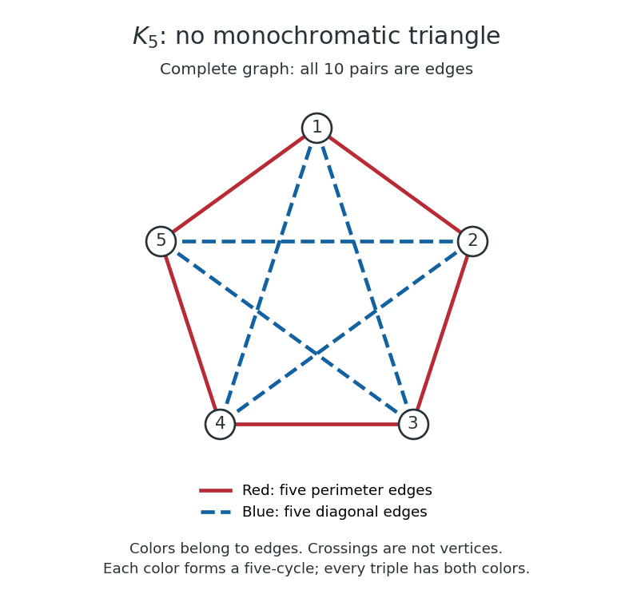

# Five-cycle Ramsey coloring

↑ **Parent:** [Ramsey number for triangles](ramsey-number-for-triangles.md)

Place five labeled [vertices](vertex-graph-theory.md) around a pentagon. In the [complete graph](complete-graph.md) $K_5$, color the five perimeter [edges](edge-of-a-graph.md) red and the five diagonals blue. Writing $ij$ for the [unordered pair](unordered-pair.md) $\{i,j\}$, the red pairs are $12,23,34,45,15$, and the blue pairs are $13,14,24,25,35$. This assigns a color to every pair, including every diagonal.

The red [subgraph](subgraph.md) is the [cycle graph](cycle-graph.md) $1,2,3,4,5,1$; the blue [subgraph](subgraph.md) is the [cycle graph](cycle-graph.md) $1,3,5,2,4,1$. Neither contains a [triangle in a graph](triangle-in-a-graph.md). Consequently, none of the ten triples has all three [edges](edge-of-a-graph.md) red or all three blue, proving the lower bound for the [Ramsey number for triangles](ramsey-number-for-triangles.md). Crossings in the drawing are not additional [vertices](vertex-graph-theory.md).

**[Figure 1](#image-all-ten-edges-of-a-complete-graph-on-five-vertices-red-perimeter-and-blue-diagonals-avoid-monochromatic-triangles). All ten edges of a complete graph on five vertices: red perimeter and blue diagonals avoid monochromatic triangles**.

## ↑ Ancestors (9)

1. [Ramsey number for triangles](ramsey-number-for-triangles.md)
2. [Ramsey number](ramsey-number.md)
3. [Finite Ramsey theorem](finite-ramsey-theorem.md)
4. [Ramsey's theorem](ramsey-s-theorem.md)
5. [Ramsey theory](ramsey-theory-split.md)
6. [Combinatorics](combinatorics-split.md)
7. [Area of mathematics](area-of-mathematics.md)
8. [Mathematics](mathematics-split.md)
9. [Codex Wiki](split.md)

## ← Incoming links (1)

- [Ramsey number for triangles](ramsey-number-for-triangles.md)
