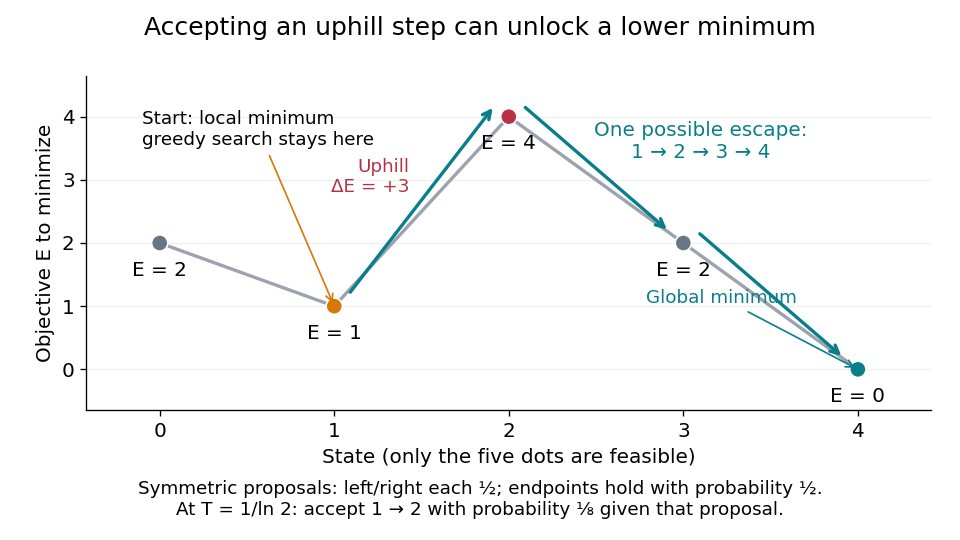

# Five-state barrier example for simulated annealing

↑ **Parent:** [Simulated annealing](simulated-annealing.md)

Consider the chosen finite [minimization problem](minimization-problem.md)

$$
F=\{0,1,2,3,4\},\qquad (E(0),E(1),E(2),E(3),E(4))=(2,1,4,2,0).
$$

Only adjacent [integers](integer-split.md) are neighbors. At each interior state propose left or right with [probability](probability.md) $1/2$ each; at an endpoint propose its sole neighbor with [probability](probability.md) $1/2$ and itself with [probability](probability.md) $1/2$. This [proposal distribution](proposal-distribution.md) is symmetric, including at the endpoints. The [local minimum](local-minimum.md) at $1$ is relative to these allowed moves; $4$ is the unique [global minimum](global-minimum.md).

**[Figure 4](#image-an-uphill-step-opens-a-route-out-of-a-local-minimum-in-a-chosen-five-state-problem). An uphill step opens a route out of a local minimum in a chosen five-state problem**. Points are the only allowed states; joining lines show adjacency, not additional [feasible points](feasible-point.md). Starting at $1$, improving-only [local search](local-search.md) is trapped. The possible route $1\to2\to3\to4$ first raises the [objective function](objective-function.md) by $3$, then lowers it twice.

At $1$, improving-only [local search](local-search.md) rejects both neighbors because $E(0)=2$ and $E(2)=4$ exceed $E(1)=1$. For [simulated annealing](simulated-annealing.md), choose $T_*=1/\ln2$, using the [natural logarithm](natural-logarithm.md). Conditional on proposing $2$ from $1$, the acceptance [probability](probability.md) is

$$
a_{T_*}(1,2)=e^{-3/T_*}=\frac18.
$$

The one-step [transition probability](transition-probability.md) is instead $P_{T_*}(1,2)=(1/2)(1/8)=1/16$. Both subsequent rightward proposals are downhill, so the [conditional probability](conditional-probability.md) of the precise next three states being $2,3,4$, given $X_0=1$ and fixed $T_*$, is

$$
\Pr(X_1=2,X_2=3,X_3=4\mid X_0=1)
=\frac1{16}\frac12\frac12=\frac1{64}.
$$

This is one possible escape route, not the [probability](probability.md) of eventually reaching $4$. Rejections, excursions toward $0$, and repeated attempts give many other [sample paths](sample-path.md). The calculation establishes possibility, without claiming a general performance advantage from a selected [sample path](sample-path.md).

For comparison, halving $T_*$ makes the uphill acceptance [probability](probability.md) $1/64$; doubling it makes that [probability](probability.md) $1/(2\sqrt2)$. Cooling makes it harder to leave this [local minimum](local-minimum.md), even though the [stationary distribution](stationary-distribution.md) increasingly favors the [global minimum](global-minimum.md). That tension is the central scheduling problem.

## ↑ Ancestors (6)

1. [Simulated annealing](simulated-annealing.md)
2. [Heuristic optimization](heuristic-optimization.md)
3. [Mathematical optimization](mathematical-optimization-split.md)
4. [Area of mathematics](area-of-mathematics.md)
5. [Mathematics](mathematics-split.md)
6. [Codex Wiki](split.md)

## ← Incoming links (2)

- [Cooling schedule for simulated annealing](cooling-schedule-for-simulated-annealing.md)
- [Fixed-temperature law of simulated annealing](fixed-temperature-law-of-simulated-annealing.md)
