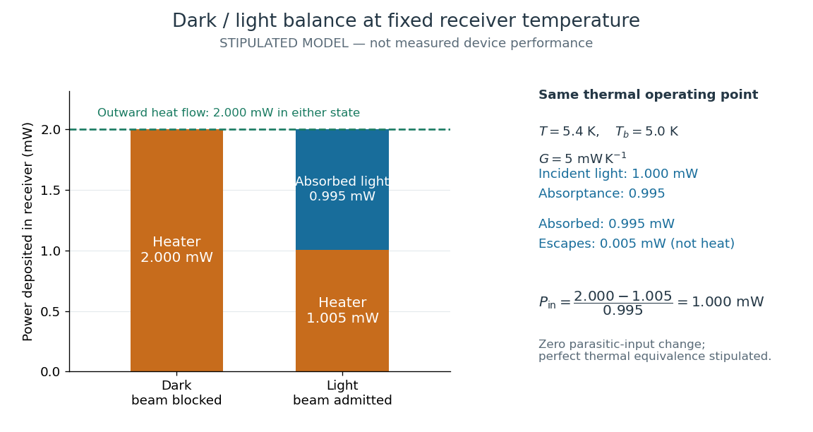

# Fixed-temperature electrical substitution example

↑ **Parent:** [Electrical substitution heat balance](electrical-substitution-heat-balance.md)

Stipulate a model receiver held at $T=5.4\,\mathrm K$ with a reference at $T_b=5.0\,\mathrm K$. Choose $G=5\,\mathrm{mW\,K^{-1}}$, so outward [thermal conduction](thermal-conduction.md) is $G(T-T_b)=2\,\mathrm{mW}$. Ignore other [heat transfer](heat-transfer.md), take $P_{\rm par}=0$ in both states, and stipulate perfect optical/electrical thermal equivalence. These values specify an original example; they are not measurements or claimed performance of a NIST instrument.

With the beam blocked, supply $P_{h,d}=2\,\mathrm{mW}$. With [light](light.md) admitted, the required heater [power](power.md) is $P_{h,l}=1.005\,\mathrm{mW}$. For stipulated [radiometric absorptance](radiometric-absorptance.md) $a=0.995$ at the chosen single [wavelength](wavelength.md),

$$
P_{\rm abs}=2-1.005=0.995\,\mathrm{mW},\qquad
P_{\rm in}=\frac{0.995\,\mathrm{mW}}{0.995}=1.000\,\mathrm{mW}.
$$

The illuminated receiver still gets $1.005+0.995=2\,\mathrm{mW}$ of heating. The remaining $0.005\,\mathrm{mW}$ of incident [radiant flux](radiant-flux.md) escapes without heating it. Calling the measured heater reduction “incident [power](power.md)” would underestimate the stipulated incident [radiant flux](radiant-flux.md) by $0.5\%$.

**[Figure 8](#electrical-substitution-dark-light-heater-balance). The same receiver temperature with different electrical and optical heating**. Original stipulated steady-state example, not experimental data. Both columns total $2\,\mathrm{mW}$ of deposited heating and balance the same outward [thermal conduction](thermal-conduction.md). Incident [radiant flux](radiant-flux.md) is $1\,\mathrm{mW}$, of which $0.995\,\mathrm{mW}$ is absorbed; the $0.005\,\mathrm{mW}$ that escapes is outside the heating column. No response time or measured uncertainty is implied.

Two variations expose different pitfalls. First, if admitting the beam also adds $0.010\,\mathrm{mW}$ of stray heating while the same $0.995\,\mathrm{mW}$ is absorbed from the intended beam, the heater falls to $0.995\,\mathrm{mW}$. The apparent reduction is now $1.005\,\mathrm{mW}$; subtracting $\Delta P_{\rm par}=0.010\,\mathrm{mW}$ recovers the beam's absorbed [power](power.md). Second, keep the original heater readings but stipulate a light-state receiver offset $\delta T=+1\,\mathrm{mK}$ at fixed reference [temperature](temperature-split.md). The link carries an extra $G\delta T=0.005\,\mathrm{mW}$; the inferred absorbed [power](power.md) becomes $1.000\,\mathrm{mW}$, and incident [radiant flux](radiant-flux.md) becomes $1.000/0.995\simeq1.005025\,\mathrm{mW}$. This second variation deliberately violates exact fixed-[temperature](temperature-split.md) substitution.

The heater can supply only nonnegative [power](power.md) in this model. Consequently an absorbed beam above the available dark heater [power](power.md) cannot be compensated at the chosen setpoint merely by reducing the heater. The operating point, link, or admitted [radiant flux](radiant-flux.md) must change; zero heater demand is a range boundary, not evidence of greater [radiant flux](radiant-flux.md) sensitivity.

## ↑ Ancestors (7)

1. [Electrical substitution heat balance](electrical-substitution-heat-balance.md)
2. [Electrical substitution radiometer](electrical-substitution-radiometer.md)
3. [Radiometry](radiometry-split.md)
4. [Optics](optics-split.md)
5. [Branches of physics](branches-of-physics.md)
6. [Physics](physics-split.md)
7. [Codex Wiki](split.md)
