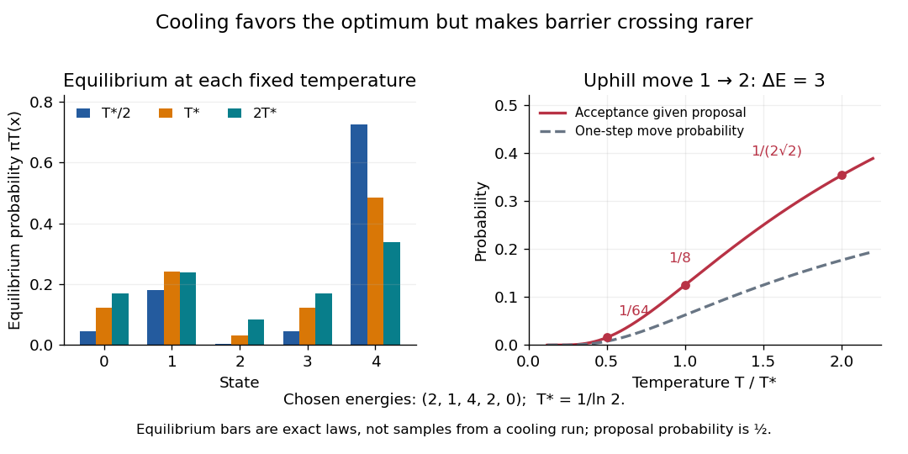

# Fixed-temperature law of simulated annealing

↑ **Parent:** [Simulated annealing](simulated-annealing.md)

On a finite [state space](state-space.md) $F$ with finite [objective function](objective-function.md) values, the fixed-$T$ target is a [Boltzmann distribution](boltzmann-distribution.md):

$$
\pi_T(x)=\frac{e^{-E(x)/T}}{Z_T},\qquad Z_T=\sum_{z\in F}e^{-E(z)/T}.
$$

The [partition function](canonical-partition-function.md) $Z_T$ normalizes the weights but cancels from the [Metropolis–Hastings acceptance probability](metropolis-hastings-acceptance-probability.md). A short [detailed balance](detailed-balance.md) proof explains the target. With symmetric $q$ and $x\ne y$,

$$
\pi_T(x)P_T(x,y)
=\frac{q(x,y)}{Z_T}\min\{e^{-E(x)/T},e^{-E(y)/T}\}
=\pi_T(y)P_T(y,x).
$$

Summing over $x$ gives $\pi_TP_T=\pi_T$, so this is a [stationary distribution](stationary-distribution.md). On a finite [state space](state-space.md), a [connected graph](connected-graph.md) of positive symmetric proposals makes the accepted [Markov chain](markov-chain-split.md) an [irreducible Markov chain](irreducible-markov-chain.md). Convergence from any starting state additionally requires an [aperiodic Markov chain](aperiodic-markov-chain.md); one positive self-transition suffices under irreducibility. Replacing $q$ by $(I+q)/2$ ensures this. For asymmetric $q$, require connectivity through bidirectional proposals: one-way proposals are rejected.[§3.2, printed pp. 39–41: reversibility; §4.3, Theorem 4.9, printed p. 52: convergence for finite irreducible aperiodic chains](markov-chains-and-mixing-times-second-edition-by-david-a-levin-and-others.md)

In the [five-state barrier example for simulated annealing](five-state-barrier-example-for-simulated-annealing.md), $T_*=1/\ln2$ gives exact [Boltzmann weights](boltzmann-factor.md) $2^{-E(x)}$. Multiplying by $16$ gives

$$
\pi_{T_*}=\frac1{33}(4,8,1,4,16),\qquad Z_{T_*}=\frac{33}{16}.
$$

For the uphill edge, [detailed balance](detailed-balance.md) is visible numerically:

$$
\pi_{T_*}(1)P_{T_*}(1,2)=\frac8{33}\frac1{16}
=\frac1{66}=\frac1{33}\frac12
=\pi_{T_*}(2)P_{T_*}(2,1).
$$

Thus the [global minimum](global-minimum.md) has the largest individual stationary [probability](probability.md), $16/33$, but is far from certain at this positive $T_*$. At $T_*/2$ the exact [stationary distribution](stationary-distribution.md) is $(16,64,1,16,256)/353$.

**[Figure 5](#image-lower-temperature-concentrates-equilibrium-weights-while-suppressing-uphill-acceptance). Lower temperature concentrates equilibrium weights while suppressing uphill acceptance**. Exact [Boltzmann distributions](boltzmann-distribution.md) for the chosen five-state [objective function](objective-function.md), and the uphill acceptance [probability](probability.md) $e^{-3/T}$ conditional on the proposal $1\to2$. The one-step [transition probability](transition-probability.md) is half that acceptance [probability](probability.md). The bars describe equilibrium at each fixed temperature, not the evolving [probability distribution](probability-distribution-split.md) during cooling.

For any finite $F$, let $M$ be the [set](set-split.md) of [global minima](global-minimum.md) and $E_{\min}$ the smallest [objective function](objective-function.md) value. Cancelling $e^{-E_{\min}/T}$ from numerator and denominator shows that each nonminimal state's weight tends to zero as $T\downarrow0$, while every state in $M$ has equal weight. Therefore $\pi_T$ tends to the [uniform distribution](continuous-uniform-distribution.md) on $M$. This is a statement about a family of equilibrium [probability distributions](probability-distribution-split.md); it does not prove that a cooling [Markov chain](markov-chain-split.md) follows that family.

## ↑ Ancestors (6)

1. [Simulated annealing](simulated-annealing.md)
2. [Heuristic optimization](heuristic-optimization.md)
3. [Mathematical optimization](mathematical-optimization-split.md)
4. [Area of mathematics](area-of-mathematics.md)
5. [Mathematics](mathematics-split.md)
6. [Codex Wiki](split.md)
