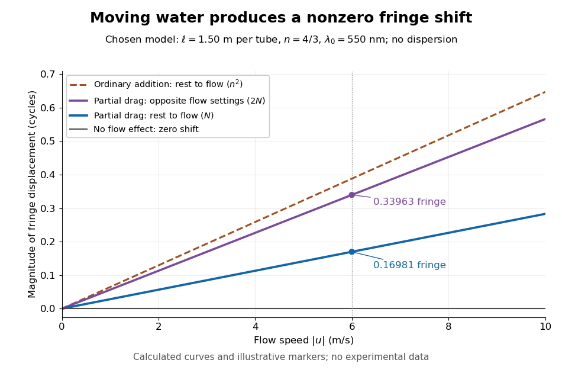

# Fizeau experiment worked example

↑ **Parent:** [Fizeau experiment](fizeau-experiment.md)

Choose $\ell=1.50\,\mathrm m$, $n=4/3$, $\lambda_0=550\,\mathrm{nm}$ and $u=6.00\,\mathrm{m\,s^{-1}}$, with $c=299792458\,\mathrm{m\,s^{-1}}$. These are illustrative choices, not measured values or a reconstruction of [Hippolyte Fizeau](hippolyte-fizeau.md)'s data. Each beam traverses $L=3.00\,\mathrm m$ of [water](water.md). The nondispersive prediction is

$$
N=\frac{4(1.50)(6.00)(7/9)}{(299792458)(550\times10^{-9})}\simeq0.16981,\qquad
2N\simeq0.33963,\qquad
\Delta t\simeq3.1154\times10^{-16}\,\mathrm s.
$$

The first number is the offset from rest to one flow setting; the second compares equal opposite settings. The very short equivalent delay explains why [interference](interference-wave-propagation.md) is useful: a measurable fraction of a [wavelength](wavelength.md) replaces an unattainable direct timing measurement.

**[Figure 9](#image-fizeau-fringe-shift-versus-flow). Calculated fringe offsets for chosen parameters: partial drag gives 0.16981 fringe at 6 m/s, whereas equal opposite flows differ by 0.33963 fringe**. Original model curves for tubes of length $\ell=1.50\,\mathrm m$, [refractive index](refractive-index.md) $n=4/3$ and vacuum [wavelength](wavelength.md) $\lambda_0=550\,\mathrm{nm}$. Solid curves show the first-order rest-to-flow offset and the offset between reversed settings; the dashed curve is the rest-to-flow prediction from ordinary addition of $c/n$ and $u$. No points represent experimental measurements, and [optical dispersion](dispersion-optics.md) is omitted.

The [Galilean transformation](galilean-transformation.md) would give [phase velocity](phase-velocity.md) magnitudes $c/n\pm u$, hence $N_{\rm full}\simeq4\ell u n^2/(c\lambda_0)$. At the chosen values this is $0.38815$ fringe from rest, larger than the [special relativity](special-relativity-split.md) prediction by $n^2/(n^2-1)=16/7$. A model with no flow-induced change of [phase velocity](phase-velocity.md) instead gives $N=0$. The three alternatives are experimentally distinguishable even when $u/c$ is tiny.

[Hippolyte Fizeau](hippolyte-fizeau.md)'s positive displacement favoured [Augustin Jean Fresnel](augustin-jean-fresnel.md)'s partial-drag law over zero or full drag. He explicitly distinguished support for that law from establishing its underlying [luminiferous aether](luminiferous-aether.md) hypothesis.[Comparison of the three predictions and final paragraph qualifying the inference about Fresnel's hypothesis; scanned translation pp. 572–573](the-hypotheses-relating-to-the-luminous-aether-by-hippolyte-fizeau.md) The [Fizeau experiment](fizeau-experiment.md) therefore supplies a nonzero relative-motion measurement, not a null test proving an [luminiferous aether](luminiferous-aether.md)'s absence. The derivation above exhibits the same first-order law within [special relativity](special-relativity-split.md), showing why agreement with the coefficient alone cannot select an physical interpretation.

Two limitations matter for precision. The [velocity profile](velocity-profile.md) sampled by the beam need not equal the cross-sectional average inferred from [volumetric flow rate](volumetric-flow-rate.md). Also, the [Doppler effect](doppler-effect.md) gives opposite rest-frame [frequencies](frequency.md) for the counterpropagating beams. With [optical dispersion](dispersion-optics.md), the coefficient $n^2-1$ in the [interference fringe](interference-fringe.md) formula becomes

$$
n^2-1+n\omega\frac{dn}{d\omega}
=n^2-1-n\lambda_0\frac{dn}{d\lambda_0},
$$

where the [refractive index](refractive-index.md) and its derivative are evaluated for stationary [water](water.md) at the laboratory [angular frequency](angular-frequency.md) $\omega=2\pi c/\lambda_0$. A wavelength-independent $n$ therefore defines an approximation, not a precision fit to real [water](water.md).[Section III, p. 499, equation (7), dispersion from opposite Doppler shifts; section IV.B, pp. 499–500, mean flow versus velocity at the beam](fizeau%E2%80%99s-%E2%80%9Caether-drag%E2%80%9D-experiment-in-the-undergraduate-laboratory-by-thierry-lahaye-and-others.md) Flow reversal removes a fixed [phase difference](phase-difference.md), but a mechanical or [temperature](temperature-split.md) change that reverses with the flow can still imitate the signal and must be controlled.

## ↑ Ancestors (7)

1. [Fizeau experiment](fizeau-experiment.md)
2. [Velocity-addition formula](velocity-addition-formula.md)
3. [Lorentz transformation](lorentz-transformation.md)
4. [Special relativity](special-relativity-split.md)
5. [Branches of physics](branches-of-physics.md)
6. [Physics](physics-split.md)
7. [Codex Wiki](split.md)
