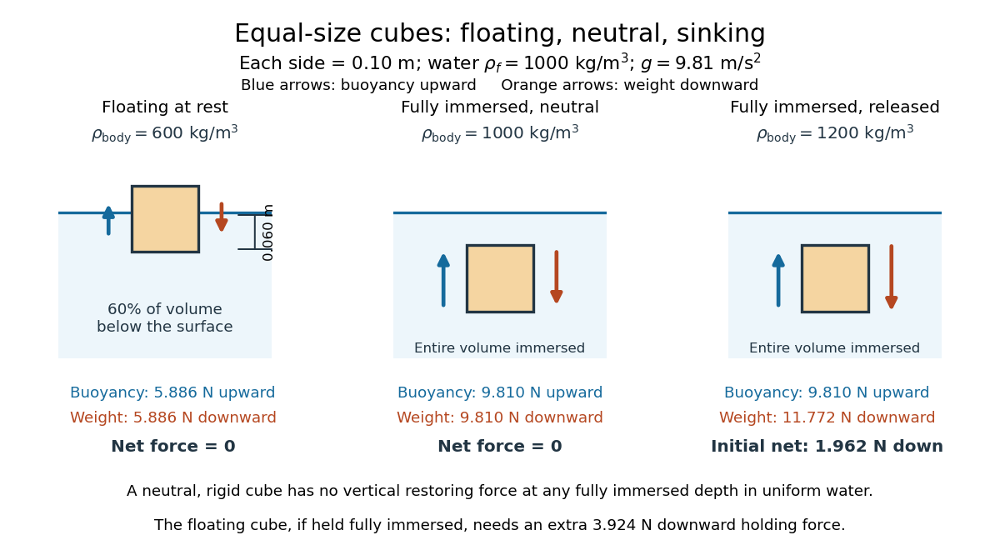

# Floating equilibrium

↑ **Parent:** [Archimedes' principle](archimedes-principle.md)

A freely floating body at rest has no supporting contact or applied holding [force](force.md). Neglecting [surface tension](surface-tension.md) and the [buoyancy](buoyancy.md) of air, its upward [buoyancy](buoyancy.md) balances its downward [force](force.md) from [gravity](gravity.md):

$$
F_b=mg.
$$

For a body of uniform [mass density](density.md) $\rho_{\mathrm{body}}$ and total [volume](volume.md) $V_{\mathrm{body}}$, its [mass](mass.md) is $m=\rho_{\mathrm{body}}V_{\mathrm{body}}$. Substitution into [Archimedes' principle](archimedes-principle.md) gives

$$
\frac{V_{\mathrm{displaced}}}{V_{\mathrm{body}}}
=\frac{\rho_{\mathrm{body}}}{\rho_f}.
$$

Partial immersion is possible when $\rho_{\mathrm{body}}<\rho_f$. A nonuniform body uses its mean [mass density](density.md) $m/V_{\mathrm{body}}$ instead; for a hollow body this [volume](volume.md) must count the enclosed space that excludes [water](water.md). This explains how the amount of displaced [water](water.md) can support a vessel whose walls alone are denser than [water](water.md). [OpenStax, College Physics, §11.7: floating fraction and mean density](https://openstax.org/books/college-physics-2e/pages/11-7-archimedes-principle)

For the $600\ \mathrm{kg\,m^{-3}}$ [cube](cube.md) in [water](water.md) of [mass density](density.md) $1000\ \mathrm{kg\,m^{-3}}$, the displaced fraction is $600/1000=0.60$: sixty percent of its [volume](volume.md) lies below the surface. With a horizontal top and bottom, the immersed depth $d$ satisfies $V_{\mathrm{displaced}}=Ad$, so

$$
V_{\mathrm{displaced}}=0.000600\ \mathrm{m^3},\qquad
d=\frac{0.000600}{0.010}=0.060\ \mathrm m.
$$

Its remaining height is $0.040\ \mathrm m$, and the [buoyancy](buoyancy.md) is $1000\times9.81\times0.000600=5.886\ \mathrm N$, exactly balancing its downward [force](force.md) from [gravity](gravity.md).

**[Figure 10](#image-floating-neutral-buoyancy-and-sinking-for-three-equal-size-cubes). Floating, neutral buoyancy and sinking for three equal-size cubes**. All three [cubes](cube.md) have side $0.10\ \mathrm m$ in [water](water.md) with stipulated [mass density](density.md) $1000\ \mathrm{kg\,m^{-3}}$ and [gravitational acceleration](gravitational-acceleration.md) $9.81\ \mathrm{m\,s^{-2}}$. Left: the $600\ \mathrm{kg\,m^{-3}}$ body floats with $0.060\ \mathrm m$ immersed and equal upward and downward [forces](force.md) of $5.886\ \mathrm N$. Middle: a fully immersed $1000\ \mathrm{kg\,m^{-3}}$ body has [neutral buoyancy](neutral-buoyancy.md), with both [forces](force.md) equal to $9.81\ \mathrm N$. Right: a fully immersed $1200\ \mathrm{kg\,m^{-3}}$ body has downward [force](force.md) from [gravity](gravity.md) $11.772\ \mathrm N$ against upward [buoyancy](buoyancy.md) $9.81\ \mathrm N$, so release from rest gives an initial net downward [force](force.md) $1.962\ \mathrm N$.

## ↑ Ancestors (6)

1. [Archimedes' principle](archimedes-principle.md)
2. [Buoyancy](buoyancy.md)
3. [Fluid mechanics](fluid-mechanics-split.md)
4. [Branches of physics](branches-of-physics.md)
5. [Physics](physics-split.md)
6. [Codex Wiki](split.md)

## ← Incoming links (2)

- [Archimedes' principle](archimedes-principle.md)
- [Buoyancy](buoyancy.md)
