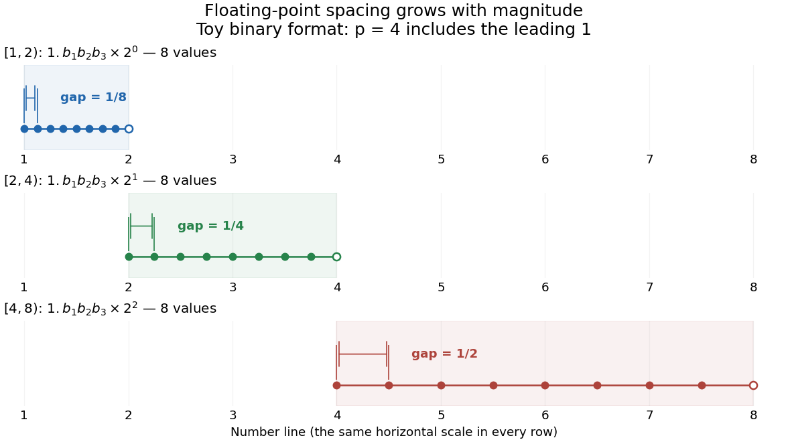

# Floating-point arithmetic

↑ **Parent:** [Numerical analysis](numerical-analysis-split.md)  
ⓦ [Wiki](https://en.wikipedia.org/wiki/Floating-point_arithmetic)

[Floating-point arithmetic](floating-point-arithmetic-split.md) represents a [real number](real-number.md) by a sign, a fixed number of significant digits, and a scale. It trades exactness for a compact representation spanning many orders of magnitude. The picture shows the essential compromise: with the same precision, large numbers have wider gaps between representable neighbors. Thus accuracy is naturally relative to magnitude, rather than a fixed distance along the [number line](number-line.md).

<a id="image-eight-normalized-four-bit-binary-values-in-each-of-three-intervals-with-gaps-doubling-from-one-eighth-to-one-half"></a>


**[Figure 1](#image-eight-normalized-four-bit-binary-values-in-each-of-three-intervals-with-gaps-doubling-from-one-eighth-to-one-half). Eight normalized four-bit binary values in each of three intervals, with gaps doubling from one eighth to one half**.

In radix $\beta$, an [integer](integer-split.md) at least two, a nonzero normalized value has the [positional notation](positional-notation.md)

$$
y=\pm\left(d_0+\frac{d_1}{\beta}+\cdots+\frac{d_{p-1}}{\beta^{p-1}}\right)\beta^e,\qquad 1\leq d_0<\beta,\quad 0\leq d_j<\beta\ (j\geq1),
$$

where the digits and exponent $e$ are [integers](integer-split.md). The parenthesized factor is the significand; $p$ counts all its significant digits, including the leading digit. Normalization means $d_0\ne0$, so the same value has one such representation. The allowed exponents satisfy $e_{\min}\leq e\leq e_{\max}$. Finite precision restricts the available digits, while the exponent bounds restrict the range. Zero needs a separate representation. This scales a digit string in [positional notation](positional-notation.md) by a power of its base.[David Goldberg, What Every Computer Scientist Should Know About Floating-Point Arithmetic, §Floating-point Formats, 1991; Oracle's authorized edited reprint](https://docs.oracle.com/cd/E19957-01/806-3568/ncg_goldberg.html)

For positive normalized values in $[\beta^e,\beta^{e+1})$, increasing the last digit by one gives the constant neighbor spacing

$$
\Delta_e=\beta^{e-p+1}.
$$

At the next scale, the spacing is multiplied by $\beta$. In the [binary numeral system](binary-numeral-system.md) with $p=4$, the values in $[1,2)$ are $1,1.125,1.25,\ldots,1.875$; those in $[2,4)$ are $2,2.25,\ldots,3.75$; those in $[4,8)$ are $4,4.5,\ldots,7.5$. The respective gaps are $1/8$, $1/4$, and $1/2$. Although absolute resolution deteriorates with magnitude, $\Delta_e/y$ stays between $\beta^{-p}$ and $\beta^{1-p}$. This scale invariance is why [floating-point arithmetic](floating-point-arithmetic-split.md) suits both microscopic and astronomical calculations.

The IEEE 754 binary64 format uses the [binary numeral system](binary-numeral-system.md) with $p=53$, including an implicit leading one for normalized values, and normal exponents $-1022\leq e\leq1023$. Its 64 stored [binary digits](binary-digit.md) comprise one sign digit, 11 exponent digits and 52 trailing significand digits. [Subnormal numbers](subnormal-number.md) extend the range toward zero with a different leading-digit rule. In rounding to nearest, an operation returns the representable value closest to its exact result; a tie goes to the value whose last significant [binary digit](binary-digit.md) is even. [Machine epsilon](machine-epsilon.md) describes the gap just above one, whereas [unit roundoff](unit-roundoff.md) bounds a single relative rounding error in the normal range. These format and rounding rules are presented in MIT's floating-point lecture.[Per-Olof Persson, MIT 18.335J, Lecture 2: Floating-Point Arithmetic, the IEEE Standard, slides 6–9, 2019](https://ocw.mit.edu/courses/18-335j-introduction-to-numerical-methods-spring-2019/2f313023ae3404bc217a81a31b227170_MIT18_335JS19_lec2.pdf)

Even an ordinary terminating decimal can require rounding in the [binary numeral system](binary-numeral-system.md). The [rational number](rational-number.md) $0.1=1/10$ has the repeating [positional notation](positional-notation.md) $0.0001100110011\ldots{}_2$. Every finite binary [fraction](fraction.md) has a reduced [denominator](denominator.md) that is a power of two, so the factor five in $10$ prevents an exact finite binary representation. In binary64, the exact stored values of three decimal literals and their computed [sum](sum.md) are

$$
\begin{array}{c|c}
\text{Python expression}&\text{exact stored rational number}\\\hline
0.1&3602879701896397/36028797018963968\\
0.2&3602879701896397/18014398509481984\\
0.3&5404319552844595/18014398509481984\\
0.1+0.2&1351079888211149/4503599627370496
\end{array}
$$

The exact [sum](sum.md) of the first two stored [rational numbers](rational-number.md) is $10808639105689191/36028797018963968$, halfway between two binary64 values. The even-last-digit tie rule rounds it upward. The printed result is `0.30000000000000004`, one step $2^{-54}$ above stored `0.3`, so `0.1 + 0.2 == 0.3` is false. Both conversion of the inputs and rounding of the [addition](addition.md) matter here.

To reproduce the table on a Python installation using binary64, inspect exact [fractions](fraction.md) rather than only their printed decimal representations:
```
import sys
assert (sys.float_info.radix, sys.float_info.mant_dig) == (2, 53)
for value in (0.1, 0.2, 0.3, 0.1 + 0.2):
    print(repr(value), value.as_integer_ratio())
print(0.1 + 0.2 == 0.3)  # False
```
Python's `as_integer_ratio()` returns a pair of [integers](integer-split.md) whose quotient equals the stored finite value exactly.[Python 3.14 documentation, float.as\_integer\_ratio](https://docs.python.org/3.14/library/stdtypes.html#float.as_integer_ratio) Exact [rational numbers](rational-number.md) are also useful for checking [floating-point arithmetic](floating-point-arithmetic-split.md): a short decimal printout can hide the approximation being made.

Historically, David Goldberg's March 1991 ACM Computing Surveys paper explained representation, rounding and [catastrophic cancellation](catastrophic-cancellation.md) together with the IEEE standard's design choices. Oracle provides an authorized edited reprint. Its enduring lesson is practical: use the spacing to understand [roundoff error](round-off-error.md), and inspect intermediate values when mathematically equivalent [algorithms](algorithm-split.md) behave differently.[Goldberg, 1991, reprint notice and §§Rounding Error, Cancellation](https://docs.oracle.com/cd/E19957-01/806-3568/ncg_goldberg.html)

**Table of contents**

- [Floating-point underflow](floating-point-underflow.md)
- [Floating-point representation](floating-point-representation.md)
- [Floating-point number](floating-point-number.md)
- [Compensated summation](compensated-summation.md)
  - [Kahan summation algorithm](kahan-summation-algorithm.md)
- [Machine epsilon](machine-epsilon.md)
- [Unit roundoff](unit-roundoff.md)
- [Subnormal number](subnormal-number.md)
- [Catastrophic cancellation](catastrophic-cancellation.md)

## ↑ Ancestors (5)

1. [Numerical analysis](numerical-analysis-split.md)
2. [Analysis](analysis-split.md)
3. [Area of mathematics](area-of-mathematics.md)
4. [Mathematics](mathematics-split.md)
5. [Codex Wiki](split.md)

## ← Incoming links (41)

- [A cubic root from existence to a quantitative bracket](a-cubic-root-from-existence-to-a-quantitative-bracket.md)
- [Adaptive Euler step doubling for exponential decay](adaptive-euler-step-doubling-for-exponential-decay.md)
- [Adaptive step-size controller](adaptive-step-size-controller.md)
- [Axis-aligned bounding box](axis-aligned-bounding-box.md)
- [Barycentric interpolation formula](barycentric-interpolation-formula.md)
- [Bisection stopping criterion](bisection-stopping-criterion.md)
- [Bounding volume](bounding-volume.md)
- [Ceiling function](ceiling-function.md)
- [Compensated summation](compensated-summation.md)
- [Complementary error function](complementary-error-function.md)
- [Constant folding](constant-folding.md)
- [Cross multiplication](cross-multiplication.md)
- [Farkas certificate for linear inequalities](farkas-certificate-for-linear-inequalities.md)
- [Fill-in](fill-in.md)
- [Floating-point arithmetic](floating-point-arithmetic-split.md)
- [Floor and ceiling functions](floor-and-ceiling-functions.md)
- [Givens row-pair update](givens-row-pair-update.md)
- [Gram-Schmidt process](gram-schmidt-process.md)
- [Householder reflection sending a vector to a coordinate axis](householder-reflection-sending-a-vector-to-a-coordinate-axis.md)
- [Interval bisection](interval-bisection.md)
- [Log-likelihood](log-likelihood.md)
- [Machine epsilon](machine-epsilon.md)
- [Matrix-chain cost model](matrix-chain-cost-model.md)
- [Node order in Newton interpolation](node-order-in-newton-interpolation.md)
- [Number-theoretic transform](number-theoretic-transform.md)
- [Outward rounding](outward-rounding.md)
- [Pairing function](pairing-function.md)
- [Solution](past-exam-of-the-mathematical-and-computational-biology-course-of-the-university-of-cambridge/2024/paper-2/a1/a/solution.md)
- [Power iteration](power-iteration.md)
- [Power iteration failure cases](power-iteration-failure-cases.md)
- [Prefix sum](prefix-sum.md)
- [QR decomposition by Givens rotations](qr-decomposition-by-givens-rotations.md)
- [Random evaluation test for a polynomial identity](random-evaluation-test-for-a-polynomial-identity.md)
- [Residual and forward error in a stationary iteration](residual-and-forward-error-in-a-stationary-iteration.md)
- [Richardson extrapolation](richardson-extrapolation.md)
- [Row echelon form](row-echelon-form.md)
- [Safe pivots for tridiagonal elimination](safe-pivots-for-tridiagonal-elimination.md)
- [Shared face flux cancellation](shared-face-flux-cancellation.md)
- [Stable construction of a Givens rotation](stable-construction-of-a-givens-rotation.md)
- [Tiny-pivot roundoff in Gaussian elimination](tiny-pivot-roundoff-in-gaussian-elimination.md)
- [Unit roundoff](unit-roundoff.md)
