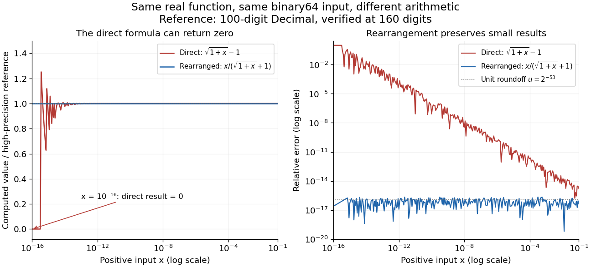

# Floating-point arithmetic

↑ **Parent:** [Numerical analysis](numerical-analysis.md)  
ⓦ [Wiki](https://en.wikipedia.org/wiki/Floating-point_arithmetic)

[Floating-point arithmetic](floating-point-arithmetic.md) represents a [real number](arithmetic.md#real-number) by a sign, a fixed number of significant digits, and a scale. It trades exactness for a compact representation spanning many orders of magnitude. The picture shows the essential compromise: with the same precision, large numbers have wider gaps between representable neighbors. Thus accuracy is naturally relative to magnitude, rather than a fixed distance along the [number line](arithmetic.md#number-line).

<a id="image-eight-normalized-four-bit-binary-values-in-each-of-three-intervals-with-gaps-doubling-from-one-eighth-to-one-half"></a>


**[Figure 1](#image-eight-normalized-four-bit-binary-values-in-each-of-three-intervals-with-gaps-doubling-from-one-eighth-to-one-half). Eight normalized four-bit binary values in each of three intervals, with gaps doubling from one eighth to one half**.

In radix $\beta$, an [integer](integer.md) at least two, a nonzero normalized value has the [positional notation](integer.md#positional-notation)

$$
y=\pm\left(d_0+\frac{d_1}{\beta}+\cdots+\frac{d_{p-1}}{\beta^{p-1}}\right)\beta^e,\qquad 1\leq d_0<\beta,\quad 0\leq d_j<\beta\ (j\geq1),
$$

where the digits and exponent $e$ are [integers](integer.md). The parenthesized factor is the significand; $p$ counts all its significant digits, including the leading digit. Normalization means $d_0\ne0$, so the same value has one such representation. The allowed exponents satisfy $e_{\min}\leq e\leq e_{\max}$. Finite precision restricts the available digits, while the exponent bounds restrict the range. Zero needs a separate representation. This scales a digit string in [positional notation](integer.md#positional-notation) by a power of its base.[David Goldberg, What Every Computer Scientist Should Know About Floating-Point Arithmetic, §Floating-point Formats, 1991; Oracle's authorized edited reprint](https://docs.oracle.com/cd/E19957-01/806-3568/ncg_goldberg.html)

For positive normalized values in $[\beta^e,\beta^{e+1})$, increasing the last digit by one gives the constant neighbor spacing

$$
\Delta_e=\beta^{e-p+1}.
$$

At the next scale, the spacing is multiplied by $\beta$. In the [binary numeral system](integer.md#binary-numeral-system) with $p=4$, the values in $[1,2)$ are $1,1.125,1.25,\ldots,1.875$; those in $[2,4)$ are $2,2.25,\ldots,3.75$; those in $[4,8)$ are $4,4.5,\ldots,7.5$. The respective gaps are $1/8$, $1/4$, and $1/2$. Although absolute resolution deteriorates with magnitude, $\Delta_e/y$ stays between $\beta^{-p}$ and $\beta^{1-p}$. This scale invariance is why [floating-point arithmetic](floating-point-arithmetic.md) suits both microscopic and astronomical calculations.

The IEEE 754 binary64 format uses the [binary numeral system](integer.md#binary-numeral-system) with $p=53$, including an implicit leading one for normalized values, and normal exponents $-1022\leq e\leq1023$. Its 64 stored [binary digits](integer.md#binary-digit) comprise one sign digit, 11 exponent digits and 52 trailing significand digits. [Subnormal numbers](#subnormal-number) extend the range toward zero with a different leading-digit rule. In rounding to nearest, an operation returns the representable value closest to its exact result; a tie goes to the value whose last significant [binary digit](integer.md#binary-digit) is even. [Machine epsilon](#machine-epsilon) describes the gap just above one, whereas [unit roundoff](#unit-roundoff) bounds a single relative rounding error in the normal range. These format and rounding rules are presented in MIT's floating-point lecture.[Per-Olof Persson, MIT 18.335J, Lecture 2: Floating-Point Arithmetic, the IEEE Standard, slides 6–9, 2019](https://ocw.mit.edu/courses/18-335j-introduction-to-numerical-methods-spring-2019/2f313023ae3404bc217a81a31b227170_MIT18_335JS19_lec2.pdf)

Even an ordinary terminating decimal can require rounding in the [binary numeral system](integer.md#binary-numeral-system). The [rational number](number-theory.md#rational-number) $0.1=1/10$ has the repeating [positional notation](integer.md#positional-notation) $0.0001100110011\ldots{}_2$. Every finite binary [fraction](number-theory.md#fraction) has a reduced [denominator](number-theory.md#denominator) that is a power of two, so the factor five in $10$ prevents an exact finite binary representation. In binary64, the exact stored values of three decimal literals and their computed [sum](arithmetic.md#sum) are

$$
\begin{array}{c|c}
\text{Python expression}&\text{exact stored rational number}\\\hline
0.1&3602879701896397/36028797018963968\\
0.2&3602879701896397/18014398509481984\\
0.3&5404319552844595/18014398509481984\\
0.1+0.2&1351079888211149/4503599627370496
\end{array}
$$

The exact [sum](arithmetic.md#sum) of the first two stored [rational numbers](number-theory.md#rational-number) is $10808639105689191/36028797018963968$, halfway between two binary64 values. The even-last-digit tie rule rounds it upward. The printed result is `0.30000000000000004`, one step $2^{-54}$ above stored `0.3`, so `0.1 + 0.2 == 0.3` is false. Both conversion of the inputs and rounding of the [addition](arithmetic.md#addition) matter here.

To reproduce the table on a Python installation using binary64, inspect exact [fractions](number-theory.md#fraction) rather than only their printed decimal representations:
```
import sys
assert (sys.float_info.radix, sys.float_info.mant_dig) == (2, 53)
for value in (0.1, 0.2, 0.3, 0.1 + 0.2):
    print(repr(value), value.as_integer_ratio())
print(0.1 + 0.2 == 0.3)  # False
```
Python's `as_integer_ratio()` returns a pair of [integers](integer.md) whose quotient equals the stored finite value exactly.[Python 3.14 documentation, float.as\_integer\_ratio](https://docs.python.org/3.14/library/stdtypes.html#float.as_integer_ratio) Exact [rational numbers](number-theory.md#rational-number) are also useful for checking [floating-point arithmetic](floating-point-arithmetic.md): a short decimal printout can hide the approximation being made.

Historically, David Goldberg's March 1991 ACM Computing Surveys paper explained representation, rounding and [catastrophic cancellation](#catastrophic-cancellation) together with the IEEE standard's design choices. Oracle provides an authorized edited reprint. Its enduring lesson is practical: use the spacing to understand [roundoff error](numerical-analysis.md#round-off-error), and inspect intermediate values when mathematically equivalent [algorithms](algorithm.md) behave differently.[Goldberg, 1991, reprint notice and §§Rounding Error, Cancellation](https://docs.oracle.com/cd/E19957-01/806-3568/ncg_goldberg.html)

**Table of contents**

- [Floating-point underflow](#floating-point-underflow)
- [Floating-point representation](#floating-point-representation)
- [Floating-point number](#floating-point-number)
- [Compensated summation](#compensated-summation)
  - [Kahan summation algorithm](#kahan-summation-algorithm)
- [Machine epsilon](#machine-epsilon)
- [Unit roundoff](#unit-roundoff)
- [Subnormal number](#subnormal-number)
- [Catastrophic cancellation](#catastrophic-cancellation)

## Floating-point underflow

↑ **Parent:** [Floating-point arithmetic](floating-point-arithmetic.md)

[Floating-point underflow](#floating-point-underflow) occurs when a nonzero numerical result is smaller in magnitude than the representable range or loses precision in the subnormal range. A long product of probabilities can become zero despite a mathematically positive result. Adding [logarithms](calculus.md#logarithm) avoids forming the product; adding alternative path probabilities then requires [log-sum-exp](convex-optimization.md#log-sum-exp-function) or controlled rescaling.

## Floating-point representation

↑ **Parent:** [Floating-point arithmetic](floating-point-arithmetic.md)

## Floating-point number

↑ **Parent:** [Floating-point arithmetic](floating-point-arithmetic.md)

## Compensated summation

↑ **Parent:** [Floating-point arithmetic](floating-point-arithmetic.md)

[Compensated summation](#compensated-summation) retains a correction for low-order information lost to [roundoff error](numerical-analysis.md#round-off-error) in successive [floating-point arithmetic](floating-point-arithmetic.md) additions. [Kahan summation](#kahan-summation-algorithm) is a common implementation; it can substantially reduce accumulated error when many terms are added.

### Kahan summation algorithm

↑ **Parent:** [Compensated summation](#compensated-summation)

A [summation](arithmetic.md#summation) [algorithm](algorithm.md) that keeps a correction for low-order information lost when adding [floating-point numbers](#floating-point-number). Feeding that correction into subsequent additions can greatly reduce accumulated rounding error compared with straightforward summation.

## Machine epsilon

↑ **Parent:** [Floating-point arithmetic](floating-point-arithmetic.md)  
ⓦ [Wiki](https://en.wikipedia.org/wiki/Machine_epsilon)

Here [machine epsilon](#machine-epsilon) means the gap from one to the next larger value in normalized [floating-point arithmetic](floating-point-arithmetic.md):

$$
\epsilon_{\rm mach}=\operatorname{next}(1)-1=\beta^{1-p}.
$$

It is a relative resolution scale near one, not the smallest positive representable value and not a fixed absolute error for all magnitudes. In binary64, $p=53$ gives

$$
\epsilon_{\rm mach}=2^{-52}\approx2.220446049250313\times10^{-16},\qquad u=2^{-53}\approx1.1102230246251565\times10^{-16},
$$

where $u$ is [unit roundoff](#unit-roundoff) for rounding to nearest. Some authors instead call $u$ their [machine epsilon](#machine-epsilon); MIT 18.335J uses this half-gap convention. Always check which definition an error bound uses.[Persson, MIT 18.335J, Lecture 2, slides 3, 8–9: the half-gap convention](https://ocw.mit.edu/courses/18-335j-introduction-to-numerical-methods-spring-2019/2f313023ae3404bc217a81a31b227170_MIT18_335JS19_lec2.pdf)

The gap below one is smaller: the preceding binary64 value is $1-2^{-53}$, whereas the next value above one is $1+2^{-52}$. Under nearest-even rounding, `1.0 + 2.0**-53` is exactly `1.0`: the exact [sum](arithmetic.md#sum) is a tie and one has the even final [binary digit](integer.md#binary-digit). By contrast, `1.0 + 2.0**-52` is the next value. Thus searching for the smallest increment that changes one by trial [addition](arithmetic.md#addition) also depends on the rounding convention. At $2^{53}$ the next larger binary64 value is $2^{53}+2$, illustrating why a small absolute increment can disappear at large magnitude.

## Unit roundoff

↑ **Parent:** [Floating-point arithmetic](floating-point-arithmetic.md)

For [floating-point arithmetic](floating-point-arithmetic.md) with precision $p$ in radix $\beta$ and rounding to nearest, [unit roundoff](#unit-roundoff) is the half-gap scale $u=\beta^{1-p}/2$. If a nonzero exact [real number](arithmetic.md#real-number) $z$ lies in the normal finite range, its nearest rounded value satisfies

$$
\operatorname{fl}(z)=z(1+\delta),\qquad |\delta|\leq u.
$$

Indeed, the absolute distance to the nearest value is at most $\Delta_e/2$, and $|z|\geq\beta^e$ gives the bound. For a correctly rounded [addition](arithmetic.md#addition), [subtraction](arithmetic.md#subtraction), [multiplication](arithmetic.md#multiplication) or [division](arithmetic.md#division-mathematics), apply this estimate to the exact result of that one operation on the stored operands. The bound does not include earlier [roundoff error](numerical-analysis.md#round-off-error) or automatically bound a whole [algorithm](algorithm.md). Results outside the finite range and tiny [subnormal numbers](#subnormal-number) require separate treatment. Rounding in a directed mode also changes the bound.[Goldberg, 1991, §§Relative Error and Ulps, Exactly Rounded Operations](https://docs.oracle.com/cd/E19957-01/806-3568/ncg_goldberg.html)

## Subnormal number

↑ **Parent:** [Floating-point arithmetic](floating-point-arithmetic.md)  
ⓦ [Wiki](https://en.wikipedia.org/wiki/Subnormal_number)

A [subnormal number](#subnormal-number) is a nonzero representable value smaller in magnitude than the least positive normalized value $\beta^{e_{\min}}$. Keep the exponent scale fixed at $e_{\min}$ and allow a zero leading digit: the positive values are $k\beta^{e_{\min}-p+1}$ for [integers](integer.md) $1\leq k<\beta^{p-1}$. This fills the gap toward zero with constant absolute spacing, at the cost of fewer significant digits. Goldberg describes this gradual approach to zero and why it matters for differences of small numbers.[Goldberg, 1991, §Denormalized Numbers](https://docs.oracle.com/cd/E19957-01/806-3568/ncg_goldberg.html)

For binary64 the least positive normalized value is $2^{-1022}$, and [subnormal numbers](#subnormal-number) are spaced by $2^{-1074}$. With nearest rounding and gradual underflow enabled, an exact result $z$ with $|z|<2^{-1022}$ has absolute rounding error at most $2^{-1075}$. A uniform relative bound by [unit roundoff](#unit-roundoff) fails here: $z=2^{-1075}$ rounds to zero under the even-last-digit tie rule, giving relative error one. [Machine epsilon](#machine-epsilon) measures resolution near one; it does not measure the distance from zero to the first positive value.

## Catastrophic cancellation

↑ **Parent:** [Floating-point arithmetic](floating-point-arithmetic.md)  
ⓦ [Wiki](https://en.wikipedia.org/wiki/Catastrophic_cancellation)

[Catastrophic cancellation](#catastrophic-cancellation) occurs when [subtraction](arithmetic.md#subtraction) of nearly equal approximations removes their matching leading digits and exposes earlier [roundoff error](numerical-analysis.md#round-off-error). The [subtraction](arithmetic.md#subtraction) can itself be exact on the stored operands: the information may already have been lost while obtaining them. Goldberg distinguishes this from cancellation of accurately known quantities, which can be harmless.[Goldberg, 1991, §Cancellation](https://docs.oracle.com/cd/E19957-01/806-3568/ncg_goldberg.html)

For $x>0$, consider the single [real-valued function](function.md#real-valued-function)

$$
f(x)=\sqrt{1+x}-1=\frac{x}{\sqrt{1+x}+1}.
$$

The [rationalization of a square-root difference](algebra.md#rationalization-of-a-square-root-difference) proves equality in exact [arithmetic](arithmetic.md). The two evaluations use the same input $x$, but the direct version first forms a value near one and then subtracts one. The rearranged version keeps the small input in its [numerator](number-theory.md#numerator) and divides by a [denominator](number-theory.md#denominator) near two.

<a id="image-direct-and-rationalized-evaluation-of-a-small-square-root-difference-against-a-high-precision-reference-for-the-same-binary64-inputs"></a>


**[Figure 2](#image-direct-and-rationalized-evaluation-of-a-small-square-root-difference-against-a-high-precision-reference-for-the-same-binary64-inputs). Direct and rationalized evaluation of a small square-root difference against a high-precision reference for the same binary64 inputs**.

For binary64 `x = 1e-16`, the rounded [sum](arithmetic.md#sum) `1.0 + x` is one, so `sqrt(1.0 + x) - 1.0` is zero. The rationalized evaluation returns approximately $5\times10^{-17}$. A 100-digit Decimal calculation using the exact stored input gives relative errors of one and about $2.50\times10^{-17}$ respectively. At `x = 1e-12`, the direct result is about $5.0004445029\times10^{-13}$, with relative error $8.89\times10^{-5}$; the rearranged result is about $4.99999999999875\times10^{-13}$, with relative error $1.21\times10^{-17}$.

The plot uses `Decimal.from_float(x)` to preserve the binary input exactly, computes $x/(\sqrt{1+x}+1)$ at 100 decimal digits, and verifies the reference at 160 digits. Exact conversion of a stored binary value is documented by Python.[Python 3.14 documentation, Decimal.from\_float](https://docs.python.org/3.14/library/decimal.html#decimal.Decimal.from_float) Each error is $|\widehat f-f|/|f|$, with the computed result converted exactly to Decimal before comparison. Hence the curves measure evaluation error for one common input, rather than a mixture of input conversion error and evaluation error. The plotted interval $10^{-16}\leq x\leq10^{-1}$ is far above the [subnormal number](#subnormal-number) range.

The original problem is well conditioned with respect to relative changes in $x$. Using the [derivative](calculus.md#derivative) $f'(x)=1/(2\sqrt{1+x})$ and [rationalization of a square-root difference](algebra.md#rationalization-of-a-square-root-difference), its relative [condition number](quadratic-form.md#condition-number) is

$$
\kappa_f(x)=\left|\frac{xf'(x)}{f(x)}\right|=\frac{\sqrt{1+x}+1}{2\sqrt{1+x}},\qquad \frac12<\kappa_f(x)<1\quad(x>0).
$$

It tends to one as $x$ tends to zero. The direct evaluation instead introduces the intermediate difference $s-1$ with $s=\sqrt{1+x}$; an error of order [unit roundoff](#unit-roundoff) in $s$ is large relative to $f(x)\approx x/2$. This is a failure of the chosen [algorithm](algorithm.md)'s accuracy despite a small [condition number](quadratic-form.md#condition-number) for the same [real-valued function](function.md#real-valued-function). The rationalized evaluation avoids that intermediate [catastrophic cancellation](#catastrophic-cancellation), retaining relative accuracy near the [unit roundoff](#unit-roundoff) scale throughout the plotted interval. Recognizing this structure can improve a calculation far more than merely printing extra digits.

## ↑ Ancestors (5)

1. [Numerical analysis](numerical-analysis.md)
2. [Analysis](analysis.md)
3. [Area of mathematics](mathematics.md#area-of-mathematics)
4. [Mathematics](mathematics.md)
5. [Codex Wiki](README.md)

## ← Incoming links (41)

- [A cubic root from existence to a quantitative bracket](calculus.md#a-cubic-root-from-existence-to-a-quantitative-bracket)
- [Adaptive Euler step doubling for exponential decay](error-control-for-ode-solvers.md#adaptive-euler-step-doubling-for-exponential-decay)
- [Adaptive step-size controller](error-control-for-ode-solvers.md#adaptive-step-size-controller)
- [Axis-aligned bounding box](computer-aided-geometric-design.md#axis-aligned-bounding-box)
- [Barycentric interpolation formula](interpolation.md#barycentric-interpolation-formula)
- [Bisection stopping criterion](numerical-analysis.md#bisection-stopping-criterion)
- [Bounding volume](computer-aided-geometric-design.md#bounding-volume)
- [Ceiling function](calculus.md#ceiling-function)
- [Compensated summation](#compensated-summation)
- [Complementary error function](integral.md#complementary-error-function)
- [Constant folding](programming-language.md#constant-folding)
- [Cross multiplication](number-theory.md#cross-multiplication)
- [Farkas certificate for linear inequalities](convex-optimization.md#farkas-certificate-for-linear-inequalities)
- [Fill-in](numerical-linear-algebra.md#fill-in)
- [Floating-point arithmetic](floating-point-arithmetic.md)
- [Floor and ceiling functions](calculus.md#floor-and-ceiling-functions)
- [Givens row-pair update](numerical-analysis.md#givens-row-pair-update)
- [Gram-Schmidt process](inner-product.md#gram-schmidt-process)
- [Householder reflection sending a vector to a coordinate axis](linear-algebra.md#householder-reflection-sending-a-vector-to-a-coordinate-axis)
- [Interval bisection](numerical-analysis.md#interval-bisection)
- [Log-likelihood](maximum-likelihood-estimation.md#log-likelihood)
- [Machine epsilon](#machine-epsilon)
- [Matrix-chain cost model](algorithm.md#matrix-chain-cost-model)
- [Node order in Newton interpolation](interpolation.md#node-order-in-newton-interpolation)
- [Number-theoretic transform](discrete-fourier-transform.md#number-theoretic-transform)
- [Outward rounding](numerical-analysis.md#outward-rounding)
- [Pairing function](computability-theory.md#pairing-function)
- [Solution](past-exam-of-the-mathematical-and-computational-biology-course-of-the-university-of-cambridge/2024/paper-2.md#a1/a/solution)
- [Power iteration](numerical-linear-algebra.md#power-iteration)
- [Power iteration failure cases](numerical-linear-algebra.md#power-iteration-failure-cases)
- [Prefix sum](arithmetic.md#prefix-sum)
- [QR decomposition by Givens rotations](numerical-analysis.md#qr-decomposition-by-givens-rotations)
- [Random evaluation test for a polynomial identity](algorithm.md#random-evaluation-test-for-a-polynomial-identity)
- [Residual and forward error in a stationary iteration](numerical-linear-algebra.md#residual-and-forward-error-in-a-stationary-iteration)
- [Richardson extrapolation](numerical-analysis.md#richardson-extrapolation)
- [Row echelon form](numerical-linear-algebra.md#row-echelon-form)
- [Safe pivots for tridiagonal elimination](numerical-analysis.md#safe-pivots-for-tridiagonal-elimination)
- [Shared face flux cancellation](finite-volume-method.md#shared-face-flux-cancellation)
- [Stable construction of a Givens rotation](numerical-analysis.md#stable-construction-of-a-givens-rotation)
- [Tiny-pivot roundoff in Gaussian elimination](numerical-linear-algebra.md#tiny-pivot-roundoff-in-gaussian-elimination)
- [Unit roundoff](#unit-roundoff)
