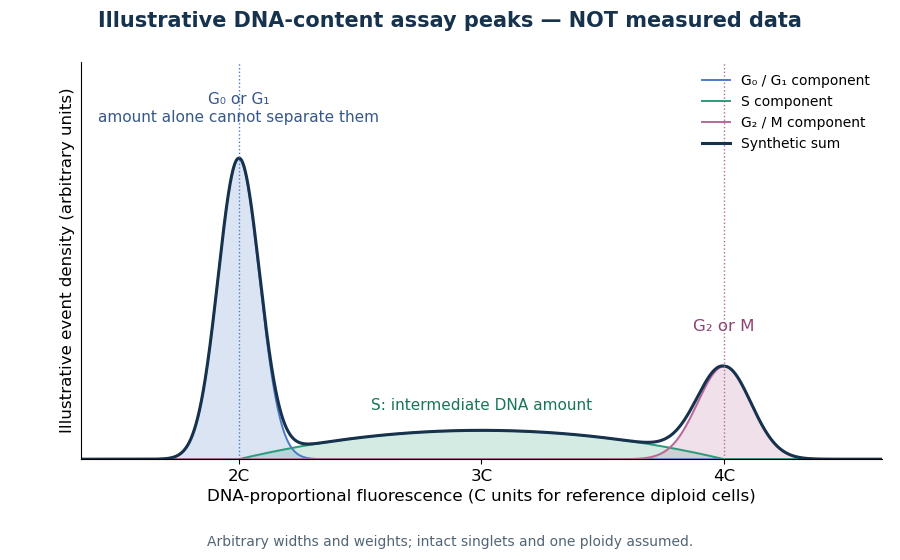

# Flow cytometric DNA-content assay

↑ **Parent:** [Flow cytometry](flow-cytometry.md)

Under controlled staining and detector settings, integrated [fluorescence](fluorescence.md) can be approximately proportional to nuclear [DNA](deoxyribonucleic-acid.md) amount. A [histogram](histogram.md) of accepted single-cell events then separates a $2C$ region, an intermediate region and a $4C$ region. These are ordinarily assigned to [G0 phase](g0-phase.md)/[G1 phase](g1-phase.md), [S phase](s-phase.md), and [G2 phase](g2-phase.md)/[M phase](m-phase.md) respectively in the stated [diploid](diploid.md) model.

**[Figure 62](#image-illustrative-dna-content-assay-peaks-equal-amount-need-not-mean-equal-cell-cycle-stage). Illustrative DNA-content assay peaks: equal amount need not mean equal cell cycle stage**. Original synthetic curves, not measured data or a fit to an experiment. The horizontal axis is a proportional [fluorescence](fluorescence.md) scale expressed in $C$ units for a reference [diploid](diploid.md) population. Component shapes and weights are arbitrary. The $2C$ peak combines [G0 phase](g0-phase.md) and [G1 phase](g1-phase.md); the $4C$ peak combines [G2 phase](g2-phase.md) and [M phase](m-phase.md). The plotted curve cannot itself distinguish these paired states.

A Cornell protocol fixes a single-cell suspension by adding cold 70% [ethanol](ethanol.md) dropwise while mixing, reducing clumping. After washing, its staining solution contains propidium iodide at $50\,\mathrm{\mu g/ml}$; [ribonuclease A](ribonuclease-a.md) removes interfering [RNA](ribonucleic-acid.md). It specifies excitation at $488\,\mathrm{nm}$ and emission around $600\,\mathrm{nm}$. The resulting readout is [fluorescence](fluorescence.md) per event, not a direct count of [chromosomes](chromosome.md). [DNA Cell Cycle Analysis with PI, p. 1: dye properties, staining steps 1–7 and reagent recipe](dna-cell-cycle-analysis-with-pi.md)

Useful controls include an unstained sample for background and a reference population with known nuclear [DNA](deoxyribonucleic-acid.md) amount, processed with identical settings. Two attached $2C$ [biological cells](biological-cell.md) can mimic one $4C$ event. Comparing signal integral with pulse height or width helps exclude such doublets; a gate selecting intact single particles also limits debris. These are proposed assay checks, not measurements underlying the illustration.

A $4C$ peak cannot distinguish [G2 phase](g2-phase.md) from [mitosis](mitosis.md); a $2C$ peak cannot distinguish [G1 phase](g1-phase.md) from [G0 phase](g0-phase.md). Mixed [ploidy](ploidy.md), uneven staining and aggregates can invalidate phase assignments. Peak areas describe the accepted sample at collection, and do not by themselves establish phase durations, division rates or a particular arrest mechanism. A treatment comparison needs matched handling and another readout appropriate to the claimed mechanism.

## ↑ Ancestors (3)

1. [Flow cytometry](flow-cytometry.md)
2. [Biology](biology-split.md)
3. [Codex Wiki](split.md)

## ← Incoming links (3)

- [Cell cycle](cell-cycle.md)
- [Cell cycle analysis](cell-cycle-analysis.md)
- [Flow cytometry](flow-cytometry.md)
