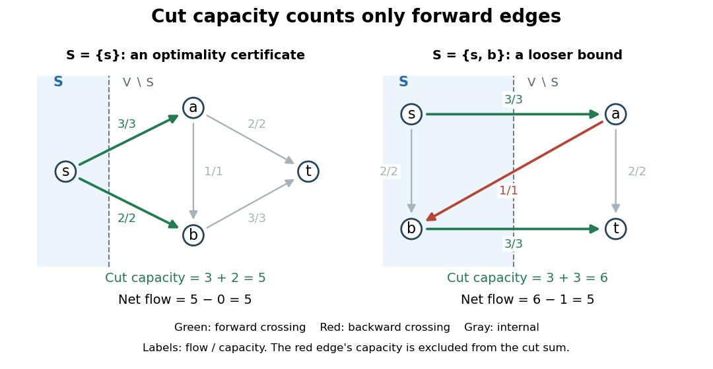
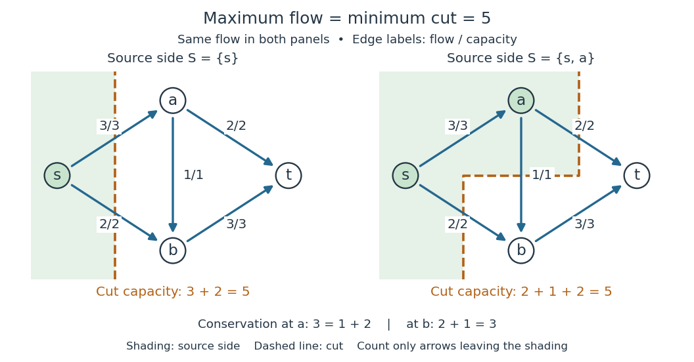
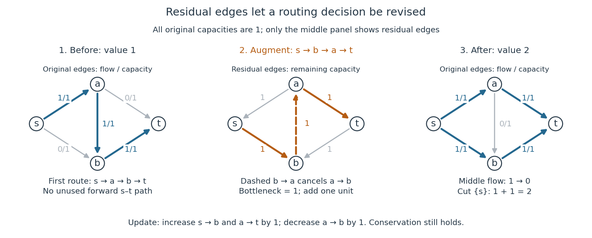

# Flow network

↑ **Parent:** [Graph theory](graph-theory.md)  
ⓦ [Wiki](https://en.wikipedia.org/wiki/Flow_network)

A [flow network](flow-network.md) is a [directed graph](graph-theory.md#directed-graph) $G=(V,E)$ with distinct source and sink [vertices](graph.md#vertex-graph-theory) $s,t$ and a nonnegative [flow network edge capacity](#flow-network-edge-capacity) $c_{uv}$ on each directed [edge](graph-theory.md#edge-of-a-graph) $(u,v)$. In the finite setting here, every [flow network edge capacity](#flow-network-edge-capacity) is a finite real number. A [feasible flow](graph-theory.md#feasible-flow) assigns a nonnegative amount $f_{uv}$ to each original directed [edge](graph-theory.md#edge-of-a-graph), satisfies the [capacity constraints](#capacity-constraint), and obeys [flow conservation](#flow-conservation) at every other [vertex](graph.md#vertex-graph-theory):

$$
0\leq f_{uv}\leq c_{uv},\qquad
\sum_{u:(u,v)\in E}f_{uv}=\sum_{w:(v,w)\in E}f_{vw}\quad(v\notin\{s,t\}).
$$

These are nonnegative arc amounts. The antisymmetric convention in [flow](#flow) instead records net amounts $\theta_{uv}=f_{uv}-f_{vu}$, taking a missing arc amount as zero. The two conventions express the same [flow conservation](#flow-conservation); keeping them distinct makes backward [residual network](#residual-network) [edges](graph-theory.md#edge-of-a-graph) easier to interpret.

Think of [vertices](graph.md#vertex-graph-theory) as routers, directed [edges](graph-theory.md#edge-of-a-graph) as communication links, [flow network edge capacities](#flow-network-edge-capacity) as available bandwidth, and [flow](#flow) as a steady transmission rate. An intermediate router can distribute incoming traffic among outgoing links, but [flow conservation](#flow-conservation) prevents it from creating traffic. The [maximum flow problem](#maximum-flow-problem) asks how much total traffic can pass from $s$ to $t$, allowing several [graph paths](graph-theory.md#path-in-a-graph) to share the work. The same [flow network](flow-network.md) language models transportation and abstract resource allocation.[Goemans, Network flows, introduction and maximum flow formulation](https://ocw.mit.edu/courses/6-854j-advanced-algorithms-fall-2008/4064d889e5033a9915327a777d12b592_notes_flow.pdf)

Our running [flow network](flow-network.md) has [vertices](graph.md#vertex-graph-theory) $V=\{s,a,b,t\}$ and exactly five directed [edges](graph-theory.md#edge-of-a-graph), with [flow network edge capacities](#flow-network-edge-capacity)

$$
(c_{sa},c_{sb},c_{ab},c_{at},c_{bt})=(3,2,1,2,3).
$$

The cross [edge](graph-theory.md#edge-of-a-graph) $a\to b$ lets traffic entering $a$ use spare capacity on $b\to t$. With this [edge](graph-theory.md#edge-of-a-graph) removed, the two separate [graph paths](graph-theory.md#path-in-a-graph) can carry only $\min(3,2)+\min(2,3)=4$; including it will let the [maximum flow](#maximum-flow-problem) reach $5$. Thus a link's usefulness depends on the rest of the [flow network](flow-network.md), rather than just its own [flow network edge capacity](#flow-network-edge-capacity).

**Table of contents**

- [Circulation in a flow network](#circulation-in-a-flow-network)
- [Vertex capacity](#vertex-capacity)
- [Maximum flow problem](#maximum-flow-problem)
  - [Dinic's algorithm](#dinic-s-algorithm)
  - [Sports elimination by maximum flow](#sports-elimination-by-maximum-flow)
  - [Treatment capacity as a sink arc](#treatment-capacity-as-a-sink-arc)
  - [Server connectivity under component failures](#server-connectivity-under-component-failures)
  - [Edmonds–Karp algorithm](#edmonds-karp-algorithm)
  - [Maximum flow with vertex capacities](#maximum-flow-with-vertex-capacities)
    - [Vertex splitting](#vertex-splitting)
- [Flow network edge capacity](#flow-network-edge-capacity)
- [Capacity constraint](#capacity-constraint)
- [Cut of a flow network](#cut-of-a-flow-network)
  - [Minimum cut](#minimum-cut)
    - [Diagonal cut in a nearest-neighbour lattice flow](#diagonal-cut-in-a-nearest-neighbour-lattice-flow)
  - [Cut capacity](#cut-capacity)
- [Flow](#flow)
  - [Unit flow](#unit-flow)
  - [Divergence of a flow](#divergence-of-a-flow)
    - [Flow conservation](#flow-conservation)
  - [Strength of a flow](#strength-of-a-flow)
  - [Energy of a flow](#energy-of-a-flow)
    - [Finite-energy flow criterion for transience](#finite-energy-flow-criterion-for-transience)
- [Max-flow min-cut theorem](#max-flow-min-cut-theorem)
  - [Residual reachability certificate for maximum flow](#residual-reachability-certificate-for-maximum-flow)
  - [Uniform capacity perturbation of a flow network](#uniform-capacity-perturbation-of-a-flow-network)
  - [Integral max-flow theorem](#integral-max-flow-theorem)
  - [Kőnig's theorem (graph theory)](#konig-s-theorem-graph-theory)
  - [Residual network](#residual-network)
    - [Residual maximum flow is the remaining optimality gap](#residual-maximum-flow-is-the-remaining-optimality-gap)
    - [Augmenting path](#augmenting-path)
      - [Widest augmenting path](#widest-augmenting-path)
        - [Geometric convergence of widest-path augmentation](#geometric-convergence-of-widest-path-augmentation)
      - [Ford-Fulkerson algorithm](#ford-fulkerson-algorithm)
        - [Integrality of the Ford-Fulkerson algorithm](#integrality-of-the-ford-fulkerson-algorithm)
  - [Parametric maximum flow with one source capacity](#parametric-maximum-flow-with-one-source-capacity)

## Circulation in a flow network

↑ **Parent:** [Flow network](flow-network.md)

A [network circulation](#circulation-in-a-flow-network) is a [flow](#flow) with zero net supply at every vertex. A feasible residual [network circulation](#circulation-in-a-flow-network) changes one feasible flow into another with the same prescribed supplies. It decomposes into directed cycles, giving the negative-cycle optimality test for [minimum-cost flow](graph-theory.md#minimum-cost-flow-problem).

## Vertex capacity

↑ **Parent:** [Flow network](flow-network.md)

An internal vertex capacity bounds the total [flow](#flow) through that vertex, equivalently its total inflow or outflow by [flow conservation](#flow-conservation). Replace the vertex by an input and output vertex, direct incoming edges to the input and outgoing edges from the output, and connect input to output with an edge of the vertex capacity. This converts the constraint into an ordinary [flow network edge capacity](#flow-network-edge-capacity).

## Maximum flow problem

↑ **Parent:** [Flow network](flow-network.md)  
ⓦ [Wiki](https://en.wikipedia.org/wiki/Maximum_flow_problem)

The [maximum flow problem](#maximum-flow-problem) maximises the [strength of a flow](#strength-of-a-flow) from a source to a sink subject to [flow conservation](#flow-conservation) and [flow network edge capacities](#flow-network-edge-capacity). For the nonnegative arc amounts used in [flow network](flow-network.md), its objective is net outflow from the source:

$$
|f|=\sum_{v:(s,v)\in E}f_{sv}-\sum_{u:(u,s)\in E}f_{us}
=\sum_{u:(u,t)\in E}f_{ut}-\sum_{v:(t,v)\in E}f_{tv}.
$$

The equality follows by summing [flow conservation](#flow-conservation) over all internal [vertices](graph.md#vertex-graph-theory). Incoming source [flow](#flow) must be subtracted: merely circulating traffic through $s$ does not deliver more to $t$. The [max-flow min-cut theorem](#max-flow-min-cut-theorem) identifies the optimum with the least [cut capacity](#cut-capacity) of a [cut of a flow network](#cut-of-a-flow-network). A [feasible flow](graph-theory.md#feasible-flow) and a [cut of a flow network](#cut-of-a-flow-network) of equal value certify optimality without requiring a particular choice of [augmenting paths](#augmenting-path).

For the five-[edge](graph-theory.md#edge-of-a-graph) [flow network](flow-network.md) with [flow network edge capacities](#flow-network-edge-capacity) $(3,2,1,2,3)$, take

$$
(f_{sa},f_{sb},f_{ab},f_{at},f_{bt})=(3,2,1,2,3).
$$

Every [capacity constraint](#capacity-constraint) holds with equality. [Flow conservation](#flow-conservation) at $a$ is $3=1+2$, and at $b$ it is $2+1=3$. The [strength of a flow](#strength-of-a-flow) is $|f|=3+2=5$, also $2+3=5$ entering $t$. This [flow](#flow) consists of $2$ units on the [graph path](graph-theory.md#path-in-a-graph) $s\to a\to t$, $2$ on $s\to b\to t$, and $1$ on $s\to a\to b\to t$. The [cut of a flow network](#cut-of-a-flow-network) with source side $\{s\}$ has [cut capacity](#cut-capacity) $3+2=5$, so no [feasible flow](graph-theory.md#feasible-flow) can do better.

Even a seemingly poor first [augmenting path](#augmenting-path) $s\to a\to b\to t$, carrying $1$, does not cause failure in this example. It leaves [residual network](#residual-network) capacity $2$ along $s\to a\to t$ and $2$ along $s\to b\to t$. These two subsequent [augmenting paths](#augmenting-path) yield values $1$, $3$, and $5$, and produce exactly the [flow](#flow) above. Backward [residual network](#residual-network) [edges](graph-theory.md#edge-of-a-graph) become essential in the unit-capacity example under [residual network](#residual-network), where this same first choice blocks every unused forward route.

Discrete assignment is another reason to study [maximum flow](#maximum-flow-problem). Put unit-capacity [edges](graph-theory.md#edge-of-a-graph) from $s$ to job [vertices](graph.md#vertex-graph-theory), from each job to eligible worker [vertices](graph.md#vertex-graph-theory), and from workers to $t$. An integral [flow](#flow) selects a [matching in a graph](matching-graph-theory.md): each job and worker participates at most once, and the [strength of a flow](#strength-of-a-flow) counts assigned jobs. The [integral max-flow theorem](#integral-max-flow-theorem) therefore turns maximum cardinality assignment into [maximum flow](#maximum-flow-problem). Minimizing assignment costs is the related [assignment problem](linear-programming.md#assignment-problem), modeled by [minimum-cost flow](graph-theory.md#minimum-cost-flow-problem).[Goemans, Network flows, assignment formulation](https://ocw.mit.edu/courses/6-854j-advanced-algorithms-fall-2008/4064d889e5033a9915327a777d12b592_notes_flow.pdf)

<h3 id="dinic-s-algorithm">Dinic's algorithm</h3>

↑ **Parent:** [Maximum flow problem](#maximum-flow-problem)

### Sports elimination by maximum flow

↑ **Parent:** [Maximum flow problem](#maximum-flow-problem)

For a league in which every remaining game gives exactly one win, first give the target team all its remaining wins, obtaining $W$. Make a node for each unordered pair of other teams, with source capacity equal to their remaining games. Route each game-node flow to one of its two teams, and cap the team's total additional wins at $W-w_i-1$ for a strict target victory. A negative cap immediately rules out success. Otherwise an integral [maximum flow](#maximum-flow-problem) saturating every game-source arc specifies the winners of all games and proves feasibility. Each actual game is counted once; duplicating ordered pairs changes the problem.

### Treatment capacity as a sink arc

↑ **Parent:** [Maximum flow problem](#maximum-flow-problem)

In a [flow network](flow-network.md) for treatment facilities, the amount treated at a facility is represented by a directed arc from it to the sink, with that arc's capacity equal to its treatment limit. Untreated fluid may pass through the facility independently of how much is treated there. Thus the treatment limit is not a bound on total incoming flow. [Flow conservation](#flow-conservation) at a facility equates incoming flow with outgoing untreated flow plus its sink-arc flow.

### Server connectivity under component failures

↑ **Parent:** [Maximum flow problem](#maximum-flow-problem)

To find the smallest link failure set separating a client from every server, add a common sink with sufficiently large-capacity server arcs and give original links unit capacities in both directions. The [max-flow min-cut theorem](#max-flow-min-cut-theorem) identifies the minimum failure count $\lambda$. Unit-capacity [vertex splitting](#vertex-splitting) also charges intermediary node failures. The network tolerates fewer than $\lambda$ failures and fails for some set of $\lambda$ failures. This concerns connection to at least one server, not separate connectivity to each server.

<h3 id="edmonds-karp-algorithm">Edmonds–Karp algorithm</h3>

↑ **Parent:** [Maximum flow problem](#maximum-flow-problem)  
ⓦ [Wiki](https://en.wikipedia.org/wiki/Edmonds–Karp_algorithm)

This [maximum flow](#maximum-flow-problem) algorithm repeatedly augments along a shortest residual path found by [breadth-first search](tree-graph-theory.md#breadth-first-search). Residual distances from the source never decrease. If the same arc becomes saturated again after being restored by a reverse augmentation, the distance to its tail has increased by at least two. Thus each arc is critical only $O(|V|)$ times, yielding $O(|V||E|)$ augmentations. Each search costs $O(|E|)$, so the total time is $O(|V||E|^2)$. Termination with no residual source-sink path supplies a [max-flow min-cut theorem](#max-flow-min-cut-theorem) certificate.

### Maximum flow with vertex capacities

↑ **Parent:** [Maximum flow problem](#maximum-flow-problem)

The [maximum flow problem](#maximum-flow-problem) with internal [vertex capacities](#vertex-capacity) reduces to the usual edge-capacitated problem by splitting each constrained vertex into input and output copies. The connecting edge carries its entire through-flow. Feasible flows correspond under this construction, preserving the source-to-sink value; the [Ford-Fulkerson algorithm](#ford-fulkerson-algorithm) and [max-flow min-cut theorem](#max-flow-min-cut-theorem) therefore apply to the transformed network.

#### Vertex splitting

↑ **Parent:** [Maximum flow with vertex capacities](#maximum-flow-with-vertex-capacities)

Replace a vertex $v$ by $v_{\rm in},v_{\rm out}$ and an arc between them carrying its vertex capacity. Incoming arcs enter $v_{\rm in}$ and outgoing arcs leave $v_{\rm out}$. A path must cross that internal arc to use the vertex. This converts node-capacitated [maximum flow](#maximum-flow-problem) to an ordinary [flow network](flow-network.md). For undirected mixed-failure cuts, normalize the source side so $v_{\rm out}$ inside implies $v_{\rm in}$ inside; then each original link contributes at most one crossing orientation.

## Flow network edge capacity

↑ **Parent:** [Flow network](flow-network.md)

A directed edge capacity is the upper bound $c_{ij}\geq0$ on the feasible nonnegative [flow](#flow) through that edge. In a [residual network](#residual-network), its forward residual capacity is $c_{ij}-f_{ij}$ and its backward residual capacity is $f_{ij}$. Increasing every edge capacity need not increase the [maximum flow](#maximum-flow-problem) by that same amount, because a [cut of a flow network](#cut-of-a-flow-network) can contain several edges.

## Capacity constraint

↑ **Parent:** [Flow network](flow-network.md)

If a directed edge $e$ has capacity $c(e)$, a feasible flow satisfies $0\leq f(e)\leq c(e)$. In an antisymmetric-flow convention, this is encoded together with the residual capacity of the reverse orientation.

## Cut of a flow network

↑ **Parent:** [Flow network](flow-network.md)

A source-to-sink [cut of a flow network](#cut-of-a-flow-network) is a [partition of a set](set.md#partition-of-a-set) $(S,V\setminus S)$ of the [vertex set](graph.md#vertex-set) of a [flow network](flow-network.md), with $s\in S$ and $t\notin S$. Its [cut capacity](#cut-capacity) sums the [flow network edge capacities](#flow-network-edge-capacity) of [directed edges](graph-theory.md#directed-edge) leaving $S$.[Graph Theory by Reinhard Diestel; Diestel, Flows, §6.2, printed p. 158: source-side partition and cut capacity](mathematics-bibliography.md#graph-theory-by-reinhard-diestel/flows-author-hosted-chapter-preview)

The side $S$ may contain any selection of the other [vertices](graph.md#vertex-graph-theory); its [induced subgraph](graph-theory.md#induced-subgraph) need not be a [connected graph](graph.md#connected-graph). For the five-[edge](graph-theory.md#edge-of-a-graph) [flow network](flow-network.md) with [flow network edge capacities](#flow-network-edge-capacity) $(c_{sa},c_{sb},c_{ab},c_{at},c_{bt})=(3,2,1,2,3)$, $S=\{s\}$ gives the [partition of a set](set.md#partition-of-a-set) $(\{s\},\{a,b,t\})$. Only $s\to a$ and $s\to b$ leave this side, so its [cut capacity](#cut-capacity) is $3+2=5$. Choosing $S=\{s,b\}$ instead puts $a\to b$ across the boundary in the incoming direction: its [flow network edge capacity](#flow-network-edge-capacity) is excluded.

**[Figure 1](#image-forward-cut-capacity-bounds-net-flow-with-backward-flow-subtracted). Forward cut capacity bounds net flow, with backward flow subtracted**.

The left panel pairs a [feasible flow](graph-theory.md#feasible-flow) of [flow value](#strength-of-a-flow) $5$ with a [cut of a flow network](#cut-of-a-flow-network) of [cut capacity](#cut-capacity) $5$, proving that each is optimal. The right panel uses the same [feasible flow](graph-theory.md#feasible-flow) but a different [cut of a flow network](#cut-of-a-flow-network): the outward [flow](#flow) is $3+3=6$ and the backward [flow](#flow) is $1$, giving net [flow](#flow) $6-1=5$. That [cut capacity](#cut-capacity) is $6$, so it supplies a valid but less sharp bound. The dashed boundary marks a [partition of a set](set.md#partition-of-a-set), rather than an additional [edge](graph-theory.md#edge-of-a-graph) or a proposed route.

### Minimum cut

↑ **Parent:** [Cut of a flow network](#cut-of-a-flow-network)

A [minimum cut](#minimum-cut) is a [cut of a flow network](#cut-of-a-flow-network) of least [cut capacity](#cut-capacity) for the prescribed source $s$ and sink $t$. The [max-flow min-cut theorem](#max-flow-min-cut-theorem) equates that least [cut capacity](#cut-capacity) with the greatest [flow value](#strength-of-a-flow).[Graph Theory by Reinhard Diestel; Diestel, Flows, §6.2, Theorem 6.2.2, printed p. 159](mathematics-bibliography.md#graph-theory-by-reinhard-diestel/flows-author-hosted-chapter-preview)

To certify a particular [minimum cut](#minimum-cut), exhibit a [feasible flow](graph-theory.md#feasible-flow) whose [flow value](#strength-of-a-flow) equals its [cut capacity](#cut-capacity). Every [feasible flow](graph-theory.md#feasible-flow) is bounded above by every [cut capacity](#cut-capacity), so this single equality proves both optimalities.[Algorithms, 4th edition by Robert Sedgewick and others; Sedgewick and Wayne, FordFulkerson.java, check method, lines 180–209: feasibility, source/sink membership and equality of values](mathematics-bibliography.md#algorithms-4th-edition-by-robert-sedgewick-and-others/fordfulkerson-java)

In the running example, the four possible source sides $\{s\}$, $\{s,a\}$, $\{s,b\}$ and $\{s,a,b\}$ have [cut capacities](#cut-capacity) $5,5,6,5$, respectively. The [feasible flow](graph-theory.md#feasible-flow) of [flow value](#strength-of-a-flow) $5$ therefore certifies three different [minimum cuts](#minimum-cut). A [minimum cut](#minimum-cut) need not be unique; the optimum [cut capacity](#cut-capacity) is the same for all of them. Merely saturating many [edges](graph-theory.md#edge-of-a-graph) does not give this certificate: [flow conservation](#flow-conservation) and the particular [cut of a flow network](#cut-of-a-flow-network) must also be checked.

#### Diagonal cut in a nearest-neighbour lattice flow

↑ **Parent:** [Minimum cut](#minimum-cut)

On $\{0,\ldots,m\}^2$, give an adjacent edge capacity equal to the larger endpoint distance $|i_1-i_2|$ from the diagonal. The set $S=\{i_1<i_2\}$ has $2m$ outgoing edges: two at each interior diagonal vertex and one at each endpoint. Every such edge has capacity one. Thus any [flow](#flow) from above to below the diagonal is at most $2m$; a feasible path decomposition attaining this value certifies optimality by [weak duality](linear-programming.md#weak-duality).

### Cut capacity

↑ **Parent:** [Cut of a flow network](#cut-of-a-flow-network)

The [cut capacity](#cut-capacity) of $(S,S^c)$, with $S^c=V\setminus S$ the [complement of a set](set.md#complement-of-a-set), is

$$
c(S,S^c)=\sum_{(u,v)\in E:\,u\in S,\,v\notin S}c_{uv}.
$$

Only outward [directed edges](graph-theory.md#directed-edge) contribute; incoming and internal [edges](graph-theory.md#edge-of-a-graph) contribute nothing.[Algorithms, 4th edition by Robert Sedgewick and others; Sedgewick and Wayne, FordFulkerson.java, check method, lines 196–203: sum capacities only from the source side to its complement](mathematics-bibliography.md#algorithms-4th-edition-by-robert-sedgewick-and-others/fordfulkerson-java)

Here is the accounting behind the bound, using nonnegative original [edge](graph-theory.md#edge-of-a-graph) amounts $f_{uv}$ in a finite [flow network](flow-network.md). Sum the [divergence of a flow](#divergence-of-a-flow) over the [vertices](graph.md#vertex-graph-theory) in $S$:

$$
\sum_{v\in S}\operatorname{div}f(v)
=\sum_{v\in S}\left(\sum_{w:(v,w)\in E}f_{vw}-\sum_{u:(u,v)\in E}f_{uv}\right).
$$

An [edge](graph-theory.md#edge-of-a-graph) with both endpoints in $S$ appears once with a plus sign at its tail and once with a minus sign at its head, so those contributions cancel. An outward [edge](graph-theory.md#edge-of-a-graph) appears only with a plus sign; an incoming [edge](graph-theory.md#edge-of-a-graph) appears only with a minus sign. Since $s\in S$, $t\notin S$ and every other [vertex](graph.md#vertex-graph-theory) satisfies [flow conservation](#flow-conservation), the left side is the [flow value](#strength-of-a-flow). Thus

$$
|f|=\sum_{(u,v)\in E:\,u\in S,\,v\notin S}f_{uv}
-\sum_{(u,v)\in E:\,u\notin S,\,v\in S}f_{uv}
\leq\sum_{(u,v)\in E:\,u\in S,\,v\notin S}c_{uv}=c(S,S^c).
$$

The inequality uses two facts separately: each forward [flow](#flow) is at most its [flow network edge capacity](#flow-network-edge-capacity), and each backward [flow](#flow) is nonnegative. This is the [weak duality](linear-programming.md#weak-duality) bound underlying the [max-flow min-cut theorem](#max-flow-min-cut-theorem). It is an accounting proof, requiring no choice of [augmenting paths](#augmenting-path).

For $S=\{s,b\}$ in the running example, explicitly add the two [divergences of a flow](#divergence-of-a-flow):

$$
\operatorname{div}f(s)+\operatorname{div}f(b)
=(f_{sa}+f_{sb})+(f_{bt}-f_{sb}-f_{ab})
=f_{sa}+f_{bt}-f_{ab}=3+3-1=5.
$$

The internal $s\to b$ [edge](graph-theory.md#edge-of-a-graph) cancels. The $a\to b$ [edge](graph-theory.md#edge-of-a-graph) is a genuine original [directed edge](graph-theory.md#directed-edge) entering $S$, so its [flow](#flow) is subtracted; this is different from a backward [edge](graph-theory.md#edge-of-a-graph) in a [residual network](#residual-network). Its [flow network edge capacity](#flow-network-edge-capacity) is neither added to nor subtracted from [cut capacity](#cut-capacity), which remains $c_{sa}+c_{bt}=6$.

Equality in the bound holds precisely when every outward [edge](graph-theory.md#edge-of-a-graph) is saturated and every incoming [edge](graph-theory.md#edge-of-a-graph) carries zero [flow](#flow), because

$$
c(S,S^c)-|f|
=\sum_{(u,v)\in E:\,u\in S,\,v\notin S}(c_{uv}-f_{uv})
+\sum_{(u,v)\in E:\,u\notin S,\,v\in S}f_{uv},
$$

and every term is nonnegative. For $S=\{s\}$ the two outward [edges](graph-theory.md#edge-of-a-graph) are saturated and there are no incoming [edges](graph-theory.md#edge-of-a-graph), so the gap is zero. For $S=\{s,b\}$ all outward [edges](graph-theory.md#edge-of-a-graph) are still saturated, but the incoming [flow](#flow) of $1$ gives a gap of $1$. This explains exactly why the second [cut of a flow network](#cut-of-a-flow-network) is not a [minimum cut](#minimum-cut).

## Flow

↑ **Parent:** [Flow network](flow-network.md)

In a finite [directed graph](graph-theory.md#directed-graph) $G=(V,E)$ with distinct source and sink [vertices](graph.md#vertex-graph-theory) $s,t$, a [flow](#flow) records an amount $f_{uv}$ on each original [directed edge](graph-theory.md#directed-edge). For a [feasible flow](graph-theory.md#feasible-flow) in a [flow network](flow-network.md), these amounts satisfy the [capacity constraints](#capacity-constraint) $0\leq f_{uv}\leq c_{uv}$ and [flow conservation](#flow-conservation) at every [vertex](graph.md#vertex-graph-theory) other than $s,t$.[Algorithms, 4th edition by Robert Sedgewick and others; Sedgewick and Wayne, FlowEdge.java, class documentation and capacity/flow constructor: nonnegative amount on an original directed edge, bounded by capacity](mathematics-bibliography.md#algorithms-4th-edition-by-robert-sedgewick-and-others/flowedge-java)

The antisymmetric convention records signed net amounts instead:

$$
\theta_{uv}=f_{uv}-f_{vu},\qquad \theta_{vu}=-\theta_{uv},\qquad
\operatorname{div}\theta(v)=\sum_{w\in V}\theta_{vw}=0\quad(v\notin\{s,t\}),
$$

taking missing [edge](graph-theory.md#edge-of-a-graph) amounts as zero. The paired signs describe one net transfer, rather than two independent transfers.[Graph Theory by Reinhard Diestel; Diestel, Flows, §6.2, conditions F1 and F2′, printed p. 158: antisymmetry and conservation at nonterminal vertices](mathematics-bibliography.md#graph-theory-by-reinhard-diestel/flows-author-hosted-chapter-preview)

For example, if separate original [directed edges](graph-theory.md#directed-edge) $u\to v$ and $v\to u$ carry $3$ and $1$, their net amount is $\theta_{uv}=2$. This signed record loses the separate amounts: $f_{uv}=2$, $f_{vu}=0$ would give the same net amount. When checking [capacity constraints](#capacity-constraint) on actual [edges](graph-theory.md#edge-of-a-graph), keep the original amounts or specify the signed bounds carefully; when summing [flow conservation](#flow-conservation), either record gives the same [divergence of a flow](#divergence-of-a-flow).

For the running [flow network](flow-network.md), choose the original [edge](graph-theory.md#edge-of-a-graph) amounts

$$
(f_{sa},f_{sb},f_{ab},f_{at},f_{bt})=(3,2,1,2,3)
=(c_{sa},c_{sb},c_{ab},c_{at},c_{bt}).
$$

Every [capacity constraint](#capacity-constraint) holds. At $a$, incoming [flow](#flow) $3$ equals outgoing [flow](#flow) $1+2$; at $b$, incoming [flow](#flow) $2+1$ equals outgoing [flow](#flow) $3$. This [feasible flow](graph-theory.md#feasible-flow) has [flow value](#strength-of-a-flow) $5$, computed at $s$ or $t$.

**[Figure 2](#image-an-original-edge-flow-ledger-verifies-capacity-constraints-flow-conservation-and-flow-value-five). An original-edge flow ledger verifies capacity constraints, flow conservation and flow value five**.

The total of all five [edge](graph-theory.md#edge-of-a-graph) amounts is $11$, but the [flow value](#strength-of-a-flow) is $5$. A unit passing through several [edges](graph-theory.md#edge-of-a-graph) appears several times in that total. Concretely, route $2$ units along each of the [directed paths](graph-theory.md#directed-path) $s\to a\to t$ and $s\to b\to t$, and $1$ along $s\to a\to b\to t$. Their delivered amounts sum to $2+2+1=5$, while their [edge](graph-theory.md#edge-of-a-graph) usages sum to $2\cdot2+2\cdot2+1\cdot3=11$. The [cut of a flow network](#cut-of-a-flow-network) $S=\{s\}$ certifies that this delivery rate is already a [maximum flow](#maximum-flow-problem).

[Flow conservation](#flow-conservation) is useful because it makes a local ledger predict a global delivery rate: intermediate [vertices](graph.md#vertex-graph-theory) only redistribute the resource. An additional [network circulation](#circulation-in-a-flow-network) can change the individual [edge](graph-theory.md#edge-of-a-graph) amounts without changing the [flow value](#strength-of-a-flow). Counting net delivery rather than total [edge](graph-theory.md#edge-of-a-graph) usage prevents such recirculation from masquerading as increased output.

### Unit flow

↑ **Parent:** [Flow](#flow)

A unit flow from $a$ to $b$ is an antisymmetric [flow](#flow) with net outward [strength of a flow](#strength-of-a-flow) one at $a$, net inward strength one at $b$, and zero [divergence of a flow](#divergence-of-a-flow) elsewhere. For a unit flow to infinity, only the finite source has nonzero divergence.

### Divergence of a flow

↑ **Parent:** [Flow](#flow)

The [divergence of a flow](#divergence-of-a-flow) at a [vertex](graph.md#vertex-graph-theory) $v$ is net outward [flow](#flow). For original nonnegative [edge](graph-theory.md#edge-of-a-graph) amounts and their signed net record, respectively,

$$
\operatorname{div}f(v)
=\sum_{w:(v,w)\in E}f_{vw}-\sum_{u:(u,v)\in E}f_{uv}
=\sum_{w\in V}\theta_{vw}.
$$

Positive [divergence of a flow](#divergence-of-a-flow) means net supply, negative [divergence of a flow](#divergence-of-a-flow) means net demand, and zero is [flow conservation](#flow-conservation). This is the same sign convention as [flow balance](graph-theory.md#flow-balance).

In the running example, the [divergences of a flow](#divergence-of-a-flow) at $(s,a,b,t)$ are $(5,0,0,-5)$. Adding the four [divergences of a flow](#divergence-of-a-flow) gives zero: every [edge](graph-theory.md#edge-of-a-graph) contributes positively at one endpoint and negatively at the other. In a finite [flow network](flow-network.md), this cancellation explains why net supply at $s$ equals net demand at $t$.

#### Flow conservation

↑ **Parent:** [Divergence of a flow](#divergence-of-a-flow)

[Flow conservation](#flow-conservation) requires equal total inflow and outflow at every [vertex](graph.md#vertex-graph-theory) other than the source and sink:

$$
\sum_{u:(u,v)\in E}f_{uv}=\sum_{w:(v,w)\in E}f_{vw}
\quad(v\notin\{s,t\}).
$$

Equivalently, the [divergence of a flow](#divergence-of-a-flow) is zero there.[Algorithms, 4th edition by Robert Sedgewick and others; Sedgewick and Wayne, FordFulkerson.java, excess and isFeasible methods, lines 138–175: incoming minus outgoing amount and zero excess at nonterminal vertices](mathematics-bibliography.md#algorithms-4th-edition-by-robert-sedgewick-and-others/fordfulkerson-java)

This is a steady accounting condition: an intermediate [vertex](graph.md#vertex-graph-theory) neither creates the routed resource nor accumulates it. Splitting is allowed; equality between individual incoming and outgoing [edges](graph-theory.md#edge-of-a-graph) is not required. For the running [flow](#flow), the equation at $a$ is $f_{sa}=f_{ab}+f_{at}$, or $3=1+2$, and at $b$ it is $f_{sb}+f_{ab}=f_{bt}$, or $2+1=3$.

[Capacity constraints](#capacity-constraint) alone do not ensure [flow conservation](#flow-conservation). For instance, changing only $f_{ab}$ from $1$ to $0$ keeps every [edge](graph-theory.md#edge-of-a-graph) amount within its [flow network edge capacity](#flow-network-edge-capacity), but leaves an excess inflow of $1$ at $a$ and an excess outflow of $1$ at $b$. It is therefore not a [feasible flow](graph-theory.md#feasible-flow). Changing all affected [edge](graph-theory.md#edge-of-a-graph) amounts together to $(f_{sa},f_{sb},f_{ab},f_{at},f_{bt})=(2,2,0,2,2)$ restores both equations and gives [flow value](#strength-of-a-flow) $4$.

### Strength of a flow

↑ **Parent:** [Flow](#flow)

The [strength of a flow](#strength-of-a-flow), also called its [flow value](#strength-of-a-flow), is net outflow from $s$, equivalently net inflow to $t$:

$$
|f|=\sum_{v:(s,v)\in E}f_{sv}-\sum_{u:(u,s)\in E}f_{us}
=\sum_{u:(u,t)\in E}f_{ut}-\sum_{v:(t,v)\in E}f_{tv}.
$$

The notation $|f|$ denotes this signed value, rather than an absolute value.[Graph Theory by Reinhard Diestel; Diestel, Flows, §6.2, printed p. 159: total value after Proposition 6.2.1 and footnote 4 on possible negative values](mathematics-bibliography.md#graph-theory-by-reinhard-diestel/flows-author-hosted-chapter-preview)

The equality follows by summing the [divergence of a flow](#divergence-of-a-flow) over all [vertices](graph.md#vertex-graph-theory): the internal [vertices](graph.md#vertex-graph-theory) contribute zero by [flow conservation](#flow-conservation), while every [edge](graph-theory.md#edge-of-a-graph) cancels between its two endpoints. Hence $\operatorname{div}f(s)=-\operatorname{div}f(t)$. For the running [flow](#flow), $|f|=3+2=2+3=5$.

Net outflow matters even when the source has incoming [edges](graph-theory.md#edge-of-a-graph). As a separate example, give $s\to a$, $a\to s$ and $s\to t$ [flow network edge capacities](#flow-network-edge-capacity) $2,2,3$ and [flow](#flow) amounts $2,2,3$. At $a$, [flow conservation](#flow-conservation) reads $2=2$. The source sends $5$ units along outgoing [edges](graph-theory.md#edge-of-a-graph) but receives $2$ back, so the [flow value](#strength-of-a-flow) is $5-2=3$, exactly the amount arriving at $t$. The two-[edge](graph-theory.md#edge-of-a-graph) [network circulation](#circulation-in-a-flow-network) through $a$ raises total [edge](graph-theory.md#edge-of-a-graph) usage without increasing net delivery.

### Energy of a flow

↑ **Parent:** [Flow](#flow)

For unit edge resistances, the energy of a flow is

$$
\mathcal E(\theta)=\sum_e\theta(e)^2,
$$

where every unoriented edge is counted once.

#### Finite-energy flow criterion for transience

↑ **Parent:** [Energy of a flow](#energy-of-a-flow)

An infinite locally finite connected graph is a [transient graph](random-walk.md#transient-graph) exactly when it supports a unit flow from a vertex to infinity with finite [energy of a flow](#energy-of-a-flow).

## Max-flow min-cut theorem

↑ **Parent:** [Flow network](flow-network.md)  
ⓦ [Wiki](https://en.wikipedia.org/wiki/Max-flow_min-cut_theorem)

For a finite [flow network](flow-network.md) with finite nonnegative real [flow network edge capacities](#flow-network-edge-capacity), the greatest [strength of a flow](#strength-of-a-flow) of a [feasible flow](graph-theory.md#feasible-flow) equals the least [cut capacity](#cut-capacity) of a source-to-sink [cut of a flow network](#cut-of-a-flow-network):

$$
\max_{f\text{ feasible}}|f|
=\min_{S\subseteq V:\,s\in S,\,t\notin S}
\sum_{(u,v)\in E:\,u\in S,\,v\notin S}c_{uv}.
$$

For a [maximum flow](#maximum-flow-problem), the [vertices](graph.md#vertex-graph-theory) reachable from the source in the [residual network](#residual-network) define a [minimum cut](#minimum-cut) whose outgoing original [edges](graph-theory.md#edge-of-a-graph) are saturated and whose incoming original [edges](graph-theory.md#edge-of-a-graph) carry zero [flow](#flow).[Karger, MIT 6.854 Notes 6, maximum-flow optimality conditions](https://courses.csail.mit.edu/6.854/21/Notes/n06-flow.html)

Why is a [cut of a flow network](#cut-of-a-flow-network) an upper bound? Sum [flow conservation](#flow-conservation) on its source side $S$. Internal [edge](graph-theory.md#edge-of-a-graph) contributions cancel, leaving

$$
|f|=\sum_{(u,v)\in E:\,u\in S,\,v\notin S}f_{uv}
-\sum_{(u,v)\in E:\,u\notin S,\,v\in S}f_{uv}
\leq\sum_{(u,v)\in E:\,u\in S,\,v\notin S}c_{uv}
=c(S,V\setminus S).
$$

Only directed [edges](graph-theory.md#edge-of-a-graph) leaving $S$ contribute to [cut capacity](#cut-capacity). Directed [edges](graph-theory.md#edge-of-a-graph) entering $S$ are subtracted in net [flow](#flow), so adding their capacities to the upper bound would lose the intended bottleneck. This inequality is [weak duality](linear-programming.md#weak-duality); the theorem says the bound is attained, an instance of [strong duality](linear-programming.md#strong-duality). Its beauty is that a routing plan and a separating boundary independently witness each other's optimality.

In the running [flow network](flow-network.md), the two internal [vertices](graph.md#vertex-graph-theory) give four possible source sides. For $S=\{s\}$, the [cut capacity](#cut-capacity) is $c_{sa}+c_{sb}=3+2=5$. For $S=\{s,a\}$ it is $c_{sb}+c_{ab}+c_{at}=2+1+2=5$. For $S=\{s,b\}$ it is $c_{sa}+c_{bt}=3+3=6$; the incoming [edge](graph-theory.md#edge-of-a-graph) $a\to b$ contributes nothing to that [cut capacity](#cut-capacity). Finally, $S=\{s,a,b\}$ gives $c_{at}+c_{bt}=2+3=5$. Thus the [minimum cut](#minimum-cut) has [cut capacity](#cut-capacity) $5$, matching the explicitly computed [maximum flow](#maximum-flow-problem).

**[Figure 3](#image-maximum-flow-of-value-five-and-two-minimum-cut-certificates). Maximum flow of value five and two minimum-cut certificates**. Labels show flow/capacity on each directed edge. The shaded source sides give cuts of capacities three plus two and two plus one plus two, both equal to the flow value.

Ford and Fulkerson's 1956 paper opens with a railway-capacity question attributed there to T. Harris and proves a minimal-cut theorem as Theorem 1. Its original formulation uses [graph paths](graph-theory.md#path-in-a-graph) carrying nonnegative amounts; the [residual reachability certificate for maximum flow](#residual-reachability-certificate-for-maximum-flow) below gives the finite directed [flow network](flow-network.md) proof used here.[Ford and Fulkerson, Maximal Flow Through a Network, Canadian Journal of Mathematics 8 (1956), pp. 399–404](https://doi.org/10.4153/CJM-1956-045-5)

### Residual reachability certificate for maximum flow

↑ **Parent:** [Max-flow min-cut theorem](#max-flow-min-cut-theorem)

In a finite [flow network](flow-network.md), a [maximum flow](#maximum-flow-problem) exists because the [feasible flow](graph-theory.md#feasible-flow) set contains the zero [flow](#flow) and is a [compact set](topology.md#compact-space): the [capacity constraints](#capacity-constraint) bound every coordinate, and they and [flow conservation](#flow-conservation) define a [closed set](topology.md#closed-set). The [strength of a flow](#strength-of-a-flow) is a [continuous function](calculus.md#continuous-function), so the [extreme value theorem](real-analysis.md#extreme-value-theorem) gives an attained maximum. An [augmenting path](#augmenting-path) in the [residual network](#residual-network) would permit positive augmentation, contradicting maximality. The source-reachable [vertices](graph.md#vertex-graph-theory) in the [residual network](#residual-network) therefore define a [cut of a flow network](#cut-of-a-flow-network) whose outgoing original [edges](graph-theory.md#edge-of-a-graph) are saturated and incoming original [edges](graph-theory.md#edge-of-a-graph) carry zero [flow](#flow). [Flow conservation](#flow-conservation) makes the [strength of a flow](#strength-of-a-flow) equal to this [cut capacity](#cut-capacity), proving the [max-flow min-cut theorem](#max-flow-min-cut-theorem).

Existence and [strong duality](linear-programming.md#strong-duality) for finite real [flow network edge capacities](#flow-network-edge-capacity) do not imply finite termination for every choice of [augmenting paths](#augmenting-path) in the [Ford-Fulkerson algorithm](#ford-fulkerson-algorithm). With irrational capacities, some choices can continue forever. With integer capacities, [Integrality of the Ford-Fulkerson algorithm](#integrality-of-the-ford-fulkerson-algorithm) instead forces finite termination; rational capacities reduce to that case by a common denominator. Choosing shortest [augmenting paths](#augmenting-path) as in the [Edmonds–Karp algorithm](#edmonds-karp-algorithm) avoids dependence on capacity magnitudes.[Karger, MIT 6.854 Notes 6, section 2.1, rational and real capacities](https://courses.csail.mit.edu/6.854/21/Notes/n06-flow.html)

### Uniform capacity perturbation of a flow network

↑ **Parent:** [Max-flow min-cut theorem](#max-flow-min-cut-theorem)

If every directed edge capacity increases by $\varepsilon$, a [cut of a flow network](#cut-of-a-flow-network) with $m(S)$ outgoing edges gains $\varepsilon m(S)$. By the [max-flow min-cut theorem](#max-flow-min-cut-theorem), the new [maximum flow](#maximum-flow-problem) value is

$$
v(\varepsilon)=\min_{S:s\in S,\,t\notin S}\bigl(c(S)+\varepsilon m(S)\bigr).
$$

For a finite [flow network](flow-network.md), this is a nondecreasing concave piecewise-linear function, and its active cut can change as $\varepsilon$ varies. Two unit-capacity edge-disjoint two-edge source-to-sink paths gain $2\varepsilon$, refuting an invariably exact $\varepsilon$ increase. If there is a directed source-to-sink path, every cut has at least one outgoing edge and the increase is at least $\varepsilon$; without a path it can be zero.

### Integral max-flow theorem

↑ **Parent:** [Max-flow min-cut theorem](#max-flow-min-cut-theorem)

A flow network with integer capacities has a maximum flow whose value on every edge is an integer. The augmenting-path algorithm proves this because every augmentation preserves integrality.

<h3 id="konig-s-theorem-graph-theory">Kőnig's theorem (graph theory)</h3>

↑ **Parent:** [Max-flow min-cut theorem](#max-flow-min-cut-theorem)  
ⓦ [Wiki](https://en.wikipedia.org/wiki/Kőnig's_theorem_(graph_theory))

In a finite bipartite graph, the maximum size of a matching equals the minimum size of a vertex cover. It follows by representing matching as an integral flow and vertex covers as finite-capacity cuts.

### Residual network

↑ **Parent:** [Max-flow min-cut theorem](#max-flow-min-cut-theorem)

For a [feasible flow](graph-theory.md#feasible-flow) $f$, each original directed [edge](graph-theory.md#edge-of-a-graph) $u\to v$ supplies a forward [residual network](#residual-network) [edge](graph-theory.md#edge-of-a-graph) of capacity $c_{uv}-f_{uv}$ and a backward one $v\to u$ of capacity $f_{uv}$; zero-capacity residual [edges](graph-theory.md#edge-of-a-graph) may be omitted. The forward [edge](graph-theory.md#edge-of-a-graph) permits an increase, while the backward [edge](graph-theory.md#edge-of-a-graph) permits cancellation of existing [flow](#flow). In particular, backward residual capacity is the amount already sent, rather than unused original capacity. If both original orientations exist, keep their residual contributions separate, or add capacities for contributions with the same direction. An [augmenting path](#augmenting-path) uses these permitted changes while preserving [flow conservation](#flow-conservation) and the [capacity constraints](#capacity-constraint).

To see why cancellation matters, give all five directed [edges](graph-theory.md#edge-of-a-graph) $s\to a$, $s\to b$, $a\to b$, $a\to t$, $b\to t$ unit [flow network edge capacities](#flow-network-edge-capacity). Starting from zero [flow](#flow), an [augmenting path](#augmenting-path) $s\to a\to b\to t$ carrying $1$ yields

$$
(f_{sa},f_{sb},f_{ab},f_{at},f_{bt})=(1,0,1,0,1),\qquad |f|=1.
$$

The remaining unused original [edges](graph-theory.md#edge-of-a-graph) are $s\to b$ and $a\to t$, which do not form a source-to-sink [graph path](graph-theory.md#path-in-a-graph). However, the backward residual [edge](graph-theory.md#edge-of-a-graph) $b\to a$ has capacity $f_{ab}=1$. Consequently the [residual network](#residual-network) contains the [augmenting path](#augmenting-path) $s\to b\to a\to t$, with residual capacities $1,1,1$.

Augment by $1$: increase $f_{sb}$ and $f_{at}$ from $0$ to $1$, and decrease $f_{ab}$ from $1$ to $0$. The result is

$$
(f_{sa},f_{sb},f_{ab},f_{at},f_{bt})=(1,1,0,1,1),\qquad |f|=2.
$$

Now [flow conservation](#flow-conservation) is $1=0+1$ at $a$ and $1+0=1$ at $b$. The final [flow](#flow) sends one unit along each of $s\to a\to t$ and $s\to b\to t$. The [cut of a flow network](#cut-of-a-flow-network) $S=\{s\}$ has [cut capacity](#cut-capacity) $1+1=2$, proving this is a [maximum flow](#maximum-flow-problem). Traversing $b\to a$ in the [residual network](#residual-network) revised the earlier routing decision; it did not send actual traffic along a nonexistent original [edge](graph-theory.md#edge-of-a-graph).

**[Figure 4](#image-backward-residual-capacity-reroutes-the-first-unit-of-flow). Backward residual capacity reroutes the first unit of flow**. Before: one unit follows s to a to b to t. Middle: the residual augmenting path s to b to a to t cancels flow on a to b. After: two units use the separate paths, and the middle original edge carries zero flow.

#### Residual maximum flow is the remaining optimality gap

↑ **Parent:** [Residual network](#residual-network)

For an undirected capacitated network, write the net edge flow as $y_{ij}=-y_{ji}$, and the directed residual capacity as $c_{ij}-y_{ij}$. On every source–sink cut, residual capacity is the original cut capacity minus the current net flow value $f$. Taking the minimum over cuts and applying the [max-flow min-cut theorem](#max-flow-min-cut-theorem) to each network gives the displayed remaining-flow identity.

#### Augmenting path

↑ **Parent:** [Residual network](#residual-network)

An [augmenting path](#augmenting-path) is a source-to-sink [graph path](graph-theory.md#path-in-a-graph) $P$ of positive capacities in the [residual network](#residual-network). Its bottleneck is $\Delta=\min_{e\in P}c_f(e)>0$. Add $\Delta$ to original [flow](#flow) on forward residual [edges](graph-theory.md#edge-of-a-graph) and subtract $\Delta$ on backward residual [edges](graph-theory.md#edge-of-a-graph). Each internal [vertex](graph.md#vertex-graph-theory) still satisfies [flow conservation](#flow-conservation), and the bottleneck guarantees every [capacity constraint](#capacity-constraint). The resulting [feasible flow](graph-theory.md#feasible-flow) has [strength of a flow](#strength-of-a-flow) $|f|+\Delta$. In the unit-capacity [residual network](#residual-network) example, $\Delta=1$, and the subtraction on $a\to b$ is precisely what allows the value to rise from $1$ to $2$.

##### Widest augmenting path

↑ **Parent:** [Augmenting path](#augmenting-path)

An [augmenting path](#augmenting-path) maximizing the possible increase in flow, namely its smallest [residual network](#residual-network) edge capacity. If the remaining maximum flow is $F>0$ and the original undirected network has $m$ edges, a path has bottleneck at least $F/m$. Otherwise the vertices reachable through arcs of capacity at least $F/m$ define a cut of capacity strictly less than $F$, contradicting the [max-flow min-cut theorem](#max-flow-min-cut-theorem). Only one directed arc per original crossing edge contributes to that cut.

###### Geometric convergence of widest-path augmentation

↑ **Parent:** [Widest augmenting path](#widest-augmenting-path)

Starting from zero flow, a [widest augmenting path](#widest-augmenting-path) increases the current flow by at least $F_k/m$, where $F_k$ is its remaining optimality gap. Therefore $F_{k+1}\leq(1-1/m)F_k$. Integer capacities keep this gap integer, so a gap below one is zero. The method takes $O(m\log f^*)$ augmentations for $f^*\geq2$, or uniformly $O(m\log(1+f^*))$; zero maximum flow requires no augmentation.

##### Ford-Fulkerson algorithm

↑ **Parent:** [Augmenting path](#augmenting-path)  
ⓦ [Wiki](https://en.wikipedia.org/wiki/Ford-Fulkerson_algorithm)

The Ford-Fulkerson algorithm repeatedly augments a feasible flow along an [augmenting path](#augmenting-path). When no such path remains, the source-reachable vertices in the [residual network](#residual-network) define a cut of capacity equal to the flow value, proving optimality by the [max-flow min-cut theorem](#max-flow-min-cut-theorem).

###### Integrality of the Ford-Fulkerson algorithm

↑ **Parent:** [Ford-Fulkerson algorithm](#ford-fulkerson-algorithm)

Starting from the zero flow with integer capacities, every residual capacity and every augmenting bottleneck is an integer. Each augmentation therefore preserves integer edge flows and raises the flow value by at least one. Since the value is bounded by the total capacity leaving the source, the algorithm terminates after finitely many augmentations with an integral maximum flow.

### Parametric maximum flow with one source capacity

↑ **Parent:** [Max-flow min-cut theorem](#max-flow-min-cut-theorem)

If one edge leaving the source has capacity $x$, every cut capacity is affine in $x$ with coefficient zero or one. In the 2024 Cambridge Part IB example, cuts of capacities $x+5$ and $14$ are both sharp, giving

$$
\delta^*(x)=\min\{x+5,14\}.
$$

## ↑ Ancestors (5)

1. [Graph theory](graph-theory.md)
2. [Foundations of mathematics](foundations-of-mathematics.md)
3. [Area of mathematics](mathematics.md#area-of-mathematics)
4. [Mathematics](mathematics.md)
5. [Codex Wiki](README.md)

## ← Incoming links (30)

- [Braess's paradox](queueing-theory.md#braess-s-paradox)
- [Cut capacity](#cut-capacity)
- [Cut of a flow network](#cut-of-a-flow-network)
- [Divergence of a flow](#divergence-of-a-flow)
- [Flow](#flow)
- [Flow network](flow-network.md)
- [Fluid flow](fluid-mechanics.md#fluid-flow)
- [Max-flow min-cut theorem](#max-flow-min-cut-theorem)
- [Maximum flow problem](#maximum-flow-problem)
- [Nonatomic congestion game](game-theory.md#nonatomic-congestion-game)
- [Outdegree orientation criterion](graph-theory.md#outdegree-orientation-criterion)
- [Solution](past-exam-of-the-mathematics-course-of-the-university-of-cambridge/2002/ib/paper-4.md#5h/solution)
- [Solution](past-exam-of-the-mathematics-course-of-the-university-of-cambridge/2004/ib/paper-4.md#10g/solution)
- [Solution](past-exam-of-the-mathematics-course-of-the-university-of-cambridge/2006/ib/paper-2.md#9c/solution)
- [Solution](past-exam-of-the-mathematics-course-of-the-university-of-cambridge/2007/ib/paper-1.md#8c/solution)
- [Solution](past-exam-of-the-mathematics-course-of-the-university-of-cambridge/2007/iii/paper-35.md#2/a/solution)
- [Solution](past-exam-of-the-mathematics-course-of-the-university-of-cambridge/2009/ib/paper-2.md#9h/solution)
- [Solution](past-exam-of-the-mathematics-course-of-the-university-of-cambridge/2010/iii/paper-35.md#3/a/solution)
- [Solution](past-exam-of-the-mathematics-course-of-the-university-of-cambridge/2013/ib/paper-2.md#9h/solution)
- [Solution](past-exam-of-the-mathematics-course-of-the-university-of-cambridge/2013/iii/paper-37.md#2/a/solution)
- [Solution](past-exam-of-the-mathematics-course-of-the-university-of-cambridge/2014/ib/paper-4.md#20h/solution)
- [Solution](past-exam-of-the-mathematics-course-of-the-university-of-cambridge/2014/iii/paper-37.md#3/a/solution)
- [Solution](past-exam-of-the-mathematics-course-of-the-university-of-cambridge/2016/ib/paper-4.md#20h/a/solution)
- [Solution](past-exam-of-the-mathematics-course-of-the-university-of-cambridge/2017/ib/paper-4.md#20h/a/solution)
- [Solution](past-exam-of-the-mathematics-course-of-the-university-of-cambridge/2017/iii/paper-109.md#1/solution)
- [Solution](past-exam-of-the-mathematics-course-of-the-university-of-cambridge/2019/ib/paper-4.md#20h/a/solution)
- [Residual reachability certificate for maximum flow](#residual-reachability-certificate-for-maximum-flow)
- [Treatment capacity as a sink arc](#treatment-capacity-as-a-sink-arc)
- [Uniform capacity perturbation of a flow network](#uniform-capacity-perturbation-of-a-flow-network)
- [Vertex splitting](#vertex-splitting)
