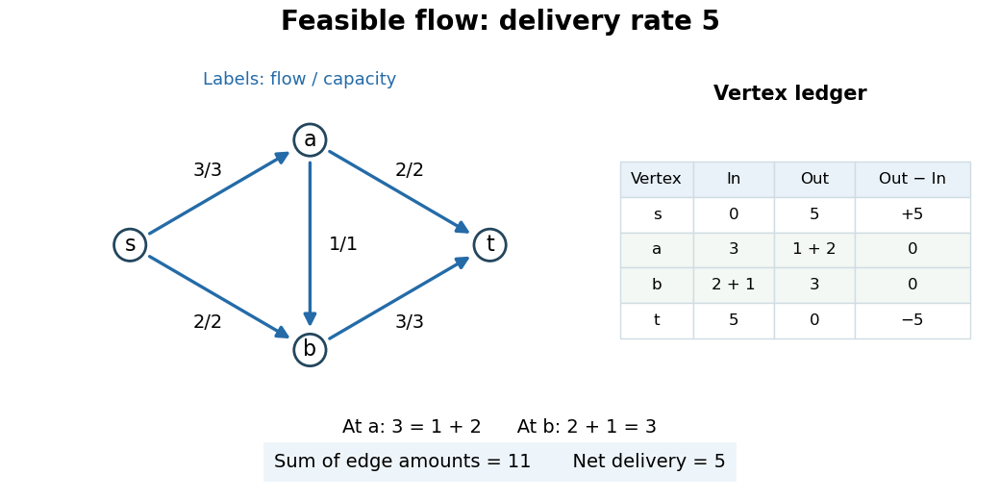

# Flow

↑ **Parent:** [Flow network](flow-network-split.md)

In a finite [directed graph](directed-graph.md) $G=(V,E)$ with distinct source and sink [vertices](vertex-graph-theory.md) $s,t$, a [flow](flow.md) records an amount $f_{uv}$ on each original [directed edge](directed-edge.md). For a [feasible flow](feasible-flow.md) in a [flow network](flow-network-split.md), these amounts satisfy the [capacity constraints](capacity-constraint.md) $0\leq f_{uv}\leq c_{uv}$ and [flow conservation](flow-conservation.md) at every [vertex](vertex-graph-theory.md) other than $s,t$.[Algorithms, 4th edition by Robert Sedgewick and others; Sedgewick and Wayne, FlowEdge.java, class documentation and capacity/flow constructor: nonnegative amount on an original directed edge, bounded by capacity](algorithms-4th-edition-by-robert-sedgewick-and-others/flowedge-java.md)

The antisymmetric convention records signed net amounts instead:

$$
\theta_{uv}=f_{uv}-f_{vu},\qquad \theta_{vu}=-\theta_{uv},\qquad
\operatorname{div}\theta(v)=\sum_{w\in V}\theta_{vw}=0\quad(v\notin\{s,t\}),
$$

taking missing [edge](edge-of-a-graph.md) amounts as zero. The paired signs describe one net transfer, rather than two independent transfers.[Graph Theory by Reinhard Diestel; Diestel, Flows, §6.2, conditions F1 and F2′, printed p. 158: antisymmetry and conservation at nonterminal vertices](graph-theory-by-reinhard-diestel/flows-author-hosted-chapter-preview.md)

For example, if separate original [directed edges](directed-edge.md) $u\to v$ and $v\to u$ carry $3$ and $1$, their net amount is $\theta_{uv}=2$. This signed record loses the separate amounts: $f_{uv}=2$, $f_{vu}=0$ would give the same net amount. When checking [capacity constraints](capacity-constraint.md) on actual [edges](edge-of-a-graph.md), keep the original amounts or specify the signed bounds carefully; when summing [flow conservation](flow-conservation.md), either record gives the same [divergence of a flow](divergence-of-a-flow.md).

For the running [flow network](flow-network-split.md), choose the original [edge](edge-of-a-graph.md) amounts

$$
(f_{sa},f_{sb},f_{ab},f_{at},f_{bt})=(3,2,1,2,3)
=(c_{sa},c_{sb},c_{ab},c_{at},c_{bt}).
$$

Every [capacity constraint](capacity-constraint.md) holds. At $a$, incoming [flow](flow.md) $3$ equals outgoing [flow](flow.md) $1+2$; at $b$, incoming [flow](flow.md) $2+1$ equals outgoing [flow](flow.md) $3$. This [feasible flow](feasible-flow.md) has [flow value](strength-of-a-flow.md) $5$, computed at $s$ or $t$.

**[Figure 2](#image-an-original-edge-flow-ledger-verifies-capacity-constraints-flow-conservation-and-flow-value-five). An original-edge flow ledger verifies capacity constraints, flow conservation and flow value five**.

The total of all five [edge](edge-of-a-graph.md) amounts is $11$, but the [flow value](strength-of-a-flow.md) is $5$. A unit passing through several [edges](edge-of-a-graph.md) appears several times in that total. Concretely, route $2$ units along each of the [directed paths](directed-path.md) $s\to a\to t$ and $s\to b\to t$, and $1$ along $s\to a\to b\to t$. Their delivered amounts sum to $2+2+1=5$, while their [edge](edge-of-a-graph.md) usages sum to $2\cdot2+2\cdot2+1\cdot3=11$. The [cut of a flow network](cut-of-a-flow-network.md) $S=\{s\}$ certifies that this delivery rate is already a [maximum flow](maximum-flow-problem.md).

[Flow conservation](flow-conservation.md) is useful because it makes a local ledger predict a global delivery rate: intermediate [vertices](vertex-graph-theory.md) only redistribute the resource. An additional [network circulation](circulation-in-a-flow-network.md) can change the individual [edge](edge-of-a-graph.md) amounts without changing the [flow value](strength-of-a-flow.md). Counting net delivery rather than total [edge](edge-of-a-graph.md) usage prevents such recirculation from masquerading as increased output.

**Table of contents**

- [Unit flow](unit-flow.md)
- [Divergence of a flow](divergence-of-a-flow.md)
  - [Flow conservation](flow-conservation.md)
- [Strength of a flow](strength-of-a-flow.md)
- [Energy of a flow](energy-of-a-flow.md)
  - [Finite-energy flow criterion for transience](finite-energy-flow-criterion-for-transience.md)

## ↑ Ancestors (6)

1. [Flow network](flow-network-split.md)
2. [Graph theory](graph-theory-split.md)
3. [Foundations of mathematics](foundations-of-mathematics-split.md)
4. [Area of mathematics](area-of-mathematics.md)
5. [Mathematics](mathematics-split.md)
6. [Codex Wiki](split.md)

## ← Incoming links (42)

- [Augmenting path](augmenting-path.md)
- [Circulation in a flow network](circulation-in-a-flow-network.md)
- [Cut capacity](cut-capacity.md)
- [Cut of a flow network](cut-of-a-flow-network.md)
- [Diagonal cut in a nearest-neighbour lattice flow](diagonal-cut-in-a-nearest-neighbour-lattice-flow.md)
- [Divergence of a flow](divergence-of-a-flow.md)
- [Flow](flow.md)
- [Flow conservation](flow-conservation.md)
- [Flow network](flow-network-split.md)
- [Flow network edge capacity](flow-network-edge-capacity.md)
- [Fluid flow](fluid-flow.md)
- [Max-flow min-cut theorem](max-flow-min-cut-theorem.md)
- [Maximum flow problem](maximum-flow-problem.md)
- [Solution](past-exam-of-the-mathematics-course-of-the-university-of-cambridge/2002/ib/paper-4/5h/solution.md)
- [Solution](past-exam-of-the-mathematics-course-of-the-university-of-cambridge/2002/iii/paper-56/3/a/solution.md)
- [Solution](past-exam-of-the-mathematics-course-of-the-university-of-cambridge/2002/iii/paper-56/3/b/solution.md)
- [Solution](past-exam-of-the-mathematics-course-of-the-university-of-cambridge/2003/iii/paper-17/2/solution.md)
- [Solution](past-exam-of-the-mathematics-course-of-the-university-of-cambridge/2003/iii/paper-30/1/a/solution.md)
- [Solution](past-exam-of-the-mathematics-course-of-the-university-of-cambridge/2004/ib/paper-4/10g/solution.md)
- [Solution](past-exam-of-the-mathematics-course-of-the-university-of-cambridge/2005/iii/paper-40/5/solution.md)
- [Solution](past-exam-of-the-mathematics-course-of-the-university-of-cambridge/2006/iii/paper-38/2/solution.md)
- [Solution](past-exam-of-the-mathematics-course-of-the-university-of-cambridge/2007/ii/paper-1/7e/solution.md)
- [Solution](past-exam-of-the-mathematics-course-of-the-university-of-cambridge/2008/iii/paper-78/2/a/solution.md)
- [Solution](past-exam-of-the-mathematics-course-of-the-university-of-cambridge/2010/iii/paper-35/3/a/solution.md)
- [Solution](past-exam-of-the-mathematics-course-of-the-university-of-cambridge/2010/iii/paper-35/3/b/solution.md)
- [Solution](past-exam-of-the-mathematics-course-of-the-university-of-cambridge/2013/ib/paper-2/9h/solution.md)
- [Solution](past-exam-of-the-mathematics-course-of-the-university-of-cambridge/2014/ib/paper-4/20h/solution.md)
- [Solution](past-exam-of-the-mathematics-course-of-the-university-of-cambridge/2017/ib/paper-4/20h/a/solution.md)
- [Solution](past-exam-of-the-mathematics-course-of-the-university-of-cambridge/2017/ib/paper-4/20h/b/solution.md)
- [Solution](past-exam-of-the-mathematics-course-of-the-university-of-cambridge/2017/ib/paper-4/20h/c/solution.md)
- [Solution](past-exam-of-the-mathematics-course-of-the-university-of-cambridge/2018/iii/paper-214/3/a/solution.md)
- [Solution](past-exam-of-the-mathematics-course-of-the-university-of-cambridge/2018/iii/paper-214/4/c/solution.md)
- [Solution](past-exam-of-the-mathematics-course-of-the-university-of-cambridge/2026/iii/paper-212/2/a/solution.md)
- [Solution](past-exam-of-the-physics-b-course-of-the-university-of-cambridge/2010/paper-1/section-b/b8/a/solution.md)
- [Solution](past-exam-of-the-physics-b-course-of-the-university-of-cambridge/2010/paper-1/section-b/b8/d/solution.md)
- [Solution](past-exam-of-the-physics-b-course-of-the-university-of-cambridge/2011/paper-1/section-b/b9/solution.md)
- [Solution](past-exam-of-the-physics-b-course-of-the-university-of-cambridge/2011/paper-1/section-c/c13/solution.md)
- [Residual network](residual-network.md)
- [Residual reachability certificate for maximum flow](residual-reachability-certificate-for-maximum-flow.md)
- [Strength of a flow](strength-of-a-flow.md)
- [Unit flow](unit-flow.md)
- [Vertex capacity](vertex-capacity.md)
