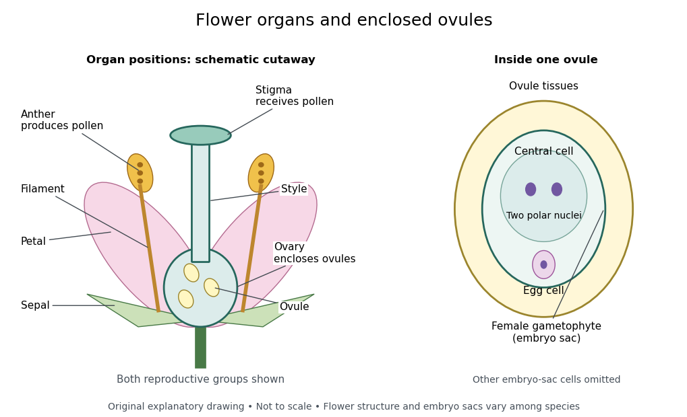

# Flower

↑ **Parent:** [Plant](plant.md)

A [flower](flower.md) is an [angiosperm](angiosperm.md)'s reproductive structure. [Stamens](stamen.md) produce [pollen](pollen.md); [carpels](carpel.md) enclose [ovules](ovule.md). [Petals](petal.md) and [sepals](sepal.md) surround these organs in a complete [flower](flower.md), but some [flowers](flower.md) lack one or more groups, including either reproductive group.[Biology 2e, §32.1 Flower Structure, Figures 32.3–32.4: organs and incomplete flowers](biology-2e-by-mary-ann-clark-and-others.md)

**[Figure 9](#image-flower-organs-and-the-enclosure-of-ovules). Flower organs and the enclosure of ovules**. Original schematic cutaway of a [flower](flower.md) with both reproductive groups. Colors separate functions; shapes, organ counts and relative sizes are illustrative. The enlarged [ovule](ovule.md) belongs inside the [ovary](ovary-botany.md), not on the [stigma](stigma-botany.md). The sketch is not a universal arrangement.

Read the drawing from outside inward, then trace two routes: where [pollen](pollen.md) is released, and where an [ovule](ovule.md) is enclosed. This reveals why catching [pollen](pollen.md) and forming a [seed](seed.md) require different structures. A detached [petal](petal.md) cannot substitute for a [stigma](stigma-botany.md) simply because both belong to the same [flower](flower.md).

**Table of contents**

- [Dichogamy](dichogamy.md)
- [Herkogamy](herkogamy.md)
- [Perianth](perianth.md)
- [Bisexual flower](bisexual-flower.md)
- [Floral symmetry](floral-symmetry.md)
  - [Bilateral floral symmetry](bilateral-floral-symmetry.md)
  - [Radial floral symmetry](radial-floral-symmetry.md)
- [Stamen](stamen.md)
  - [Anther](anther.md)
  - [Stamen filament](stamen-filament.md)
- [Stigma (botany)](stigma-botany.md)
- [Carpel](carpel.md)
  - [Style (botany)](style-botany.md)
  - [Ovary (botany)](ovary-botany.md)
    - [Ovule](ovule.md)
      - [Angiosperm female gametophyte](angiosperm-female-gametophyte.md)
- [Petal](petal.md)
- [Sepal](sepal.md)

## ↑ Ancestors (5)

1. [Plant](plant.md)
2. [Eukaryote](eukaryote.md)
3. [Organism](organism-split.md)
4. [Biology](biology-split.md)
5. [Codex Wiki](split.md)

## ← Incoming links (19)

- [Angiosperm](angiosperm.md)
- [Bisexual flower](bisexual-flower.md)
- [Carpel](carpel.md)
- [Cross-pollination](cross-pollination.md)
- [Dichogamy](dichogamy.md)
- [Floral symmetry](floral-symmetry.md)
- [Flower](flower.md)
- [Herkogamy](herkogamy.md)
- [Independent assortment](independent-assortment.md)
- [Monoecy](monoecy.md)
- [Solution](past-exam-of-the-plant-sciences-course-of-the-university-of-cambridge/2025/paper-plm3/3/solution.md)
- [Solution](past-exam-of-the-plant-sciences-course-of-the-university-of-cambridge/2025/paper-plm3/4/solution.md)
- [Petal](petal.md)
- [Pollen tube](pollen-tube.md)
- [Pollen tube germination assay](pollen-tube-germination-assay.md)
- [Pollination](pollination.md)
- [Self-pollination](self-pollination.md)
- [Sepal](sepal.md)
- [Stamen](stamen.md)
