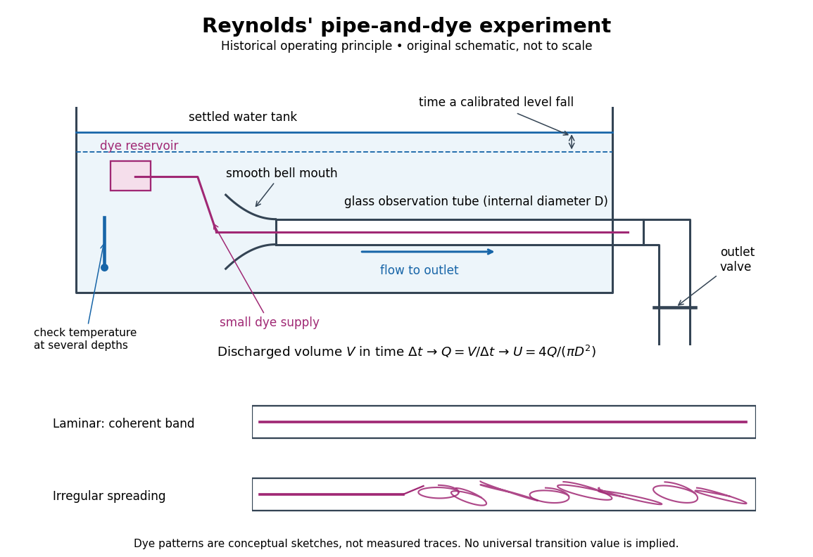
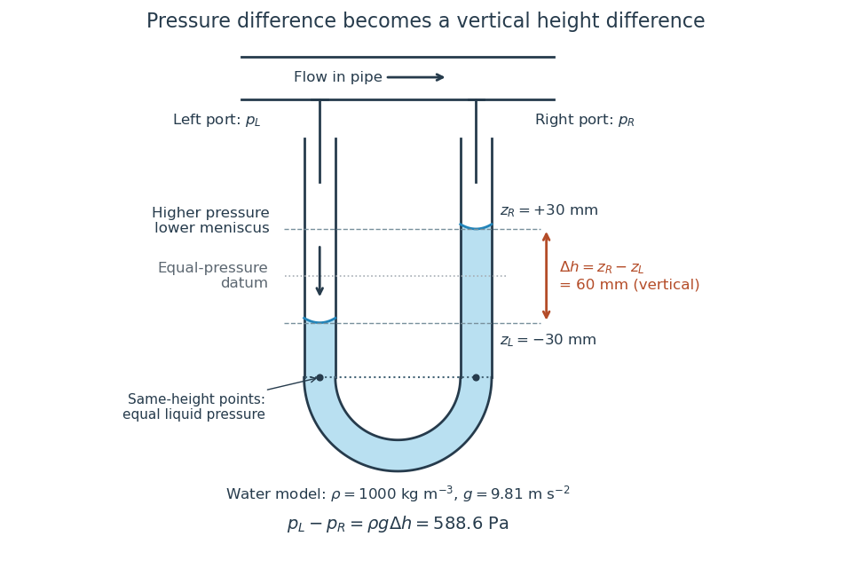
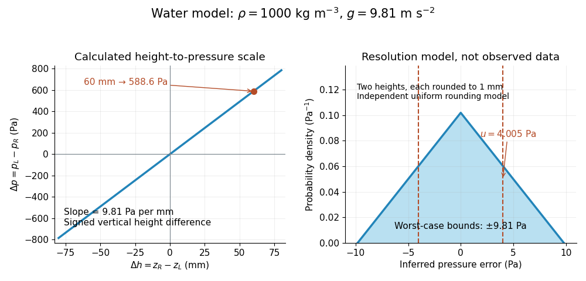
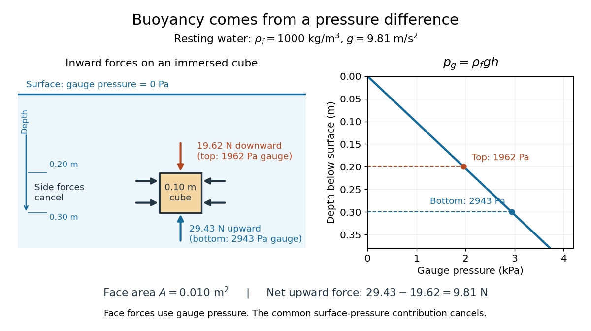
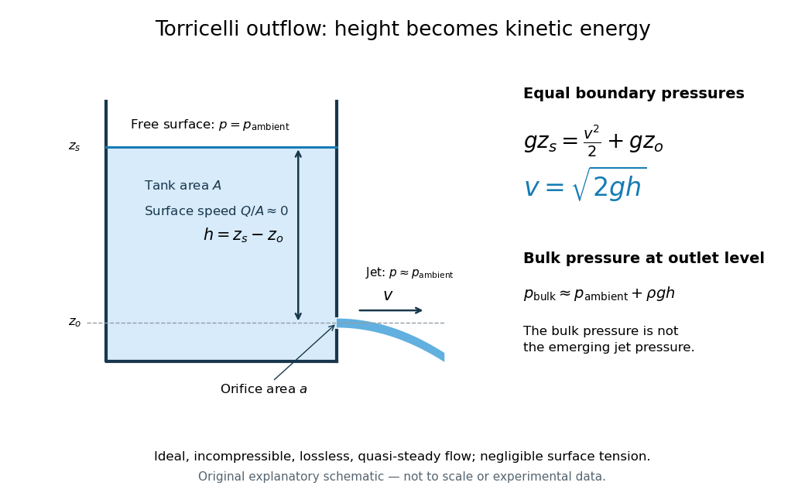
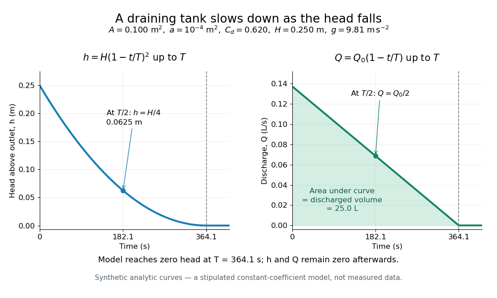
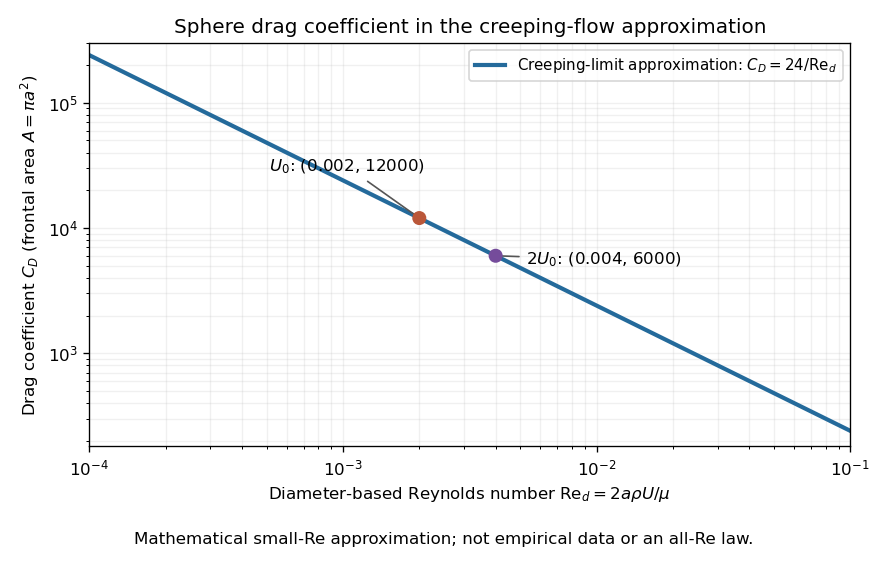
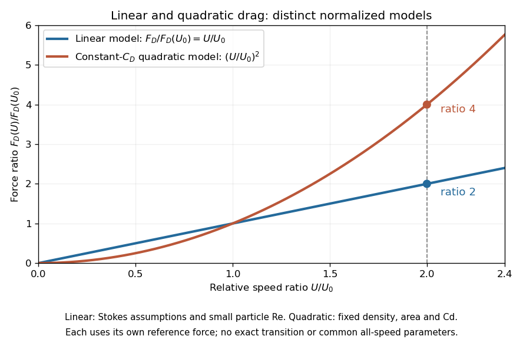
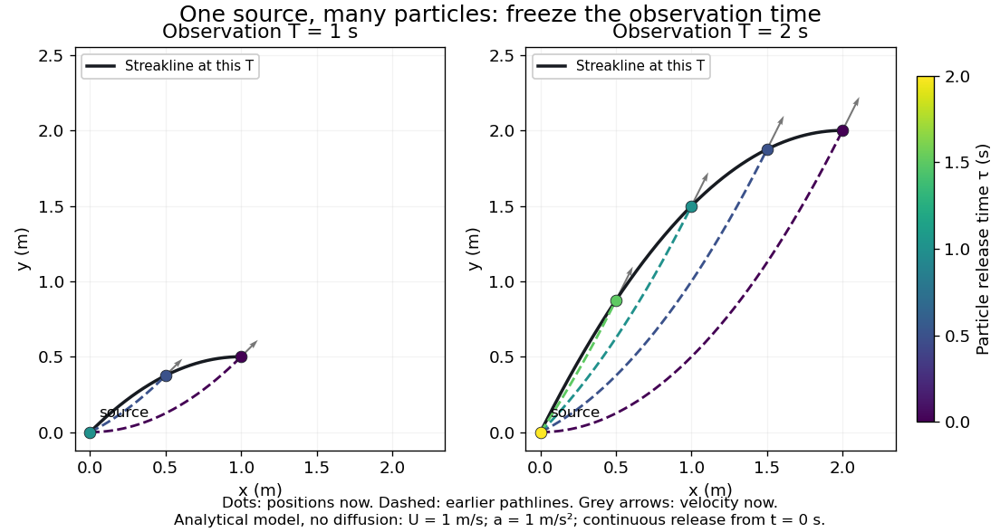

# Fluid mechanics

↑ **Parent:** [Branches of physics](physics.md#branches-of-physics)  
ⓦ [Wiki](https://en.wikipedia.org/wiki/Fluid_mechanics)

[Fluid mechanics](fluid-mechanics.md) studies the motion and [forces](force.md) of [liquids](thermodynamics.md#liquid) and [gases](thermodynamics.md#gas). Its central simplification is the [continuum approximation](continuum-mechanics.md#continuum-approximation): replace individual [molecules](molecule.md) by bulk properties defined at every position and time. The averaging region must contain many [molecules](molecule.md) while remaining small compared with the distances over which those properties vary. A [fluid element](continuum-mechanics.md#fluid-element) is such a small material parcel, rather than a single [molecule](molecule.md). This connects [fluid mechanics](fluid-mechanics.md) to [continuum mechanics](continuum-mechanics.md) and makes [calculus](calculus.md) useful for describing flow. [MIT, A. Techet, Hydrodynamics reading 1, pp. 2–3](https://ocw.mit.edu/courses/2-016-hydrodynamics-13-012-fall-2005/dc299d2ff05553b3515dccc23fc0f7d2_2005reading1.pdf)

Three basic fields are the [velocity field](#velocity-field) $\mathbf u(\mathbf x,t)$, the [mass density](#density) $\rho(\mathbf x,t)$ and the [pressure](pressure.md) $p(\mathbf x,t)$. The first gives a parcel's instantaneous [velocity](classical-mechanics.md#velocity); the second gives [mass](classical-mechanics.md#mass) per unit [volume](geometry-and-topology.md#volume). The [pressure](pressure.md) contributes an inward normal [traction](continuum-mechanics.md#traction) $-p\mathbf n$ across a surface with outward unit normal $\mathbf n$. Thus [pressure](pressure.md) is a [stress](continuum-mechanics.md#stress), measured in $\mathrm{Pa}=\mathrm{N\,m^{-2}}$, and may vary with position even in [incompressible flow](#incompressible-flow). Additional [viscous stresses](dynamic-viscosity.md#viscous-stress-tensor) can act tangentially. [MIT, A. Techet, Hydrodynamics reading 1, p. 5](https://ocw.mit.edu/courses/2-016-hydrodynamics-13-012-fall-2005/dc299d2ff05553b3515dccc23fc0f7d2_2005reading1.pdf)

The guiding questions are what must be conserved and which [forces](force.md) matter. [Mass conservation](continuum-mechanics.md#mass-conservation) constrains the [velocity field](#velocity-field); [momentum conservation](momentum.md#momentum-conservation) determines its response to [pressure gradients](#pressure-gradient), [viscosity](dynamic-viscosity.md) and body [forces](force.md). An [incompressible flow](#incompressible-flow) model, a [Reynolds number](dynamic-viscosity.md#reynolds-number) estimate and [Bernoulli's principle](euler-equations-for-an-inviscid-fluid.md#bernoulli-s-principle) answer different parts of a problem. Their appeal is that a few carefully stated assumptions can determine useful quantities before the entire [velocity field](#velocity-field) is known.

**Table of contents**

- [Wall slip](#wall-slip)
- [Focal length of a rotating liquid mirror](#focal-length-of-a-rotating-liquid-mirror)
- [Pump](#pump)
  - [Centrifugal pump](#centrifugal-pump)
    - [Pump operating point](#pump-operating-point)
- [Hydraulic diameter](#hydraulic-diameter)
- [Computational fluid dynamics](#computational-fluid-dynamics)
- [Microfluidics](#microfluidics)
  - [Nanopore](#nanopore)
    - [Ionic resistance of a conical pore](#ionic-resistance-of-a-conical-pore)
      - [Electrophoretic transit time in a conical pore](#electrophoretic-transit-time-in-a-conical-pore)
  - [Resistive-pulse sensing](#resistive-pulse-sensing)
    - [Position-dependent resistive pulse](#position-dependent-resistive-pulse)
- [Magnus effect](#magnus-effect)
- [Laminar flow](#laminar-flow)
  - [Reynolds pipe-and-dye experiment](#reynolds-pipe-and-dye-experiment)
- [Void fraction](#void-fraction)
  - [Kinematic bubble transport in an exponentially narrowing vessel](#kinematic-bubble-transport-in-an-exponentially-narrowing-vessel)
  - [Bubble clearing in a cylindrical vessel](#bubble-clearing-in-a-cylindrical-vessel)
- [Strouhal number](#strouhal-number)
- [Lift (force)](lift-force.md)
  - [Lift coefficient](lift-force.md#lift-coefficient)
    - [Dynamic pressure](lift-force.md#dynamic-pressure)
  - [Pressure coefficient](lift-force.md#pressure-coefficient)
    - [Pressure tapping](lift-force.md#pressure-tapping)
- [Static pressure](#static-pressure)
  - [Absolute pressure](#absolute-pressure)
  - [Stagnation pressure](#stagnation-pressure)
    - [Pitot tube](#pitot-tube)
      - [Pitot-static tube](#pitot-static-tube)
- [Manometer](#manometer)
  - [U-tube differential manometer](#u-tube-differential-manometer)
    - [Manometer height-to-pressure calibration](#manometer-height-to-pressure-calibration)
    - [Water-column wind-tunnel pressure measurement](#water-column-wind-tunnel-pressure-measurement)
  - [McLeod gauge](#mcleod-gauge)
- [Pressure transducer](#pressure-transducer)
  - [Differential-pressure calibration](#differential-pressure-calibration)
- [D'Alembert's paradox](#d-alembert-s-paradox)
- [Wind tunnel](#wind-tunnel)
  - [Supersonic wind tunnel](#supersonic-wind-tunnel)
- [Airfoil](#airfoil)
  - [Angle of attack](#angle-of-attack)
  - [Thin airfoil theory](#thin-airfoil-theory)
  - [Aerodynamic stall](#aerodynamic-stall)
- [Uniform flow](#uniform-flow)
- [Volume viscosity](#volume-viscosity)
- [Hydraulic resistance](#hydraulic-resistance)
  - [Hydraulic ladder network](#hydraulic-ladder-network)
  - [Delta-star transformation](#delta-star-transformation)
- [Physiological fluid dynamics](physiological-fluid-dynamics.md)
  - [Lubrication model of a compliant translating plug](physiological-fluid-dynamics.md#lubrication-model-of-a-compliant-translating-plug)
    - [Force-free pressure drop of an annular lubrication plug](physiological-fluid-dynamics.md#force-free-pressure-drop-of-an-annular-lubrication-plug)
      - [Small-speed compliant-plug lubrication asymptotics](physiological-fluid-dynamics.md#small-speed-compliant-plug-lubrication-asymptotics)
  - [Annular inviscid-core displacement](physiological-fluid-dynamics.md#annular-inviscid-core-displacement)
    - [Forced annular displacement equation](physiological-fluid-dynamics.md#forced-annular-displacement-equation)
      - [Opposite propagation directions in the annular displacement equation](physiological-fluid-dynamics.md#opposite-propagation-directions-in-the-annular-displacement-equation)
  - [Peristaltic pumping](physiological-fluid-dynamics.md#peristaltic-pumping)
    - [Weak peristaltic pumping of a collapsible tube](physiological-fluid-dynamics.md#weak-peristaltic-pumping-of-a-collapsible-tube)
  - [Collapsible tube flow](physiological-fluid-dynamics.md#collapsible-tube-flow)
    - [Choking by wall thickness in an elastic tube](physiological-fluid-dynamics.md#choking-by-wall-thickness-in-an-elastic-tube)
    - [Subcritical tube flow](physiological-fluid-dynamics.md#subcritical-tube-flow)
    - [Supercritical tube flow](physiological-fluid-dynamics.md#supercritical-tube-flow)
    - [Elastic jump in a quadratic pressure-area tube](physiological-fluid-dynamics.md#elastic-jump-in-a-quadratic-pressure-area-tube)
    - [Spatial attraction of a uniform downhill tube flow](physiological-fluid-dynamics.md#spatial-attraction-of-a-uniform-downhill-tube-flow)
    - [Friction-induced instability of a collapsible-tube flow](physiological-fluid-dynamics.md#friction-induced-instability-of-a-collapsible-tube-flow)
    - [Pressure-area law of a collapsible tube](physiological-fluid-dynamics.md#pressure-area-law-of-a-collapsible-tube)
      - [Tube wave speed](physiological-fluid-dynamics.md#tube-wave-speed)
  - [Arterial pressure wave](physiological-fluid-dynamics.md#arterial-pressure-wave)
    - [Bifurcation reflection of an arterial pressure wave](physiological-fluid-dynamics.md#bifurcation-reflection-of-an-arterial-pressure-wave)
      - [Pressure-flow phase lag from one arterial reflection](physiological-fluid-dynamics.md#pressure-flow-phase-lag-from-one-arterial-reflection)
    - [Reflection of an arterial pressure wave](physiological-fluid-dynamics.md#reflection-of-an-arterial-pressure-wave)
    - [Wave transfer matrix of an arterial segment](physiological-fluid-dynamics.md#wave-transfer-matrix-of-an-arterial-segment)
      - [Wave transmission through a resistively loaded arterial loop](physiological-fluid-dynamics.md#wave-transmission-through-a-resistively-loaded-arterial-loop)
    - [Characteristic admittance of an arterial wave](physiological-fluid-dynamics.md#characteristic-admittance-of-an-arterial-wave)
- [Fluid](#fluid)
- [Buoyant plume](#buoyant-plume)
- [Pathline](#pathline)
- [Control volume](#control-volume)
- [Navier slip boundary condition](#navier-slip-boundary-condition)
  - [Slip length](#slip-length)
    - [Couette flow with a slipping lower wall](#couette-flow-with-a-slipping-lower-wall)
    - [Planar Poiseuille flow with equal wall slip](#planar-poiseuille-flow-with-equal-wall-slip)
  - [Wall friction in the Navier slip boundary condition](#wall-friction-in-the-navier-slip-boundary-condition)
- [Fluid free boundary](#fluid-free-boundary)
- [Material surface](#material-surface)
  - [Material surface element](#material-surface-element)
    - [Material surface element evolution](#material-surface-element-evolution)
- [Material curve](#material-curve)
- [Scalar transport](scalar-transport.md)
  - [Active scalar](scalar-transport.md#active-scalar)
  - [Passive scalar](scalar-transport.md#passive-scalar)
    - [Gaussian scalar packet in a linear incompressible flow](scalar-transport.md#gaussian-scalar-packet-in-a-linear-incompressible-flow)
      - [Diffusion arrest of Gaussian packet compression](scalar-transport.md#diffusion-arrest-of-gaussian-packet-compression)
        - [Large-deviation decay rates of a Gaussian scalar packet](scalar-transport.md#large-deviation-decay-rates-of-a-gaussian-scalar-packet)
    - [Schmidt number (fluid mechanics)](scalar-transport.md#schmidt-number-fluid-mechanics)
    - [Covector evolution of a material scalar gradient](scalar-transport.md#covector-evolution-of-a-material-scalar-gradient)
      - [Scalar-gradient inclination in a steady planar strain](scalar-transport.md#scalar-gradient-inclination-in-a-steady-planar-strain)
        - [White-noise vertical shear gives an Ornstein-Uhlenbeck inclination](scalar-transport.md#white-noise-vertical-shear-gives-an-ornstein-uhlenbeck-inclination)
        - [Gaussian-over-Rayleigh inclination distribution](scalar-transport.md#gaussian-over-rayleigh-inclination-distribution)
    - [Scalar structure function](scalar-transport.md#scalar-structure-function)
    - [Obukhov-Corrsin theory](scalar-transport.md#obukhov-corrsin-theory)
      - [Inertial-diffusive scalar range](scalar-transport.md#inertial-diffusive-scalar-range)
        - [Corrsin scalar microscale](scalar-transport.md#corrsin-scalar-microscale)
      - [Viscous-convective scalar range](scalar-transport.md#viscous-convective-scalar-range)
        - [Batchelor scalar microscale](scalar-transport.md#batchelor-scalar-microscale)
      - [Inertial-convective scalar range](scalar-transport.md#inertial-convective-scalar-range)
    - [Horizontally integrated plume concentration](scalar-transport.md#horizontally-integrated-plume-concentration)
      - [Horizontally averaged plume concentration](scalar-transport.md#horizontally-averaged-plume-concentration)
  - [Adjoint equations for Boussinesq scalar mixing](scalar-transport.md#adjoint-equations-for-boussinesq-scalar-mixing)
  - [Scalar variance](scalar-transport.md#scalar-variance)
    - [Scalar dissipation rate](scalar-transport.md#scalar-dissipation-rate)
- [Fluid flow](#fluid-flow)
  - [Unidirectional flow](#unidirectional-flow)
  - [Steady flow](#steady-flow)
  - [Inviscid flow](#inviscid-flow)
    - [Inviscid falling jet and radial impact film](#inviscid-falling-jet-and-radial-impact-film)
- [Sediment transport](#sediment-transport)
  - [Sediment resuspension](#sediment-resuspension)
    - [Equilibrium settling-diffusion profile](#equilibrium-settling-diffusion-profile)
  - [Sediment transport saturation](#sediment-transport-saturation)
    - [Equilibrium sediment flux](#equilibrium-sediment-flux)
    - [Saturation length](#saturation-length)
  - [Exner equation](#exner-equation)
  - [Shields parameter](#shields-parameter)
    - [Sediment entrainment threshold](#sediment-entrainment-threshold)
      - [Inclined-bed sediment threshold](#inclined-bed-sediment-threshold)
  - [Bedform](#bedform)
    - [Sediment-bed linear instability](#sediment-bed-linear-instability)
    - [Bed shear response](#bed-shear-response)
- [Ram pressure](#ram-pressure)
- [Turbulence](turbulence.md)
  - [Reynolds averaging](turbulence.md#reynolds-averaging)
  - [External intermittency](turbulence.md#external-intermittency)
  - [Wave turbulence](turbulence.md#wave-turbulence)
    - [Weak wave cascade](turbulence.md#weak-wave-cascade)
  - [Magnetohydrodynamic turbulence](turbulence.md#magnetohydrodynamic-turbulence)
    - [Dimensional freedom of an MHD spectrum](turbulence.md#dimensional-freedom-of-an-mhd-spectrum)
    - [Electron-magnetohydrodynamic cascade](turbulence.md#electron-magnetohydrodynamic-cascade)
      - [Critically balanced electron-magnetohydrodynamic cascade](turbulence.md#critically-balanced-electron-magnetohydrodynamic-cascade)
      - [Weak electron-magnetohydrodynamic cascade](turbulence.md#weak-electron-magnetohydrodynamic-cascade)
    - [Critical balance](turbulence.md#critical-balance)
    - [Alfvénic turbulence](turbulence.md#alfvenic-turbulence)
      - [Weak Alfvénic cascade](turbulence.md#weak-alfvenic-cascade)
        - [Weak-to-strong transition of an Alfvénic cascade](turbulence.md#weak-to-strong-transition-of-an-alfvenic-cascade)
      - [Iroshnikov-Kraichnan spectrum](turbulence.md#iroshnikov-kraichnan-spectrum)
      - [Goldreich–Sridhar turbulence](turbulence.md#goldreich-sridhar-turbulence)
  - [Turbulence closure](turbulence.md#turbulence-closure)
    - [Constant-skewness turbulence closure](turbulence.md#constant-skewness-turbulence-closure)
      - [Normalized constant-skewness structure-function equation](turbulence.md#normalized-constant-skewness-structure-function-equation)
    - [Eddy-damped quasi-normal Markovian closure](turbulence.md#eddy-damped-quasi-normal-markovian-closure)
  - [K-epsilon turbulence model](turbulence.md#k-epsilon-turbulence-model)
    - [K-epsilon turbulence front](turbulence.md#k-epsilon-turbulence-front)
    - [Log-layer solution of the k-epsilon model](turbulence.md#log-layer-solution-of-the-k-epsilon-model)
  - [Turbulent mixing](turbulence.md#turbulent-mixing)
    - [Richardson pair dispersion](turbulence.md#richardson-pair-dispersion)
      - [Three-regime turbulent pair-separation model](turbulence.md#three-regime-turbulent-pair-separation-model)
      - [Diffusive large-scale pair dispersion](turbulence.md#diffusive-large-scale-pair-dispersion)
      - [Richardson constant](turbulence.md#richardson-constant)
    - [Taylor turbulent dispersion](turbulence.md#taylor-turbulent-dispersion)
      - [Power-law velocity-correlation dispersion](turbulence.md#power-law-velocity-correlation-dispersion)
      - [Lagrangian velocity autocorrelation](turbulence.md#lagrangian-velocity-autocorrelation)
      - [Lagrangian integral time](turbulence.md#lagrangian-integral-time)
    - [Forced stratified mixing with square-root power input](turbulence.md#forced-stratified-mixing-with-square-root-power-input)
    - [Stratified mixing energy budget](turbulence.md#stratified-mixing-energy-budget)
      - [Instantaneous mixing efficiency](turbulence.md#instantaneous-mixing-efficiency)
        - [Cumulative mixing efficiency](turbulence.md#cumulative-mixing-efficiency)
  - [Turbulent plane jet similarity](turbulence.md#turbulent-plane-jet-similarity)
    - [Finite-edge stress condition for a mixing-length jet](turbulence.md#finite-edge-stress-condition-for-a-mixing-length-jet)
  - [Mixing length](turbulence.md#mixing-length)
    - [Mixing-length closure](turbulence.md#mixing-length-closure)
  - [Turbulent kinetic energy](turbulence.md#turbulent-kinetic-energy)
    - [Mean-shear production of turbulent kinetic energy](turbulence.md#mean-shear-production-of-turbulent-kinetic-energy)
    - [Local turbulent kinetic energy balance](turbulence.md#local-turbulent-kinetic-energy-balance)
      - [Fixed-correlation equilibrium model for stratified turbulence](turbulence.md#fixed-correlation-equilibrium-model-for-stratified-turbulence)
  - [Reynolds stress](turbulence.md#reynolds-stress)
    - [Nondiffusive convective angular momentum transport](turbulence.md#nondiffusive-convective-angular-momentum-transport)
    - [Reynolds-stress energy production in a shearing sheet](turbulence.md#reynolds-stress-energy-production-in-a-shearing-sheet)
    - [Constant-stress Reynolds-averaged wall flow](turbulence.md#constant-stress-reynolds-averaged-wall-flow)
    - [Eddy viscosity](turbulence.md#eddy-viscosity)
    - [Reynolds-averaged momentum equation](turbulence.md#reynolds-averaged-momentum-equation)
  - [Internal intermittency](turbulence.md#internal-intermittency)
    - [Kolmogorov refined similarity hypothesis](turbulence.md#kolmogorov-refined-similarity-hypothesis)
      - [Lognormal intermittency model](turbulence.md#lognormal-intermittency-model)
    - [Coarse-grained energy dissipation](turbulence.md#coarse-grained-energy-dissipation)
    - [Integral-scale intermittency](turbulence.md#integral-scale-intermittency)
      - [Landau intermittency counterexample](turbulence.md#landau-intermittency-counterexample)
  - [Energy cascade](turbulence.md#energy-cascade)
    - [Spectral triad interaction](turbulence.md#spectral-triad-interaction)
    - [Zeroth law of turbulence](turbulence.md#zeroth-law-of-turbulence)
      - [Turbulent dissipation anomaly](turbulence.md#turbulent-dissipation-anomaly)
    - [Eddy turnover time](turbulence.md#eddy-turnover-time)
    - [Two-dimensional enstrophy cascade](turbulence.md#two-dimensional-enstrophy-cascade)
      - [Logarithmic structure function in an enstrophy cascade](turbulence.md#logarithmic-structure-function-in-an-enstrophy-cascade)
    - [Townsend-Betchov cascade cartoon](turbulence.md#townsend-betchov-cascade-cartoon)
    - [Kolmogorov 1941 theory](turbulence.md#kolmogorov-1941-theory)
      - [Kolmogorov second similarity hypothesis](turbulence.md#kolmogorov-second-similarity-hypothesis)
        - [Kolmogorov two-thirds law](turbulence.md#kolmogorov-two-thirds-law)
      - [Kolmogorov first similarity hypothesis](turbulence.md#kolmogorov-first-similarity-hypothesis)
    - [Equilibrium range](turbulence.md#equilibrium-range)
    - [Dissipation range](turbulence.md#dissipation-range)
      - [Kolmogorov microscales](turbulence.md#kolmogorov-microscales)
        - [Kolmogorov length scale](turbulence.md#kolmogorov-length-scale)
    - [Inertial range](turbulence.md#inertial-range)
  - [Homogeneous turbulence](turbulence.md#homogeneous-turbulence)
    - [Integral scale of turbulence](turbulence.md#integral-scale-of-turbulence)
    - [Betchov relation](turbulence.md#betchov-relation)
    - [Isotropic turbulence](turbulence.md#isotropic-turbulence)
      - [Local isotropy of turbulence](turbulence.md#local-isotropy-of-turbulence)
      - [Loitsyansky integral](turbulence.md#loitsyansky-integral)
        - [Landau angular-momentum argument for turbulent decay](turbulence.md#landau-angular-momentum-argument-for-turbulent-decay)
        - [Kolmogorov decay law](turbulence.md#kolmogorov-decay-law)
      - [Saffman integral](turbulence.md#saffman-integral)
        - [Saffman decay law](turbulence.md#saffman-decay-law)
        - [Small-wavenumber spectrum with nonzero Saffman integral](turbulence.md#small-wavenumber-spectrum-with-nonzero-saffman-integral)
      - [Velocity correlation tensor](turbulence.md#velocity-correlation-tensor)
        - [Kármán-Howarth equation](turbulence.md#karman-howarth-equation)
          - [Kolmogorov equation for structure functions](turbulence.md#kolmogorov-equation-for-structure-functions)
            - [Kolmogorov four-fifths law](turbulence.md#kolmogorov-four-fifths-law)
        - [Longitudinal velocity correlation](turbulence.md#longitudinal-velocity-correlation)
          - [Longitudinal velocity structure function](turbulence.md#longitudinal-velocity-structure-function)
            - [Velocity increment](turbulence.md#velocity-increment)
            - [Large-scale contributions to structure functions](turbulence.md#large-scale-contributions-to-structure-functions)
            - [Structure-function spectral filter](turbulence.md#structure-function-spectral-filter)
      - [Turbulent energy spectrum](turbulence.md#turbulent-energy-spectrum)
      - [Longitudinal velocity-gradient skewness](turbulence.md#longitudinal-velocity-gradient-skewness)
  - [Eddy diffusion](turbulence.md#eddy-diffusion)
    - [Buoyancy-driven turbulent density diffusion](turbulence.md#buoyancy-driven-turbulent-density-diffusion)
      - [Quintic density-profile similarity in an unstable tube](turbulence.md#quintic-density-profile-similarity-in-an-unstable-tube)
    - [Density-variance dissipation rate](turbulence.md#density-variance-dissipation-rate)
    - [Turbulent Prandtl number](turbulence.md#turbulent-prandtl-number)
      - [Reynolds analogy](turbulence.md#reynolds-analogy)
    - [Vertical turbulent buoyancy flux](turbulence.md#vertical-turbulent-buoyancy-flux)
    - [Buoyancy-gradient mixing-length closure](turbulence.md#buoyancy-gradient-mixing-length-closure)
      - [Arrested cubic buoyancy profile](turbulence.md#arrested-cubic-buoyancy-profile)
      - [Flux convergence in turbulent buoyancy mixing](turbulence.md#flux-convergence-in-turbulent-buoyancy-mixing)
  - [Eddy diffusivity](turbulence.md#eddy-diffusivity)
    - [Turbulent Schmidt number](turbulence.md#turbulent-schmidt-number)
  - [Turbulent round jet](turbulence.md#turbulent-round-jet)
- [Acoustic wave](#acoustic-wave)
  - [Ultrasound](#ultrasound)
    - [Doppler ultrasound](#doppler-ultrasound)
    - [Pulse-echo ultrasound](#pulse-echo-ultrasound)
      - [M-mode ultrasound scan](#m-mode-ultrasound-scan)
      - [B-mode ultrasound scan](#b-mode-ultrasound-scan)
      - [A-mode ultrasound scan](#a-mode-ultrasound-scan)
  - [Burgers reduction of weakly nonlinear rightgoing acoustics](#burgers-reduction-of-weakly-nonlinear-rightgoing-acoustics)
  - [Adiabatic vertical modes of a Gaussian atmosphere](#adiabatic-vertical-modes-of-a-gaussian-atmosphere)
  - [Acoustically rigid boundary](#acoustically-rigid-boundary)
  - [Acoustic cutoff frequency](#acoustic-cutoff-frequency)
    - [Atmospheric acoustic cutoff transformation](#atmospheric-acoustic-cutoff-transformation)
  - [Pressure-release boundary](#pressure-release-boundary)
  - [Sonic boom](#sonic-boom)
- [Velocity field](#velocity-field)
  - [Secondary flow](#secondary-flow)
  - [Velocity gradient tensor](#velocity-gradient-tensor)
  - [Vertical velocity](#vertical-velocity)
  - [Axisymmetric flow](#axisymmetric-flow)
    - [Near-axis radial velocity in incompressible axisymmetric flow](#near-axis-radial-velocity-in-incompressible-axisymmetric-flow)
- [Advection](#advection)
  - [Chaotic advection](#chaotic-advection)
  - [Ballistic transport](#ballistic-transport)
- [Convection](convection.md)
  - [Convection cell](convection.md#convection-cell)
  - [Convection zone](convection.md#convection-zone)
  - [Compositional convection](convection.md#compositional-convection)
  - [Long-wave convection equation with broken Boussinesq symmetry](convection.md#long-wave-convection-equation-with-broken-boussinesq-symmetry)
    - [Second-harmonic feedback in a long-wave convection amplitude equation](convection.md#second-harmonic-feedback-in-a-long-wave-convection-amplitude-equation)
    - [Energy square completion for long-wave convection](convection.md#energy-square-completion-for-long-wave-convection)
  - [Thermal convection](convection.md#thermal-convection)
    - [Horizontal convection](convection.md#horizontal-convection)
      - [Shallow horizontal convection with an insulated bottom](convection.md#shallow-horizontal-convection-with-an-insulated-bottom)
        - [Advection correction in shallow horizontal convection](convection.md#advection-correction-in-shallow-horizontal-convection)
    - [Forced convection](convection.md#forced-convection)
    - [Natural convection](convection.md#natural-convection)
      - [Free-convection surface-layer scaling](convection.md#free-convection-surface-layer-scaling)
    - [Hexagonal convection amplitude equations](convection.md#hexagonal-convection-amplitude-equations)
      - [Rotational hexagon amplitude equations](convection.md#rotational-hexagon-amplitude-equations)
        - [Roll and hexagon spectra without reflection symmetry](convection.md#roll-and-hexagon-spectra-without-reflection-symmetry)
        - [Axial isotropy of rolls and hexagons](convection.md#axial-isotropy-of-rolls-and-hexagons)
      - [Roll instability from broken up-down symmetry](convection.md#roll-instability-from-broken-up-down-symmetry)
    - [Convection roll](convection.md#convection-roll)
    - [Oscillatory convection](convection.md#oscillatory-convection)
      - [Travelling and standing convection rolls](convection.md#travelling-and-standing-convection-rolls)
    - [Stationary convection](convection.md#stationary-convection)
    - [Convective stability](convection.md#convective-stability)
    - [Convective overshoot](convection.md#convective-overshoot)
    - [Double-diffusive convection](convection.md#double-diffusive-convection)
      - [Thermosolutal convection](convection.md#thermosolutal-convection)
        - [Double-diffusive overflow reservoir](convection.md#double-diffusive-overflow-reservoir)
          - [Post-shutdown double-diffusive reservoir cooling](convection.md#post-shutdown-double-diffusive-reservoir-cooling)
        - [Lorenz model of thermosolutal convection](convection.md#lorenz-model-of-thermosolutal-convection)
          - [Oscillatory threshold of a thermosolutal Lorenz model](convection.md#oscillatory-threshold-of-a-thermosolutal-lorenz-model)
          - [Steady fold of a thermosolutal Lorenz model](convection.md#steady-fold-of-a-thermosolutal-lorenz-model)
      - [Layered convection](convection.md#layered-convection)
- [Buoyancy](#buoyancy)
  - [Centre of buoyancy](#centre-of-buoyancy)
  - [Buoyancy of an aerated liquid](#buoyancy-of-an-aerated-liquid)
  - [Buoyancy gradient](#buoyancy-gradient)
  - [Magnetic buoyancy](#magnetic-buoyancy)
  - [Archimedes' principle](#archimedes-principle)
    - [Floating equilibrium](#floating-equilibrium)
      - [Metacentric height](#metacentric-height)
      - [Vertical oscillations of a floating cylinder](#vertical-oscillations-of-a-floating-cylinder)
  - [Neutral buoyancy](#neutral-buoyancy)
  - [Submerged weight](#submerged-weight)
  - [Buoyancy perturbation](#buoyancy-perturbation)
    - [Buoyancy displacement variable](#buoyancy-displacement-variable)
  - [Isopycnal](#isopycnal)
- [Hydrodynamic stability](hydrodynamic-stability.md)
  - [Global hydrodynamic mode](hydrodynamic-stability.md#global-hydrodynamic-mode)
  - [Global hydrodynamic instability](hydrodynamic-stability.md#global-hydrodynamic-instability)
    - [Global modes of a quadratically confined Ginzburg-Landau equation](hydrodynamic-stability.md#global-modes-of-a-quadratically-confined-ginzburg-landau-equation)
  - [Critical layer in a shear flow](hydrodynamic-stability.md#critical-layer-in-a-shear-flow)
    - [Neutral-mode critical-layer matching](hydrodynamic-stability.md#neutral-mode-critical-layer-matching)
      - [Neutral Rayleigh-mode dispersion correction](hydrodynamic-stability.md#neutral-rayleigh-mode-dispersion-correction)
    - [Prandtl critical layer at a stationary shear profile](hydrodynamic-stability.md#prandtl-critical-layer-at-a-stationary-shear-profile)
      - [High-wavenumber instability of a non-monotone Prandtl layer](hydrodynamic-stability.md#high-wavenumber-instability-of-a-non-monotone-prandtl-layer)
  - [Critical level of a shear-flow wave](hydrodynamic-stability.md#critical-level-of-a-shear-flow-wave)
  - [Baroclinic instability](hydrodynamic-stability.md#baroclinic-instability)
  - [Three-layer long-wave shear-flow matching](hydrodynamic-stability.md#three-layer-long-wave-shear-flow-matching)
    - [Airy wall-layer matching determinant](hydrodynamic-stability.md#airy-wall-layer-matching-determinant)
  - [Pressure equation for a shear-flow normal mode](hydrodynamic-stability.md#pressure-equation-for-a-shear-flow-normal-mode)
  - [Adjoint linearized Navier-Stokes evolution](hydrodynamic-stability.md#adjoint-linearized-navier-stokes-evolution)
  - [Kinetic-energy inner product](hydrodynamic-stability.md#kinetic-energy-inner-product)
  - [Stability diagram of the linear complex Ginzburg-Landau equation](hydrodynamic-stability.md#stability-diagram-of-the-linear-complex-ginzburg-landau-equation)
  - [Saddle growth rate along a ray](hydrodynamic-stability.md#saddle-growth-rate-along-a-ray)
  - [Convective hydrodynamic instability](hydrodynamic-stability.md#convective-hydrodynamic-instability)
  - [Absolute hydrodynamic instability](hydrodynamic-stability.md#absolute-hydrodynamic-instability)
    - [Anisotropic absolute-instability threshold for positive diffusion](hydrodynamic-stability.md#anisotropic-absolute-instability-threshold-for-positive-diffusion)
    - [Absolute frequency](hydrodynamic-stability.md#absolute-frequency)
      - [Absolute-frequency conservation in steady shear](hydrodynamic-stability.md#absolute-frequency-conservation-in-steady-shear)
      - [Absolute growth rate](hydrodynamic-stability.md#absolute-growth-rate)
      - [Absolute wavenumber](hydrodynamic-stability.md#absolute-wavenumber)
  - [Orr-Sommerfeld equation](hydrodynamic-stability.md#orr-sommerfeld-equation)
    - [Squire's theorem](hydrodynamic-stability.md#squire-s-theorem)
      - [Squire transformation](hydrodynamic-stability.md#squire-transformation)
    - [Airy reduction of the Orr-Sommerfeld equation in constant shear](hydrodynamic-stability.md#airy-reduction-of-the-orr-sommerfeld-equation-in-constant-shear)
      - [Velocity reconstruction from the Orr-Sommerfeld vorticity](hydrodynamic-stability.md#velocity-reconstruction-from-the-orr-sommerfeld-vorticity)
    - [Squire equation](hydrodynamic-stability.md#squire-equation)
      - [Squire mode](hydrodynamic-stability.md#squire-mode)
        - [Dissipation identity for a homogeneous Squire mode](hydrodynamic-stability.md#dissipation-identity-for-a-homogeneous-squire-mode)
    - [Orr-Sommerfeld mode](hydrodynamic-stability.md#orr-sommerfeld-mode)
  - [Inertial instability](hydrodynamic-stability.md#inertial-instability)
  - [Rayleigh equation for inviscid shear flow](hydrodynamic-stability.md#rayleigh-equation-for-inviscid-shear-flow)
    - [Inviscid instability of a piecewise-linear mixing layer](hydrodynamic-stability.md#inviscid-instability-of-a-piecewise-linear-mixing-layer)
    - [Axisymmetric inviscid pipe stability equation](hydrodynamic-stability.md#axisymmetric-inviscid-pipe-stability-equation)
      - [Evanescent potential modes of inviscid Poiseuille flow](hydrodynamic-stability.md#evanescent-potential-modes-of-inviscid-poiseuille-flow)
    - [Inviscid instability of a triangular jet](hydrodynamic-stability.md#inviscid-instability-of-a-triangular-jet)
    - [Pressure matching at a piecewise-linear shear interface](hydrodynamic-stability.md#pressure-matching-at-a-piecewise-linear-shear-interface)
    - [Fjørtoft theorem](hydrodynamic-stability.md#fjortoft-theorem)
    - [Inviscid Couette continuous spectrum](hydrodynamic-stability.md#inviscid-couette-continuous-spectrum)
      - [Inviscid Couette initial-value Green function](hydrodynamic-stability.md#inviscid-couette-initial-value-green-function)
      - [Linear inviscid damping in unbounded Couette flow](hydrodynamic-stability.md#linear-inviscid-damping-in-unbounded-couette-flow)
      - [Vorticity-sheet eigenfunction of inviscid Couette flow](hydrodynamic-stability.md#vorticity-sheet-eigenfunction-of-inviscid-couette-flow)
    - [Vorticity-jump matching for an inviscid shear flow](hydrodynamic-stability.md#vorticity-jump-matching-for-an-inviscid-shear-flow)
    - [Inviscid parallel shear flow](hydrodynamic-stability.md#inviscid-parallel-shear-flow)
      - [Unbounded piecewise-linear shear layer](hydrodynamic-stability.md#unbounded-piecewise-linear-shear-layer)
      - [Three-layer stratified piecewise-linear shear flow](hydrodynamic-stability.md#three-layer-stratified-piecewise-linear-shear-flow)
        - [Quartic dispersion relation for a three-layer stratified shear flow](hydrodynamic-stability.md#quartic-dispersion-relation-for-a-three-layer-stratified-shear-flow)
        - [Unstable band of a three-layer stratified shear flow](hydrodynamic-stability.md#unstable-band-of-a-three-layer-stratified-shear-flow)
      - [Hazel model](hydrodynamic-stability.md#hazel-model)
        - [Neutral mode of the equal-width Hazel model](hydrodynamic-stability.md#neutral-mode-of-the-equal-width-hazel-model)
          - [Critical-layer regularity of a neutral Hazel mode](hydrodynamic-stability.md#critical-layer-regularity-of-a-neutral-hazel-mode)
      - [Bounded piecewise-linear shear layer](hydrodynamic-stability.md#bounded-piecewise-linear-shear-layer)
        - [Instability threshold for a bounded piecewise-linear shear layer](hydrodynamic-stability.md#instability-threshold-for-a-bounded-piecewise-linear-shear-layer)
    - [Rayleigh's inflection-point theorem](hydrodynamic-stability.md#rayleigh-s-inflection-point-theorem)
    - [Howard's semicircle theorem](hydrodynamic-stability.md#howard-s-semicircle-theorem)
      - [Weighted identity for Howard's semicircle theorem](hydrodynamic-stability.md#weighted-identity-for-howard-s-semicircle-theorem)
  - [Counterpropagating wave instability](hydrodynamic-stability.md#counterpropagating-wave-instability)
    - [Counterpropagating wave resonance in a three-layer shear flow](hydrodynamic-stability.md#counterpropagating-wave-resonance-in-a-three-layer-shear-flow)
  - [Transient growth from non-normal modes](hydrodynamic-stability.md#transient-growth-from-non-normal-modes)
    - [Orr mechanism](hydrodynamic-stability.md#orr-mechanism)
    - [Lift-up effect](hydrodynamic-stability.md#lift-up-effect)
  - [Energy-stability threshold](hydrodynamic-stability.md#energy-stability-threshold)
  - [Symmetric instability](hydrodynamic-stability.md#symmetric-instability)
  - [Eady model](hydrodynamic-stability.md#eady-model)
    - [Eady model with parallel sloping boundaries](hydrodynamic-stability.md#eady-model-with-parallel-sloping-boundaries)
    - [Boundary pseudomomentum of a sloping Eady layer](hydrodynamic-stability.md#boundary-pseudomomentum-of-a-sloping-eady-layer)
    - [Finite-depth Eady dispersion relation](hydrodynamic-stability.md#finite-depth-eady-dispersion-relation)
    - [Semi-infinite Eady model](hydrodynamic-stability.md#semi-infinite-eady-model)
      - [Absence of exponential instability in the semi-infinite Eady model](hydrodynamic-stability.md#absence-of-exponential-instability-in-the-semi-infinite-eady-model)
      - [Semi-infinite Eady edge wave](hydrodynamic-stability.md#semi-infinite-eady-edge-wave)
        - [Dispersion relation of a semi-infinite Eady edge wave](hydrodynamic-stability.md#dispersion-relation-of-a-semi-infinite-eady-edge-wave)
          - [Steering height of a semi-infinite Eady edge wave](hydrodynamic-stability.md#steering-height-of-a-semi-infinite-eady-edge-wave)
        - [Decaying vertical structure of a semi-infinite Eady edge wave](hydrodynamic-stability.md#decaying-vertical-structure-of-a-semi-infinite-eady-edge-wave)
    - [Eady model with a sloping lower boundary](hydrodynamic-stability.md#eady-model-with-a-sloping-lower-boundary)
      - [Instability for negative slopes in the sloping-boundary Eady model](hydrodynamic-stability.md#instability-for-negative-slopes-in-the-sloping-boundary-eady-model)
    - [Eady instability](hydrodynamic-stability.md#eady-instability)
    - [Boundary Rossby wave](hydrodynamic-stability.md#boundary-rossby-wave)
      - [Eady edge wave](hydrodynamic-stability.md#eady-edge-wave)
        - [Forced Eady edge wave](hydrodynamic-stability.md#forced-eady-edge-wave)
        - [Sloping-boundary Eady edge wave](hydrodynamic-stability.md#sloping-boundary-eady-edge-wave)
      - [Quasi-geostrophic wave at a stratification interface](hydrodynamic-stability.md#quasi-geostrophic-wave-at-a-stratification-interface)
    - [Damped Eady-wave dispersion relation](hydrodynamic-stability.md#damped-eady-wave-dispersion-relation)
  - [Dissipation-induced instability](hydrodynamic-stability.md#dissipation-induced-instability)
  - [Rayleigh discriminant](hydrodynamic-stability.md#rayleigh-discriminant)
    - [Narrow-gap centrifugal stability equation](hydrodynamic-stability.md#narrow-gap-centrifugal-stability-equation)
      - [Rayleigh stability integral identity](hydrodynamic-stability.md#rayleigh-stability-integral-identity)
    - [Rayleigh's circulation criterion](hydrodynamic-stability.md#rayleigh-s-circulation-criterion)
- [Barotropic fluid](#barotropic-fluid)
  - [Barotropic cylindrical rotation theorem](#barotropic-cylindrical-rotation-theorem)
  - [Barotropic spherical accretion equation](#barotropic-spherical-accretion-equation)
    - [Polytropic accretion in a mixed inverse-power potential](#polytropic-accretion-in-a-mixed-inverse-power-potential)
    - [Critical-point slope of barotropic spherical accretion](#critical-point-slope-of-barotropic-spherical-accretion)
  - [Barotropic enthalpy function](#barotropic-enthalpy-function)
  - [Centrifugal potential of cylindrical rotation](#centrifugal-potential-of-cylindrical-rotation)
  - [Barotropic energy density](#barotropic-energy-density)
  - [Barotropic magnetic energy equation](#barotropic-magnetic-energy-equation)
  - [Barotropic vorticity transport](#barotropic-vorticity-transport)
    - [Conservation of vorticity flux through a material surface](#conservation-of-vorticity-flux-through-a-material-surface)
- [Shear flow](#shear-flow)
  - [Renovating shear flow](#renovating-shear-flow)
    - [Mean logarithmic stretching in an isotropic renovating shear](#mean-logarithmic-stretching-in-an-isotropic-renovating-shear)
      - [Log-stretch fluctuations in an isotropic renovating shear](#log-stretch-fluctuations-in-an-isotropic-renovating-shear)
  - [Linear shear flow](#linear-shear-flow)
- [Lagrangian displacement (fluid mechanics)](#lagrangian-displacement-fluid-mechanics)
  - [Eulerian perturbation of a fluid variable](#eulerian-perturbation-of-a-fluid-variable)
  - [Lagrangian perturbation of a fluid variable](#lagrangian-perturbation-of-a-fluid-variable)
    - [Adiabatic fluid perturbation](#adiabatic-fluid-perturbation)
- [Eulerian and Lagrangian fluid perturbations](#eulerian-and-lagrangian-fluid-perturbations)
  - [Eulerian fluid perturbation](#eulerian-fluid-perturbation)
  - [Surface density perturbation of a displaced uniform interface](#surface-density-perturbation-of-a-displaced-uniform-interface)
  - [Lagrangian pressure perturbation](#lagrangian-pressure-perturbation)
- [Torricelli's law](#torricelli-s-law)
  - [Draining tank with constant cross-sectional area](#draining-tank-with-constant-cross-sectional-area)
  - [Discharge measurement in a draining tank](#discharge-measurement-in-a-draining-tank)
  - [Drainage time of a conical tank](#drainage-time-of-a-conical-tank)
- [Density](#density)
  - [Mean density](#mean-density)
  - [Mass of an exponential spherical atmosphere](#mass-of-an-exponential-spherical-atmosphere)
  - [Gas density](#gas-density)
    - [Gas-globe density measurement](#gas-globe-density-measurement)
  - [Linear mass density](#linear-mass-density)
  - [Gas clumping factor](#gas-clumping-factor)
  - [Projected surface mass density](#projected-surface-mass-density)
- [Fluid pressure](#fluid-pressure)
  - [Cavitation](#cavitation)
  - [Pressure gradient](#pressure-gradient)
    - [Pressure gradient force](#pressure-gradient-force)
- [Drag (physics)](#drag-physics)
  - [Linear drag](#linear-drag)
    - [Projectile motion with linear drag](#projectile-motion-with-linear-drag)
    - [Mechanical mobility](#mechanical-mobility)
    - [Overdamped particle dynamics](#overdamped-particle-dynamics)
    - [Linear friction coefficient](#linear-friction-coefficient)
    - [Vertical ascent under linear drag](#vertical-ascent-under-linear-drag)
  - [Drag coefficient](#drag-coefficient)
  - [Quadratic drag](#quadratic-drag)
    - [Descent from rest under quadratic drag](#descent-from-rest-under-quadratic-drag)
    - [Quadratic-drag turning angle](#quadratic-drag-turning-angle)
      - [Mass per drag area](#mass-per-drag-area)
    - [Quadratic damping](#quadratic-damping)
  - [Pressure drag](#pressure-drag)
  - [Stokes number](#stokes-number)
  - [Gas drag](#gas-drag)
  - [Aerodynamic stopping time](#aerodynamic-stopping-time)
- [Dynamic viscosity](dynamic-viscosity.md)
  - [Zero-shear viscosity](dynamic-viscosity.md#zero-shear-viscosity)
  - [Kinematic viscosity](dynamic-viscosity.md#kinematic-viscosity)
    - [Momentum diffusion](dynamic-viscosity.md#momentum-diffusion)
    - [Density-weighted mean kinematic viscosity](dynamic-viscosity.md#density-weighted-mean-kinematic-viscosity)
    - [Density-weighted viscosity of a disk](dynamic-viscosity.md#density-weighted-viscosity-of-a-disk)
  - [Viscous stress tensor](dynamic-viscosity.md#viscous-stress-tensor)
    - [Viscous force](dynamic-viscosity.md#viscous-force)
  - [Reynolds number](dynamic-viscosity.md#reynolds-number)
- [Suspension (chemistry)](suspension-chemistry.md)
  - [Sedimentation](suspension-chemistry.md#sedimentation)
    - [Sedimentation equilibrium](suspension-chemistry.md#sedimentation-equilibrium)
  - [Monodisperse](suspension-chemistry.md#monodisperse)
  - [Density inversion in a settling suspension](suspension-chemistry.md#density-inversion-in-a-settling-suspension)
  - [Heated particle-laden layer](suspension-chemistry.md#heated-particle-laden-layer)
  - [Particle volume fraction](suspension-chemistry.md#particle-volume-fraction)
  - [Bidisperse particle suspension](suspension-chemistry.md#bidisperse-particle-suspension)
    - [Composition wave in a bidisperse suspension](suspension-chemistry.md#composition-wave-in-a-bidisperse-suspension)
  - [Settling velocity](suspension-chemistry.md#settling-velocity)
    - [Settling-velocity radius scaling](suspension-chemistry.md#settling-velocity-radius-scaling)
    - [Particle Reynolds number](suspension-chemistry.md#particle-reynolds-number)
    - [Particle deposition flux](suspension-chemistry.md#particle-deposition-flux)
    - [Stokes settling velocity](suspension-chemistry.md#stokes-settling-velocity)
    - [Hindered settling](suspension-chemistry.md#hindered-settling)
      - [Kinematic sedimentation](suspension-chemistry.md#kinematic-sedimentation)
        - [Hindered-settling flux inflection](suspension-chemistry.md#hindered-settling-flux-inflection)
        - [Bidisperse kinematic sedimentation](suspension-chemistry.md#bidisperse-kinematic-sedimentation)
          - [Two-stage bidisperse batch sedimentation](suspension-chemistry.md#two-stage-bidisperse-batch-sedimentation)
          - [Deposit composition from sedimentation jump conditions](suspension-chemistry.md#deposit-composition-from-sedimentation-jump-conditions)
        - [Sedimentation shock](suspension-chemistry.md#sedimentation-shock)
        - [Sediment mass determines final deposit thickness](suspension-chemistry.md#sediment-mass-determines-final-deposit-thickness)
        - [Two-layer sedimentation with a compression shock](suspension-chemistry.md#two-layer-sedimentation-with-a-compression-shock)
          - [Triple-shock sedimentation point](suspension-chemistry.md#triple-shock-sedimentation-point)
        - [Quadratic hindered-settling flux](suspension-chemistry.md#quadratic-hindered-settling-flux)
          - [Parabolic-profile sedimentation shock](suspension-chemistry.md#parabolic-profile-sedimentation-shock)
          - [Settling rarefaction fan](suspension-chemistry.md#settling-rarefaction-fan)
            - [Early extinction of a settling rarefaction fan](suspension-chemistry.md#early-extinction-of-a-settling-rarefaction-fan)
            - [Curved settling fronts within a rarefaction fan](suspension-chemistry.md#curved-settling-fronts-within-a-rarefaction-fan)
              - [Last surviving characteristic of a settling fan](suspension-chemistry.md#last-surviving-characteristic-of-a-settling-fan)
          - [Settling shock speed](suspension-chemistry.md#settling-shock-speed)
- [Mass diffusivity](#mass-diffusivity)
- [Vorticity](vorticity.md)
  - [Vorticity of a linear shear flow](vorticity.md#vorticity-of-a-linear-shear-flow)
  - [Vortex line](vorticity.md#vortex-line)
  - [Vortex (fluid mechanics)](vorticity.md#vortex-fluid-mechanics)
    - [Vortex dynamics](vorticity.md#vortex-dynamics)
      - [Slow-drain angular-momentum amplification](vorticity.md#slow-drain-angular-momentum-amplification)
      - [Nonrotating layerwise-two-dimensional vortex dynamics](vorticity.md#nonrotating-layerwise-two-dimensional-vortex-dynamics)
      - [Two-dimensional vortex dynamics](vorticity.md#two-dimensional-vortex-dynamics)
        - [Steady planar vorticity as a local function of stream function](vorticity.md#steady-planar-vorticity-as-a-local-function-of-stream-function)
    - [Line vortex](vorticity.md#line-vortex)
      - [Motion of two point vortices](vorticity.md#motion-of-two-point-vortices)
      - [Image vortex at a plane wall](vorticity.md#image-vortex-at-a-plane-wall)
        - [Line-vortex trajectory in a quarter-plane](vorticity.md#line-vortex-trajectory-in-a-quarter-plane)
  - [Hydrodynamic Biot-Savart kernel](vorticity.md#hydrodynamic-biot-savart-kernel)
  - [Hydrodynamic impulse](vorticity.md#hydrodynamic-impulse)
    - [Dipolar velocity field of a localized eddy](vorticity.md#dipolar-velocity-field-of-a-localized-eddy)
  - [Vortex tube](vorticity.md#vortex-tube)
    - [Vortex filament](vorticity.md#vortex-filament)
    - [Vortex ring](vorticity.md#vortex-ring)
      - [Velocity field of a dense coaxial vortex-ring array](vorticity.md#velocity-field-of-a-dense-coaxial-vortex-ring-array)
  - [Enstrophy](vorticity.md#enstrophy)
    - [Mean enstrophy balance](vorticity.md#mean-enstrophy-balance)
  - [Planar vorticity velocity kernel](vorticity.md#planar-vorticity-velocity-kernel)
  - [Uniform-vorticity circular flow in an annulus](vorticity.md#uniform-vorticity-circular-flow-in-an-annulus)
  - [Vorticity cross-product identity](vorticity.md#vorticity-cross-product-identity)
    - [Convective acceleration identity](vorticity.md#convective-acceleration-identity)
  - [Hydrodynamical helicity](vorticity.md#hydrodynamical-helicity)
    - [Kinetic helicity density](vorticity.md#kinetic-helicity-density)
      - [Helicity vector of a solenoidal Fourier mode](vorticity.md#helicity-vector-of-a-solenoidal-fourier-mode)
      - [Kinetic helicity conservation law](vorticity.md#kinetic-helicity-conservation-law)
        - [Material conservation of kinetic helicity density](vorticity.md#material-conservation-of-kinetic-helicity-density)
  - [Absolute vorticity](vorticity.md#absolute-vorticity)
    - [Planetary vorticity](vorticity.md#planetary-vorticity)
    - [Absolute-vorticity flux tensor](vorticity.md#absolute-vorticity-flux-tensor)
      - [Radial vorticity conservation in a shearing sheet](vorticity.md#radial-vorticity-conservation-in-a-shearing-sheet)
  - [Relative vorticity](vorticity.md#relative-vorticity)
  - [Circulation (physics)](vorticity.md#circulation-physics)
    - [Kelvin's circulation theorem](vorticity.md#kelvin-s-circulation-theorem)
      - [Irrotational circulation in an exterior domain](vorticity.md#irrotational-circulation-in-an-exterior-domain)
  - [Irrotational flow](vorticity.md#irrotational-flow)
- [Circular vortex-sheet mode](#circular-vortex-sheet-mode)
- [Gravity wave](gravity-wave.md)
  - [Internal wave](gravity-wave.md#internal-wave)
    - [Internal-wave response of a sharp buoyancy interface](gravity-wave.md#internal-wave-response-of-a-sharp-buoyancy-interface)
    - [Pressure projection in a displaced stratified blob](gravity-wave.md#pressure-projection-in-a-displaced-stratified-blob)
    - [Finite-amplitude stationary channel internal waves](gravity-wave.md#finite-amplitude-stationary-channel-internal-waves)
    - [Internal-wave momentum deposition](gravity-wave.md#internal-wave-momentum-deposition)
      - [Boundary work and mean-flow energy of an internal wave](gravity-wave.md#boundary-work-and-mean-flow-energy-of-an-internal-wave)
    - [Energy partition of rotating internal waves](gravity-wave.md#energy-partition-of-rotating-internal-waves)
    - [Internal-wave breaking](gravity-wave.md#internal-wave-breaking)
    - [Plane internal gravity wave](gravity-wave.md#plane-internal-gravity-wave)
      - [Displacement pseudomomentum of an internal gravity wave](gravity-wave.md#displacement-pseudomomentum-of-an-internal-gravity-wave)
        - [Viscous attenuation of an internal gravity wave](gravity-wave.md#viscous-attenuation-of-an-internal-gravity-wave)
      - [Internal-wave transmission across a buoyancy-frequency jump](gravity-wave.md#internal-wave-transmission-across-a-buoyancy-frequency-jump)
        - [Internal-wave cavity response](gravity-wave.md#internal-wave-cavity-response)
      - [Monochromatic internal-wave overturning criterion](gravity-wave.md#monochromatic-internal-wave-overturning-criterion)
    - [Dispersion relation for interfacial gravity waves between rigid boundaries](gravity-wave.md#dispersion-relation-for-interfacial-gravity-waves-between-rigid-boundaries)
    - [Stratified internal-wave guide](gravity-wave.md#stratified-internal-wave-guide)
    - [Boundary-forced internal gravity wave](gravity-wave.md#boundary-forced-internal-gravity-wave)
      - [Slowly modulated internal-wave boundary forcing](gravity-wave.md#slowly-modulated-internal-wave-boundary-forcing)
        - [Internal-wave work in a phase-speed frame](gravity-wave.md#internal-wave-work-in-a-phase-speed-frame)
      - [Two-beam radiation from a localized oscillating boundary](gravity-wave.md#two-beam-radiation-from-a-localized-oscillating-boundary)
      - [Stationary topographic internal gravity wave](gravity-wave.md#stationary-topographic-internal-gravity-wave)
        - [Rigid-lid resonance of stationary topographic internal waves](gravity-wave.md#rigid-lid-resonance-of-stationary-topographic-internal-waves)
        - [Stationary phase of topographic internal waves](gravity-wave.md#stationary-phase-of-topographic-internal-waves)
      - [Internal-wave transmission across a stratification step](gravity-wave.md#internal-wave-transmission-across-a-stratification-step)
    - [Interfacial gravity wave](gravity-wave.md#interfacial-gravity-wave)
      - [Interfacial gravity-wave dispersion relation](gravity-wave.md#interfacial-gravity-wave-dispersion-relation)
    - [Atmospheric internal gravity wave](gravity-wave.md#atmospheric-internal-gravity-wave)
      - [Intrinsic frequency](gravity-wave.md#intrinsic-frequency)
        - [Critical level of an internal gravity wave](gravity-wave.md#critical-level-of-an-internal-gravity-wave)
          - [Wave-action criterion for critical-level overturning](gravity-wave.md#wave-action-criterion-for-critical-level-overturning)
          - [Critical-height approach of a stationary wave in linear shear](gravity-wave.md#critical-height-approach-of-a-stationary-wave-in-linear-shear)
      - [Radiation condition](gravity-wave.md#radiation-condition)
        - [Internal-wave envelope radiation condition](gravity-wave.md#internal-wave-envelope-radiation-condition)
        - [Limiting absorption principle](gravity-wave.md#limiting-absorption-principle)
      - [Wave momentum flux](gravity-wave.md#wave-momentum-flux)
      - [Taylor–Goldstein equation](gravity-wave.md#taylor-goldstein-equation)
        - [Exponential-profile stationary stratified waves](gravity-wave.md#exponential-profile-stationary-stratified-waves)
        - [Nonlinear exactness test for a stratified streamfunction mode](gravity-wave.md#nonlinear-exactness-test-for-a-stratified-streamfunction-mode)
        - [Variational group velocity of a Taylor-Goldstein mode](gravity-wave.md#variational-group-velocity-of-a-taylor-goldstein-mode)
        - [Power-transformed Taylor–Goldstein energy identity](gravity-wave.md#power-transformed-taylor-goldstein-energy-identity)
          - [Miles–Howard theorem](gravity-wave.md#miles-howard-theorem)
          - [Phase-speed bound for unstable stratified shear modes](gravity-wave.md#phase-speed-bound-for-unstable-stratified-shear-modes)
        - [Jump conditions for stratified inviscid shear flow](gravity-wave.md#jump-conditions-for-stratified-inviscid-shear-flow)
          - [Endpoint derivative map for an evanescent wave layer](gravity-wave.md#endpoint-derivative-map-for-an-evanescent-wave-layer)
          - [Gravity-vorticity interface wave](gravity-wave.md#gravity-vorticity-interface-wave)
          - [Internal-wave transmission across a velocity jump](gravity-wave.md#internal-wave-transmission-across-a-velocity-jump)
            - [Displacement impedance for an internal wave at a velocity jump](gravity-wave.md#displacement-impedance-for-an-internal-wave-at-a-velocity-jump)
          - [Dispersion relation for two density interfaces in uniform shear](gravity-wave.md#dispersion-relation-for-two-density-interfaces-in-uniform-shear)
        - [Scorer parameter](gravity-wave.md#scorer-parameter)
          - [Stationary internal-wave WKB solution](gravity-wave.md#stationary-internal-wave-wkb-solution)
          - [Vertical trapping of an atmospheric gravity wave](gravity-wave.md#vertical-trapping-of-an-atmospheric-gravity-wave)
            - [Turning level of a stationary internal wave](gravity-wave.md#turning-level-of-a-stationary-internal-wave)
            - [Turning height of a stationary wave in linear shear](gravity-wave.md#turning-height-of-a-stationary-wave-in-linear-shear)
    - [Density stratification](gravity-wave.md#density-stratification)
      - [Density gradient](gravity-wave.md#density-gradient)
      - [Halocline](gravity-wave.md#halocline)
        - [Cold halocline](gravity-wave.md#cold-halocline)
      - [Ocean mixed layer](gravity-wave.md#ocean-mixed-layer)
      - [Stable density stratification](gravity-wave.md#stable-density-stratification)
        - [Ozmidov length](gravity-wave.md#ozmidov-length)
        - [Potential-energy cost of homogenizing a linear stratification](gravity-wave.md#potential-energy-cost-of-homogenizing-a-linear-stratification)
        - [Unstable density stratification](gravity-wave.md#unstable-density-stratification)
    - [Buoyancy frequency](gravity-wave.md#buoyancy-frequency)
      - [Buoyancy frequency of an ideal-gas stratification](gravity-wave.md#buoyancy-frequency-of-an-ideal-gas-stratification)
      - [Adiabatic buoyancy frequency of an ideal gas](gravity-wave.md#adiabatic-buoyancy-frequency-of-an-ideal-gas)
      - [Radial buoyancy frequency](gravity-wave.md#radial-buoyancy-frequency)
        - [Radial Solberg–Høiland instability criterion](gravity-wave.md#radial-solberg-hoiland-instability-criterion)
      - [Dry parcel buoyancy in a homogeneous atmosphere](gravity-wave.md#dry-parcel-buoyancy-in-a-homogeneous-atmosphere)
      - [Richardson number](gravity-wave.md#richardson-number)
        - [Flux Richardson number](gravity-wave.md#flux-richardson-number)
          - [Buoyancy fraction of total turbulent sinks](gravity-wave.md#buoyancy-fraction-of-total-turbulent-sinks)
        - [Interfacial Richardson number](gravity-wave.md#interfacial-richardson-number)
          - [Entrainment exponent from a local interfacial Richardson closure](gravity-wave.md#entrainment-exponent-from-a-local-interfacial-richardson-closure)
        - [Bulk Richardson number](gravity-wave.md#bulk-richardson-number)
        - [Gradient Richardson number](gravity-wave.md#gradient-richardson-number)
      - [Stellar buoyancy frequency](gravity-wave.md#stellar-buoyancy-frequency)
    - [Internal-wave phase and group velocity](gravity-wave.md#internal-wave-phase-and-group-velocity)
      - [Right-triangle geometry of internal-wave velocities](gravity-wave.md#right-triangle-geometry-of-internal-wave-velocities)
      - [Internal-wave polarization](gravity-wave.md#internal-wave-polarization)
        - [Buoyancy polarization of a plane internal gravity wave](gravity-wave.md#buoyancy-polarization-of-a-plane-internal-gravity-wave)
      - [Constant-phase line of an internal gravity wave](gravity-wave.md#constant-phase-line-of-an-internal-gravity-wave)
    - [Reflection of an internal-wave ray](gravity-wave.md#reflection-of-an-internal-wave-ray)
      - [Internal-wave slope criticality](gravity-wave.md#internal-wave-slope-criticality)
        - [Subcritical internal-wave reflection](gravity-wave.md#subcritical-internal-wave-reflection)
        - [Critical internal-wave reflection](gravity-wave.md#critical-internal-wave-reflection)
      - [Topographic sideband of an internal gravity wave](gravity-wave.md#topographic-sideband-of-an-internal-gravity-wave)
      - [Internal-wave ray tracing](gravity-wave.md#internal-wave-ray-tracing)
        - [Internal-wave ray in uniform vertical shear](gravity-wave.md#internal-wave-ray-in-uniform-vertical-shear)
          - [Circular mountain-wave ray in linear shear](gravity-wave.md#circular-mountain-wave-ray-in-linear-shear)
        - [Internal-wave attractor](gravity-wave.md#internal-wave-attractor)
          - [Internal-wave ray return map](gravity-wave.md#internal-wave-ray-return-map)
        - [Double-zero internal-wave turning level](gravity-wave.md#double-zero-internal-wave-turning-level)
        - [Causal envelope of stationary internal waves](gravity-wave.md#causal-envelope-of-stationary-internal-waves)
          - [Refraction of a stationary internal-wave causal envelope](gravity-wave.md#refraction-of-a-stationary-internal-wave-causal-envelope)
          - [First arrival of a stationary internal wavefront at a layer boundary](gravity-wave.md#first-arrival-of-a-stationary-internal-wavefront-at-a-layer-boundary)
      - [Focusing power of internal-wave reflection](gravity-wave.md#focusing-power-of-internal-wave-reflection)
    - [Viscous attenuation of an internal-wave beam](gravity-wave.md#viscous-attenuation-of-an-internal-wave-beam)
      - [Oscillatory drift of an attenuated internal-wave beam](gravity-wave.md#oscillatory-drift-of-an-attenuated-internal-wave-beam)
    - [Vertical trapping of an internal gravity wave by planar strain](gravity-wave.md#vertical-trapping-of-an-internal-gravity-wave-by-planar-strain)
    - [Mountain-wave cutoff](gravity-wave.md#mountain-wave-cutoff)
- [Stream function](#stream-function)
  - [Sinusoidal cellular flow](#sinusoidal-cellular-flow)
    - [Melnikov splitting of a periodically perturbed cellular flow](#melnikov-splitting-of-a-periodically-perturbed-cellular-flow)
  - [Linear planar strain and rotation streamlines](#linear-planar-strain-and-rotation-streamlines)
  - [Axisymmetric hydrodynamic mass flux function](#axisymmetric-hydrodynamic-mass-flux-function)
  - [Stokes streamfunction](#stokes-streamfunction)
  - [Streamline classification of a planar linear saddle or centre](#streamline-classification-of-a-planar-linear-saddle-or-centre)
    - [Linear planar flow with strain and rotation](#linear-planar-flow-with-strain-and-rotation)
- [Streamline](#streamline)
  - [Stream tube](#stream-tube)
- [Velocity potential](#velocity-potential)
  - [Potential flow around a circular cylinder](#potential-flow-around-a-circular-cylinder)
    - [Potential flow around a circular cylinder with circulation](#potential-flow-around-a-circular-cylinder-with-circulation)
      - [Kutta–Joukowski theorem](#kutta-joukowski-theorem)
        - [Advective and pressure contributions to circulatory lift](#advective-and-pressure-contributions-to-circulatory-lift)
  - [Radially symmetric incompressible flow in a planar annulus](#radially-symmetric-incompressible-flow-in-a-planar-annulus)
    - [Pressure in radially symmetric annular potential flow](#pressure-in-radially-symmetric-annular-potential-flow)
      - [Small oscillation of a planar gas bubble in an annular liquid](#small-oscillation-of-a-planar-gas-bubble-in-an-annular-liquid)
- [Plume (fluid dynamics)](#plume-fluid-dynamics)
  - [Laminar plume](#laminar-plume)
    - [Integral momentum-flux balance for a two-dimensional plume](#integral-momentum-flux-balance-for-a-two-dimensional-plume)
    - [Similarity scaling of a two-dimensional laminar plume](#similarity-scaling-of-a-two-dimensional-laminar-plume)
      - [Similarity equation for a two-dimensional laminar plume](#similarity-equation-for-a-two-dimensional-laminar-plume)
- [Euler equations for an inviscid fluid](euler-equations-for-an-inviscid-fluid.md)
  - [Euler equation in a uniformly rotating frame](euler-equations-for-an-inviscid-fluid.md#euler-equation-in-a-uniformly-rotating-frame)
  - [Density scaling invariance of incompressible Euler flow](euler-equations-for-an-inviscid-fluid.md#density-scaling-invariance-of-incompressible-euler-flow)
  - [Linearized Euler equations](euler-equations-for-an-inviscid-fluid.md#linearized-euler-equations)
  - [Conservative energy flux of a polytropic ideal gas](euler-equations-for-an-inviscid-fluid.md#conservative-energy-flux-of-a-polytropic-ideal-gas)
  - [Crocco form of the unsteady Euler equation](euler-equations-for-an-inviscid-fluid.md#crocco-form-of-the-unsteady-euler-equation)
  - [Yudovich characteristic flow](euler-equations-for-an-inviscid-fluid.md#yudovich-characteristic-flow)
  - [Bernoulli's principle](euler-equations-for-an-inviscid-fluid.md#bernoulli-s-principle)
    - [Venturi effect](euler-equations-for-an-inviscid-fluid.md#venturi-effect)
  - [Axisymmetric inviscid flow between moving parallel plates](euler-equations-for-an-inviscid-fluid.md#axisymmetric-inviscid-flow-between-moving-parallel-plates)
  - [Radial velocity](euler-equations-for-an-inviscid-fluid.md#radial-velocity)
  - [Unsteady Bernoulli equation](euler-equations-for-an-inviscid-fluid.md#unsteady-bernoulli-equation)
    - [Constant-tension balloon discharge](euler-equations-for-an-inviscid-fluid.md#constant-tension-balloon-discharge)
    - [Inviscid startup in a pressure-driven tube](euler-equations-for-an-inviscid-fluid.md#inviscid-startup-in-a-pressure-driven-tube)
    - [Linearly elastic balloon discharge](euler-equations-for-an-inviscid-fluid.md#linearly-elastic-balloon-discharge)
  - [Clebsch-potential variational derivation of incompressible Euler flow](euler-equations-for-an-inviscid-fluid.md#clebsch-potential-variational-derivation-of-incompressible-euler-flow)
  - [Bernoulli equation](euler-equations-for-an-inviscid-fluid.md#bernoulli-equation)
    - [Bernoulli invariant](euler-equations-for-an-inviscid-fluid.md#bernoulli-invariant)
    - [Hydraulic control over a smooth hump](euler-equations-for-an-inviscid-fluid.md#hydraulic-control-over-a-smooth-hump)
    - [Bernoulli function for planar constant-vorticity flow](euler-equations-for-an-inviscid-fluid.md#bernoulli-function-for-planar-constant-vorticity-flow)
    - [Steady rotating-frame Bernoulli integral](euler-equations-for-an-inviscid-fluid.md#steady-rotating-frame-bernoulli-integral)
    - [Bernoulli function](euler-equations-for-an-inviscid-fluid.md#bernoulli-function)
    - [Bernoulli equation over topography](euler-equations-for-an-inviscid-fluid.md#bernoulli-equation-over-topography)
    - [Draining time of a uniform tank through a siphon](euler-equations-for-an-inviscid-fluid.md#draining-time-of-a-uniform-tank-through-a-siphon)
  - [Integral momentum equation](euler-equations-for-an-inviscid-fluid.md#integral-momentum-equation)
    - [Holding force on a contracting nozzle](euler-equations-for-an-inviscid-fluid.md#holding-force-on-a-contracting-nozzle)
    - [Force on a pipe junction](euler-equations-for-an-inviscid-fluid.md#force-on-a-pipe-junction)
- [Conservation of mass in a pipe](#conservation-of-mass-in-a-pipe)
- [Surface tension](surface-tension.md)
  - [Critical point drying](surface-tension.md#critical-point-drying)
  - [Capillary force](surface-tension.md#capillary-force)
  - [Hamaker estimate of liquid surface tension](surface-tension.md#hamaker-estimate-of-liquid-surface-tension)
  - [Thermodynamics of a liquid film](surface-tension.md#thermodynamics-of-a-liquid-film)
  - [Surface energy](surface-tension.md#surface-energy)
  - [Wetting](surface-tension.md#wetting)
    - [Wenzel wetting](surface-tension.md#wenzel-wetting)
      - [Wenzel roughness factor](surface-tension.md#wenzel-roughness-factor)
    - [Complete wetting](surface-tension.md#complete-wetting)
    - [Spreading coefficient](surface-tension.md#spreading-coefficient)
    - [Cassie–Baxter state](surface-tension.md#cassie-baxter-state)
    - [Contact line](surface-tension.md#contact-line)
  - [Bond number](surface-tension.md#bond-number)
  - [Oil lens capillary balance](surface-tension.md#oil-lens-capillary-balance)
  - [Contact angle](surface-tension.md#contact-angle)
    - [Young's contact-angle equation](surface-tension.md#young-s-contact-angle-equation)
    - [Contact-angle hysteresis](surface-tension.md#contact-angle-hysteresis)
    - [Young's equation](surface-tension.md#young-s-equation)
      - [Interfacial-energy difference from two contact angles](surface-tension.md#interfacial-energy-difference-from-two-contact-angles)
      - [Young-Dupré equation](surface-tension.md#young-dupre-equation)
  - [Capillary number](surface-tension.md#capillary-number)
  - [Capillary pressure](surface-tension.md#capillary-pressure)
  - [Surfactant](surface-tension.md#surfactant)
    - [Cetrimonium bromide](surface-tension.md#cetrimonium-bromide)
    - [Sodium dodecyl sulfate](surface-tension.md#sodium-dodecyl-sulfate)
    - [Surfactant transport with exchange relaxation](surface-tension.md#surfactant-transport-with-exchange-relaxation)
      - [Translating surfactant-coated bubble](surface-tension.md#translating-surfactant-coated-bubble)
        - [Normal stress balance on a translating bubble](surface-tension.md#normal-stress-balance-on-a-translating-bubble)
        - [Dipolar surfactant distribution](surface-tension.md#dipolar-surfactant-distribution)
    - [Surfactant stabilization of film rupture](surface-tension.md#surfactant-stabilization-of-film-rupture)
      - [Strong-surfactant long-wave rupture maximum](surface-tension.md#strong-surfactant-long-wave-rupture-maximum)
    - [Insoluble surfactant](surface-tension.md#insoluble-surfactant)
      - [Surface diffusion](surface-tension.md#surface-diffusion)
      - [Conservation of insoluble surfactant on a moving interface](surface-tension.md#conservation-of-insoluble-surfactant-on-a-moving-interface)
        - [Quadrupolar surfactant distribution on a spherical interface](surface-tension.md#quadrupolar-surfactant-distribution-on-a-spherical-interface)
    - [Soap](surface-tension.md#soap)
    - [Detergent](surface-tension.md#detergent)
  - [Marangoni effect](surface-tension.md#marangoni-effect)
    - [Thermocapillary migration of an insulating bubble](surface-tension.md#thermocapillary-migration-of-an-insulating-bubble)
    - [Interfacial stress balance with variable surface tension](surface-tension.md#interfacial-stress-balance-with-variable-surface-tension)
      - [Marangoni immobilization of a bubble in straining flow](surface-tension.md#marangoni-immobilization-of-a-bubble-in-straining-flow)
    - [Chemophoresis](surface-tension.md#chemophoresis)
  - [Rayleigh–Plateau instability](surface-tension.md#rayleigh-plateau-instability)
    - [Capillary instability of an annular liquid lining](surface-tension.md#capillary-instability-of-an-annular-liquid-lining)
      - [Surfactant stabilization of an annular liquid lining](surface-tension.md#surfactant-stabilization-of-an-annular-liquid-lining)
  - [Young–Laplace equation](surface-tension.md#young-laplace-equation)
    - [Gibbs--Thomson relation](surface-tension.md#gibbs-thomson-relation)
      - [Nanoparticle melting-point depression](surface-tension.md#nanoparticle-melting-point-depression)
      - [Curvature-induced melting-temperature depression](surface-tension.md#curvature-induced-melting-temperature-depression)
  - [Capillary length](surface-tension.md#capillary-length)
  - [Dynamic meniscus](surface-tension.md#dynamic-meniscus)
  - [Capillary wave](surface-tension.md#capillary-wave)
    - [Thermal roughness of a tension-dominated interface](surface-tension.md#thermal-roughness-of-a-tension-dominated-interface)
    - [Gravity-capillary wave](surface-tension.md#gravity-capillary-wave)
      - [Minimum phase speed of a gravity-capillary wave](surface-tension.md#minimum-phase-speed-of-a-gravity-capillary-wave)
    - [Laser-diffraction measurement of capillary waves](surface-tension.md#laser-diffraction-measurement-of-capillary-waves)
    - [Deep-water capillary-wave dispersion relation](surface-tension.md#deep-water-capillary-wave-dispersion-relation)
      - [Surface response to a localized impulsive velocity](surface-tension.md#surface-response-to-a-localized-impulsive-velocity)
        - [Stationary-phase wake of an impulsive capillary wave](surface-tension.md#stationary-phase-wake-of-an-impulsive-capillary-wave)
    - [Diffusion-limited relaxation of an interface](surface-tension.md#diffusion-limited-relaxation-of-an-interface)
  - [Capillary action](surface-tension.md#capillary-action)
    - [Capillary rise between parallel plates](surface-tension.md#capillary-rise-between-parallel-plates)
    - [Jurin's law](surface-tension.md#jurin-s-law)
      - [Contact-angle change of capillary rise](surface-tension.md#contact-angle-change-of-capillary-rise)
- [Viscous fluid flow](viscous-fluid-flow.md)
  - [Stokes' second problem](viscous-fluid-flow.md#stokes-second-problem)
    - [Viscous penetration depth](viscous-fluid-flow.md#viscous-penetration-depth)
  - [Euler limit](viscous-fluid-flow.md#euler-limit)
    - [Inviscid core](viscous-fluid-flow.md#inviscid-core)
  - [Pressure-driven channel flow](viscous-fluid-flow.md#pressure-driven-channel-flow)
    - [Corner expansion of pressure-driven sector flow](viscous-fluid-flow.md#corner-expansion-of-pressure-driven-sector-flow)
  - [Plane Poiseuille flow](viscous-fluid-flow.md#plane-poiseuille-flow)
    - [Free viscous decay between parallel plates](viscous-fluid-flow.md#free-viscous-decay-between-parallel-plates)
    - [Symmetric viscous interaction in an indented Poiseuille channel](viscous-fluid-flow.md#symmetric-viscous-interaction-in-an-indented-poiseuille-channel)
      - [One-third-power similarity of an indented channel boundary layer](viscous-fluid-flow.md#one-third-power-similarity-of-an-indented-channel-boundary-layer)
    - [Two-layer plane Poiseuille flow with unequal viscosities](viscous-fluid-flow.md#two-layer-plane-poiseuille-flow-with-unequal-viscosities)
  - [Fully developed flow](viscous-fluid-flow.md#fully-developed-flow)
  - [Velocity profile](viscous-fluid-flow.md#velocity-profile)
  - [Viscous boundary layer](viscous-fluid-flow.md#viscous-boundary-layer)
    - [Prandtl limit](viscous-fluid-flow.md#prandtl-limit)
    - [Prandtl boundary-layer equation](viscous-fluid-flow.md#prandtl-boundary-layer-equation)
      - [Blasius equation](viscous-fluid-flow.md#blasius-equation)
      - [Unsteady Prandtl equation](viscous-fluid-flow.md#unsteady-prandtl-equation)
        - [Linearized unsteady Prandtl equation](viscous-fluid-flow.md#linearized-unsteady-prandtl-equation)
          - [Prandtl normal-mode equation](viscous-fluid-flow.md#prandtl-normal-mode-equation)
    - [Boundary-layer thickness from an advection-diffusion balance](viscous-fluid-flow.md#boundary-layer-thickness-from-an-advection-diffusion-balance)
  - [Viscous diffusion time](viscous-fluid-flow.md#viscous-diffusion-time)
  - [Couette flow](viscous-fluid-flow.md#couette-flow)
    - [Parallel-disc viscometer](viscous-fluid-flow.md#parallel-disc-viscometer)
    - [Taylor-Couette flow](viscous-fluid-flow.md#taylor-couette-flow)
      - [Steady circular Couette profile](viscous-fluid-flow.md#steady-circular-couette-profile)
    - [Couette-Poiseuille flow](viscous-fluid-flow.md#couette-poiseuille-flow)
    - [Zero-flux Couette-Poiseuille flow](viscous-fluid-flow.md#zero-flux-couette-poiseuille-flow)
    - [Two-layer Couette flow](viscous-fluid-flow.md#two-layer-couette-flow)
  - [Falling film flow](viscous-fluid-flow.md#falling-film-flow)
    - [Uniform gravity-driven Newtonian film](viscous-fluid-flow.md#uniform-gravity-driven-newtonian-film)
    - [Two-layer falling film of equal-density viscous fluids](viscous-fluid-flow.md#two-layer-falling-film-of-equal-density-viscous-fluids)
    - [Residual wall films in a receding gravity current](viscous-fluid-flow.md#residual-wall-films-in-a-receding-gravity-current)
    - [Inclined viscous film with opposing surface shear](viscous-fluid-flow.md#inclined-viscous-film-with-opposing-surface-shear)
  - [Stress boundary condition](viscous-fluid-flow.md#stress-boundary-condition)
    - [Stress-free boundary condition](viscous-fluid-flow.md#stress-free-boundary-condition)
    - [No-penetration boundary condition](viscous-fluid-flow.md#no-penetration-boundary-condition)
  - [No-slip boundary condition](viscous-fluid-flow.md#no-slip-boundary-condition)
    - [Pressure compatibility at a no-slip wall](viscous-fluid-flow.md#pressure-compatibility-at-a-no-slip-wall)
    - [Taylor-expanded no-slip boundary condition](viscous-fluid-flow.md#taylor-expanded-no-slip-boundary-condition)
  - [Newtonian fluid](viscous-fluid-flow.md#newtonian-fluid)
    - [Newtonian fluid stress tensor](viscous-fluid-flow.md#newtonian-fluid-stress-tensor)
      - [Shear stress](viscous-fluid-flow.md#shear-stress)
        - [Fault shear stress from a plate-integrated force](viscous-fluid-flow.md#fault-shear-stress-from-a-plate-integrated-force)
        - [Shear velocity](viscous-fluid-flow.md#shear-velocity)
      - [Strain-rate tensor](viscous-fluid-flow.md#strain-rate-tensor)
        - [Principal strain rates](viscous-fluid-flow.md#principal-strain-rates)
          - [Bi-axial strain](viscous-fluid-flow.md#bi-axial-strain)
        - [Shear rate](viscous-fluid-flow.md#shear-rate)
          - [Simple shear flow](viscous-fluid-flow.md#simple-shear-flow)
        - [Spin tensor](viscous-fluid-flow.md#spin-tensor)
      - [Polar shear stress in a Newtonian fluid](viscous-fluid-flow.md#polar-shear-stress-in-a-newtonian-fluid)
  - [Navier-Stokes equation](viscous-fluid-flow.md#navier-stokes-equation)
    - [Pressure Poisson equation for incompressible flow](viscous-fluid-flow.md#pressure-poisson-equation-for-incompressible-flow)
      - [Long-range pressure correlations in turbulence](viscous-fluid-flow.md#long-range-pressure-correlations-in-turbulence)
    - [Leray-Helmholtz projection](viscous-fluid-flow.md#leray-helmholtz-projection)
    - [Stokes operator](viscous-fluid-flow.md#stokes-operator)
      - [Spectral projection of the Stokes operator](viscous-fluid-flow.md#spectral-projection-of-the-stokes-operator)
    - [Skew-symmetry of incompressible transport](viscous-fluid-flow.md#skew-symmetry-of-incompressible-transport)
      - [Skew-symmetrized transport form](viscous-fluid-flow.md#skew-symmetrized-transport-form)
    - [Navier-Stokes equation with spectrally truncated advection](viscous-fluid-flow.md#navier-stokes-equation-with-spectrally-truncated-advection)
    - [Steady skew-symmetrized Navier-Stokes equation](viscous-fluid-flow.md#steady-skew-symmetrized-navier-stokes-equation)
    - [Rayleigh-Bénard convection](viscous-fluid-flow.md#rayleigh-benard-convection)
      - [Critical Rayleigh number for an isothermal layer](viscous-fluid-flow.md#critical-rayleigh-number-for-an-isothermal-layer)
      - [Four-thirds convective heat-transfer law](viscous-fluid-flow.md#four-thirds-convective-heat-transfer-law)
        - [Convective cooling under the four-thirds heat-transfer law](viscous-fluid-flow.md#convective-cooling-under-the-four-thirds-heat-transfer-law)
      - [Stress-free convection growth-rate polynomial](viscous-fluid-flow.md#stress-free-convection-growth-rate-polynomial)
        - [Exchange of stabilities in stress-free convection](viscous-fluid-flow.md#exchange-of-stabilities-in-stress-free-convection)
      - [Thermal-diffusion scaling of a convection layer](viscous-fluid-flow.md#thermal-diffusion-scaling-of-a-convection-layer)
      - [Conductive state of Rayleigh-Bénard convection](viscous-fluid-flow.md#conductive-state-of-rayleigh-benard-convection)
      - [Rotating Rayleigh-Bénard convection](viscous-fluid-flow.md#rotating-rayleigh-benard-convection)
        - [Five-mode rotating-convection truncation](viscous-fluid-flow.md#five-mode-rotating-convection-truncation)
        - [Counterpropagating Hopf amplitudes in rotating convection](viscous-fluid-flow.md#counterpropagating-hopf-amplitudes-in-rotating-convection)
        - [Weakly nonlinear rotating-convection roll stability](viscous-fluid-flow.md#weakly-nonlinear-rotating-convection-roll-stability)
          - [Small-angle instability of rotating convection rolls](viscous-fluid-flow.md#small-angle-instability-of-rotating-convection-rolls)
          - [Küppers–Lortz instability](viscous-fluid-flow.md#kuppers-lortz-instability)
        - [Wavenumber selection in rotating convection](viscous-fluid-flow.md#wavenumber-selection-in-rotating-convection)
        - [Rotating-convection growth-rate polynomial](viscous-fluid-flow.md#rotating-convection-growth-rate-polynomial)
          - [Oscillatory neutral curve of rotating convection](viscous-fluid-flow.md#oscillatory-neutral-curve-of-rotating-convection)
          - [Stationary neutral curve of rotating convection](viscous-fluid-flow.md#stationary-neutral-curve-of-rotating-convection)
      - [Free-slip convection neutral curve](viscous-fluid-flow.md#free-slip-convection-neutral-curve)
      - [Infinite-Prandtl-number convection](viscous-fluid-flow.md#infinite-prandtl-number-convection)
        - [Fastest growth in infinite-Prandtl convection](viscous-fluid-flow.md#fastest-growth-in-infinite-prandtl-convection)
        - [Stokes temperature-slaving operator](viscous-fluid-flow.md#stokes-temperature-slaving-operator)
    - [Damped-driven Navier-Stokes equation](viscous-fluid-flow.md#damped-driven-navier-stokes-equation)
      - [Damped-vorticity maximum estimate](viscous-fluid-flow.md#damped-vorticity-maximum-estimate)
      - [Vanishing-viscosity limit](viscous-fluid-flow.md#vanishing-viscosity-limit)
  - [Pipe flow](viscous-fluid-flow.md#pipe-flow)
    - [Hagen-Poiseuille equation](viscous-fluid-flow.md#hagen-poiseuille-equation)
      - [Radius sensitivity of Poiseuille-flow uncertainty](viscous-fluid-flow.md#radius-sensitivity-of-poiseuille-flow-uncertainty)
      - [Kinetic energy flux of circular Poiseuille flow](viscous-fluid-flow.md#kinetic-energy-flux-of-circular-poiseuille-flow)
  - [Kinetic-energy balance for an incompressible Newtonian fluid](viscous-fluid-flow.md#kinetic-energy-balance-for-an-incompressible-newtonian-fluid)
    - [Dissipation estimate for high-Reynolds-number bubble drag](viscous-fluid-flow.md#dissipation-estimate-for-high-reynolds-number-bubble-drag)
      - [Drag on a two-dimensional circular bubble from outer-flow dissipation](viscous-fluid-flow.md#drag-on-a-two-dimensional-circular-bubble-from-outer-flow-dissipation)
  - [Stokes flow](stokes-flow.md)
    - [Relaxation of a symmetric viscous layer](stokes-flow.md#relaxation-of-a-symmetric-viscous-layer)
      - [Uniform high-viscosity limit of viscous-layer relaxation](stokes-flow.md#uniform-high-viscosity-limit-of-viscous-layer-relaxation)
    - [Fourier traction map for a viscous half-space](stokes-flow.md#fourier-traction-map-for-a-viscous-half-space)
    - [Stokes far-field multipoles of a deforming body](stokes-flow.md#stokes-far-field-multipoles-of-a-deforming-body)
    - [Mutual drag reduction of two distant translating spheres](stokes-flow.md#mutual-drag-reduction-of-two-distant-translating-spheres)
    - [Oseen approximation](stokes-flow.md#oseen-approximation)
      - [Potential-source and wake decomposition of sphere Oseen flow](stokes-flow.md#potential-source-and-wake-decomposition-of-sphere-oseen-flow)
    - [Cylinder in a simple shear Stokes flow](stokes-flow.md#cylinder-in-a-simple-shear-stokes-flow)
    - [Zero total flux for localized tube Stokes flow](stokes-flow.md#zero-total-flux-for-localized-tube-stokes-flow)
    - [Surface independence of Stokes force and torque integrals](stokes-flow.md#surface-independence-of-stokes-force-and-torque-integrals)
    - [Brinkman equation](stokes-flow.md#brinkman-equation)
      - [Matrix-relative Brinkman velocity](stokes-flow.md#matrix-relative-brinkman-velocity)
    - [Viscous buoyant conduit](stokes-flow.md#viscous-buoyant-conduit)
      - [Conduit equation](stokes-flow.md#conduit-equation)
        - [Solitary-wave amplitude-speed relation for the conduit equation](stokes-flow.md#solitary-wave-amplitude-speed-relation-for-the-conduit-equation)
    - [Hydrodynamic interaction](stokes-flow.md#hydrodynamic-interaction)
      - [Stresslet reflection between two force-free and forced spheres](stokes-flow.md#stresslet-reflection-between-two-force-free-and-forced-spheres)
        - [Rotation-clamped reflection between two spheres](stokes-flow.md#rotation-clamped-reflection-between-two-spheres)
      - [Externally driven two-sphere pump](stokes-flow.md#externally-driven-two-sphere-pump)
        - [Minimum separation of phase-shifted sphere oscillations](stokes-flow.md#minimum-separation-of-phase-shifted-sphere-oscillations)
        - [Phase-dependent mean force of an externally driven sphere pair](stokes-flow.md#phase-dependent-mean-force-of-an-externally-driven-sphere-pair)
      - [Longitudinal two-sphere mobility](stokes-flow.md#longitudinal-two-sphere-mobility)
    - [Particle stresslet tensor](stokes-flow.md#particle-stresslet-tensor)
    - [Sphere in a uniform straining Stokes flow](stokes-flow.md#sphere-in-a-uniform-straining-stokes-flow)
      - [Papkovich potentials for a strained sphere](stokes-flow.md#papkovich-potentials-for-a-strained-sphere)
    - [Stokes equation](stokes-flow.md#stokes-equation)
      - [Unsteady Stokes equation](stokes-flow.md#unsteady-stokes-equation)
    - [Linearity of Stokes flow](stokes-flow.md#linearity-of-stokes-flow)
    - [Uniqueness of Stokes flow](stokes-flow.md#uniqueness-of-stokes-flow)
    - [Pressure-driven thinning of a uniform Stokes layer](stokes-flow.md#pressure-driven-thinning-of-a-uniform-stokes-layer)
    - [Stokeslet](stokes-flow.md#stokeslet)
      - [Oseen tensor](stokes-flow.md#oseen-tensor)
      - [No-slip image system of a normal Stokeslet](stokes-flow.md#no-slip-image-system-of-a-normal-stokeslet)
      - [Stress-free image of a normal Stokeslet](stokes-flow.md#stress-free-image-of-a-normal-stokeslet)
      - [Rate of strain and vorticity of a Stokeslet](stokes-flow.md#rate-of-strain-and-vorticity-of-a-stokeslet)
      - [Normal Stokeslet below a stress-free plane](stokes-flow.md#normal-stokeslet-below-a-stress-free-plane)
    - [Slender-body theory](stokes-flow.md#slender-body-theory)
      - [Straight-rod resistance in a linear flow](stokes-flow.md#straight-rod-resistance-in-a-linear-flow)
        - [Force-free straight-rod orientation equation](stokes-flow.md#force-free-straight-rod-orientation-equation)
          - [Rod excess dissipation in shear](stokes-flow.md#rod-excess-dissipation-in-shear)
      - [Slender-body force density](stokes-flow.md#slender-body-force-density)
        - [Right-angle two-rod resistance matrix](stokes-flow.md#right-angle-two-rod-resistance-matrix)
          - [Sedimentation drift of a weighted two-rod body](stokes-flow.md#sedimentation-drift-of-a-weighted-two-rod-body)
        - [Axial resistance matrix of a slender helix](stokes-flow.md#axial-resistance-matrix-of-a-slender-helix)
          - [Axial coupling of an elliptic helix](stokes-flow.md#axial-coupling-of-an-elliptic-helix)
          - [Determinant of helical resistance in resistive-force theory](stokes-flow.md#determinant-of-helical-resistance-in-resistive-force-theory)
          - [Handedness reversal of helical hydrodynamic resistance](stokes-flow.md#handedness-reversal-of-helical-hydrodynamic-resistance)
    - [Hydrodynamic resistance matrix](stokes-flow.md#hydrodynamic-resistance-matrix)
      - [Hydrodynamic mobility matrix](stokes-flow.md#hydrodynamic-mobility-matrix)
      - [Symmetry and positivity of a rigid-body resistance matrix](stokes-flow.md#symmetry-and-positivity-of-a-rigid-body-resistance-matrix)
    - [Lorentz reciprocal theorem for Stokes flow](stokes-flow.md#lorentz-reciprocal-theorem-for-stokes-flow)
      - [Body-force-driven rotation of a torque-free sphere](stokes-flow.md#body-force-driven-rotation-of-a-torque-free-sphere)
      - [Boundary integral representation of Stokes flow](stokes-flow.md#boundary-integral-representation-of-stokes-flow)
        - [Capillary boundary integral equation for a viscous drop](stokes-flow.md#capillary-boundary-integral-equation-for-a-viscous-drop)
    - [Viscous dissipation](stokes-flow.md#viscous-dissipation)
      - [Turbulent kinetic energy dissipation rate](stokes-flow.md#turbulent-kinetic-energy-dissipation-rate)
      - [Minimum-dissipation theorem for Stokes flow](stokes-flow.md#minimum-dissipation-theorem-for-stokes-flow)
        - [Extra dissipation due to a rigid inclusion](stokes-flow.md#extra-dissipation-due-to-a-rigid-inclusion)
          - [Force-free inclusions increase rotational resistance](stokes-flow.md#force-free-inclusions-increase-rotational-resistance)
          - [Einstein viscosity formula for a dilute suspension](stokes-flow.md#einstein-viscosity-formula-for-a-dilute-suspension)
        - [Fixed-force comparison of minimum viscous dissipation](stokes-flow.md#fixed-force-comparison-of-minimum-viscous-dissipation)
          - [Force-free inclusion reduces axial mobility of a centred settling sphere](stokes-flow.md#force-free-inclusion-reduces-axial-mobility-of-a-centred-settling-sphere)
    - [Biharmonic stream function for planar Stokes flow](stokes-flow.md#biharmonic-stream-function-for-planar-stokes-flow)
      - [Zero-mean normal velocity in periodic half-space Stokes flow](stokes-flow.md#zero-mean-normal-velocity-in-periodic-half-space-stokes-flow)
      - [Similarity solution for tangentially forced Stokes wedge](stokes-flow.md#similarity-solution-for-tangentially-forced-stokes-wedge)
      - [Stokes flow between touching counter-rotating cylinders](stokes-flow.md#stokes-flow-between-touching-counter-rotating-cylinders)
      - [Biharmonic stream function for a fixed disk in planar shear](stokes-flow.md#biharmonic-stream-function-for-a-fixed-disk-in-planar-shear)
        - [Hydrodynamic torque on a fixed disk in planar shear](stokes-flow.md#hydrodynamic-torque-on-a-fixed-disk-in-planar-shear)
    - [Harmonic pressure and vorticity in Stokes flow](stokes-flow.md#harmonic-pressure-and-vorticity-in-stokes-flow)
    - [Velocity gradient of translating-sphere Stokes flow](stokes-flow.md#velocity-gradient-of-translating-sphere-stokes-flow)
    - [Vorticity of translating-sphere Stokes flow](stokes-flow.md#vorticity-of-translating-sphere-stokes-flow)
    - [Harmonicity of derivatives of the Newtonian potential](stokes-flow.md#harmonicity-of-derivatives-of-the-newtonian-potential)
    - [Direct incompressibility check for translating-sphere flow](stokes-flow.md#direct-incompressibility-check-for-translating-sphere-flow)
    - [Surface traction in translating-sphere Stokes flow](stokes-flow.md#surface-traction-in-translating-sphere-stokes-flow)
      - [Stokes's law](stokes-flow.md#stokes-s-law)
        - [Rarefied-gas nanoparticle drag](stokes-flow.md#rarefied-gas-nanoparticle-drag)
        - [Particle velocity-relaxation time](stokes-flow.md#particle-velocity-relaxation-time)
        - [Gas slip correction to Stokes drag](stokes-flow.md#gas-slip-correction-to-stokes-drag)
        - [Clean-bubble Stokes drag](stokes-flow.md#clean-bubble-stokes-drag)
          - [Bubble rise near a distant stress-free free surface](stokes-flow.md#bubble-rise-near-a-distant-stress-free-free-surface)
          - [Spherical clean bubble without surface tension](stokes-flow.md#spherical-clean-bubble-without-surface-tension)
        - [Stokes–Einstein relation](stokes-flow.md#stokes-einstein-relation)
          - [Brownian radius estimate from endpoint displacements](stokes-flow.md#brownian-radius-estimate-from-endpoint-displacements)
            - [Sampling uncertainty of an endpoint diffusivity estimate](stokes-flow.md#sampling-uncertainty-of-an-endpoint-diffusivity-estimate)
          - [Stokes-Einstein experimental consistency test](stokes-flow.md#stokes-einstein-experimental-consistency-test)
    - [Kinematic reversibility of Stokes flow](stokes-flow.md#kinematic-reversibility-of-stokes-flow)
      - [Reflection symmetry of a two-sphere passing trajectory](stokes-flow.md#reflection-symmetry-of-a-two-sphere-passing-trajectory)
      - [No lateral migration of a single sphere in a uniform tube in Stokes flow](stokes-flow.md#no-lateral-migration-of-a-single-sphere-in-a-uniform-tube-in-stokes-flow)
      - [Fore-aft symmetry of a sedimenting-sphere encounter](stokes-flow.md#fore-aft-symmetry-of-a-sedimenting-sphere-encounter)
      - [Scallop theorem](stokes-flow.md#scallop-theorem)
        - [Force-free two-sphere stroke](stokes-flow.md#force-free-two-sphere-stroke)
      - [Reflection argument for zero Stokes migration](stokes-flow.md#reflection-argument-for-zero-stokes-migration)
    - [Rotational Stokes flow between concentric spheres](stokes-flow.md#rotational-stokes-flow-between-concentric-spheres)
      - [Torque in rotational Stokes flow between concentric spheres](stokes-flow.md#torque-in-rotational-stokes-flow-between-concentric-spheres)
    - [Papkovich–Neuber representation](stokes-flow.md#papkovich-neuber-representation)
      - [Unscaled Papkovich–Neuber representation](stokes-flow.md#unscaled-papkovich-neuber-representation)
        - [Traction of translating-sphere Papkovich–Neuber potentials](stokes-flow.md#traction-of-translating-sphere-papkovich-neuber-potentials)
    - [Rotating sphere in Stokes flow](stokes-flow.md#rotating-sphere-in-stokes-flow)
      - [Rotlet](stokes-flow.md#rotlet)
        - [Rotlet dipole](stokes-flow.md#rotlet-dipole)
          - [Free-surface image of a rotlet dipole](stokes-flow.md#free-surface-image-of-a-rotlet-dipole)
            - [Surface-induced yaw of a rotlet dipole](stokes-flow.md#surface-induced-yaw-of-a-rotlet-dipole)
    - [Translating sphere in Stokes flow](stokes-flow.md#translating-sphere-in-stokes-flow)
      - [Holding force and torque for a sphere in a distant Stokeslet](stokes-flow.md#holding-force-and-torque-for-a-sphere-in-a-distant-stokeslet)
      - [Faxén's first law](stokes-flow.md#faxen-s-first-law)
        - [Rotne--Prager mobility](stokes-flow.md#rotne-prager-mobility)
          - [Hydrodynamic displacement of a force-free sphere](stokes-flow.md#hydrodynamic-displacement-of-a-force-free-sphere)
    - [Faxén's rotational law](stokes-flow.md#faxen-s-rotational-law)
    - [Method of reflections for Stokes flow](stokes-flow.md#method-of-reflections-for-stokes-flow)
      - [Forced-sphere rotation reflected from a held sphere](stokes-flow.md#forced-sphere-rotation-reflected-from-a-held-sphere)
      - [Leading interaction of two sedimenting spheres](stokes-flow.md#leading-interaction-of-two-sedimenting-spheres)
        - [Vertical bound pair in the point-force sedimentation model](stokes-flow.md#vertical-bound-pair-in-the-point-force-sedimentation-model)
        - [Passing invariant for unequal point-force spheres](stokes-flow.md#passing-invariant-for-unequal-point-force-spheres)
      - [Reversible scattering of two spheres in simple shear](stokes-flow.md#reversible-scattering-of-two-spheres-in-simple-shear)
      - [Mobility correction from a fixed distant sphere](stokes-flow.md#mobility-correction-from-a-fixed-distant-sphere)
        - [Deflection and spin in a distant sphere encounter](stokes-flow.md#deflection-and-spin-in-a-distant-sphere-encounter)
      - [Squirmer reflection from a held sphere](stokes-flow.md#squirmer-reflection-from-a-held-sphere)
      - [Rotational constraint correction to sphere mobility](stokes-flow.md#rotational-constraint-correction-to-sphere-mobility)
      - [Self-mobility correction from a distant force-free sphere](stokes-flow.md#self-mobility-correction-from-a-distant-force-free-sphere)
        - [Suppressed spin from a force-free distant sphere](stokes-flow.md#suppressed-spin-from-a-force-free-distant-sphere)
      - [Rotlet interaction of two spheres](stokes-flow.md#rotlet-interaction-of-two-spheres)
    - [Microswimmer](stokes-flow.md#microswimmer)
      - [Opposite-handed counterrotating helical swimmer](stokes-flow.md#opposite-handed-counterrotating-helical-swimmer)
        - [Large reaction helix limit](stokes-flow.md#large-reaction-helix-limit)
        - [Vanishing reaction rotor in a helical swimmer](stokes-flow.md#vanishing-reaction-rotor-in-a-helical-swimmer)
        - [Equal-length opposite-handed helices](stokes-flow.md#equal-length-opposite-handed-helices)
      - [Helical microswimmer with a spherical head](stokes-flow.md#helical-microswimmer-with-a-spherical-head)
        - [Entrained-head approximation for a helical microswimmer](stokes-flow.md#entrained-head-approximation-for-a-helical-microswimmer)
        - [Optimal pitch of a helical microswimmer](stokes-flow.md#optimal-pitch-of-a-helical-microswimmer)
      - [Squirmer](stokes-flow.md#squirmer)
        - [Torque-free rotation of a spherical squirmer](stokes-flow.md#torque-free-rotation-of-a-spherical-squirmer)
          - [Flow-free rotation of a spherical squirmer](stokes-flow.md#flow-free-rotation-of-a-spherical-squirmer)
        - [Two-mode tensorial squirmer flow](stokes-flow.md#two-mode-tensorial-squirmer-flow)
        - [Surface slip velocity](stokes-flow.md#surface-slip-velocity)
      - [Taylor swimming sheet](stokes-flow.md#taylor-swimming-sheet)
        - [Brinkman swimming sheet](stokes-flow.md#brinkman-swimming-sheet)
          - [Power of a Brinkman sheet](stokes-flow.md#power-of-a-brinkman-sheet)
          - [Swimming speed of a Brinkman sheet](stokes-flow.md#swimming-speed-of-a-brinkman-sheet)
          - [Screened first-order transverse sheet flow](stokes-flow.md#screened-first-order-transverse-sheet-flow)
        - [Navier-slip Taylor swimming sheet](stokes-flow.md#navier-slip-taylor-swimming-sheet)
          - [Slip-enhanced swimming speed of a transverse sheet](stokes-flow.md#slip-enhanced-swimming-speed-of-a-transverse-sheet)
          - [First-order slip independence of a transverse sheet](stokes-flow.md#first-order-slip-independence-of-a-transverse-sheet)
        - [Longitudinal mode of a Taylor swimming sheet](stokes-flow.md#longitudinal-mode-of-a-taylor-swimming-sheet)
        - [Transverse mode of a Taylor swimming sheet](stokes-flow.md#transverse-mode-of-a-taylor-swimming-sheet)
        - [Mean boundary velocity determines Taylor-sheet swimming speed](stokes-flow.md#mean-boundary-velocity-determines-taylor-sheet-swimming-speed)
          - [Fourier orthogonality of sheet swimming modes](stokes-flow.md#fourier-orthogonality-of-sheet-swimming-modes)
            - [Different-wavenumber cancellation in sheet swimming](stokes-flow.md#different-wavenumber-cancellation-in-sheet-swimming)
        - [Taylor-sheet swimming next to a rigid wall](stokes-flow.md#taylor-sheet-swimming-next-to-a-rigid-wall)
      - [Force-dipole flow](stokes-flow.md#force-dipole-flow)
        - [Axial repulsion of pusher stresslets](stokes-flow.md#axial-repulsion-of-pusher-stresslets)
        - [Orientation averaging of an axisymmetric stresslet](stokes-flow.md#orientation-averaging-of-an-axisymmetric-stresslet)
          - [Far-field orbit average of a tangent stresslet](stokes-flow.md#far-field-orbit-average-of-a-tangent-stresslet)
            - [Even displacement correction in an orbit-averaged stresslet](stokes-flow.md#even-displacement-correction-in-an-orbit-averaged-stresslet)
        - [Axisymmetric stresslet from a Stokeslet pair](stokes-flow.md#axisymmetric-stresslet-from-a-stokeslet-pair)
        - [Pusher microswimmer](stokes-flow.md#pusher-microswimmer)
        - [Puller microswimmer](stokes-flow.md#puller-microswimmer)
        - [Free-surface image of a force dipole](stokes-flow.md#free-surface-image-of-a-force-dipole)
          - [Free-surface interaction of two parallel stresslets](stokes-flow.md#free-surface-interaction-of-two-parallel-stresslets)
          - [Finite-time free-surface approach of a point stresslet](stokes-flow.md#finite-time-free-surface-approach-of-a-point-stresslet)
    - [Force-free](stokes-flow.md#force-free)
    - [Torque-free](stokes-flow.md#torque-free)
    - [Boundary perturbation of a nearly spherical particle](stokes-flow.md#boundary-perturbation-of-a-nearly-spherical-particle)
      - [First-order mobility of a nearly spherical particle](stokes-flow.md#first-order-mobility-of-a-nearly-spherical-particle)
  - [Viscous sheet](viscous-fluid-flow.md#viscous-sheet)
    - [Planar viscous-sheet stretching equations](viscous-fluid-flow.md#planar-viscous-sheet-stretching-equations)
      - [Uniform material thinning under planar-sheet tension](viscous-fluid-flow.md#uniform-material-thinning-under-planar-sheet-tension)
        - [Finite-time extension of a quadratically thickened sheet](viscous-fluid-flow.md#finite-time-extension-of-a-quadratically-thickened-sheet)
      - [Capillary drainage of a film between two bubbles](viscous-fluid-flow.md#capillary-drainage-of-a-film-between-two-bubbles)
    - [Axisymmetric viscous-sheet stretching equations](viscous-fluid-flow.md#axisymmetric-viscous-sheet-stretching-equations)
      - [Self-similar spreading of a viscous oil slick](viscous-fluid-flow.md#self-similar-spreading-of-a-viscous-oil-slick)
      - [Capillary growth of a hole in a viscous sheet](viscous-fluid-flow.md#capillary-growth-of-a-hole-in-a-viscous-sheet)
  - [Lubrication theory](viscous-fluid-flow.md#lubrication-theory)
    - [Normal-stress smallness in lubrication](viscous-fluid-flow.md#normal-stress-smallness-in-lubrication)
    - [Gravity-driven spreading of a planar viscous drop](viscous-fluid-flow.md#gravity-driven-spreading-of-a-planar-viscous-drop)
    - [Capillary instability of a thin film on a rigid cylinder](viscous-fluid-flow.md#capillary-instability-of-a-thin-film-on-a-rigid-cylinder)
      - [Volume-constrained capillary energy of a cylindrical coating](viscous-fluid-flow.md#volume-constrained-capillary-energy-of-a-cylindrical-coating)
      - [Quasisteady sliding collar on a coated cylinder](viscous-fluid-flow.md#quasisteady-sliding-collar-on-a-coated-cylinder)
        - [Collar-to-film capillary matching](viscous-fluid-flow.md#collar-to-film-capillary-matching)
    - [Cylinder translating parallel to a wall in a thin gap](viscous-fluid-flow.md#cylinder-translating-parallel-to-a-wall-in-a-thin-gap)
    - [Cusp flow between touching cylinders](viscous-fluid-flow.md#cusp-flow-between-touching-cylinders)
      - [Hydrostatic rise in a cylindrical cusp](viscous-fluid-flow.md#hydrostatic-rise-in-a-cylindrical-cusp)
      - [Fixed-volume capillary spreading in a cylindrical cusp](viscous-fluid-flow.md#fixed-volume-capillary-spreading-in-a-cylindrical-cusp)
    - [Lubrication model of a crawling snail](viscous-fluid-flow.md#lubrication-model-of-a-crawling-snail)
      - [Optimal sinusoidal waveform for viscous snail locomotion](viscous-fluid-flow.md#optimal-sinusoidal-waveform-for-viscous-snail-locomotion)
    - [Rotating roller under a nearly flat free surface](viscous-fluid-flow.md#rotating-roller-under-a-nearly-flat-free-surface)
    - [Lubrication resistance](viscous-fluid-flow.md#lubrication-resistance)
      - [Axial rotational resistance of eccentric nested spheres](viscous-fluid-flow.md#axial-rotational-resistance-of-eccentric-nested-spheres)
      - [Squeeze resistance of eccentric nested spheres](viscous-fluid-flow.md#squeeze-resistance-of-eccentric-nested-spheres)
      - [Lubrication prevents finite-time collision of smooth spheres](viscous-fluid-flow.md#lubrication-prevents-finite-time-collision-of-smooth-spheres)
    - [Viscous mountain spreading over an underthrust plate](viscous-fluid-flow.md#viscous-mountain-spreading-over-an-underthrust-plate)
      - [Sediment-lubricated viscous mountain model](viscous-fluid-flow.md#sediment-lubricated-viscous-mountain-model)
        - [Upstream basin profile of a sediment-lubricated mountain](viscous-fluid-flow.md#upstream-basin-profile-of-a-sediment-lubricated-mountain)
    - [Squeegee lubrication model](viscous-fluid-flow.md#squeegee-lubrication-model)
      - [Finite-blade side-drainage pile](viscous-fluid-flow.md#finite-blade-side-drainage-pile)
      - [Squeegee gap leakage flux](viscous-fluid-flow.md#squeegee-gap-leakage-flux)
      - [Infinite-blade gravity pile](viscous-fluid-flow.md#infinite-blade-gravity-pile)
    - [Journal bearing](viscous-fluid-flow.md#journal-bearing)
      - [Full-film journal bearing](viscous-fluid-flow.md#full-film-journal-bearing)
      - [Full-film journal-bearing whirl](viscous-fluid-flow.md#full-film-journal-bearing-whirl)
      - [Squeeze resistance of an eccentric journal bearing](viscous-fluid-flow.md#squeeze-resistance-of-an-eccentric-journal-bearing)
      - [Full-film eccentric journal-bearing rotation](viscous-fluid-flow.md#full-film-eccentric-journal-bearing-rotation)
    - [Lubrication gravity-current flux](viscous-fluid-flow.md#lubrication-gravity-current-flux)
    - [Draining viscous film on a finite horizontal plate](viscous-fluid-flow.md#draining-viscous-film-on-a-finite-horizontal-plate)
      - [Edge region of a draining viscous film](viscous-fluid-flow.md#edge-region-of-a-draining-viscous-film)
    - [Lubrication pressure](viscous-fluid-flow.md#lubrication-pressure)
    - [Hele-Shaw flow](viscous-fluid-flow.md#hele-shaw-flow)
    - [Long-wave approximation](viscous-fluid-flow.md#long-wave-approximation)
    - [Lubrication pressure dominates shear stress](viscous-fluid-flow.md#lubrication-pressure-dominates-shear-stress)
    - [Lubrication-limit scaling for a moving thin gap](viscous-fluid-flow.md#lubrication-limit-scaling-for-a-moving-thin-gap)
    - [Porous-plate lubrication cushion](viscous-fluid-flow.md#porous-plate-lubrication-cushion)
    - [Gravity-driven thin film on an incline](viscous-fluid-flow.md#gravity-driven-thin-film-on-an-incline)
      - [Inertia criterion for an inclined viscous film](viscous-fluid-flow.md#inertia-criterion-for-an-inclined-viscous-film)
      - [Travelling front of a gravity-driven thin film](viscous-fluid-flow.md#travelling-front-of-a-gravity-driven-thin-film)
        - [Small-slope breakdown at an inclined-current nose](viscous-fluid-flow.md#small-slope-breakdown-at-an-inclined-current-nose)
      - [Viscous gravity current on a cone](viscous-fluid-flow.md#viscous-gravity-current-on-a-cone)
      - [Finite-volume gravity-driven thin-film current](viscous-fluid-flow.md#finite-volume-gravity-driven-thin-film-current)
        - [Constant-head supply for a gravity-driven thin film](viscous-fluid-flow.md#constant-head-supply-for-a-gravity-driven-thin-film)
    - [Parabolic lubrication gap](viscous-fluid-flow.md#parabolic-lubrication-gap)
      - [Pressure-driven flux through a parabolic lubrication gap](viscous-fluid-flow.md#pressure-driven-flux-through-a-parabolic-lubrication-gap)
      - [Lubrication resistance integrals for a nearly occluding sphere](viscous-fluid-flow.md#lubrication-resistance-integrals-for-a-nearly-occluding-sphere)
        - [Radius-deficit normalization of sphere-tube lubrication integrals](viscous-fluid-flow.md#radius-deficit-normalization-of-sphere-tube-lubrication-integrals)
        - [Settling speed of a nearly occluding sphere without through-flow](viscous-fluid-flow.md#settling-speed-of-a-nearly-occluding-sphere-without-through-flow)
          - [Eccentricity increases narrow-gap bypass mobility](viscous-fluid-flow.md#eccentricity-increases-narrow-gap-bypass-mobility)
        - [Control-volume drag formula for a sphere in a tube](viscous-fluid-flow.md#control-volume-drag-formula-for-a-sphere-in-a-tube)
          - [Three drag regimes for a nearly occluding sphere](viscous-fluid-flow.md#three-drag-regimes-for-a-nearly-occluding-sphere)
            - [Sphere-tube drag regimes with a radius-deficit gap](viscous-fluid-flow.md#sphere-tube-drag-regimes-with-a-radius-deficit-gap)
            - [Load sharing between co-moving spheres in a tube](viscous-fluid-flow.md#load-sharing-between-co-moving-spheres-in-a-tube)
    - [Couette-Poiseuille flow in a thin gap](viscous-fluid-flow.md#couette-poiseuille-flow-in-a-thin-gap)
      - [Couette-Poiseuille flow with a stress-free stationary wall](viscous-fluid-flow.md#couette-poiseuille-flow-with-a-stress-free-stationary-wall)
      - [Moving-boundary lubrication flux](viscous-fluid-flow.md#moving-boundary-lubrication-flux)
        - [Sphere-frame flux in a tube](viscous-fluid-flow.md#sphere-frame-flux-in-a-tube)
        - [Drag on a plane beneath a translating cylinder](viscous-fluid-flow.md#drag-on-a-plane-beneath-a-translating-cylinder)
        - [Reynolds equation](viscous-fluid-flow.md#reynolds-equation)
          - [Horizontal rotation in a nearly touching spherical shell](viscous-fluid-flow.md#horizontal-rotation-in-a-nearly-touching-spherical-shell)
          - [Weakly compliant sphere-plane squeeze flow](viscous-fluid-flow.md#weakly-compliant-sphere-plane-squeeze-flow)
            - [Load-controlled breakdown of weak squeeze-flow compliance](viscous-fluid-flow.md#load-controlled-breakdown-of-weak-squeeze-flow-compliance)
          - [Logarithmic lubrication resistance of a sphere near a wall](viscous-fluid-flow.md#logarithmic-lubrication-resistance-of-a-sphere-near-a-wall)
            - [Logarithmic integrals in a parabolic lubrication gap](viscous-fluid-flow.md#logarithmic-integrals-in-a-parabolic-lubrication-gap)
          - [Pressure gradient in a translating and squeezing finite gap](viscous-fluid-flow.md#pressure-gradient-in-a-translating-and-squeezing-finite-gap)
            - [Zero-shear lower wall in a translating and squeezing finite gap](viscous-fluid-flow.md#zero-shear-lower-wall-in-a-translating-and-squeezing-finite-gap)
        - [Annular lubrication drag on a settling cylinder](viscous-fluid-flow.md#annular-lubrication-drag-on-a-settling-cylinder)
    - [Pressure recovery condition in lubrication flow](viscous-fluid-flow.md#pressure-recovery-condition-in-lubrication-flow)
    - [Nearly occluding sphere in a cylindrical tube](viscous-fluid-flow.md#nearly-occluding-sphere-in-a-cylindrical-tube)
      - [Force-free transport of a nearly occluding sphere](viscous-fluid-flow.md#force-free-transport-of-a-nearly-occluding-sphere)
      - [Wall-shear and pressure-drop balance in a tube](viscous-fluid-flow.md#wall-shear-and-pressure-drop-balance-in-a-tube)
    - [Thin-film equation](viscous-fluid-flow.md#thin-film-equation)
      - [Thermocapillary thin-film equation](viscous-fluid-flow.md#thermocapillary-thin-film-equation)
        - [Balanced scales for a thermocapillary film](viscous-fluid-flow.md#balanced-scales-for-a-thermocapillary-film)
        - [Zero-flux thermocapillary film profiles](viscous-fluid-flow.md#zero-flux-thermocapillary-film-profiles)
        - [Quasistatic temperature of a conductively cooled film](viscous-fluid-flow.md#quasistatic-temperature-of-a-conductively-cooled-film)
      - [Thin liquid film on a vertical cylinder](viscous-fluid-flow.md#thin-liquid-film-on-a-vertical-cylinder)
        - [Large solitary pulse on a cylindrical film](viscous-fluid-flow.md#large-solitary-pulse-on-a-cylindrical-film)
      - [Thin-film equations with insoluble surfactant](viscous-fluid-flow.md#thin-film-equations-with-insoluble-surfactant)
        - [Zero-liquid-flux surfactant film](viscous-fluid-flow.md#zero-liquid-flux-surfactant-film)
        - [Steady surfactant film with zero surface flux](viscous-fluid-flow.md#steady-surfactant-film-with-zero-surface-flux)
        - [Finite-mass Marangoni spreading on a liquid film](viscous-fluid-flow.md#finite-mass-marangoni-spreading-on-a-liquid-film)
          - [Gravity smoothing of a Marangoni front](viscous-fluid-flow.md#gravity-smoothing-of-a-marangoni-front)
            - [Gravity-levelled surfactant film](viscous-fluid-flow.md#gravity-levelled-surfactant-film)
          - [Capillary smoothing of a Marangoni front](viscous-fluid-flow.md#capillary-smoothing-of-a-marangoni-front)
          - [Linear similarity profiles for surfactant spreading](viscous-fluid-flow.md#linear-similarity-profiles-for-surfactant-spreading)
      - [Disjoining pressure](viscous-fluid-flow.md#disjoining-pressure)
        - [Van der Waals rupture instability of a viscous sheet](viscous-fluid-flow.md#van-der-waals-rupture-instability-of-a-viscous-sheet)
          - [Clean-sheet long-wave rupture plateau](viscous-fluid-flow.md#clean-sheet-long-wave-rupture-plateau)
      - [Thin-film mass flux](viscous-fluid-flow.md#thin-film-mass-flux)
    - [Slender viscous bubble](viscous-fluid-flow.md#slender-viscous-bubble)
      - [Lubrication equation for a bubble with viscous exterior](viscous-fluid-flow.md#lubrication-equation-for-a-bubble-with-viscous-exterior)
      - [Uniform-pressure evolution of a slender viscous bubble](viscous-fluid-flow.md#uniform-pressure-evolution-of-a-slender-viscous-bubble)
      - [Viscous-capillary pinch-off similarity](viscous-fluid-flow.md#viscous-capillary-pinch-off-similarity)
        - [Linear pinch-off scaling of a slender viscous bubble](viscous-fluid-flow.md#linear-pinch-off-scaling-of-a-slender-viscous-bubble)
    - [Slender viscous thread](viscous-fluid-flow.md#slender-viscous-thread)
      - [Annular viscous extension](viscous-fluid-flow.md#annular-viscous-extension)
        - [Capillary collapse of an annular viscous cylinder](viscous-fluid-flow.md#capillary-collapse-of-an-annular-viscous-cylinder)
      - [Capillary tensile force of a slender thread](viscous-fluid-flow.md#capillary-tensile-force-of-a-slender-thread)
        - [Capillary tensile force of a hollow slender thread](viscous-fluid-flow.md#capillary-tensile-force-of-a-hollow-slender-thread)
          - [Capillary closure of a falling hollow thread](viscous-fluid-flow.md#capillary-closure-of-a-falling-hollow-thread)
      - [Viscous-thread drawing](viscous-fluid-flow.md#viscous-thread-drawing)
        - [Localized-neck and uniform-thread stretching exponents](viscous-fluid-flow.md#localized-neck-and-uniform-thread-stretching-exponents)
      - [Viscous-sheet drawing](viscous-fluid-flow.md#viscous-sheet-drawing)
  - [Viscous shear torque](viscous-fluid-flow.md#viscous-shear-torque)
    - [Torque-free cylinder in a lubrication gap](viscous-fluid-flow.md#torque-free-cylinder-in-a-lubrication-gap)
      - [Falling cylinder near a wall](viscous-fluid-flow.md#falling-cylinder-near-a-wall)
        - [Shear and pressure force partition in cylinder lubrication](viscous-fluid-flow.md#shear-and-pressure-force-partition-in-cylinder-lubrication)
      - [Force-free cylinder in confined Couette flow](viscous-fluid-flow.md#force-free-cylinder-in-confined-couette-flow)
- [Body force](#body-force)
  - [Elastic force dipole](#elastic-force-dipole)
- [Hydrostatic pressure](#hydrostatic-pressure)
  - [Gauge pressure](#gauge-pressure)
  - [Hydrostatic approximation](#hydrostatic-approximation)
    - [Hydrostatic balance](#hydrostatic-balance)
      - [Hydrostatic atmosphere with a constant temperature lapse rate](#hydrostatic-atmosphere-with-a-constant-temperature-lapse-rate)
- [Volumetric flow rate](#volumetric-flow-rate)
  - [Mass flow rate](#mass-flow-rate)
    - [Coolant mass flux](#coolant-mass-flux)
  - [Volume flux per unit width](#volume-flux-per-unit-width)
  - [Discharge coefficient](#discharge-coefficient)
- [Potential flow](#potential-flow)
  - [Potential of a translating sphere](#potential-of-a-translating-sphere)
  - [Complex potential of a two-dimensional potential flow](#complex-potential-of-a-two-dimensional-potential-flow)
    - [Logarithmic flow in a sine-mapped half-strip](#logarithmic-flow-in-a-sine-mapped-half-strip)
  - [Corner sink in a semi-infinite channel](#corner-sink-in-a-semi-infinite-channel)
  - [Rankine half-body](#rankine-half-body)
  - [Radial source flow](#radial-source-flow)
  - [Potential dipole](#potential-dipole)
  - [Point source](#point-source)
    - [Source dipole](#source-dipole)
    - [Three-dimensional point source](#three-dimensional-point-source)
    - [Hydrodynamic attraction of a plane wall to a point source](#hydrodynamic-attraction-of-a-plane-wall-to-a-point-source)
  - [Sink flow in a sector](#sink-flow-in-a-sector)
    - [Similarity solution for a sink-flow boundary layer](#similarity-solution-for-a-sink-flow-boundary-layer)
  - [Potential flow around a translating sphere](#potential-flow-around-a-translating-sphere)
  - [Spherically symmetric incompressible radial flow](#spherically-symmetric-incompressible-radial-flow)
    - [Rayleigh equation for an inviscid spherical bubble](#rayleigh-equation-for-an-inviscid-spherical-bubble)
      - [Pressure-work energy balance for a spherical bubble](#pressure-work-energy-balance-for-a-spherical-bubble)
      - [First integral of polytropic spherical-bubble motion](#first-integral-of-polytropic-spherical-bubble-motion)
    - [Rayleigh-Plesset equation](#rayleigh-plesset-equation)
      - [Rayleigh collapse of a spherical cavity](#rayleigh-collapse-of-a-spherical-cavity)
  - [Squeezing wedge flow](#squeezing-wedge-flow)
- [Free surface](#free-surface)
  - [Surface gravity wave](#surface-gravity-wave)
    - [Surface-wave breaking](#surface-wave-breaking)
    - [Normal modes of surface gravity waves in a rectangular tank](#normal-modes-of-surface-gravity-waves-in-a-rectangular-tank)
    - [Power-law near-shore ray asymptotics](#power-law-near-shore-ray-asymptotics)
    - [Wave fetch](#wave-fetch)
    - [Radiation stress](#radiation-stress)
    - [Surface-gravity-wave energy](#surface-gravity-wave-energy)
    - [Wave steepness](#wave-steepness)
    - [Airy wave theory](#airy-wave-theory)
      - [Deep-water gravity wave](#deep-water-gravity-wave)
        - [Deep-water swell distance from period-dependent arrival times](#deep-water-swell-distance-from-period-dependent-arrival-times)
        - [Energy of a deep-water standing gravity wave](#energy-of-a-deep-water-standing-gravity-wave)
        - [Dispersive swell source inversion](#dispersive-swell-source-inversion)
        - [Viscous decay of a deep-water gravity wave](#viscous-decay-of-a-deep-water-gravity-wave)
        - [Linearized free-surface boundary conditions](#linearized-free-surface-boundary-conditions)
          - [Rectangular standing surface-gravity mode](#rectangular-standing-surface-gravity-mode)
            - [Resonance of a pressure-forced rectangular surface-gravity mode](#resonance-of-a-pressure-forced-rectangular-surface-gravity-mode)
- [Streamfunction in polar coordinates](#streamfunction-in-polar-coordinates)
- [Stagnation point](#stagnation-point)
- [Incompressible flow](#incompressible-flow)
  - [Rectilinear flow](#rectilinear-flow)
  - [Streamfunction advection bracket](#streamfunction-advection-bracket)
  - [Cartesian streamfunction](#cartesian-streamfunction)
  - [Divergence-free vector field](#divergence-free-vector-field)
- [Streakline](#streakline)
- [Kinematic boundary condition](#kinematic-boundary-condition)
  - [Kinematic boundary condition for a free-surface graph](#kinematic-boundary-condition-for-a-free-surface-graph)
  - [Linearized boundary condition](#linearized-boundary-condition)
- [Dynamic boundary condition for an inviscid interface](#dynamic-boundary-condition-for-an-inviscid-interface)
  - [Pressure continuity](#pressure-continuity)
- [Wake (physics)](#wake-physics)
- [Shear layer](#shear-layer)
  - [Vortex sheet](#vortex-sheet)
    - [Cylindrical vortex sheet](#cylindrical-vortex-sheet)
    - [Kelvin-Helmholtz instability](#kelvin-helmholtz-instability)
      - [Two-fluid interfacial gravity-shear dispersion relation](#two-fluid-interfacial-gravity-shear-dispersion-relation)
      - [Bending-membrane Kelvin-Helmholtz dispersion relation](#bending-membrane-kelvin-helmholtz-dispersion-relation)
      - [Kelvin-Helmholtz dispersion relation with gravity](#kelvin-helmholtz-dispersion-relation-with-gravity)
      - [Top-hat planar jet](#top-hat-planar-jet)
        - [Varicose mode of a planar jet](#varicose-mode-of-a-planar-jet)
        - [Sinuous mode of a planar jet](#sinuous-mode-of-a-planar-jet)
        - [Equal-density top-hat planar-jet dispersion relation](#equal-density-top-hat-planar-jet-dispersion-relation)
          - [Equality of top-hat jet parity growth rates](#equality-of-top-hat-jet-parity-growth-rates)
      - [Finite-depth vortex-sheet dispersion relation](#finite-depth-vortex-sheet-dispersion-relation)
- [Astrophysical fluid dynamics](astrophysical-fluid-dynamics.md)
  - [Isobaric thermal stability of a heated ideal gas](astrophysical-fluid-dynamics.md#isobaric-thermal-stability-of-a-heated-ideal-gas)
    - [Isobaric thermal instability](astrophysical-fluid-dynamics.md#isobaric-thermal-instability)
    - [Isobaric recombination-cooling stability with constant volumetric heating](astrophysical-fluid-dynamics.md#isobaric-recombination-cooling-stability-with-constant-volumetric-heating)
  - [Gravitational instability](astrophysical-fluid-dynamics.md#gravitational-instability)
    - [Axisymmetric gravitational instability of an incompressible cylinder](astrophysical-fluid-dynamics.md#axisymmetric-gravitational-instability-of-an-incompressible-cylinder)
  - [Critically rotating self-gravitating cylinder](astrophysical-fluid-dynamics.md#critically-rotating-self-gravitating-cylinder)
    - [Dipolar perturbations of a critically rotating cylinder](astrophysical-fluid-dynamics.md#dipolar-perturbations-of-a-critically-rotating-cylinder)
    - [Gravitational potential of a displaced cylindrical interface](astrophysical-fluid-dynamics.md#gravitational-potential-of-a-displaced-cylindrical-interface)
  - [Uniformly rotating barotropic star](astrophysical-fluid-dynamics.md#uniformly-rotating-barotropic-star)
    - [Pressure equation for inertial oscillations of a barotropic star](astrophysical-fluid-dynamics.md#pressure-equation-for-inertial-oscillations-of-a-barotropic-star)
      - [Sectoral inertial mode of a slowly rotating barotropic star](astrophysical-fluid-dynamics.md#sectoral-inertial-mode-of-a-slowly-rotating-barotropic-star)
      - [Anelastic approximation for a rotating barotropic star](astrophysical-fluid-dynamics.md#anelastic-approximation-for-a-rotating-barotropic-star)
  - [Self-gravitating incompressible slab](astrophysical-fluid-dynamics.md#self-gravitating-incompressible-slab)
    - [Vertical stellar orbit in a uniform slab](astrophysical-fluid-dynamics.md#vertical-stellar-orbit-in-a-uniform-slab)
    - [Gravitational instability of an incompressible slab](astrophysical-fluid-dynamics.md#gravitational-instability-of-an-incompressible-slab)
    - [Surface modes of a self-gravitating incompressible slab](astrophysical-fluid-dynamics.md#surface-modes-of-a-self-gravitating-incompressible-slab)
  - [Isothermal pressure support during gravitational collapse](astrophysical-fluid-dynamics.md#isothermal-pressure-support-during-gravitational-collapse)
  - [Adiabatic pressure support during gravitational collapse](astrophysical-fluid-dynamics.md#adiabatic-pressure-support-during-gravitational-collapse)
  - [Differential rotation](astrophysical-fluid-dynamics.md#differential-rotation)
  - [Affine stellar model](astrophysical-fluid-dynamics.md#affine-stellar-model)
    - [Affine breathing mode of a star](astrophysical-fluid-dynamics.md#affine-breathing-mode-of-a-star)
    - [Affine quadrupole mode of a star](astrophysical-fluid-dynamics.md#affine-quadrupole-mode-of-a-star)
  - [Stellar oscillation](astrophysical-fluid-dynamics.md#stellar-oscillation)
    - [Helioseismology](astrophysical-fluid-dynamics.md#helioseismology)
      - [Solar rotational mode splitting](astrophysical-fluid-dynamics.md#solar-rotational-mode-splitting)
      - [Duvall law](astrophysical-fluid-dynamics.md#duvall-law)
        - [Abel inversion of stellar acoustic travel times](astrophysical-fluid-dynamics.md#abel-inversion-of-stellar-acoustic-travel-times)
    - [Axisymmetric adiabatic displacement operator](astrophysical-fluid-dynamics.md#axisymmetric-adiabatic-displacement-operator)
      - [Cowling energy principle for a rotating barotropic star](astrophysical-fluid-dynamics.md#cowling-energy-principle-for-a-rotating-barotropic-star)
        - [Effective-potential stratification coefficient](astrophysical-fluid-dynamics.md#effective-potential-stratification-coefficient)
    - [Stellar gravity mode](astrophysical-fluid-dynamics.md#stellar-gravity-mode)
    - [Stellar acoustic mode](astrophysical-fluid-dynamics.md#stellar-acoustic-mode)
      - [Large frequency separation](astrophysical-fluid-dynamics.md#large-frequency-separation)
    - [Lamb frequency](astrophysical-fluid-dynamics.md#lamb-frequency)
    - [Linear adiabatic stellar oscillation equations](astrophysical-fluid-dynamics.md#linear-adiabatic-stellar-oscillation-equations)
      - [Stellar displacement energy identity](astrophysical-fluid-dynamics.md#stellar-displacement-energy-identity)
        - [Pressure-free localized stellar convective trial](astrophysical-fluid-dynamics.md#pressure-free-localized-stellar-convective-trial)
      - [Acoustic-gravity propagation relation](astrophysical-fluid-dynamics.md#acoustic-gravity-propagation-relation)
      - [Cowling approximation](astrophysical-fluid-dynamics.md#cowling-approximation)
        - [Plane-parallel Cowling displacement-pressure equations](astrophysical-fluid-dynamics.md#plane-parallel-cowling-displacement-pressure-equations)
          - [Plane-parallel stellar f-mode](astrophysical-fluid-dynamics.md#plane-parallel-stellar-f-mode)
            - [Matched chromospheric interfacial mode](astrophysical-fluid-dynamics.md#matched-chromospheric-interfacial-mode)
        - [Angular-degree bound on perturbed stellar self-gravity](astrophysical-fluid-dynamics.md#angular-degree-bound-on-perturbed-stellar-self-gravity)
      - [Radial stellar pulsation equation](astrophysical-fluid-dynamics.md#radial-stellar-pulsation-equation)
        - [Central-density upper bound for a radial stellar frequency](astrophysical-fluid-dynamics.md#central-density-upper-bound-for-a-radial-stellar-frequency)
        - [Weighted stellar pulsation Rayleigh quotient](astrophysical-fluid-dynamics.md#weighted-stellar-pulsation-rayleigh-quotient)
          - [Positive-square radial pulsation energy](astrophysical-fluid-dynamics.md#positive-square-radial-pulsation-energy)
          - [Pressure-weighted radial instability criterion](astrophysical-fluid-dynamics.md#pressure-weighted-radial-instability-criterion)
    - [Self-gravitating adiabatic displacement equations](astrophysical-fluid-dynamics.md#self-gravitating-adiabatic-displacement-equations)
      - [Uniform-density stellar oscillation](astrophysical-fluid-dynamics.md#uniform-density-stellar-oscillation)
        - [Radial stability of a uniform-density star](astrophysical-fluid-dynamics.md#radial-stability-of-a-uniform-density-star)
        - [Polynomial stellar-mode coefficient reduction](astrophysical-fluid-dynamics.md#polynomial-stellar-mode-coefficient-reduction)
        - [Dynamical frequency of a uniform-density star](astrophysical-fluid-dynamics.md#dynamical-frequency-of-a-uniform-density-star)
    - [Incompressible stellar surface mode](astrophysical-fluid-dynamics.md#incompressible-stellar-surface-mode)
      - [Kelvin stellar mode](astrophysical-fluid-dynamics.md#kelvin-stellar-mode)
      - [Surface gravity perturbation of a uniform-density sphere](astrophysical-fluid-dynamics.md#surface-gravity-perturbation-of-a-uniform-density-sphere)
    - [Tidal resonance of a stellar oscillation](astrophysical-fluid-dynamics.md#tidal-resonance-of-a-stellar-oscillation)
  - [Polytrope](astrophysical-fluid-dynamics.md#polytrope)
    - [Index-one plane-parallel polytrope](astrophysical-fluid-dynamics.md#index-one-plane-parallel-polytrope)
    - [Polytropic equation of state](astrophysical-fluid-dynamics.md#polytropic-equation-of-state)
      - [Polytropic constant](astrophysical-fluid-dynamics.md#polytropic-constant)
    - [Polytropic atmosphere](astrophysical-fluid-dynamics.md#polytropic-atmosphere)
      - [Surface sound speed of a polytropic star](astrophysical-fluid-dynamics.md#surface-sound-speed-of-a-polytropic-star)
      - [Neutrally stratified polytropic atmosphere](astrophysical-fluid-dynamics.md#neutrally-stratified-polytropic-atmosphere)
      - [Surface gravito-inertial wave](astrophysical-fluid-dynamics.md#surface-gravito-inertial-wave)
      - [Polytropic acoustic mode](astrophysical-fluid-dynamics.md#polytropic-acoustic-mode)
  - [Magnetohydrodynamics](magnetohydrodynamics.md)
    - [Magnetic flux concentration](magnetohydrodynamics.md#magnetic-flux-concentration)
      - [Equipartition magnetic field](magnetohydrodynamics.md#equipartition-magnetic-field)
      - [Convective collapse](magnetohydrodynamics.md#convective-collapse)
    - [Magnetostrophic balance](magnetohydrodynamics.md#magnetostrophic-balance)
      - [Taylor constraint](magnetohydrodynamics.md#taylor-constraint)
        - [Viscous regularization of the Taylor constraint](magnetohydrodynamics.md#viscous-regularization-of-the-taylor-constraint)
        - [Geostrophic flow preserving the Taylor constraint](magnetohydrodynamics.md#geostrophic-flow-preserving-the-taylor-constraint)
        - [Magnetostrophic Taylor state](magnetohydrodynamics.md#magnetostrophic-taylor-state)
    - [Mean-field electrodynamics](magnetohydrodynamics.md#mean-field-electrodynamics)
    - [Kinematic magnetic dynamo](magnetohydrodynamics.md#kinematic-magnetic-dynamo)
      - [Gaussian white-noise magnetic stretching](magnetohydrodynamics.md#gaussian-white-noise-magnetic-stretching)
        - [Lognormal magnetic-field amplification](magnetohydrodynamics.md#lognormal-magnetic-field-amplification)
        - [Magnetic stretching moment growth](magnetohydrodynamics.md#magnetic-stretching-moment-growth)
        - [Radial magnetic-field Fokker-Planck equation](magnetohydrodynamics.md#radial-magnetic-field-fokker-planck-equation)
    - [Theta pinch](magnetohydrodynamics.md#theta-pinch)
      - [Positive ideal energy of a theta pinch](magnetohydrodynamics.md#positive-ideal-energy-of-a-theta-pinch)
    - [Hall magnetohydrodynamics](magnetohydrodynamics.md#hall-magnetohydrodynamics)
      - [Fast-time electron-MHD limit of Hall magnetohydrodynamics](magnetohydrodynamics.md#fast-time-electron-mhd-limit-of-hall-magnetohydrodynamics)
      - [Incompressible Hall-MHD wave dispersion](magnetohydrodynamics.md#incompressible-hall-mhd-wave-dispersion)
    - [Electron magnetohydrodynamics](magnetohydrodynamics.md#electron-magnetohydrodynamics)
      - [Whistler wave](magnetohydrodynamics.md#whistler-wave)
      - [Reduced electron magnetohydrodynamics](magnetohydrodynamics.md#reduced-electron-magnetohydrodynamics)
    - [Stratified magneto-Coriolis wave](magnetohydrodynamics.md#stratified-magneto-coriolis-wave)
      - [Rapid-rotation slow magneto-Coriolis branch](magnetohydrodynamics.md#rapid-rotation-slow-magneto-coriolis-branch)
    - [Lehnert number](magnetohydrodynamics.md#lehnert-number)
    - [Magnetohydrodynamic momentum equation](magnetohydrodynamics.md#magnetohydrodynamic-momentum-equation)
    - [Resistive magnetohydrodynamics](resistive-magnetohydrodynamics.md)
      - [Magnetic reconnection](resistive-magnetohydrodynamics.md#magnetic-reconnection)
      - [Magnetic skin layer](resistive-magnetohydrodynamics.md#magnetic-skin-layer)
        - [Magnetic skin-layer streaming slip](resistive-magnetohydrodynamics.md#magnetic-skin-layer-streaming-slip)
        - [Mean Lorentz force in a magnetic skin layer](resistive-magnetohydrodynamics.md#mean-lorentz-force-in-a-magnetic-skin-layer)
      - [Flux expulsion](resistive-magnetohydrodynamics.md#flux-expulsion)
        - [Phase mixing in magnetic flux expulsion](resistive-magnetohydrodynamics.md#phase-mixing-in-magnetic-flux-expulsion)
          - [Cubic-time resistive damping in a differentially rotating cell](resistive-magnetohydrodynamics.md#cubic-time-resistive-damping-in-a-differentially-rotating-cell)
      - [Dynamo action](resistive-magnetohydrodynamics.md#dynamo-action)
        - [Homopolar disc dynamo](resistive-magnetohydrodynamics.md#homopolar-disc-dynamo)
          - [Torque-controlled homopolar dynamo equilibrium](resistive-magnetohydrodynamics.md#torque-controlled-homopolar-dynamo-equilibrium)
        - [Radial-flow dynamo energy bound](resistive-magnetohydrodynamics.md#radial-flow-dynamo-energy-bound)
        - [Dynamo quenching](resistive-magnetohydrodynamics.md#dynamo-quenching)
          - [Algebraic alpha quenching](resistive-magnetohydrodynamics.md#algebraic-alpha-quenching)
            - [Alpha-quenching rotating wave](resistive-magnetohydrodynamics.md#alpha-quenching-rotating-wave)
              - [Unequal-hemisphere dynamo rotating wave](resistive-magnetohydrodynamics.md#unequal-hemisphere-dynamo-rotating-wave)
        - [Equivariant three-mode dynamo normal form](resistive-magnetohydrodynamics.md#equivariant-three-mode-dynamo-normal-form)
          - [Magnetic onset on a rotating velocity branch](resistive-magnetohydrodynamics.md#magnetic-onset-on-a-rotating-velocity-branch)
          - [Normalization of nonzero dynamo coupling coefficients](resistive-magnetohydrodynamics.md#normalization-of-nonzero-dynamo-coupling-coefficients)
        - [Anti-dynamo theorem](resistive-magnetohydrodynamics.md#anti-dynamo-theorem)
          - [Periodic two-coordinate anti-dynamo energy bound](resistive-magnetohydrodynamics.md#periodic-two-coordinate-anti-dynamo-energy-bound)
          - [Planar anti-dynamo theorem](resistive-magnetohydrodynamics.md#planar-anti-dynamo-theorem)
            - [Zeldovich planar flux balance](resistive-magnetohydrodynamics.md#zeldovich-planar-flux-balance)
          - [Toroidal-velocity anti-dynamo theorem](resistive-magnetohydrodynamics.md#toroidal-velocity-anti-dynamo-theorem)
          - [Cowling anti-dynamo theorem](resistive-magnetohydrodynamics.md#cowling-anti-dynamo-theorem)
        - [Magnetic concentration by an incompressible stagnation flow](resistive-magnetohydrodynamics.md#magnetic-concentration-by-an-incompressible-stagnation-flow)
          - [Self-similar magnetic mode in a stagnation flow](resistive-magnetohydrodynamics.md#self-similar-magnetic-mode-in-a-stagnation-flow)
        - [Backus' necessary condition for dynamo action](resistive-magnetohydrodynamics.md#backus-necessary-condition-for-dynamo-action)
          - [Maximum-strain bound on dynamo growth](resistive-magnetohydrodynamics.md#maximum-strain-bound-on-dynamo-growth)
        - [Mean-field dynamo](resistive-magnetohydrodynamics.md#mean-field-dynamo)
          - [Mean-field shearing-wave transient amplification](resistive-magnetohydrodynamics.md#mean-field-shearing-wave-transient-amplification)
          - [Dipole and quadrupole parity in a mean-field dynamo](resistive-magnetohydrodynamics.md#dipole-and-quadrupole-parity-in-a-mean-field-dynamo)
            - [Coupled-hemisphere dynamo parity threshold](resistive-magnetohydrodynamics.md#coupled-hemisphere-dynamo-parity-threshold)
            - [Parity splitting of a mean-field dynamo threshold](resistive-magnetohydrodynamics.md#parity-splitting-of-a-mean-field-dynamo-threshold)
          - [Alpha-Omega dynamo](resistive-magnetohydrodynamics.md#alpha-omega-dynamo)
            - [Plane-layer alpha-Omega dynamo threshold](resistive-magnetohydrodynamics.md#plane-layer-alpha-omega-dynamo-threshold)
            - [Alpha-squared Omega dynamo threshold](resistive-magnetohydrodynamics.md#alpha-squared-omega-dynamo-threshold)
            - [Bounded-modulation alpha-Omega growth estimate](resistive-magnetohydrodynamics.md#bounded-modulation-alpha-omega-growth-estimate)
          - [Omega effect](resistive-magnetohydrodynamics.md#omega-effect)
          - [First-order smoothing approximation](resistive-magnetohydrodynamics.md#first-order-smoothing-approximation)
            - [Isotropic alpha effect of three helical traveling waves](resistive-magnetohydrodynamics.md#isotropic-alpha-effect-of-three-helical-traveling-waves)
            - [Helicity formula for isotropic first-order smoothing](resistive-magnetohydrodynamics.md#helicity-formula-for-isotropic-first-order-smoothing)
            - [Quasistatic magnetic response of a helical shearing wave](resistive-magnetohydrodynamics.md#quasistatic-magnetic-response-of-a-helical-shearing-wave)
            - [Monochromatic coupled magnetic and velocity response](resistive-magnetohydrodynamics.md#monochromatic-coupled-magnetic-and-velocity-response)
            - [Oscillatory magnetic response in first-order smoothing](resistive-magnetohydrodynamics.md#oscillatory-magnetic-response-in-first-order-smoothing)
          - [Parker dynamo wave](resistive-magnetohydrodynamics.md#parker-dynamo-wave)
            - [Local alpha-Omega dynamo wave dispersion](resistive-magnetohydrodynamics.md#local-alpha-omega-dynamo-wave-dispersion)
            - [Periodically reversing Parker dynamo coupling](resistive-magnetohydrodynamics.md#periodically-reversing-parker-dynamo-coupling)
          - [Alpha effect](resistive-magnetohydrodynamics.md#alpha-effect)
            - [Rapidly fluctuating alpha effect](resistive-magnetohydrodynamics.md#rapidly-fluctuating-alpha-effect)
            - [Strong-field quenching of an isotropic electromotive force](resistive-magnetohydrodynamics.md#strong-field-quenching-of-an-isotropic-electromotive-force)
            - [Alpha-squared dynamo](resistive-magnetohydrodynamics.md#alpha-squared-dynamo)
              - [Homogeneous alpha-squared dynamo growth criterion](resistive-magnetohydrodynamics.md#homogeneous-alpha-squared-dynamo-growth-criterion)
              - [Anisotropic alpha-squared dynamo](resistive-magnetohydrodynamics.md#anisotropic-alpha-squared-dynamo)
                - [Uniaxial alpha dynamo threshold](resistive-magnetohydrodynamics.md#uniaxial-alpha-dynamo-threshold)
            - [Alpha tensor](resistive-magnetohydrodynamics.md#alpha-tensor)
          - [Mean-field electromotive force](resistive-magnetohydrodynamics.md#mean-field-electromotive-force)
            - [Monochromatic small-Reynolds-number mean electromotive force](resistive-magnetohydrodynamics.md#monochromatic-small-reynolds-number-mean-electromotive-force)
              - [Antisymmetry of the second-order monochromatic alpha tensor](resistive-magnetohydrodynamics.md#antisymmetry-of-the-second-order-monochromatic-alpha-tensor)
              - [Symmetry of the first-order monochromatic alpha tensor](resistive-magnetohydrodynamics.md#symmetry-of-the-first-order-monochromatic-alpha-tensor)
            - [Turbulent magnetic pumping](resistive-magnetohydrodynamics.md#turbulent-magnetic-pumping)
            - [Integrated electromotive response of a finite cyclonic event](resistive-magnetohydrodynamics.md#integrated-electromotive-response-of-a-finite-cyclonic-event)
            - [Space-time average of periodic modes](resistive-magnetohydrodynamics.md#space-time-average-of-periodic-modes)
      - [Hartmann flow](resistive-magnetohydrodynamics.md#hartmann-flow)
        - [Hartmann flow rate with normal-field walls](resistive-magnetohydrodynamics.md#hartmann-flow-rate-with-normal-field-walls)
        - [Hartmann layer](resistive-magnetohydrodynamics.md#hartmann-layer)
        - [Hartmann number](resistive-magnetohydrodynamics.md#hartmann-number)
      - [Normal magnetic field boundary condition](resistive-magnetohydrodynamics.md#normal-magnetic-field-boundary-condition)
      - [Resistive induction equation](resistive-magnetohydrodynamics.md#resistive-induction-equation)
        - [Conductivity-gradient term in magnetic induction](resistive-magnetohydrodynamics.md#conductivity-gradient-term-in-magnetic-induction)
        - [Shearing-coordinate magnetic flux equation](resistive-magnetohydrodynamics.md#shearing-coordinate-magnetic-flux-equation)
        - [Radial magnetic induction scalar](resistive-magnetohydrodynamics.md#radial-magnetic-induction-scalar)
          - [Insulating boundary condition for the radial magnetic scalar](resistive-magnetohydrodynamics.md#insulating-boundary-condition-for-the-radial-magnetic-scalar)
    - [Magnetic diffusion](magnetohydrodynamics.md#magnetic-diffusion)
      - [Magnetic phase mixing under differential rotation](magnetohydrodynamics.md#magnetic-phase-mixing-under-differential-rotation)
        - [Exact quadratic-shear magnetic flux solution](magnetohydrodynamics.md#exact-quadratic-shear-magnetic-flux-solution)
      - [Magnetic free-decay spectral bound](magnetohydrodynamics.md#magnetic-free-decay-spectral-bound)
      - [Magnetic diffusivity](magnetohydrodynamics.md#magnetic-diffusivity)
        - [Magnetic Prandtl number](magnetohydrodynamics.md#magnetic-prandtl-number)
        - [Turbulent magnetic diffusivity](magnetohydrodynamics.md#turbulent-magnetic-diffusivity)
          - [Variance bound for planar turbulent magnetic transport](magnetohydrodynamics.md#variance-bound-for-planar-turbulent-magnetic-transport)
    - [Magnetic Reynolds number](magnetohydrodynamics.md#magnetic-reynolds-number)
    - [Moving-conductor Ohm law](magnetohydrodynamics.md#moving-conductor-ohm-law)
    - [Magnetoconvection](magnetohydrodynamics.md#magnetoconvection)
      - [Three-mode porous magnetoconvection](magnetohydrodynamics.md#three-mode-porous-magnetoconvection)
        - [Cubic centre-manifold reduction of porous magnetoconvection](magnetohydrodynamics.md#cubic-centre-manifold-reduction-of-porous-magnetoconvection)
      - [Thermal-diffusion scaling of planar magnetoconvection](magnetohydrodynamics.md#thermal-diffusion-scaling-of-planar-magnetoconvection)
      - [Quasistatic vertical-field magnetoconvection](magnetohydrodynamics.md#quasistatic-vertical-field-magnetoconvection)
        - [Cubic saturation of quasistatic magnetoconvection](magnetohydrodynamics.md#cubic-saturation-of-quasistatic-magnetoconvection)
      - [Five-mode vertical-field magnetoconvection](magnetohydrodynamics.md#five-mode-vertical-field-magnetoconvection)
        - [Conduction double-zero criterion for five-mode magnetoconvection](magnetohydrodynamics.md#conduction-double-zero-criterion-for-five-mode-magnetoconvection)
        - [Stationary branch of five-mode magnetoconvection](magnetohydrodynamics.md#stationary-branch-of-five-mode-magnetoconvection)
          - [Pitchfork reversal near geometric ratio two in magnetoconvection](magnetohydrodynamics.md#pitchfork-reversal-near-geometric-ratio-two-in-magnetoconvection)
      - [Horizontal-field magnetoconvection dispersion relation](magnetohydrodynamics.md#horizontal-field-magnetoconvection-dispersion-relation)
        - [Strong-field steady magnetoconvection varying along the field](magnetohydrodynamics.md#strong-field-steady-magnetoconvection-varying-along-the-field)
        - [Magnetic-field-aligned rolls evade steady magnetic inhibition](magnetohydrodynamics.md#magnetic-field-aligned-rolls-evade-steady-magnetic-inhibition)
      - [Magnetic-to-thermal diffusivity ratio](magnetohydrodynamics.md#magnetic-to-thermal-diffusivity-ratio)
      - [Subcritical magnetoconvection](magnetohydrodynamics.md#subcritical-magnetoconvection)
      - [Magnetic flux separation](magnetohydrodynamics.md#magnetic-flux-separation)
      - [Oblique-field plane-wave magnetoconvection](magnetohydrodynamics.md#oblique-field-plane-wave-magnetoconvection)
        - [Field-independent stationary threshold in oblique magnetoconvection](magnetohydrodynamics.md#field-independent-stationary-threshold-in-oblique-magnetoconvection)
        - [Wavenumber selection in oblique-field magnetoconvection](magnetohydrodynamics.md#wavenumber-selection-in-oblique-field-magnetoconvection)
      - [Vertical-field magnetoconvection dispersion relation](magnetohydrodynamics.md#vertical-field-magnetoconvection-dispersion-relation)
        - [Three-amplitude vertical-field magnetoconvection](magnetohydrodynamics.md#three-amplitude-vertical-field-magnetoconvection)
        - [Exact critical Rayleigh relation for vertical-field magnetoconvection](magnetohydrodynamics.md#exact-critical-rayleigh-relation-for-vertical-field-magnetoconvection)
        - [Strong-field wavenumber selection in magnetoconvection](magnetohydrodynamics.md#strong-field-wavenumber-selection-in-magnetoconvection)
        - [Oscillatory marginality in vertical-field magnetoconvection](magnetohydrodynamics.md#oscillatory-marginality-in-vertical-field-magnetoconvection)
          - [Steady-Hopf merger in vertical-field magnetoconvection](magnetohydrodynamics.md#steady-hopf-merger-in-vertical-field-magnetoconvection)
            - [Merger at a magnetoconvection neutral-curve minimum](magnetohydrodynamics.md#merger-at-a-magnetoconvection-neutral-curve-minimum)
      - [Chandrasekhar number](magnetohydrodynamics.md#chandrasekhar-number)
        - [Thermal-diffusion magnetic-field parameter](magnetohydrodynamics.md#thermal-diffusion-magnetic-field-parameter)
      - [Convection amplitude coupled to a conserved field](magnetohydrodynamics.md#convection-amplitude-coupled-to-a-conserved-field)
        - [Localized pulse of a conserved-field convection model](magnetohydrodynamics.md#localized-pulse-of-a-conserved-field-convection-model)
        - [Conserved-field sideband dispersion relation](magnetohydrodynamics.md#conserved-field-sideband-dispersion-relation)
          - [Long-wave instability with a conserved mean field](magnetohydrodynamics.md#long-wave-instability-with-a-conserved-mean-field)
    - [Magnetic buoyancy instability](magnetohydrodynamics.md#magnetic-buoyancy-instability)
      - [Isothermal interchange criterion for magnetic buoyancy](magnetohydrodynamics.md#isothermal-interchange-criterion-for-magnetic-buoyancy)
      - [Localized interchange criterion for a magnetized atmosphere](magnetohydrodynamics.md#localized-interchange-criterion-for-a-magnetized-atmosphere)
      - [Parker instability](magnetohydrodynamics.md#parker-instability)
        - [Long-wavelength undular magnetic buoyancy criterion](magnetohydrodynamics.md#long-wavelength-undular-magnetic-buoyancy-criterion)
        - [Magnetic buoyancy energy criterion](magnetohydrodynamics.md#magnetic-buoyancy-energy-criterion)
          - [Short transverse wavelength limit for magnetic buoyancy](magnetohydrodynamics.md#short-transverse-wavelength-limit-for-magnetic-buoyancy)
    - [Poloidal magnetic field](magnetohydrodynamics.md#poloidal-magnetic-field)
    - [Magnetic pressure](magnetohydrodynamics.md#magnetic-pressure)
      - [Magnetic pressure discontinuity in an isothermal atmosphere](magnetohydrodynamics.md#magnetic-pressure-discontinuity-in-an-isothermal-atmosphere)
      - [Magnetohydrodynamic total pressure](magnetohydrodynamics.md#magnetohydrodynamic-total-pressure)
    - [Magnetic tension](magnetohydrodynamics.md#magnetic-tension)
    - [Toroidal magnetic field](magnetohydrodynamics.md#toroidal-magnetic-field)
      - [Toroidal magnetic-field winding equation](magnetohydrodynamics.md#toroidal-magnetic-field-winding-equation)
        - [Steady toroidal induction by spherical differential rotation](magnetohydrodynamics.md#steady-toroidal-induction-by-spherical-differential-rotation)
          - [Diffusive establishment time of a wound toroidal field](magnetohydrodynamics.md#diffusive-establishment-time-of-a-wound-toroidal-field)
      - [Michael criterion for axisymmetric toroidal-field interchange](magnetohydrodynamics.md#michael-criterion-for-axisymmetric-toroidal-field-interchange)
        - [Toroidal interchange field threshold in a thin Keplerian disk](magnetohydrodynamics.md#toroidal-interchange-field-threshold-in-a-thin-keplerian-disk)
        - [Global variational form of the Michael criterion](magnetohydrodynamics.md#global-variational-form-of-the-michael-criterion)
      - [Uniform-current toroidal-field curl reduction](magnetohydrodynamics.md#uniform-current-toroidal-field-curl-reduction)
        - [Neutral quadrupolar perturbation of a uniform-current toroidal field](magnetohydrodynamics.md#neutral-quadrupolar-perturbation-of-a-uniform-current-toroidal-field)
    - [Ideal magnetohydrodynamics](ideal-magnetohydrodynamics.md)
      - [Magnetic relaxation](ideal-magnetohydrodynamics.md#magnetic-relaxation)
        - [Single-molecule magnet](ideal-magnetohydrodynamics.md#single-molecule-magnet)
        - [Quantum tunnelling of magnetization](ideal-magnetohydrodynamics.md#quantum-tunnelling-of-magnetization)
        - [Collapse of a planar magnetic separatrix](ideal-magnetohydrodynamics.md#collapse-of-a-planar-magnetic-separatrix)
        - [Viscous magnetic-relaxation energy identity](ideal-magnetohydrodynamics.md#viscous-magnetic-relaxation-energy-identity)
      - [Steady planar ideal-MHD field-line invariants](ideal-magnetohydrodynamics.md#steady-planar-ideal-mhd-field-line-invariants)
        - [Alfvénic degeneracy of steady planar MHD](ideal-magnetohydrodynamics.md#alfvenic-degeneracy-of-steady-planar-mhd)
        - [Planar ideal-MHD Bernoulli invariant](ideal-magnetohydrodynamics.md#planar-ideal-mhd-bernoulli-invariant)
      - [Grad-Shafranov equation](ideal-magnetohydrodynamics.md#grad-shafranov-equation)
        - [Grad-Shafranov equation for a force-free magnetic field](ideal-magnetohydrodynamics.md#grad-shafranov-equation-for-a-force-free-magnetic-field)
      - [Reduced magnetohydrodynamics](ideal-magnetohydrodynamics.md#reduced-magnetohydrodynamics)
        - [Five quadratic cascade invariants of anisotropic magnetohydrodynamic turbulence](ideal-magnetohydrodynamics.md#five-quadratic-cascade-invariants-of-anisotropic-magnetohydrodynamic-turbulence)
        - [Slow and entropy fluctuations in reduced magnetohydrodynamics](ideal-magnetohydrodynamics.md#slow-and-entropy-fluctuations-in-reduced-magnetohydrodynamics)
      - [Ideal magnetohydrodynamic energy conservation](ideal-magnetohydrodynamics.md#ideal-magnetohydrodynamic-energy-conservation)
      - [Ideal magnetohydrodynamic momentum equation](ideal-magnetohydrodynamics.md#ideal-magnetohydrodynamic-momentum-equation)
      - [Plane-parallel magnetohydrodynamic flow with imposed shear](ideal-magnetohydrodynamics.md#plane-parallel-magnetohydrodynamic-flow-with-imposed-shear)
        - [Alfvén-point compatibility in a plane-parallel sheared flow](ideal-magnetohydrodynamics.md#alfven-point-compatibility-in-a-plane-parallel-sheared-flow)
        - [Magnetohydrodynamic shear work](ideal-magnetohydrodynamics.md#magnetohydrodynamic-shear-work)
      - [Ideal magnetohydrodynamic equations](ideal-magnetohydrodynamics.md#ideal-magnetohydrodynamic-equations)
      - [Magnetohydrodynamic energy principle](ideal-magnetohydrodynamics.md#magnetohydrodynamic-energy-principle)
        - [Incompressible magnetic displacement energy identity](ideal-magnetohydrodynamics.md#incompressible-magnetic-displacement-energy-identity)
          - [Interchange stability of an incompressible magnetized atmosphere](ideal-magnetohydrodynamics.md#interchange-stability-of-an-incompressible-magnetized-atmosphere)
        - [Linear displacement equations for a magnetized atmosphere](ideal-magnetohydrodynamics.md#linear-displacement-equations-for-a-magnetized-atmosphere)
      - [Elsässer variable](ideal-magnetohydrodynamics.md#elsasser-variable)
        - [Elsässer energy invariant](ideal-magnetohydrodynamics.md#elsasser-energy-invariant)
      - [Cross-helicity](ideal-magnetohydrodynamics.md#cross-helicity)
        - [Cross-helicity conservation law](ideal-magnetohydrodynamics.md#cross-helicity-conservation-law)
          - [Material conservation of cross-helicity density](ideal-magnetohydrodynamics.md#material-conservation-of-cross-helicity-density)
      - [Magnetic flux freezing](ideal-magnetohydrodynamics.md#magnetic-flux-freezing)
        - [Material magnetic-flux transport theorem](ideal-magnetohydrodynamics.md#material-magnetic-flux-transport-theorem)
        - [Flux-surface preservation during magnetic-tube expansion](ideal-magnetohydrodynamics.md#flux-surface-preservation-during-magnetic-tube-expansion)
        - [Mass-to-flux ratio](ideal-magnetohydrodynamics.md#mass-to-flux-ratio)
          - [Critical mass-to-flux ratio](ideal-magnetohydrodynamics.md#critical-mass-to-flux-ratio)
      - [Alfvén speed](ideal-magnetohydrodynamics.md#alfven-speed)
        - [Alfvén Mach number](ideal-magnetohydrodynamics.md#alfven-mach-number)
        - [Alfvén velocity](ideal-magnetohydrodynamics.md#alfven-velocity)
        - [Alfvén number](ideal-magnetohydrodynamics.md#alfven-number)
      - [Magnetohydrodynamic wave](ideal-magnetohydrodynamics.md#magnetohydrodynamic-wave)
        - [Parallel-propagating ideal magnetohydrodynamic wave](ideal-magnetohydrodynamics.md#parallel-propagating-ideal-magnetohydrodynamic-wave)
        - [Ambipolar damping](ideal-magnetohydrodynamics.md#ambipolar-damping)
          - [Equal-density ion-neutral Alfvén dispersion relation](ideal-magnetohydrodynamics.md#equal-density-ion-neutral-alfven-dispersion-relation)
            - [Strong-collision ion-neutral Alfvén modes](ideal-magnetohydrodynamics.md#strong-collision-ion-neutral-alfven-modes)
        - [Entropy mode](ideal-magnetohydrodynamics.md#entropy-mode)
        - [Magnetohydrodynamic wave polarization](ideal-magnetohydrodynamics.md#magnetohydrodynamic-wave-polarization)
        - [Uniform-current rotating magnetohydrodynamic wave dispersion](ideal-magnetohydrodynamics.md#uniform-current-rotating-magnetohydrodynamic-wave-dispersion)
          - [Single-azimuthal-mode current-driven instability threshold](ideal-magnetohydrodynamics.md#single-azimuthal-mode-current-driven-instability-threshold)
        - [Alfvén wave](ideal-magnetohydrodynamics.md#alfven-wave)
          - [Linear Alfvén wave equations](ideal-magnetohydrodynamics.md#linear-alfven-wave-equations)
          - [Alfvén wave energy transport](ideal-magnetohydrodynamics.md#alfven-wave-energy-transport)
          - [Resistive damping of an Alfvén wave](ideal-magnetohydrodynamics.md#resistive-damping-of-an-alfven-wave)
          - [Lundquist liquid-metal Alfvén wave experiment](ideal-magnetohydrodynamics.md#lundquist-liquid-metal-alfven-wave-experiment)
          - [Alfvén-resonant vorticity in a parallel magnetic shear flow](ideal-magnetohydrodynamics.md#alfven-resonant-vorticity-in-a-parallel-magnetic-shear-flow)
          - [Kinetic Alfvén wave](ideal-magnetohydrodynamics.md#kinetic-alfven-wave)
          - [Magnetohydrodynamic phase mixing](ideal-magnetohydrodynamics.md#magnetohydrodynamic-phase-mixing)
          - [Torsional Alfvén wave](ideal-magnetohydrodynamics.md#torsional-alfven-wave)
            - [Pressure compatibility of nonlinear torsional Alfvén profiles](ideal-magnetohydrodynamics.md#pressure-compatibility-of-nonlinear-torsional-alfven-profiles)
            - [Cylinder-averaged torsional Alfvén wave](ideal-magnetohydrodynamics.md#cylinder-averaged-torsional-alfven-wave)
              - [Conserved energy of a cylinder-averaged torsional wave](ideal-magnetohydrodynamics.md#conserved-energy-of-a-cylinder-averaged-torsional-wave)
            - [Magnetic axial angular momentum flux](ideal-magnetohydrodynamics.md#magnetic-axial-angular-momentum-flux)
          - [Nonlinear Alfvén wave](ideal-magnetohydrodynamics.md#nonlinear-alfven-wave)
            - [Magnetic-pressure obstruction to a linearly polarized Alfvén wave](ideal-magnetohydrodynamics.md#magnetic-pressure-obstruction-to-a-linearly-polarized-alfven-wave)
            - [Circularly polarized nonlinear Alfvén wave](ideal-magnetohydrodynamics.md#circularly-polarized-nonlinear-alfven-wave)
          - [Alfvén characteristic eigenvector](ideal-magnetohydrodynamics.md#alfven-characteristic-eigenvector)
          - [Alfvén frequency](ideal-magnetohydrodynamics.md#alfven-frequency)
          - [Alfvén wing](ideal-magnetohydrodynamics.md#alfven-wing)
            - [Alfvénic Mach-cone slope](ideal-magnetohydrodynamics.md#alfvenic-mach-cone-slope)
        - [Magnetosonic wave](ideal-magnetohydrodynamics.md#magnetosonic-wave)
          - [High-pressure limit of magnetosonic waves](ideal-magnetohydrodynamics.md#high-pressure-limit-of-magnetosonic-waves)
            - [Pseudo-Alfvén wave](ideal-magnetohydrodynamics.md#pseudo-alfven-wave)
          - [Isothermal coplanar magnetohydrodynamic characteristic matrix](ideal-magnetohydrodynamics.md#isothermal-coplanar-magnetohydrodynamic-characteristic-matrix)
          - [Magnetosonic critical speed](ideal-magnetohydrodynamics.md#magnetosonic-critical-speed)
            - [Regularity at a magnetosonic point](ideal-magnetohydrodynamics.md#regularity-at-a-magnetosonic-point)
              - [Cold-limit degeneracy of a slow magnetosonic point](ideal-magnetohydrodynamics.md#cold-limit-degeneracy-of-a-slow-magnetosonic-point)
          - [Fast magnetosonic wave](ideal-magnetohydrodynamics.md#fast-magnetosonic-wave)
          - [Slow magnetosonic wave](ideal-magnetohydrodynamics.md#slow-magnetosonic-wave)
          - [Tube speed](ideal-magnetohydrodynamics.md#tube-speed)
        - [Magnetohydrodynamic interface wave](ideal-magnetohydrodynamics.md#magnetohydrodynamic-interface-wave)
          - [Magnetic stabilization of an equal-density vortex sheet](ideal-magnetohydrodynamics.md#magnetic-stabilization-of-an-equal-density-vortex-sheet)
      - [Force-free magnetic field](ideal-magnetohydrodynamics.md#force-free-magnetic-field)
        - [Magnetic-energy injection by differential boundary rotation](ideal-magnetohydrodynamics.md#magnetic-energy-injection-by-differential-boundary-rotation)
        - [Force-free parameter](ideal-magnetohydrodynamics.md#force-free-parameter)
        - [Cylindrical force-free magnetic field](ideal-magnetohydrodynamics.md#cylindrical-force-free-magnetic-field)
      - [Linearized ideal magnetohydrodynamic equations](ideal-magnetohydrodynamics.md#linearized-ideal-magnetohydrodynamic-equations)
        - [Displacement equation for a parallel magnetic shear flow](ideal-magnetohydrodynamics.md#displacement-equation-for-a-parallel-magnetic-shear-flow)
      - [Ideal magnetohydrodynamic induction equation](ideal-magnetohydrodynamics.md#ideal-magnetohydrodynamic-induction-equation)
        - [Ideal magnetic response to a cylindrical cyclonic event](ideal-magnetohydrodynamics.md#ideal-magnetic-response-to-a-cylindrical-cyclonic-event)
        - [Cartesian magnetic flux function](ideal-magnetohydrodynamics.md#cartesian-magnetic-flux-function)
          - [Magnetic island](ideal-magnetohydrodynamics.md#magnetic-island)
          - [Cartesian magnetostatic flux-function equilibrium](ideal-magnetohydrodynamics.md#cartesian-magnetostatic-flux-function-equilibrium)
        - [Axisymmetric magnetic winding](ideal-magnetohydrodynamics.md#axisymmetric-magnetic-winding)
          - [Magnetic-pressure equality radius under Keplerian winding](ideal-magnetohydrodynamics.md#magnetic-pressure-equality-radius-under-keplerian-winding)
          - [Ferraro's law of isorotation](ideal-magnetohydrodynamics.md#ferraro-s-law-of-isorotation)
      - [Entropy advection equation](ideal-magnetohydrodynamics.md#entropy-advection-equation)
      - [Magnetohydrodynamic shock](ideal-magnetohydrodynamics.md#magnetohydrodynamic-shock)
        - [Perpendicular magnetohydrodynamic shock](ideal-magnetohydrodynamics.md#perpendicular-magnetohydrodynamic-shock)
          - [Compression ratio of a perpendicular magnetohydrodynamic shock](ideal-magnetohydrodynamics.md#compression-ratio-of-a-perpendicular-magnetohydrodynamic-shock)
        - [Parallel magnetohydrodynamic shock](ideal-magnetohydrodynamics.md#parallel-magnetohydrodynamic-shock)
        - [Ideal magnetohydrodynamic shock conditions](ideal-magnetohydrodynamics.md#ideal-magnetohydrodynamic-shock-conditions)
        - [de Hoffmann–Teller frame](ideal-magnetohydrodynamics.md#de-hoffmann-teller-frame)
        - [Rotational discontinuity in magnetohydrodynamics](ideal-magnetohydrodynamics.md#rotational-discontinuity-in-magnetohydrodynamics)
      - [Axisymmetric magnetostatic Grad-Shafranov system](ideal-magnetohydrodynamics.md#axisymmetric-magnetostatic-grad-shafranov-system)
      - [Axisymmetric magnetohydrodynamic wind](ideal-magnetohydrodynamics.md#axisymmetric-magnetohydrodynamic-wind)
        - [Cold radial magnetohydrodynamic wind integral](ideal-magnetohydrodynamics.md#cold-radial-magnetohydrodynamic-wind-integral)
        - [Sub-Alfvénic isorotation in a steady axisymmetric wind](ideal-magnetohydrodynamics.md#sub-alfvenic-isorotation-in-a-steady-axisymmetric-wind)
        - [Corotating energy invariant of an axisymmetric magnetic wind](ideal-magnetohydrodynamics.md#corotating-energy-invariant-of-an-axisymmetric-magnetic-wind)
        - [Field-line angular velocity of an axisymmetric wind](ideal-magnetohydrodynamics.md#field-line-angular-velocity-of-an-axisymmetric-wind)
        - [Poloidal magnetic flux function](ideal-magnetohydrodynamics.md#poloidal-magnetic-flux-function)
          - [Material advection of an axisymmetric magnetic flux function](ideal-magnetohydrodynamics.md#material-advection-of-an-axisymmetric-magnetic-flux-function)
          - [Axisymmetric magnetic flux surface](ideal-magnetohydrodynamics.md#axisymmetric-magnetic-flux-surface)
          - [Power-law poloidal field near a disk surface](ideal-magnetohydrodynamics.md#power-law-poloidal-field-near-a-disk-surface)
        - [Magnetohydrodynamic mass loading](ideal-magnetohydrodynamics.md#magnetohydrodynamic-mass-loading)
          - [Regular-axis alignment of steady poloidal ideal flow](ideal-magnetohydrodynamics.md#regular-axis-alignment-of-steady-poloidal-ideal-flow)
        - [Field-line angular velocity](ideal-magnetohydrodynamics.md#field-line-angular-velocity)
        - [Magnetohydrodynamic angular-momentum invariant](ideal-magnetohydrodynamics.md#magnetohydrodynamic-angular-momentum-invariant)
          - [Maxwell torque conservation in an axisymmetric wind](ideal-magnetohydrodynamics.md#maxwell-torque-conservation-in-an-axisymmetric-wind)
        - [Magnetohydrodynamic Bernoulli invariant](ideal-magnetohydrodynamics.md#magnetohydrodynamic-bernoulli-invariant)
          - [Isothermal magnetic Bernoulli integral](ideal-magnetohydrodynamics.md#isothermal-magnetic-bernoulli-integral)
        - [Alfvén surface](ideal-magnetohydrodynamics.md#alfven-surface)
          - [Alfvén radius](ideal-magnetohydrodynamics.md#alfven-radius)
          - [Alfvén-surface regularity condition for an axisymmetric wind](ideal-magnetohydrodynamics.md#alfven-surface-regularity-condition-for-an-axisymmetric-wind)
        - [Asymptotic energy of a radial magnetohydrodynamic wind](ideal-magnetohydrodynamics.md#asymptotic-energy-of-a-radial-magnetohydrodynamic-wind)
        - [Magnetocentrifugal acceleration](ideal-magnetohydrodynamics.md#magnetocentrifugal-acceleration)
          - [Thirty-degree magnetocentrifugal launching criterion](ideal-magnetohydrodynamics.md#thirty-degree-magnetocentrifugal-launching-criterion)
            - [Marginal straight-line launch at thirty degrees](ideal-magnetohydrodynamics.md#marginal-straight-line-launch-at-thirty-degrees)
          - [Magnetocentrifugal launching criterion in a flattened power-law potential](ideal-magnetohydrodynamics.md#magnetocentrifugal-launching-criterion-in-a-flattened-power-law-potential)
  - [Self-gravitating gaseous filament](astrophysical-fluid-dynamics.md#self-gravitating-gaseous-filament)
    - [Magnetized self-gravitating filament](astrophysical-fluid-dynamics.md#magnetized-self-gravitating-filament)
    - [Line mass](astrophysical-fluid-dynamics.md#line-mass)
  - [Parker wind](astrophysical-fluid-dynamics.md#parker-wind)
    - [Subsonic isothermal breeze](astrophysical-fluid-dynamics.md#subsonic-isothermal-breeze)
      - [Radiative shift of an isothermal breeze maximum](astrophysical-fluid-dynamics.md#radiative-shift-of-an-isothermal-breeze-maximum)
      - [Density at the maximum speed of an isothermal breeze](astrophysical-fluid-dynamics.md#density-at-the-maximum-speed-of-an-isothermal-breeze)
    - [Isothermal Parker wind](astrophysical-fluid-dynamics.md#isothermal-parker-wind)
      - [Large-radius asymptotics of an isothermal Parker wind](astrophysical-fluid-dynamics.md#large-radius-asymptotics-of-an-isothermal-parker-wind)
    - [Polytropic Parker wind](astrophysical-fluid-dynamics.md#polytropic-parker-wind)
      - [Parker wind equation](astrophysical-fluid-dynamics.md#parker-wind-equation)
- [Compressible flow](compressible-flow.md)
  - [Transonic flow](compressible-flow.md#transonic-flow)
  - [Stagnation temperature](compressible-flow.md#stagnation-temperature)
  - [Choked flow](compressible-flow.md#choked-flow)
  - [Quasi-one-dimensional flow](compressible-flow.md#quasi-one-dimensional-flow)
  - [Isothermal flow through molecular hydrogen formation](compressible-flow.md#isothermal-flow-through-molecular-hydrogen-formation)
  - [Self-similar blast wave](compressible-flow.md#self-similar-blast-wave)
    - [Spherical blast-wave similarity energy integrals](compressible-flow.md#spherical-blast-wave-similarity-energy-integrals)
    - [Pressure similarity in a spherical blast wave](compressible-flow.md#pressure-similarity-in-a-spherical-blast-wave)
    - [Thin-shell approximation for a spherical blast wave](compressible-flow.md#thin-shell-approximation-for-a-spherical-blast-wave)
    - [Spherical blast wave in a power-law ambient density](compressible-flow.md#spherical-blast-wave-in-a-power-law-ambient-density)
      - [Linear-profile spherical blast wave](compressible-flow.md#linear-profile-spherical-blast-wave)
    - [Planar blast-wave energy scaling](compressible-flow.md#planar-blast-wave-energy-scaling)
  - [Polytropic flow](compressible-flow.md#polytropic-flow)
  - [Spherically symmetric adiabatic flow](compressible-flow.md#spherically-symmetric-adiabatic-flow)
    - [Transonic spherical flow in a power-law potential](compressible-flow.md#transonic-spherical-flow-in-a-power-law-potential)
      - [Transonic spherical accretion rate in a power-law potential](compressible-flow.md#transonic-spherical-accretion-rate-in-a-power-law-potential)
        - [Endpoint limits of power-law spherical accretion](compressible-flow.md#endpoint-limits-of-power-law-spherical-accretion)
      - [Critical adiabatic exponent for spherical power-law flow](compressible-flow.md#critical-adiabatic-exponent-for-spherical-power-law-flow)
  - [Isothermal shock](compressible-flow.md#isothermal-shock)
    - [Dissociating isothermal shock](compressible-flow.md#dissociating-isothermal-shock)
    - [Cooling across an isothermal shock](compressible-flow.md#cooling-across-an-isothermal-shock)
  - [Fluid total-energy equation](compressible-flow.md#fluid-total-energy-equation)
  - [Spherical polytropic flow with adiabatic exponent three halves](compressible-flow.md#spherical-polytropic-flow-with-adiabatic-exponent-three-halves)
  - [Speed of sound](compressible-flow.md#speed-of-sound)
    - [Sound-crossing time](compressible-flow.md#sound-crossing-time)
    - [Isothermal sound speed](compressible-flow.md#isothermal-sound-speed)
    - [Adiabatic sound speed](compressible-flow.md#adiabatic-sound-speed)
  - [Isentropic flow](compressible-flow.md#isentropic-flow)
    - [Isentropic Euler equations](compressible-flow.md#isentropic-euler-equations)
    - [Homentropic flow](compressible-flow.md#homentropic-flow)
  - [Globally isothermal equation of state](compressible-flow.md#globally-isothermal-equation-of-state)
  - [Sonic point](compressible-flow.md#sonic-point)
    - [Plane-parallel isothermal sonic transition at a potential maximum](compressible-flow.md#plane-parallel-isothermal-sonic-transition-at-a-potential-maximum)
    - [Sonic-point slope discriminant](compressible-flow.md#sonic-point-slope-discriminant)
    - [Critical speed of a polytropic flow](compressible-flow.md#critical-speed-of-a-polytropic-flow)
    - [Transonic branch](compressible-flow.md#transonic-branch)
      - [Transonic accretion in a power-law tube](compressible-flow.md#transonic-accretion-in-a-power-law-tube)
  - [Mach number](compressible-flow.md#mach-number)
    - [Moving-point acoustic wavefronts](compressible-flow.md#moving-point-acoustic-wavefronts)
    - [Radial Mach number](compressible-flow.md#radial-mach-number)
    - [Subsonic flow](compressible-flow.md#subsonic-flow)
    - [Sonic flow](compressible-flow.md#sonic-flow)
    - [Supersonic flow](compressible-flow.md#supersonic-flow)
  - [Riemann invariant](compressible-flow.md#riemann-invariant)
    - [Riemann invariants for one-dimensional isentropic flow](compressible-flow.md#riemann-invariants-for-one-dimensional-isentropic-flow)
      - [Vacuum formation at an accelerating withdrawing piston](compressible-flow.md#vacuum-formation-at-an-accelerating-withdrawing-piston)
    - [Simple wave](compressible-flow.md#simple-wave)
      - [Area transformation of a nonlinear acoustic simple wave](compressible-flow.md#area-transformation-of-a-nonlinear-acoustic-simple-wave)
        - [Shock distance for a spherical simple wave launched at finite radius](compressible-flow.md#shock-distance-for-a-spherical-simple-wave-launched-at-finite-radius)
      - [Linearly degenerate characteristic field](compressible-flow.md#linearly-degenerate-characteristic-field)
      - [Simple wave in magnetohydrodynamics](compressible-flow.md#simple-wave-in-magnetohydrodynamics)
        - [Perpendicular fast magnetosonic simple wave](compressible-flow.md#perpendicular-fast-magnetosonic-simple-wave)
          - [Isothermal perpendicular magnetosonic simple wave](compressible-flow.md#isothermal-perpendicular-magnetosonic-simple-wave)
      - [Damping threshold for a simple wave](compressible-flow.md#damping-threshold-for-a-simple-wave)
      - [Receding-piston rarefaction wave](compressible-flow.md#receding-piston-rarefaction-wave)
        - [Vacuum formation behind a receding piston](compressible-flow.md#vacuum-formation-behind-a-receding-piston)
        - [Singular small-power piston emission time](compressible-flow.md#singular-small-power-piston-emission-time)
    - [Pressure in a perfect-gas simple wave](compressible-flow.md#pressure-in-a-perfect-gas-simple-wave)
    - [Shock formation by characteristic intersection](compressible-flow.md#shock-formation-by-characteristic-intersection)
  - [Normal shock wave](compressible-flow.md#normal-shock-wave)
    - [Shock tube](compressible-flow.md#shock-tube)
    - [Normal shock reflection at a rigid wall](compressible-flow.md#normal-shock-reflection-at-a-rigid-wall)
    - [Moving-interface conservation jump identity](compressible-flow.md#moving-interface-conservation-jump-identity)
    - [Normal shock tables](compressible-flow.md#normal-shock-tables)
    - [Shock frame](compressible-flow.md#shock-frame)
    - [Rankine-Hugoniot conditions for a perfect gas](compressible-flow.md#rankine-hugoniot-conditions-for-a-perfect-gas)
      - [Prandtl shock relation](compressible-flow.md#prandtl-shock-relation)
      - [Strong-shock Rankine-Hugoniot conditions](compressible-flow.md#strong-shock-rankine-hugoniot-conditions)
        - [Energy fluxes of a strong adiabatic shock](compressible-flow.md#energy-fluxes-of-a-strong-adiabatic-shock)
        - [Shock compression ratio](compressible-flow.md#shock-compression-ratio)
          - [Planar shock compression of a finite slab](compressible-flow.md#planar-shock-compression-of-a-finite-slab)
            - [Mach-number convention in shock unbinding estimates](compressible-flow.md#mach-number-convention-in-shock-unbinding-estimates)
      - [Piston-driven normal shock](compressible-flow.md#piston-driven-normal-shock)
        - [Piston-driven shock with specific-heat ratio three](compressible-flow.md#piston-driven-shock-with-specific-heat-ratio-three)
      - [Pressure-density Hugoniot relation for a perfect gas](compressible-flow.md#pressure-density-hugoniot-relation-for-a-perfect-gas)
        - [Entropy production in a perfect-gas shock](compressible-flow.md#entropy-production-in-a-perfect-gas-shock)
          - [Entropy production in successive weak shocks](compressible-flow.md#entropy-production-in-successive-weak-shocks)
    - [Weak shock](compressible-flow.md#weak-shock)
    - [Oblique shock](compressible-flow.md#oblique-shock)
      - [Strong oblique-shock angle branches](compressible-flow.md#strong-oblique-shock-angle-branches)
      - [Shock polar](compressible-flow.md#shock-polar)
        - [Strong-shock polar for a perfect gas](compressible-flow.md#strong-shock-polar-for-a-perfect-gas)
          - [Maximum deflection through a strong perfect-gas shock](compressible-flow.md#maximum-deflection-through-a-strong-perfect-gas-shock)
      - [Weak-oblique-shock deflection](compressible-flow.md#weak-oblique-shock-deflection)
      - [Mach angle](compressible-flow.md#mach-angle)
        - [Mach cone](compressible-flow.md#mach-cone)
- [Geophysical fluid dynamics](geophysical-fluid-dynamics.md)
  - [Ekman number](geophysical-fluid-dynamics.md#ekman-number)
  - [Deacon cell](geophysical-fluid-dynamics.md#deacon-cell)
    - [Eddy-induced overturning](geophysical-fluid-dynamics.md#eddy-induced-overturning)
    - [Meridional overturning streamfunction](geophysical-fluid-dynamics.md#meridional-overturning-streamfunction)
  - [Deformation radius](geophysical-fluid-dynamics.md#deformation-radius)
    - [Two-layer internal deformation radius](geophysical-fluid-dynamics.md#two-layer-internal-deformation-radius)
  - [Burger number](geophysical-fluid-dynamics.md#burger-number)
  - [General circulation model](geophysical-fluid-dynamics.md#general-circulation-model)
  - [Eulerian mean flow](geophysical-fluid-dynamics.md#eulerian-mean-flow)
  - [Thermal wind](geophysical-fluid-dynamics.md#thermal-wind)
    - [Geostrophic thermal wind with separable buoyancy](geophysical-fluid-dynamics.md#geostrophic-thermal-wind-with-separable-buoyancy)
  - [Log-pressure coordinate](geophysical-fluid-dynamics.md#log-pressure-coordinate)
  - [Rossby number](geophysical-fluid-dynamics.md#rossby-number)
    - [Stellar activity Rossby number](geophysical-fluid-dynamics.md#stellar-activity-rossby-number)
  - [Burgers number](geophysical-fluid-dynamics.md#burgers-number)
  - [Boussinesq approximation](geophysical-fluid-dynamics.md#boussinesq-approximation)
    - [Strong Boussinesq approximation](geophysical-fluid-dynamics.md#strong-boussinesq-approximation)
    - [Stratification–rotation analogy](geophysical-fluid-dynamics.md#stratification-rotation-analogy)
      - [Causal pressure adjustment by internal waves](geophysical-fluid-dynamics.md#causal-pressure-adjustment-by-internal-waves)
        - [Hydrostatic response to a localized horizontal force](geophysical-fluid-dynamics.md#hydrostatic-response-to-a-localized-horizontal-force)
    - [Boussinesq up-down symmetry](geophysical-fluid-dynamics.md#boussinesq-up-down-symmetry)
    - [Boussinesq equations](geophysical-fluid-dynamics.md#boussinesq-equations)
      - [Linearized Boussinesq equations](geophysical-fluid-dynamics.md#linearized-boussinesq-equations)
    - [Inertial wave](geophysical-fluid-dynamics.md#inertial-wave)
      - [Inertial-wave dispersion relation](geophysical-fluid-dynamics.md#inertial-wave-dispersion-relation)
      - [Inertial-wave vorticity equation](geophysical-fluid-dynamics.md#inertial-wave-vorticity-equation)
      - [Inertial modes in a rigid rotating sphere](geophysical-fluid-dynamics.md#inertial-modes-in-a-rigid-rotating-sphere)
        - [Cubic axisymmetric inertial mode of a rigid sphere](geophysical-fluid-dynamics.md#cubic-axisymmetric-inertial-mode-of-a-rigid-sphere)
  - [Rotating fluid](geophysical-fluid-dynamics.md#rotating-fluid)
    - [Taylor–Proudman theorem](geophysical-fluid-dynamics.md#taylor-proudman-theorem)
      - [Geostrophic contour](geophysical-fluid-dynamics.md#geostrophic-contour)
    - [Taylor number](geophysical-fluid-dynamics.md#taylor-number)
    - [Traditional approximation (geophysical fluid dynamics)](geophysical-fluid-dynamics.md#traditional-approximation-geophysical-fluid-dynamics)
    - [Coriolis parameter](geophysical-fluid-dynamics.md#coriolis-parameter)
      - [f-plane](geophysical-fluid-dynamics.md#f-plane)
      - [beta plane](geophysical-fluid-dynamics.md#beta-plane)
      - [Inertial oscillation](geophysical-fluid-dynamics.md#inertial-oscillation)
        - [Beta drift of an inertial oscillation](geophysical-fluid-dynamics.md#beta-drift-of-an-inertial-oscillation)
  - [Potential vorticity](geophysical-fluid-dynamics.md#potential-vorticity)
    - [Potential-vorticity inversion](geophysical-fluid-dynamics.md#potential-vorticity-inversion)
      - [Two-dimensional potential-vorticity inversion](geophysical-fluid-dynamics.md#two-dimensional-potential-vorticity-inversion)
      - [Shallow-water quasi-geostrophic inversion](geophysical-fluid-dynamics.md#shallow-water-quasi-geostrophic-inversion)
      - [Stratified quasi-geostrophic inversion](geophysical-fluid-dynamics.md#stratified-quasi-geostrophic-inversion)
        - [Prandtl ratio of scales](geophysical-fluid-dynamics.md#prandtl-ratio-of-scales)
        - [Stretched coordinates for quasi-geostrophic inversion](geophysical-fluid-dynamics.md#stretched-coordinates-for-quasi-geostrophic-inversion)
          - [Spherical potential-vorticity anomaly](geophysical-fluid-dynamics.md#spherical-potential-vorticity-anomaly)
    - [Potential-vorticity gradient](geophysical-fluid-dynamics.md#potential-vorticity-gradient)
    - [Potential-vorticity evolution equation](geophysical-fluid-dynamics.md#potential-vorticity-evolution-equation)
      - [Potential-vorticity conservation](geophysical-fluid-dynamics.md#potential-vorticity-conservation)
        - [Momentum loss from uniform potential-vorticity mixing](geophysical-fluid-dynamics.md#momentum-loss-from-uniform-potential-vorticity-mixing)
          - [Rossby-wave PV mixing and zonal momentum](geophysical-fluid-dynamics.md#rossby-wave-pv-mixing-and-zonal-momentum)
    - [Ertel potential vorticity](geophysical-fluid-dynamics.md#ertel-potential-vorticity)
      - [Dry atmospheric Ertel potential vorticity](geophysical-fluid-dynamics.md#dry-atmospheric-ertel-potential-vorticity)
        - [Potential-vorticity generation by heating and friction](geophysical-fluid-dynamics.md#potential-vorticity-generation-by-heating-and-friction)
      - [Isentropic potential vorticity](geophysical-fluid-dynamics.md#isentropic-potential-vorticity)
        - [Mountain-crossing isentropic PV balance](geophysical-fluid-dynamics.md#mountain-crossing-isentropic-pv-balance)
          - [Upper-boundary qualification of mountain PV compression](geophysical-fluid-dynamics.md#upper-boundary-qualification-of-mountain-pv-compression)
        - [Isentropic mass density](geophysical-fluid-dynamics.md#isentropic-mass-density)
        - [Seasonal land-heating vorticity tendency](geophysical-fluid-dynamics.md#seasonal-land-heating-vorticity-tendency)
          - [Coastal vorticity tendency from variable surface drag](geophysical-fluid-dynamics.md#coastal-vorticity-tendency-from-variable-surface-drag)
      - [Ertel's theorem](geophysical-fluid-dynamics.md#ertel-s-theorem)
    - [Shallow-water potential vorticity](geophysical-fluid-dynamics.md#shallow-water-potential-vorticity)
      - [Vorticity dilution in a shallow draining layer](geophysical-fluid-dynamics.md#vorticity-dilution-in-a-shallow-draining-layer)
      - [Circular topographic anticyclone](geophysical-fluid-dynamics.md#circular-topographic-anticyclone)
        - [Closed-streamline threshold for a circular topographic anticyclone](geophysical-fluid-dynamics.md#closed-streamline-threshold-for-a-circular-topographic-anticyclone)
      - [Zero-potential-vorticity rotating channel flow](geophysical-fluid-dynamics.md#zero-potential-vorticity-rotating-channel-flow)
        - [Hydraulic control of a zero-PV rotating channel](geophysical-fluid-dynamics.md#hydraulic-control-of-a-zero-pv-rotating-channel)
      - [Linearized shallow-water potential-vorticity anomaly](geophysical-fluid-dynamics.md#linearized-shallow-water-potential-vorticity-anomaly)
      - [Shallow-water quasi-geostrophic potential vorticity](geophysical-fluid-dynamics.md#shallow-water-quasi-geostrophic-potential-vorticity)
        - [Cosine-ridge shallow-water geostrophic response](geophysical-fluid-dynamics.md#cosine-ridge-shallow-water-geostrophic-response)
        - [Uniform-current obstruction to constant shallow-water QG potential vorticity](geophysical-fluid-dynamics.md#uniform-current-obstruction-to-constant-shallow-water-qg-potential-vorticity)
          - [Gaussian topographic response with compensated uniform potential vorticity](geophysical-fluid-dynamics.md#gaussian-topographic-response-with-compensated-uniform-potential-vorticity)
            - [Closed-streamline threshold for a Gaussian disturbance in uniform flow](geophysical-fluid-dynamics.md#closed-streamline-threshold-for-a-gaussian-disturbance-in-uniform-flow)
        - [Potential-vorticity mixing over a finite bottom slope](geophysical-fluid-dynamics.md#potential-vorticity-mixing-over-a-finite-bottom-slope)
        - [Potential-vorticity step edge wave](geophysical-fluid-dynamics.md#potential-vorticity-step-edge-wave)
        - [Barotropic deformation radius](geophysical-fluid-dynamics.md#barotropic-deformation-radius)
  - [Quasi-geostrophic approximation](geophysical-fluid-dynamics.md#quasi-geostrophic-approximation)
    - [Two-layer quasi-geostrophic potential vorticity](geophysical-fluid-dynamics.md#two-layer-quasi-geostrophic-potential-vorticity)
      - [Two-layer quasi-geostrophic energy conservation](geophysical-fluid-dynamics.md#two-layer-quasi-geostrophic-energy-conservation)
        - [Baroclinic energy ratio and deformation scale](geophysical-fluid-dynamics.md#baroclinic-energy-ratio-and-deformation-scale)
      - [Vortex stretching in layered quasi-geostrophic flow](geophysical-fluid-dynamics.md#vortex-stretching-in-layered-quasi-geostrophic-flow)
    - [Quasi-geostrophic omega equation](geophysical-fluid-dynamics.md#quasi-geostrophic-omega-equation)
    - [Quasi-geostrophic streamfunction](geophysical-fluid-dynamics.md#quasi-geostrophic-streamfunction)
    - [Geostrophic flow](geophysical-fluid-dynamics.md#geostrophic-flow)
      - [Strict geostrophic balance](geophysical-fluid-dynamics.md#strict-geostrophic-balance)
    - [Ageostrophic flow](geophysical-fluid-dynamics.md#ageostrophic-flow)
    - [Three-dimensional quasi-geostrophic potential vorticity](geophysical-fluid-dynamics.md#three-dimensional-quasi-geostrophic-potential-vorticity)
      - [Reference-buoyancy convention in quasi-geostrophic potential vorticity](geophysical-fluid-dynamics.md#reference-buoyancy-convention-in-quasi-geostrophic-potential-vorticity)
      - [Quasi-geostrophic vertical mode](geophysical-fluid-dynamics.md#quasi-geostrophic-vertical-mode)
        - [Barotropic mode](geophysical-fluid-dynamics.md#barotropic-mode)
        - [Baroclinic mode](geophysical-fluid-dynamics.md#baroclinic-mode)
      - [Quasi-geostrophic potential-vorticity equation](geophysical-fluid-dynamics.md#quasi-geostrophic-potential-vorticity-equation)
        - [Topographic buoyancy boundary condition for quasi-geostrophic flow](geophysical-fluid-dynamics.md#topographic-buoyancy-boundary-condition-for-quasi-geostrophic-flow)
        - [Rigid-boundary buoyancy condition for quasi-geostrophic waves](geophysical-fluid-dynamics.md#rigid-boundary-buoyancy-condition-for-quasi-geostrophic-waves)
        - [Diabatically forced quasi-geostrophic potential vorticity](geophysical-fluid-dynamics.md#diabatically-forced-quasi-geostrophic-potential-vorticity)
          - [Harmonic heating response of quasi-geostrophic flow](geophysical-fluid-dynamics.md#harmonic-heating-response-of-quasi-geostrophic-flow)
          - [Steady quasi-geostrophic response to localized heating](geophysical-fluid-dynamics.md#steady-quasi-geostrophic-response-to-localized-heating)
      - [Log-pressure quasi-geostrophic potential vorticity](geophysical-fluid-dynamics.md#log-pressure-quasi-geostrophic-potential-vorticity)
        - [Vertical-advection consistency criterion for log-pressure quasi-geostrophy](geophysical-fluid-dynamics.md#vertical-advection-consistency-criterion-for-log-pressure-quasi-geostrophy)
      - [Isopycnal displacement](geophysical-fluid-dynamics.md#isopycnal-displacement)
      - [Quasi-geostrophic mountain wave](geophysical-fluid-dynamics.md#quasi-geostrophic-mountain-wave)
        - [Resonant topographic quasi-geostrophic wave](geophysical-fluid-dynamics.md#resonant-topographic-quasi-geostrophic-wave)
          - [Phase of a resonantly forced topographic edge wave](geophysical-fluid-dynamics.md#phase-of-a-resonantly-forced-topographic-edge-wave)
        - [Thermally damped quasi-geostrophic mountain wave](geophysical-fluid-dynamics.md#thermally-damped-quasi-geostrophic-mountain-wave)
  - [Geostrophic adjustment](geophysical-fluid-dynamics.md#geostrophic-adjustment)
    - [Geostrophic adjustment of a Gaussian height ridge](geophysical-fluid-dynamics.md#geostrophic-adjustment-of-a-gaussian-height-ridge)
    - [Geostrophic adjustment of a finite-width height ramp](geophysical-fluid-dynamics.md#geostrophic-adjustment-of-a-finite-width-height-ramp)
    - [Coastal adjustment of an elevated strip](geophysical-fluid-dynamics.md#coastal-adjustment-of-an-elevated-strip)
    - [Balanced shallow-water energy as a signed potential-vorticity pairing](geophysical-fluid-dynamics.md#balanced-shallow-water-energy-as-a-signed-potential-vorticity-pairing)
    - [Geostrophic adjustment of a finite-width current](geophysical-fluid-dynamics.md#geostrophic-adjustment-of-a-finite-width-current)
      - [Energy retention in finite-width geostrophic adjustment](geophysical-fluid-dynamics.md#energy-retention-in-finite-width-geostrophic-adjustment)
    - [Geostrophic adjustment of a surface-height jump](geophysical-fluid-dynamics.md#geostrophic-adjustment-of-a-surface-height-jump)
    - [Inertia-gravity wave](geophysical-fluid-dynamics.md#inertia-gravity-wave)
      - [Linear pressure equation for rotating stratified flow](geophysical-fluid-dynamics.md#linear-pressure-equation-for-rotating-stratified-flow)
      - [Particle ellipses for rotating shallow-water waves](geophysical-fluid-dynamics.md#particle-ellipses-for-rotating-shallow-water-waves)
      - [External gravity wave](geophysical-fluid-dynamics.md#external-gravity-wave)
      - [Linear rotating shallow-water dispersion relation](geophysical-fluid-dynamics.md#linear-rotating-shallow-water-dispersion-relation)
    - [Kelvin wave](geophysical-fluid-dynamics.md#kelvin-wave)
      - [Kelvin-wave channel invariant](geophysical-fluid-dynamics.md#kelvin-wave-channel-invariant)
  - [Ocean circulation](geophysical-fluid-dynamics.md#ocean-circulation)
    - [Antarctic Convergence](geophysical-fluid-dynamics.md#antarctic-convergence)
    - [Antarctic Coastal Current](geophysical-fluid-dynamics.md#antarctic-coastal-current)
    - [Antarctic Circumpolar Current](geophysical-fluid-dynamics.md#antarctic-circumpolar-current)
    - [Antarctic bottom water](geophysical-fluid-dynamics.md#antarctic-bottom-water)
    - [Wind stress](geophysical-fluid-dynamics.md#wind-stress)
      - [Wind stress curl](geophysical-fluid-dynamics.md#wind-stress-curl)
      - [Ekman layer](geophysical-fluid-dynamics.md#ekman-layer)
        - [Laminar Ekman boundary stress](geophysical-fluid-dynamics.md#laminar-ekman-boundary-stress)
        - [Surface Ekman layer](geophysical-fluid-dynamics.md#surface-ekman-layer)
        - [Bottom Ekman layer](geophysical-fluid-dynamics.md#bottom-ekman-layer)
      - [Ekman transport](geophysical-fluid-dynamics.md#ekman-transport)
        - [Ekman pumping](geophysical-fluid-dynamics.md#ekman-pumping)
          - [Ekman spin-down in a shallow-water layer](geophysical-fluid-dynamics.md#ekman-spin-down-in-a-shallow-water-layer)
          - [Quasi-geostrophic Ekman spin-down](geophysical-fluid-dynamics.md#quasi-geostrophic-ekman-spin-down)
      - [Ocean gyre](geophysical-fluid-dynamics.md#ocean-gyre)
        - [Sverdrup balance](geophysical-fluid-dynamics.md#sverdrup-balance)
          - [Ocean basin equation with bottom drag and lateral viscosity](geophysical-fluid-dynamics.md#ocean-basin-equation-with-bottom-drag-and-lateral-viscosity)
            - [Drag-dominated basin solution with no-slip layers](geophysical-fluid-dynamics.md#drag-dominated-basin-solution-with-no-slip-layers)
          - [Two-layer Sverdrup interior](geophysical-fluid-dynamics.md#two-layer-sverdrup-interior)
            - [Linear stability of a meridional two-layer current](geophysical-fluid-dynamics.md#linear-stability-of-a-meridional-two-layer-current)
              - [Meridional-wave instability of a two-layer Sverdrup flow](geophysical-fluid-dynamics.md#meridional-wave-instability-of-a-two-layer-sverdrup-flow)
            - [Potential-vorticity gradients in a meridional two-layer current](geophysical-fluid-dynamics.md#potential-vorticity-gradients-in-a-meridional-two-layer-current)
          - [Point-forced Sverdrup–drag Green function](geophysical-fluid-dynamics.md#point-forced-sverdrup-drag-green-function)
          - [Ocean transport streamfunction](geophysical-fluid-dynamics.md#ocean-transport-streamfunction)
            - [Relative vorticity from a variable-depth transport streamfunction](geophysical-fluid-dynamics.md#relative-vorticity-from-a-variable-depth-transport-streamfunction)
          - [Godfrey island rule](geophysical-fluid-dynamics.md#godfrey-island-rule)
          - [Topographic Sverdrup balance](geophysical-fluid-dynamics.md#topographic-sverdrup-balance)
            - [Wind-driven circulation over parabolic basin topography](geophysical-fluid-dynamics.md#wind-driven-circulation-over-parabolic-basin-topography)
            - [Topographic potential-vorticity pseudovelocity](geophysical-fluid-dynamics.md#topographic-potential-vorticity-pseudovelocity)
            - [Topographic potential-vorticity steering](geophysical-fluid-dynamics.md#topographic-potential-vorticity-steering)
        - [Western boundary current](geophysical-fluid-dynamics.md#western-boundary-current)
          - [Stommel boundary layer](geophysical-fluid-dynamics.md#stommel-boundary-layer)
          - [Munk boundary layer](geophysical-fluid-dynamics.md#munk-boundary-layer)
  - [Rossby wave](geophysical-fluid-dynamics.md#rossby-wave)
    - [Rossby-wave equation for a sheared zonal current](geophysical-fluid-dynamics.md#rossby-wave-equation-for-a-sheared-zonal-current)
      - [Local Rossby-wave dispersion relation in a zonal jet](geophysical-fluid-dynamics.md#local-rossby-wave-dispersion-relation-in-a-zonal-jet)
        - [Stationary Rossby waves in a sinusoidal zonal jet](geophysical-fluid-dynamics.md#stationary-rossby-waves-in-a-sinusoidal-zonal-jet)
    - [Linear Rossby-wave equation](geophysical-fluid-dynamics.md#linear-rossby-wave-equation)
      - [Shallow-water Rossby-wave dispersion relation](geophysical-fluid-dynamics.md#shallow-water-rossby-wave-dispersion-relation)
        - [Reflection of a Rossby wave at a meridional wall](geophysical-fluid-dynamics.md#reflection-of-a-rossby-wave-at-a-meridional-wall)
        - [Rossby-wave isofrequency circle](geophysical-fluid-dynamics.md#rossby-wave-isofrequency-circle)
    - [Topographic Rossby-wave dispersion relation](geophysical-fluid-dynamics.md#topographic-rossby-wave-dispersion-relation)
      - [Square-basin topographic Rossby mode](geophysical-fluid-dynamics.md#square-basin-topographic-rossby-mode)
      - [Step-trapped topographic Rossby wave](geophysical-fluid-dynamics.md#step-trapped-topographic-rossby-wave)
        - [Double Kelvin-wave adjustment at a depth step](geophysical-fluid-dynamics.md#double-kelvin-wave-adjustment-at-a-depth-step)
        - [Long-wave transport along a depth step](geophysical-fluid-dynamics.md#long-wave-transport-along-a-depth-step)
    - [Barotropic Rossby wave](geophysical-fluid-dynamics.md#barotropic-rossby-wave)
      - [Shorter Rossby-wave propagation inside a stationary long wave](geophysical-fluid-dynamics.md#shorter-rossby-wave-propagation-inside-a-stationary-long-wave)
        - [Rossby-wave downstream development](geophysical-fluid-dynamics.md#rossby-wave-downstream-development)
      - [Stationary zonal-wavenumber-two Rossby-wave condition](geophysical-fluid-dynamics.md#stationary-zonal-wavenumber-two-rossby-wave-condition)
      - [Stationary Rossby-wave ray envelope](geophysical-fluid-dynamics.md#stationary-rossby-wave-ray-envelope)
    - [Baroclinic Rossby wave](geophysical-fluid-dynamics.md#baroclinic-rossby-wave)
      - [Rossby wave in a log-pressure atmosphere](geophysical-fluid-dynamics.md#rossby-wave-in-a-log-pressure-atmosphere)
  - [Wave activity](geophysical-fluid-dynamics.md#wave-activity)
    - [Wave action (fluid dynamics)](geophysical-fluid-dynamics.md#wave-action-fluid-dynamics)
      - [Wave pseudomomentum](geophysical-fluid-dynamics.md#wave-pseudomomentum)
    - [Quasi-geostrophic wave pseudomomentum](geophysical-fluid-dynamics.md#quasi-geostrophic-wave-pseudomomentum)
  - [Equatorial wave](geophysical-fluid-dynamics.md#equatorial-wave)
    - [Equivalent depth](geophysical-fluid-dynamics.md#equivalent-depth)
    - [Equatorial shallow-water dispersion relation](geophysical-fluid-dynamics.md#equatorial-shallow-water-dispersion-relation)
      - [Equatorial wave velocity polarization](geophysical-fluid-dynamics.md#equatorial-wave-velocity-polarization)
      - [Frequency gap for higher equatorial wave modes](geophysical-fluid-dynamics.md#frequency-gap-for-higher-equatorial-wave-modes)
    - [Equatorial Kelvin wave](geophysical-fluid-dynamics.md#equatorial-kelvin-wave)
    - [Equatorial Rossby wave](geophysical-fluid-dynamics.md#equatorial-rossby-wave)
      - [Equatorial Rossby-wave dispersion relation](geophysical-fluid-dynamics.md#equatorial-rossby-wave-dispersion-relation)
    - [Equatorial inertia--gravity wave](geophysical-fluid-dynamics.md#equatorial-inertia-gravity-wave)
    - [Rossby-gravity waves](geophysical-fluid-dynamics.md#rossby-gravity-waves)
      - [Exceptional root of the mixed Rossby-gravity mode](geophysical-fluid-dynamics.md#exceptional-root-of-the-mixed-rossby-gravity-mode)
    - [Damped equatorial Kelvin and Rossby response](geophysical-fluid-dynamics.md#damped-equatorial-kelvin-and-rossby-response)
  - [Transformed Eulerian mean](geophysical-fluid-dynamics.md#transformed-eulerian-mean)
    - [Eddy buoyancy flux](geophysical-fluid-dynamics.md#eddy-buoyancy-flux)
    - [Eliassen–Palm flux](geophysical-fluid-dynamics.md#eliassen-palm-flux)
      - [Taylor identity for quasi-geostrophic flux](geophysical-fluid-dynamics.md#taylor-identity-for-quasi-geostrophic-flux)
      - [Non-acceleration theorem for quasi-geostrophic waves](geophysical-fluid-dynamics.md#non-acceleration-theorem-for-quasi-geostrophic-waves)
      - [Wave-activity deposition](geophysical-fluid-dynamics.md#wave-activity-deposition)
      - [Quasi-geostrophic wave-activity conservation law](geophysical-fluid-dynamics.md#quasi-geostrophic-wave-activity-conservation-law)
    - [Residual mean circulation](geophysical-fluid-dynamics.md#residual-mean-circulation)
      - [Eliassen equation for residual circulation](geophysical-fluid-dynamics.md#eliassen-equation-for-residual-circulation)
        - [Step-flux residual circulation in a stratified channel](geophysical-fluid-dynamics.md#step-flux-residual-circulation-in-a-stratified-channel)
        - [Localized wave-drag response in a stratified channel](geophysical-fluid-dynamics.md#localized-wave-drag-response-in-a-stratified-channel)
          - [Vertically integrated wave-drag acceleration](geophysical-fluid-dynamics.md#vertically-integrated-wave-drag-acceleration)
- [Linear acoustics](linear-acoustics.md)
  - [Sound pressure](linear-acoustics.md#sound-pressure)
  - [Acoustic particle velocity](linear-acoustics.md#acoustic-particle-velocity)
    - [Acoustic displacement](linear-acoustics.md#acoustic-displacement)
  - [Kundt's tube](linear-acoustics.md#kundt-s-tube)
    - [Kundt tube experiment](linear-acoustics.md#kundt-tube-experiment)
    - [Pressure and motion in a closed acoustic tube](linear-acoustics.md#pressure-and-motion-in-a-closed-acoustic-tube)
    - [Kundt tube spacing fit](linear-acoustics.md#kundt-tube-spacing-fit)
    - [Rod wavelength in a Kundt tube](linear-acoustics.md#rod-wavelength-in-a-kundt-tube)
  - [Stationary vorticity mode in linear acoustics](linear-acoustics.md#stationary-vorticity-mode-in-linear-acoustics)
  - [Rayleigh integral for baffled acoustic radiation](linear-acoustics.md#rayleigh-integral-for-baffled-acoustic-radiation)
  - [Acoustic far field](linear-acoustics.md#acoustic-far-field)
    - [Acoustic directivity](linear-acoustics.md#acoustic-directivity)
  - [Moving-surface retarded Jacobian](linear-acoustics.md#moving-surface-retarded-jacobian)
  - [Stratified acoustic pressure equation](linear-acoustics.md#stratified-acoustic-pressure-equation)
  - [Acoustic density perturbation](linear-acoustics.md#acoustic-density-perturbation)
  - [Acoustic compact-source approximation](linear-acoustics.md#acoustic-compact-source-approximation)
  - [Acoustic multipole source](linear-acoustics.md#acoustic-multipole-source)
    - [Acoustic quadrupole](linear-acoustics.md#acoustic-quadrupole)
      - [Compact rotating two-blade loading source](linear-acoustics.md#compact-rotating-two-blade-loading-source)
      - [Compact acoustic quadrupole Mach-number scaling](linear-acoustics.md#compact-acoustic-quadrupole-mach-number-scaling)
        - [Two-dimensional compact quadrupole scaling](linear-acoustics.md#two-dimensional-compact-quadrupole-scaling)
    - [Acoustic dipole](linear-acoustics.md#acoustic-dipole)
      - [Acoustic dipole Mach-number scaling](linear-acoustics.md#acoustic-dipole-mach-number-scaling)
    - [Acoustic monopole](linear-acoustics.md#acoustic-monopole)
      - [Rotating acoustic point source](linear-acoustics.md#rotating-acoustic-point-source)
  - [Lighthill acoustic analogy](linear-acoustics.md#lighthill-acoustic-analogy)
    - [Mass-injection term in the acoustic analogy](linear-acoustics.md#mass-injection-term-in-the-acoustic-analogy)
    - [Far-field acoustic force and stress moments](linear-acoustics.md#far-field-acoustic-force-and-stress-moments)
    - [Distributional acoustic analogy across a moving interface](linear-acoustics.md#distributional-acoustic-analogy-across-a-moving-interface)
      - [Ffowcs Williams-Hawkings equation](linear-acoustics.md#ffowcs-williams-hawkings-equation)
        - [Fixed-body retarded acoustic loading formula](linear-acoustics.md#fixed-body-retarded-acoustic-loading-formula)
        - [Acoustic loading noise](linear-acoustics.md#acoustic-loading-noise)
          - [Small-body loading-noise threshold](linear-acoustics.md#small-body-loading-noise-threshold)
        - [Acoustic thickness noise](linear-acoustics.md#acoustic-thickness-noise)
          - [Compact radiation moments of a pulsating spherical bubble](linear-acoustics.md#compact-radiation-moments-of-a-pulsating-spherical-bubble)
          - [Translating-sphere acoustic thickness dipole](linear-acoustics.md#translating-sphere-acoustic-thickness-dipole)
    - [Lighthill stress tensor](linear-acoustics.md#lighthill-stress-tensor)
      - [Surface sources of a discontinuous Lighthill stress tensor](linear-acoustics.md#surface-sources-of-a-discontinuous-lighthill-stress-tensor)
  - [Linear homentropic acoustic equations](linear-acoustics.md#linear-homentropic-acoustic-equations)
    - [Acoustic pressure wave equation](linear-acoustics.md#acoustic-pressure-wave-equation)
      - [Outgoing acoustic square-root branch](linear-acoustics.md#outgoing-acoustic-square-root-branch)
  - [Homentropic pressure perturbation](linear-acoustics.md#homentropic-pressure-perturbation)
  - [Acoustic velocity potential](linear-acoustics.md#acoustic-velocity-potential)
    - [Outgoing acoustic field of a pulsating sphere](linear-acoustics.md#outgoing-acoustic-field-of-a-pulsating-sphere)
      - [Mean acoustic power of a pulsating sphere](linear-acoustics.md#mean-acoustic-power-of-a-pulsating-sphere)
      - [Surface acoustic energy-to-flux ratio of a pulsating sphere](linear-acoustics.md#surface-acoustic-energy-to-flux-ratio-of-a-pulsating-sphere)
    - [Pressure-forced standing acoustic wave in a spherical annulus](linear-acoustics.md#pressure-forced-standing-acoustic-wave-in-a-spherical-annulus)
      - [Radial acoustic resonance in a spherical annulus](linear-acoustics.md#radial-acoustic-resonance-in-a-spherical-annulus)
    - [Spherically symmetric vibration of a gas-filled elastic shell](linear-acoustics.md#spherically-symmetric-vibration-of-a-gas-filled-elastic-shell)
  - [Acoustic energy conservation](linear-acoustics.md#acoustic-energy-conservation)
    - [Near-field energy imbalance in a spherical acoustic wave](linear-acoustics.md#near-field-energy-imbalance-in-a-spherical-acoustic-wave)
    - [Acoustic energy density](linear-acoustics.md#acoustic-energy-density)
  - [Evanescent acoustic surface wave](linear-acoustics.md#evanescent-acoustic-surface-wave)
    - [Acoustic wave on a tensioned massive membrane](linear-acoustics.md#acoustic-wave-on-a-tensioned-massive-membrane)
      - [Elastic-sheet tension](linear-acoustics.md#elastic-sheet-tension)
      - [Point-force radiation from a fluid-loaded sheet](linear-acoustics.md#point-force-radiation-from-a-fluid-loaded-sheet)
        - [One-sided fluid-loaded membrane radiation](linear-acoustics.md#one-sided-fluid-loaded-membrane-radiation)
      - [Tensioned-sheet acoustic impedance](linear-acoustics.md#tensioned-sheet-acoustic-impedance)
        - [Reflection pole of a fluid-loaded membrane](linear-acoustics.md#reflection-pole-of-a-fluid-loaded-membrane)
      - [Fluid-loaded membrane edge scattering](linear-acoustics.md#fluid-loaded-membrane-edge-scattering)
        - [Plane-wave forcing of a pinned elastic half-sheet](linear-acoustics.md#plane-wave-forcing-of-a-pinned-elastic-half-sheet)
        - [Incoming-pole cancellation at a pinned membrane edge](linear-acoustics.md#incoming-pole-cancellation-at-a-pinned-membrane-edge)
    - [Spring-supported acoustic membrane wave](linear-acoustics.md#spring-supported-acoustic-membrane-wave)
      - [Acoustic membrane dispersion asymptotics](linear-acoustics.md#acoustic-membrane-dispersion-asymptotics)
    - [Added mass of an evanescent fluid layer](linear-acoustics.md#added-mass-of-an-evanescent-fluid-layer)
  - [Time average of harmonic power](linear-acoustics.md#time-average-of-harmonic-power)
    - [Reactive acoustic energy flux](linear-acoustics.md#reactive-acoustic-energy-flux)
- [Dispersion of a solute by flow](#dispersion-of-a-solute-by-flow)
  - [Irreversible capture of an advecting tracer](#irreversible-capture-of-an-advecting-tracer)
  - [Transverse dispersion](#transverse-dispersion)
  - [Péclet number](#peclet-number)
  - [Taylor dispersion](#taylor-dispersion)
    - [Longitudinal moment hierarchy for shear transport](#longitudinal-moment-hierarchy-for-shear-transport)
      - [Oscillating shear dispersion in an insulating channel](#oscillating-shear-dispersion-in-an-insulating-channel)
    - [Effective diffusivity of a periodic sinusoidal shear](#effective-diffusivity-of-a-periodic-sinusoidal-shear)
      - [Impulsively kicked sinusoidal shear dispersion](#impulsively-kicked-sinusoidal-shear-dispersion)
    - [Taylor dispersion in a parabolic porous-layer velocity profile](#taylor-dispersion-in-a-parabolic-porous-layer-velocity-profile)
    - [Taylor dispersion in a linear porous-layer velocity profile](#taylor-dispersion-in-a-linear-porous-layer-velocity-profile)
    - [Taylor dispersion in plane Couette flow](#taylor-dispersion-in-plane-couette-flow)
- [Porous-media flow](porous-media-flow.md)
  - [Aquifer](porous-media-flow.md#aquifer)
    - [Unconfined aquifer](porous-media-flow.md#unconfined-aquifer)
      - [Boussinesq equation for an unconfined aquifer](porous-media-flow.md#boussinesq-equation-for-an-unconfined-aquifer)
        - [Conserved first moment of a draining porous current](porous-media-flow.md#conserved-first-moment-of-a-draining-porous-current)
          - [Dipole similarity solution of a draining porous current](porous-media-flow.md#dipole-similarity-solution-of-a-draining-porous-current)
            - [Drainage volume decay in a dipole porous current](porous-media-flow.md#drainage-volume-decay-in-a-dipole-porous-current)
        - [Separable aquifer drawdown](porous-media-flow.md#separable-aquifer-drawdown)
      - [Dupuit approximation](porous-media-flow.md#dupuit-approximation)
        - [Dupuit flow in a channel with cubic wetted area](porous-media-flow.md#dupuit-flow-in-a-channel-with-cubic-wetted-area)
      - [Unconfined aquifer with depth-dependent permeability](porous-media-flow.md#unconfined-aquifer-with-depth-dependent-permeability)
        - [Outlet layer in a deep unconfined aquifer](porous-media-flow.md#outlet-layer-in-a-deep-unconfined-aquifer)
      - [Poroelastic aquifer](porous-media-flow.md#poroelastic-aquifer)
        - [Poroelastic compaction length](porous-media-flow.md#poroelastic-compaction-length)
  - [Delayed polymer diversion in parallel porous layers](porous-media-flow.md#delayed-polymer-diversion-in-parallel-porous-layers)
  - [Thermal front in a porous medium](porous-media-flow.md#thermal-front-in-a-porous-medium)
  - [Porous medium](porous-media-flow.md#porous-medium)
  - [Resident-weighted transit time in a layered flow](porous-media-flow.md#resident-weighted-transit-time-in-a-layered-flow)
  - [Capillary imbibition](porous-media-flow.md#capillary-imbibition)
    - [Hemispherical capillary imbibition](porous-media-flow.md#hemispherical-capillary-imbibition)
      - [Evaporation-limited hemispherical imbibition](porous-media-flow.md#evaporation-limited-hemispherical-imbibition)
  - [Two-phase porous-media flow](porous-media-flow.md#two-phase-porous-media-flow)
    - [Capillary residual trapping](porous-media-flow.md#capillary-residual-trapping)
      - [Residual-trapping attenuation of a porous current](porous-media-flow.md#residual-trapping-attenuation-of-a-porous-current)
        - [Mobile-volume peak of an exponentially forced porous current](porous-media-flow.md#mobile-volume-peak-of-an-exponentially-forced-porous-current)
      - [Triangular current with capillary retention](porous-media-flow.md#triangular-current-with-capillary-retention)
        - [Maximum-invasion envelope of a retained current](porous-media-flow.md#maximum-invasion-envelope-of-a-retained-current)
    - [Waterflooding](porous-media-flow.md#waterflooding)
    - [Buckley-Leverett equation](porous-media-flow.md#buckley-leverett-equation)
      - [Capillary diffusion](porous-media-flow.md#capillary-diffusion)
      - [Fractional-flow tangent construction](porous-media-flow.md#fractional-flow-tangent-construction)
    - [Fractional flow](porous-media-flow.md#fractional-flow)
    - [Fluid saturation](porous-media-flow.md#fluid-saturation)
  - [Flux-weighted residence time in a porous layer](porous-media-flow.md#flux-weighted-residence-time-in-a-porous-layer)
  - [Vertical imbibition under a draining liquid layer](porous-media-flow.md#vertical-imbibition-under-a-draining-liquid-layer)
  - [Darcy law](porous-media-flow.md#darcy-law)
    - [Hydraulic head](porous-media-flow.md#hydraulic-head)
    - [Hydraulic conductivity](porous-media-flow.md#hydraulic-conductivity)
    - [Darcy flow through a homogeneous slab](porous-media-flow.md#darcy-flow-through-a-homogeneous-slab)
    - [Darcy flow](porous-media-flow.md#darcy-flow)
      - [Lubrication boundary condition for a crack in a Darcy medium](porous-media-flow.md#lubrication-boundary-condition-for-a-crack-in-a-darcy-medium)
        - [Crack pressure in elliptic coordinates](porous-media-flow.md#crack-pressure-in-elliptic-coordinates)
          - [Elliptic crack pressure dipole](porous-media-flow.md#elliptic-crack-pressure-dipole)
            - [Fixed-throughflow dissipation reduction of a conductive crack](porous-media-flow.md#fixed-throughflow-dissipation-reduction-of-a-conductive-crack)
    - [Uniformly heated vertical plate in a porous medium](porous-media-flow.md#uniformly-heated-vertical-plate-in-a-porous-medium)
      - [Integral exponential profile for porous wall convection](porous-media-flow.md#integral-exponential-profile-for-porous-wall-convection)
    - [Fixed-pressure planar Darcy displacement](porous-media-flow.md#fixed-pressure-planar-darcy-displacement)
      - [Thermal-front retardation in Darcy flow](porous-media-flow.md#thermal-front-retardation-in-darcy-flow)
    - [Porous thermal plume](porous-media-flow.md#porous-thermal-plume)
      - [Conserved momentum flux of a porous thermal plume](porous-media-flow.md#conserved-momentum-flux-of-a-porous-thermal-plume)
      - [Hyperbolic-secant porous plume profile](porous-media-flow.md#hyperbolic-secant-porous-plume-profile)
        - [Heat-weighted head speed of a porous plume](porous-media-flow.md#heat-weighted-head-speed-of-a-porous-plume)
    - [Darcy dissipation](porous-media-flow.md#darcy-dissipation)
    - [Darcy velocity](porous-media-flow.md#darcy-velocity)
      - [Pore velocity](porous-media-flow.md#pore-velocity)
    - [Darcy-Bénard convection](porous-media-flow.md#darcy-benard-convection)
      - [Insulated square-column Darcy convection onset](porous-media-flow.md#insulated-square-column-darcy-convection-onset)
      - [Conducting-square Darcy convection](porous-media-flow.md#conducting-square-darcy-convection)
        - [Growth-rate solvability for conducting-square Darcy convection](porous-media-flow.md#growth-rate-solvability-for-conducting-square-darcy-convection)
        - [Gauge transformation for conducting-square Darcy onset](porous-media-flow.md#gauge-transformation-for-conducting-square-darcy-onset)
      - [Darcy thermal-time Rayleigh number](porous-media-flow.md#darcy-thermal-time-rayleigh-number)
      - [Onset of convection in a horizontal Darcy layer](porous-media-flow.md#onset-of-convection-in-a-horizontal-darcy-layer)
        - [Supercritical saturation of Darcy convection rolls](porous-media-flow.md#supercritical-saturation-of-darcy-convection-rolls)
          - [Mean-temperature correction in weakly nonlinear Darcy convection](porous-media-flow.md#mean-temperature-correction-in-weakly-nonlinear-darcy-convection)
    - [Saffman–Taylor instability](porous-media-flow.md#saffman-taylor-instability)
      - [Planar viscous-fingering dispersion relation](porous-media-flow.md#planar-viscous-fingering-dispersion-relation)
        - [Thermal-front viscous-fingering dispersion relation](porous-media-flow.md#thermal-front-viscous-fingering-dispersion-relation)
        - [Buoyancy-modified Darcy fingering dispersion relation](porous-media-flow.md#buoyancy-modified-darcy-fingering-dispersion-relation)
        - [Surface-tension-gradient stabilization of viscous fingering](porous-media-flow.md#surface-tension-gradient-stabilization-of-viscous-fingering)
    - [Permeability of a porous medium](porous-media-flow.md#permeability-of-a-porous-medium)
      - [Relative permeability](porous-media-flow.md#relative-permeability)
        - [Phase mobility](porous-media-flow.md#phase-mobility)
      - [Effective permeability](porous-media-flow.md#effective-permeability)
        - [Layered porous permeability](porous-media-flow.md#layered-porous-permeability)
        - [Dilute permeability enhancement by aligned cracks](porous-media-flow.md#dilute-permeability-enhancement-by-aligned-cracks)
        - [Effective permeability of complementary wedges](porous-media-flow.md#effective-permeability-of-complementary-wedges)
      - [Porosity](porous-media-flow.md#porosity)
        - [Effective porosity](porous-media-flow.md#effective-porosity)
    - [Pressure-dependent Darcy drainage](porous-media-flow.md#pressure-dependent-darcy-drainage)
  - [Reactive infiltration instability](porous-media-flow.md#reactive-infiltration-instability)
    - [Melting-front instability due to permeability contrast](porous-media-flow.md#melting-front-instability-due-to-permeability-contrast)
  - [Porous gravity current](porous-media-flow.md#porous-gravity-current)
    - [Inclined porous gravity current](porous-media-flow.md#inclined-porous-gravity-current)
      - [Volume Jacobian for downslope stretched coordinates](porous-media-flow.md#volume-jacobian-for-downslope-stretched-coordinates)
      - [Depth-dependent inclined porous-current equation](porous-media-flow.md#depth-dependent-inclined-porous-current-equation)
        - [Far-downslope width of a constant-flux porous current](porous-media-flow.md#far-downslope-width-of-a-constant-flux-porous-current)
      - [Advection limit of an inclined porous current](porous-media-flow.md#advection-limit-of-an-inclined-porous-current)
    - [One-sided constant-volume porous gravity current](porous-media-flow.md#one-sided-constant-volume-porous-gravity-current)
    - [Slope-driven porous gravity current](porous-media-flow.md#slope-driven-porous-gravity-current)
      - [Caprock leakage threshold](porous-media-flow.md#caprock-leakage-threshold)
      - [Moving thermal front in a porous current](porous-media-flow.md#moving-thermal-front-in-a-porous-current)
    - [Porous gravity current with background flow](porous-media-flow.md#porous-gravity-current-with-background-flow)
      - [Advected constant-volume porous gravity current](porous-media-flow.md#advected-constant-volume-porous-gravity-current)
      - [Constant-flux porous gravity current](porous-media-flow.md#constant-flux-porous-gravity-current)
        - [Diffusive nose of an advected porous gravity current](porous-media-flow.md#diffusive-nose-of-an-advected-porous-gravity-current)
    - [Leaky porous gravity current](porous-media-flow.md#leaky-porous-gravity-current)
      - [Hydrostatic leakage through a basal seal](porous-media-flow.md#hydrostatic-leakage-through-a-basal-seal)
      - [Exponential drainage transform for porous-medium diffusion](porous-media-flow.md#exponential-drainage-transform-for-porous-medium-diffusion)
        - [Invasion envelope of an exponentially draining porous current](porous-media-flow.md#invasion-envelope-of-an-exponentially-draining-porous-current)
- [Reduced gravity](reduced-gravity.md)
  - [Buoyancy exchange time of a cold-air enclosure](reduced-gravity.md#buoyancy-exchange-time-of-a-cold-air-enclosure)
  - [Entraining shallow-water layer](reduced-gravity.md#entraining-shallow-water-layer)
  - [Gravity current](reduced-gravity.md#gravity-current)
    - [Finite-volume inertial gravity current](reduced-gravity.md#finite-volume-inertial-gravity-current)
    - [Finite-Froude lock-release rarefaction](reduced-gravity.md#finite-froude-lock-release-rarefaction)
      - [Reflected information in a finite lock release](reduced-gravity.md#reflected-information-in-a-finite-lock-release)
    - [Front-regularized triangular-channel dam break](reduced-gravity.md#front-regularized-triangular-channel-dam-break)
    - [Entraining shallow-water current in a triangular channel](reduced-gravity.md#entraining-shallow-water-current-in-a-triangular-channel)
      - [Characteristic compatibility for an entraining triangular-channel current](reduced-gravity.md#characteristic-compatibility-for-an-entraining-triangular-channel-current)
    - [Floating extensional viscous gravity current](reduced-gravity.md#floating-extensional-viscous-gravity-current)
      - [Constant-flux floating extensional gravity current](reduced-gravity.md#constant-flux-floating-extensional-gravity-current)
    - [Axisymmetric viscous gravity current](reduced-gravity.md#axisymmetric-viscous-gravity-current)
    - [V-shaped channel gravity current](reduced-gravity.md#v-shaped-channel-gravity-current)
      - [Shallow V-channel lubrication flux](reduced-gravity.md#shallow-v-channel-lubrication-flux)
        - [Porous-medium transformation of V-channel spreading](reduced-gravity.md#porous-medium-transformation-of-v-channel-spreading)
      - [Constant-volume similarity in a V-shaped channel](reduced-gravity.md#constant-volume-similarity-in-a-v-shaped-channel)
    - [Shear-driven viscous gravity current](reduced-gravity.md#shear-driven-viscous-gravity-current)
      - [Line-source upstream reach under imposed shear](reduced-gravity.md#line-source-upstream-reach-under-imposed-shear)
      - [Downstream similarity of a shear-driven gravity current](reduced-gravity.md#downstream-similarity-of-a-shear-driven-gravity-current)
    - [Subglacial current with constant viscous wall layers](reduced-gravity.md#subglacial-current-with-constant-viscous-wall-layers)
      - [Melting-source gravity-current equation](reduced-gravity.md#melting-source-gravity-current-equation)
        - [Meltwater production over an advancing footprint](reduced-gravity.md#meltwater-production-over-an-advancing-footprint)
    - [Constant-speed entraining gravity current on a slope](reduced-gravity.md#constant-speed-entraining-gravity-current-on-a-slope)
    - [Interfacial viscous gravity current](reduced-gravity.md#interfacial-viscous-gravity-current)
      - [Diffusion-controlled solute gravity current](reduced-gravity.md#diffusion-controlled-solute-gravity-current)
      - [Ambient-controlled interfacial plug current](reduced-gravity.md#ambient-controlled-interfacial-plug-current)
        - [Disc-traction analogy for an interfacial current](reduced-gravity.md#disc-traction-analogy-for-an-interfacial-current)
          - [Interfacial plug-current similarity profile](reduced-gravity.md#interfacial-plug-current-similarity-profile)
        - [Viscosity window for an interfacial plug current](reduced-gravity.md#viscosity-window-for-an-interfacial-plug-current)
      - [Isostatic depth partition of an interfacial current](reduced-gravity.md#isostatic-depth-partition-of-an-interfacial-current)
    - [Froude number](reduced-gravity.md#froude-number)
      - [Critical width of a rectangular open-channel contraction](reduced-gravity.md#critical-width-of-a-rectangular-open-channel-contraction)
      - [Hydraulic control](reduced-gravity.md#hydraulic-control)
        - [Weir](reduced-gravity.md#weir)
          - [Broad-crested weir](reduced-gravity.md#broad-crested-weir)
        - [Hydraulic flow in an inverted channel](reduced-gravity.md#hydraulic-flow-in-an-inverted-channel)
          - [Two successive hydraulic controls](reduced-gravity.md#two-successive-hydraulic-controls)
        - [Hydraulic control with prescribed seepage](reduced-gravity.md#hydraulic-control-with-prescribed-seepage)
        - [Head-loss correction to hydraulic control](reduced-gravity.md#head-loss-correction-to-hydraulic-control)
        - [Hydraulic control in a variable-width channel](reduced-gravity.md#hydraulic-control-in-a-variable-width-channel)
      - [Supercritical flow](reduced-gravity.md#supercritical-flow)
      - [Subcritical flow](reduced-gravity.md#subcritical-flow)
      - [Gravity-current front condition](reduced-gravity.md#gravity-current-front-condition)
        - [Benjamin deep-ambient front condition](reduced-gravity.md#benjamin-deep-ambient-front-condition)
        - [Saint-Venant dry-front condition](reduced-gravity.md#saint-venant-dry-front-condition)
    - [Gravity-current box model](reduced-gravity.md#gravity-current-box-model)
      - [Finite-volume triangular-channel current](reduced-gravity.md#finite-volume-triangular-channel-current)
      - [Hindered-settling runout in a rectangular channel](reduced-gravity.md#hindered-settling-runout-in-a-rectangular-channel)
      - [Inertial dam-break current in a triangular valley](reduced-gravity.md#inertial-dam-break-current-in-a-triangular-valley)
      - [Parabolic-channel sediment-current box model](reduced-gravity.md#parabolic-channel-sediment-current-box-model)
      - [Prismatic triangular-channel gravity-current box model](reduced-gravity.md#prismatic-triangular-channel-gravity-current-box-model)
        - [Finite-volume inertial spreading in a triangular channel](reduced-gravity.md#finite-volume-inertial-spreading-in-a-triangular-channel)
        - [Constant-settling runout in a triangular valley](reduced-gravity.md#constant-settling-runout-in-a-triangular-valley)
          - [Deposit profile of a finite triangular-valley particle current](reduced-gravity.md#deposit-profile-of-a-finite-triangular-valley-particle-current)
        - [Hindered-settling runout invariant in a prismatic triangular channel](reduced-gravity.md#hindered-settling-runout-invariant-in-a-prismatic-triangular-channel)
      - [Detrainment-limited gravity-current runout](reduced-gravity.md#detrainment-limited-gravity-current-runout)
      - [Particle-laden gravity current](reduced-gravity.md#particle-laden-gravity-current)
        - [Particle-laden current with suction](reduced-gravity.md#particle-laden-current-with-suction)
        - [Sedimenting rectangular-channel characteristic compatibility](reduced-gravity.md#sedimenting-rectangular-channel-characteristic-compatibility)
        - [Axisymmetric settling box model](reduced-gravity.md#axisymmetric-settling-box-model)
          - [Settling exposure for a particle size distribution](reduced-gravity.md#settling-exposure-for-a-particle-size-distribution)
          - [Monodisperse circular ash runout](reduced-gravity.md#monodisperse-circular-ash-runout)
            - [Circular ash deposit profile](reduced-gravity.md#circular-ash-deposit-profile)
        - [Prismatic triangular-channel shallow water equations](reduced-gravity.md#prismatic-triangular-channel-shallow-water-equations)
          - [Sedimenting triangular-channel characteristic compatibility](reduced-gravity.md#sedimenting-triangular-channel-characteristic-compatibility)
        - [Buoyancy production in a particle-laden current](reduced-gravity.md#buoyancy-production-in-a-particle-laden-current)
        - [Weak-settling attenuation of a sloping gravity current](reduced-gravity.md#weak-settling-attenuation-of-a-sloping-gravity-current)
          - [Formal sedimentation runout of a sloping gravity current](reduced-gravity.md#formal-sedimentation-runout-of-a-sloping-gravity-current)
        - [Steady depositing gravity current](reduced-gravity.md#steady-depositing-gravity-current)
          - [Bidisperse gravity-current deposition](reduced-gravity.md#bidisperse-gravity-current-deposition)
          - [Depth branches of a steady depositing gravity current](reduced-gravity.md#depth-branches-of-a-steady-depositing-gravity-current)
        - [Heated particle-laden gravity current](reduced-gravity.md#heated-particle-laden-gravity-current)
          - [Heated gravity-current runout](reduced-gravity.md#heated-gravity-current-runout)
        - [Triangular-channel shallow water equations](reduced-gravity.md#triangular-channel-shallow-water-equations)
        - [Triangular-channel gravity-current box model](reduced-gravity.md#triangular-channel-gravity-current-box-model)
        - [Runout length of a gravity current](reduced-gravity.md#runout-length-of-a-gravity-current)
    - [Draining gravity current](reduced-gravity.md#draining-gravity-current)
      - [Deep-substrate drainage of a gravity current](reduced-gravity.md#deep-substrate-drainage-of-a-gravity-current)
        - [Cubic-input similarity for a draining gravity current](reduced-gravity.md#cubic-input-similarity-for-a-draining-gravity-current)
      - [Similarity exponents of a draining gravity current](reduced-gravity.md#similarity-exponents-of-a-draining-gravity-current)
    - [Lock-exchange flow](reduced-gravity.md#lock-exchange-flow)
- [Rheology](rheology.md)
  - [Rheometry](rheology.md#rheometry)
  - [Yield stress](rheology.md#yield-stress)
  - [Microrheology](rheology.md#microrheology)
    - [Passive microrheology](rheology.md#passive-microrheology)
      - [Microrheology of a Maxwell fluid](rheology.md#microrheology-of-a-maxwell-fluid)
  - [Extensional flow](rheology.md#extensional-flow)
    - [Extensional strain rate](rheology.md#extensional-strain-rate)
  - [Viscous dissipation potential](rheology.md#viscous-dissipation-potential)
    - [Convex viscous potential minimum principle](rheology.md#convex-viscous-potential-minimum-principle)
  - [Rheometer](rheology.md#rheometer)
    - [Couette rheometer](rheology.md#couette-rheometer)
    - [Cone-and-plate rheometer](rheology.md#cone-and-plate-rheometer)
    - [Parallel-plate rheometer](rheology.md#parallel-plate-rheometer)
    - [Small-amplitude oscillatory shear](rheology.md#small-amplitude-oscillatory-shear)
      - [Oscillatory-shear frequency sweep](rheology.md#oscillatory-shear-frequency-sweep)
      - [Oscillatory-shear amplitude sweep](rheology.md#oscillatory-shear-amplitude-sweep)
      - [Dynamic modulus](rheology.md#dynamic-modulus)
        - [Maxwell fluid dynamic modulus](rheology.md#maxwell-fluid-dynamic-modulus)
        - [Torsional measurement of a complex shear modulus](rheology.md#torsional-measurement-of-a-complex-shear-modulus)
        - [Rubbery plateau](rheology.md#rubbery-plateau)
      - [Storage modulus](rheology.md#storage-modulus)
      - [Loss modulus](rheology.md#loss-modulus)
        - [Dissipated energy per oscillatory shear cycle](rheology.md#dissipated-energy-per-oscillatory-shear-cycle)
      - [Loss tangent](rheology.md#loss-tangent)
      - [Viscoelastic relaxation time](rheology.md#viscoelastic-relaxation-time)
  - [Non-Newtonian fluid](rheology.md#non-newtonian-fluid)
    - [Simple fluid](rheology.md#simple-fluid)
      - [Viscometric flow](rheology.md#viscometric-flow)
    - [Shear banding](rheology.md#shear-banding)
    - [Generalized Newtonian fluid](rheology.md#generalized-newtonian-fluid)
      - [Differential shear viscosity](rheology.md#differential-shear-viscosity)
        - [Weak-pressure Couette-Poiseuille expansion](rheology.md#weak-pressure-couette-poiseuille-expansion)
      - [Weissenberg–Rabinowitsch equation](rheology.md#weissenberg-rabinowitsch-equation)
    - [Thixotropy](rheology.md#thixotropy)
    - [Yield-stress fluid](rheology.md#yield-stress-fluid)
      - [Bingham plastic](rheology.md#bingham-plastic)
        - [Plane Poiseuille flow of a Bingham fluid](rheology.md#plane-poiseuille-flow-of-a-bingham-fluid)
        - [Yield surface](rheology.md#yield-surface)
        - [Pressure-driven annular Bingham flow with a free surface](rheology.md#pressure-driven-annular-bingham-flow-with-a-free-surface)
        - [Bingham sliding law](rheology.md#bingham-sliding-law)
      - [Herschel–Bulkley fluid](rheology.md#herschel-bulkley-fluid)
      - [Plug flow of a yield-stress fluid](rheology.md#plug-flow-of-a-yield-stress-fluid)
      - [Slump test for yield stress](rheology.md#slump-test-for-yield-stress)
    - [Power-law fluid](rheology.md#power-law-fluid)
      - [Power-law coating on a rotating cylinder](rheology.md#power-law-coating-on-a-rotating-cylinder)
      - [Power-law Couette-Poiseuille flow](rheology.md#power-law-couette-poiseuille-flow)
      - [Shear thinning](rheology.md#shear-thinning)
    - [Viscoelasticity](rheology.md#viscoelasticity)
      - [Linear viscoelasticity](rheology.md#linear-viscoelasticity)
        - [Retardation time (viscoelasticity)](rheology.md#retardation-time-viscoelasticity)
        - [Burgers material](rheology.md#burgers-material)
      - [Anelasticity](rheology.md#anelasticity)
        - [Snoek effect](rheology.md#snoek-effect)
      - [Standard linear solid model](rheology.md#standard-linear-solid-model)
        - [Series spring and Voigt-branch creep](rheology.md#series-spring-and-voigt-branch-creep)
          - [Recovery after a finite-duration stress load](rheology.md#recovery-after-a-finite-duration-stress-load)
        - [Peak frequencies in a standard linear solid](rheology.md#peak-frequencies-in-a-standard-linear-solid)
      - [Passivity in linear viscoelasticity](rheology.md#passivity-in-linear-viscoelasticity)
      - [Phan-Thien-Tanner fluid](rheology.md#phan-thien-tanner-fluid)
        - [Uniaxial extension of an affine linear PTT fluid](rheology.md#uniaxial-extension-of-an-affine-linear-ptt-fluid)
        - [Shear and pipe flow of an affine linear PTT fluid](rheology.md#shear-and-pipe-flow-of-an-affine-linear-ptt-fluid)
      - [Weissenberg number](rheology.md#weissenberg-number)
      - [Deborah number](rheology.md#deborah-number)
      - [Differential pom-pom model](rheology.md#differential-pom-pom-model)
        - [Steady uniaxial extension of the differential pom-pom model](rheology.md#steady-uniaxial-extension-of-the-differential-pom-pom-model)
        - [Linear and second-order response of the differential pom-pom model](rheology.md#linear-and-second-order-response-of-the-differential-pom-pom-model)
      - [Dashpot](rheology.md#dashpot)
      - [Kelvin-Voigt model](rheology.md#kelvin-voigt-model)
        - [Kelvin-Voigt harmonic compliance](rheology.md#kelvin-voigt-harmonic-compliance)
        - [Kelvin-Voigt step-stress creep](rheology.md#kelvin-voigt-step-stress-creep)
        - [Kelvin-Voigt rod Green function](rheology.md#kelvin-voigt-rod-green-function)
        - [Kelvin-Voigt cantilever creep](rheology.md#kelvin-voigt-cantilever-creep)
      - [Stress relaxation](rheology.md#stress-relaxation)
      - [Linear viscoelastic fluid](rheology.md#linear-viscoelastic-fluid)
        - [Anti-Zener model](rheology.md#anti-zener-model)
        - [Boltzmann superposition](rheology.md#boltzmann-superposition)
        - [Creep compliance](rheology.md#creep-compliance)
        - [Complex viscosity](rheology.md#complex-viscosity)
        - [Relaxation modulus](rheology.md#relaxation-modulus)
          - [Instantaneous solvent term in a relaxation modulus](rheology.md#instantaneous-solvent-term-in-a-relaxation-modulus)
      - [Viscometric functions](rheology.md#viscometric-functions)
      - [Corotational Jeffreys fluid](rheology.md#corotational-jeffreys-fluid)
      - [Linear Maxwell fluid](rheology.md#linear-maxwell-fluid)
        - [Maxwell dissipation under controlled stress and strain](rheology.md#maxwell-dissipation-under-controlled-stress-and-strain)
        - [Oscillatory channel flux of a linear Maxwell fluid](rheology.md#oscillatory-channel-flux-of-a-linear-maxwell-fluid)
        - [Maxwell start-up shear layer](rheology.md#maxwell-start-up-shear-layer)
        - [Maxwell cantilever creep](rheology.md#maxwell-cantilever-creep)
        - [Maxwell-filtered local drag](rheology.md#maxwell-filtered-local-drag)
      - [Conformation tensor](rheology.md#conformation-tensor)
        - [Objective time derivative](rheology.md#objective-time-derivative)
          - [Rivlin-Ericksen tensor](rheology.md#rivlin-ericksen-tensor)
          - [Corotational derivative of a polar vector](rheology.md#corotational-derivative-of-a-polar-vector)
          - [Upper-convected derivative](rheology.md#upper-convected-derivative)
            - [Rotating-frame reduction of circular viscoelastic shear](rheology.md#rotating-frame-reduction-of-circular-viscoelastic-shear)
            - [Upper-convected rate as a stress push-forward](rheology.md#upper-convected-rate-as-a-stress-push-forward)
            - [Upper-convected Maxwell model](rheology.md#upper-convected-maxwell-model)
              - [Giesekus model](rheology.md#giesekus-model)
          - [Lower-convected derivative](rheology.md#lower-convected-derivative)
            - [Lower-convected stress pull-back](rheology.md#lower-convected-stress-pull-back)
          - [Jaumann derivative](rheology.md#jaumann-derivative)
            - [Corotating-frame representation of a Jaumann derivative](rheology.md#corotating-frame-representation-of-a-jaumann-derivative)
            - [Corotational Maxwell fluid](rheology.md#corotational-maxwell-fluid)
              - [Steady shear of a corotational Maxwell fluid](rheology.md#steady-shear-of-a-corotational-maxwell-fluid)
            - [Covariance of the Jaumann derivative](rheology.md#covariance-of-the-jaumann-derivative)
      - [Oldroyd-B model](rheology.md#oldroyd-b-model)
        - [Torque reversal of a linear Oldroyd fluid](rheology.md#torque-reversal-of-a-linear-oldroyd-fluid)
        - [Inertialess Oldroyd-B circular Couette pressure](rheology.md#inertialess-oldroyd-b-circular-couette-pressure)
        - [FENE-P model](rheology.md#fene-p-model)
      - [Oldroyd-A model](rheology.md#oldroyd-a-model)
        - [Steady simple shear of an Oldroyd-A fluid](rheology.md#steady-simple-shear-of-an-oldroyd-a-fluid)
        - [Fading-memory representation of the Oldroyd-A model](rheology.md#fading-memory-representation-of-the-oldroyd-a-model)
      - [Second-order fluid](rheology.md#second-order-fluid)
        - [Elastic secondary circulation around a rotating sphere](rheology.md#elastic-secondary-circulation-around-a-rotating-sphere)
        - [Newtonian velocity preservation in a second-order fluid](rheology.md#newtonian-velocity-preservation-in-a-second-order-fluid)
      - [Johnson--Segalman--Oldroyd model](rheology.md#johnson-segalman-oldroyd-model)
        - [Johnson-Segalman extensional response](rheology.md#johnson-segalman-extensional-response)
        - [Johnson-Segalman steady viscometric functions](rheology.md#johnson-segalman-steady-viscometric-functions)
          - [Johnson-Segalman negative-slope shear threshold](rheology.md#johnson-segalman-negative-slope-shear-threshold)
        - [Gordon--Schowalter derivative](rheology.md#gordon-schowalter-derivative)
        - [Retardation time of an Oldroyd fluid](rheology.md#retardation-time-of-an-oldroyd-fluid)
        - [Linear oscillatory response of a Johnson--Segalman--Oldroyd fluid](rheology.md#linear-oscillatory-response-of-a-johnson-segalman-oldroyd-fluid)
        - [Steady shear viscosity of a Johnson--Segalman--Oldroyd fluid](rheology.md#steady-shear-viscosity-of-a-johnson-segalman-oldroyd-fluid)
      - [Normal-stress difference](rheology.md#normal-stress-difference)
        - [Die swell](rheology.md#die-swell)
        - [Weissenberg effect](rheology.md#weissenberg-effect)
      - [Extensional viscosity](rheology.md#extensional-viscosity)
        - [Uniaxial extensional flow](rheology.md#uniaxial-extensional-flow)
          - [Extensional equations for a slender Newtonian column](rheology.md#extensional-equations-for-a-slender-newtonian-column)
            - [Annular return flow around a slumping column](rheology.md#annular-return-flow-around-a-slumping-column)
              - [Extensional screening length of a slumping column](rheology.md#extensional-screening-length-of-a-slumping-column)
                - [Initial velocity profile of an annularly confined column](rheology.md#initial-velocity-profile-of-an-annularly-confined-column)
            - [Plug-flow criterion for a column in a low-viscosity annulus](rheology.md#plug-flow-criterion-for-a-column-in-a-low-viscosity-annulus)
          - [Axial strain rate](rheology.md#axial-strain-rate)
        - [Trouton ratio](rheology.md#trouton-ratio)
    - [Suspension rheology](rheology.md#suspension-rheology)
      - [Dilute rod suspension](rheology.md#dilute-rod-suspension)
      - [Jamming (physics)](rheology.md#jamming-physics)
      - [Viscous number](rheology.md#viscous-number)
      - [Shear-induced dilation](rheology.md#shear-induced-dilation)
- [Laminar round jet](#laminar-round-jet)
  - [Conserved momentum flux of a laminar round jet](#conserved-momentum-flux-of-a-laminar-round-jet)
  - [Similarity solution for a laminar round jet](#similarity-solution-for-a-laminar-round-jet)
- [Fluid entrainment](#fluid-entrainment)
  - [Entrainment velocity](#entrainment-velocity)
  - [Interfacial power model for entrainment](#interfacial-power-model-for-entrainment)
  - [Potential energy of two-layer entrainment](#potential-energy-of-two-layer-entrainment)
    - [Potential energy of mixed-layer deepening with an initial buoyancy jump](#potential-energy-of-mixed-layer-deepening-with-an-initial-buoyancy-jump)
  - [Fixed-energy turbulent mixed layer](#fixed-energy-turbulent-mixed-layer)
    - [Fixed-energy two-layer entrainment law](#fixed-energy-two-layer-entrainment-law)
    - [Rotating-disc mixed-layer depth law](#rotating-disc-mixed-layer-depth-law)
- [Turbulent plume](turbulent-plume.md)
  - [Lazy plume](turbulent-plume.md#lazy-plume)
  - [Filling box model](turbulent-plume.md#filling-box-model)
    - [Finite-source filling-box front with a side opening](turbulent-plume.md#finite-source-filling-box-front-with-a-side-opening)
    - [Filling-box first front](turbulent-plume.md#filling-box-first-front)
      - [Symmetric line-plume filling-box front](turbulent-plume.md#symmetric-line-plume-filling-box-front)
  - [Forced plume](turbulent-plume.md#forced-plume)
    - [Jet length](turbulent-plume.md#jet-length)
    - [Inclined forced plume](turbulent-plume.md#inclined-forced-plume)
      - [Horizontal forced-plume trajectory](turbulent-plume.md#horizontal-forced-plume-trajectory)
  - [Buoyancy flux](turbulent-plume.md#buoyancy-flux)
  - [Batchelor entrainment hypothesis](turbulent-plume.md#batchelor-entrainment-hypothesis)
    - [Entrainment coefficient](turbulent-plume.md#entrainment-coefficient)
  - [Top-hat plume model](turbulent-plume.md#top-hat-plume-model)
    - [Confined plume with compensating return flow](turbulent-plume.md#confined-plume-with-compensating-return-flow)
      - [Confined-plume momentum fold](turbulent-plume.md#confined-plume-momentum-fold)
    - [Source-volume length of a turbulent plume](turbulent-plume.md#source-volume-length-of-a-turbulent-plume)
    - [Jet limit of the top-hat plume model](turbulent-plume.md#jet-limit-of-the-top-hat-plume-model)
    - [Weak hyperbolicity of the unsteady top-hat plume](turbulent-plume.md#weak-hyperbolicity-of-the-unsteady-top-hat-plume)
    - [Unsteady top-hat line-plume balances](turbulent-plume.md#unsteady-top-hat-line-plume-balances)
      - [Separable decaying top-hat line plume](turbulent-plume.md#separable-decaying-top-hat-line-plume)
    - [Merger of two equal pure plumes](turbulent-plume.md#merger-of-two-equal-pure-plumes)
      - [Fixed-speed pure-plume merger and flux conservation](turbulent-plume.md#fixed-speed-pure-plume-merger-and-flux-conservation)
    - [Boussinesq top-hat plume in a stratified ambient](turbulent-plume.md#boussinesq-top-hat-plume-in-a-stratified-ambient)
      - [Plume similarity in power-law stratification](turbulent-plume.md#plume-similarity-in-power-law-stratification)
        - [Top-hat plume in constant unstable stratification](turbulent-plume.md#top-hat-plume-in-constant-unstable-stratification)
        - [Amplitudes and physical branches of a power-law stratified plume](turbulent-plume.md#amplitudes-and-physical-branches-of-a-power-law-stratified-plume)
        - [Logarithmic-height plume equations](turbulent-plume.md#logarithmic-height-plume-equations)
          - [Growing mode of power-law plume similarity](turbulent-plume.md#growing-mode-of-power-law-plume-similarity)
    - [Kinematic plume fluxes](turbulent-plume.md#kinematic-plume-fluxes)
    - [Non-Boussinesq top-hat plume equations](turbulent-plume.md#non-boussinesq-top-hat-plume-equations)
      - [Non-Boussinesq pure-plume density transition](turbulent-plume.md#non-boussinesq-pure-plume-density-transition)
    - [Pure plume](turbulent-plume.md#pure-plume)
      - [Pure plume balance](turbulent-plume.md#pure-plume-balance)
        - [Plume flux-balance invariant](turbulent-plume.md#plume-flux-balance-invariant)
          - [Finite-source forced-plume quadrature](turbulent-plume.md#finite-source-forced-plume-quadrature)
          - [Attraction to pure plume similarity](turbulent-plume.md#attraction-to-pure-plume-similarity)
        - [Plume balance parameter](turbulent-plume.md#plume-balance-parameter)
      - [Axisymmetric pure plume](turbulent-plume.md#axisymmetric-pure-plume)
        - [Radius growth of an axisymmetric pure plume](turbulent-plume.md#radius-growth-of-an-axisymmetric-pure-plume)
        - [Neutral buoyancy-flux mode of a pure plume](turbulent-plume.md#neutral-buoyancy-flux-mode-of-a-pure-plume)
        - [Boussinesq point-source plume](turbulent-plume.md#boussinesq-point-source-plume)
      - [Line plume](turbulent-plume.md#line-plume)
        - [Triangular-profile line plume](turbulent-plume.md#triangular-profile-line-plume)
          - [Unsteady Boussinesq triangular-profile line-plume balances](turbulent-plume.md#unsteady-boussinesq-triangular-profile-line-plume-balances)
            - [Separable decaying line-plume similarity](turbulent-plume.md#separable-decaying-line-plume-similarity)
          - [Non-Boussinesq triangular-profile line-plume balances](turbulent-plume.md#non-boussinesq-triangular-profile-line-plume-balances)
        - [Two-sided top-hat line plume](turbulent-plume.md#two-sided-top-hat-line-plume)
        - [Wall line plume](turbulent-plume.md#wall-line-plume)
          - [Melting-driven saline wall plume](turbulent-plume.md#melting-driven-saline-wall-plume)
          - [Ice-bearing wall-plume thermodynamic invariant](turbulent-plume.md#ice-bearing-wall-plume-thermodynamic-invariant)
            - [Self-similar ice-bearing wall plume](turbulent-plume.md#self-similar-ice-bearing-wall-plume)
          - [Triangular-profile wall line plume](turbulent-plume.md#triangular-profile-wall-line-plume)
        - [Stratified line-plume height scale](turbulent-plume.md#stratified-line-plume-height-scale)
      - [Plume virtual origin](turbulent-plume.md#plume-virtual-origin)
        - [Forced-plume virtual-origin geometry](turbulent-plume.md#forced-plume-virtual-origin-geometry)
  - [Heated wall plume](turbulent-plume.md#heated-wall-plume)
  - [Buoyant thermal](turbulent-plume.md#buoyant-thermal)
    - [Thermal erosion of a two-layer interface](turbulent-plume.md#thermal-erosion-of-a-two-layer-interface)
    - [Point-source spherical thermal similarity](turbulent-plume.md#point-source-spherical-thermal-similarity)
    - [Dilute bubbly thermal](turbulent-plume.md#dilute-bubbly-thermal)
      - [Neutral height of a bubbly thermal in a stratified fluid](turbulent-plume.md#neutral-height-of-a-bubbly-thermal-in-a-stratified-fluid)
    - [Buoyant thermal mass balance](turbulent-plume.md#buoyant-thermal-mass-balance)
  - [Starting plume](turbulent-plume.md#starting-plume)
    - [Self-similar starting plume](turbulent-plume.md#self-similar-starting-plume)
      - [Starting-plume thermal Froude-number ratio](turbulent-plume.md#starting-plume-thermal-froude-number-ratio)
  - [Buoyant intrusion](turbulent-plume.md#buoyant-intrusion)
- [Natural ventilation](#natural-ventilation)
  - [Ventilation after a heating reduction](#ventilation-after-a-heating-reduction)
  - [Well-mixed ventilation temperature balance](#well-mixed-ventilation-temperature-balance)
    - [Opposing-wind ventilation bistability](#opposing-wind-ventilation-bistability)
      - [Ventilation switching under wind and heating changes](#ventilation-switching-under-wind-and-heating-changes)
  - [Effective opening area for pressure-driven ventilation](#effective-opening-area-for-pressure-driven-ventilation)
  - [Displacement ventilation](#displacement-ventilation)
    - [Plume-fed doorway ventilation](#plume-fed-doorway-ventilation)
    - [Two-plume three-layer displacement ventilation](#two-plume-three-layer-displacement-ventilation)
    - [Source-volume blocking of displacement ventilation](#source-volume-blocking-of-displacement-ventilation)
    - [Ventilated filling-box relaxation](#ventilated-filling-box-relaxation)
    - [No steady displacement layer without ambient supply](#no-steady-displacement-layer-without-ambient-supply)
    - [Multiple-plume displacement ventilation](#multiple-plume-displacement-ventilation)
    - [Displacement-ventilation interface height](#displacement-ventilation-interface-height)
  - [Single-opening exchange flow](#single-opening-exchange-flow)
    - [Neutral pressure level](#neutral-pressure-level)
  - [Stratified-room plume-exchange model](#stratified-room-plume-exchange-model)
- [Homologous spherical flow](#homologous-spherical-flow)
  - [Self-similar ansatz](#self-similar-ansatz)
- [Orifice](#orifice)
  - [Vena contracta](#vena-contracta)
- [Nozzle](#nozzle)
  - [Isentropic nozzle flow](#isentropic-nozzle-flow)
    - [Adiabatic nozzle terminal speed](#adiabatic-nozzle-terminal-speed)
    - [Sonic density of a polytropic nozzle](#sonic-density-of-a-polytropic-nozzle)
    - [de Laval nozzle](#de-laval-nozzle)
    - [Nozzle area-Mach number relation](#nozzle-area-mach-number-relation)
    - [Nozzle area-velocity relation](#nozzle-area-velocity-relation)

## Wall slip

↑ **Parent:** [Fluid mechanics](fluid-mechanics.md)

Relative tangential motion between material and its solid boundary. In [rheometry](rheology.md#rheometry) it can produce an apparent shear rate greater than the actual bulk rate and distort inferred [viscosity](dynamic-viscosity.md) or modulus.

## Focal length of a rotating liquid mirror

↑ **Parent:** [Fluid mechanics](fluid-mechanics.md)

A liquid in steady rigid rotation has a free surface $z-z_0=\Omega^2r^2/(2g)$. Comparing with a paraboloid $z-z_0=r^2/(4f)$ gives $f=g/(2\Omega^2)$. The result follows from [hydrostatic equilibrium](statistical-physics.md#hydrostatic-equilibrium) in the rotating frame and is independent of [density](#density).

## Pump

↑ **Parent:** [Fluid mechanics](fluid-mechanics.md)

A device that supplies mechanical energy to a fluid to drive a flow. A specified pump installation does not by itself determine the resulting [mass flow rate](#mass-flow-rate); the connected system's resistance also matters.

### Centrifugal pump

↑ **Parent:** [Pump](#pump)

A rotating-impeller [pump](#pump) that transfers mechanical energy to a fluid. At a fixed speed its head varies with flow; its characteristic curve and the connected system determine the [pump operating point](#pump-operating-point).

#### Pump operating point

↑ **Parent:** [Centrifugal pump](#centrifugal-pump)

The flow and head at which a pump's characteristic curve intersects the hydraulic system's required-head curve. Increasing system resistance at unchanged speed normally reduces flow on a conventional falling pump curve.[Module HT-03, pp.51–53, System Operating Point](engineering.md#thermodynamics-heat-transfer-and-fluid-flow-volume-3-by-the-united-states-department-of-energy)

## Hydraulic diameter

↑ **Parent:** [Fluid mechanics](fluid-mechanics.md)

Four times a flow passage's cross-sectional area divided by its wetted perimeter. It provides a characteristic length for many internal-flow correlations, with applicability depending on geometry and flow regime.

## Computational fluid dynamics

↑ **Parent:** [Fluid mechanics](fluid-mechanics.md)

Numerical solution of fluid-flow models. In [fossil](biology.md#fossil) functional analysis, reconstructed geometry, material assumptions and boundary conditions constrain the interpretation.

## Microfluidics

↑ **Parent:** [Fluid mechanics](fluid-mechanics.md)  
ⓦ [Wiki](https://en.wikipedia.org/wiki/Microfluidics)

[Microfluidics](#microfluidics) controls and studies small fluid volumes in confined channels. In cellular assays it can impose reproducible flow and chemical fields, but channel geometry, wall interactions and flow-induced stresses can themselves alter behaviour.

### Nanopore

↑ **Parent:** [Microfluidics](#microfluidics)

A [nanopore](#nanopore) is a channel or aperture with a nanometre-scale constriction. A solid-state realization can connect conducting liquid reservoirs, permitting ionic current to report particle passage through [resistive-pulse sensing](#resistive-pulse-sensing). A geometrical pore diameter alone does not determine its conductance: axial shape, reservoir access, surface charge, solution conductivity and interfacial effects can all matter. This definition concerns a physical aperture, without a biological application.

#### Ionic resistance of a conical pore

↑ **Parent:** [Nanopore](#nanopore)

In a one-dimensional Ohmic approximation, a linear conical frustum of [length](physics.md#length) $L$, end [radii](topology.md#radius) $a,b>0$ and ionic resistivity $\rho$ has $r(z)=a+(b-a)z/L$. Conservation of [electric current](electric-charge.md#electric-current) gives $d\mathcal R=\rho\,dz/[\pi r(z)^2]$. Integration yields the displayed resistance. Two identical opposed frusta, each of [length](physics.md#length) $l$, have resistance $2\rho l/(\pi ab)$, whether their central junction is the wider or narrower end. Their local field profiles nevertheless differ. The approximation neglects surface conduction and resistance outside the defined pore, and is not an exact three-dimensional field solution for arbitrary wall slope.

##### Electrophoretic transit time in a conical pore

↑ **Parent:** [Ionic resistance of a conical pore](#ionic-resistance-of-a-conical-pore)

For a point-like object with constant [electrophoretic mobility](physical-chemistry.md#electrophoretic-mobility), deterministic traversal is the integral of inverse local drift speed. In a conical frustum of [length](physics.md#length) $L$ at pore voltage $V$, the one-dimensional field is $E(z)=Vab/[Lr(z)^2]$. Integrating gives $t=L^2(b/a+1+a/b)/(3\mu V)$ for positive $\mu V$. For two symmetric frusta of total [length](physics.md#length) $2l$ and the same total pore voltage, replace $L$ by $2l$. The inequality $b/a+a/b\geq2$ shows that this nonuniform field cannot produce a shorter deterministic point-particle transit than a uniform field at fixed total [length](physics.md#length) and voltage. Reservoir [forces](force.md), [diffusion](thermodynamics.md#diffusion), adsorption and finite-object conformation are additional physics.

### Resistive-pulse sensing

↑ **Parent:** [Microfluidics](#microfluidics)

Electrical detection of particles passing through a conducting-liquid aperture. A particle changes the effective pore conductance transiently; pulse amplitude and duration depend on geometry, transport and interfacial charge, so calibration is essential.

#### Position-dependent resistive pulse

↑ **Parent:** [Resistive-pulse sensing](#resistive-pulse-sensing)

A small insulating object of excluded [volume](geometry-and-topology.md#volume) $\Omega$ perturbs an Ohmic pore most strongly where the pore cross-sectional [area](differential-geometry.md#surface-area) $A$ is small. In a local weak-blockage model, replacing a small conducting [volume](geometry-and-topology.md#volume) gives the displayed resistance scaling, with a shape-dependent coefficient. At fixed voltage, $\Delta I\simeq-I_0\Delta\mathcal R/\mathcal R_0$. A symmetric pore with narrow ends and a wide middle can therefore resolve two end features in a passage pulse. This is a conditional volume-exclusion model: charged-particle ion transport, surface interactions and bandwidth can change the observed sign, amplitude and shape.

## Magnus effect

↑ **Parent:** [Fluid mechanics](fluid-mechanics.md)  
ⓦ [Wiki](https://en.wikipedia.org/wiki/Magnus_effect)

The [Magnus effect](#magnus-effect) is a transverse [force](force.md) on a spinning body in relative motion through a [fluid](#fluid). Rotation changes the surrounding [circulation](vorticity.md#circulation-physics), [pressure](pressure.md) distribution and wake. In a two-dimensional cylinder model, the [Kutta–Joukowski theorem](#kutta-joukowski-theorem) gives [force](force.md) per unit span $\mathbf F'=\rho\mathbf U\times(\Gamma\hat{\mathbf z})$, with relative [fluid](#fluid) [velocity](classical-mechanics.md#velocity) $\mathbf U$ and [circulation](vorticity.md#circulation-physics) $\Gamma$ positive anticlockwise viewed from $+z$. Real [viscosity](dynamic-viscosity.md) and boundary-layer behavior help determine the [circulation](vorticity.md#circulation-physics); impermeability alone does not determine it from spin rate.

## Laminar flow

↑ **Parent:** [Fluid mechanics](fluid-mechanics.md)  
ⓦ [Wiki](https://en.wikipedia.org/wiki/Laminar_flow)

[Laminar flow](#laminar-flow) is a regime of [fluid flow](#fluid-flow) in which the motion remains organized, with neighboring fluid parcels following smooth, coherent paths rather than the irregular interacting fluctuations characteristic of [turbulence](turbulence.md). In a straight pipe, the simplest example consists of coaxial layers sliding past one another. This describes the character of the motion, not a requirement that every parcel have the same [velocity](classical-mechanics.md#velocity). Nor does it require [steady flow](#steady-flow): a smooth profile can evolve in time as [viscosity](dynamic-viscosity.md) transmits motion from a newly moving wall into a resting [fluid](#fluid). The unsteady wall-driven solution provides an explicit example. [Shreyas Mandre, Fluid Dynamics Lecture Notes, section 3.3](https://notes.shreyasmandre.com/fluid-dynamics-notes/Ch3.html)

The [Reynolds pipe-and-dye experiment](#reynolds-pipe-and-dye-experiment) makes this distinction visible. A thin injected dye band can remain coherent in [laminar flow](#laminar-flow), whereas irregular motion can fold it and carry dye across the pipe. However, [molecular diffusion](thermodynamics.md#molecular-diffusion) can spread dye even in [laminar flow](#laminar-flow), and an inlet disturbance can move a coherent band without producing [turbulence](turbulence.md). A dye band is a [streakline](#streakline), not a measurement of the entire [velocity field](#velocity-field); in [steady flow](#steady-flow) an ideal passive tracer's [streakline](#streakline) coincides with a [streamline](#streamline). Reynolds explicitly distinguished a wandering band from one broken into eddies. [Osborne Reynolds, An Experimental Investigation (1883), section 11, pp. 941–943](https://archive.org/stream/philtrans06508925/06508925_djvu.txt)

For a circular pipe of internal diameter $D$, define the mean axial [velocity](classical-mechanics.md#velocity) $U$ using the [volumetric flow rate](#volumetric-flow-rate) $Q$ and cross-sectional [area](differential-geometry.md#surface-area) $A$:

$$
A=\frac{\pi D^2}{4},\qquad U=\frac QA,\qquad
\mathrm{Re}_D=\frac{UD}{\nu}=\frac{\rho UD}{\mu}
=\frac{4Q}{\pi D\nu}.
$$

Here $\rho$ is [mass density](#density), $\mu$ is [dynamic viscosity](dynamic-viscosity.md) and $\nu=\mu/\rho$ is [kinematic viscosity](dynamic-viscosity.md#kinematic-viscosity). This particular [Reynolds number](dynamic-viscosity.md#reynolds-number) uses the diameter and mean [velocity](classical-mechanics.md#velocity), not the radius or centreline [velocity](classical-mechanics.md#velocity). Small [Reynolds number](dynamic-viscosity.md#reynolds-number) generally favors [laminar flow](#laminar-flow), but a single universal critical [Reynolds number](dynamic-viscosity.md#reynolds-number) does not distinguish it from [turbulence](turbulence.md) in all geometries and experiments. Even in a given pipe, inlet conditions and the magnitude of disturbances affect the observed onset. Reynolds demonstrated this dependence by deliberately inserting a wire coil. [Osborne Reynolds (1883), section 23, pp. 955–956](https://archive.org/stream/philtrans06508925/06508925_djvu.txt)

**[Figure 1](#image-ideal-laminar-pipe-flow-zero-velocity-at-the-wall-and-twice-the-mean-velocity-at-the-centre). Ideal laminar pipe flow: zero velocity at the wall and twice the mean velocity at the centre**. An illustrative fully developed Poiseuille solution, not measured data. The arrows and curve use a 10 mm diameter pipe with mean axial velocity 0.10 m/s. The dashed line marks the mean over the circular cross-section, not the mean along a diameter.

The quantitative example above assumes [steady flow](#steady-flow), [incompressible flow](#incompressible-flow), a [Newtonian fluid](viscous-fluid-flow.md#newtonian-fluid) with constant [dynamic viscosity](dynamic-viscosity.md), a straight horizontal circular pipe of radius $R=D/2$, stationary walls satisfying the [no-slip boundary condition](viscous-fluid-flow.md#no-slip-boundary-condition), and [fully developed flow](viscous-fluid-flow.md#fully-developed-flow). The last assumption means that the axial [velocity](classical-mechanics.md#velocity) profile no longer changes downstream. A positive [pressure](pressure.md) drop $\Delta p=p_{\rm in}-p_{\rm out}$ over a developed length $L$ gives the [Hagen-Poiseuille equation](viscous-fluid-flow.md#hagen-poiseuille-equation):

$$
u(r)=\frac{\Delta p}{4\mu L}(R^2-r^2)
=2U\left(1-\frac{r^2}{R^2}\right),\qquad
Q=\int_0^R u(r)\,2\pi r\,dr
=\frac{\pi R^4\Delta p}{8\mu L}.
$$

The [velocity](classical-mechanics.md#velocity) is zero at the wall and maximal at the centre. Averaging over the circular [area](differential-geometry.md#surface-area), whose annuli have [area](differential-geometry.md#surface-area) $2\pi r\,dr$, gives $U=u(0)/2$; averaging along one diameter would give a different answer. These assumptions produce a [parabola](euclidean-geometry.md#parabola), rather than every [laminar flow](#laminar-flow) having a parabolic profile. [Shreyas Mandre, Fluid Dynamics Lecture Notes, section 3.2.2, equations (3.9)–(3.11)](https://notes.shreyasmandre.com/fluid-dynamics-notes/Ch3.html)

As a stipulated calculation, take $D=0.010\,\mathrm m$, $U=0.10\,\mathrm{m\,s^{-1}}$, $\rho=1000\,\mathrm{kg\,m^{-3}}$, $\mu=0.0010\,\mathrm{Pa\,s}$ and $L=1.0\,\mathrm m$, and assume the developed [laminar flow](#laminar-flow) above. Then $\nu=10^{-6}\,\mathrm{m^2\,s^{-1}}$, $\mathrm{Re}_D=1000$, $u(0)=0.20\,\mathrm{m\,s^{-1}}$, $Q=7.85\times10^{-6}\,\mathrm{m^3\,s^{-1}}$ (about $0.471\,\mathrm{L\,min^{-1}}$), and $\Delta p=32\mu LU/D^2=32\,\mathrm{Pa}$. These are predictions from chosen parameters, not measurements or a claim that $\mathrm{Re}_D=1000$ guarantees [laminar flow](#laminar-flow) in every apparatus.

The beauty of this example is that a spatially varying [velocity field](#velocity-field) still gives an exact relation between two accessible measurements, [pressure](pressure.md) drop and [volumetric flow rate](#volumetric-flow-rate). It predicts the [hydraulic resistance](#hydraulic-resistance) $\Delta p/Q=8\mu L/(\pi R^4)$. Doubling the radius therefore multiplies $Q$ by sixteen at fixed [pressure](pressure.md) drop, length and [dynamic viscosity](dynamic-viscosity.md), provided the model remains applicable. This makes the [laminar flow](#laminar-flow) model useful for sizing narrow tubes or determining [dynamic viscosity](dynamic-viscosity.md). It also explains why a persistent narrow dye band can be informative without implying that the fluid is moving as a uniform plug.

### Reynolds pipe-and-dye experiment

↑ **Parent:** [Laminar flow](#laminar-flow)

In his 1883 paper, Osborne Reynolds investigated how the character of [pipe flow](viscous-fluid-flow.md#pipe-flow) depends jointly on [velocity](classical-mechanics.md#velocity), pipe diameter and [viscosity](dynamic-viscosity.md). His final dye apparatus drew water from a large glass tank through a horizontal glass tube with a smooth trumpet-shaped entrance. A separate reservoir supplied strongly colored water just upstream of the entrance; a valve below the tank controlled the outflow. The glass tube was immersed in the tank, so its internal dye band could be watched. Reynolds repeated the trials with different tube diameters and water [temperatures](temperature.md). [Osborne Reynolds (1883), sections 11 and 21–22, pp. 941–943 and 951–953](https://archive.org/stream/philtrans06508925/06508925_djvu.txt)

**[Figure 2](#image-reynolds-pipe-and-dye-experiment-observe-the-dye-while-measuring-discharge-and-temperature). Reynolds' pipe-and-dye experiment: observe the dye while measuring discharge and temperature**. Original schematic of the historical operating principle, not a scale reconstruction. A falling tank level determines discharged volume; timing it gives flow rate. The lower dye patterns are conceptual sketches of a coherent band and irregular spreading, not measured trajectories or concentration records.

The [volumetric flow rate](#volumetric-flow-rate) was measured independently of the appearance of the dye. Reynolds timed a one-inch fall of the tank's water level, corresponding to a calibrated discharged [volume](geometry-and-topology.md#volume). In modern notation, if this volume is $V$ and the elapsed time is $\Delta t$, then $Q=V/\Delta t$ and $U=4V/(\pi D^2\Delta t)$. He determined the glass tubes' internal diameters by filling them with water. For a uniform bore, a known filled length $\ell$ and measured water [volume](geometry-and-topology.md#volume) $V_{\rm tube}$ determine $D=\sqrt{4V_{\rm tube}/(\pi\ell)}$; checking bore uniformity matters because the same [volume](geometry-and-topology.md#volume) would only give an average cross-section in a tapered tube. Thermometers at different tank levels checked both the [temperature](temperature.md) and its uniformity. Reynolds compared the [viscosity](dynamic-viscosity.md) at different [temperatures](temperature.md) using Poiseuille's results and checked his own water by separate experiments of that type. Thus the [Reynolds number](dynamic-viscosity.md#reynolds-number) estimate did not come from judging the dye band or from assuming that transition occurred at a preset value. [Osborne Reynolds (1883), sections 21–22 and the reductions following Table I, pp. 951–955](https://archive.org/stream/philtrans06508925/06508925_djvu.txt)

A practical repetition can instead collect a known outflow [volume](geometry-and-topology.md#volume) in a measuring vessel and time its collection, or weigh the collected water and divide its [mass](classical-mechanics.md#mass) by [mass density](#density). Measure the internal diameter, rather than the external diameter, and obtain [kinematic viscosity](dynamic-viscosity.md#kinematic-viscosity) at the measured water [temperature](temperature.md) from independently established properties or a separate [viscosity](dynamic-viscosity.md) measurement. Record the dye appearance and observation position alongside $Q$, $D$, [temperature](temperature.md) and the resulting [Reynolds number](dynamic-viscosity.md#reynolds-number). These are alternative measurement procedures following $Q=V/\Delta t$, not additional historical claims about Reynolds' dye apparatus.

Begin with settled water and a small dye supply, then open the outlet valve in small steps. Reynolds saw a thin straight band at sufficiently low speeds. With a tank that had not fully settled, the band could wander while retaining its coherence. At higher discharge it could abruptly spread into the surrounding water downstream of the entrance. Short illumination by an electric spark resolved curls within what otherwise looked like a colored cloud. This connected the visible breakup with internal irregular motion rather than merely the appearance of an opaque pipe. [Osborne Reynolds (1883), sections 11 and 22, pp. 942 and 951–952](https://archive.org/stream/philtrans06508925/06508925_djvu.txt)

The controls are part of the result. Reynolds used a smooth entrance and let the tank rest to reduce inlet disturbances. He found that a heated tank could retain slow circulation as it cooled, so measuring one [temperature](temperature.md) was insufficient: thermal uniformity and residual motion also mattered. His wire-coil trial broke up the band below the previous onset speed, but he explicitly cautioned that once the dye was mixed he could not tell from that dye alone whether the motion became orderly again farther along the tube. In a repetition, keep the dye supply small enough to act approximately as a [passive scalar](scalar-transport.md#passive-scalar), avoid a strong injection jet, and record the inlet condition and downstream observation distance. If also testing the [Hagen-Poiseuille equation](viscous-fluid-flow.md#hagen-poiseuille-equation), allow the profile to develop and measure [pressure](pressure.md) drop between positions within the developed region; do not treat the entrance and outlet losses as part of its uniform [pressure gradient](#pressure-gradient). The dye experiment by itself does not establish [fully developed flow](viscous-fluid-flow.md#fully-developed-flow). [Osborne Reynolds (1883), sections 21–23 and 26, pp. 951–956 and 959](https://archive.org/stream/philtrans06508925/06508925_djvu.txt)

The experiment's usefulness is that it compares a visible change in the motion with independently measured scales. Repeating it with several diameters and [temperatures](temperature.md), while controlling disturbances, tests the organizing role of the [Reynolds number](dynamic-viscosity.md#reynolds-number). Its limitations are equally instructive: dye is a tracer of transport, [diffusion](thermodynamics.md#diffusion) still acts in [laminar flow](#laminar-flow), and a local dye observation cannot by itself prove that [turbulence](turbulence.md) persists throughout an arbitrarily long pipe.

## Void fraction

↑ **Parent:** [Fluid mechanics](fluid-mechanics.md)

The [void fraction](#void-fraction) is the fraction of a mixture's local volume occupied by gas. For a horizontally uniform bubbly liquid it is the transported concentration in a one-dimensional gas-volume [continuity equation](mathematical-physics.md#continuity-equation). It is distinct from gas mass fraction because gas and liquid have different [mass densities](#density).

### Kinematic bubble transport in an exponentially narrowing vessel

↑ **Parent:** [Void fraction](#void-fraction)

If the vessel radius is proportional to $e^{-\beta z}$, its area is proportional to $e^{-2\beta z}$. Gas-volume conservation gives the displayed equation. Along concentration [characteristic curves](transport-equation.md#characteristic-curve), $\dot z=V_s(1-2\phi)$ and $\dot\phi=2\beta V_s\phi(1-\phi)$. Uniform initial concentration stays uniform in the uninterrupted bubbly region and follows this logistic law. Individual bubbles move at $V_s(1-\phi)$ instead: their rise distance there is $\eta=-(2\beta)^{-1}\log[\phi_0+(1-\phi_0)e^{-2\beta V_st}]$. Boundary interactions and dense-mixture backflow can invalidate the simplified closure.

### Bubble clearing in a cylindrical vessel

↑ **Parent:** [Void fraction](#void-fraction)

For initially uniform bubbles with upward speed $V_s(1-\phi)$, no new gas production and free escape at the top, gas conservation gives flux $V_s\phi(1-\phi)$. A clearing [shock](transport-equation.md#shock-wave) rises from the impermeable bottom with speed $V_s(1-\phi_0)$ by the [Rankine-Hugoniot condition](transport-equation.md#rankine-hugoniot-conditions). The displayed mean [void fraction](#void-fraction) averages the remaining uniform region over the whole liquid depth $H$. This assumes the dilute regime and no retained foam layer.

## Strouhal number

↑ **Parent:** [Fluid mechanics](fluid-mechanics.md)

The Strouhal number compares the advective time $h/U$ with a prescribed forcing time $1/\omega$. Some conventions use ordinary frequency instead of angular frequency, introducing a factor $2\pi$. For a longitudinal disturbance extending over length $\lambda h$, the relevant ratio is $\lambda St$ rather than $St$ alone.

## Lift (force)

↑ **Parent:** [Fluid mechanics](fluid-mechanics.md)

[This section is present in another page, follow this link to view it.](lift-force.md)

## Static pressure

↑ **Parent:** [Fluid mechanics](fluid-mechanics.md)  
ⓦ [Wiki](https://en.wikipedia.org/wiki/Static_pressure)

The local [fluid pressure](#fluid-pressure), distinguished from [dynamic pressure](lift-force.md#dynamic-pressure) and [stagnation pressure](#stagnation-pressure). "Static" does not require the [fluid](#fluid) to be stationary.

### Absolute pressure

↑ **Parent:** [Static pressure](#static-pressure)

[Pressure](pressure.md) referred to an ideal [vacuum](physics.md#vacuum), rather than to [atmospheric pressure](pressure.md#atmospheric-pressure) or another chosen reference. [Gauge pressure](#gauge-pressure) instead subtracts [atmospheric pressure](pressure.md#atmospheric-pressure).

### Stagnation pressure

↑ **Parent:** [Static pressure](#static-pressure)  
ⓦ [Wiki](https://en.wikipedia.org/wiki/Stagnation_pressure)

The [pressure](pressure.md) obtained by bringing a flow to rest without losses; in [compressible flow](compressible-flow.md) the usual definition specifies an [isentropic process](first-law-of-thermodynamics.md#isentropic-process) for stopping. For the constant-[mass density](#density), same-height [Bernoulli equation](euler-equations-for-an-inviscid-fluid.md#bernoulli-equation) discussed under [dynamic pressure](lift-force.md#dynamic-pressure), $p_0=p+q$.

#### Pitot tube

↑ **Parent:** [Stagnation pressure](#stagnation-pressure)  
ⓦ [Wiki](https://en.wikipedia.org/wiki/Pitot_tube)

An upstream-facing probe that senses [stagnation pressure](#stagnation-pressure). Determining [speed](classical-mechanics.md#speed) also requires a separate [static pressure](#static-pressure) and [mass density](#density).

##### Pitot-static tube

↑ **Parent:** [Pitot tube](#pitot-tube)

A combined [Pitot tube](#pitot-tube) and [static pressure](#static-pressure) probe with separate passages for the two [pressures](pressure.md).

## Manometer

↑ **Parent:** [Fluid mechanics](fluid-mechanics.md)

An instrument for measuring [pressure](pressure.md) relative to another [pressure](pressure.md). A liquid-column [manometer](#manometer) uses [hydrostatic pressure](#hydrostatic-pressure); a digital [manometer](#manometer) uses a [pressure transducer](#pressure-transducer).

The appeal of a [liquid](thermodynamics.md#liquid)-column [manometer](#manometer) is that a [pressure measurement](pressure.md#pressure-measurement) becomes a visible [length](physics.md#length) measurement: [mass density](#density) and [gravitational acceleration](newton-s-law-of-universal-gravitation.md#gravitational-acceleration) supply the conversion. It can compare two [pressure tappings](lift-force.md#pressure-tapping) in a flowing [fluid](#fluid), even though the measuring [liquid](thermodynamics.md#liquid) itself must settle into [hydrostatic equilibrium](statistical-physics.md#hydrostatic-equilibrium). The reference connection determines which [pressure](pressure.md) difference is being measured.

### U-tube differential manometer

↑ **Parent:** [Manometer](#manometer)

A [U-tube differential manometer](#u-tube-differential-manometer) contains a connected column of [liquid](thermodynamics.md#liquid) with one [gas](thermodynamics.md#gas) connection above each [liquid meniscus](mixture.md#meniscus-liquid-surface). Write $p_L,p_R$ for the left and right [pressures](pressure.md), and $z_L,z_R$ for the meniscus heights on an upward vertical coordinate. Assume constant [mass density](#density) $\rho$ and downward [gravitational acceleration](newton-s-law-of-universal-gravitation.md#gravitational-acceleration) of magnitude $g$; neglect the [gas](thermodynamics.md#gas) column's [mass density](#density) and differences in [capillary pressure](surface-tension.md#capillary-pressure). The signed vertical [length](physics.md#length) difference $\Delta h=z_R-z_L$ then gives

$$
\Delta p=p_L-p_R=\rho g\Delta h.
$$

Larger left [pressure](pressure.md) means a lower left [liquid meniscus](mixture.md#meniscus-liquid-surface): $p_L>p_R$ implies $z_L<z_R$. Equal [pressures](pressure.md) give equal meniscus heights.

**[Figure 3](#image-a-u-tube-differential-manometer-higher-left-pressure-lowers-the-left-liquid-meniscus). A U-tube differential manometer: higher left pressure lowers the left liquid meniscus**. Original schematic of two same-height [pressure tappings](lift-force.md#pressure-tapping) connected to a resting [water](chemical-substance.md#water) column. The constructed example uses $z_L=-30\,\mathrm{mm}$ and $z_R=30\,\mathrm{mm}$, so the vertical difference is $60\,\mathrm{mm}$. Dashed lines mark both meniscus heights and the equal-pressure datum; the dotted bottom line identifies two equal-height [points](geometry-and-topology.md#point-geometry) within the connected [liquid](thermodynamics.md#liquid). The arrow in the pipe indicates [fluid flow](#fluid-flow); the [manometer](#manometer) [liquid](thermodynamics.md#liquid) has no continuing flow at equilibrium.

The balance follows directly from [hydrostatic pressure](#hydrostatic-pressure). At a common height $z_0$ below both surfaces, the two [points](geometry-and-topology.md#point-geometry) in the connected homogeneous [liquid](thermodynamics.md#liquid) have equal [pressure](pressure.md):

$$
p_L+\rho g(z_L-z_0)=p_R+\rho g(z_R-z_0).
$$

Subtracting cancels the common bottom depth and leaves $p_L-p_R=\rho g(z_R-z_L)$. The same-height rule follows from [hydrostatic equilibrium](statistical-physics.md#hydrostatic-equilibrium), $\nabla p=-\rho g\mathbf e_z$: a horizontal displacement changes no [pressure](pressure.md), and for constant $\rho$ the quantity $p+\rho gz$ is constant throughout the connected [liquid](thermodynamics.md#liquid). Equal height alone is insufficient for unrelated vessels or for [fluid flow](#fluid-flow) with significant [acceleration](classical-mechanics.md#acceleration).

For an original constructed example, choose [water](chemical-substance.md#water) of stipulated [mass density](#density) $\rho=1000\,\mathrm{kg\,m^{-3}}$, [gravitational acceleration](newton-s-law-of-universal-gravitation.md#gravitational-acceleration) $g=9.81\,\mathrm{m\,s^{-2}}$, and vertical [length](physics.md#length) difference $\Delta h=0.060\,\mathrm m$. Then

$$
\Delta p=1000\times9.81\times0.060=588.6\,\mathrm{Pa}.
$$

The [SI](physics.md#international-system-of-units) [pressure](pressure.md) unit is the [pascal](physics.md#pascal-unit): the product has units $\mathrm{kg\,m^{-3}}\times\mathrm{m\,s^{-2}}\times\mathrm m=\mathrm{kg\,m^{-1}\,s^{-2}}=\mathrm{Pa}$. Swapping the two connections gives $-588.6\,\mathrm{Pa}$ and reverses which [liquid meniscus](mixture.md#meniscus-liquid-surface) is lower. In equal-bore arms, [volume conservation](mathematical-physics.md#volume-conservation) makes each surface move $30\,\mathrm{mm}$ from its initial equal-height position; using only one surface's displacement would halve the inferred [pressure](pressure.md). With unequal arm [areas](differential-geometry.md#surface-area) $A_L,A_R$, a left fall $a$ and right rise $b$ instead obey $A_La=A_Rb$, while the vertical [length](physics.md#length) difference is still $a+b$.

If the right port is open to the local atmosphere, $p_L-p_R$ is the left [gauge pressure](#gauge-pressure). Only with that reference and known [atmospheric pressure](pressure.md#atmospheric-pressure) can one obtain [absolute pressure](#absolute-pressure) from

$$
p_{L,\mathrm{abs}}=p_{\mathrm{atmosphere}}+p_{L,\mathrm{gauge}}.
$$

For an explicitly stipulated [atmospheric pressure](pressure.md#atmospheric-pressure) of $100000\,\mathrm{Pa}$, the example gives $100588.6\,\mathrm{Pa}$ [absolute pressure](#absolute-pressure). If the right port is connected to another vessel or a [pressure tapping](lift-force.md#pressure-tapping), the same reading is a differential [pressure](pressure.md) and supplies no [absolute pressure](#absolute-pressure) without knowing that reference.[§14.2, Gauge Pressure vs. Absolute Pressure, equation 14.11; Manometers](physics-bibliography.md#university-physics-volume-1-by-william-moebs-and-others)

#### Manometer height-to-pressure calibration

↑ **Parent:** [U-tube differential manometer](#u-tube-differential-manometer)

The ideal [measurement calibration](physics.md#measurement-calibration) is a straight line through the equal-pressure zero. For the stipulated [water](chemical-substance.md#water) [mass density](#density) and [gravitational acceleration](newton-s-law-of-universal-gravitation.md#gravitational-acceleration) above, its slope is $9.81\,\mathrm{Pa}$ per vertical millimetre. A lower [liquid](thermodynamics.md#liquid) [mass density](#density) gives a larger [length](physics.md#length) change for the same [pressure](pressure.md), improving the height-reading contribution to [measurement resolution](physics.md#measurement-resolution) but requiring more vertical space for a given [pressure](pressure.md) range. The [pressure](pressure.md) scale depends on the actual [mass density](#density), which depends on [temperature](temperature.md); $1000\,\mathrm{kg\,m^{-3}}$ here is a chosen model value, not an exact property of all [water](chemical-substance.md#water) samples.

**[Figure 4](#image-calculated-water-column-pressure-scale-and-a-two-meniscus-rounding-model). Calculated water-column pressure scale and a two-meniscus rounding model**. The left panel is the theoretical [measurement calibration](physics.md#measurement-calibration) for $\rho=1000\,\mathrm{kg\,m^{-3}}$ and $g=9.81\,\mathrm{m\,s^{-2}}$. The right panel models two [liquid meniscus](mixture.md#meniscus-liquid-surface) heights read separately to the nearest millimetre: each rounding [measurement error](probability-and-statistics.md#measurement-error) is assumed independently uniform between $-0.5$ and $0.5\,\mathrm{mm}$. Their difference gives a triangular [probability density function](continuous-probability-distribution.md#probability-density-function) for the inferred [pressure](pressure.md) error. The bounds and [standard uncertainty](physics.md#standard-uncertainty) describe this constructed model, not observed instrument data.

Suppose each [liquid meniscus](mixture.md#meniscus-liquid-surface) height is rounded to the nearest scale division $q=1\,\mathrm{mm}$. Each height [measurement error](probability-and-statistics.md#measurement-error) lies within $q/2$, so the error in their difference lies within $q$. The resulting [pressure](pressure.md) error is bounded by $\rho gq=9.81\,\mathrm{Pa}$. To quantify a [standard uncertainty](physics.md#standard-uncertainty), make the additional model assumption that the two rounding errors are [independent random variables](random-variable.md#independent-random-variables), each having a [continuous uniform distribution](continuous-probability-distribution.md#continuous-uniform-distribution) on $[-q/2,q/2]$. Each then has [variance](variance.md) $q^2/12$; adding the two [variances](variance.md) gives

$$
u(\Delta h)=\frac{q}{\sqrt6},\qquad
u(\Delta p)=\frac{\rho gq}{\sqrt6}=4.0049\,\mathrm{Pa}.
$$

Here $u$ denotes [standard uncertainty](physics.md#standard-uncertainty). The $9.81\,\mathrm{Pa}$ worst-case bound and $4.0049\,\mathrm{Pa}$ [standard uncertainty](physics.md#standard-uncertainty) answer different questions. At $588.6\,\mathrm{Pa}$ they are respectively $1.67\%$ and $0.680\%$ of the reading. Shared reading bias or a different reading method can violate the assumed [independence](random-variable.md#independent-random-variables).

If the [mass density](#density), [gravitational acceleration](newton-s-law-of-universal-gravitation.md#gravitational-acceleration) and height difference also have small independent [standard uncertainties](physics.md#standard-uncertainty), a first-order estimate follows from the [partial derivatives](multivariable-calculus.md#partial-derivative) of $\Delta p=\rho g\Delta h$:

$$
u^2(\Delta p)\simeq(g\Delta h)^2u^2(\rho)+(\rho\Delta h)^2u^2(g)+(\rho g)^2u^2(\Delta h).
$$

This displays why a finer scale does not remove uncertainty in [mass density](#density) or [gravitational acceleration](newton-s-law-of-universal-gravitation.md#gravitational-acceleration). A [pressure transducer](#pressure-transducer) compared against the column needs its own [differential-pressure calibration](#differential-pressure-calibration) to establish an electrical response.

#### Water-column wind-tunnel pressure measurement

↑ **Parent:** [U-tube differential manometer](#u-tube-differential-manometer)

NASA's Wind Tunnel Experiment Details, slide 27, describes a practical [manometer](#manometer) measurement: partially fill a Tygon tube with [water](chemical-substance.md#water) and connect its two ends to [total pressure](#stagnation-pressure) and [static pressure](#static-pressure) ports in a [wind tunnel](#wind-tunnel). The [total pressure](#stagnation-pressure) connection pushes its [liquid meniscus](mixture.md#meniscus-liquid-surface) downward; the vertical [length](physics.md#length) difference supplies the [pressure](pressure.md) difference. The slide predicts increasing separation as the tunnel [speed](classical-mechanics.md#speed) increases. It supplies an apparatus and method, rather than a table of observed readings.[Wind Tunnel Experiment Details, slide 27: water-filled Tygon tube, total/static pressure ports and height readout](physics-bibliography.md#wind-tunnel-experiment-details-slide-27-by-nasa-glenn-research-center)

A control for this practical is to expose both connections to the same [atmospheric pressure](pressure.md#atmospheric-pressure) before the run: settled [liquid meniscus](mixture.md#meniscus-liquid-surface) heights should agree in a symmetric column. Read each [liquid meniscus](mixture.md#meniscus-liquid-surface) at eye level, reconnect sealed tubing to the identified ports, and wait for settling. Recheck the equal-pressure zero afterwards; reverse connections to check the sign. These checks establish neither [mass density](#density) nor ruler accuracy.[§14.2, Manometers, Figure 14.12(a): both arms open to atmosphere](physics-bibliography.md#university-physics-volume-1-by-william-moebs-and-others)

The inference is a differential [pressure](pressure.md) from [hydrostatic pressure](#hydrostatic-pressure), with [stagnation pressure](#stagnation-pressure) on one side and [static pressure](#static-pressure) on the other in NASA's practical. Converting that difference to a flow [speed](classical-mechanics.md#speed) additionally needs the hypotheses discussed under [dynamic pressure](lift-force.md#dynamic-pressure) and [Pitot-static tube](#pitot-static-tube). A changing [pressure](pressure.md) can leave the column oscillating; leaks, blocked [pressure tappings](lift-force.md#pressure-tapping) or trapped [liquid](thermodynamics.md#liquid) in a [gas](thermodynamics.md#gas) connection can alter or delay the readout. The column should be read after settling, and [temperature](temperature.md) should be recorded when choosing the measuring [liquid](thermodynamics.md#liquid)'s [mass density](#density).

Two corrections clarify the limits. If both [gas](thermodynamics.md#gas) ports are at the same height and carry the same [gas](thermodynamics.md#gas) of constant [mass density](#density) $\rho_g$, keeping its [hydrostatic pressure](#hydrostatic-pressure) gives $p_L-p_R=(\rho-\rho_g)g\Delta h$. Different port heights require their separate [gas](thermodynamics.md#gas) column heights. Also, a curved [liquid meniscus](mixture.md#meniscus-liquid-surface) can sustain a [capillary pressure](surface-tension.md#capillary-pressure) jump through [surface tension](surface-tension.md). Write $J_L,J_R$ for [liquid](thermodynamics.md#liquid) [pressure](pressure.md) minus [gas](thermodynamics.md#gas) [pressure](pressure.md) at the two surfaces. Neglecting [gas](thermodynamics.md#gas) weight, the balance becomes $p_L-p_R=\rho g\Delta h+J_R-J_L$. Identical meniscus shapes in matching clean bores cancel those jumps; unequal bores or different wetting conditions need not. Thus the useful simplicity of $\rho g\Delta h$ rests on identifiable physical conditions.

### McLeod gauge

↑ **Parent:** [Manometer](#manometer)

A [McLeod gauge](#mcleod-gauge) infers low [gas pressure](pressure.md#gas-pressure) by compressing a trapped [gas](thermodynamics.md#gas) sample into a calibrated smaller [volume](geometry-and-topology.md#volume).

## Pressure transducer

↑ **Parent:** [Fluid mechanics](fluid-mechanics.md)

An instrument converting [pressure](pressure.md) or a [pressure](pressure.md) difference into a measurable signal. Its zero and scale must be checked separately, as illustrated by [differential-pressure calibration](#differential-pressure-calibration).

### Differential-pressure calibration

↑ **Parent:** [Pressure transducer](#pressure-transducer)

Checking the zero and scale of a differential [pressure transducer](#pressure-transducer) against equal port [pressures](pressure.md) and independently known [pressure](pressure.md) differences. The [dynamic pressure](lift-force.md#dynamic-pressure) measurement discussion gives a liquid-column check.

<h2 id="d-alembert-s-paradox">D'Alembert's paradox</h2>

↑ **Parent:** [Fluid mechanics](fluid-mechanics.md)  
ⓦ [Wiki](https://en.wikipedia.org/wiki/D'Alembert's_paradox)

Ideal [steady flow](#steady-flow) with [incompressible flow](#incompressible-flow), [inviscid flow](#inviscid-flow) and [irrotational flow](vorticity.md#irrotational-flow) can predict zero [drag](#drag-physics) on a body that has nonzero [drag](#drag-physics) in a real [fluid](#fluid). The zero-[circulation](vorticity.md#circulation-physics) cylinder [pressure coefficient](lift-force.md#pressure-coefficient) distribution gives an explicit cancellation example; [viscosity](dynamic-viscosity.md) and [flow separation](continuum-mechanics.md#flow-separation) are absent from that model.

## Wind tunnel

↑ **Parent:** [Fluid mechanics](fluid-mechanics.md)

An apparatus that produces controlled [fluid flow](#fluid-flow) past a model for measuring quantities such as [pressure](pressure.md), [lift](lift-force.md) and [drag](#drag-physics).

### Supersonic wind tunnel

↑ **Parent:** [Wind tunnel](#wind-tunnel)  
ⓦ [Wiki](https://en.wikipedia.org/wiki/Supersonic_wind_tunnel)

A [supersonic wind tunnel](#supersonic-wind-tunnel) produces controlled [supersonic flow](compressible-flow.md#supersonic-flow) in its test section. Its [nozzle](#nozzle) geometry and imposed [pressure](pressure.md) conditions set the test [Mach number](compressible-flow.md#mach-number).

## Airfoil

↑ **Parent:** [Fluid mechanics](fluid-mechanics.md)  
ⓦ [Wiki](https://en.wikipedia.org/wiki/Airfoil)

An [airfoil](#airfoil) (British spelling: [aerofoil](#airfoil)) is the cross-sectional profile of a lifting surface, such as a wing or blade. Its chord is the straight segment from leading edge to trailing edge, with length $c$; its mean camber line runs midway between its upper and lower surfaces, and its thickness measures their separation. Camber is the departure of that mean line from the chord. The [angle of attack](#angle-of-attack) describes the profile's orientation relative to the incoming flow. These independent choices let a designer alter the distribution of [pressure](pressure.md), [lift](lift-force.md) and [drag](#drag-physics), rather than simply enlarging the surface. [NASA Glenn, Wing Geometry, Airfoil Geometry subsection](https://www1.grc.nasa.gov/beginners-guide-to-aeronautics/wing-geometry/)

The distinction between an [airfoil](#airfoil) and a finite wing matters. A two-dimensional section model assumes no variation along span and predicts [lift](lift-force.md) per unit span $L'$. A wing of span $b$ has a spanwise distribution $L'(z)$ and total [lift](lift-force.md) $L=\int_{-b/2}^{b/2}L'(z)\,dz$. Its tip flow and trailing [vortices](critical-phenomenon.md#phase-vortex) generate a downward induced [velocity](classical-mechanics.md#velocity), called downwash, which changes the local flow seen by the sections. Thus one cannot generally multiply the isolated two-dimensional $L'$ by $b$. The wing aspect ratio $b^2/S$ measures its span relative to its reference area and helps characterize these three-dimensional effects. [James F. Marchman III, Aerodynamics and Aircraft Performance, chapter 3.4: finite wings](https://pressbooks.lib.vt.edu/aerodynamics/chapter/chapter-3-additional-aerodynamic-tools/)

For a thin section with small camber slopes and small [angle of attack](#angle-of-attack), [thin airfoil theory](#thin-airfoil-theory) predicts

$$
c_l\simeq2\pi(\alpha-\alpha_{L=0}),\qquad
\frac{dc_l}{d\alpha}\simeq2\pi,
$$

where both [angles](geometry-and-topology.md#angle) are in [radians](geometry-and-topology.md#radian) and $\alpha_{L=0}$ is the zero-lift [angle of attack](#angle-of-attack). The model assumes two-dimensional, [steady flow](#steady-flow), [incompressible flow](#incompressible-flow), [inviscid flow](#inviscid-flow), an attached outer flow, and smooth departure at a sharp trailing edge (the Kutta condition). This last condition selects the [circulation](vorticity.md#circulation-physics) used by the [Kutta–Joukowski theorem](#kutta-joukowski-theorem); with counterclockwise [circulation](vorticity.md#circulation-physics) $\Gamma$ positive and $\mathbf U_\infty=U_\infty\mathbf e_x$, that theorem gives $L'=-\rho_\infty U_\infty\Gamma$ for positive lift towards $+\mathbf e_y$. The beauty is that a detailed [velocity field](#velocity-field) collapses to a simple force law, while the geometry enters through $\alpha_{L=0}$. [MIT Unified Engineering, F3 lecture notes, pp. 2–4: camber and lift slope](https://ocw.mit.edu/courses/16-01-unified-engineering-i-ii-iii-iv-fall-2005-spring-2006/d721171c42af48a056aaccec784a6d10_f03_0304.pdf) [MIT Unified Engineering, F2 questions 7 and 9: symmetric sections and Kutta condition](https://ocw.mit.edu/courses/16-01-unified-engineering-i-ii-iii-iv-fall-2005-spring-2006/cc3f20c40c9451bde6a595fdd96a7e9e_f02_mud_0304.pdf)

A symmetric [airfoil](#airfoil) has $\alpha_{L=0}=0$ in this model: at $\alpha=4\,{}^\circ=\pi/45$ the predicted [lift coefficient](lift-force.md#lift-coefficient) is $c_l\simeq0.439$, and reversing $\alpha$ reverses [lift](lift-force.md). A stipulated cambered section with $\alpha_{L=0}=-2\,{}^\circ$ instead predicts $c_l\simeq0.219$ at zero [angle of attack](#angle-of-attack). These are ideal calculations, not measurements or guarantees for a particular profile. Air parcels on the upper and lower surfaces have no obligation to arrive together at the trailing edge; the [pressure](pressure.md) and [velocity field](#velocity-field) must satisfy the flow problem. A symmetric lifting section already makes an unequal-path-length explanation inadequate. [NASA Glenn, Bernoulli and Newton: the equal-transit explanation is incorrect](https://www1.grc.nasa.gov/beginners-guide-to-aeronautics/bernoulli-and-newton/)

Real [airfoils](#airfoil) have a viscous [boundary layer](continuum-mechanics.md#boundary-layer), even when [inviscid flow](#inviscid-flow) approximates the outer motion. At sufficiently demanding incidence, [flow separation](continuum-mechanics.md#flow-separation) can become extensive and the [lift coefficient](lift-force.md#lift-coefficient) departs from its approximately linear law, reaches a maximum and may fall: this is [aerodynamic stall](#aerodynamic-stall). [Lift](lift-force.md) does not generally vanish at [aerodynamic stall](#aerodynamic-stall). The onset depends on profile, [Reynolds number](dynamic-viscosity.md#reynolds-number), surface condition and motion history; $2\pi(\alpha-\alpha_{L=0})$ predicts neither a universal stall angle nor post-stall behavior. The pressure/balance experiment in [lift](lift-force.md) makes this limit observable by measuring changes in the surface [pressure](pressure.md) distribution alongside the total [force](force.md). [James F. Marchman, chapter 3.3: separation invalidates thin-airfoil assumptions](https://pressbooks.lib.vt.edu/aerodynamics/chapter/chapter-3-additional-aerodynamic-tools/)

### Angle of attack

↑ **Parent:** [Airfoil](#airfoil)

The signed [angle](geometry-and-topology.md#angle) between a lifting surface's chord and its incoming relative flow. Positive incidence in the planar convention used in [airfoil](#airfoil) raises the leading edge relative to the trailing edge in a horizontal left-to-right flow. It is distinct from orientation relative to the ground; an induced [velocity](classical-mechanics.md#velocity) can change the local effective incidence.

### Thin airfoil theory

↑ **Parent:** [Airfoil](#airfoil)

A small-disturbance, two-dimensional [potential flow](#potential-flow) model for a thin [airfoil](#airfoil), using surface tangency and smooth flow departure at its trailing edge to determine [circulation](vorticity.md#circulation-physics). Its [lift coefficient](lift-force.md#lift-coefficient) slope is $2\pi$ per [radian](geometry-and-topology.md#radian), with camber shifting the zero-lift [angle of attack](#angle-of-attack). See [airfoil](#airfoil) for assumptions, examples and the [aerodynamic stall](#aerodynamic-stall) limit.

### Aerodynamic stall

↑ **Parent:** [Airfoil](#airfoil)

A loss of the approximately attached-flow relation between [angle of attack](#angle-of-attack) and [lift coefficient](lift-force.md#lift-coefficient), associated with substantial [flow separation](continuum-mechanics.md#flow-separation). A stalled [airfoil](#airfoil) can still produce [lift](lift-force.md); its behavior must be measured or modeled beyond [thin airfoil theory](#thin-airfoil-theory).

## Uniform flow

↑ **Parent:** [Fluid mechanics](fluid-mechanics.md)

A uniform flow has the same [velocity](classical-mechanics.md#velocity) at every position. A constant velocity field has zero [divergence](multivariable-calculus.md#divergence) and zero [vorticity](vorticity.md); a [velocity potential](#velocity-potential) is $\phi(\mathbf x)=\mathbf U\cdot\mathbf x$. It describes the remote ambient flow in idealized obstacle and [line vortex](vorticity.md#line-vortex) problems.

## Volume viscosity

↑ **Parent:** [Fluid mechanics](fluid-mechanics.md)  
ⓦ [Wiki](https://en.wikipedia.org/wiki/Volume_viscosity)

Bulk viscosity is the dissipative response to a fluid's volume expansion or compression, distinct from the shear response. For a Newtonian isotropic fluid its isotropic dissipative stress includes $\zeta_B(\nabla\cdot\mathbf v)I$, and nonnegative $\zeta_B$ gives nonnegative compression-related dissipation. A condensate's relative-density-flow bulk coefficient must be identified from its particular hydrodynamic equation; it is not automatically numerically identical to a dimensional Newtonian viscosity.

## Hydraulic resistance

↑ **Parent:** [Fluid mechanics](fluid-mechanics.md)

[Hydraulic resistance](#hydraulic-resistance) relates the [pressure](pressure.md) drop across a resistive fluid element to its [volumetric flow rate](#volumetric-flow-rate). In a linear model, $\Delta p=RQ$ with $R>0$, so dissipated mechanical power is $\Delta p\,Q=RQ^2$. A peripheral circulatory bed can be represented by such a resistance when its detailed dynamics are not retained. This terminal [pressure](pressure.md)-to-flow resistance differs from the area-dependent friction rate multiplying [velocity](classical-mechanics.md#velocity) in a distributed tube momentum equation.

## Physiological fluid dynamics

↑ **Parent:** [Fluid mechanics](fluid-mechanics.md)

[This section is present in another page, follow this link to view it.](physiological-fluid-dynamics.md)

### Hydraulic ladder network

↑ **Parent:** [Hydraulic resistance](#hydraulic-resistance)

A network of two resistive rails joined by multiple cross-links. Finite rail resistance makes cross-link flows unequal; maintaining a three-terminal equivalent permits exact recursive reduction.

### Delta-star transformation

↑ **Parent:** [Hydraulic resistance](#hydraulic-resistance)

Replacement of a three-edge triangular linear resistance network by a three-arm star with the same relation between terminal pressures and flows. Each star arm equals the product of its two adjacent triangle edges divided by the sum of all three edges.

## Fluid

↑ **Parent:** [Fluid mechanics](fluid-mechanics.md)

A [fluid](#fluid) is a material that flows under sustained [shear stress](viscous-fluid-flow.md#shear-stress) and cannot maintain a static [shear stress](viscous-fluid-flow.md#shear-stress) in its fluid state. [Liquids](thermodynamics.md#liquid) and [gases](thermodynamics.md#gas) are the usual examples. A [Newtonian fluid](viscous-fluid-flow.md#newtonian-fluid) has [deviatoric stress](continuum-mechanics.md#deviatoric-stress) proportional to its [rate-of-strain tensor](viscous-fluid-flow.md#strain-rate-tensor), whereas more general fluid [constitutive equations](continuum-mechanics.md#constitutive-equation) can be nonlinear or have memory. In a [porous medium](porous-media-flow.md#porous-medium), the [fluid](#fluid) occupies connected voids within a load-bearing [solid](thermodynamics.md#solid) framework. The important distinction is the response to a continuing tangential [force](force.md): an ordinary elastic [solid](thermodynamics.md#solid) can settle into a fixed [deformation](continuum-mechanics.md#deformation-mechanics), while an ordinary [fluid](#fluid) continues to deform. A [fluid](#fluid) can nevertheless be at rest when no unbalanced [shear stress](viscous-fluid-flow.md#shear-stress) drives it. [MIT, Fluid Dynamics of the Atmosphere and Ocean, lecture 3, pp. 4–5](https://ocw.mit.edu/courses/12-800-fluid-dynamics-of-the-atmosphere-and-ocean-fall-2004/7bb9e945405534b36776cbe404a8f839_lecture3.pdf)

For a worked example, place a [Newtonian fluid](viscous-fluid-flow.md#newtonian-fluid) between parallel plates separated by $h=1\,\mathrm{mm}$, keep the lower plate fixed and move the upper one at $U=0.10\,\mathrm{m\,s^{-1}}$. With [no-slip boundary conditions](viscous-fluid-flow.md#no-slip-boundary-condition), [steady flow](#steady-flow), no imposed [pressure gradient](#pressure-gradient) and negligible edge effects, [Couette flow](viscous-fluid-flow.md#couette-flow) has $u(y)=Uy/h$. For [dynamic viscosity](dynamic-viscosity.md) $\mu=0.001\,\mathrm{Pa\,s}$, the [shear stress](viscous-fluid-flow.md#shear-stress) magnitude is

$$
\tau=\mu\frac{du}{dy}=\mu\frac{U}{h}=0.10\,\mathrm{Pa}.
$$

The [velocity gradient](continuum-mechanics.md#velocity-gradient) describes neighbouring layers sliding at different speeds. Doubling $U$ doubles the required [shear stress](viscous-fluid-flow.md#shear-stress); maintaining the same [velocity](classical-mechanics.md#velocity) keeps producing [deformation](continuum-mechanics.md#deformation-mechanics), rather than fixing a final shape. This gives [viscosity](dynamic-viscosity.md) a concrete meaning: resistance to a rate of motion, not a prohibition on motion.

## Buoyant plume

↑ **Parent:** [Fluid mechanics](fluid-mechanics.md)

A buoyant plume rises because its density differs from the surrounding fluid and entrains ambient fluid as it travels.

## Pathline

↑ **Parent:** [Fluid mechanics](fluid-mechanics.md)

A [pathline](#pathline) records the motion of one identified [fluid element](continuum-mechanics.md#fluid-element): keep its starting position $\mathbf a$ and starting time $t_0$ fixed, and let physical time $t$ advance. In a [velocity field](#velocity-field) $\mathbf u(\mathbf x,t)$ its [Lagrangian trajectory](continuum-mechanics.md#lagrangian-trajectory) $\mathbf X(t;t_0,\mathbf a)$ solves the [initial value problem](differential-equation.md#initial-value-problem)

$$
\frac{d\mathbf X}{dt}=\mathbf u(\mathbf X(t),t),\qquad \mathbf X(t_0;t_0,\mathbf a)=\mathbf a.
$$

A [streamline](#streamline) instead freezes the time argument of the [velocity field](#velocity-field); a [streakline](#streakline) fixes the observation time and varies the release time of many [fluid elements](continuum-mechanics.md#fluid-element). A [pathline](#pathline) is useful for answering where a particular parcel goes and how long it takes, rather than merely which way the [fluid](#fluid) is moving now. [MIT Marine Hydrodynamics, lecture 2, sections 1.1–1.2](https://web.mit.edu/13.021/demos/lectures/lecture2.pdf)

For a concrete analytical model, take spatial coordinates $x,y$ in metres, time $t\geq0$ in seconds, and the spatially uniform but time-dependent [velocity field](#velocity-field)

$$
\mathbf u(x,y,t)=(U,at),\qquad U=1\ \mathrm{m\,s^{-1}},\qquad a=1\ \mathrm{m\,s^{-2}}.
$$

Its numerical components in these units are $(1,t)$. A [fluid element](continuum-mechanics.md#fluid-element) starting at the origin at $t_0=0$ has the [pathline](#pathline)

$$
x(t)=Ut,\qquad y(t)=\frac{at^2}{2},\qquad y=\frac{a}{2U^2}x^2.
$$

At $t=1\ \mathrm s$ it is at $(1,0.5)\ \mathrm m$; at $t=2\ \mathrm s$ it is at $(2,2)\ \mathrm m$. The [parabola](euclidean-geometry.md#parabola) records earlier, shallower [velocity](classical-mechanics.md#velocity) directions as well as the final direction. Differentiating gives $(\dot x,\dot y)=(U,at)$ and [acceleration](classical-mechanics.md#acceleration) $(0,a)$, so this curved [pathline](#pathline) needs no spatial variation of the [velocity field](#velocity-field). More generally the [chain rule](calculus.md#chain-rule) along a [pathline](#pathline) gives $d f(\mathbf X(t),t)/dt=\partial_t f+\mathbf u\cdot\nabla f$, the [material derivative](continuum-mechanics.md#material-derivative) of a transported [scalar field](classical-field-theory.md#scalar-field).

A motivating tracer demonstration appears in S. J. Kline's film notes: water passes through a contracting channel, and [hydrogen](chemical-substance.md#hydrogen) bubbles mark a small element at a wire at time $t_0$. The illustrated element is shown again $4.7\ \mathrm s$ later, with its accumulated [pathline](#pathline) superposed. Following that same marked element across successive film frames records a history; the entire bubble pattern in one frame has a different meaning. [S. J. Kline, Flow Visualization film notes, figures 7a–7c](https://web.mit.edu/hml/ncfmf/05FV.pdf)

For a modern version of the readout, use sparse small markers in a transparent water channel, illuminate the viewed plane, and keep an [optical camera](optical-instrument.md#optical-camera) fixed with a ruler in that plane. Record timestamps and track the same isolated marker between frames; successive positions estimate its [pathline](#pathline) and $[\mathbf X(t+\Delta t)-\mathbf X(t)]/\Delta t$ estimates its [velocity](classical-mechanics.md#velocity). A long exposure records a [pathline](#pathline) segment but loses the timing within it, so its total length divided by exposure time gives only mean [speed](classical-mechanics.md#speed). These are proposed measurement steps based on Jean Hertzberg's teaching guidance, rather than additional measurements from Kline's film. Markers leaving the viewed plane, overlapping tracks and perspective can break particle identification; repeat with a thinner viewed slice and a lower marker [concentration](mathematical-physics.md#concentration). [Jean Hertzberg and Flow Vis course students, Particles 4: Dilute Particle Techniques](https://www.flowvis.org/Flow%20Vis%20Guide/particles-4-dilute/)

## Control volume

↑ **Parent:** [Fluid mechanics](fluid-mechanics.md)

A [control volume](#control-volume) is a chosen region over which fluid [mass conservation](continuum-mechanics.md#mass-conservation) and momentum balance are integrated. It may be fixed or move with a prescribed [velocity](classical-mechanics.md#velocity). Boundary fluxes must use [velocity](classical-mechanics.md#velocity) relative to the moving boundary. In [Stokes flow](stokes-flow.md), negligible inertia reduces the momentum balance to the sum of body [forces](force.md) and boundary tractions, making a carefully chosen [control volume](#control-volume) useful for finding drag without integrating directly over a curved body.

## Navier slip boundary condition

↑ **Parent:** [Fluid mechanics](fluid-mechanics.md)

The [Navier slip boundary condition](#navier-slip-boundary-condition) allows a [fluid](#fluid) to slide tangentially past a solid wall while resisting that motion through [wall friction in the Navier slip boundary condition](#wall-friction-in-the-navier-slip-boundary-condition). For parallel flow past a flat, impermeable wall translating uniformly with tangential [velocity](classical-mechanics.md#velocity) $U_w$, write the fluid's tangential [velocity](classical-mechanics.md#velocity) as $u$ and its relative tangential [velocity](classical-mechanics.md#velocity) as $u_{\mathrm{rel}}=u-U_w$. Then

$$
u_{\mathrm{rel}}=b\partial_nu,\qquad b\ge0,
$$

where $b$ is the [slip length](#slip-length), also written $\ell_s$. The [unit normal](differential-geometry.md#unit-normal) $\mathbf n$ points from the wall into the [fluid](#fluid), and $\partial_nu=\mathbf n\cdot\nabla u$ is the [normal derivative](differential-geometry.md#normal-derivative). The separate [no-penetration boundary condition](viscous-fluid-flow.md#no-penetration-boundary-condition) requires $(\mathbf u-\mathbf U_w)\cdot\mathbf n=0$: tangential sliding does not allow flow through the wall.

The sign convention matters. In a channel $0<z<H$, the lower wall has inward [unit normal](differential-geometry.md#unit-normal) $+\mathbf e_z$ and the upper wall has inward [unit normal](differential-geometry.md#unit-normal) $-\mathbf e_z$. If both walls obey the [Navier slip boundary condition](#navier-slip-boundary-condition), their tangential [velocities](classical-mechanics.md#velocity) satisfy

$$
u(0)-U_0=b_0u'(0),\qquad
u(H)-U_H=-b_Hu'(H).
$$

Here the prime means the [derivative](calculus.md#derivative) with respect to $z$. Using $+b_Hu'(H)$ at the upper wall would reverse the friction law. The examples [Couette flow with a slipping lower wall](#couette-flow-with-a-slipping-lower-wall) and [planar Poiseuille flow with equal wall slip](#planar-poiseuille-flow-with-equal-wall-slip) use different upper-wall [boundary conditions](differential-equation.md#boundary-condition).

This flat-wall formula is a local linear model. On a curved wall the [Newtonian fluid stress tensor](viscous-fluid-flow.md#newtonian-fluid-stress-tensor) must supply the tangential [traction](continuum-mechanics.md#traction); the [normal derivative](differential-geometry.md#normal-derivative) alone generally misses curvature terms. The author-written review by Lauga, Brenner and Stone states the full strain-based condition with the [unit normal](differential-geometry.md#unit-normal) directed into the liquid. [Lauga, Brenner and Stone, Microfluidics: The No-Slip Boundary Condition (2005), §2.1, equation (2)](https://arxiv.org/pdf/cond-mat/0501557)

The same review credits Navier's 1823 treatise with the linear slip law. Its history is a reminder that the [no-slip boundary condition](viscous-fluid-flow.md#no-slip-boundary-condition) is an experimentally successful model, whose validity depends on the interface and scale. The history here follows that review rather than a new reading of Navier's original memoir. [Lauga, Brenner and Stone (2005), §2.1: the nineteenth-century boundary-condition debate](https://arxiv.org/pdf/cond-mat/0501557)

### Slip length

↑ **Parent:** [Navier slip boundary condition](#navier-slip-boundary-condition)

The [slip length](#slip-length) measures tangential wall mobility in the [Navier slip boundary condition](#navier-slip-boundary-condition). Where the wall [shear rate](viscous-fluid-flow.md#shear-rate) is nonzero,

$$
b=\frac{u_{\mathrm{rel}}}{\partial_nu}.
$$

The numerator is a [velocity](classical-mechanics.md#velocity) and the denominator has units $\mathrm{s^{-1}}$, so $b$ has units of length. Geometrically, take a local inward normal coordinate $s$, with the wall at $s=0$. The tangent line to the relative [velocity](classical-mechanics.md#velocity) profile is

$$
u_{\mathrm{rel,lin}}(s)=u_{\mathrm{rel}}(0)+s\partial_nu(0)
=(b+s)\partial_nu(0).
$$

It reaches zero at $s=-b$, a fictitious distance $b$ inside the solid. This extrapolation does not assert that [fluid](#fluid) exists there. At a moving wall, extrapolate to the wall's [velocity](classical-mechanics.md#velocity), rather than to zero laboratory [velocity](classical-mechanics.md#velocity). If both the wall [shear rate](viscous-fluid-flow.md#shear-rate) and relative [velocity](classical-mechanics.md#velocity) vanish, their ratio cannot determine $b$.

The useful comparison is $b/H$, where $H$ is the channel gap. A small absolute [slip length](#slip-length) can noticeably change [volumetric flow rate](#volumetric-flow-rate) in a micrometre-scale channel. Measured effective [slip length](#slip-length) may summarize unresolved interfacial structure; it need not mean literal molecular sliding at every point. The review distinguishes intrinsic, apparent and effective slip and discusses how surface conditions affect measurements. [Lauga, Brenner and Stone (2005), §§2.2 and 3.1: slip terminology and measurement](https://arxiv.org/pdf/cond-mat/0501557)

#### Couette flow with a slipping lower wall

↑ **Parent:** [Slip length](#slip-length)

Consider [steady flow](#steady-flow) of a [Newtonian fluid](viscous-fluid-flow.md#newtonian-fluid) in [incompressible flow](#incompressible-flow) with constant [dynamic viscosity](dynamic-viscosity.md) $\mu>0$ between parallel plates at $z=0$ and $z=H$. The bottom plate is stationary and obeys the [Navier slip boundary condition](#navier-slip-boundary-condition) with [slip length](#slip-length) $b$. The top plate moves at [velocity](classical-mechanics.md#velocity) $U>0$ and obeys the [no-slip boundary condition](viscous-fluid-flow.md#no-slip-boundary-condition). There is no streamwise [pressure gradient](#pressure-gradient) or body [force](force.md). The [Couette flow](viscous-fluid-flow.md#couette-flow) solution is

$$
u(z)=U\frac{z+b}{H+b},\qquad
u(0)=\frac{Ub}{H+b},\qquad
\tau=\mu u'(z)=\frac{\mu U}{H+b}.
$$

Here $\tau$ is the constant [shear stress](viscous-fluid-flow.md#shear-stress) magnitude. The lower wall's [Navier slip boundary condition](#navier-slip-boundary-condition) holds exactly because $bu'(0)=bU/(H+b)=u(0)$. At the top, $u(H)=U$ is exactly the prescribed [no-slip boundary condition](viscous-fluid-flow.md#no-slip-boundary-condition); no finite upper-wall [slip length](#slip-length) is imposed in this example.

For a numerical example, stipulate $H=10\,\mathrm{\mu m}$, $b=2\,\mathrm{\mu m}$, $U=1\,\mathrm{mm\,s^{-1}}$ and $\mu=10^{-3}\,\mathrm{Pa\,s}$. The bottom [velocity](classical-mechanics.md#velocity) is $0.167\,\mathrm{mm\,s^{-1}}$ and the [shear stress](viscous-fluid-flow.md#shear-stress) is $0.0833\,\mathrm{Pa}$, compared with $0.100\,\mathrm{Pa}$ when both plates obey the [no-slip boundary condition](viscous-fluid-flow.md#no-slip-boundary-condition). The extrapolated profile reaches zero at $z=-2\,\mathrm{\mu m}$.

**[Figure 5](#image-couette-profiles-reveal-slip-length-by-extrapolation-beneath-the-lower-wall). Couette profiles reveal slip length by extrapolation beneath the lower wall**. The bottom wall is stationary with [slip length](#slip-length) $b$; the upper wall at $z=H$ moves at [velocity](classical-mechanics.md#velocity) $U$ with a [no-slip boundary condition](viscous-fluid-flow.md#no-slip-boundary-condition). Solid lines show [Couette flow](viscous-fluid-flow.md#couette-flow) for $b/H=0$, $0.25$ and $0.75$. Dashed continuations inside the shaded solid reach zero at $z=-b$. Increasing [slip length](#slip-length) reduces the [shear rate](viscous-fluid-flow.md#shear-rate) required for the same upper-wall [velocity](classical-mechanics.md#velocity).

For fixed $H$, $U$ and $\mu$, $b\to0$ recovers $u=Uz/H$. As $b\to\infty$, $u\to U$ throughout the gap and $\tau\to0$: the moving upper wall selects the limiting uniform [velocity](classical-mechanics.md#velocity), while the lower wall approaches a [stress-free boundary condition](viscous-fluid-flow.md#stress-free-boundary-condition). The [dynamic viscosity](dynamic-viscosity.md) stays positive; the disappearing [shear stress](viscous-fluid-flow.md#shear-stress) comes from the disappearing [velocity gradient](continuum-mechanics.md#velocity-gradient).

A short derivation uses [unidirectional flow](#unidirectional-flow): the [convective acceleration](continuum-mechanics.md#convective-acceleration) vanishes and the [Navier-Stokes equation](viscous-fluid-flow.md#navier-stokes-equation) reduces to $\mu u''=0$. Write $u=Az+B$. The bottom condition gives $B=bA$ and the top condition gives $A(H+b)=U$.

#### Planar Poiseuille flow with equal wall slip

↑ **Parent:** [Slip length](#slip-length)

Now both plates at $z=0$ and $z=H$ are stationary and both obey the [Navier slip boundary condition](#navier-slip-boundary-condition) with the same [slip length](#slip-length) $b$. Drive [steady flow](#steady-flow) of a [Newtonian fluid](viscous-fluid-flow.md#newtonian-fluid) in [incompressible flow](#incompressible-flow) by the constant [pressure gradient](#pressure-gradient) $G=-dp/dx>0$, with constant [dynamic viscosity](dynamic-viscosity.md) $\mu>0$ and no other streamwise body [force](force.md). The planar [Poiseuille flow](viscous-fluid-flow.md#hagen-poiseuille-equation) profile and its [volumetric flow rate](#volumetric-flow-rate) per unit width are

$$
u(z)=\frac{G}{2\mu}\left[z(H-z)+bH\right],\qquad
q=\int_0^H u(z)\,dz
=\frac{GH^3}{12\mu}\left(1+\frac{6b}{H}\right).
$$

The full [volumetric flow rate](#volumetric-flow-rate) for channel width $W$ is $Q=Wq$ when side-wall effects are negligible. Thus $q$ has units $\mathrm{m^2\,s^{-1}}$, while $Q$ has units $\mathrm{m^3\,s^{-1}}$. Denote the value at $b=0$ by $q_0=GH^3/(12\mu)$.

The two wall checks expose the normal signs:

$$
u'(z)=\frac{G}{2\mu}(H-2z),\qquad
u(0)=u(H)=\frac{GbH}{2\mu},
$$

$$
bu'(0)=\frac{GbH}{2\mu}=u(0),\qquad
-bu'(H)=\frac{GbH}{2\mu}=u(H).
$$

Both [Navier slip boundary conditions](#navier-slip-boundary-condition) therefore hold exactly. The two walls exert backward tangential [tractions](continuum-mechanics.md#traction) of magnitude $GH/2$ on the [fluid](#fluid). Increasing $b$ at fixed $G$ adds a uniform [velocity](classical-mechanics.md#velocity) offset, leaving the [velocity gradient](continuum-mechanics.md#velocity-gradient) and wall [shear stress](viscous-fluid-flow.md#shear-stress) unchanged. This differs from [Couette flow with a slipping lower wall](#couette-flow-with-a-slipping-lower-wall), where upper-wall [velocity](classical-mechanics.md#velocity) is fixed and [shear stress](viscous-fluid-flow.md#shear-stress) decreases.

For $H=10\,\mathrm{\mu m}$, $b=2\,\mathrm{\mu m}$, $G=10^3\,\mathrm{Pa\,m^{-1}}$ and $\mu=10^{-3}\,\mathrm{Pa\,s}$, the wall [velocity](classical-mechanics.md#velocity) is $10\,\mathrm{\mu m\,s^{-1}}$, the centre [velocity](classical-mechanics.md#velocity) is $22.5\,\mathrm{\mu m\,s^{-1}}$, and $q=1.83\times10^{-10}\,\mathrm{m^2\,s^{-1}}$. The enhancement is $q/q_0=2.2$. Equivalently, a prescribed [volumetric flow rate](#volumetric-flow-rate) needs only $1/2.2$ of the original [pressure gradient](#pressure-gradient). This makes [slip length](#slip-length) useful for estimating pumping requirements in small channels.

**[Figure 6](#image-equal-slip-at-both-channel-walls-increases-pressure-driven-flow). Equal slip at both channel walls increases pressure-driven flow**. Both walls are stationary and obey the [Navier slip boundary condition](#navier-slip-boundary-condition). Left: normalized planar [Poiseuille flow](viscous-fluid-flow.md#hagen-poiseuille-equation) profiles at fixed [pressure gradient](#pressure-gradient) $G$, gap $H$ and [dynamic viscosity](dynamic-viscosity.md) $\mu$ for $b/H=0$, $0.10$ and $0.25$. Arrows show inward [unit normals](differential-geometry.md#unit-normal) in opposite directions at the two walls. Right: [volumetric flow rate](#volumetric-flow-rate) per unit width increases by the factor $1+6b/H$ at fixed $G$.

At fixed $H$, $G>0$ and $\mu$, $b\to0$ recovers ordinary planar [Poiseuille flow](viscous-fluid-flow.md#hagen-poiseuille-equation). As $b\to\infty$, the [velocity](classical-mechanics.md#velocity) and $q$ grow without bound in this model, although the varying part of the profile stays the same. At exactly zero tangential wall [traction](continuum-mechanics.md#traction), no steady solution can balance this nonzero [pressure gradient](#pressure-gradient): $u'(0)=u'(H)=0$ conflicts with $\mu[u'(H)-u'(0)]=-GH$. Unlimited enhancement is consequently not a prediction for a real channel; finite wall friction, finite driving capacity and the validity of the assumed [steady flow](#steady-flow) must be assessed. At fixed finite $q$ instead, $G\to0$ and the profile approaches uniform [velocity](classical-mechanics.md#velocity) $q/H$.

A short derivation integrates the reduced [Navier-Stokes equation](viscous-fluid-flow.md#navier-stokes-equation) $\mu u''=-G$ twice. Equal [slip lengths](#slip-length) and the opposite inward [unit normals](differential-geometry.md#unit-normal) give $u=G[z(H-z)+bH]/(2\mu)$. Its [integral](integral.md) over the gap supplies the enhancement factor $1+6b/H$.

### Wall friction in the Navier slip boundary condition

↑ **Parent:** [Navier slip boundary condition](#navier-slip-boundary-condition)

For a [Newtonian fluid](viscous-fluid-flow.md#newtonian-fluid) and a flat wall with $0<b<\infty$, the [Navier slip boundary condition](#navier-slip-boundary-condition) is equivalent to a tangential wall-on-fluid [traction](continuum-mechanics.md#traction)

$$
t_{w,t}=-\frac{\mu}{b}u_{\mathrm{rel}}.
$$

The sign expresses resisting [friction](newtonian-mechanics.md#friction): $\partial_nu$ uses the inward [unit normal](differential-geometry.md#unit-normal), whereas the wall-on-fluid [traction](continuum-mechanics.md#traction) uses the outward [unit normal](differential-geometry.md#unit-normal) of the fluid domain. The irreversible loss of mechanical [energy](energy.md) per unit wall [area](differential-geometry.md#surface-area) and time is

$$
\mathcal D_w=-t_{w,t}u_{\mathrm{rel}}
=\frac{\mu}{b}u_{\mathrm{rel}}^2\ge0,
\qquad [\mathcal D_w]=\mathrm{W\,m^{-2}}.
$$

For two tangential directions replace $u_{\mathrm{rel}}^2$ by the squared [Euclidean norm](normed-vector-space.md#euclidean-norm) of relative tangential [velocity](classical-mechanics.md#velocity). At a moving wall this relative-[velocity](classical-mechanics.md#velocity) loss must be distinguished from the [power](energy.md#power) supplied by the wall's motion. Bulk [viscous dissipation](stokes-flow.md#viscous-dissipation) also remains present. A finite [slip length](#slip-length) models reduced interfacial resistance, without declaring every boundary ideal or removing [dynamic viscosity](dynamic-viscosity.md).

The limiting loss depends on how the flow is driven. In [Couette flow with a slipping lower wall](#couette-flow-with-a-slipping-lower-wall),

$$
\mathcal D_w=\frac{\mu U^2b}{(H+b)^2}.
$$

It tends to zero for both $b\to0$ and $b\to\infty$ at fixed $H$ and $U$. At $b=0$ impose the [no-slip boundary condition](viscous-fluid-flow.md#no-slip-boundary-condition) directly, rather than dividing by zero. In [planar Poiseuille flow with equal wall slip](#planar-poiseuille-flow-with-equal-wall-slip) at fixed $G$, each wall instead dissipates $G^2bH^2/(4\mu)$, which grows with $b$ because relative [velocity](classical-mechanics.md#velocity) grows. The bulk loss per unit width is $G^2H^3/(12\mu)$; adding both wall losses gives $Gq$, the [pressure](pressure.md) work per unit channel length and width. This [energy](energy.md) balance shows why small friction coefficients do not guarantee small losses under every driving constraint.

## Fluid free boundary

↑ **Parent:** [Fluid mechanics](fluid-mechanics.md)

A [fluid free boundary](#fluid-free-boundary) is an initially unknown material interface separating a fluid from its exterior. For a [polytropic elliptical patch in a shearing sheet](gravitational-instability-of-an-astrophysical-disk.md#polytropic-elliptical-patch-in-a-shearing-sheet) bounded by vacuum, it is the level set $p=\rho=Q=0$, and the velocity is tangent to it in a steady solution.

## Material surface

↑ **Parent:** [Fluid mechanics](fluid-mechanics.md)

A material surface is transported with its [fluid elements](continuum-mechanics.md#fluid-element), including its boundary when open. Its oriented [material surface element](#material-surface-element) evolves by tangent transport. [Magnetic flux freezing](ideal-magnetohydrodynamics.md#magnetic-flux-freezing) conserves the flux through such an open surface.

### Material surface element

↑ **Parent:** [Material surface](#material-surface)

If $\mathbf A=\mathbf t_a\times\mathbf t_b\,da\,db$ and each tangent satisfies $D\mathbf t/Dt=(\nabla\mathbf u)\mathbf t$, differentiation of the cross product gives $D\mathbf A/Dt=(\nabla\cdot\mathbf u)\mathbf A-(\nabla\mathbf u)^T\mathbf A$. Combining this with ideal induction proves pointwise conservation of $\mathbf B\cdot\mathbf A$.

#### Material surface element evolution

↑ **Parent:** [Material surface element](#material-surface-element)

Parameterize a [material surface](#material-surface) by fixed particle labels $a,b$, with tangents $\mathbf a=\partial_a\mathbf x$, $\mathbf b=\partial_b\mathbf x$. The [material derivative](continuum-mechanics.md#material-derivative) gives $D\mathbf a/Dt=(\nabla\mathbf u)\mathbf a$ and similarly for $\mathbf b$. Differentiate $d\mathbf S=(\mathbf a\times\mathbf b)\,da\,db$ and use the [cross product](vector-space.md#cross-product) identity

$$
(A\mathbf a)\times\mathbf b+\mathbf a\times(A\mathbf b)
=[(\operatorname{tr}A)\mathsf I-A^{\mathsf T}](\mathbf a\times\mathbf b).
$$

This proves the displayed oriented-area evolution law, with $(\nabla\mathbf u)_{ij}=\partial_ju_i$. It allows both area change and rotation; even [incompressible flow](#incompressible-flow) need not preserve the magnitude of a material area element.

## Material curve

↑ **Parent:** [Fluid mechanics](fluid-mechanics.md)

A material curve consists of the same [fluid elements](continuum-mechanics.md#fluid-element) at all times. Differentiating their flow map gives $D\boldsymbol\ell/Dt=(\boldsymbol\ell\cdot\nabla)\mathbf u$ for its tangent. In [ideal magnetohydrodynamics](ideal-magnetohydrodynamics.md) a magnetic-field tangent obeys this same transport law after division by [mass density](#density).

## Scalar transport

↑ **Parent:** [Fluid mechanics](fluid-mechanics.md)

[This section is present in another page, follow this link to view it.](scalar-transport.md)

## Fluid flow

↑ **Parent:** [Fluid mechanics](fluid-mechanics.md)

A [fluid flow](#fluid-flow) is motion described by a [velocity field](#velocity-field) $\mathbf u(\mathbf x,t)$. The trajectories of [fluid elements](continuum-mechanics.md#fluid-element) satisfy $d\mathbf x/dt=\mathbf u(\mathbf x,t)$; the [mass density](#density) and other fields obey their [conservation laws](mathematical-physics.md#conservation-law) and [constitutive equations](continuum-mechanics.md#constitutive-equation). This physical motion differs from a [flow](flow-network.md#flow) on a [flow network](flow-network.md).

### Unidirectional flow

↑ **Parent:** [Fluid flow](#fluid-flow)

A unidirectional flow has velocity parallel to a single fixed direction, for example $\boldsymbol u=u(y)\boldsymbol e_x$. If the speed is independent of the coordinate along that direction, the convective acceleration $(\boldsymbol u\cdot\nabla)\boldsymbol u$ vanishes. The steady [Navier-Stokes equation](viscous-fluid-flow.md#navier-stokes-equation) then reduces to a linear balance of the pressure gradient and viscosity, as in [Couette flow](viscous-fluid-flow.md#couette-flow) and [Poiseuille flow](viscous-fluid-flow.md#hagen-poiseuille-equation).

### Steady flow

↑ **Parent:** [Fluid flow](#fluid-flow)

In steady flow, the velocity and other relevant flow fields are independent of time in the chosen reference frame. [Streamlines](#streamline) then coincide with the paths of moving particles, while [convective acceleration](continuum-mechanics.md#convective-acceleration) can still be nonzero.

### Inviscid flow

↑ **Parent:** [Fluid flow](#fluid-flow)

An inviscid flow neglects [viscosity](dynamic-viscosity.md) in the [fluid flow](#fluid-flow). Its [momentum](momentum.md) balance is described by the [Euler equations for an inviscid fluid](euler-equations-for-an-inviscid-fluid.md).

#### Inviscid falling jet and radial impact film

↑ **Parent:** [Inviscid flow](#inviscid-flow)

A steady incompressible jet at atmospheric [pressure](pressure.md) conserves [Bernoulli's equation](euler-equations-for-an-inviscid-fluid.md#bernoulli-equation) and [volume flux](#volumetric-flow-rate). Its radius contracts as $R=a[u/u_0]^{-1/2}$. After impact, a thin nearly horizontal axisymmetric film has $2\pi rhv=\pi a^2u_0$. Evaluating [Bernoulli's equation](euler-equations-for-an-inviscid-fluid.md#bernoulli-equation) on its [free surface](#free-surface) gives $v^2=u_0^2+2g(H-h)$, hence $a^4/(4r^2h^2)=1+2g(H-h)/u_0^2$. This inviscid thin-film description applies away from the impact region and does not describe a dissipative hydraulic jump.

## Sediment transport

↑ **Parent:** [Fluid mechanics](fluid-mechanics.md)  
ⓦ [Wiki](https://en.wikipedia.org/wiki/Sediment_transport)

### Sediment resuspension

↑ **Parent:** [Sediment transport](#sediment-transport)

Sediment resuspension transfers deposited bed particles into a [particle suspension](suspension-chemistry.md). It can supply particle [buoyancy flux](turbulent-plume.md#buoyancy-flux) to a [particle-laden gravity current](reduced-gravity.md#particle-laden-gravity-current) if erosion or upward mixing exceeds settling losses. Ambient fluid without particles dilutes concentration without supplying particle mass.

#### Equilibrium settling-diffusion profile

↑ **Parent:** [Sediment resuspension](#sediment-resuspension)

For downward [settling velocity](suspension-chemistry.md#settling-velocity) magnitude $W_s>0$ and [eddy diffusivity](turbulence.md#eddy-diffusivity) $\kappa_T=Kz$, the total upward particle flux is $J=-W_s\phi-Kz\phi_z$. A stationary profile tending to zero at infinity has $J=0$, giving the displayed power law. The exponent compares settling with turbulent mixing. It describes a region above the bed; entrainment from the bed and viscous near-wall effects determine the reference concentration separately.

### Sediment transport saturation

↑ **Parent:** [Sediment transport](#sediment-transport)

#### Equilibrium sediment flux

↑ **Parent:** [Sediment transport saturation](#sediment-transport-saturation)

The [equilibrium sediment flux](#equilibrium-sediment-flux) is the transport supported locally by a prescribed bed [shear stress](viscous-fluid-flow.md#shear-stress). A common idealization is $q_{\mathrm{sat}}=\phi_b\chi(\tau-\tau_{\mathrm{th}})_+^\gamma$. Linearization above the [sediment entrainment threshold](#sediment-entrainment-threshold) requires perturbations small compared with the positive excess stress.

#### Saturation length

↑ **Parent:** [Sediment transport saturation](#sediment-transport-saturation)

The [saturation length](#saturation-length) measures downstream relaxation of a transported grain population toward its equilibrium [sediment transport](#sediment-transport) flux. The elementary steady relaxation law is $L_{\mathrm{sat}}q_x=q_{\mathrm{sat}}-q$; it introduces a phase lag between forcing and actual transport.

### Exner equation

↑ **Parent:** [Sediment transport](#sediment-transport)  
ⓦ [Wiki](https://en.wikipedia.org/wiki/Exner_equation)

The [Exner equation](#exner-equation) is local sediment [mass conservation](continuum-mechanics.md#mass-conservation) expressed in terms of solid volume: accumulation raises the bed and flux divergence lowers it. Here $\phi_b$ is the solid volume fraction of the packed bed and $q$ is solid volume flux per unit width.

### Shields parameter

↑ **Parent:** [Sediment transport](#sediment-transport)  
ⓦ [Wiki](https://en.wikipedia.org/wiki/Shields_parameter)

The [Shields parameter](#shields-parameter) is $\Theta=\tau/[(\rho_p-\rho_f)gd]$, comparing bed [shear stress](viscous-fluid-flow.md#shear-stress) with a grain-scale [submerged weight](#submerged-weight) per area. Its critical value depends on the assumed [drag coefficient](#drag-coefficient), [static friction](force.md#static-friction), lift, and contact geometry.

#### Sediment entrainment threshold

↑ **Parent:** [Shields parameter](#shields-parameter)

The [sediment entrainment threshold](#sediment-entrainment-threshold) is the bed [shear stress](viscous-fluid-flow.md#shear-stress) at which resting grains begin moving. An elementary [force balance](force.md#force-balance) using spherical grains, tangential [quadratic drag](#quadratic-drag), and [static friction](force.md#static-friction) gives $\Theta_{\mathrm{th},0}=4\mu_s/(3C_D)$ when the [drag coefficient](#drag-coefficient) is defined relative to the bed [shear velocity](viscous-fluid-flow.md#shear-velocity).

##### Inclined-bed sediment threshold

↑ **Parent:** [Sediment entrainment threshold](#sediment-entrainment-threshold)

For locally bed-tangent [drag force](#drag-physics) and an upslope angle $a$, a spherical-grain [force balance](force.md#force-balance) gives $\tau_{\mathrm{th}}(a)=\tau_{\mathrm{th},0}(\cos a+\sin a/\mu_s)$. The small-slope term is $\delta\tau_{\mathrm{th}}=(\tau_{\mathrm{th},0}/\mu_s)\eta_x$. A horizontal [drag force](#drag-physics) instead changes the normal contact [force](force.md) and gives a different slope correction.

### Bedform

↑ **Parent:** [Sediment transport](#sediment-transport)  
ⓦ [Wiki](https://en.wikipedia.org/wiki/Bedform)

#### Sediment-bed linear instability

↑ **Parent:** [Bedform](#bedform)

Combining the [Exner equation](#exner-equation), [sediment transport saturation](#sediment-transport-saturation), [bed shear response](#bed-shear-response), and [inclined-bed sediment threshold](#inclined-bed-sediment-threshold) gives a competition between upstream forcing and downstream relaxation. With $a=\tau_0A$, $b=\tau_0B-\tau_{\mathrm{th},0}/\mu_s$, $C=\chi\gamma(\tau_0-\tau_{\mathrm{th},0})^{\gamma-1}$, and positive [wavenumber](wave-equation.md#wavenumber) $k$, the [growth rate](dispersion-relation.md#growth-rate) is $\sigma=Ck^2(b-akL_{\mathrm{sat}})/(1+k^2L_{\mathrm{sat}}^2)$. Thus $b>0$ permits long-wave growth when $a>0$, while a finite [saturation length](#saturation-length) stabilizes shorter waves.

#### Bed shear response

↑ **Parent:** [Bedform](#bedform)

For a small sinusoidal [bedform](#bedform), a fluid-dynamical closure can be written $\hat\tau=\tau_0k(A+iB)\hat\eta$ for $k>0$. The real coefficient $A$ is in phase with the bed height and $B$ describes an upstream phase lead. Neither coefficient follows from the [Exner equation](#exner-equation) or sediment relaxation alone; they require a flow calculation or measurement.

## Ram pressure

↑ **Parent:** [Fluid mechanics](fluid-mechanics.md)  
ⓦ [Wiki](https://en.wikipedia.org/wiki/Ram_pressure)

The momentum-flux [pressure](pressure.md) associated with a moving fluid. Some energy-density balances use $\rho v^2/2$ instead; the numerical convention must be stated when balancing [magnetic pressure](magnetohydrodynamics.md#magnetic-pressure).

## Turbulence

↑ **Parent:** [Fluid mechanics](fluid-mechanics.md)

[This section is present in another page, follow this link to view it.](turbulence.md)

## Acoustic wave

↑ **Parent:** [Fluid mechanics](fluid-mechanics.md)  
ⓦ [Wiki](https://en.wikipedia.org/wiki/Acoustic_wave)

An acoustic wave is a propagating pressure and density disturbance in a material medium. Linear sound waves oscillate when pressure restores a displaced fluid element.

### Ultrasound

↑ **Parent:** [Acoustic wave](#acoustic-wave)  
ⓦ [Wiki](https://en.wikipedia.org/wiki/Ultrasound)

[Ultrasound](#ultrasound) is sound above the conventional upper limit of human hearing, approximately $20\,\mathrm{kHz}$. In a [crystal](thermodynamics.md#crystal), ultrasonic travel-time measurements determine long-wavelength elastic [wave speeds](wave-equation.md#wave-speed), which are the small-[wavevector](elasticity-physics.md#wavevector) slopes of the corresponding [acoustic phonon branches](quantum-ideal-gas-statistics.md#acoustic-phonon-branch).

#### Doppler ultrasound

↑ **Parent:** [Ultrasound](#ultrasound)

Acoustic measurement of a moving-scatterer [velocity](classical-mechanics.md#velocity) projection using [frequency](wave.md#frequency) or [phase](wave.md#phase-waves) changes. A [speed](classical-mechanics.md#speed) estimate needs the scattering geometry; finite pulsed sampling can alias the measured shift.

#### Pulse-echo ultrasound

↑ **Parent:** [Ultrasound](#ultrasound)

An emitted acoustic pulse is followed by detection of returning echoes. Travel time estimates depth under a declared sound-speed and path model, while echo amplitudes depend on interfaces and propagation losses.

##### M-mode ultrasound scan

↑ **Parent:** [Pulse-echo ultrasound](#pulse-echo-ultrasound)

A depth-versus-time display from repeated acquisition along one pulse-echo beam line.

##### B-mode ultrasound scan

↑ **Parent:** [Pulse-echo ultrasound](#pulse-echo-ultrasound)

A brightness-coded spatial image assembled from pulse-echo beam lines.

##### A-mode ultrasound scan

↑ **Parent:** [Pulse-echo ultrasound](#pulse-echo-ultrasound)

An amplitude-versus-depth representation of a single pulse-echo beam line.

### Burgers reduction of weakly nonlinear rightgoing acoustics

↑ **Parent:** [Acoustic wave](#acoustic-wave)

For a pure rightgoing [acoustic wave](#acoustic-wave), retarded time $\theta=t-x$ and slow distance $X=Mx$ separate fast oscillations from nonlinear steepening. Expanding the [equation of state](pressure.md#equation-of-state) gives $p=\rho+M(\gamma-1)\rho^2/2+O(M^2)$. The leading perturbations satisfy $u_0=\rho_0=p_0$. Adding the first-order [mass conservation](continuum-mechanics.md#mass-conservation) and [momentum conservation](momentum.md#momentum-conservation) equations cancels the unknown first corrections and yields the displayed [viscous Burgers equation](partial-differential-equation.md#viscous-burgers-equation). Inviscid characteristics satisfy $\theta=s-(\gamma+1)F(s)X/2$, $p=F(s)$; loss of invertibility marks [shock](transport-equation.md#shock-wave) formation and the end of the smooth inviscid approximation.

### Adiabatic vertical modes of a Gaussian atmosphere

↑ **Parent:** [Acoustic wave](#acoustic-wave)

A [plane-parallel atmosphere](astrophysics.md#plane-parallel-atmosphere) with [isothermal sound speed](compressible-flow.md#isothermal-sound-speed) $c_s$ in gravity $-\Omega^2z$ has [mass density](#density) $\rho_0e^{-z^2/(2H^2)}$, $H=c_s/\Omega$. Above a rigid base, vertically directed [adiabatic fluid perturbations](#adiabatic-fluid-perturbation) satisfy $w''-zw'/H^2+(\sigma^2/\Omega^2-1)w/(\gamma H^2)=0$ and $w(0)=0$. Set $x=z/H$ and $\lambda=(\sigma^2/\Omega^2-1)/\gamma$. The substitution $y=e^{-x^2/4}w$ converts finite Gaussian-weighted [kinetic energy](energy.md#kinetic-energy) into square integrability for $-y''+x^2y/4=(\lambda+1/2)y$. Odd extension across the base and the oscillator lowering operator force $\lambda$ to be an odd positive integer. Thus $w_n$ is proportional to the [Probabilists' Hermite polynomial](orthogonal-polynomial.md#probabilists-hermite-polynomial) $\mathrm{He}_{2n+1}(z/H)$. These are vertical [acoustic waves](#acoustic-wave); a general stably stratified atmosphere also admits [internal gravity waves](gravity-wave.md#internal-wave) with horizontal structure.

### Acoustically rigid boundary

↑ **Parent:** [Acoustic wave](#acoustic-wave)

An acoustically rigid boundary has zero perturbation [normal velocity](classical-mechanics.md#normal-velocity). For a reflected [acoustic plane wave](physics.md#acoustic-plane-wave), [pressure](pressure.md) amplitudes add in phase and the [reflection coefficient](partial-differential-equation.md#reflection-coefficient) is $+1$. It is the infinite-[surface acoustic impedance](elasticity-physics.md#surface-acoustic-impedance) limit. A [pressure-release boundary](#pressure-release-boundary) instead fixes the [pressure](pressure.md) perturbation to zero and reflects with coefficient $-1$.

### Acoustic cutoff frequency

↑ **Parent:** [Acoustic wave](#acoustic-wave)

A stratified atmosphere can reflect low-frequency [acoustic waves](#acoustic-wave) while permitting sufficiently high-frequency waves to escape. In a plane-parallel isothermal atmosphere, the angular acoustic cutoff is approximately $c_s/(2H_\rho)$, where $H_\rho$ is the density scale height. Its detailed form depends on the atmospheric profile and on the wave-variable approximation.

#### Atmospheric acoustic cutoff transformation

↑ **Parent:** [Acoustic cutoff frequency](#acoustic-cutoff-frequency)

In an [isothermal atmosphere](statistical-physics.md#isothermal-atmosphere) with constant density [scale height](statistical-physics.md#scale-height) $H$, the equation $\delta\rho_{tt}-c^2\delta\rho_{zz}-(c^2/H)\delta\rho_z=0$ loses its first spatial derivative under $\delta\rho=e^{-z/(2H)}\Psi$. Direct differentiation gives $\Psi_{tt}-c^2\Psi_{zz}+c^2\Psi/(4H^2)=0$. Thus a [plane wave](wave-function.md#plane-wave) has [dispersion relation](dispersion-relation.md) $\omega^2=c^2k^2+\omega_c^2$, with real [acoustic cutoff frequency](#acoustic-cutoff-frequency) $\omega_c=c/(2H)$. The cutoff term is positive; a minus sign would instead predict growing sufficiently long spatial modes. Vertical propagation requires $|\omega|\ge\omega_c$ within this ideal constant-coefficient model.

### Pressure-release boundary

↑ **Parent:** [Acoustic wave](#acoustic-wave)

A pressure-release boundary imposes zero acoustic pressure disturbance, $\widetilde p=0$. The incident and reflected pressure amplitudes therefore obey $1+R=0$, so the pressure [reflection coefficient](partial-differential-equation.md#reflection-coefficient) is $R=-1$. It contrasts with a rigid inviscid boundary, where zero normal velocity gives $R=+1$. A much lower normal impedance on the far side approximates the pressure-release condition.

### Sonic boom

↑ **Parent:** [Acoustic wave](#acoustic-wave)  
ⓦ [Wiki](https://en.wikipedia.org/wiki/Sonic_boom)

A [sonic boom](#sonic-boom) is the sound associated with [shock waves](transport-equation.md#shock-wave) from a body moving at a [supersonic](compressible-flow.md#supersonic-flow) [Mach number](compressible-flow.md#mach-number). The weak-wave [Mach cone](compressible-flow.md#mach-cone) describes a propagation geometry rather than the finite [pressure](pressure.md) signature determining the sound strength.

## Velocity field

↑ **Parent:** [Fluid mechanics](fluid-mechanics.md)

A velocity field assigns a velocity vector to every position and time in a moving continuum. Its spatial derivatives describe local deformation, rotation, and volume change.

### Secondary flow

↑ **Parent:** [Velocity field](#velocity-field)

A secondary flow is a usually smaller velocity component superposed on a primary flow selected by symmetry or a simplified force balance. Examples include meridional circulation around a rotating sphere, or transverse circulation in a curved channel. Its direction depends on the forcing mechanism: elastic [normal stresses](continuum-mechanics.md#normal-stress) and inertial effects can produce opposite circulations.

### Velocity gradient tensor

↑ **Parent:** [Velocity field](#velocity-field)

The [velocity gradient tensor](#velocity-gradient-tensor) is $A_{ij}=\partial_j u_i$. Its symmetric part is the [rate-of-strain tensor](viscous-fluid-flow.md#strain-rate-tensor) $S$ and its antisymmetric part describes local rotation. For [incompressible flow](#incompressible-flow), $\operatorname{tr}A=\operatorname{tr}S=0$. The sign convention for a cubic invariant must be specified explicitly.

### Vertical velocity

↑ **Parent:** [Velocity field](#velocity-field)

The vertical velocity is the component of a fluid [velocity field](#velocity-field) along the selected upward vertical direction. In [incompressible flow](#incompressible-flow), impermeable horizontal boundaries impose $w=0$. Eliminating [pressure](pressure.md) often yields a closed [hydrodynamic stability](hydrodynamic-stability.md) equation for this component.

### Axisymmetric flow

↑ **Parent:** [Velocity field](#velocity-field)

An axisymmetric flow is invariant under rotations about one fixed axis, so scalar fields and cylindrical-coordinate velocity components do not depend on the azimuthal angle.

#### Near-axis radial velocity in incompressible axisymmetric flow

↑ **Parent:** [Axisymmetric flow](#axisymmetric-flow)

For a smooth [axisymmetric flow](#axisymmetric-flow), write $u_z(r,z)=w(z)+O(r^2)$ near the axis. The [incompressible flow](#incompressible-flow) condition is $r^{-1}\partial_r(ru_r)+\partial_zu_z=0$. Integrating radially and excluding a singular line source at the axis gives $u_r=-rw'(z)/2+O(r^3)$. The signed axial velocity is essential: specifying only its magnitude does not fix the sign of the radial velocity.

## Advection

↑ **Parent:** [Fluid mechanics](fluid-mechanics.md)  
ⓦ [Wiki](https://en.wikipedia.org/wiki/Advection)

Advection transports a quantity with a [velocity field](#velocity-field). For a scalar field $f$, its local advective rate is $\mathbf u\mathbin\cdot\nabla f$, the spatial contribution to the [material derivative](continuum-mechanics.md#material-derivative). The same term transports the components of a vector field.

### Chaotic advection

↑ **Parent:** [Advection](#advection)

Chaotic advection is complicated, sensitive material motion generated by a smooth [velocity field](#velocity-field), often even when the Eulerian flow is periodic and simple. Transverse intersections of [stable manifolds](dynamical-systems.md#stable-manifold) and [unstable manifolds](dynamical-systems.md#unstable-manifold) create stretching, folding and lobe transport across former [separatrices](dynamical-systems.md#separatrix). [Incompressible flow](#incompressible-flow) preserves parcel area and advected scalar values in the absence of [diffusion](thermodynamics.md#diffusion), so chaotic motion can create fine filaments without independently producing molecular homogenization.

### Ballistic transport

↑ **Parent:** [Advection](#advection)

A trajectory with a persistent random velocity $V$ has $X(t)-X(0)=Vt$. An ensemble with finite velocity variance therefore has displacement variance $t^2\operatorname{Var}V$, contrasting with the linear-in-time variance of [diffusion](thermodynamics.md#diffusion). In an [impulsively kicked sinusoidal shear dispersion](#impulsively-kicked-sinusoidal-shear-dispersion) model with zero transverse diffusivity, the shear phase never changes and repeated identical kicks have this ballistic scaling. Transverse diffusion instead decorrelates the velocity and permits a long-time diffusive limit.

## Convection

↑ **Parent:** [Fluid mechanics](fluid-mechanics.md)

[This section is present in another page, follow this link to view it.](convection.md)

## Buoyancy

↑ **Parent:** [Fluid mechanics](fluid-mechanics.md)  
ⓦ [Wiki](https://en.wikipedia.org/wiki/Buoyancy)

[Buoyancy](#buoyancy) is the resultant upward [force](force.md) exerted by a resting [fluid](#fluid) on an immersed body in a downward [gravitational field](physics.md#gravitational-field). The [fluid](#fluid) pushes inward, perpendicular to each part of the body's surface. Because [hydrostatic pressure](#hydrostatic-pressure) increases with depth, the upward push from below exceeds the downward push from above. Opposite horizontal [forces](force.md) cancel; [buoyancy](#buoyancy) is the remaining vertical [force](force.md). A sinking body still receives this upward support. [OpenStax, University Physics, §14.4: origin of buoyancy](https://openstax.org/books/university-physics-volume-1/pages/14-4-archimedes-principle-and-buoyancy)

More precisely, [pressure](pressure.md) $p$ on a small surface of [area](differential-geometry.md#surface-area) $dA$ with outward unit [normal vector](differential-geometry.md#normal-vector) $\mathbf n$ exerts

$$
d\mathbf F=-p\mathbf n\,dA.
$$

The minus sign says the [force](force.md) points into the body. On a [cube](euclidean-geometry.md#cube), the top [force](force.md) points down, the bottom [force](force.md) points up, and the side [forces](force.md) cancel in pairs because opposite sides have the same [pressure](pressure.md) at each depth. This is a surface [traction](continuum-mechanics.md#traction); [gravity](physics.md#gravity) on the body itself is a separate [body force](#body-force). [MIT, A. Techet, Hydrodynamics reading 1, p. 5: pressure traction](https://ocw.mit.edu/courses/2-016-hydrodynamics-13-012-fall-2005/dc299d2ff05553b3515dccc23fc0f7d2_2005reading1.pdf)

For a computed example, stipulate resting [water](chemical-substance.md#water) with constant [mass density](#density) $\rho_f=1000\ \mathrm{kg\,m^{-3}}$ and uniform [gravitational acceleration](newton-s-law-of-universal-gravitation.md#gravitational-acceleration) $g=9.81\ \mathrm{m\,s^{-2}}$. A fully immersed [cube](euclidean-geometry.md#cube) has side $L=0.10\ \mathrm m$, top depth $h_t=0.20\ \mathrm m$ and bottom depth $h_b=0.30\ \mathrm m$. Each horizontal face has [area](differential-geometry.md#surface-area) $A=L^2=0.010\ \mathrm{m^2}$, and its [volume](geometry-and-topology.md#volume) is $V=L^3=0.001\ \mathrm{m^3}$. Its top and bottom [gauge pressures](#gauge-pressure) are

$$
p_{g,t}=\rho_fgh_t=1962\ \mathrm{Pa},\qquad
p_{g,b}=\rho_fgh_b=2943\ \mathrm{Pa}.
$$

The corresponding [forces](force.md) relative to the common surface [pressure](pressure.md) are $p_{g,t}A=19.62\ \mathrm N$ downward and $p_{g,b}A=29.43\ \mathrm N$ upward. Therefore the net [buoyancy](#buoyancy) is

$$
F_b=(p_{g,b}-p_{g,t})A=9.81\ \mathrm N.
$$

Using absolute [pressures](pressure.md) adds the same $p_{\mathrm{surface}}A$ to both face [forces](force.md), leaving their difference unchanged. Zero [gauge pressure](#gauge-pressure) at the surface does not mean zero absolute [pressure](pressure.md). Increasing both depths by the same amount also leaves [buoyancy](#buoyancy) unchanged in this constant-[mass density](#density) model.

**[Figure 7](#image-how-a-hydrostatic-pressure-difference-supports-an-immersed-cube). How a hydrostatic pressure difference supports an immersed cube**. Left: a fully immersed [cube](euclidean-geometry.md#cube) of side $0.10\ \mathrm m$ has its top at depth $0.20\ \mathrm m$ and bottom at $0.30\ \mathrm m$. The inward [pressure](pressure.md) [forces](force.md) on its sides cancel; its horizontal faces have [area](differential-geometry.md#surface-area) $0.010\ \mathrm{m^2}$. The displayed face [forces](force.md) use [gauge pressure](#gauge-pressure), whose common surface offset cancels in the net $9.81\ \mathrm N$ upward [buoyancy](#buoyancy). Right: [gauge pressure](#gauge-pressure) increases linearly with depth, marking $1962\ \mathrm{Pa}$ at the top and $2943\ \mathrm{Pa}$ at the bottom.

[Archimedes' principle](#archimedes-principle) turns this calculation into a rule for bodies of any shape. It explains [floating equilibrium](#floating-equilibrium) and lets us infer an immersed body's [volume](geometry-and-topology.md#volume) from the difference between its [force](force.md) from [gravity](physics.md#gravity) and the [force](force.md) needed to support it. In particular, [buoyancy](#buoyancy) depends on the displaced [volume](geometry-and-topology.md#volume) and the surrounding [mass density](#density), whereas the body's own [mass density](#density) decides how its [force](force.md) from [gravity](physics.md#gravity) compares with that support.

### Centre of buoyancy

↑ **Parent:** [Buoyancy](#buoyancy)

The [centre of buoyancy](#centre-of-buoyancy) is the point through which the resultant hydrostatic [buoyant force](#buoyancy) acts. In a uniform [fluid](#fluid) under uniform [gravitational acceleration](newton-s-law-of-universal-gravitation.md#gravitational-acceleration), it is the [volume](thermodynamics.md#volume-thermodynamics) [centroid](euclidean-geometry.md#centroid) of the displaced [fluid](#fluid). For a floating body its position generally changes when the body tilts, because the displaced [volume](thermodynamics.md#volume-thermodynamics) changes shape.

### Buoyancy of an aerated liquid

↑ **Parent:** [Buoyancy](#buoyancy)

For a quasihydrostatic bubbly mixture with gas [void fraction](#void-fraction) $\alpha$, volume averaging gives the displayed [mass density](#density). A body displacing mixture volume $V$ has approximate [buoyant force](#buoyancy) $\rho_{\rm mix}gV$. A floating body of mass $m$ therefore needs $V=m/\rho_{\rm mix}$; gas release can increase its draft until the required displacement exceeds its available watertight volume. This mechanism explains a possible loss of flotation without making sinking inevitable in every gas plume. Upward liquid flow, turbulence and nonuniform bubble distributions require additional hydrodynamic forces beyond this simple mixture model.

### Buoyancy gradient

↑ **Parent:** [Buoyancy](#buoyancy)

The spatial [gradient](multivariable-calculus.md#gradient) of [buoyancy](#buoyancy) determines the buoyancy anomaly produced by a small parcel [displacement](classical-mechanics.md#displacement): $b'=-\boldsymbol\xi\cdot\nabla\bar b$. Its vertical component is the squared [buoyancy frequency](gravity-wave.md#buoyancy-frequency) in a stably stratified [Boussinesq approximation](geophysical-fluid-dynamics.md#boussinesq-approximation). A horizontal component enters [thermal wind](geophysical-fluid-dynamics.md#thermal-wind) and the propagation of a [Boundary Rossby wave](hydrodynamic-stability.md#boundary-rossby-wave).

### Magnetic buoyancy

↑ **Parent:** [Buoyancy](#buoyancy)

[Magnetic buoyancy](#magnetic-buoyancy) is the tendency of magnetized fluid to rise when [magnetic pressure](magnetohydrodynamics.md#magnetic-pressure) support reduces its density relative to its surroundings. For a thin flux concentration in lateral balance, $p_{\rm in}+B^2/(2\mu_0)=p_{\rm out}$. At equal [temperature](temperature.md) and composition an ideal-gas equation of state then gives $\rho_{\rm in}<\rho_{\rm out}$, producing an upward buoyant force. Thermal exchange, [magnetic tension](magnetohydrodynamics.md#magnetic-tension) and stable stratification modify this simple argument. In a [solar dynamo](stellar-astrophysics.md#solar-dynamo), buoyant toroidal flux can emerge as tilted bipolar active regions.

### Archimedes' principle

↑ **Parent:** [Buoyancy](#buoyancy)  
ⓦ [Wiki](https://en.wikipedia.org/wiki/Archimedes'_principle)

[Archimedes' principle](#archimedes-principle) states that [buoyancy](#buoyancy) equals the downward [gravitational weight](force.md#weight-physics), or weight, of the displaced [fluid](#fluid). In a resting [fluid](#fluid) of constant [mass density](#density) $\rho_f$ under uniform [gravitational acceleration](newton-s-law-of-universal-gravitation.md#gravitational-acceleration) $g$, its magnitude is

$$
F_b=\rho_fgV_{\mathrm{displaced}}.
$$

Here $V_{\mathrm{displaced}}$ is the [volume](geometry-and-topology.md#volume) from which the body excludes the [fluid](#fluid): the whole external [volume](geometry-and-topology.md#volume) for a fully immersed solid body, and just the immersed [volume](geometry-and-topology.md#volume) for a partly immersed one. The body's own [mass](classical-mechanics.md#mass) does not enter this [buoyancy](#buoyancy) formula. [OpenStax, University Physics, §14.4: Archimedes' principle](https://openstax.org/books/university-physics-volume-1/pages/14-4-archimedes-principle-and-buoyancy)

A short proof outline for a fully immersed body is to imagine replacing it by exactly the [fluid](#fluid) it displaces. The surrounding [hydrostatic pressure](#hydrostatic-pressure) is unchanged. That replacement [fluid](#fluid) is at rest, so its upward [pressure](pressure.md) [force](force.md) must balance its downward [force](force.md) from [gravity](physics.md#gravity). The original body receives the same inward [pressure](pressure.md) [forces](force.md) on the same closed surface, hence the same upward [buoyancy](#buoyancy).

Equivalently, let $\Omega$ be the displaced region, $\partial\Omega$ its closed surface and $\mathbf e_z$ the upward unit direction. The [divergence theorem](multivariable-calculus.md#divergence-theorem), applied component by component to the [surface integral](multivariable-calculus.md#surface-integral), and [hydrostatic pressure](#hydrostatic-pressure) give

$$
\mathbf F_b=-\int_{\partial\Omega}p\mathbf n\,dA
=-\int_\Omega\nabla p\,dV
=\rho_fgV_{\mathrm{displaced}}\mathbf e_z.
$$

This also explains why horizontal [forces](force.md) cancel even for an irregular shape. A spatially constant surface [pressure](pressure.md) contributes zero to the closed-surface [integral](integral.md). If the [mass density](#density) varies with depth, replace $\rho_fV_{\mathrm{displaced}}$ by the [mass](classical-mechanics.md#mass) $\int_\Omega\rho_f\,dV$ of the displaced [fluid](#fluid).

The closed-surface argument assumes that the [fluid](#fluid) applies [pressure](pressure.md) over the entire boundary of a fully immersed body. A body sealing against a tank bottom may have no [fluid](#fluid) beneath it; then the lower-face [pressure](pressure.md) [force](force.md) used in the proof is absent, and a supporting contact [force](force.md) must be treated separately. For partial immersion, the usual [buoyancy](#buoyancy) formula assumes the exposed surface receives the common atmospheric [pressure](pressure.md), neglects the much smaller [buoyancy](#buoyancy) from the air, and neglects [surface tension](surface-tension.md).

For the $0.10\ \mathrm m$ [cube](euclidean-geometry.md#cube) in the stipulated [water](chemical-substance.md#water), full immersion displaces $0.001\ \mathrm{m^3}$, so $F_b=1000\times9.81\times0.001=9.81\ \mathrm N$. If its uniform [mass density](#density) is $600\ \mathrm{kg\,m^{-3}}$, its [mass](classical-mechanics.md#mass) is $m=600\times0.001=0.600\ \mathrm{kg}$ and its downward [force](force.md) from [gravity](physics.md#gravity) is $mg=5.886\ \mathrm N$. To hold it fully immersed at rest requires an additional downward [force](force.md)

$$
F_{\mathrm{hold}}=F_b-mg=9.81-5.886=3.924\ \mathrm N.
$$

On release from rest it initially moves upward; its eventual [floating equilibrium](#floating-equilibrium) has a smaller displaced [volume](geometry-and-topology.md#volume). A same-size [cube](euclidean-geometry.md#cube) of uniform [mass density](#density) $1200\ \mathrm{kg\,m^{-3}}$ has [mass](classical-mechanics.md#mass) $1.200\ \mathrm{kg}$ and downward [force](force.md) from [gravity](physics.md#gravity) $11.772\ \mathrm N$. Full immersion still gives $9.81\ \mathrm N$ of [buoyancy](#buoyancy), leaving an initial net downward [force](force.md) of $11.772-9.81=1.962\ \mathrm N$. Subsequent motion also involves [drag](#drag-physics).

#### Floating equilibrium

↑ **Parent:** [Archimedes' principle](#archimedes-principle)

A freely floating body at rest has no supporting contact or applied holding [force](force.md). Neglecting [surface tension](surface-tension.md) and the [buoyancy](#buoyancy) of air, its upward [buoyancy](#buoyancy) balances its downward [force](force.md) from [gravity](physics.md#gravity):

$$
F_b=mg.
$$

For a body of uniform [mass density](#density) $\rho_{\mathrm{body}}$ and total [volume](geometry-and-topology.md#volume) $V_{\mathrm{body}}$, its [mass](classical-mechanics.md#mass) is $m=\rho_{\mathrm{body}}V_{\mathrm{body}}$. Substitution into [Archimedes' principle](#archimedes-principle) gives

$$
\frac{V_{\mathrm{displaced}}}{V_{\mathrm{body}}}
=\frac{\rho_{\mathrm{body}}}{\rho_f}.
$$

Partial immersion is possible when $\rho_{\mathrm{body}}<\rho_f$. A nonuniform body uses its mean [mass density](#density) $m/V_{\mathrm{body}}$ instead; for a hollow body this [volume](geometry-and-topology.md#volume) must count the enclosed space that excludes [water](chemical-substance.md#water). This explains how the amount of displaced [water](chemical-substance.md#water) can support a vessel whose walls alone are denser than [water](chemical-substance.md#water). [OpenStax, College Physics, §11.7: floating fraction and mean density](https://openstax.org/books/college-physics-2e/pages/11-7-archimedes-principle)

For the $600\ \mathrm{kg\,m^{-3}}$ [cube](euclidean-geometry.md#cube) in [water](chemical-substance.md#water) of [mass density](#density) $1000\ \mathrm{kg\,m^{-3}}$, the displaced fraction is $600/1000=0.60$: sixty percent of its [volume](geometry-and-topology.md#volume) lies below the surface. With a horizontal top and bottom, the immersed depth $d$ satisfies $V_{\mathrm{displaced}}=Ad$, so

$$
V_{\mathrm{displaced}}=0.000600\ \mathrm{m^3},\qquad
d=\frac{0.000600}{0.010}=0.060\ \mathrm m.
$$

Its remaining height is $0.040\ \mathrm m$, and the [buoyancy](#buoyancy) is $1000\times9.81\times0.000600=5.886\ \mathrm N$, exactly balancing its downward [force](force.md) from [gravity](physics.md#gravity).

**[Figure 8](#image-floating-neutral-buoyancy-and-sinking-for-three-equal-size-cubes). Floating, neutral buoyancy and sinking for three equal-size cubes**. All three [cubes](euclidean-geometry.md#cube) have side $0.10\ \mathrm m$ in [water](chemical-substance.md#water) with stipulated [mass density](#density) $1000\ \mathrm{kg\,m^{-3}}$ and [gravitational acceleration](newton-s-law-of-universal-gravitation.md#gravitational-acceleration) $9.81\ \mathrm{m\,s^{-2}}$. Left: the $600\ \mathrm{kg\,m^{-3}}$ body floats with $0.060\ \mathrm m$ immersed and equal upward and downward [forces](force.md) of $5.886\ \mathrm N$. Middle: a fully immersed $1000\ \mathrm{kg\,m^{-3}}$ body has [neutral buoyancy](#neutral-buoyancy), with both [forces](force.md) equal to $9.81\ \mathrm N$. Right: a fully immersed $1200\ \mathrm{kg\,m^{-3}}$ body has downward [force](force.md) from [gravity](physics.md#gravity) $11.772\ \mathrm N$ against upward [buoyancy](#buoyancy) $9.81\ \mathrm N$, so release from rest gives an initial net downward [force](force.md) $1.962\ \mathrm N$.

##### Metacentric height

↑ **Parent:** [Floating equilibrium](#floating-equilibrium)  
ⓦ [Wiki](https://en.wikipedia.org/wiki/Metacentric_height)

For a small heel of a floating body in a uniform [fluid](#fluid), the metacentre is the intersection of the new vertical [buoyancy](#buoyancy) line with the original vertical through the [centre of buoyancy](#centre-of-buoyancy). With the [centre of mass](classical-mechanics.md#center-of-mass) a signed distance $BG$ above the original [centre of buoyancy](#centre-of-buoyancy), the [metacentric height](#metacentric-height) is $GM=I_{\rm wp}/V_d-BG$. Here $I_{\rm wp}$ is the waterplane [second moment of area](elasticity-physics.md#second-moment-of-area) about the heel axis and $V_d$ the displaced [volume](thermodynamics.md#volume-thermodynamics). Positive $GM$ gives a restoring small-angle [torque](momentum.md#torque) and negative $GM$ gives instability. The formula describes local static stability, not all large-angle behaviour or effects of free [liquid](thermodynamics.md#liquid) surfaces inside the body.

##### Vertical oscillations of a floating cylinder

↑ **Parent:** [Floating equilibrium](#floating-equilibrium)

A vertical cylinder of constant cross-sectional [area](differential-geometry.md#surface-area) $A$, partly immersed to depth $h_0$ in a fluid of [mass density](#density) $\rho_f$, satisfies $mg=\rho_f gAh_0$ by [Archimedes' principle](#archimedes-principle). A small extra downward displacement $z$ increases the [buoyant force](#buoyancy) by $\rho_f gAz$, so $m\ddot z=-\rho_f gAz$. This is [simple harmonic motion](classical-mechanics.md#simple-harmonic-motion) with the displayed [angular frequency](lagrangian-mechanics.md#angular-frequency) and [oscillation period](classical-mechanics.md#period-of-an-oscillation) $2\pi\sqrt{h_0/g}$. The ideal model neglects fluid added inertia, [drag](#drag-physics) and surface effects; it requires partial immersion throughout the motion.

### Neutral buoyancy

↑ **Parent:** [Buoyancy](#buoyancy)  
ⓦ [Wiki](https://en.wikipedia.org/wiki/Neutral_buoyancy)

[Neutral buoyancy](#neutral-buoyancy) means a fully immersed body's upward [buoyancy](#buoyancy) equals its downward [force](force.md) from [gravity](physics.md#gravity). For a body of fixed [volume](geometry-and-topology.md#volume) in a constant-[mass density](#density) [fluid](#fluid) under a uniform [gravitational field](physics.md#gravitational-field), this occurs when its mean [mass density](#density) equals the surrounding [mass density](#density). A $0.10\ \mathrm m$ [cube](euclidean-geometry.md#cube) of [mass density](#density) $1000\ \mathrm{kg\,m^{-3}}$ in the stipulated [water](chemical-substance.md#water) has [mass](classical-mechanics.md#mass) $1.000\ \mathrm{kg}$, so both [forces](force.md) are $9.81\ \mathrm N$.

Ideally it can remain at rest at any depth for which it stays fully immersed and clear of boundaries. Raising or lowering it changes the absolute [pressure](pressure.md), but neither its displaced [volume](geometry-and-topology.md#volume) nor the difference between the vertical [pressure](pressure.md) [forces](force.md). There is therefore no vertical [restoring force](force.md#restoring-force) toward a preferred depth in this model. [Neutral buoyancy](#neutral-buoyancy) is a vertical [force](force.md) balance, not a claim about resistance to tilting or about a compressible body whose [volume](geometry-and-topology.md#volume) changes with [pressure](pressure.md).

### Submerged weight

↑ **Parent:** [Buoyancy](#buoyancy)

For a grain of [mass density](#density) $\rho_p$ and volume $\mathcal V$ in a fluid of [mass density](#density) $\rho_f$, its effective downward [force](force.md) is $(\rho_p-\rho_f)g\mathcal V$, after subtracting [buoyancy](#buoyancy) from weight.

### Buoyancy perturbation

↑ **Parent:** [Buoyancy](#buoyancy)

A buoyancy perturbation is the departure $b'$ from a prescribed basic buoyancy field. In a fluid with constant [buoyancy frequency](gravity-wave.md#buoyancy-frequency) $N$, vertical velocity $w'$ changes it according to $(\partial_t+\mathbf U\cdot\nabla)b'=-N^2w'$.

#### Buoyancy displacement variable

↑ **Parent:** [Buoyancy perturbation](#buoyancy-perturbation)

In a radially stratified [shearing sheet](gravitational-instability-of-an-astrophysical-disk.md#shearing-sheet), one can normalize the scalar [buoyancy perturbation](#buoyancy-perturbation) by writing $b_x=-N^2\theta$ and $D_t\theta=u_x+\xi\nabla^2\theta$. With this convention $\theta$ has dimensions of length, rather than [temperature](temperature.md); $\xi$ is [thermal diffusivity](heat.md#thermal-diffusivity).

### Isopycnal

↑ **Parent:** [Buoyancy](#buoyancy)  
ⓦ [Wiki](https://en.wikipedia.org/wiki/Isopycnal)

An isopycnal is a surface of constant [mass density](#density). In a [Boussinesq approximation](geophysical-fluid-dynamics.md#boussinesq-approximation), it is equivalently a surface of constant buoyancy.

## Hydrodynamic stability

↑ **Parent:** [Fluid mechanics](fluid-mechanics.md)

[This section is present in another page, follow this link to view it.](hydrodynamic-stability.md)

## Barotropic fluid

↑ **Parent:** [Fluid mechanics](fluid-mechanics.md)  
ⓦ [Wiki](https://en.wikipedia.org/wiki/Barotropic_fluid)

A barotropic fluid has pressure determined by density alone, $P=P(\rho)$, so pressure and density surfaces coincide in hydrostatic equilibrium.

### Barotropic cylindrical rotation theorem

↑ **Parent:** [Barotropic fluid](#barotropic-fluid)

In a steady axisymmetric [barotropic fluid](#barotropic-fluid) with purely azimuthal velocity $r\Omega\mathbf e_\phi$ and a conservative body force, the [barotropic enthalpy function](#barotropic-enthalpy-function) obeys $\nabla(w+\Phi)=r\Omega^2\mathbf e_r$. Taking its curl yields the displayed cylindrical rotation law. The first integral is $w+\Phi-\int r\Omega^2dr=C$ in a connected fluid region. Baroclinic pressure and density need not satisfy this conclusion.

### Barotropic spherical accretion equation

↑ **Parent:** [Barotropic fluid](#barotropic-fluid)

Steady spherical [continuity equation](mathematical-physics.md#continuity-equation) gives $r^2\rho u=\text{constant}$. Combining this with [Euler equations for an inviscid fluid](euler-equations-for-an-inviscid-fluid.md) and $c_s^2=dp/d\rho$ gives the displayed equation. Smooth transonic passage requires $u^2=c_s^2$ and $\Phi^{\prime}=2c_s^2/r$ simultaneously. The [barotropic enthalpy function](#barotropic-enthalpy-function) gives the integral $u^2/2+h+\Phi=\text{constant}$.

#### Polytropic accretion in a mixed inverse-power potential

↑ **Parent:** [Barotropic spherical accretion equation](#barotropic-spherical-accretion-equation)

For $p=K\rho^{1+1/m}$, the [barotropic enthalpy function](#barotropic-enthalpy-function) is $mc_s^2$. In $\Phi=-\lambda/R^2-\mu/R$, a regular [sonic point](compressible-flow.md#sonic-point) obeys $c_{s,s}^2=\lambda/R_s^2+\mu/(2R_s)$, and its Bernoulli integral yields the displayed quadratic. For $K,\lambda,\mu>0$ and the usual positive polytropic index, its unique positive root exists precisely when $m>1/2$. The [mass accretion rate](astrophysical-black-hole.md#mass-accretion-rate) is $4\pi R_s^2\rho_\infty c_{s,s}(c_{s,s}^2/c_\infty^2)^m$. If indices with $0<1+1/m<1$ are admitted, $m<-1$ also permits a positive sonic root; negative compressibility indices do not.

#### Critical-point slope of barotropic spherical accretion

↑ **Parent:** [Barotropic spherical accretion equation](#barotropic-spherical-accretion-equation)

At a regular [sonic point](compressible-flow.md#sonic-point), differentiating the vanishing coefficient and numerator yields $(2+C/c_s^2)(u^{\prime})^2+4Cu^{\prime}/(ru)+(4C+2c_s^2)/r^2+\Phi^{\prime\prime}=0$. A real slope compatible with the desired branch is needed in addition to the sonic equalities. For constant [sound speed](compressible-flow.md#speed-of-sound) this reduces to $(u^{\prime})^2=-c_s^2/r^2-\Phi^{\prime\prime}/2$.

### Barotropic enthalpy function

↑ **Parent:** [Barotropic fluid](#barotropic-fluid)

This [barotropic pressure potential](#barotropic-enthalpy-function) obeys $\nabla h=\nabla p/\rho$ for a [barotropic fluid](#barotropic-fluid). It gives the [pressure](pressure.md) contribution to a steady [Bernoulli equation](euler-equations-for-an-inviscid-fluid.md#bernoulli-equation). In isentropic thermodynamics it agrees with [specific enthalpy](enthalpy.md#specific-enthalpy) up to a constant; for an externally maintained isothermal ideal gas it is $c_s^2\log\rho$ and is not the constant thermodynamic enthalpy at fixed temperature.

### Centrifugal potential of cylindrical rotation

↑ **Parent:** [Barotropic fluid](#barotropic-fluid)

For [angular velocity](rigid-body-dynamics.md#angular-velocity) depending only on cylindrical radius, the centrifugal acceleration is a [gradient](multivariable-calculus.md#gradient). Steady barotropic balance is $\nabla p/\rho=-\nabla\Psi$, hence [specific enthalpy](enthalpy.md#specific-enthalpy) satisfies $h(\rho)+\Psi=\text{constant}$. On an invertible equation-of-state branch, [mass density](#density) and [pressure](pressure.md) are functions of $\Psi$. Cylindrical rotation is essential to this scalar centrifugal-potential representation.

### Barotropic energy density

↑ **Parent:** [Barotropic fluid](#barotropic-fluid)

For a [barotropic fluid](#barotropic-fluid) with [pressure](pressure.md) $P=P(\rho)$, choose an energy density $U$ satisfying $\rho U'(\rho)-U=P$. The [continuity equation](mathematical-physics.md#continuity-equation) then gives $\partial_tU+\nabla\cdot(U\mathbf u)=-P\nabla\cdot\mathbf u$. For an [isothermal equation of state](compressible-flow.md#globally-isothermal-equation-of-state) $P=c_s^2\rho$, one choice is $U=c_s^2\rho\ln(\rho/\rho_{\rm ref})$. A fixed reference density changes $U$ only by a conserved mass term. The same construction holds with [surface density](astrophysical-disk.md#surface-density-of-a-disk) and vertically integrated [pressure](pressure.md). This closure energy need not equal the microscopic internal energy of a gas maintained at fixed [temperature](temperature.md).

### Barotropic magnetic energy equation

↑ **Parent:** [Barotropic fluid](#barotropic-fluid)

For a [barotropic fluid](#barotropic-fluid), an energy per mass $e$ can be defined by $de/d\rho=p/\rho^2$. For the [isothermal equation of state](compressible-flow.md#globally-isothermal-equation-of-state), $e=c_s^2\ln(\rho/\rho_0)$. Adding kinetic, gravitational and [magnetic energy](electromagnetic-wave.md#magnetic-energy) gives the ideal magnetic energy flux $\mathbf u(E+p+B^2/(2\mu_0))-\mathbf B(\mathbf u\cdot\mathbf B)/\mu_0$. This is a mechanical barotropic energy identity; it does not say that an isothermal gas is thermally isolated.

### Barotropic vorticity transport

↑ **Parent:** [Barotropic fluid](#barotropic-fluid)

For an inviscid [barotropic fluid](#barotropic-fluid) with only potential body forces, the [vorticity](vorticity.md) $\boldsymbol\omega=\nabla\times\mathbf u$ obeys

$$
\partial_t\boldsymbol\omega=\nabla\times(\mathbf u\times\boldsymbol\omega).
$$

The pressure force is a [gradient](multivariable-calculus.md#gradient) because $\rho^{-1}\nabla p=\nabla\int^\rho p'(s)\,ds/s$. A spatially uniform [specific entropy](entropy.md#specific-entropy) makes a fixed-composition fluid barotropic. Merely having $Ds/Dt=0$ does not exclude [baroclinic vorticity generation](mathematical-physics.md#baroclinic-vorticity-generation) from spatial entropy gradients.

#### Conservation of vorticity flux through a material surface

↑ **Parent:** [Barotropic vorticity transport](#barotropic-vorticity-transport)

For smooth inviscid [barotropic fluid](#barotropic-fluid) with potential body forces, [barotropic vorticity transport](#barotropic-vorticity-transport) and $\nabla\cdot\boldsymbol\omega=0$ give $D\boldsymbol\omega/Dt=(\boldsymbol\omega\cdot\nabla)\mathbf u-\boldsymbol\omega\nabla\cdot\mathbf u$. Combine this with [material surface element evolution](#material-surface-element-evolution) to obtain $D(\boldsymbol\omega\cdot d\mathbf S)/Dt=0$. Integrating over a [material surface](#material-surface) proves the flux law. Its boundary must move with the fluid; flux through a fixed open surface is generally not conserved. By [Stokes theorem](multivariable-calculus.md#stokes-theorem) the same statement is [Kelvin's circulation theorem](vorticity.md#kelvin-s-circulation-theorem) around the material boundary.

## Shear flow

↑ **Parent:** [Fluid mechanics](fluid-mechanics.md)

A shear flow has a [velocity field](#velocity-field) varying across adjacent fluid layers, giving a nonzero [shear rate](viscous-fluid-flow.md#shear-rate). A parallel example is $\mathbf u=U(z)\mathbf e_x$, with vertical shear $U'$. [Linear shear flow](#linear-shear-flow) has constant shear, while a [shear layer](#shear-layer) concentrates the velocity change in a narrow region.

### Renovating shear flow

↑ **Parent:** [Shear flow](#shear-flow)

A renovating shear flow holds a planar [shear flow](#shear-flow) fixed for an interval $T$, then chooses a fresh orientation independently of preceding intervals. Each interval acts on a [material line](#material-curve) by a rotated copy of the displayed [deformation gradient](continuum-mechanics.md#deformation-gradient). The orientation law must be specified: independent uniformly distributed orientations define the isotropic model, whereas a biased orientation law generally gives another [Lyapunov exponent](dynamical-systems.md#lyapunov-exponent).

#### Mean logarithmic stretching in an isotropic renovating shear

↑ **Parent:** [Renovating shear flow](#renovating-shear-flow)

For independent uniform orientations in a [renovating shear flow](#renovating-shear-flow), the incident angle relative to each new shear is uniform even after earlier deformations. One interval stretches a unit [material line](#material-curve) by $\ell(\theta)^2=1+a\sin2\theta+a^2\sin^2\theta$. Write this as $A+B\cos(2\theta-\delta)$, where $A=1+a^2/2$ and $A^2-B^2=1$. The angular logarithmic integral gives $\langle\log\ell\rangle=\tfrac12\log[(A+1)/2]$. Add these independent logarithmic increments to get the displayed rate. At fixed shear rate, small $T$ gives $\mu\sim\Lambda^2T/8$ and large $T$ gives $\mu\sim\log(|\Lambda|T/2)/T$. The unique positive maximum is at $|\Lambda|T\approx3.9605826$, obtained from $\log z=2(1-z^{-1})$ with $z=1+a^2/4$.

##### Log-stretch fluctuations in an isotropic renovating shear

↑ **Parent:** [Mean logarithmic stretching in an isotropic renovating shear](#mean-logarithmic-stretching-in-an-isotropic-renovating-shear)

The logarithm of the stretch after $N$ independent uniform renovations is a sum of independent identically distributed bounded increments. For singular stretching $e^\gamma$, $\gamma=\operatorname{arsinh}(|a|/2)$, the increment has Fourier expansion $r+\sum_{n\geq1}(-1)^{n+1}q^n\cos(2n\theta)/n$, with $q=\tanh\gamma$ and $r=\tfrac12\log(1+a^2/4)$. Orthogonality proves the displayed variance. The [central limit theorem](convergence-of-random-variables.md#central-limit-theorem) gives an approximate central [log-normal distribution](probability-distribution.md#log-normal-distribution) of $\lambda_N$, not an exact description of extreme tails. For $|a|\ll1$, both the mean and variance of $\log\lambda_N$ are $Na^2/8$ to leading order. Direct expansion of fixed-power moments gives $\langle\lambda_N^p\rangle=\exp[Np(p+2)a^2/16+O(Na^4)]$; in particular mean stretch grows faster than typical stretch.

### Linear shear flow

↑ **Parent:** [Shear flow](#shear-flow)

A linear shear flow has velocity that varies linearly in a transverse coordinate, such as $\mathbf u=-Sx\mathbf e_y$. Its velocity gradient and shear rate are spatially constant.

## Lagrangian displacement (fluid mechanics)

↑ **Parent:** [Fluid mechanics](fluid-mechanics.md)

A Lagrangian displacement maps each equilibrium fluid element to its perturbed position. Its time derivative is the velocity perturbation when the equilibrium is static.

### Eulerian perturbation of a fluid variable

↑ **Parent:** [Lagrangian displacement (fluid mechanics)](#lagrangian-displacement-fluid-mechanics)

The Eulerian perturbation compares field values at the same spatial location, rather than following a fluid element. To first order it satisfies $\delta q=\Delta q-\xi\cdot\nabla q$. Thus a field advected unchanged by individual elements can still have a nonzero Eulerian perturbation in an inhomogeneous background.

### Lagrangian perturbation of a fluid variable

↑ **Parent:** [Lagrangian displacement (fluid mechanics)](#lagrangian-displacement-fluid-mechanics)

The Lagrangian perturbation compares a variable on the same moving fluid element before and after a displacement. Taylor expansion of the background value at the displaced position gives the displayed relation to an Eulerian perturbation. For an adiabatic [ideal gas](ideal-gas.md), $\Delta(p/\rho^\gamma)=0$ even when the equilibrium [entropy](entropy.md) varies spatially.

#### Adiabatic fluid perturbation

↑ **Parent:** [Lagrangian perturbation of a fluid variable](#lagrangian-perturbation-of-a-fluid-variable)

An adiabatic fluid perturbation preserves the [specific entropy](entropy.md#specific-entropy) of each displaced parcel. For a [perfect gas](ideal-gas.md), [mass conservation](continuum-mechanics.md#mass-conservation) gives $\Delta\rho=-\rho\nabla\cdot\boldsymbol\xi$ and the [adiabatic equation of state](pressure.md#adiabatic-equation-of-state) gives $\Delta p=\gamma p\Delta\rho/\rho$. The corresponding [Eulerian perturbation of a fluid variable](#eulerian-perturbation-of-a-fluid-variable) is $\delta p=-\gamma p\nabla\cdot\boldsymbol\xi-\boldsymbol\xi\cdot\nabla p$. An isothermal equilibrium may still have adiabatic perturbations, because the thermodynamic constraint on displaced parcels differs from the equilibrium temperature profile.

## Eulerian and Lagrangian fluid perturbations

↑ **Parent:** [Fluid mechanics](fluid-mechanics.md)

For a background scalar field $f$ and fluid displacement $\boldsymbol\xi$, the Lagrangian perturbation follows the displaced fluid element while the Eulerian perturbation compares fields at one fixed position. To first order,

$$
\Delta_L f=\delta f+\boldsymbol\xi\mathbin\cdot\nabla f.
$$

### Eulerian fluid perturbation

↑ **Parent:** [Eulerian and Lagrangian fluid perturbations](#eulerian-and-lagrangian-fluid-perturbations)

An Eulerian fluid perturbation compares a perturbed field with its equilibrium value at one fixed spatial point. It differs from the perturbation following a displaced material element: $\Delta f=f_1+\boldsymbol\xi\cdot\nabla f$. Linearizing a static fluid velocity gives $\mathbf v_1=\partial_t\boldsymbol\xi$.

### Surface density perturbation of a displaced uniform interface

↑ **Parent:** [Eulerian and Lagrangian fluid perturbations](#eulerian-and-lagrangian-fluid-perturbations)

Moving a uniform-density boundary produces a delta-function sheet in the Eulerian [mass density](#density) perturbation. For a slab displaced vertically by $\eta_\pm$, $\rho^{\prime}=\rho_0\eta_+\delta(z-H)-\rho_0\eta_-\delta(z+H)$. [Poisson equation](partial-differential-equation.md#poisson-s-equation) then gives a continuous gravitational potential with derivative jumps fixed by those sheets.

### Lagrangian pressure perturbation

↑ **Parent:** [Eulerian and Lagrangian fluid perturbations](#eulerian-and-lagrangian-fluid-perturbations)

The [Lagrangian pressure perturbation](#lagrangian-pressure-perturbation) is the change in [pressure](pressure.md) experienced by a displaced [fluid element](continuum-mechanics.md#fluid-element): $\Delta p=\delta p+\boldsymbol\xi\cdot\nabla p_0$. For a free surface against fixed external [pressure](pressure.md), $\Delta p=0$, rather than $\delta p=0$ at the original surface.

<h2 id="torricelli-s-law">Torricelli's law</h2>

↑ **Parent:** [Fluid mechanics](fluid-mechanics.md)  
ⓦ [Wiki](https://en.wikipedia.org/wiki/Torricelli's_law)

An ideal fluid issuing from a small hole a vertical depth $h$ below a free surface has speed

$$
v=\sqrt{2gh}.
$$

Here $h$ is the vertical distance from the [free surface](#free-surface) to the centre of the [orifice](#orifice), and $g$ is the positive magnitude of [gravitational acceleration](newton-s-law-of-universal-gravitation.md#gravitational-acceleration). The ideal prediction assumes [incompressible flow](#incompressible-flow), the same ambient [pressure](pressure.md) at the [free surface](#free-surface) and emerging jet, negligible [velocity](classical-mechanics.md#velocity) of the reservoir's [free surface](#free-surface), and negligible [viscous dissipation](stokes-flow.md#viscous-dissipation) and [surface tension](surface-tension.md) effects. For a falling [free surface](#free-surface), a [quasi-steady approximation](mathematics.md#quasi-steady-approximation) additionally assumes that the local outflow adjusts much faster than $h$ changes. It applies the [Bernoulli equation](euler-equations-for-an-inviscid-fluid.md#bernoulli-equation) at each instant, rather than claiming that the whole drainage is [steady flow](#steady-flow).[Macro Scale Derivation and Common Assumptions: steady, inviscid, incompressible streamline balance and the gravity-height term](physics-bibliography.md#bernoulli’s-equation-by-nasa-glenn-research-center)

A short proof uses a [streamline](#streamline) connecting the reservoir's [free surface](#free-surface) at elevation $z_s$ to the emerging jet at elevation $z_o$. With constant [mass density](#density) $\rho$, negligible surface [speed](classical-mechanics.md#speed) and no mechanical [energy](energy.md) losses, the [Bernoulli equation](euler-equations-for-an-inviscid-fluid.md#bernoulli-equation) gives

$$
\frac{p_{\mathrm{ambient}}}{\rho}+gz_s
=\frac{p_{\mathrm{ambient}}}{\rho}+\frac{v^2}{2}+gz_o,
\qquad h=z_s-z_o.
$$

Equal [pressures](pressure.md) cancel, leaving $v^2/2=gh$: a unit [mass](classical-mechanics.md#mass) gains the same [kinetic energy](energy.md#kinetic-energy) as a body in [free fall](newton-s-law-of-universal-gravitation.md#free-fall) through height $h$. This makes [Torricelli's law](#torricelli-s-law) a useful first estimate before the detailed [velocity field](#velocity-field) is known. At one quarter of the original head, ideal jet [speed](classical-mechanics.md#speed) is one half as large; it is not proportional to head.

**[Figure 9](#image-torricelli-geometry-equal-boundary-pressures-and-a-vertical-head). Torricelli geometry: equal boundary pressures and a vertical head**. Original schematic of ideal outflow, not measured apparatus or a scale drawing. The [free surface](#free-surface) and emerging jet share ambient [pressure](pressure.md). Head $h$ is measured to the [orifice](#orifice) centre. Bulk [hydrostatic pressure](#hydrostatic-pressure) at that elevation is a different quantity from jet [pressure](pressure.md).

Far from the accelerating outlet region, the reservoir has approximately [hydrostatic pressure](#hydrostatic-pressure) $p_{\mathrm{ambient}}+\rho gh$ at the outlet's elevation. The emerging jet instead has approximately ambient [pressure](pressure.md) when [surface tension](surface-tension.md) is negligible. Do not assign that bulk [hydrostatic pressure](#hydrostatic-pressure) to the emerging jet as well as adding the height difference: that would count the available mechanical [energy](energy.md) twice. A sealed reservoir, a submerged outlet or significant [surface tension](surface-tension.md) changes the [pressure](pressure.md) conditions and requires a different balance.

Actual [volumetric flow rate](#volumetric-flow-rate) is commonly represented by a [discharge coefficient](#discharge-coefficient):

$$
Q=C_d a\sqrt{2gh},\qquad C_d=\frac{Q}{a\sqrt{2gh}},
$$

where $a$ is the geometric [area](differential-geometry.md#surface-area) of the [orifice](#orifice). This definition compares [volumetric flow rates](#volumetric-flow-rate), not just [speeds](classical-mechanics.md#speed). If a nearly uniform jet at its [vena contracta](#vena-contracta) has [area](differential-geometry.md#surface-area) $a_j$ and [speed](classical-mechanics.md#speed) $v_j$, define the two separate ratios $C_c=a_j/a$ and $C_v=v_j/\sqrt{2gh}$. Then $Q=a_jv_j$ gives $C_d=C_cC_v$. A contracted jet can consequently have a [speed](classical-mechanics.md#speed) close to $\sqrt{2gh}$ while $C_d$ is appreciably below one. No particular $C_d$ is universal: calibrate it for the opening and operating range.

### Draining tank with constant cross-sectional area

↑ **Parent:** [Torricelli's law](#torricelli-s-law)

Take a reservoir with constant horizontal cross-sectional [area](differential-geometry.md#surface-area) $A$, one small [orifice](#orifice) of [area](differential-geometry.md#surface-area) $a$, no inflow, and constant stipulated [discharge coefficient](#discharge-coefficient) $C_d>0$. Let the initial head be $H>0$. For constant [mass density](#density) $\rho$, the stored [mass](classical-mechanics.md#mass) above the outlet level is $\rho Ah$ and outgoing [mass flow rate](#mass-flow-rate) is $\rho Q$. [Mass conservation](continuum-mechanics.md#mass-conservation) cancels $\rho$ and gives the [initial value problem](differential-equation.md#initial-value-problem)

$$
A\frac{dh}{dt}=-Q,
\qquad \frac{dh}{dt}=-k\sqrt h,
\qquad h(0)=H,
\qquad k=\frac{C_da}{A}\sqrt{2g}.
$$

The downward [speed](classical-mechanics.md#speed) of the [free surface](#free-surface) is $Q/A$, smaller than the ideal jet [speed](classical-mechanics.md#speed) by the factor $C_da/A$. Thus a small opening relative to the reservoir supports the negligible-surface-[velocity](classical-mechanics.md#velocity) assumption.

For $h>0$, [separation of variables](partial-differential-equation.md#separation-of-variables) or the [chain rule](calculus.md#chain-rule) gives $d\sqrt h/dt=-k/2$. Integrating yields

$$
T=\frac{2\sqrt H}{k}=\frac{A}{C_da}\sqrt{\frac{2H}{g}},
\qquad
h(t)=\begin{cases}H(1-t/T)^2,&0\le t\le T,\\0,&t\ge T,\end{cases}
$$

$$
Q(t)=\begin{cases}Q_0(1-t/T),&0\le t\le T,\\0,&t\ge T,\end{cases}
\qquad Q_0=C_da\sqrt{2gH}.
$$

The model reaches zero head in finite time even though [volumetric flow rate](#volumetric-flow-rate) tends to zero. Extending the squared expression beyond $T$ would make head grow again and violate the original [ordinary differential equation](differential-equation.md#ordinary-differential-equation). The zero-head continuation enforces no further outflow. For an elevated side opening, zero head means the surface has reached that opening, leaving [fluid](#fluid) below it; $T$ is not the time to remove every drop from such a tank.

For an original synthetic example, stipulate

$$
A=0.100\ \mathrm{m^2},\quad a=1.00\times10^{-4}\ \mathrm{m^2},\quad
C_d=0.620,\quad H=0.250\ \mathrm m,\quad g=9.81\ \mathrm{m\,s^{-2}}.
$$

The initial [volume](geometry-and-topology.md#volume) above outlet level is $AH=0.0250\ \mathrm{m^3}=25.0\ \mathrm L$. The initial ideal jet [speed](classical-mechanics.md#speed) is $2.215\ \mathrm{m\,s^{-1}}$, the initial [volumetric flow rate](#volumetric-flow-rate) is $Q_0=0.1373\ \mathrm{L\,s^{-1}}$, and the predicted zero-head time is $T=364.1\ \mathrm s$. These are consequences of stipulated parameters, not experimental measurements. At $t=T/2=182.1\ \mathrm s$, head is $H/4=0.0625\ \mathrm m$, stored [volume](geometry-and-topology.md#volume) is $6.25\ \mathrm L$, and [volumetric flow rate](#volumetric-flow-rate) is $Q_0/2=0.06866\ \mathrm{L\,s^{-1}}$. Half the initial [volume](geometry-and-topology.md#volume) has already left at $t=T(1-1/\sqrt2)=106.7\ \mathrm s$.

**[Figure 10](#image-constant-area-drainage-quadratic-head-and-linearly-declining-discharge). Constant-area drainage: quadratic head and linearly declining discharge**. Original synthetic trajectories for the stipulated [draining tank with constant cross-sectional area](#draining-tank-with-constant-cross-sectional-area), with $A=0.100\ \mathrm{m^2}$, $a=10^{-4}\ \mathrm{m^2}$, $C_d=0.620$, $H=0.250\ \mathrm m$ and $g=9.81\ \mathrm{m\,s^{-2}}$. The model remains at zero head and zero [volumetric flow rate](#volumetric-flow-rate) after $T$. The shaded [area](differential-geometry.md#surface-area) under the flow curve represents $25.0\ \mathrm L$.

An independent [mass conservation](continuum-mechanics.md#mass-conservation) check integrates the outgoing [volumetric flow rate](#volumetric-flow-rate):

$$
\int_0^tQ(s)\,ds
=Q_0\left(t-\frac{t^2}{2T}\right)
=A[H-h(t)]\quad(0\le t\le T),
\qquad \int_0^TQ(s)\,ds=\frac{Q_0T}{2}=AH.
$$

Multiply both sides by [mass density](#density) to obtain discharged [mass](classical-mechanics.md#mass). A [dimensional analysis](mathematical-physics.md#dimensional-analysis) check gives $[k]=\mathrm{m^{1/2}\,s^{-1}}$, $[Q]=\mathrm{m^3\,s^{-1}}$ and $[T]=\mathrm s$. The triangular [area](differential-geometry.md#surface-area) under $Q(t)$ explains why the initial-rate estimate $AH/Q_0$ is only half the actual model time. Doubling $A$ doubles $T$; doubling $a$ or $C_d$ halves $T$, within the same assumptions.

This finite-time result is an idealized prediction. The constant $C_d$ and [quasi-steady approximation](mathematics.md#quasi-steady-approximation) need not survive very small head or the initial startup. Appreciable [viscosity](dynamic-viscosity.md) in a narrow outlet tube requires a different [pressure](pressure.md) balance, as in [Poiseuille flow](viscous-fluid-flow.md#hagen-poiseuille-equation); appreciable [surface tension](surface-tension.md) can prevent zero head altogether.

### Discharge measurement in a draining tank

↑ **Parent:** [Torricelli's law](#torricelli-s-law)

[James F. Price](physics.md#james-f-price)'s Draining a Tank, an appendix to Dimensional Analysis of Models and Data Sets, describes an actual tabletop experiment in sections 2.1–2.3. Tap [water](chemical-substance.md#water) filled a semitransparent polypropylene beaker with a marked [volume](geometry-and-topology.md#volume) scale and drilled side openings. Some trials added horizontal outlet tubes. [Temperature](temperature.md) was measured, and dye checked that the [water](chemical-substance.md#water) had settled before uncovering the outlet. The readout was elapsed time at successive [volume](geometry-and-topology.md#volume) marks. Opening diameter and tube length varied between trials. Reported repeatability was checked; tube bores were measured with feeler gauges rather than accepted from nominal sizes.[James F. Price, Draining a Tank, §§2.1–2.3, printed pp. 9–12: preparation, volume/time readout and repeatability](physics-bibliography.md#draining-a-tank-by-james-f-price)

For tank [area](differential-geometry.md#surface-area) $A$ and [volume](geometry-and-topology.md#volume) $W_o$ at outlet level, the observations give $h_i=(W_i-W_o)/A$ and interval [volumetric flow rate](#volumetric-flow-rate) $Q_i\simeq(W_i-W_{i+1})/(t_{i+1}-t_i)$. Price compared $Q/(a\sqrt{2gh})$ across heads to infer a [discharge coefficient](#discharge-coefficient) where that ratio was nearly constant. At small head, drainage could stop with a protruding [water](chemical-substance.md#water) cap; [surface tension](surface-tension.md) mattered. Outlet tubes introduced [viscosity](dynamic-viscosity.md) effects. This experiment tests a useful operating range, rather than proving ideal drainage down to zero head.[James F. Price, Draining a Tank, eqs. (1)–(2), Fig. 2, §3.1 eq. (13), §§4 and 5: coefficient inference and departures from ideal flow](physics-bibliography.md#draining-a-tank-by-james-f-price)

A useful independent test of the constant-coefficient model avoids numerical [derivatives](calculus.md#derivative) of noisy head readings. Its exact [square root](algebra.md#square-root) relation predicts

$$
\sqrt{h(t)}=\sqrt H-bt,\qquad
b=\frac{C_da}{A}\sqrt{\frac g2},\qquad
C_d=\frac{A}{a}\sqrt{\frac2g}\,b.
$$

Fit a straight line to $\sqrt{h_i}$ against time over a chosen positive-head interval; the negative slope determines $b$. Repeat from the same initial head and compare slopes, then vary the head interval to test constancy of $C_d$. This is a proposed diagnostic derived from the [draining tank with constant cross-sectional area](#draining-tank-with-constant-cross-sectional-area), not an additional procedure or measured fit attributed to Price. Startup transients, uncertain outlet level, a changing jet shape and terminal low-head data can spoil the straight line. Independent collection of discharged [volume](geometry-and-topology.md#volume) provides a check on the tank-scale readout.

### Drainage time of a conical tank

↑ **Parent:** [Torricelli's law](#torricelli-s-law)

For a cone of half angle $\pi/4$ draining through a small circular aperture of radius $\epsilon$, the horizontal area at height $h$ is $\pi h^2$. [Torricelli's law](#torricelli-s-law) gives speed $\sqrt{2gh}$, so [conservation of mass](continuum-mechanics.md#mass-conservation) gives $h^2\dot h=-\epsilon^2\sqrt{2gh}$. Integration yields the displayed leading drainage time when $h_0\gg\epsilon$. The final layer $h=O(\epsilon)$ is outside the quasi-steady approximation and contributes only order $\sqrt{\epsilon/g}$, compared with the leading time of order $h_0^{5/2}/(\epsilon^2\sqrt g)$. This is an ideal inviscid estimate without a discharge coefficient.

## Density

↑ **Parent:** [Fluid mechanics](fluid-mechanics.md)  
ⓦ [Wiki](https://en.wikipedia.org/wiki/Density)

Mass density is mass per unit volume.

### Mean density

↑ **Parent:** [Density](#density)

The mean [mass density](#density) of a body is its total [mass](classical-mechanics.md#mass) divided by its [volume](geometry-and-topology.md#volume). A nonuniform density distribution can have the same mean as a uniform one; orbital information that determines only $M/V$ does not determine the internal density profile.

### Mass of an exponential spherical atmosphere

↑ **Parent:** [Density](#density)

For a spherical surface of radius $R$ with exterior [mass density](#density) $\rho(r)=\rho_0e^{-(r-R)/h_0}$, integrate the spherical [volume element](integral.md#volume-element) to obtain $M=4\pi\rho_0\int_0^\infty(R+h)^2e^{-h/h_0}\,dh$. The moments $\int_0^\infty h^ne^{-h/h_0}\,dh=n!h_0^{n+1}$ give the displayed expression. Its leading thin-atmosphere approximation is surface area times column mass, $4\pi R^2\rho_0h_0$; the two positive correction terms account for the growth of shell area with altitude.

### Gas density

↑ **Parent:** [Density](#density)

[Gas density](#gas-density) is the [mass density](#density) of a [gas](thermodynamics.md#gas). For an [ideal gas](ideal-gas.md) sample of [amount of substance](physics.md#amount-of-substance) $n$, mean [molar mass](chemistry.md#molar-mass) $\overline M$ and [volume](thermodynamics.md#volume-thermodynamics) $V$, combine $m=n\overline M$ with $pV=nRT$ to obtain

$$
\rho=\frac{m}{V}=\frac{p\overline M}{RT}.
$$

Here $R$ is the [molar gas constant](ideal-gas.md#molar-gas-constant). For a homogeneous [mixture](mixture.md) of [gases](thermodynamics.md#gas), $\overline M=\sum_i x_iM_i$, where $x_i$ is the [mole fraction](mathematical-biology.md#mole-fraction) of component $i$. Equal [pressure](pressure.md) and [temperature](temperature.md) make a [gas density](#gas-density) ratio equal to a mean-[molar mass](chemistry.md#molar-mass) ratio within this model. [Argon detection in a binary gas mixture](chemical-substance.md#argon-detection-in-a-binary-gas-mixture) gives a worked example and a [temperature](temperature.md) confounder.

#### Gas-globe density measurement

↑ **Parent:** [Gas density](#gas-density)

In an idealized rigid-globe weighing, subtract the evacuated assembly's [mass](classical-mechanics.md#mass) from the filled assembly's [mass](classical-mechanics.md#mass), then divide by the internal [volume](thermodynamics.md#volume-thermodynamics). Establish the filled sample's [pressure](pressure.md) and [temperature](temperature.md) before comparing gases. The subtraction removes the container's large contribution, making a small gas contribution accessible. A real measurement also needs corrections or bounds for residual [gas](thermodynamics.md#gas), [adsorption](physical-chemistry.md#adsorption), leaks, changing vessel volume and external [buoyancy](#buoyancy). The [Rayleigh-Ramsay argon density experiment](chemical-substance.md#rayleigh-ramsay-argon-density-experiment) shows why preparation-route comparisons add information beyond repeated weighings of one sample.

### Linear mass density

↑ **Parent:** [Density](#density)

Linear mass density is [mass](classical-mechanics.md#mass) per unit [length](physics.md#length), measured in $\mathrm{kg\,m^{-1}}$. A uniform string of mass $m$ and length $L$ has $\mu=m/L$; with constant [tension](force.md#tension) $T$, its transverse [wave](wave.md) speed is $\sqrt{T/\mu}$. [Mass density](#density) instead measures mass per unit [volume](geometry-and-topology.md#volume).

### Gas clumping factor

↑ **Parent:** [Density](#density)

The [gas clumping factor](#gas-clumping-factor) measures unresolved inhomogeneity in electron [number density](statistical-physics.md#number-density) within a chosen averaging region. Nonnegative [variance](variance.md) gives $C_e\ge1$. At a uniform [temperature](temperature.md), [thermal bremsstrahlung](astrophysics.md#thermal-bremsstrahlung) scales with $\langle n_e^2\rangle$, whereas the [thermal Sunyaev-Zeldovich effect](cosmic-microwave-background.md#thermal-sunyaev-zeldovich-effect) scales with $\langle n_e\rangle$. A homogeneous [cluster distance from Sunyaev-Zeldovich and X-ray signals](cosmic-microwave-background.md#cluster-distance-from-sunyaev-zeldovich-and-x-ray-signals) inference then gives $d_{A,\mathrm{inferred}}=d_{A,\mathrm{true}}/C_e$, for the same geometry and temperature. Correlated temperature variations require additional weighted averages.

### Projected surface mass density

↑ **Parent:** [Density](#density)

Projected surface mass density is mass per unit projected area, obtained by integrating [mass density](#density) along the line of sight. It determines the enclosed cylindrical mass used by a [thin gravitational lens equation](gravitational-lensing.md#thin-gravitational-lens-equation). It need not equal a physical disk's density, and its aperture mass differs from a spherical three-dimensional enclosed mass.

## Fluid pressure

↑ **Parent:** [Fluid mechanics](fluid-mechanics.md)

Fluid pressure is the isotropic normal compressive stress in a fluid at rest.

### Cavitation

↑ **Parent:** [Fluid pressure](#fluid-pressure)

Cavitation is the formation of gas or vapour cavities when a liquid's [pressure](pressure.md) becomes sufficiently low. A [journal bearing](viscous-fluid-flow.md#journal-bearing) model with [cavitation](#cavitation) must specify how a partly filled film and its boundaries behave, so periodic [pressure](pressure.md) alone cannot determine the flow there.

### Pressure gradient

↑ **Parent:** [Fluid pressure](#fluid-pressure)

The pressure gradient is the vector $\nabla p$ pointing in the direction of fastest pressure increase. The force density exerted by pressure on a continuum is $-\nabla p$.

#### Pressure gradient force

↑ **Parent:** [Pressure gradient](#pressure-gradient)

A spatially varying [pressure](pressure.md) exerts net [force](force.md) per unit volume $-\nabla p$ on a small fluid element. Its contribution to [acceleration](classical-mechanics.md#acceleration) is $-\nabla p/\rho$. Pressure increases in the direction opposite to this force.

## Drag (physics)

↑ **Parent:** [Fluid mechanics](fluid-mechanics.md)  
ⓦ [Wiki](https://en.wikipedia.org/wiki/Drag_(physics))

A drag force opposes an object's motion relative to a surrounding fluid and transfers momentum between them.

### Linear drag

↑ **Parent:** [Drag (physics)](#drag-physics)

Linear drag opposes the [velocity](classical-mechanics.md#velocity) relative to the surrounding medium with magnitude proportional to its [speed](classical-mechanics.md#speed), where $\alpha>0$. Its [power](energy.md#power) is $\mathbf F_d\cdot\mathbf v=-\alpha|\mathbf v|^2$, so it dissipates [kinetic energy](energy.md#kinetic-energy). Under a constant external [force](force.md), the resulting [linear ordinary differential equation](linear-ordinary-differential-equation.md) relaxes exponentially on the [time](classical-mechanics.md#time-in-physics) scale $m/\alpha$.

#### Projectile motion with linear drag

↑ **Parent:** [Linear drag](#linear-drag)

For constant [acceleration](classical-mechanics.md#acceleration) vector $\mathbf g$ and $\gamma>0$, a projectile initially at $\mathbf r_0$ with [velocity](classical-mechanics.md#velocity) $\mathbf v_0$ has

$$
\mathbf v(t)=\frac{\mathbf g}{\gamma}+\left(\mathbf v_0-\frac{\mathbf g}{\gamma}\right)e^{-\gamma t},\qquad
\mathbf r(t)=\mathbf r_0+\frac{\mathbf g}{\gamma}t+
\frac{\mathbf v_0-\mathbf g/\gamma}{\gamma}(1-e^{-\gamma t}).
$$

The [integrating factor](linear-ordinary-differential-equation.md#integrating-factor) $e^{\gamma t}$ solves the first-order [linear ordinary differential equation](linear-ordinary-differential-equation.md) for the [velocity](classical-mechanics.md#velocity); one more integration proves the position formula. The terminal [velocity](classical-mechanics.md#velocity) is $\mathbf g/\gamma$, and $1/\gamma$ is the relaxation [time](classical-mechanics.md#time-in-physics). For $\mathbf g=(0,-g)$ and $\mathbf r_0=0$, eliminating time when $V_{0x}\ne0$ gives

$$
z(x)=\left(\frac{V_{0z}}{V_{0x}}+\frac{g}{\gamma V_{0x}}\right)x
+\frac{g}{\gamma^2}\ln\left(1-\frac{\gamma x}{V_{0x}}\right).
$$

For finite $t\geq0$, the physical domain is $0\leq\gamma x/V_{0x}<1$. If $V_{0x}=0$, the path is vertical and cannot generally be represented as a single-valued graph $z(x)$. Expanding at fixed $x$ as $\gamma\to0$ recovers $z=(V_{0z}/V_{0x})x-gx^2/(2V_{0x}^2)$.

#### Mechanical mobility

↑ **Parent:** [Linear drag](#linear-drag)

Mechanical mobility relates a steady drift [velocity](classical-mechanics.md#velocity) to a weak applied mechanical [force](force.md). For isotropic [linear drag](#linear-drag) $-\zeta\mathbf v$, terminal force balance gives $\mathbf v_{\mathrm{drift}}=\mu_{\mathrm{mech}}\mathbf F$ with $\mu_{\mathrm{mech}}=1/\zeta$, in units $\mathrm{s\,kg^{-1}}$. For a sphere obeying [Stokes's law](stokes-flow.md#stokes-s-law), it is $1/(6\pi\eta R)$. The corresponding translational [hydrodynamic mobility matrix](stokes-flow.md#hydrodynamic-mobility-matrix) is $\mu_{\mathrm{mech}}I$. The [Stokes–Einstein relation](stokes-flow.md#stokes-einstein-relation) reads $D=k_BT\mu_{\mathrm{mech}}$, and the [velocity relaxation time](stochastic-process.md#velocity-relaxation-time) is $m\mu_{\mathrm{mech}}$. In the bare-force spherical model, a particle with [electric charge](electric-charge.md) $q$ has [electrophoretic mobility](physical-chemistry.md#electrophoretic-mobility) $\mu_{\mathrm{ep}}=q\mu_{\mathrm{mech}}$; ionic-atmosphere effects can modify that simple model.

#### Overdamped particle dynamics

↑ **Parent:** [Linear drag](#linear-drag)

When momentum relaxes much faster than the imposed motion, [force](force.md) balance replaces the inertial equation: $\zeta\dot x=F(x,t)$ in a deterministic one-dimensional model. The [linear friction coefficient](#linear-friction-coefficient) sets the time scale. Thermal forcing, if included, gives [overdamped Langevin dynamics](stochastic-calculus.md#overdamped-langevin-dynamics).

#### Linear friction coefficient

↑ **Parent:** [Linear drag](#linear-drag)

The dimensional linear friction coefficient relates [drag force](#drag-physics) and [velocity](classical-mechanics.md#velocity), $F_d=-\zeta v$, and has units of [force](force.md) divided by speed. It differs from the dimensionless aerodynamic [drag coefficient](#drag-coefficient). For an isolated sphere in [Stokes flow](stokes-flow.md), the [Stokes drag law](stokes-flow.md#stokes-s-law) gives $\zeta=6\pi\eta a$.

#### Vertical ascent under linear drag

↑ **Parent:** [Linear drag](#linear-drag)

For constant downward gravitational [acceleration](classical-mechanics.md#acceleration) $g$ and [linear drag](#linear-drag) $-\alpha v$, the upward [velocity](classical-mechanics.md#velocity) solves $m\dot v=-mg-\alpha v$ with $v(0)=u_0\ge0$. Its first zero occurs at the displayed [time](classical-mechanics.md#time-in-physics). The dimensionless control variable is $\alpha u_0/(mg)$, and the limit $\alpha\to0$ gives $u_0/g$.

### Drag coefficient

↑ **Parent:** [Drag (physics)](#drag-physics)  
ⓦ [Wiki](https://en.wikipedia.org/wiki/Drag_coefficient)

The [drag coefficient](#drag-coefficient) measures a [drag force](#drag-physics) against a specified scale of [force](force.md). Let $\mathbf U=\mathbf v_{\rm body}-\mathbf u_\infty$ be the body's [velocity](classical-mechanics.md#velocity) relative to the distant, undisturbed [fluid](#fluid), and let $U=|\mathbf U|>0$ be its relative [speed](classical-mechanics.md#speed). For [fluid](#fluid) [density](#density) $\rho$, [drag force](#drag-physics) magnitude $F_D$ and reference [area](differential-geometry.md#surface-area) $A>0$, define

$$
C_D=\frac{F_D}{\tfrac12\rho U^2A},\qquad F_D=\tfrac12\rho U^2AC_D.
$$

The [drag coefficient](#drag-coefficient) is a [dimensionless quantity](physics.md#dimensionless-quantity): the denominator has units of [force](force.md). The reference [area](differential-geometry.md#surface-area) must be reported with it. For a [sphere](euclidean-geometry.md#sphere) of radius $a$, the usual choice is the frontal [area](differential-geometry.md#surface-area) $A=\pi a^2$. Choosing its entire surface [area](differential-geometry.md#surface-area) $4\pi a^2$ instead divides the reported [drag coefficient](#drag-coefficient) by four for the same physical [drag force](#drag-physics). Comparing coefficients without comparing their reference [areas](differential-geometry.md#surface-area) can therefore be misleading. [NASA Glenn Research Center, Drag Coefficient, definition and Determining Value for Drag Coefficient](https://www1.grc.nasa.gov/beginners-guide-to-aeronautics/drag-coefficient/)

For a rigid [sphere](euclidean-geometry.md#sphere) in [steady flow](#steady-flow) through an unbounded [Newtonian fluid](viscous-fluid-flow.md#newtonian-fluid) with constant [dynamic viscosity](dynamic-viscosity.md) $\mu$, [incompressible flow](#incompressible-flow) and the [no-slip boundary condition](viscous-fluid-flow.md#no-slip-boundary-condition), the creeping-flow limit requires the diameter-based [particle Reynolds number](suspension-chemistry.md#particle-reynolds-number) $\mathrm{Re}_d=2a\rho U/\mu\ll1$. The [Stokes drag law](stokes-flow.md#stokes-s-law) gives $F_D=6\pi\mu aU$. Substitution into the definition with $A=\pi a^2$ gives the short derivation

$$
C_D=\frac{6\pi\mu aU}{\tfrac12\rho U^2\pi a^2}=\frac{12\mu}{\rho aU}=\frac{24}{\mathrm{Re}_d}.
$$

Thus the [drag coefficient](#drag-coefficient) is neither necessarily constant nor bounded above by one. The formula containing $U^2$ still describes [linear drag](#linear-drag) here, because the [drag coefficient](#drag-coefficient) varies as $1/U$. The relation $C_D=24/\mathrm{Re}_d$ is the leading small-[Reynolds number](dynamic-viscosity.md#reynolds-number) approximation, not a measured curve valid at every [Reynolds number](dynamic-viscosity.md#reynolds-number). [Richard Fitzpatrick, Axisymmetric Stokes Flow Around a Solid Sphere, equations 10.126 and 10.129](https://farside.ph.utexas.edu/teaching/336L/Fluid/node142.html)

For a worked example, stipulate [dynamic viscosity](dynamic-viscosity.md) $\mu=0.10\,\mathrm{Pa\,s}$, [density](#density) $\rho=1000\,\mathrm{kg\,m^{-3}}$, radius $a=10^{-4}\,\mathrm m$ and relative [speed](classical-mechanics.md#speed) $U=10^{-3}\,\mathrm{m\,s^{-1}}$. Within the stated [Stokes drag law](stokes-flow.md#stokes-s-law) assumptions,

$$
\mathrm{Re}_d=0.002,\qquad C_D=12000,\qquad F_D=6\pi\times10^{-8}\,\mathrm N\approx1.88495559\times10^{-7}\,\mathrm N.
$$

Doubling the relative [speed](classical-mechanics.md#speed) with all other parameters fixed gives $\mathrm{Re}_d=0.004$ and $C_D=6000$: the predicted [drag force](#drag-physics) doubles to $3.76991118\times10^{-7}\,\mathrm N$. Falsely holding the [drag coefficient](#drag-coefficient) at $12000$ would instead quadruple the [drag force](#drag-physics). Both [particle Reynolds numbers](suspension-chemistry.md#particle-reynolds-number) remain small, so the comparison is within the creeping-flow approximation.

**[Figure 11](#image-sphere-drag-coefficient-in-the-creeping-flow-approximation). Sphere drag coefficient in the creeping-flow approximation**. The mathematical approximation $C_D=24/\mathrm{Re}_d$ is plotted only for small diameter-based [particle Reynolds number](suspension-chemistry.md#particle-reynolds-number), using frontal reference [area](differential-geometry.md#surface-area) $A=\pi a^2$. The two dots mark the worked example and its doubled relative [speed](classical-mechanics.md#speed). This is a creeping-limit curve, not empirical data or an extension of the [Stokes drag law](stokes-flow.md#stokes-s-law) to all [Reynolds numbers](dynamic-viscosity.md#reynolds-number).

The useful idea is to separate the [force](force.md) scale from the dependence on geometry and flow conditions. A [drag coefficient](#drag-coefficient) can help compare experiments, but changing [Reynolds number](dynamic-viscosity.md#reynolds-number) can change the coefficient itself; NASA Glenn explicitly stresses matching the relevant flow conditions. The elegant cancellation above also exposes a common mistake: a [drag coefficient](#drag-coefficient) definition does not by itself impose a [quadratic drag](#quadratic-drag) law.

### Quadratic drag

↑ **Parent:** [Drag (physics)](#drag-physics)

Quadratic drag has magnitude proportional to the square of the relative speed and points opposite to the relative velocity.

For an [isotropic](continuum-mechanics.md#isotropy) model of a body of fixed shape, let $\mathbf U=\mathbf v_{\rm body}-\mathbf u_\infty$ denote its [relative velocity](classical-mechanics.md#relative-velocity) through the distant [fluid](#fluid), with $U=|\mathbf U|$. A constant positive resistance $k$ gives

$$
\mathbf F_D=-k|\mathbf U|\mathbf U,\qquad F_D=kU^2,\qquad k=\tfrac12\rho AC_D.
$$

Here [density](#density) $\rho$, reference [area](differential-geometry.md#surface-area) $A$ and [drag coefficient](#drag-coefficient) $C_D$ are held fixed over the modeled range of relative [speeds](classical-mechanics.md#speed). The vector formula makes the direction explicit: the [drag force](#drag-physics) on the body opposes its motion relative to the [fluid](#fluid), and vanishes at $U=0$. For a general body, orientation and other flow conditions can affect the [drag coefficient](#drag-coefficient); treating it as a constant requires a regime in which that is an adequate approximation. [NASA Glenn Research Center, Drag Coefficient, Air Viscosity and Compressibility Effects](https://www1.grc.nasa.gov/beginners-guide-to-aeronautics/drag-coefficient/)

Compare two distinct models at a chosen relative [speed](classical-mechanics.md#speed) $U_0>0$. A [linear drag](#linear-drag) model has $F_D(U)/F_D(U_0)=U/U_0$, while a constant-coefficient [quadratic drag](#quadratic-drag) model has $F_D(U)/F_D(U_0)=(U/U_0)^2$. At $U=2U_0$ their [drag force](#drag-physics) ratios are two and four respectively.

**[Figure 12](#image-normalized-linear-and-quadratic-drag-models-doubling-speed-gives-force-ratios-two-and-four). Normalized linear and quadratic drag models: doubling speed gives force ratios two and four**. Each model is divided by its own [drag force](#drag-physics) at $U_0$. The [linear drag](#linear-drag) curve applies, for example, to a rigid [sphere](euclidean-geometry.md#sphere) under the [Stokes drag law](stokes-flow.md#stokes-s-law) assumptions while its [particle Reynolds number](suspension-chemistry.md#particle-reynolds-number) remains small. The [quadratic drag](#quadratic-drag) curve assumes constant [density](#density), reference [area](differential-geometry.md#surface-area) and [drag coefficient](#drag-coefficient) over its modeled range. The comparison specifies neither an exact transition nor a single set of physical parameters that realizes both laws throughout the plotted range.

This distinction matters when estimating [terminal velocity](classical-mechanics.md#terminal-velocity) or trajectories such as [descent from rest under quadratic drag](#descent-from-rest-under-quadratic-drag): doubling relative [speed](classical-mechanics.md#speed) increases the resistance much more strongly in the [quadratic drag](#quadratic-drag) model. An approximately constant [drag coefficient](#drag-coefficient) can occur in another [Reynolds number](dynamic-viscosity.md#reynolds-number) regime; its use must be justified there. Conversely, substituting the creeping-flow [sphere](euclidean-geometry.md#sphere) coefficient $C_D=24/\mathrm{Re}_d$ into $F_D=\tfrac12\rho U^2AC_D$ recovers [linear drag](#linear-drag), so writing this general formula does not make the resistance quadratic. Neither approximation should be extended across all [Reynolds numbers](dynamic-viscosity.md#reynolds-number).

The distinction already appears in the original investigation underlying the [Stokes drag law](stokes-flow.md#stokes-s-law), read on 9 December 1850: article 42 identifies resistance proportional to relative [speed](classical-mechanics.md#speed) and distinguishes it from a contribution proportional to the square of relative [speed](classical-mechanics.md#speed). [George Gabriel Stokes, On the Effect of the Internal Friction of Fluids on the Motion of Pendulums, article 42, collected-paper reprint](https://mural.uv.es/daroig/documentos/stokes1850.pdf)

#### Descent from rest under quadratic drag

↑ **Parent:** [Quadratic drag](#quadratic-drag)

For positive downward speed, gravity and [quadratic drag](#quadratic-drag) give $m\dot v=mg-\alpha v^2$, $v(0)=0$. Separation and the integral of $(1-s^2)^{-1}$ give the displayed approach to [terminal velocity](classical-mechanics.md#terminal-velocity). The fallen distance is $(m/\alpha)\log\cosh(\sqrt{\alpha g/m}\,t)$. The limit as $\alpha\to0$ recovers $v=gt$ and distance $gt^2/2$.

#### Quadratic-drag turning angle

↑ **Parent:** [Quadratic drag](#quadratic-drag)

For an ice mass in still water, approximate the wind stress by a fixed vector $a\mathbf e_x$ while retaining [quadratic drag](#quadratic-drag) in the water. With mass per water-drag area $\mu=m/A_w$, water coefficient $b=\rho_wC_w$ and $f=2\Omega\sin\phi$, the steady balance is $a\mathbf e_x=bU\mathbf u+\mu f\widehat{\mathbf z}\times\mathbf u$. Resolving along the drift and perpendicular to it gives $a\cos\theta=bU^2$, $a\sin\theta=\mu|f|U$. Thus $b^2U^4+(\mu f)^2U^2=a^2$ and $\tan\theta=\mu|f|/(bU)$. The direction is right of the wind in the northern hemisphere and left in the southern hemisphere. This angle neglects intrinsic boundary-layer turning, ocean currents and contact forces; it is not a universal observed sea-ice turning angle.

##### Mass per drag area

↑ **Parent:** [Quadratic-drag turning angle](#quadratic-drag-turning-angle)

The normalization $\mu=m/A_w$ has units $\mathrm{kg\,m^{-2}}$. It converts the [Coriolis force](mathematical-physics.md#coriolis-force) into a force per water-drag area and allows comparison with wind and water stresses. [Icebergs](geophysics.md#iceberg) generally have much larger $\mu$ than thin [ice floes](geophysics.md#ice-floe), but their effective air-to-water drag-area ratio also matters. A geometric depth becomes a mass per area only after multiplication by density.

#### Quadratic damping

↑ **Parent:** [Quadratic drag](#quadratic-drag)

A resistive velocity term proportional to the speed squared removes energy at rate proportional to $|\omega|^3$. Its derivative at zero velocity vanishes, so it does not appear in the [linearization of a dynamical system](algebra.md#linearization-of-a-dynamical-system) at rest. Nonlinear energy arguments can still prove [asymptotic stability](dynamical-systems.md#asymptotic-stability).

### Pressure drag

↑ **Parent:** [Drag (physics)](#drag-physics)

Pressure drag is the component of force produced by integrating pressure over a body's surface. For flow over topography $z=h(x)$, the horizontal force on the fluid is $-\overline{p h_x}$ to leading order.

### Stokes number

↑ **Parent:** [Drag (physics)](#drag-physics)  
ⓦ [Wiki](https://en.wikipedia.org/wiki/Stokes_number)

The Stokes number compares a particle's drag stopping time $\tau$ with a characteristic flow time $T$: $\operatorname{St}=\tau/T$. In an orbiting disk, the natural choice is $\operatorname{St}=\tau\Omega$.

### Gas drag

↑ **Parent:** [Drag (physics)](#drag-physics)

Gas drag is a [drag force](#drag-physics) on a solid body due to its motion relative to surrounding gas. With [aerodynamic stopping time](#aerodynamic-stopping-time) $t_s$, the linear approximation gives $\dot{\mathbf v}|_{\rm drag}=-(\mathbf v-\mathbf v_g)/t_s$.

### Aerodynamic stopping time

↑ **Parent:** [Drag (physics)](#drag-physics)

The aerodynamic stopping time is the characteristic time on which [drag force](#drag-physics) damps a solid particle's velocity relative to the surrounding fluid. Linear drag gives relative acceleration $-\mathbf v_{\rm rel}/\tau$.

## Dynamic viscosity

↑ **Parent:** [Fluid mechanics](fluid-mechanics.md)

[This section is present in another page, follow this link to view it.](dynamic-viscosity.md)

## Suspension (chemistry)

↑ **Parent:** [Fluid mechanics](fluid-mechanics.md)

[This section is present in another page, follow this link to view it.](suspension-chemistry.md)

## Mass diffusivity

↑ **Parent:** [Fluid mechanics](fluid-mechanics.md)  
ⓦ [Wiki](https://en.wikipedia.org/wiki/Mass_diffusivity)

Mass diffusivity is the coefficient multiplying the Laplacian in a diffusion law for a concentration or density anomaly.

## Vorticity

↑ **Parent:** [Fluid mechanics](fluid-mechanics.md)

[This section is present in another page, follow this link to view it.](vorticity.md)

## Circular vortex-sheet mode

↑ **Parent:** [Fluid mechanics](fluid-mechanics.md)

For a circular patch in solid-body rotation next to stationary fluid, a sinusoidal boundary displacement couples an interior $r^k$ potential to an exterior $r^{-k}$ potential. The tangential velocity jump makes the interface Kelvin--Helmholtz unstable.

## Gravity wave

↑ **Parent:** [Fluid mechanics](fluid-mechanics.md)

[This section is present in another page, follow this link to view it.](gravity-wave.md)

## Stream function

↑ **Parent:** [Fluid mechanics](fluid-mechanics.md)  
ⓦ [Wiki](https://en.wikipedia.org/wiki/Stream_function)

A two-dimensional incompressible velocity field can be written either as $u=\psi_y$, $v=-\psi_x$ or with both signs reversed. The continuity equation then holds identically.

### Sinusoidal cellular flow

↑ **Parent:** [Stream function](#stream-function)

Using $\mathbf u=(-\psi_y,\psi_x)$, the displayed [stream function](#stream-function) gives $\mathbf u_0=(\sin x\cos y,-\cos x\sin y)$. Its [streamlines](#streamline) are level sets of $\psi_0$. At $(n\pi,m\pi)$, the [Jacobian matrix](multivariable-calculus.md#jacobian-matrix) is $\operatorname{diag}((-1)^{n+m},-(-1)^{n+m})$, so the points are [saddle equilibria](dynamical-systems.md#saddle-equilibrium). At $(\pi/2+n\pi,\pi/2+m\pi)$ the eigenvalues are $\pm i$, giving [center equilibria](dynamical-systems.md#center-equilibrium) surrounded by closed [streamlines](#streamline). The grid lines $x=n\pi$ and $y=m\pi$ form [heteroclinic orbits](dynamical-systems.md#heteroclinic-orbit) between adjacent saddles; circulation alternates between cells.

#### Melnikov splitting of a periodically perturbed cellular flow

↑ **Parent:** [Sinusoidal cellular flow](#sinusoidal-cellular-flow)

Perturb the [sinusoidal cellular flow](#sinusoidal-cellular-flow) by $\epsilon\cos x\cos y\sin(\omega t)$ in its [stream function](#stream-function). On $y=0$, parameterizing the unperturbed orbit with $q_0(0)=(X_0,0)$ gives $x(s)=2\arctan e^{s+a}$, $a=\log\tan(X_0/2)$. The [heteroclinic Melnikov function for a periodic planar flow](dynamical-systems.md#heteroclinic-melnikov-function-for-a-periodic-planar-flow) has integrand $\operatorname{sech}^2(t-t_0+a)\sin(\omega t)$. Its odd part vanishes and the Fourier transform of $\operatorname{sech}^2$ gives the displayed result. For each fixed nonzero frequency its simple zeros produce transverse intersections at sufficiently small perturbation, hence exchange of fluid lobes across the former cell boundary. The leading splitting is exponentially small at high frequency; that estimate is not uniform in frequency and perturbation size.

### Linear planar strain and rotation streamlines

↑ **Parent:** [Stream function](#stream-function)

The incompressible planar field $(\alpha x-\beta y,\beta x-\alpha y)$ has the displayed [stream function](#stream-function) under $(u,v)=(\psi_y,-\psi_x)$ and vorticity $2\beta$. In rotated coordinates $s=(x+y)/\sqrt2$, $t=(x-y)/\sqrt2$, $\psi=((\alpha-\beta)s^2-(\alpha+\beta)t^2)/2$. For positive parameters its nonstationary [streamlines](#streamline) are closed ellipses if $\alpha<\beta$, hyperbolas and straight separatrices if $\alpha>\beta$, and parallel straight lines with a stationary diagonal if $\alpha=\beta$.

### Axisymmetric hydrodynamic mass flux function

↑ **Parent:** [Stream function](#stream-function)

For a steady axisymmetric compressible [fluid flow](#fluid-flow), [mass conservation](continuum-mechanics.md#mass-conservation) permits this representation. The mass flow through an annulus between two stream surfaces is $2\pi\Delta\psi$. In a steady adiabatic wind without magnetic forces, the [specific entropy](entropy.md#specific-entropy), [specific angular momentum](celestial-mechanics.md#specific-angular-momentum) and [Bernoulli function](euler-equations-for-an-inviscid-fluid.md#bernoulli-function) are locally functions of $\psi$ on connected regular stream surfaces.

### Stokes streamfunction

↑ **Parent:** [Stream function](#stream-function)

For axisymmetric incompressible flow without swirl, $u_r=-\psi_z/r$ and $u_z=\psi_r/r$. These identities enforce incompressibility, and $2\pi\psi$ measures axial volume flux from the symmetry axis when its additive constant is chosen there.

### Streamline classification of a planar linear saddle or centre

↑ **Parent:** [Stream function](#stream-function)

For $(u,v)=(y,ax)$, the stream function $\psi=(y^2-ax^2)/2$ gives hyperbolic streamlines and a saddle when $a>0$, while $a<0$ gives elliptical streamlines and a centre.

#### Linear planar flow with strain and rotation

↑ **Parent:** [Streamline classification of a planar linear saddle or centre](#streamline-classification-of-a-planar-linear-saddle-or-centre)

The incompressible linear flow $(u,v)=(\epsilon x-\gamma y,\gamma x-\epsilon y)$ has [streamfunction](#stream-function) $\psi=\epsilon xy-\gamma(x^2+y^2)/2$. Its velocity matrix squares to $(\epsilon^2-\gamma^2)I$. Thus strain-dominated flow has saddle trajectories, rotation-dominated flow has closed elliptical trajectories, and equal nonzero strain and rotation gives [simple shear flow](viscous-fluid-flow.md#simple-shear-flow) along parallel lines with a stationary line. Pure rotation is counterclockwise for positive $\gamma$.

## Streamline

↑ **Parent:** [Fluid mechanics](fluid-mechanics.md)  
ⓦ [Wiki](https://en.wikipedia.org/wiki/Streamline)

A [streamline](#streamline) at a specified instant $T$ is a curve whose [tangent line](calculus.md#tangent-line) follows the [velocity field](#velocity-field) at that same frozen instant everywhere along the curve. One convenient [integral curve](multivariable-calculus.md#integral-curve-of-a-vector-field) parameterization is

$$
\frac{d\boldsymbol\gamma}{ds}=\mathbf u(\boldsymbol\gamma(s),T),\qquad T\text{ fixed}.
$$

Here $s$ is an auxiliary curve parameter, with units of seconds in this convention; advancing $s$ does not advance physical time. Any regular reparameterization preserves the tangent geometry. Where $u_x\ne0$, a planar [streamline](#streamline) satisfies $dy/dx=u_y/u_x$ evaluated at time $T$. At a [stagnation point](#stagnation-point) the [velocity field](#velocity-field) has no direction; under the local [Lipschitz condition](real-analysis.md#lipschitz-continuity) of the [Picard-Lindelöf theorem](differential-equation.md#picard-lindelof-theorem), regular [streamlines](#streamline) at the same time cannot cross. A [streamline](#streamline) answers which directions fit together now, making it useful for describing local flow geometry. [MIT fluid mechanics modules, tutorial on streamlines, streaklines and pathlines](https://web.mit.edu/fluids-modules/www/potential_flows/LecturesHTML/lec02/tutorial/)

In the analytical [velocity field](#velocity-field) $(U,at)$ introduced under [pathline](#pathline), the [streamline](#streamline) through the origin at time $T$ is

$$
y=\frac{aT}{U}x.
$$

At $T=2\ \mathrm s$ this is $y=2x$ when both coordinates are expressed in metres. At $x=1\ \mathrm m$ its height is $2\ \mathrm m$, whereas the earlier [pathline](#pathline) of the origin's first released [fluid element](continuum-mechanics.md#fluid-element) has height $0.5\ \mathrm m$. Its instantaneous [streamline](#streamline) at the final position $(2,2)\ \mathrm m$ is instead $y-2\ \mathrm m=2(x-2\ \mathrm m)$: the [pathline](#pathline) is tangent to that [streamline](#streamline) at its current endpoint, although its recorded history does not lie along it.

**[Figure 13](#image-analytical-comparison-of-a-frozen-time-streamline-one-pathline-and-a-streakline). Analytical comparison of a frozen-time streamline, one pathline and a streakline**.

The green [streamline](#streamline) uses the [velocity field](#velocity-field) at $T=2\ \mathrm s$ throughout; the orange [pathline](#pathline) uses times $0\leq t\leq2\ \mathrm s$; the purple [streakline](#streakline) uses different release times at the single observation time $T=2\ \mathrm s$. The grey arrows all show the instantaneous [velocity](classical-mechanics.md#velocity) direction at $T$. These are exact analytical curves with chosen units, not measured dye shapes.

In a [steady flow](#steady-flow) in a fixed [reference frame](mathematical-physics.md#reference-frame), a [pathline](#pathline) and a [streamline](#streamline) solve the same autonomous [ordinary differential equation](differential-equation.md#ordinary-differential-equation). Uniqueness makes each particle released from a fixed point follow the same [integral curve](multivariable-calculus.md#integral-curve-of-a-vector-field), so its [pathline](#pathline), the [streakline](#streakline) from that point and the [streamline](#streamline) share one geometrical curve. Finite recording or release intervals usually show different segments of that curve; the comparison assumes particles stay in the domain and treats stationary [fluid elements](continuum-mechanics.md#fluid-element) separately. Neither two-dimensionality nor [incompressibility](#incompressible-flow) is needed for this coincidence. Steadiness is sufficient, but is not necessary: $\mathbf u(\mathbf x,t)=g(t)\mathbf v(\mathbf x)$ with smooth $g(t)>0$ changes [speed](classical-mechanics.md#speed) while preserving the same [integral curves](multivariable-calculus.md#integral-curve-of-a-vector-field). In a general time-dependent [velocity field](#velocity-field), however, the three curves differ. Kline explains why continuous dye release in [steady flow](#steady-flow) can therefore display [streamlines](#streamline). [S. J. Kline, Flow Visualization film notes, section II](https://web.mit.edu/hml/ncfmf/05FV.pdf)

For two-dimensional [incompressible flow](#incompressible-flow), the convention $\mathbf u=(\partial_y\psi,-\partial_x\psi)$ gives $\mathbf u\cdot\nabla\psi=0$, so regular [streamlines](#streamline) are [level sets](topology.md#level-set) of the [stream function](#stream-function) at each frozen time. In time-dependent [incompressible flow](#incompressible-flow), that does not force a [pathline](#pathline) to stay on one numerical value of $\psi$: its [material derivative](continuum-mechanics.md#material-derivative) is $D\psi/Dt=\partial_t\psi$. The distinction is the difference between a geometric snapshot and a parcel's history.

### Stream tube

↑ **Parent:** [Streamline](#streamline)

A [stream tube](#stream-tube) is a narrow tube whose side boundary consists of [streamlines](#streamline). In steady flow no fluid crosses its sides, so continuity makes its [mass flux](mathematical-physics.md#mass-flux) $A\rho u$ constant. If flow follows a [magnetic field](magnetic-field.md) with constant [magnetohydrodynamic mass loading](ideal-magnetohydrodynamics.md#magnetohydrodynamic-mass-loading), its normal area obeys $A|\mathbf B|=\mathrm{constant}$.

## Velocity potential

↑ **Parent:** [Fluid mechanics](fluid-mechanics.md)  
ⓦ [Wiki](https://en.wikipedia.org/wiki/Velocity_potential)

Use a [velocity potential](#velocity-potential) to reconstruct an [irrotational flow](vorticity.md#irrotational-flow) from one [scalar field](classical-field-theory.md#scalar-field). A [velocity potential](#velocity-potential) $\phi(\mathbf x,t)$ satisfies

$$
\mathbf u=\nabla\phi.
$$

It has units $\mathrm{m^2\,s^{-1}}$ and is unchanged as a description of the [velocity field](#velocity-field) when any function of time alone is added. For twice continuously differentiable $\phi$, the identity [curl of a gradient](multivariable-calculus.md#curl-of-a-gradient) proves zero [vorticity](vorticity.md). In [incompressible flow](#incompressible-flow), taking the [divergence](multivariable-calculus.md#divergence) also gives $\nabla^2\phi=0$, the [Laplace equation](partial-differential-equation.md#laplace-equation). This turns a three-component [velocity field](#velocity-field) into a single [harmonic function](partial-differential-equation.md#harmonic-function) with appropriate [boundary conditions](differential-equation.md#boundary-condition). [A. H. Techet, MIT Hydrodynamics reading 4, pp. 1–3](https://ocw.mit.edu/courses/2-016-hydrodynamics-13-012-fall-2005/c472432debcf6ee250209b68cf18cc12_2005reading4.pdf)

For [uniform flow](#uniform-flow) $\mathbf u=(U,0,0)$, take $\phi=Ux$. With $U=2\ \mathrm{m\,s^{-1}}$, the change from $x=0$ to $x=3\ \mathrm m$ is $\Delta\phi=6\ \mathrm{m^2\,s^{-1}}$. By the [fundamental theorem for line integrals](multivariable-calculus.md#fundamental-theorem-for-line-integrals), the [line integral](multivariable-calculus.md#line-integral) of [velocity](classical-mechanics.md#velocity) between these points equals that change along any path in the domain; a [closed curve](topology.md#closed-curve) gives zero [circulation](vorticity.md#circulation-physics).

For the potential [line vortex](vorticity.md#line-vortex), choose a local angle branch in [polar coordinates](multivariable-calculus.md#polar-coordinates) and set $\phi=K\theta$. Then $u_r=\partial_r\phi=0$ and $u_\theta=r^{-1}\partial_\theta\phi=K/r$. One counterclockwise turn changes the continued [velocity potential](#velocity-potential) by $2\pi K$, although the [velocity field](#velocity-field) returns to its original value. With $K=1\ \mathrm{m^2\,s^{-1}}$, this change is $2\pi\ \mathrm{m^2\,s^{-1}}$, exactly the [circulation](vorticity.md#circulation-physics). A full [annulus](topology.md#annulus-mathematics) therefore admits local angle branches and a multivalued [velocity potential](#velocity-potential), but no global single-valued [velocity potential](#velocity-potential) when $K\ne0$. Cutting the [annulus](topology.md#annulus-mathematics) along a radial line allows a single-valued angle branch on the remaining domain. The obstruction is [path independence](multivariable-calculus.md#path-independence), not a failure of the local [gradient](multivariable-calculus.md#gradient) formula.

### Potential flow around a circular cylinder

↑ **Parent:** [Velocity potential](#velocity-potential)

Uniform irrotational flow of speed $U$ past a circular cylinder of radius $a$, with zero circulation, has [velocity potential](#velocity-potential)

$$
\phi=U\left(r+\frac{a^2}{r}\right)\cos\theta.
$$

On the cylinder, the tangential speed is $-2U\sin\theta$, so the [Bernoulli equation](euler-equations-for-an-inviscid-fluid.md#bernoulli-equation) gives

$$
p(a,\theta)=p_\infty+\frac12\rho U^2(1-4\sin^2\theta).
$$

#### Potential flow around a circular cylinder with circulation

↑ **Parent:** [Potential flow around a circular cylinder](#potential-flow-around-a-circular-cylinder)

Adding circulation $\kappa$ gives the possibly multivalued [velocity potential](#velocity-potential)

$$
\phi=U\left(r+\frac{a^2}{r}\right)\cos\theta+\frac\kappa{2\pi}\theta.
$$

The velocity remains single-valued, and on the cylinder its tangential component is $-2U\sin\theta+\kappa/(2\pi a)$.

<h5 id="kutta-joukowski-theorem">Kutta–Joukowski theorem</h5>

↑ **Parent:** [Potential flow around a circular cylinder with circulation](#potential-flow-around-a-circular-cylinder-with-circulation)  
ⓦ [Wiki](https://en.wikipedia.org/wiki/Kutta–Joukowski_theorem)

For steady two-dimensional inviscid flow of density $\rho$, far-field velocity $\mathbf U$, and circulation $\kappa$, the force per unit span is perpendicular to the flow. With counterclockwise circulation taken positive and $\mathbf U=U\mathbf e_x$, it is $-\rho\kappa U\mathbf e_y$.

###### Advective and pressure contributions to circulatory lift

↑ **Parent:** [Kutta–Joukowski theorem](#kutta-joukowski-theorem)

For [uniform flow](#uniform-flow) $\mathbf U$ plus a [line vortex](vorticity.md#line-vortex) of counterclockwise [circulation](vorticity.md#circulation-physics) $\Gamma$, the outward advective [momentum flux](mathematical-physics.md#momentum-flux) around a large circle is $\rho\boldsymbol\Gamma\times\mathbf U/2$. The [Bernoulli equation](euler-equations-for-an-inviscid-fluid.md#bernoulli-equation) supplies an equal [pressure](pressure.md) contribution. Their sum is the force on the fluid; the force on an obstacle per unit span is its negative, $\rho\mathbf U\times\boldsymbol\Gamma$. Retaining only the advective term loses half the lift and obscures its sign.

### Radially symmetric incompressible flow in a planar annulus

↑ **Parent:** [Velocity potential](#velocity-potential)

For liquid occupying $a(t)<r<b(t)$, radial symmetry and [incompressible flow](#incompressible-flow) imply

$$
u_r(r,t)=\frac{a\dot a}{r},
\qquad
\phi(r,t)=a\dot a\log r+C(t).
$$

The [kinematic boundary condition](#kinematic-boundary-condition) at the outer interface gives

$$
b^2-a^2=\text{constant},
$$

which expresses conservation of the liquid's area.

#### Pressure in radially symmetric annular potential flow

↑ **Parent:** [Radially symmetric incompressible flow in a planar annulus](#radially-symmetric-incompressible-flow-in-a-planar-annulus)

If the pressure at $r=b(t)$ is $p_\infty$, the [Unsteady Bernoulli equation](euler-equations-for-an-inviscid-fluid.md#unsteady-bernoulli-equation) gives

$$
p(a,t)-p_\infty
=\rho\left[\frac d{dt}(a\dot a)\log\frac ba
-\frac{(a\dot a)^2}{2}\left(\frac1{a^2}-\frac1{b^2}\right)\right].
$$

##### Small oscillation of a planar gas bubble in an annular liquid

↑ **Parent:** [Pressure in radially symmetric annular potential flow](#pressure-in-radially-symmetric-annular-potential-flow)

For $a=a_0(1+\epsilon)$, equilibrium outer radius $b_0$, and a bubble gas obeying $p_0\pi a^2=\text{constant}$, the [linearization](algebra.md#linearization) is

$$
\rho a_0^2\log\frac{b_0}{a_0}\,\ddot\epsilon
=-2p_\infty\epsilon.
$$

The bubble therefore undergoes [simple harmonic motion](classical-mechanics.md#simple-harmonic-motion) with

$$
\omega^2=\frac{2p_\infty}{\rho a_0^2\log(b_0/a_0)}.
$$

## Plume (fluid dynamics)

↑ **Parent:** [Fluid mechanics](fluid-mechanics.md)  
ⓦ [Wiki](https://en.wikipedia.org/wiki/Plume_(fluid_dynamics))

A [plume](#plume-fluid-dynamics) is a localized buoyancy-driven flow generated by a source of heat or another density-changing substance. A plume can be laminar or turbulent; the transport regime is an additional condition.

### Laminar plume

↑ **Parent:** [Plume (fluid dynamics)](#plume-fluid-dynamics)

A laminar plume is a narrow buoyancy-driven flow in which viscous diffusion balances inertia across the plume.

#### Integral momentum-flux balance for a two-dimensional plume

↑ **Parent:** [Laminar plume](#laminar-plume)

For a steady incompressible plume with localized vertical body force $b(x)\delta(y)$, decay of velocity and shear at transverse infinity gives

$$
\frac{d}{dx}\int_{-\infty}^{\infty}\rho u^2\,dy=b(x).
$$

#### Similarity scaling of a two-dimensional laminar plume

↑ **Parent:** [Laminar plume](#laminar-plume)

If $b(x)=Bx^{-1/5}$, balancing the momentum flux and transverse viscosity gives

$$
\Delta\sim\left(\frac{\mu^2}{\rho B}\right)^{1/3}x^{2/5},
\qquad
U\sim\left(\frac{B^2}{\rho\mu}\right)^{1/3}x^{1/5}.
$$

##### Similarity equation for a two-dimensional laminar plume

↑ **Parent:** [Similarity scaling of a two-dimensional laminar plume](#similarity-scaling-of-a-two-dimensional-laminar-plume)

With $u=-\psi_y$, $v=\psi_x$, $\eta=y/\Delta$, and $\psi=U\Delta f(\eta)$, the plume boundary-layer equation reduces to

$$
f'''+\frac15(f')^2-\frac35ff''=\delta(\eta).
$$

## Euler equations for an inviscid fluid

↑ **Parent:** [Fluid mechanics](fluid-mechanics.md)

[This section is present in another page, follow this link to view it.](euler-equations-for-an-inviscid-fluid.md)

## Conservation of mass in a pipe

↑ **Parent:** [Fluid mechanics](fluid-mechanics.md)  
ⓦ [Wiki](https://en.wikipedia.org/wiki/Conservation_of_mass_in_a_pipe)

For steady incompressible pipe flow, volume flux equals cross-sectional area times mean speed and is conserved through a junction.

## Surface tension

↑ **Parent:** [Fluid mechanics](fluid-mechanics.md)

[This section is present in another page, follow this link to view it.](surface-tension.md)

## Viscous fluid flow

↑ **Parent:** [Fluid mechanics](fluid-mechanics.md)

[This section is present in another page, follow this link to view it.](viscous-fluid-flow.md)

## Body force

↑ **Parent:** [Fluid mechanics](fluid-mechanics.md)  
ⓦ [Wiki](https://en.wikipedia.org/wiki/Body_force)

A [body force](#body-force) acts throughout a body's or [fluid](#fluid)'s [volume](geometry-and-topology.md#volume), rather than only through its surface. [Gravity](physics.md#gravity) is the example used in [hydrostatic pressure](#hydrostatic-pressure): a [gravitational field](physics.md#gravitational-field) $\mathbf g$ gives [force](force.md) per unit [volume](geometry-and-topology.md#volume) $\rho\mathbf g$, where $\rho$ is the [mass density](#density). More generally, a [body force](#body-force) per unit [mass](classical-mechanics.md#mass) $\mathbf f$ contributes $\rho\mathbf f$ to [momentum conservation](momentum.md#momentum-conservation). [Forces](force.md) from [electromagnetism](electromagnetism.md) are another example. Surface [pressure](pressure.md) [forces](force.md) produce [buoyancy](#buoyancy) on an immersed body, while its [body force](#body-force) from [gravity](physics.md#gravity) acts downward.

### Elastic force dipole

↑ **Parent:** [Body force](#body-force)

Opposite forces separated along the unit direction $\mathbf e$, with fixed force times separation $D$, have this distributional [body force](#body-force) limit. Its net force is zero. A symmetric [seismic moment tensor](wave-equation.md#seismic-moment-tensor) is a sum of such dipoles along its principal directions.

## Hydrostatic pressure

↑ **Parent:** [Fluid mechanics](fluid-mechanics.md)  
ⓦ [Wiki](https://en.wikipedia.org/wiki/Hydrostatic_pressure)

[Hydrostatic pressure](#hydrostatic-pressure) is the [pressure](pressure.md) distribution in a resting [fluid](#fluid), balancing its [body force](#body-force) from [gravity](physics.md#gravity). Take $z$ upward and a uniform downward [gravitational field](physics.md#gravitational-field) $\mathbf g=-g\mathbf e_z$, where $g>0$. The vertical [pressure gradient](#pressure-gradient) satisfies

$$
\frac{dp}{dz}=-\rho_f g.
$$

A short derivation balances the vertical [forces](force.md) on a thin horizontal layer of [area](differential-geometry.md#surface-area) $A$ and thickness $\Delta z$: $p(z)A-p(z+\Delta z)A-\rho_fgA\Delta z=0$. Dividing by $A\Delta z$ and taking the [derivative](calculus.md#derivative) gives the equation above. For constant [mass density](#density) $\rho_f$, [integration](integral.md) from the surface at $z_s$ gives

$$
p(z)=p_{\mathrm{surface}}+\rho_fg(z_s-z)
=p_{\mathrm{surface}}+\rho_fgh,\qquad h=z_s-z.
$$

Thus [pressure](pressure.md) increases with depth $h$. For the stipulated [water](chemical-substance.md#water) with [mass density](#density) $1000\ \mathrm{kg\,m^{-3}}$ and [gravitational acceleration](newton-s-law-of-universal-gravitation.md#gravitational-acceleration) $9.81\ \mathrm{m\,s^{-2}}$, depths $0.20\ \mathrm m$ and $0.30\ \mathrm m$ give [gauge pressures](#gauge-pressure) $1962\ \mathrm{Pa}$ and $2943\ \mathrm{Pa}$. Their difference produces the [buoyancy](#buoyancy) of the example [cube](euclidean-geometry.md#cube). [Feynman Lectures, II §40-1: hydrostatics](https://www.feynmanlectures.caltech.edu/II_40.html#Ch40-S1)

### Gauge pressure

↑ **Parent:** [Hydrostatic pressure](#hydrostatic-pressure)

[Gauge pressure](#gauge-pressure) is [pressure](pressure.md) measured relative to the surrounding [atmospheric pressure](pressure.md#atmospheric-pressure); absolute [pressure](pressure.md) is instead measured relative to an ideal [vacuum](physics.md#vacuum). At an open surface $p_{\mathrm{surface}}=p_{\mathrm{atmosphere}}$, so the constant-[mass density](#density) [hydrostatic pressure](#hydrostatic-pressure) law becomes $p_g=\rho_fgh$. Here $p_g=0$ at the surface denotes equality with [atmospheric pressure](pressure.md#atmospheric-pressure). It does not denote zero absolute [pressure](pressure.md). [OpenStax, University Physics, §14.2: gauge and absolute pressure](physics-bibliography.md#university-physics-volume-1-by-william-moebs-and-others)

### Hydrostatic approximation

↑ **Parent:** [Hydrostatic pressure](#hydrostatic-pressure)  
ⓦ [Wiki](https://en.wikipedia.org/wiki/Hydrostatic_approximation)

The hydrostatic approximation neglects vertical acceleration relative to gravity and vertical pressure gradients. It reduces vertical momentum balance to $p_z=-\rho g$.

#### Hydrostatic balance

↑ **Parent:** [Hydrostatic approximation](#hydrostatic-approximation)

Vertical [pressure gradient](#pressure-gradient) balances gravitational force per unit volume. Subtracting the resting hydrostatic state and using [kinematic pressure](pressure.md#kinematic-pressure) gives $p'_z=b'$ for a [Boussinesq approximation](geophysical-fluid-dynamics.md#boussinesq-approximation) buoyancy anomaly. The approximation neglects vertical [acceleration](classical-mechanics.md#acceleration); this diagnostic relation is what couples [buoyancy perturbation](#buoyancy-perturbation) to the vertical pressure profile.

##### Hydrostatic atmosphere with a constant temperature lapse rate

↑ **Parent:** [Hydrostatic balance](#hydrostatic-balance)

For an [ideal gas](ideal-gas.md) with constant composition, set $\mathcal R=k_B/\bar m$, where $\bar m$ is the mean particle [mass](classical-mechanics.md#mass). Constant downward [gravitational acceleration](newton-s-law-of-universal-gravitation.md#gravitational-acceleration) $g$ and $T=T_0-\alpha z>0$ give $p'=-(g/\mathcal R T)p$ by [hydrostatic equilibrium](statistical-physics.md#hydrostatic-equilibrium). Integration gives $p/p_0=(T/T_0)^{g/(\mathcal R\alpha)}$, and the [ideal gas law](ideal-gas.md#ideal-gas-law) gives the displayed [mass density](#density) ratio. The isothermal limit $\alpha\to0$ is $\rho/\rho_0=\exp[-gz/(\mathcal R T_0)]$.

## Volumetric flow rate

↑ **Parent:** [Fluid mechanics](fluid-mechanics.md)  
ⓦ [Wiki](https://en.wikipedia.org/wiki/Volumetric_flow_rate)

The volumetric flow rate is the volume of fluid crossing a section per unit time, $Q=\int_A\mathbf u\mathbin\cdot\mathbf n\,dA$.

### Mass flow rate

↑ **Parent:** [Volumetric flow rate](#volumetric-flow-rate)  
ⓦ [Wiki](https://en.wikipedia.org/wiki/Mass_flow_rate)

The mass flow rate through an oriented cross-section is the integral of [mass density](#density) times normal [velocity](classical-mechanics.md#velocity). For constant density it is density times the [volumetric flow rate](#volumetric-flow-rate). In a steady pipe without leaks, [conservation of mass](continuum-mechanics.md#mass-conservation) makes this rate independent of cross-section.

#### Coolant mass flux

↑ **Parent:** [Mass flow rate](#mass-flow-rate)

[Coolant](engineering.md#coolant) [mass flow rate](#mass-flow-rate) per open flow area, measured in $\mathrm{kg\,m^{-2}\,s^{-1}}$. A decrease in total flow does not establish a decrease in mass flux when the open area also changes.

### Volume flux per unit width

↑ **Parent:** [Volumetric flow rate](#volumetric-flow-rate)

For a flow invariant in one horizontal direction, the [volume flux](#volumetric-flow-rate) per unit width is the [velocity](classical-mechanics.md#velocity) integrated across the flow depth. It has dimensions of area per unit time.

### Discharge coefficient

↑ **Parent:** [Volumetric flow rate](#volumetric-flow-rate)  
ⓦ [Wiki](https://en.wikipedia.org/wiki/Discharge_coefficient)

A discharge coefficient multiplies an ideal inviscid opening-flow rate to represent contraction and dissipative losses. Its value depends on the opening geometry and flow regime.

## Potential flow

↑ **Parent:** [Fluid mechanics](fluid-mechanics.md)  
ⓦ [Wiki](https://en.wikipedia.org/wiki/Potential_flow)

Potential flow is irrotational flow represented as the gradient of a scalar potential.

### Potential of a translating sphere

↑ **Parent:** [Potential flow](#potential-flow)

For a sphere translating through an unbounded inviscid incompressible fluid at rest far away, the laboratory fluid [velocity](classical-mechanics.md#velocity) written in coordinates centred on the moving sphere is the gradient of the displayed dipole potential. Its radial [velocity](classical-mechanics.md#velocity) at the surface equals $U\cos\theta$. The sphere-rest-frame [velocity](classical-mechanics.md#velocity) instead needs the additional uniform potential $-Ur\cos\theta$.

### Complex potential of a two-dimensional potential flow

↑ **Parent:** [Potential flow](#potential-flow)

For an incompressible irrotational two-dimensional [potential flow](#potential-flow), an analytic [complex potential of a two-dimensional potential flow](#complex-potential-of-a-two-dimensional-potential-flow) combines the velocity potential $\Phi$ and [streamfunction](#stream-function) $\Psi$. The [Cauchy-Riemann equations](analysis.md#cauchy-riemann-equations) give $u=\Phi_x=\Psi_y$ and $v=\Phi_y=-\Psi_x$, hence $W'(z)=u-iv$. Curves of constant $\Psi$ are [streamlines](#streamline). An analytic coordinate change $z=f(\zeta)$ transforms the complex velocity by $dW/dz=(dW/d\zeta)/f'(\zeta)$ wherever $f'\neq0$.

#### Logarithmic flow in a sine-mapped half-strip

↑ **Parent:** [Complex potential of a two-dimensional potential flow](#complex-potential-of-a-two-dimensional-potential-flow)

The [conformal map of a vertical half-strip by sine](geometry-and-topology.md#conformal-map-of-a-vertical-half-strip-by-sine) sends $-\pi/2<\operatorname{Re}z<\pi/2$, $\operatorname{Im}z>0$ to the [upper half-plane](complex-analysis.md#upper-half-plane-complex-analysis). The [complex potential of a two-dimensional potential flow](#complex-potential-of-a-two-dimensional-potential-flow) $W(z)=\log(a+\sin z)$ therefore pulls back the radial logarithmic flow originating at $\zeta=-a$. Its complex velocity is $W'=\cos z/(a+\sin z)$, with a boundary singularity at $z=-\pi/2+i\operatorname{arcosh}a$. For $z=x+iy$, define $D=(a+\sin x\cosh y)^2+\cos^2x\sinh^2y$. Then

$$
u=\frac{\cos x(a\cosh y+\sin x)}D,\qquad v=\frac{\sinh y(\cosh y+a\sin x)}D.
$$

The bottom boundary carries rightward flow, the right boundary upward flow, and the left boundary flow away from the singular point. The velocity tends to $(0,1)$ at large height. The finite bottom corners are stagnation points, not singularities of $W$.

### Corner sink in a semi-infinite channel

↑ **Parent:** [Potential flow](#potential-flow)

For unit channel width, [incompressible flow](#incompressible-flow) towards a corner withdrawal point has $\psi=0$ on the lower wall and $\psi=-m$ on the upper and left walls, with $\psi\to-my$ far downstream. For [irrotational flow](vorticity.md#irrotational-flow), [separation of variables](partial-differential-equation.md#separation-of-variables) gives the displayed harmonic correction: the Fourier sine coefficients of $-m(1-y)$ are $-2m/(n\pi)$. Near the corner, $\psi\sim-2m\theta/\pi$ and radial velocity is $-2m/(\pi r)$, whose integrated inward flux across a quarter-circle is $m$.

### Rankine half-body

↑ **Parent:** [Potential flow](#potential-flow)

The region bounded by the dividing [streamlines](#streamline) of a two-dimensional [point source](#point-source) superposed on uniform flow. Its stagnation point is $-Q/(2\pi U)$ upstream and its far downstream width is $Q/U$. The boundary encloses fluid originating at the source rather than a rigid obstacle; the upstream stagnation point is reached only asymptotically by the upstream source trajectory.

### Radial source flow

↑ **Parent:** [Potential flow](#potential-flow)

A two-dimensional incompressible line source with area flux $Q$ has radial [velocity](classical-mechanics.md#velocity) $Q/(2\pi r)$, obtained from flux conservation around a circle. It is irrotational away from the source, with potential $(Q/(2\pi))\ln r$. For a circular expanding interface, $Q=2\pi aa_t$ and $u_r=aa_t/r$, whose radial strain is $-aa_t/r^2$. That strain supplies a normal viscous stress even though the [velocity](classical-mechanics.md#velocity) is a potential flow.

### Potential dipole

↑ **Parent:** [Potential flow](#potential-flow)

A potential dipole in three dimensions is the [potential flow](#potential-flow) $\mathbf u=\nabla\phi$ with $\phi=\mathbf d\cdot\mathbf x/r^3$. Away from the origin its potential is a [harmonic function](partial-differential-equation.md#harmonic-function), so it is also a constant-[pressure](pressure.md) [Stokes flow](stokes-flow.md). Its [velocity](classical-mechanics.md#velocity) decays as $r^{-3}$ and its [vorticity](vorticity.md) is zero. It is distinct from a [stresslet](stokes-flow.md#force-dipole-flow), whose leading [velocity](classical-mechanics.md#velocity) decays as $r^{-2}$.

### Point source

↑ **Parent:** [Potential flow](#potential-flow)

A two-dimensional point source of strength $q$ has velocity potential $\phi=q\log r/(2\pi)$ and outward velocity $q\mathbf e_r/(2\pi r)$. Every closed contour enclosing it has volume flux $q$.

#### Source dipole

↑ **Parent:** [Point source](#point-source)

A source dipole is the limit of an equal source and sink brought together with their source-strength times separation vector fixed at $\mathbf M$. Differentiating the [three-dimensional point source](#three-dimensional-point-source) field gives $\mathbf u=-(\mathbf M\cdot\nabla)[\mathbf r/(4\pi r^3)]$. It has [velocity potential](#velocity-potential) $-\mathbf M\cdot\mathbf r/(4\pi r^3)$, zero total [volume flux](#volumetric-flow-rate), and $r^{-3}$ far-field decay. Unlike a [stresslet](stokes-flow.md#force-dipole-flow), it is an irrotational potential singularity rather than a [force-dipole flow](stokes-flow.md#force-dipole-flow).

#### Three-dimensional point source

↑ **Parent:** [Point source](#point-source)

A point injection of volume at rate $Q$ produces the displayed radial [potential flow](#potential-flow) in three dimensions. Its [velocity potential](#velocity-potential) is $-Q/(4\pi r)$, and every enclosing [sphere](euclidean-geometry.md#sphere) has outward [volume flux](#volumetric-flow-rate) $Q$. The [divergence](multivariable-calculus.md#divergence) vanishes away from the source and is $Q$ times the three-dimensional [Dirac delta](distribution-theory.md#dirac-delta-function) distribution at it. The field is also a [Stokes flow](stokes-flow.md) with constant [pressure](pressure.md) away from its singularity.

#### Hydrodynamic attraction of a plane wall to a point source

↑ **Parent:** [Point source](#point-source)

An incompressible [point source](#point-source) of volume [flux](mathematical-physics.md#flux) $Q$ at height $a$ above an impermeable plane has [velocity potential](#velocity-potential) $\phi=-Q(1/r_++1/r_-)/(4\pi)$, with an equal image source below the plane. On the wall, $u_s=Qs/[2\pi(s^2+a^2)^{3/2}]$. The [Bernoulli equation](euler-equations-for-an-inviscid-fluid.md#bernoulli-equation) gives $p-p_\infty=-\rho Q^2s^2/[8\pi^2(s^2+a^2)^3]$. Integrating the [pressure](pressure.md) deficit over the plane gives the displayed attraction force relative to ambient [pressure](pressure.md). If source strength instead denotes the coefficient $Q/(4\pi)$ of radial inverse-square velocity, the force is $\pi\rho m^2/a^2$.

### Sink flow in a sector

↑ **Parent:** [Potential flow](#potential-flow)

A line sink of strength $\alpha Q$ at the vertex of a sector $0<\theta<\alpha$ produces the irrotational outer flow

$$
u_r=-\frac Qr,
\qquad u_\theta=0,
\qquad \psi=-Q\theta.
$$

It satisfies no penetration at the radial walls but violates no slip there, so viscous boundary layers form along both walls.

#### Similarity solution for a sink-flow boundary layer

↑ **Parent:** [Sink flow in a sector](#sink-flow-in-a-sector)

Near a radial wall, let $x$ measure distance from the sink along the wall and $y$ point into the fluid. With

$$
\delta=x\sqrt{\frac\nu Q},
\qquad
\eta=\frac y\delta,
\qquad
\psi=\sqrt{\nu Q}\,f(\eta),
$$

the [Prandtl boundary-layer equation](viscous-fluid-flow.md#prandtl-boundary-layer-equation) reduces to

$$
f'''=1-(f')^2,
\qquad
f(0)=f'(0)=0,
\qquad
f'(\infty)=-1.
$$

One physical solution has

$$
f'(\eta)=\frac{5-\cosh(\sqrt2\eta+c)}{1+\cosh(\sqrt2\eta+c)},
\qquad
c=\operatorname{arcosh}5.
$$

### Potential flow around a translating sphere

↑ **Parent:** [Potential flow](#potential-flow)

For a sphere of radius $a$ translating at speed $U$ along the polar axis through fluid at rest at infinity, the laboratory-frame potential is

$$
\phi=-\frac{Ua^3}{2r^2}\cos\theta.
$$

It gives $u_r=Ua^3\cos\theta/r^3$ and $u_\theta=Ua^3\sin\theta/(2r^3)$.

### Spherically symmetric incompressible radial flow

↑ **Parent:** [Potential flow](#potential-flow)

For radial flow outside a sphere, [incompressible flow](#incompressible-flow) makes

$$
Q(t)=4\pi r^2u_r(r,t)
$$

independent of radius. Its velocity potential is $\phi=-Q/(4\pi r)$.

#### Rayleigh equation for an inviscid spherical bubble

↑ **Parent:** [Spherically symmetric incompressible radial flow](#spherically-symmetric-incompressible-radial-flow)

In radial [potential flow](#potential-flow) outside a spherical bubble, [incompressibility](#incompressible-flow) and the moving-boundary condition give $u_r=R^2\dot R/r^2$ and $\phi=-R^2\dot R/r$. The [Unsteady Bernoulli equation](euler-equations-for-an-inviscid-fluid.md#unsteady-bernoulli-equation), with its gauge fixed at infinity, yields the displayed radius equation when surface tension and viscosity are neglected. Pressure continuity at the interface identifies the liquid pressure with the gas pressure $p_g$. The vacuum special case is [Rayleigh collapse of a spherical cavity](#rayleigh-collapse-of-a-spherical-cavity).

##### Pressure-work energy balance for a spherical bubble

↑ **Parent:** [Rayleigh equation for an inviscid spherical bubble](#rayleigh-equation-for-an-inviscid-spherical-bubble)

For spherical expansion in an unbounded [incompressible flow](#incompressible-flow), continuity gives $u_r=R^2\dot R/r^2$. Integrating the [kinetic energy](energy.md#kinetic-energy) outside the bubble gives $K=2\pi\rho R^3\dot R^2$. The [Rayleigh equation for an inviscid spherical bubble](#rayleigh-equation-for-an-inviscid-spherical-bubble) then yields $\dot K=(p_b-p_\infty)\dot V$, where $V=4\pi R^3/3$. With $p_b=p_\infty V_0/V$ and constant $p_\infty$, integration gives $K-K_0=p_\infty[V_0\log(V/V_0)-V+V_0]$. This neglects [viscosity](dynamic-viscosity.md), [surface tension](surface-tension.md) and external body-force differences, which contribute additional terms in other bubble models.

##### First integral of polytropic spherical-bubble motion

↑ **Parent:** [Rayleigh equation for an inviscid spherical bubble](#rayleigh-equation-for-an-inviscid-spherical-bubble)

For gas pressure depending only on radius and initial speed zero, multiplying the [Rayleigh equation for an inviscid spherical bubble](#rayleigh-equation-for-an-inviscid-spherical-bubble) by $2R^2\dot R$ integrates to the displayed identity. A polytropic pressure $p_g=K/R^{3\kappa}$ gives elementary power integrals when $\kappa\ne1$, and a logarithm when $\kappa=1$. Turning radii are the positive zeros of this first integral. At $\kappa=2$ and $p_g(R_0)=p_\infty/2$, they are $R_0$ and $R_0/2^{1/3}$; the inward and outward accelerations at them have opposite signs, giving bounded undamped oscillation in the [ideal](commutative-algebra.md#ideal) model.

#### Rayleigh-Plesset equation

↑ **Parent:** [Spherically symmetric incompressible radial flow](#spherically-symmetric-incompressible-radial-flow)  
ⓦ [Wiki](https://en.wikipedia.org/wiki/Rayleigh–Plesset_equation)

The [Rayleigh-Plesset equation](#rayleigh-plesset-equation) balances the radial inertia of an incompressible liquid around a spherical bubble against internal and ambient [pressure](pressure.md), [surface tension](surface-tension.md) and [viscous stress](dynamic-viscosity.md#viscous-stress-tensor). Removing the last two effects and setting the bubble pressure to zero gives the following vacuum-collapse case.

##### Rayleigh collapse of a spherical cavity

↑ **Parent:** [Rayleigh-Plesset equation](#rayleigh-plesset-equation)

A vacuum cavity of radius $a(t)$ in an infinite inviscid incompressible fluid of density $\rho$ and far-field pressure $p_0$ obeys

$$
a\ddot a+\frac32\dot a^2=-\frac{p_0}{\rho}.
$$

If $a(0)=a_0$ and $\dot a(0)=0$, its collapsing branch satisfies

$$
\dot a=-\sqrt{\frac{2p_0}{3\rho}
\left(\frac{a_0^3}{a^3}-1\right)}.
$$

### Squeezing wedge flow

↑ **Parent:** [Potential flow](#potential-flow)  
ⓦ [Wiki](https://en.wikipedia.org/wiki/Squeezing_wedge_flow)

Inviscid flow between closing hinged plates is a quadratic potential flow that expels fluid radially.

## Free surface

↑ **Parent:** [Fluid mechanics](fluid-mechanics.md)  
ⓦ [Wiki](https://en.wikipedia.org/wiki/Free_surface)

A free surface is a fluid boundary whose position is part of the solution and whose traction is prescribed by the adjoining medium. Its motion obeys a [kinematic boundary condition](#kinematic-boundary-condition), while its pressure or stress supplies a dynamic boundary condition.

### Surface gravity wave

↑ **Parent:** [Free surface](#free-surface)

A surface gravity wave is a free-surface oscillation restored by gravity. In inviscid deep water its angular frequency and horizontal wavenumber satisfy $\omega^2=gk$.

#### Surface-wave breaking

↑ **Parent:** [Surface gravity wave](#surface-gravity-wave)

A [surface gravity wave](#surface-gravity-wave) breaks when its smooth free-surface motion becomes unstable and overturns or forms a strongly dissipative front. In the nondispersive [shallow-water approximation](mathematical-physics.md#shallow-water-approximation), intersecting compressive [characteristic curves](transport-equation.md#characteristic-curve) signal failure of a smooth [simple wave](compressible-flow.md#simple-wave); a [hydraulic bore](mathematical-physics.md#hydraulic-bore) replaces it at the integral-model level. Dispersion can instead produce an oscillatory bore, while physical breaking involves turbulence and energy loss beyond the inviscid equations.

#### Normal modes of surface gravity waves in a rectangular tank

↑ **Parent:** [Surface gravity wave](#surface-gravity-wave)

For a tank with side lengths $a,b$, depth $h$, impermeable walls and no surface tension, the small-amplitude surface modes have horizontal factors $\cos(m\pi x/a)\cos(n\pi y/b)$ and $k_{mn}^2=(m\pi/a)^2+(n\pi/b)^2$. The velocity potential has vertical factor $\cosh(k_{mn}(z+h))$. Combining the linearized kinematic and dynamic conditions on the undisturbed surface gives $\omega_{mn}^2=gk_{mn}\tanh(k_{mn}h)$. The uniform $m=n=0$ elevation is excluded when the total water volume is fixed.

#### Power-law near-shore ray asymptotics

↑ **Parent:** [Surface gravity wave](#surface-gravity-wave)

For depth $h=\alpha x^p$ with $p>0$, stationary [surface gravity waves](#surface-gravity-wave) conserve frequency $\omega$ and alongshore wavenumber $K$. Near shore their dispersion becomes $\omega^2\sim g\kappa^2h$, so $\kappa\sim\omega x^{-p/2}/\sqrt{g\alpha}$. The shoreward ray has $y'\sim-K\sqrt{g\alpha}x^{p/2}/\omega$, giving the displayed integrated scaling. Rays approach normally, while equal-phase crests approach parallel to the shore and their shore-normal spacing shrinks as $x^{p/2}$. These are asymptotics within the ray approximation; for $p<2$, its slow-variation assumption eventually fails arbitrarily close to the endpoint.

#### Wave fetch

↑ **Parent:** [Surface gravity wave](#surface-gravity-wave)

Wave fetch is the distance over which wind acts on an uninterrupted water surface to generate waves. Growth also depends on wind speed and duration. A [polynya](geophysics.md#polynya) can provide a local fetch inside otherwise extensive [sea ice](geophysics.md#sea-ice).

#### Radiation stress

↑ **Parent:** [Surface gravity wave](#surface-gravity-wave)  
ⓦ [Wiki](https://en.wikipedia.org/wiki/Radiation_stress)

The excess depth-integrated, time-averaged [momentum flux](mathematical-physics.md#momentum-flux) of a [surface gravity wave](#surface-gravity-wave) is its radiation stress. In deep water $c_g/c_p=1/2$, so $S_{xx}=\mathcal E/2=\rho_wga^2/4$. The force per transverse width on a reflecting object is the incident plus reflected minus transmitted radiation stress. Reflection increases force because the reflected wave carries momentum in the opposite direction.

#### Surface-gravity-wave energy

↑ **Parent:** [Surface gravity wave](#surface-gravity-wave)

A linear [deep-water gravity wave](#deep-water-gravity-wave) of surface-displacement amplitude $a$ has equal mean [kinetic energy](energy.md#kinetic-energy) and [potential energy](energy.md#potential-energy), and total mean [energy](energy.md) per horizontal area $\mathcal E=\rho_wga^2/2$. Its energy transport speed is the [group velocity](dispersion-relation.md#group-velocity). This amplitude is half the crest-to-trough height.

#### Wave steepness

↑ **Parent:** [Surface gravity wave](#surface-gravity-wave)

The dimensionless product of surface-wave amplitude and [wavenumber](wave-equation.md#wavenumber), $ka$, measures orbital displacement relative to the wavelength. Small [wave steepness](#wave-steepness) permits a [Taylor expansion](calculus.md#taylor-expansion) of the velocity sampled by moving parcels. For a [deep-water gravity wave](#deep-water-gravity-wave), orbital amplitudes and the local steepness decrease exponentially with depth.

#### Airy wave theory

↑ **Parent:** [Surface gravity wave](#surface-gravity-wave)  
ⓦ [Wiki](https://en.wikipedia.org/wiki/Airy_wave_theory)

[Airy wave theory](#airy-wave-theory) linearizes the motion of small-amplitude [surface gravity waves](#surface-gravity-wave) in an inviscid, incompressible, irrotational fluid. At depth $h$, its dispersion relation is $\omega^2=gk\tanh(kh)$; deep water is the limit $kh\to\infty$.

##### Deep-water gravity wave

↑ **Parent:** [Airy wave theory](#airy-wave-theory)

A small-amplitude deep-water wave with surface elevation $\eta=Ae^{i(kx-\omega t)}$ has dispersion relation $\omega^2=gk$ and a velocity potential that decays as $e^{kz}$ below the surface.

###### Deep-water swell distance from period-dependent arrival times

↑ **Parent:** [Deep-water gravity wave](#deep-water-gravity-wave)

For two wave periods emitted together at one location, deep-water [group velocity](dispersion-relation.md#group-velocity) is $gT/(4\pi)$. A distant observer sees the shorter period $T_2<T_1$ later, with $\Delta t=(4\pi D/g)(1/T_2-1/T_1)$. This yields the displayed range estimate. Different emission times, a moving storm, finite-depth dispersion, currents and refraction are possible confounders; the propagation calculation alone does not establish a unique source range without these assumptions.

###### Energy of a deep-water standing gravity wave

↑ **Parent:** [Deep-water gravity wave](#deep-water-gravity-wave)

For elevation $h_0\sin(\omega t)\sin(kx)$, depth-integrated [kinetic energy](energy.md#kinetic-energy) per surface [area](differential-geometry.md#surface-area) is $\rho h_0^2\omega^2\cos^2(\omega t)/(4k)$. Wavelength-averaged excess gravitational [energy](energy.md) is $\rho gh_0^2\sin^2(\omega t)/4$. Conservation gives $\omega^2=gk$ in the inviscid gravity-only model.

###### Dispersive swell source inversion

↑ **Parent:** [Deep-water gravity wave](#deep-water-gravity-wave)

For an impulsive distant source of [deep-water gravity waves](#deep-water-gravity-wave), a component of period $T$ travels at [group velocity](dispersion-relation.md#group-velocity) $gT/(4\pi)$. Its arrival at distance $L$ obeys the displayed law, so inverse period increases linearly with arrival time. Two arrivals determine both $L$ and $t_0$. Finite source duration, currents, refraction and passage through [sea ice](geophysics.md#sea-ice) can invalidate the simple inversion.

###### Viscous decay of a deep-water gravity wave

↑ **Parent:** [Deep-water gravity wave](#deep-water-gravity-wave)

For small kinematic viscosity $\nu$, the mean viscous dissipation per unit horizontal area is $2\rho\nu gk^2|A|^2$. Since the mean wave energy is $\rho g|A|^2/2$, the amplitude obeys

$$
\frac{d|A|}{dt}=-2\nu k^2|A|,
\qquad
|A(t)|=|A(0)|e^{-2\nu k^2t}.
$$

###### Linearized free-surface boundary conditions

↑ **Parent:** [Deep-water gravity wave](#deep-water-gravity-wave)

For small-amplitude potential flow beneath a mean surface $z=0$, the linearized kinematic and dynamic conditions are

$$
\eta_t=\phi_z,
\qquad
\phi_t+g\eta=-\frac{p}{\rho}
\qquad(z=0).
$$

###### Rectangular standing surface-gravity mode

↑ **Parent:** [Linearized free-surface boundary conditions](#linearized-free-surface-boundary-conditions)

In a rectangular box with Neumann side walls, a horizontal mode

$$
\cos\frac{m\pi x}{L_x}\cos\frac{n\pi y}{L_y}
$$

has horizontal wavenumber $k=[(m\pi/L_x)^2+(n\pi/L_y)^2]^{1/2}$, depth dependence $e^{kz}$ in infinitely deep fluid, and natural frequency $\Omega=\sqrt{gk}$.

###### Resonance of a pressure-forced rectangular surface-gravity mode

↑ **Parent:** [Rectangular standing surface-gravity mode](#rectangular-standing-surface-gravity-mode)

Pressure forcing of one rectangular free-surface mode reduces its amplitude to

$$
H''+gkH=-\frac{kp_0}{\rho}\cos(\omega t).
$$

At $\omega=\sqrt{gk}$, the inviscid undamped response contains $t\sin(\omega t)$ and grows without bound in the linear model.

## Streamfunction in polar coordinates

↑ **Parent:** [Fluid mechanics](fluid-mechanics.md)  
ⓦ [Wiki](https://en.wikipedia.org/wiki/Streamfunction_in_polar_coordinates)

For planar incompressible flow, a streamfunction satisfies

$$
u_r=\frac1r\frac{\partial\psi}{\partial\theta},
\qquad
u_\theta=-\frac{\partial\psi}{\partial r}.
$$

## Stagnation point

↑ **Parent:** [Fluid mechanics](fluid-mechanics.md)  
ⓦ [Wiki](https://en.wikipedia.org/wiki/Stagnation_point)

A stagnation point of a fluid flow is a point at which the [velocity field](#velocity-field) vanishes. For a two-dimensional [streamfunction](#streamfunction-in-polar-coordinates), it is a critical point satisfying both first spatial derivatives of the streamfunction equal to zero.

## Incompressible flow

↑ **Parent:** [Fluid mechanics](fluid-mechanics.md)  
ⓦ [Wiki](https://en.wikipedia.org/wiki/Incompressible_flow)

An [incompressible flow](#incompressible-flow) preserves the [volume](geometry-and-topology.md#volume) of each moving [fluid element](continuum-mechanics.md#fluid-element). Its local condition is zero [velocity divergence](continuum-mechanics.md#velocity-divergence), $\nabla\cdot\mathbf u=0$. Combined with [mass conservation](continuum-mechanics.md#mass-conservation), it says that each parcel's [mass density](#density) stays unchanged as it moves. This does not require every parcel to have the same [mass density](#density): an initially nonuniform distribution can be transported without compression. Nor does [incompressibility](#incompressible-flow) require a constant [velocity](classical-mechanics.md#velocity) or constant [pressure](pressure.md).

For positive [mass density](#density), the [continuity equation](mathematical-physics.md#continuity-equation) makes the equivalence precise:

$$
\frac{\partial\rho}{\partial t}+\nabla\cdot(\rho\mathbf u)=0,
\qquad
\frac{D\rho}{Dt}+\rho\nabla\cdot\mathbf u=0,
\qquad
\frac{D}{Dt}=\frac{\partial}{\partial t}+\mathbf u\cdot\nabla.
$$

The [material derivative](continuum-mechanics.md#material-derivative) follows a [fluid element](continuum-mechanics.md#fluid-element). Thus $D\rho/Dt=0$ if and only if the [velocity field](#velocity-field) is a [divergence-free vector field](#divergence-free-vector-field). The distinction between following a parcel and observing a fixed position prevents confusing [incompressibility](#incompressible-flow) with an unchanging [density](#density) field. [UCL, Conservation law derivations, sections 30.1–30.2](https://uclnatsci.github.io/2021/Electromagnetism-Fluids-and-Waves/fluids/conservation.html)

For a rigid pipe with impermeable walls, no leaks and [steady flow](#steady-flow), [mass conservation](continuum-mechanics.md#mass-conservation) at constant [mass density](#density) implies a constant [volumetric flow rate](#volumetric-flow-rate):

$$
Q=\int_A\mathbf u\cdot\mathbf n\,dA=A\overline U,
\qquad A_1\overline U_1=A_2\overline U_2.
$$

Here $\mathbf n$ points downstream, $A$ is the section's [area](differential-geometry.md#surface-area) and $\overline U$ is the mean normal [velocity](classical-mechanics.md#velocity), not necessarily the centreline speed. No assumption of [inviscid flow](#inviscid-flow) or a uniform [velocity profile](viscous-fluid-flow.md#velocity-profile) is needed. If unequal amounts entered and left a fixed segment, its [mass](classical-mechanics.md#mass) would accumulate, contradicting [steady flow](#steady-flow).

For a worked example, take horizontal water flow with stipulated [mass density](#density) $1000\,\mathrm{kg\,m^{-3}}$, inlet radius $R_1=0.010\,\mathrm m$, outlet radius $R_2=0.005\,\mathrm m$ and inlet mean [velocity](classical-mechanics.md#velocity) $\overline U_1=0.20\,\mathrm{m\,s^{-1}}$. The circular [areas](differential-geometry.md#surface-area) give

$$
Q=\pi R_1^2\overline U_1=2\pi\times10^{-5}\,\mathrm{m^3\,s^{-1}},
\qquad
\overline U_2=\frac{Q}{\pi R_2^2}=0.80\,\mathrm{m\,s^{-1}}.
$$

The radius halves, the [area](differential-geometry.md#surface-area) falls to one quarter, and the mean [velocity](classical-mechanics.md#velocity) quadruples. The [mass flow rate](#mass-flow-rate) is $\rho Q=0.02\pi\,\mathrm{kg\,s^{-1}}$. The same amount of water passes both sections each second; narrowing changes its speed rather than compressing it. The [Reynolds number](dynamic-viscosity.md#reynolds-number) and [Bernoulli's principle](euler-equations-for-an-inviscid-fluid.md#bernoulli-s-principle) discussions use this same example to examine viscous effects and the additional assumptions needed to calculate [pressure](pressure.md).

**[Figure 14](#image-continuity-fixes-the-mean-speeds-bernoulli-s-principle-gives-a-conditional-ideal-pressure-drop). Continuity fixes the mean speeds; Bernoulli's principle gives a conditional ideal pressure drop**. The pipe outline shows the radius ratio. Arrows represent section means, not a computed velocity field. The bars show the constant $Q$ and the ideal exchange between pressure and kinetic energy density at equal height; $p_2$ is the arbitrary pressure reference.

### Rectilinear flow

↑ **Parent:** [Incompressible flow](#incompressible-flow)

A [rectilinear flow](#rectilinear-flow) has velocity everywhere parallel to a fixed direction and independent of the coordinate in that direction, for example $U(y,z)\widehat x$. Its convective acceleration vanishes. A steady incompressible viscous rectilinear flow obeys the linear transverse Poisson equation $\nu\Delta U=\rho^{-1}dp/dx$, rather than an inertia-viscosity balance. This explains Reynolds-number independence of the spatial equation with fixed scaled forcing and boundary data.

### Streamfunction advection bracket

↑ **Parent:** [Incompressible flow](#incompressible-flow)

For the two-dimensional [streamfunction](#stream-function) convention $u=\psi_z$, $w=-\psi_x$, the advective derivative of $\theta$ is $u\theta_x+w\theta_z=J(\psi,\theta)$. This antisymmetric [Jacobian determinant](multivariable-calculus.md#jacobian-determinant) bracket organizes nonlinear interactions in convection and vorticity equations.

### Cartesian streamfunction

↑ **Parent:** [Incompressible flow](#incompressible-flow)

For a two-dimensional [incompressible flow](#incompressible-flow), a Cartesian streamfunction $\psi$ defines $u=\partial_y\psi$ and $v=-\partial_x\psi$. The continuity equation $u_x+v_y=0$ then holds identically.

### Divergence-free vector field

↑ **Parent:** [Incompressible flow](#incompressible-flow)

A divergence-free vector field satisfies $\nabla\mathbin\cdot u=0$. It preserves volume under its flow, and its transport operator is skew-symmetric when boundary fluxes vanish.

## Streakline

↑ **Parent:** [Fluid mechanics](fluid-mechanics.md)  
ⓦ [Wiki](https://en.wikipedia.org/wiki/Streakline)

A [streakline](#streakline) at observation time $T$ is the set of present positions of all [fluid elements](continuum-mechanics.md#fluid-element) that passed through one fixed release point $\mathbf a$ during a specified history of injection. For continuous release over $\tau_0\leq\tau\leq T$, solve a different [initial value problem](differential-equation.md#initial-value-problem) for each release time $\tau$:

$$
\frac{\partial\mathbf X}{\partial t}(t;\tau,\mathbf a)=\mathbf u(\mathbf X(t;\tau,\mathbf a),t),\qquad \mathbf X(\tau;\tau,\mathbf a)=\mathbf a,\qquad \mathcal S_T=\{\mathbf X(T;\tau,\mathbf a):\tau_0\leq\tau\leq T\}.
$$

Thus a [pathline](#pathline) varies $t$ for one particle; a [streakline](#streakline) varies $\tau$ while holding $T$ fixed. Interrupted release gives only the corresponding subsets of the [streakline](#streakline). A moving nozzle requires a time-dependent release position instead, so the standard fixed-point definition should not silently be applied to it. Continuous release makes [streaklines](#streakline) easy to observe and useful for showing where material from one source has reached. [MIT Marine Hydrodynamics, lecture 2, section 1.2](https://web.mit.edu/13.021/demos/lectures/lecture2.pdf)

In the analytical [velocity field](#velocity-field) $(U,at)$ of [pathline](#pathline), a particle released at the origin at time $\tau$ follows

$$
x(t;\tau)=U(t-\tau),\qquad y(t;\tau)=\frac a2(t^2-\tau^2),\qquad t\geq\tau.
$$

Observe all particles together at time $T$, after continuous release from $\tau=0$:

$$
x=U(T-\tau),\qquad y=\frac a2(T^2-\tau^2),\qquad y=\frac{aT}{U}x-\frac{a}{2U^2}x^2,\qquad 0\leq x\leq UT.
$$

For $U=1\ \mathrm{m\,s^{-1}}$, $a=1\ \mathrm{m\,s^{-2}}$ and $T=2\ \mathrm s$, the [streakline](#streakline) is the downward-curving [parabola](euclidean-geometry.md#parabola) $y=2x-x^2/2$ in metre coordinates. Releases at $\tau=0,1,2\ \mathrm s$ occupy $(2,2)$, $(1,1.5)$ and $(0,0)\ \mathrm m$, respectively. At $x=1\ \mathrm m$, the [streakline](#streakline) lies above the [pathline](#pathline) $y=x^2/2$ and below the origin's [streamline](#streamline) $y=2x$. All particles nevertheless have the same present [velocity](classical-mechanics.md#velocity) $(1,2)\ \mathrm{m\,s^{-1}}$. The [streakline](#streakline) slope $dy/dx=a\tau/U$ generally differs from the present [velocity](classical-mechanics.md#velocity) slope $aT/U$; they agree at the nozzle. The oldest particle is the downstream endpoint, which explains why the [pathline](#pathline) and [streakline](#streakline) meet there without being the same curve.

**[Figure 15](#image-analytical-release-families-observed-at-one-and-two-seconds). Analytical release families observed at one and two seconds**.

Each panel fixes one observation time. Coloured dots are the present positions of particles with the indicated release times; dashed [pathlines](#pathline) show those particles' earlier histories. The black [streakline](#streakline) connects present positions of the continuously released family, including release times between the sampled dots. After $T=1\ \mathrm s$, particles already present keep moving and new ones enter at the origin, so the later [streakline](#streakline) is not a frozen record of the earlier one. Injection beginning only at $\tau=1\ \mathrm s$ would show just $0\leq x\leq1\ \mathrm m$ of the $T=2\ \mathrm s$ curve. Both panels are diffusion-free analytical models, not experimental photographs.

Kline's contracting-channel demonstration switches from marking an element to continuous bubble production at a marking wire: the resulting trace is a [streakline](#streakline). The apparatus therefore changes the curve being displayed by changing the marking history, even with the same channel. A wire produces a family of traces; conceptually each fixed emitting location supplies its own [streakline](#streakline). Individual bubbles are markers rather than perfect [fluid elements](continuum-mechanics.md#fluid-element): Jean Hertzberg's teaching notes describe [hydrogen](chemical-substance.md#hydrogen) production by [electrolysis](electrochemistry.md#electrolysis) at a thin [cathode](electrochemistry.md#cathode) wire and warn that larger bubbles have more [buoyancy](#buoyancy). [S. J. Kline, Flow Visualization film notes, figure 8](https://web.mit.edu/hml/ncfmf/05FV.pdf) [Jean Hertzberg and Flow Vis course students, Particles 3: In Water](https://www.flowvis.org/Flow%20Vis%20Guide/particles-3-in-water/)

A dye version uses a small fixed injection port upstream in a transparent water channel, a dilute premix of dye with the channel water, illumination and a fixed [optical camera](optical-instrument.md#optical-camera). Start continuous injection at a recorded time $\tau_0$ and take a short exposure at $T$: the visible filament approximates a [streakline](#streakline), not the accumulated [pathline](#pathline) of one particle. Repeat with the same port and imaging geometry after changing the flow with time; compare the filament against local directions estimated from short displacements of sparse markers at $T$. Agreement in a [steady flow](#steady-flow) and possible disagreement when the flow changes are the predictions being tested; no measured curves are claimed here. The protocol follows Hertzberg's advice to use small ports, little injected volume and a dilute premix with matched [density](#density) and [viscosity](dynamic-viscosity.md). Check for nozzle disturbance by reducing injection rate, for [buoyancy](#buoyancy) by watching the premix in still water, and for [diffusion](thermodynamics.md#diffusion) by comparing filament widths at different ages. Keep exposure short enough to suppress motion blur. Dye [concentration](mathematical-physics.md#concentration) approximates a [passive scalar](scalar-transport.md#passive-scalar) only when it has negligible feedback on the [velocity field](#velocity-field); finite port width, [diffusion](thermodynamics.md#diffusion) and out-of-plane motion limit how literally a visible filament can be read as a geometrical [streakline](#streakline). [Jean Hertzberg and Flow Vis course students, Dye Techniques 1: Do Not Disturb](https://www.flowvis.org/Flow%20Vis%20Guide/do-not-disturb-dyes-in-liquids/)

## Kinematic boundary condition

↑ **Parent:** [Fluid mechanics](fluid-mechanics.md)  
ⓦ [Wiki](https://en.wikipedia.org/wiki/Kinematic_boundary_condition)

A material fluid boundary has no relative normal flow; at a fixed impermeable graph $y=\eta(x)$ this is $v=u\eta_x$.

### Kinematic boundary condition for a free-surface graph

↑ **Parent:** [Kinematic boundary condition](#kinematic-boundary-condition)

For a free surface $z=\eta(x,y,t)$ and velocity $(u,v,w)$, material conservation of $z-\eta$ gives

$$
w=\eta_t+u\eta_x+v\eta_y=\frac{D\eta}{Dt}
$$

on the surface.

### Linearized boundary condition

↑ **Parent:** [Kinematic boundary condition](#kinematic-boundary-condition)

For a small boundary displacement and weak disturbance, evaluate boundary data on the undisturbed surface and discard products of small quantities.

## Dynamic boundary condition for an inviscid interface

↑ **Parent:** [Fluid mechanics](fluid-mechanics.md)

At an interface between two inviscid fluids without surface tension, the pressure is continuous. For potential flows of equal density, the [Unsteady Bernoulli equation](euler-equations-for-an-inviscid-fluid.md#unsteady-bernoulli-equation) therefore equates

$$
\partial_t\phi+\frac12|\nabla\phi|^2
$$

on the two sides, up to a removable function of time.

### Pressure continuity

↑ **Parent:** [Dynamic boundary condition for an inviscid interface](#dynamic-boundary-condition-for-an-inviscid-interface)

For an inviscid interface with no [surface tension](surface-tension.md), continuity of normal [traction](continuum-mechanics.md#traction) reduces to continuity of [pressure](pressure.md). The same condition is used in a sharp [Darcy law](porous-media-flow.md#darcy-law) interface model that neglects [capillary pressure](surface-tension.md#capillary-pressure) and resolved interfacial viscous normal [stress](continuum-mechanics.md#stress). For a general viscous interface, continuity of normal [traction](continuum-mechanics.md#traction) balances the full [stress](continuum-mechanics.md#stress) [tensor](multilinear-algebra.md#tensor); it does not by itself imply continuity of [pressure](pressure.md).

## Wake (physics)

↑ **Parent:** [Fluid mechanics](fluid-mechanics.md)  
ⓦ [Wiki](https://en.wikipedia.org/wiki/Wake_(physics))

A fluid wake is the region downstream of a body or velocity defect in which the flow differs from the surrounding stream.

## Shear layer

↑ **Parent:** [Fluid mechanics](fluid-mechanics.md)

A shear layer is a thin region across which the tangential [velocity](classical-mechanics.md#velocity) changes rapidly. In an inviscid idealization it can collapse to a [vortex sheet](#vortex-sheet).

### Vortex sheet

↑ **Parent:** [Shear layer](#shear-layer)  
ⓦ [Wiki](https://en.wikipedia.org/wiki/Vortex_sheet)

A vortex sheet is a surface across which tangential velocity is discontinuous while normal velocity remains continuous.

#### Cylindrical vortex sheet

↑ **Parent:** [Vortex sheet](#vortex-sheet)

A cylindrical vortex sheet is a vortex sheet supported on a cylindrical surface. Azimuthal Fourier disturbances have harmonic velocity potentials proportional to $r^m$ inside and $r^{-m}$ outside.

#### Kelvin-Helmholtz instability

↑ **Parent:** [Vortex sheet](#vortex-sheet)  
ⓦ [Wiki](https://en.wikipedia.org/wiki/Kelvin–Helmholtz_instability)

For a planar vortex sheet separating equal-density streams of velocities $U_1$ and $U_2$, a mode of nonzero [wavenumber](wave-equation.md#wavenumber) $k$ has complex growth exponent

$$
\sigma=-ik\frac{U_1+U_2}{2}
\mathbin{\pm}\frac{|k|\,|U_1-U_2|}{2}.
$$

One sign has positive [growth rate](dispersion-relation.md#growth-rate), so every nonzero wavenumber is unstable in the inviscid zero-thickness model.

##### Two-fluid interfacial gravity-shear dispersion relation

↑ **Parent:** [Kelvin-Helmholtz instability](#kelvin-helmholtz-instability)

For two inviscid incompressible half-spaces, lower density/[velocity](classical-mechanics.md#velocity) $\rho_1,U_1$, upper density/[velocity](classical-mechanics.md#velocity) $\rho_2,U_2$, downward [gravity](physics.md#gravity) $g$ and [surface tension](surface-tension.md) $\sigma$, a mode $e^{i(kx-\omega t)}$ with $k>0$ obeys

$$
(\omega-k\overline U)^2=\frac{gk(\rho_1-\rho_2)+\sigma k^3}{\rho_1+\rho_2}-\frac{\rho_1\rho_2}{(\rho_1+\rho_2)^2}k^2(U_1-U_2)^2,\qquad\overline U=\frac{\rho_1U_1+\rho_2U_2}{\rho_1+\rho_2}.
$$

A negative right-hand side produces exponential growth. The gravitational term recovers [Rayleigh-Taylor instability](continuum-mechanics.md#rayleigh-taylor-instability) for heavy-over-light ordering; the shear term can destabilize otherwise stable stratification. Finite layer thickness, [viscosity](dynamic-viscosity.md), compressibility and [magnetic tension](magnetohydrodynamics.md#magnetic-tension) lie outside this interface model.

##### Bending-membrane Kelvin-Helmholtz dispersion relation

↑ **Parent:** [Kelvin-Helmholtz instability](#kelvin-helmholtz-instability)

For equal fluid density $\rho$ on opposite sides of a massless flat membrane, a velocity jump $U$ and bending pressure jump $\beta\eta_{xxxx}$ with $\beta>0$, a mode $e^{ikx+\sigma t}$ satisfies

$$
(\sigma+ikU/2)^2=U^2k^2/4-\beta|k|^5/(2\rho).
$$

The decaying upper and lower perturbation potentials are $A_+e^{-|k|y}$ and $A_-e^{|k|y}$. Their kinematic conditions are $-|k|A_+=(\sigma+ikU)\eta$ and $|k|A_-=\sigma\eta$. The linearized [Bernoulli equation](euler-equations-for-an-inviscid-fluid.md#bernoulli-equation) gives $p_- -p_+=-\rho[\sigma^2+(\sigma+ikU)^2]\eta/|k|$. Equating it to the bending pressure yields the relation. Bending stabilizes $|k|^3\ge\rho U^2/(2\beta)$. The maximum positive growth is at $|k|^3=\rho U^2/(5\beta)$ and is $|U|\,|k|\sqrt{3/20}$.

##### Kelvin-Helmholtz dispersion relation with gravity

↑ **Parent:** [Kelvin-Helmholtz instability](#kelvin-helmholtz-instability)

Two deep layers of [incompressible flow](#incompressible-flow) with upper [mass density](#density) $\rho_1$, lower [mass density](#density) $\rho_2$, and tangential [velocities](classical-mechanics.md#velocity) $U_1,U_2$ have this [dispersion relation](dispersion-relation.md) when [surface tension](surface-tension.md) is absent. Decaying [velocity potentials](#velocity-potential) and the linearized [kinematic boundary condition](#kinematic-boundary-condition) determine their amplitudes; the [dynamic boundary condition for an inviscid interface](#dynamic-boundary-condition-for-an-inviscid-interface) gives the displayed relation. For $k>0$ the squared departure of the [phase velocity](dispersion-relation.md#phase-velocity) $c$ from the density-weighted mean [velocity](classical-mechanics.md#velocity) is $g(\rho_2-\rho_1)/[k(\rho_1+\rho_2)]-\rho_1\rho_2(U_1-U_2)^2/(\rho_1+\rho_2)^2$. A negative value gives [Kelvin-Helmholtz instability](#kelvin-helmholtz-instability) despite stable [density stratification](gravity-wave.md#density-stratification).

##### Top-hat planar jet

↑ **Parent:** [Kelvin-Helmholtz instability](#kelvin-helmholtz-instability)

A top-hat planar jet has one constant streamwise velocity in a layer and another constant velocity outside it. In the inviscid model, the two layer boundaries are parallel [vortex sheets](#vortex-sheet).

###### Varicose mode of a planar jet

↑ **Parent:** [Top-hat planar jet](#top-hat-planar-jet)

In a varicose mode, the upper and lower jet interfaces move in opposite directions, so the jet thickness varies while its centreline remains fixed.

###### Sinuous mode of a planar jet

↑ **Parent:** [Top-hat planar jet](#top-hat-planar-jet)

In a sinuous mode, the upper and lower jet interfaces move in the same direction, so the jet centreline bends while its thickness is unchanged to first order.

###### Equal-density top-hat planar-jet dispersion relation

↑ **Parent:** [Top-hat planar jet](#top-hat-planar-jet)

For a jet of velocity $U$ occupying $|y|<h$ in stationary fluid of the same density, disturbances proportional to $e^{ikx+\sigma t}$ satisfy

$$
\sigma^2+\coth(|k|h)(\sigma+ikU)^2=0
$$

for a [varicose mode of a planar jet](#varicose-mode-of-a-planar-jet), and

$$
\sigma^2+\tanh(|k|h)(\sigma+ikU)^2=0
$$

for a [sinuous mode of a planar jet](#sinuous-mode-of-a-planar-jet). Both have unstable growth rate

$$
\operatorname{Re}\sigma
=\frac{|kU|}{2}\sqrt{1-e^{-4|k|h}}.
$$

###### Equality of top-hat jet parity growth rates

↑ **Parent:** [Equal-density top-hat planar-jet dispersion relation](#equal-density-top-hat-planar-jet-dispersion-relation)

For a [top-hat planar jet](#top-hat-planar-jet) in stationary fluid of the same [mass density](#density), odd and even [velocity potentials](#velocity-potential) have the same [temporal growth rate](dispersion-relation.md#growth-rate). Put $s=\tanh(|k|L)$. Their [dispersion relations](dispersion-relation.md) use $s$ and $1/s$, but $\sqrt{s}/(1+s)=\sqrt{1/s}/(1+1/s)$. Their real [phase velocities](dispersion-relation.md#phase-velocity) are respectively $Vs/(1+s)$ and $V/(1+s)$. The common [growth rate](dispersion-relation.md#growth-rate) is strictly below $|kV|/2$ for finite $|k|L>0$, approaching the isolated [vortex sheet](#vortex-sheet) value when the sheets decouple.

##### Finite-depth vortex-sheet dispersion relation

↑ **Parent:** [Kelvin-Helmholtz instability](#kelvin-helmholtz-instability)

For an equal-density vortex sheet a distance $h$ above a rigid wall, with lower and upper base velocities $U$ and zero, a mode $e^{i(kx-\omega t)}$ satisfies

$$
(\omega-kU)^2\coth(|k|h)+\omega^2=0.
$$

The wall changes the inertia of the lower perturbation through the factor $\coth(|k|h)$.

## Astrophysical fluid dynamics

↑ **Parent:** [Fluid mechanics](fluid-mechanics.md)

[This section is present in another page, follow this link to view it.](astrophysical-fluid-dynamics.md)

## Compressible flow

↑ **Parent:** [Fluid mechanics](fluid-mechanics.md)

[This section is present in another page, follow this link to view it.](compressible-flow.md)

## Geophysical fluid dynamics

↑ **Parent:** [Fluid mechanics](fluid-mechanics.md)

[This section is present in another page, follow this link to view it.](geophysical-fluid-dynamics.md)

## Linear acoustics

↑ **Parent:** [Fluid mechanics](fluid-mechanics.md)

[This section is present in another page, follow this link to view it.](linear-acoustics.md)

## Dispersion of a solute by flow

↑ **Parent:** [Fluid mechanics](fluid-mechanics.md)

Dispersion of a solute by flow combines molecular diffusion with spatially varying advection, often producing an enhanced large-scale longitudinal diffusivity.

### Irreversible capture of an advecting tracer

↑ **Parent:** [Dispersion of a solute by flow](#dispersion-of-a-solute-by-flow)

A first-order irreversible transfer from fluid concentration $C$ to stored concentration $S$, measured per matching fluid storage volume, obeys the displayed balances. A sustained inlet can produce a stationary decaying fluid profile, but the stored amount then grows rather than becoming stationary. A finite pulse instead has $C\to0$ and a finite final deposit. Decay, desorption or finite adsorption capacity is additional physics, not a consequence of the linear capture term alone.

### Transverse dispersion

↑ **Parent:** [Dispersion of a solute by flow](#dispersion-of-a-solute-by-flow)

Spreading of solute across the mean flow direction through diffusion and pore-scale velocity variations. In a reflecting layer of depth $H$, a constant transverse dispersion coefficient gives mixing time of order $H^2/D_T$. Repeated exchange between different longitudinal speeds produces [Taylor dispersion](#taylor-dispersion) on times long compared with this mixing time.

<h3 id="peclet-number">Péclet number</h3>

↑ **Parent:** [Dispersion of a solute by flow](#dispersion-of-a-solute-by-flow)  
ⓦ [Wiki](https://en.wikipedia.org/wiki/Péclet_number)

The Péclet number compares advection over length $L$ at speed $U$ with molecular diffusion of diffusivity $D$.

### Taylor dispersion

↑ **Parent:** [Dispersion of a solute by flow](#dispersion-of-a-solute-by-flow)  
ⓦ [Wiki](https://en.wikipedia.org/wiki/Taylor_dispersion)

Taylor dispersion is enhanced longitudinal spreading produced when transverse molecular diffusion repeatedly moves solute between streamlines of different velocity.

#### Longitudinal moment hierarchy for shear transport

↑ **Parent:** [Taylor dispersion](#taylor-dispersion)

For a [passive scalar](scalar-transport.md#passive-scalar) in a planar [shear flow](#shear-flow) $u(y,t)$, let $m_j(y,t)=\int_{\mathbb R}x^j\chi(x,y,t)\,dx$. Integrating the [advection-diffusion equation](diffusion-equation.md#advection-diffusion-equation) by parts in $x$ gives the displayed hierarchy for $j\geq0$, with negative-index terms omitted. Sufficient decay and finite moments justify the integrations. Insulating walls give [Neumann boundary conditions](differential-equation.md#neumann-boundary-condition) for every moment. Solving the first two equations then determines the long-time growth of the second moment without solving the full scalar field.

##### Oscillating shear dispersion in an insulating channel

↑ **Parent:** [Longitudinal moment hierarchy for shear transport](#longitudinal-moment-hierarchy-for-shear-transport)

For $u=U\cos(\omega t)\sin(\pi y/L)$ on $|y|<L/2$, positive [diffusivity](brownian-motion.md#diffusion-coefficient) $\kappa$, nonzero frequency and insulating walls, a transversely uniform zeroth moment remains constant. Its first moment is proportional to $g(t)\sin(\pi y/L)$, where $g'+ag=U\cos(\omega t)$. The periodic solution is $g=U[a\cos(\omega t)+\omega\sin(\omega t)]/(a^2+\omega^2)$. The [longitudinal moment hierarchy for shear transport](#longitudinal-moment-hierarchy-for-shear-transport) then gives $m_2=2Ktm_0+O(1)$ after both transverse and periodic transients. The spatial average of $\sin^2(\pi y/L)$ is $1/2$ and the time average of $\cos^2(\omega t)$ is $1/2$, producing the factor $1/4$. At exactly zero frequency the steady enhancement is instead $U^2/(2a)$; averaging indefinitely over slow cycles does not commute with setting the frequency to zero.

#### Effective diffusivity of a periodic sinusoidal shear

↑ **Parent:** [Taylor dispersion](#taylor-dispersion)

For a [passive scalar](scalar-transport.md#passive-scalar) transported by $U(t)\sin(my)$ with transverse period $2\pi/m$, positive [diffusivity](brownian-motion.md#diffusion-coefficient) $\kappa$ and periodic $U$, let $g$ be the unique periodic solution of $g'+\kappa m^2g=U$. A [multiple-scale expansion](singular-perturbation.md#method-of-multiple-scales) has first corrector $-g(t)\sin(my)\partial_X\overline\chi$. Averaging the next-order equation over the space-time cell gives the displayed longitudinal [diffusion coefficient](brownian-motion.md#diffusion-coefficient). Averaging $gg'+\kappa m^2g^2=Ug$ proves the second form. This is a long-time, long-wavelength effective equation, after transverse and periodic transients have decayed, rather than an exact finite-time closure for arbitrary concentrations.

##### Impulsively kicked sinusoidal shear dispersion

↑ **Parent:** [Effective diffusivity of a periodic sinusoidal shear](#effective-diffusivity-of-a-periodic-sinusoidal-shear)

When velocity consists of impulses $U_1$ spaced by $T$, the periodic corrector jumps by $U_1$ and decays between kicks. With $a=\kappa m^2$, $g(t)=U_1e^{-at}/(1-e^{-aT})$ for $0<t<T$. Integrating $g^2$ in the [effective diffusivity of a periodic sinusoidal shear](#effective-diffusivity-of-a-periodic-sinusoidal-shear) formula yields the displayed result. For $aT\gg1$, independent transverse phases give longitudinal variance $U_1^2/2$ per kick and enhancement $U_1^2/(4T)$. For $aT\ll1$, the enhancement is $U_1^2/(2\kappa m^2T^2)$ to leading order, the steady-shear result for average speed $U_1/T$. The zero-diffusivity limit does not commute with the long-time limit: without transverse diffusion the displacement is ballistic.

#### Taylor dispersion in a parabolic porous-layer velocity profile

↑ **Parent:** [Taylor dispersion](#taylor-dispersion)

For [interstitial velocity](porous-media-flow.md#pore-velocity) $u=6U\xi(1-\xi)$, $\xi=z/h$, reflecting transverse walls and molecular [diffusion](thermodynamics.md#diffusion) $D$, solve $D\chi''=u-U$ with zero mean and zero normal derivative. One solution is $\chi=(Uh^2/D)(\xi^3-\xi^4/2-\xi^2/2+1/60)$. Averaging the [advection-diffusion equation](diffusion-equation.md#advection-diffusion-equation) gives enhancement $-\overline{(u-U)\chi}=D\overline{(\chi')^2}=U^2h^2/(210D)$. The approximation requires transverse equilibration and slowly varying longitudinal concentration.

#### Taylor dispersion in a linear porous-layer velocity profile

↑ **Parent:** [Taylor dispersion](#taylor-dispersion)

For pore velocity $u(y)=2Uy/H$ on $0<y<H$, with reflecting transverse boundaries, solve $D_T\chi''=u-U$, $\chi'(0)=\chi'(H)=0$, $\overline\chi=0$. The [Taylor dispersion](#taylor-dispersion) enhancement is $D_T\overline{(\chi')^2}=U^2H^2/(30D_T)$. Here $U$ is the mean advective pore velocity, not the [Darcy velocity](porous-media-flow.md#darcy-velocity), and $D_L$ is the original longitudinal dispersion. The averaged equation applies after transverse equilibration and on suitably long longitudinal scales.

#### Taylor dispersion in plane Couette flow

↑ **Parent:** [Taylor dispersion](#taylor-dispersion)

For $u(y)=Uy/h$ between reflecting walls at $y=\pm h$, the flow-induced diffusivity is

$$
D_T=\frac{2U^2h^2}{15D}.
$$

## Porous-media flow

↑ **Parent:** [Fluid mechanics](fluid-mechanics.md)

[This section is present in another page, follow this link to view it.](porous-media-flow.md)

## Reduced gravity

↑ **Parent:** [Fluid mechanics](fluid-mechanics.md)

[This section is present in another page, follow this link to view it.](reduced-gravity.md)

## Rheology

↑ **Parent:** [Fluid mechanics](fluid-mechanics.md)

[This section is present in another page, follow this link to view it.](rheology.md)

## Laminar round jet

↑ **Parent:** [Fluid mechanics](fluid-mechanics.md)

A laminar round jet is an axisymmetric momentum-driven flow issuing into otherwise still fluid. Viscous diffusion broadens the jet while its axial momentum flux remains constant.

### Conserved momentum flux of a laminar round jet

↑ **Parent:** [Laminar round jet](#laminar-round-jet)

For axial velocity $w(r,z)$ in the boundary-layer approximation,

$$
M=\int_0^\infty r w^2\,dr
$$

is independent of $z$. If $W$ and $\delta$ are characteristic centre-line speed and width, then $W\delta\sim M^{1/2}$, while the momentum balance gives $W\delta^2\sim\nu z$. Thus

$$
\delta\sim\frac{\nu z}{M^{1/2}},
\qquad
W\sim\frac{M}{\nu z}.
$$

### Similarity solution for a laminar round jet

↑ **Parent:** [Laminar round jet](#laminar-round-jet)

With axisymmetric streamfunction $\psi=\nu z g(r/z)$, the regular normalized similarity profile is

$$
g(\eta)=\frac{12M\eta^2}{32\nu^2+3M\eta^2}.
$$

Its volume flux grows linearly with $z$, expressing [fluid entrainment](#fluid-entrainment).

## Fluid entrainment

↑ **Parent:** [Fluid mechanics](fluid-mechanics.md)

Fluid entrainment is the incorporation of surrounding fluid into a moving current, jet, or plume. It increases volume flux while diluting transported momentum, buoyancy, or concentration.

### Entrainment velocity

↑ **Parent:** [Fluid entrainment](#fluid-entrainment)

The mean speed, measured normal to a chosen plume or jet boundary, at which ambient fluid enters the turbulent region. The boundary and averaging convention must be specified: this speed is not the plume's axial velocity. In the [Batchelor entrainment hypothesis](turbulent-plume.md#batchelor-entrainment-hypothesis) for a rising [Boussinesq](geophysical-fluid-dynamics.md#boussinesq-approximation) plume, $u_e=\alpha w$, where $\alpha$ is the dimensionless [entrainment coefficient](turbulent-plume.md#entrainment-coefficient) and $w$ the characteristic axial speed. Multiplying by the boundary perimeter gives the entrained [volume flux](#volumetric-flow-rate) per axial length.

### Interfacial power model for entrainment

↑ **Parent:** [Fluid entrainment](#fluid-entrainment)

An interfacial stress $\tau=c_D\rho_lu_I^2$ supplies local stress power $P_I=S\tau u_I$. Assuming a fixed fraction $C_W$ becomes global [potential energy](energy.md#potential-energy) gives $\dot E_P=C_WP_I$. Together with [potential energy of two-layer entrainment](#potential-energy-of-two-layer-entrainment), this gives $\dot h=2C_Wc_Du_I^3/(g'h)$. This is an additional local power-transfer closure. The shaft power of a rotating lid is its torque times its prescribed angular speed and need not equal $P_I$. Geometric factors and a constant transfer fraction may be absorbed into the empirical coefficients only when explicitly assumed time-independent.

### Potential energy of two-layer entrainment

↑ **Parent:** [Fluid entrainment](#fluid-entrainment)

In a closed tank of cross-sectional area $S$, entrainment into a uniform upper layer conserves the density deficit $(\rho_l-\rho_u)h$. Thus $B=g'h$ is constant. With depth $z$ increasing downward, gravitational [potential energy](energy.md#potential-energy) is $-gS\int_0^H\rho(z)z\,dz=E_*+\rho_lSBh/2$, so its rate of increase is proportional to the rate of deepening. This includes homogenization throughout the upper layer, not merely lifting a thin parcel across the interface.

#### Potential energy of mixed-layer deepening with an initial buoyancy jump

↑ **Parent:** [Potential energy of two-layer entrainment](#potential-energy-of-two-layer-entrainment)

Let an initial upper mixed layer have finite depth $a$, buoyancy $b_1$, and fixed upper boundary; beneath it let $b=b_1-\Delta b+N^2z$ with the initial interface at $z=0$. Homogenization down to $z=-d$ conserves [buoyancy](#buoyancy) and gives mixed buoyancy $b_1-[\Delta b\,d+N^2d^2/2]/(a+d)$. Integrating gravitational [potential energy](energy.md#potential-energy) over the initial and final profiles gives the displayed increase per unit area. Its derivative is $\rho_0[\Delta b\,a/2+N^2a d/2+N^2d^2/4]$. Specifying absorbed mixing power is not enough to determine deepening unless the initial depth or an alternative upper-reservoir model is supplied.

### Fixed-energy turbulent mixed layer

↑ **Parent:** [Fluid entrainment](#fluid-entrainment)

In a slowly deepening mixed layer driven by a rotating boundary, a phenomenological balance between energy input, turbulent loss and acceleration of entrained fluid can keep total [kinetic energy](energy.md#kinetic-energy) approximately fixed. For a tank of radius $R$ this gives $u^2h=A\Omega^2R^3$, so velocity decreases as $h^{-1/2}$. The closure does not make the speed constant and is an additional physical assumption rather than a direct consequence of [mass conservation](continuum-mechanics.md#mass-conservation).

#### Fixed-energy two-layer entrainment law

↑ **Parent:** [Fixed-energy turbulent mixed layer](#fixed-energy-turbulent-mixed-layer)

For [potential energy of two-layer entrainment](#potential-energy-of-two-layer-entrainment) with constant $B=g'h$, the [fixed-energy turbulent mixed layer](#fixed-energy-turbulent-mixed-layer) assumption gives $u_U^2h=C_K^2\Omega^2R^2h_0$. If $u_I=C_Iu_U$ and the [interfacial power model for entrainment](#interfacial-power-model-for-entrainment) applies with fixed coefficients, integration gives the displayed depth law with $A=5C_Wc_DC_I^3C_K^3\Omega^2R^3/(Bh_0)$. The relation applies only before the layer reaches the tank bottom. Its [interfacial Richardson number](gravity-wave.md#interfacial-richardson-number) $Bd_I/(h u_I^2)$ stays constant for fixed interface thickness, whereas it decreases like $h^{-1}$ in the constant-speed entrainment model.

#### Rotating-disc mixed-layer depth law

↑ **Parent:** [Fixed-energy turbulent mixed layer](#fixed-energy-turbulent-mixed-layer)

With constant interface thickness and the local [entrainment](#fluid-entrainment) exponent $3/2$, the [fixed-energy turbulent mixed layer](#fixed-energy-turbulent-mixed-layer) satisfies $\dot h=C\Omega^4R^6/(N^3\delta^{3/2}h^{7/2})$. Integration gives a linear growth law for $h^{9/2}$. Once an initial-depth offset is negligible, $h/R$ scales as $[\Omega^2R/(N^2\delta)]^{1/3}(\Omega t)^{2/9}$. The law applies before the mixed layer reaches the tank bottom and after the initial forcing transient.

## Turbulent plume

↑ **Parent:** [Fluid mechanics](fluid-mechanics.md)

[This section is present in another page, follow this link to view it.](turbulent-plume.md)

## Natural ventilation

↑ **Parent:** [Fluid mechanics](fluid-mechanics.md)  
ⓦ [Wiki](https://en.wikipedia.org/wiki/Natural_ventilation)

Natural ventilation exchanges indoor and outdoor fluid through openings using pressure differences created by buoyancy or wind.

### Ventilation after a heating reduction

↑ **Parent:** [Natural ventilation](#natural-ventilation)

For an ideal two-layer [natural ventilation](#natural-ventilation) transient following a heating change $Q\mapsto\lambda Q$, let $V_0$ and $\theta_0$ be the initial flow and temperature excess, $s=V_0t/(A_rH)$, $\eta=h/H$, and $x=\eta(1-\theta/\theta_0)$. The integrated buoyancy pressure gives $V/V_0=\sqrt{1-x}$, while [heat](heat.md) balance gives $x_s=\sqrt{1-x}-\lambda$. A material interface satisfies $\eta_s=\sqrt{1-x}$, so $\eta=x+\lambda s$. For $0<\lambda<1$, $x$ increases toward $1-\lambda^2$ and $\eta_s\geq\lambda$, ensuring finite-time filling of the room. After filling, $y=\theta/\theta_0$ obeys $y_s=\lambda-y^{3/2}$ and tends to $\lambda^{2/3}$. This model assumes well-mixed individual layers, negligible wall heat capacity and a sharp advected interface.

### Well-mixed ventilation temperature balance

↑ **Parent:** [Natural ventilation](#natural-ventilation)

For a distributed [heat](heat.md) source, a well-mixed interior with [temperature](temperature.md) excess $\theta$ gains temperature-volume flux $\mathcal H$ and loses $|q|\theta$ by ventilation in either direction. With signed upward throughflow, $q|q|=K_A(G_T\theta\pm W)$, where $G_T=g\alpha_TH_b$ and $W$ is wind [pressure](pressure.md) divided by [mass density](#density). The plus sign is assisting wind. Steady temperatures satisfy $\theta^2(G_T\theta+W)=\mathcal H^2/K_A$ for assistance, or $\theta^2|G_T\theta-W|=\mathcal H^2/K_A$ for opposition. Direction restrictions must be applied to roots.

#### Opposing-wind ventilation bistability

↑ **Parent:** [Well-mixed ventilation temperature balance](#well-mixed-ventilation-temperature-balance)

For $0<\varepsilon<2/(3\sqrt3)$, the [well-mixed ventilation temperature balance](#well-mixed-ventilation-temperature-balance) has one stable upward-flow [temperature](temperature.md) and two downward-flow temperatures. The heat-removal curve on the latter interval is $\sqrt{K_A}\theta\sqrt{W-G_T\theta}$, maximal at $2W/(3G_T)$. Its lower-temperature root is stable and its higher-temperature root unstable. The two meet at a [saddle-node bifurcation](bifurcation-theory.md#saddle-node-bifurcation). The unstable root separates the basins of the stable wind-dominated and buoyancy-dominated states.

##### Ventilation switching under wind and heating changes

↑ **Parent:** [Opposing-wind ventilation bistability](#opposing-wind-ventilation-bistability)

Increasing wind or reducing heating both reduce the control parameter of [opposing-wind ventilation bistability](#opposing-wind-ventilation-bistability). However, wind moves the reversal threshold $\theta_w=W/G_T$, whereas heating does not. A sufficiently abrupt wind increase can place a hot upward-flow state in the cooler state's basin. Reducing positive heating at fixed wind cannot make an upward-flow state cross $\theta_w$, because its [temperature](temperature.md) time derivative there is positive. Slow variation follows a persistent stable branch; a fold destroys the cooler branch when wind is weakened or [heat](heat.md) input increased.

### Effective opening area for pressure-driven ventilation

↑ **Parent:** [Natural ventilation](#natural-ventilation)

An effective opening area may absorb both the discharge coefficient and the factor of two in an orifice law. If $A_e=\sqrt2C_dA_{\rm geom}$, its discharge is $q=A_e\sqrt{\delta p/\rho}$. Two equal openings carrying the same flux share the total [pressure](pressure.md) drop, so $q^2=A_e^2\Delta p/(2\rho)$. They do not share equal drops when an internal volume source makes their fluxes unequal. State the effective-area convention before comparing numerical factors in [natural ventilation](#natural-ventilation) models.

### Displacement ventilation

↑ **Parent:** [Natural ventilation](#natural-ventilation)  
ⓦ [Wiki](https://en.wikipedia.org/wiki/Displacement_ventilation)

Displacement ventilation supplies relatively cool air at low level and removes warmer air at high level. In the ideal two-layer model, buoyant plumes feed a warm upper layer above a sharp density interface while the supply occupies the lower layer.

#### Plume-fed doorway ventilation

↑ **Parent:** [Displacement ventilation](#displacement-ventilation)

For a [pure plume](turbulent-plume.md#pure-plume) with $g'_p=\gamma B^{2/3}z^{-5/3}$, a steady sharp interface at $z_i$ has $Q_p=B^{1/3}z_i^{5/3}/\gamma$ and warm-layer [reduced gravity](reduced-gravity.md) $g'=B/Q_p$. A freely discharging upper doorway of height $D$ and width $W$ has available head $D-z_i$. Equating plume supply to the [broad-crested weir](reduced-gravity.md#broad-crested-weir) flux gives the displayed implicit height relation, with $0<z_i<D$. Warm air above the doorway stores heat but adds no available head at its crest in this uniform-layer model.

#### Two-plume three-layer displacement ventilation

↑ **Parent:** [Displacement ventilation](#displacement-ventilation)

Two independent point-source [pure plumes](turbulent-plume.md#pure-plume) with $\psi=B_1/B_2<1$ remove lower-layer volume $Q=C(B_1^{1/3}+B_2^{1/3})h_1^{5/3}$. If plume 1 feeds the middle layer, its reduced gravity is $g_1'=B_1/[CB_1^{1/3}h_1^{5/3}]$. The upper outflow carries both sources, so $g_2'=(B_1+B_2)/Q$, yielding the displayed ratio. Opening flow is driven by the integrated hydrostatic head $g_1'(h_2-h_1)+g_2'(H-h_2)$. A plume crossing the lower interface has altered buoyancy relative to its new ambient and must be continued with nonzero incoming mass and momentum fluxes rather than reset as a zero-flux pure plume.

#### Source-volume blocking of displacement ventilation

↑ **Parent:** [Displacement ventilation](#displacement-ventilation)

A source volume $Q$ makes roof outflow exceed floor inflow by $Q$. At zero floor inflow, an entraining plume cannot support a steady cold lower layer; the warm layer reaches the floor. With [reduced gravity](reduced-gravity.md) $g'=B/Q$, the entire hydrostatic head drives roof discharge $Q=A_e\sqrt{g'H}$. This gives the stated threshold. Equal splitting of [pressure](pressure.md) head is inappropriate at blocking. The same result in physical-area notation is $Q_c=(2C_d^2A_{\rm geom}^2BH)^{1/3}$.

#### Ventilated filling-box relaxation

↑ **Parent:** [Displacement ventilation](#displacement-ventilation)

For total plume flux $P(h)$, fixed ceiling exhaust $F$, zero ambient [buoyancy](#buoyancy), and uniform upper-layer [reduced gravity](reduced-gravity.md) $b$, the ideal two-layer balances are

$$
A\dot h=F-P(h),\qquad \frac{d}{dt}\bigl[A(H-h)b\bigr]=B-Fb.
$$

At $P(h_*)=F$ and $b_*=B/F$, [linearization](algebra.md#linearization) yields the decay times $\tau_h=A/P'(h_*)$ and $\tau_b=A(H-h_*)/F$. For $P(h)\propto h^{5/3}$, $\tau_h=3Ah_*/(5F)$. Upper-layer [buoyancy](#buoyancy) relaxation usually dominates when $h_*\ll H$. Exact equilibrium is approached asymptotically; a fixed small relative tolerance takes order $\max(\tau_h,\tau_b)\log(1/\varepsilon)$ after the initial transient.

#### No steady displacement layer without ambient supply

↑ **Parent:** [Displacement ventilation](#displacement-ventilation)

Consider entraining plumes supplied with total source [volume flux](#volumetric-flow-rate) $S$, a separate lower-layer ambient inflow $L$, and ceiling exhaust $F=S+L$. Write $P(h)=S+E(h)$, where $E(h)$ is total [fluid entrainment](#fluid-entrainment) from the lower layer. [Volume conservation](mathematical-physics.md#volume-conservation) gives $A\dot h=L-E(h)$. A steady positive lower layer therefore requires $L=E(h)>0$. If $L=0$ and $E(h)>0$ for every $h>0$, no positive steady [displacement-ventilation interface height](#displacement-ventilation-interface-height) exists. In a shifted [pure plume](turbulent-plume.md#pure-plume) approximation $P_i(h)=\lambda B_i^{1/3}(h+z_i)^{5/3}$ matched to source flux $S_i$ at $h=0$, this follows immediately from $P_i(h)>S_i$ for $h>0$. This is a statement about the ideal two-layer model, not a prohibition of all possible stratification in a real ventilated room.

#### Multiple-plume displacement ventilation

↑ **Parent:** [Displacement ventilation](#displacement-ventilation)

Suppose $n$ independent [axisymmetric pure plumes](turbulent-plume.md#axisymmetric-pure-plume) share total [buoyancy flux](turbulent-plume.md#buoyancy-flux) $B$ equally, have negligible source [volume flux](#volumetric-flow-rate), and are supplied with a separate ambient ventilation flux $F$ at floor level. Their combined flux is $P(h)=\lambda n^{2/3}B^{1/3}h^{5/3}$. [Volume conservation](mathematical-physics.md#volume-conservation) at a steady [displacement-ventilation interface height](#displacement-ventilation-interface-height) and [buoyancy flux](turbulent-plume.md#buoyancy-flux) conservation give

$$
h_* = \left(\frac{F}{\lambda n^{2/3}B^{1/3}}\right)^{3/5},\qquad b_* = \frac BF.
$$

A positive two-layer state needs $0<h_*<H$, sources small relative to $h_*$, and plumes sufficiently separated to remain independent. Splitting the sources increases total [fluid entrainment](#fluid-entrainment) and reduces the interface height by $n^{-2/5}$. A finite source flux cannot simultaneously be neglected and supply all the replacement air; [no steady displacement layer without ambient supply](#no-steady-displacement-layer-without-ambient-supply) explains this restriction.

#### Displacement-ventilation interface height

↑ **Parent:** [Displacement ventilation](#displacement-ventilation)

At steady state, the displacement-ventilation interface lies where the total plume [volume flux](#volumetric-flow-rate) equals the imposed ventilation flux. For one triangular-profile [wall line plume](turbulent-plume.md#wall-line-plume) with kinematic [buoyancy flux](turbulent-plume.md#buoyancy-flux) $B_0$, entrainment coefficient $\alpha$, and ventilation flux $A$ per unit span,

$$
h=\left(\frac{2}{3\alpha}\right)^{2/3}\frac{A}{B_0^{1/3}}.
$$

### Single-opening exchange flow

↑ **Parent:** [Natural ventilation](#natural-ventilation)

A tall opening between fluids of different densities can support simultaneous inflow below a neutral pressure level and outflow above it. For a symmetric opening with a Boussinesq hydrostatic pressure difference and equal discharge coefficients, the neutral level lies at mid-height.

#### Neutral pressure level

↑ **Parent:** [Single-opening exchange flow](#single-opening-exchange-flow)

The neutral pressure level is the height at which indoor and outdoor hydrostatic pressures agree. Flow through an opening reverses direction across this level.

### Stratified-room plume-exchange model

↑ **Parent:** [Natural ventilation](#natural-ventilation)

A stratified-room plume-exchange model balances the upward volume transported by a warm plume against downward transport by cold wall plumes. A global buoyancy balance relates the source flux to the buoyancy carried out through the vents.

## Homologous spherical flow

↑ **Parent:** [Fluid mechanics](fluid-mechanics.md)

A homologous spherical flow has velocity proportional to radius. Its [velocity gradient](continuum-mechanics.md#velocity-gradient) is $q(t)I$ and its [velocity divergence](continuum-mechanics.md#velocity-divergence) is $3q(t)$.

### Self-similar ansatz

↑ **Parent:** [Homologous spherical flow](#homologous-spherical-flow)

A self-similar ansatz expresses evolving fields through a dimensionless similarity coordinate such as $x=r/R(t)$, reducing a partial differential equation to ordinary differential equations in $x$.

## Orifice

↑ **Parent:** [Fluid mechanics](fluid-mechanics.md)

An [orifice](#orifice) is a small opening through which a [fluid](#fluid) can flow.

### Vena contracta

↑ **Parent:** [Orifice](#orifice)  
ⓦ [Wiki](https://en.wikipedia.org/wiki/Vena_contracta)

The [vena contracta](#vena-contracta) is the narrowest jet section after an opening. Its [area](differential-geometry.md#surface-area) may be smaller than the opening area, so the jet [speed](classical-mechanics.md#speed) and [volumetric flow rate](#volumetric-flow-rate) require separate comparisons with ideal flow.

## Nozzle

↑ **Parent:** [Fluid mechanics](fluid-mechanics.md)  
ⓦ [Wiki](https://en.wikipedia.org/wiki/Nozzle)

A [nozzle](#nozzle) shapes a passage to control the speed and direction of a [fluid flow](#fluid-flow). In [compressible flow](compressible-flow.md), converging-diverging passages can accelerate a [gas](thermodynamics.md#gas) through a [sonic flow](compressible-flow.md#sonic-flow) throat into [supersonic flow](compressible-flow.md#supersonic-flow).

### Isentropic nozzle flow

↑ **Parent:** [Nozzle](#nozzle)

Smooth adiabatic [nozzle](#nozzle) flow without [entropy](entropy.md) production. In a steady quasi-one-dimensional ideal-gas model, $\rho uA$ and $u^2/2+c_pT$ are constant along the passage. A converging-diverging passage can connect subsonic and supersonic branches through a sonic throat when reservoir and back-pressure conditions select that branch.

#### Adiabatic nozzle terminal speed

↑ **Parent:** [Isentropic nozzle flow](#isentropic-nozzle-flow)

For a lossless [polytropic flow](compressible-flow.md#polytropic-flow) with $\gamma>1$, negligible [gravity](physics.md#gravity) and a sonic throat, the [Bernoulli function](euler-equations-for-an-inviscid-fluid.md#bernoulli-function) is $u^2/2+c_s^2/(\gamma-1)=(\gamma+1)c_*^2/[2(\gamma-1)]$. On an expanding supersonic branch for which $\rho\to0$, the [specific enthalpy](enthalpy.md#specific-enthalpy) vanishes and the limiting [velocity](classical-mechanics.md#velocity) is the displayed value. If area grows as $Cr^2$, [mass conservation](continuum-mechanics.md#mass-conservation) further gives $\rho\sim\dot M/(Cu_\infty r^2)$. A subsonic pressure-confined branch need not have this asymptotic behavior.

#### Sonic density of a polytropic nozzle

↑ **Parent:** [Isentropic nozzle flow](#isentropic-nozzle-flow)

For steady [polytropic flow](compressible-flow.md#polytropic-flow) with $p=K\rho^\gamma$, $K>0$, $\gamma>1$, a sonic section has $u_*=c_*=(\gamma K\rho_*^{\gamma-1})^{1/2}$. Substitution in [mass conservation](continuum-mechanics.md#mass-conservation) $\dot M=A_*\rho_*u_*$ gives the displayed density. These conditions fix the sonic state for a prescribed flux and throat area, subject to compatible reservoir and downstream [boundary conditions](differential-equation.md#boundary-condition).

#### de Laval nozzle

↑ **Parent:** [Isentropic nozzle flow](#isentropic-nozzle-flow)  
ⓦ [Wiki](https://en.wikipedia.org/wiki/de_Laval_nozzle)

A converging-diverging [nozzle](#nozzle) that can accelerate a [compressible flow](compressible-flow.md) from subsonic to supersonic speed through a sonic throat. The [nozzle area-velocity relation](#nozzle-area-velocity-relation) requires acceleration in a converging subsonic section and a diverging supersonic section. Reservoir and downstream [pressures](pressure.md) determine whether this [transonic branch](compressible-flow.md#transonic-branch) operates; the shape alone does not ensure [choked flow](compressible-flow.md#choked-flow).

#### Nozzle area-Mach number relation

↑ **Parent:** [Isentropic nozzle flow](#isentropic-nozzle-flow)

For a calorically [perfect gas](ideal-gas.md) on a steady isentropic [nozzle](#nozzle) branch,

$$
\frac A{A_*}=\frac1M\left[\frac2{\gamma+1}\left(1+\frac{\gamma-1}{2}M^2\right)\right]^{(\gamma+1)/(2(\gamma-1))}.
$$

Here $A_*$ is the sonic area. An area ratio greater than one generally admits a subsonic and a supersonic root; [boundary conditions](differential-equation.md#boundary-condition) choose the physical branch. Numerical inversion must retain that branch information.

#### Nozzle area-velocity relation

↑ **Parent:** [Isentropic nozzle flow](#isentropic-nozzle-flow)

Steady [mass conservation](continuum-mechanics.md#mass-conservation), inviscid momentum balance and $dp=c_s^2d\rho$ give $d\ln A=(M^2-1)d\ln u$, where $M=u/c_s$. A smooth sonic crossing needs an area extremum; a minimum-area throat supports an accelerating subsonic-to-supersonic branch. A throat is a necessary geometric condition, not a sufficient specification of operating [pressures](pressure.md).

## ↑ Ancestors (3)

1. [Branches of physics](physics.md#branches-of-physics)
2. [Physics](physics.md)
3. [Codex Wiki](README.md)

## ← Incoming links (9)

- [Climate model](geophysics.md#climate-model)
- [Continuum approximation](continuum-mechanics.md#continuum-approximation)
- [Fluid mechanics](fluid-mechanics.md)
- [Leon van Dommelen](engineering.md#leon-van-dommelen)
- [Reactor thermal hydraulics](engineering.md#reactor-thermal-hydraulics)
- [Sonic point of a scalar flux](transport-equation.md#sonic-point-of-a-scalar-flux)
- [Stokes flow](stokes-flow.md)
- [Thermodynamics, Heat Transfer, and Fluid Flow, Volume 3 by the United States Department of Energy](engineering.md#thermodynamics-heat-transfer-and-fluid-flow-volume-3-by-the-united-states-department-of-energy)
- [Weather forecasting](geophysics.md#weather-forecasting)
