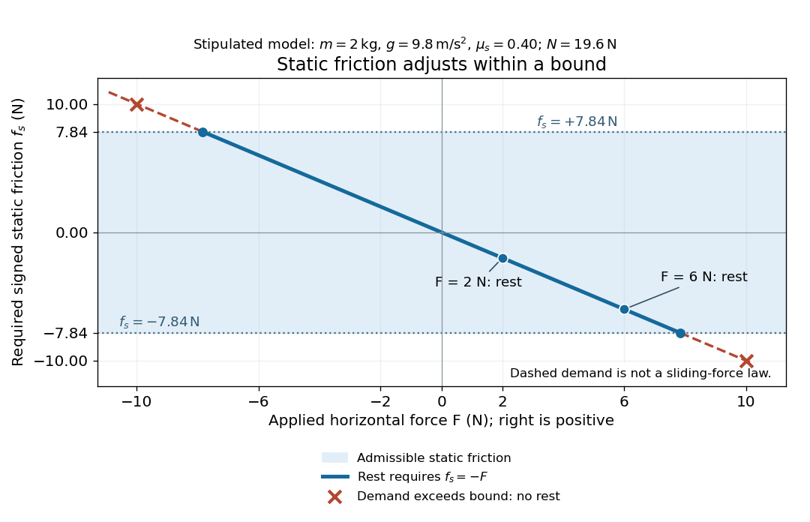
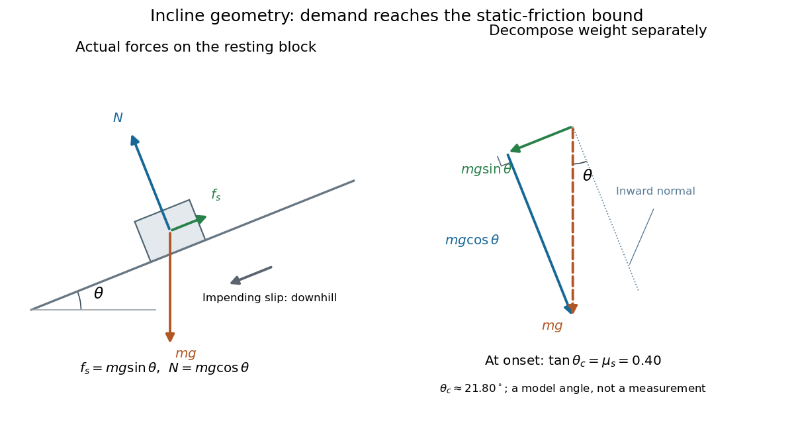
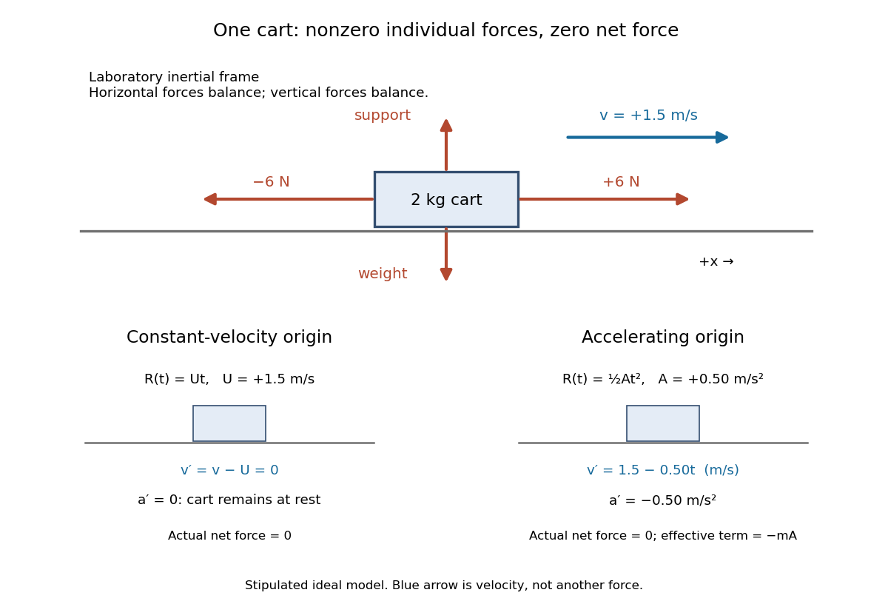
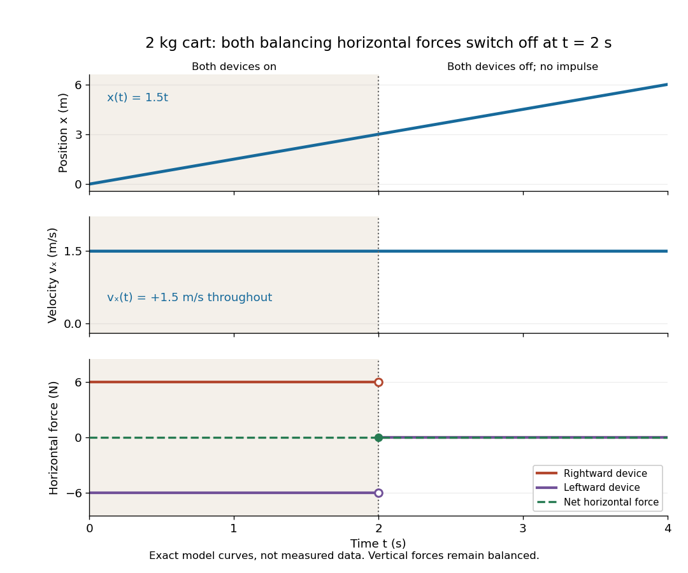

# Force

↑ **Parent:** [Classical mechanics](classical-mechanics.md)  
ⓦ [Wiki](https://en.wikipedia.org/wiki/Force)

A force is an interaction that changes momentum; in Newtonian mechanics it satisfies $F=ma$ for constant mass.

**Table of contents**

- [Force density](#force-density)
- [Intermolecular force](#intermolecular-force)
  - [Quadrupole interaction](#quadrupole-interaction)
  - [Benzene dimer](#benzene-dimer)
  - [Exchange repulsion](#exchange-repulsion)
  - [Induction interaction](#induction-interaction)
- [Force field (physics)](#force-field-physics)
- [Thrust](#thrust)
- [Entropic force](#entropic-force)
- [Force per unit length](#force-per-unit-length)
- [Free-body diagram](#free-body-diagram)
- [Internal force](#internal-force)
- [External force](#external-force)
- [Weight (physics)](#weight-physics)
  - [Apparent weight](#apparent-weight)
    - [Weightlessness](#weightlessness)
- [Restoring force](#restoring-force)
- [Tension](#tension)
- [Van der Waals force](#van-der-waals-force)
  - [Van der Waals potential](#van-der-waals-potential)
  - [Hamaker summation](#hamaker-summation)
    - [Van der Waals pressure between planar half-spaces](#van-der-waals-pressure-between-planar-half-spaces)
  - [London dispersion force](#london-dispersion-force)
  - [Far-field sphere-plane dispersion energy](#far-field-sphere-plane-dispersion-energy)
  - [Sphere-plane dispersion force](#sphere-plane-dispersion-force)
- [Static friction](#static-friction)
  - [Friction angle](#friction-angle)
    - [Normal versus resultant force in a frictional pinch](#normal-versus-resultant-force-in-a-frictional-pinch)
      - [No-lift threshold of a wedge pinch](#no-lift-threshold-of-a-wedge-pinch)
  - [Coefficient of static friction](#coefficient-of-static-friction)
    - [Static friction on an inclined plane](#static-friction-on-an-inclined-plane)
      - [Inclined-plane measurement of static friction](#inclined-plane-measurement-of-static-friction)
- [Force balance](#force-balance)
- [Newton's laws of motion](#newton-s-laws-of-motion)
  - [Newton's first law](#newton-s-first-law)
    - [Balanced forces and constant velocity](#balanced-forces-and-constant-velocity)
    - [Air-track test of inertial motion](#air-track-test-of-inertial-motion)
    - [Inertial motion in an accelerating frame](#inertial-motion-in-an-accelerating-frame)
  - [Newton's second law](#newton-s-second-law)
    - [Avalanche front with linear mass entrainment](#avalanche-front-with-linear-mass-entrainment)
  - [Newton's third law](#newton-s-third-law)
    - [Third-law interaction pair](#third-law-interaction-pair)
    - [Equal interaction forces and unequal accelerations](#equal-interaction-forces-and-unequal-accelerations)
    - [Internal-force cancellation in system momentum](#internal-force-cancellation-in-system-momentum)
    - [Two-cart force-probe test of Newton's third law](#two-cart-force-probe-test-of-newton-s-third-law)
- [Normal force](#normal-force)

## Force density

↑ **Parent:** [Force](force.md)

A [force density](#force-density) is force per unit volume, measured in $\mathrm{N\,m^{-3}}$. [Pressure](pressure.md) gradients, the divergence of a viscous [stress](continuum-mechanics.md#stress) and gravitational body force have this dimension in a local [momentum](momentum.md) balance.

## Intermolecular force

↑ **Parent:** [Force](force.md)

A force between [molecules](molecule.md), including effects of [electrostatics](electrostatics.md), [polarizability](electrostatics.md#electric-polarizability) and [London dispersion forces](#london-dispersion-force). [Hydrogen bonds](chemical-bond.md#hydrogen-bond) describe a directional interaction pattern rather than an additional fundamental force to add independently to all those components.

### Quadrupole interaction

↑ **Parent:** [Intermolecular force](#intermolecular-force)

Interaction involving a quadrupolar charge distribution. [benzene](chemical-substance.md#benzene) has no permanent dipole by [symmetry](physics.md#symmetry-physics) but can still have orientation-dependent electrostatic interactions.

### Benzene dimer

↑ **Parent:** [Intermolecular force](#intermolecular-force)

Two [benzene](chemical-substance.md#benzene) [molecules](molecule.md) associated by dispersion and electrostatic interactions. T-shaped and parallel-displaced geometries are important low-energy arrangements; a single permanent dipole–dipole model is inadequate.

### Exchange repulsion

↑ **Parent:** [Intermolecular force](#intermolecular-force)

Short-range repulsion associated with the antisymmetry requirement for overlapping electronic states, related to the [Pauli exclusion principle](tensor-product-of-quantum-systems.md#pauli-exclusion-principle). It competes with attractive electrostatic and [London dispersion forces](#london-dispersion-force) at small intermolecular separations.

### Induction interaction

↑ **Parent:** [Intermolecular force](#intermolecular-force)

An existing charge distribution polarizes a neighbouring molecule, changing its [electron density](chemistry.md#electron-density) and interaction energy. The resulting interaction depends on the molecular [polarizability](electrostatics.md#electric-polarizability) and local [electric field](electric-field.md).

## Force field (physics)

↑ **Parent:** [Force](force.md)  
ⓦ [Wiki](https://en.wikipedia.org/wiki/Force_field_(physics))

A force field specifies a [force](force.md) [vector](vector-space.md#vector) as a function of [position](classical-mechanics.md#position) and, when necessary, time, for a specified test body. It is a [vector field](multivariable-calculus.md#vector-field). A time-independent [conservative vector field](multivariable-calculus.md#conservative-vector-field) has $\mathbf F=-\nabla V$, where $V$ is the body's [potential energy](energy.md#potential-energy); its [work](energy.md#work) along a path equals the decrease in $V$. Position-dependent forces can have nonzero [curl](multivariable-calculus.md#curl), so a [scalar potential](classical-field-theory.md#scalar-potential) need not exist.

## Thrust

↑ **Parent:** [Force](force.md)

A propulsive [force](force.md) exerted on a body by an engine or another momentum-transfer mechanism. In a vehicle moving through a fluid, its direction need not coincide with the vehicle's actual [velocity](classical-mechanics.md#velocity), and a transverse component can steer the motion. The component along the velocity contributes mechanical [power](energy.md#power) $\mathbf T\cdot\mathbf v$; a purely transverse component changes direction without doing instantaneous work. [Rocket thrust](momentum.md#rocket-thrust) is one particular mechanism and includes momentum carried by expelled material.

## Entropic force

↑ **Parent:** [Force](force.md)  
ⓦ [Wiki](https://en.wikipedia.org/wiki/Entropic_force)

An [entropic force](#entropic-force) is the part of a generalized [force](force.md) arising from the dependence of [entropy](entropy.md) on a coordinate. At fixed [temperature](temperature.md), the system's force is $-\partial A/\partial x=-\partial U/\partial x+T\partial S/\partial x$, where $A=U-TS$ is the [Helmholtz free energy](thermodynamic-potential.md#helmholtz-free-energy). If the [internal energy](internal-energy.md) is independent of the coordinate, the force is entirely entropic. For an [ideal chain](mathematical-biology.md#ideal-chain) whose configurations become less numerous on extension, it acts toward shorter extension. The external [tension](#tension) holding the chain extended has the opposite sign. Thus the force depends on the statistical number of available configurations, even when the energy of each configuration is unchanged.

## Force per unit length

↑ **Parent:** [Force](force.md)

A [force per unit length](#force-per-unit-length) describes a distributed force on a filament and has units $\mathrm{N\,m^{-1}}$. For a charged filament with [linear charge density](electric-charge.md#linear-charge-density) $\lambda$ and longitudinal current $I$, the external [Lorentz force](relativistic-electromagnetism.md#lorentz-force) is $\mathbf f=\lambda\mathbf E+I\widehat{\mathbf t}\times\mathbf B$. Length, density and force must all refer to the same measurement frame. An infinite uniform filament generally has a finite force density but no finite total force.

## Free-body diagram

↑ **Parent:** [Force](force.md)  
ⓦ [Wiki](https://en.wikipedia.org/wiki/Free-body_diagram)

A [free-body diagram](#free-body-diagram) isolates a body and shows the [forces](force.md) exerted on it. A [third-law interaction pair](#third-law-interaction-pair) acts on different bodies and belongs in separate body diagrams.

## Internal force

↑ **Parent:** [Force](force.md)

An [internal force](#internal-force) is a [force](force.md) between members inside the chosen system boundary. Changing that boundary can change which [forces](force.md) are internal. Pairwise [Newtonian mechanics](newtonian-mechanics.md) interactions cancel through [third-law interaction pairs](#third-law-interaction-pair) in the system's total [momentum](momentum.md) balance.

## External force

↑ **Parent:** [Force](force.md)

An [external force](#external-force) is a [force](force.md) exerted on a member inside the chosen system boundary by a body outside it. Changing that boundary can change which [forces](force.md) are external. Their sum changes the system's total [momentum](momentum.md) when its [internal forces](#internal-force) cancel.

## Weight (physics)

↑ **Parent:** [Force](force.md)  
ⓦ [Wiki](https://en.wikipedia.org/wiki/Weight)

Here [gravitational weight](#weight-physics) means the [force](force.md) on a body due to [gravity](physics.md#gravity). In the Newtonian model, a body of [mass](classical-mechanics.md#mass) $m$ in a uniform [gravitational acceleration](newton-s-law-of-universal-gravitation.md#gravitational-acceleration) $\mathbf g$ has [gravitational weight](#weight-physics) $\mathbf W=m\mathbf g$, with magnitude $W=mg$. Its direction follows $\mathbf g$; a [buoyant force](fluid-mechanics.md#buoyancy) is a separate contribution to the body's net [force](force.md). [OpenStax: mass and gravitational weight](https://openstax.org/books/university-physics-volume-1/pages/5-4-mass-and-weight).

### Apparent weight

↑ **Parent:** [Weight (physics)](#weight-physics)  
ⓦ [Wiki](https://en.wikipedia.org/wiki/Apparent_weight)

Apparent weight measures support rather than the gravitational [force](force.md) itself. In an ideal scale model, it is the magnitude $N$ of the [normal force](#normal-force) exerted on the body. A scale calibrated to display [mass](classical-mechanics.md#mass) divides that support force by its calibration value of $g$.

Take upward as positive in a constant downward [gravitational acceleration](newton-s-law-of-universal-gravitation.md#gravitational-acceleration) of magnitude $g$. If a body stays in contact with a horizontal scale and accelerates upward at $a$, [Newton's second law](#newton-s-second-law) gives $N-mg=ma$, hence $N=m(g+a)$. At rest, $N=mg$. In common [free fall](newton-s-law-of-universal-gravitation.md#free-fall), $a=-g$, so $N=0$ despite the nonzero [gravitational weight](#weight-physics) $mg$. If the formula would require $N<0$, ordinary supporting contact cannot realize it: the body loses contact instead.

#### Weightlessness

↑ **Parent:** [Apparent weight](#apparent-weight)  
ⓦ [Wiki](https://en.wikipedia.org/wiki/Weightlessness)

Weightlessness is the absence of supporting or constraining [forces](force.md) that would give a body an [apparent weight](#apparent-weight). It does not require zero [gravitational acceleration](newton-s-law-of-universal-gravitation.md#gravitational-acceleration). A freely falling cabin and a small freely falling object inside share the same acceleration in a uniform field, so neither needs to support the other.

The [circular orbit as continuous free fall](classical-mechanics.md#circular-orbit-as-continuous-free-fall) gives a sustained example. Real spacecraft have small residual relative accelerations from [tidal forces](newton-s-law-of-universal-gravitation.md#tidal-force), atmospheric [drag force](fluid-mechanics.md#drag-physics) and onboard disturbances; the ideal common-fall explanation does not assert that every point in an extended spacecraft experiences exactly the same [Newtonian gravitational field](newton-s-law-of-universal-gravitation.md#newtonian-gravitational-field). [Ramachandran, Numerical and Experimental Investigation of the Effects of Acceleration Disturbances on Microgravity Experiments (2000), abstract: vibration, atmospheric drag and gravity-gradient effects](https://ntrs.nasa.gov/citations/20000083212)

## Restoring force

↑ **Parent:** [Force](force.md)  
ⓦ [Wiki](https://en.wikipedia.org/wiki/Restoring_force)

A restoring force acts toward an [equilibrium](dynamical-systems.md#equilibrium-point-of-a-dynamical-system) when a body is displaced from it. In one dimension, taking [displacement](classical-mechanics.md#displacement) $x=0$ at [equilibrium](dynamical-systems.md#equilibrium-point-of-a-dynamical-system), this means $xF(x)<0$ for sufficiently small nonzero $x$. An ideal linear [spring](elasticity-physics.md#spring) has $F(x)=-kx$ with positive [spring constant](elasticity-physics.md#spring-constant) $k$, producing [simple harmonic motion](classical-mechanics.md#simple-harmonic-motion) for a constant [mass](classical-mechanics.md#mass) without [damping](wave-equation.md#damping). More general restoring forces need not be linear.

## Tension

↑ **Parent:** [Force](force.md)

Tension is a pulling [force](force.md) transmitted along a taut string, rope, or similar body. For an ideal uniform string with [linear mass density](fluid-mechanics.md#linear-mass-density) $\mu$, constant tension $T$ sets the small transverse [wave](wave.md) speed $c=\sqrt{T/\mu}$.

## Van der Waals force

↑ **Parent:** [Force](force.md)  
ⓦ [Wiki](https://en.wikipedia.org/wiki/Van_der_Waals_force)

The Van der Waals force is a distance-dependent nonbonded interaction between atoms or molecules, including dispersion and dipolar contributions. In the attractive nonretarded pair model, an interaction energy $U(r)=-\beta/r^6$ gives force magnitude $6\beta/r^7$. Macroscopic integration introduces a [Hamaker constant](mathematical-biology.md#hamaker-constant); it does not replace the sign change and molecular cutoff needed at very short distances.

### Van der Waals potential

↑ **Parent:** [Van der Waals force](#van-der-waals-force)

The interaction [potential energy](energy.md#potential-energy) associated with a [Van der Waals force](#van-der-waals-force).

### Hamaker summation

↑ **Parent:** [Van der Waals force](#van-der-waals-force)

A pairwise-additive approximation integrating microscopic dispersion interactions over body volumes. For two nonretarded homogeneous half-spaces, it gives interaction energy per area $-A_H/(12\pi d^2)$.

#### Van der Waals pressure between planar half-spaces

↑ **Parent:** [Hamaker summation](#hamaker-summation)

The nonretarded attractive normal pressure obtained by differentiating the half-space interaction energy per area: $P=-A_H/(6\pi d^3)$. Total force additionally requires the interacting area.

### London dispersion force

↑ **Parent:** [Van der Waals force](#van-der-waals-force)  
ⓦ [Wiki](https://en.wikipedia.org/wiki/London_dispersion_force)

Named after [Fritz London](physicist.md#fritz-london), this is an attractive interaction between fluctuating [electric dipoles](electrostatics.md#electric-dipole) of atoms or molecules, present even without a permanent dipole. At large separation compared with atomic size in the nonretarded regime, the dipole interaction scales as $r^{-3}$ and its second-order ground-state energy correction is negative and scales as $r^{-6}$. Differentiating the energy gives an attractive [force](force.md) of magnitude $6C_6/r^7$. The short-distance overlap regime and the very-long-distance retarded regime require different descriptions.

### Far-field sphere-plane dispersion energy

↑ **Parent:** [Van der Waals force](#van-der-waals-force)

For pairwise-additive nonretarded molecular attraction and equal solid [number densities](statistical-physics.md#number-density) $n$, let $A_H=\pi^2Bn^2$ and let $L>R$ be the distance from a sphere centre to a planar half-space. Integrating the atom–half-space [potential energy](energy.md#potential-energy) gives

$$
U(L)=-\frac{A_H}{6}\left[\frac{2RL}{L^2-R^2}+\ln\frac{L-R}{L+R}\right].
$$

For $L\gg R$, expansion gives the displayed expression. Equivalently expand $(L+z)^{-3}$ over the sphere: its odd moments vanish and $\langle z^2\rangle=R^2/5$. This yields the first relative correction $6R^2/(5L^2)$. In the opposite near-contact limit, the gap $h=L-R\ll R$ gives $U\simeq-A_HR/(6h)$ and the [sphere-plane dispersion force](#sphere-plane-dispersion-force) magnitude $A_HR/(6h^2)$. The two limits use different distances and must not be confused.

### Sphere-plane dispersion force

↑ **Parent:** [Van der Waals force](#van-der-waals-force)

For a sphere of radius $a$ at separation $d\ll a$ from a half-space, pairwise integration of the attractive $r^{-6}$ molecular potential gives $F\simeq Aa/(6d^2)$. Equivalently, integrate the planar [disjoining pressure](viscous-fluid-flow.md#disjoining-pressure) magnitude $A/(6\pi h^3)$ over the local gap $h=d+r^2/(2a)$. Across a third medium the effective [Hamaker constant](mathematical-biology.md#hamaker-constant) can instead correspond to repulsion; state its sign convention explicitly.

## Static friction

↑ **Parent:** [Force](force.md)

[Static friction](#static-friction) is the tangential contact [force](force.md) that maintains zero [contact slip](newtonian-mechanics.md#contact-slip). “Static” describes the contact state: both surfaces can move together in the chosen [inertial frame](mathematical-physics.md#inertial-frame). In the ideal dry-contact model, the actual [static friction](#static-friction) adjusts to the [equations of motion](classical-mechanics.md#equation-of-motion), subject to a bound, rather than always taking its maximum value.[Static and Kinetic Friction; Magnitude of Static Friction, equation 6.1 and responsive-force paragraph](physics-bibliography.md#university-physics-volume-1-by-william-moebs-and-others/6-2-friction)

$$
|f_s|\le\mu_sN,\qquad N\ge0,\quad\mu_s\ge0.
$$

Here $N$ is the magnitude of the [normal force](#normal-force) and $\mu_s$ the [coefficient of static friction](#coefficient-of-static-friction). Equality means limiting [static friction](#static-friction); it is a threshold, not an instruction to replace every unknown contact [force](force.md) by $\mu_sN$.

For a stipulated example, place a nonrotating $2\,\mathrm{kg}$ block initially at rest on a stationary horizontal surface. Take [gravitational acceleration](newton-s-law-of-universal-gravitation.md#gravitational-acceleration) $g=9.8\,\mathrm{m/s^2}$ and [coefficient of static friction](#coefficient-of-static-friction) $\mu_s=0.40$, with no other vertical [force](force.md). The vertical [force balance](#force-balance) gives $N=mg=19.6\,\mathrm N$, so the largest allowed [static friction](#static-friction) magnitude is $7.84\,\mathrm N$. Choose right as positive and apply a horizontal [force](force.md) $F$. Remaining at rest requires [Newton's second law](#newton-s-second-law) to give

$$
F+f_s=0,\qquad f_s=-F,\qquad |F|\le7.84\,\mathrm N.
$$

At $F=2\,\mathrm N$, the [static friction](#static-friction) is $-2\,\mathrm N$; at $F=6\,\mathrm N$, it is $-6\,\mathrm N$. Both states have zero [acceleration](classical-mechanics.md#acceleration). At $F=10\,\mathrm N$, balancing would require $f_s=-10\,\mathrm N$, outside the bound, so this initially resting block cannot remain at rest. Its subsequent [acceleration](classical-mechanics.md#acceleration) requires a [kinetic friction](newtonian-mechanics.md#kinetic-friction) law; setting $f_s=-7.84\,\mathrm N$ after [contact slip](newtonian-mechanics.md#contact-slip) begins would still use the wrong contact state. At exactly $F=7.84\,\mathrm N$, the ideal inequality still permits rest at the threshold. These are model calculations, not measured material properties.

**[Figure 1](#image-static-friction-adjusts-to-the-applied-force-within-its-admissible-bound). Static friction adjusts to the applied force within its admissible bound**. Original signed horizontal model for the stipulated $2\,\mathrm{kg}$ block: the shaded band is the allowed [static friction](#static-friction), the solid line satisfies [force balance](#force-balance), and the dashed line shows the demand outside that band. The crossed points at $F=\pm10\,\mathrm N$ are impossible static demands, not sliding [forces](force.md).

The toy model used in [kinetic friction](newtonian-mechanics.md#kinetic-friction) makes the contact-state distinction explicit: $m=1\,\mathrm{kg}$, $N=10\,\mathrm N$, $\mu_s=0.5$ and [coefficient of kinetic friction](newtonian-mechanics.md#coefficient-of-kinetic-friction) $\mu_k=0.3$. On stationary ground, an initially resting box pushed right with $4\,\mathrm N$ has $f_s=-4\,\mathrm N$. At $6\,\mathrm N$ it cannot remain at rest; once it slides right, $f_k=-3\,\mathrm N$ and $a=3\,\mathrm{m/s^2}$. At $5\,\mathrm N$, rest is allowed with $f_s=-5\,\mathrm N$, whereas an already right-sliding box has $f_k=-3\,\mathrm N$ and $a=2\,\mathrm{m/s^2}$. The applied [force](force.md) alone does not specify the [friction](newtonian-mechanics.md#friction) branch: [contact slip](newtonian-mechanics.md#contact-slip) and motion history matter.

For a flat contact with two tangential directions, the bound applies to a [vector norm](normed-vector-space.md#norm), not separately to each component:

$$
\|\mathbf f_s\|\le\mu_sN,\qquad
f_{s,x}^{\,2}+f_{s,y}^{\,2}\le(\mu_sN)^2.
$$

For the stipulated $7.84\,\mathrm N$ bound, balancing horizontal components $4\,\mathrm N$ and $4\,\mathrm N$ requires a [force](force.md) magnitude $\sqrt{32}\,\mathrm N\simeq5.657\,\mathrm N$, which is allowed. Components $6\,\mathrm N$ and $6\,\mathrm N$ require $\sqrt{72}\,\mathrm N\simeq8.485\,\mathrm N$, which is forbidden even though each component separately is below $7.84\,\mathrm N$. This circular bound assumes the same [coefficient of static friction](#coefficient-of-static-friction) in every tangential direction. Near impending [contact slip](newtonian-mechanics.md#contact-slip), the limiting [static friction](#static-friction) opposes the relative contact motion that would otherwise begin. Once actual [contact slip](newtonian-mechanics.md#contact-slip) exists, [kinetic friction](newtonian-mechanics.md#kinetic-friction) instead opposes its tangential [relative velocity](classical-mechanics.md#relative-velocity), which need not have the direction of the body's [center of mass](classical-mechanics.md#center-of-mass) motion.

The [normal force](#normal-force) must also come from the [equations of motion](classical-mechanics.md#equation-of-motion). On horizontal ground, an upward pull of magnitude $P$ at [angle](geometry-and-topology.md#angle) $\alpha$ above horizontal gives, for a block remaining at rest with no other [forces](force.md),

$$
N=mg-P\sin\alpha,\qquad f_s=-P\cos\alpha,\qquad
|P\cos\alpha|\le\mu_s(mg-P\sin\alpha).
$$

The [sine](geometry-and-topology.md#sine) component unloads the contact and the [cosine](geometry-and-topology.md#cosine) component demands tangential support. These equations require $N>0$; if the supporting contact opens, this dry-contact model cannot supply a negative [normal force](#normal-force). For the stipulated $2\,\mathrm{kg}$ block and $\alpha=30^\circ$, the positive threshold is $P=\mu_smg/(\cos\alpha+\mu_s\sin\alpha)\simeq7.3544\,\mathrm N$, with $N\simeq15.9228\,\mathrm N$ and $|f_s|\simeq6.3691\,\mathrm N$. A downward pull increases $N$ instead. An [inclined plane](classical-mechanics.md#inclined-plane) gives another reason why $N$ is not always $mg$.

To solve a new problem, impose zero [contact slip](newtonian-mechanics.md#contact-slip), find the required [static friction](#static-friction) and [normal force](#normal-force) from the [equations of motion](classical-mechanics.md#equation-of-motion), then check the bound. A demand inside it permits that contact state; a demand outside it rules the state out. For an ideal driven tire undergoing [rolling without slipping](rigid-body-dynamics.md#rolling-without-slipping) on stationary ground, a forward [static friction](#static-friction) can accelerate the vehicle. Its role is to prevent [contact slip](newtonian-mechanics.md#contact-slip), rather than to oppose all motion of the whole body.

Nor does the word “static” by itself make [friction](newtonian-mechanics.md#friction) do zero [work](energy.md#work). The contact [power](energy.md#power) delivered to a body is $P_s=\mathbf f_s\cdot\mathbf v_c$, a [dot product](inner-product.md#dot-product) with its material contact-point [velocity](classical-mechanics.md#velocity) in the chosen [inertial frame](mathematical-physics.md#inertial-frame). At an ideal contact undergoing [rolling without slipping](rigid-body-dynamics.md#rolling-without-slipping) on stationary ground, $\mathbf v_c=\mathbf0$, so this [power](energy.md#power) is zero. For a [rigid body](rigid-body-dynamics.md), adding the translational and rotational contributions gives $\mathbf f_s\cdot\mathbf V_{\mathrm{CM}}+\boldsymbol\tau_{\mathrm{CM}}\cdot\boldsymbol\omega=\mathbf f_s\cdot\mathbf v_c$, where $\boldsymbol\tau_{\mathrm{CM}}$ is the contact [torque](momentum.md#torque) about the [center of mass](classical-mechanics.md#center-of-mass) and $\boldsymbol\omega$ its [angular velocity](rigid-body-dynamics.md#angular-velocity). Counting only the first term omits the rotational contribution.

At a moving contact with zero [contact slip](newtonian-mechanics.md#contact-slip), the two material contact points share a [velocity](classical-mechanics.md#velocity) $\mathbf v_c$ that can be nonzero. For instance, a nonrotating block moving with an accelerating belt receives positive contact [power](energy.md#power) $f_sU$ when the belt's rightward [velocity](classical-mechanics.md#velocity) $U$ and rightward [static friction](#static-friction) $f_s$ are positive. The belt receives $-f_sU$ by [Newton's third law](#newton-s-third-law). These contact contributions sum to zero in the ideal no-slip model, while the block's [kinetic energy](energy.md#kinetic-energy) can increase. Zero [contact slip](newtonian-mechanics.md#contact-slip) and zero [work](energy.md#work) on each body are different conditions.

### Friction angle

↑ **Parent:** [Static friction](#static-friction)

The limiting angle between a contact resultant and the compressive [normal force](#normal-force) when [static friction](#static-friction) obeys $|F_t|\le\mu N$. Resolving the resultant gives $\tan\varphi=|F_t|/N$, so admissible contact forces lie within a cone of half-angle $\arctan\mu$ about the inward normal. A contact-force magnitude is generally $\sqrt{N^2+F_t^2}$, distinct from N.

#### Normal versus resultant force in a frictional pinch

↑ **Parent:** [Friction angle](#friction-angle)

For symmetric upper faces inclined by alpha from the vertical, inward normals push partly downward. Limiting upward friction gives vertical support $2N(\mu\cos\alpha-\sin\alpha)$. Balancing weight yields the displayed minimum normal grip. The corresponding minimum total contact magnitude per face is $N_{\min}\sqrt{1+\mu^2}$. It is achieved at the limiting [friction angle](#friction-angle). The formula assumes symmetric contacts with cancelling horizontal force and torque and positive denominator.

##### No-lift threshold of a wedge pinch

↑ **Parent:** [Normal versus resultant force in a frictional pinch](#normal-versus-resultant-force-in-a-frictional-pinch)

### Coefficient of static friction

↑ **Parent:** [Static friction](#static-friction)

The [coefficient of static friction](#coefficient-of-static-friction) is the nonnegative [dimensionless quantity](physics.md#dimensionless-quantity) $\mu_s=|f_s|_{\max}/N$, with $N>0$, in the ideal dry-contact model. It characterizes the pair of surfaces under specified conditions. It describes the largest supported tangential [force](force.md), whereas the [coefficient of kinetic friction](newtonian-mechanics.md#coefficient-of-kinetic-friction) describes sliding. It is an empirical approximation, not a universal material constant.[Equations 6.1–6.2; unitless coefficient and dependence on both surfaces; empirical-law limitations immediately before Example 6.10](physics-bibliography.md#university-physics-volume-1-by-william-moebs-and-others/6-2-friction)

In the horizontal $2\,\mathrm{kg}$ example, an observed state balancing a $2\,\mathrm N$ pull would only establish $\mu_s\ge2/19.6\simeq0.10204$ under the model assumptions. It would not establish $\mu_s=0.10204$: the actual [static friction](#static-friction) is below its limit. Identifying the coefficient needs an onset measurement, such as [inclined-plane measurement of static friction](#inclined-plane-measurement-of-static-friction), or the starting peak in a suitably controlled horizontal pull. The sustained sliding part of [constant-speed measurement of kinetic friction](newtonian-mechanics.md#constant-speed-measurement-of-kinetic-friction) measures a different coefficient.

In a simple grain model, the existing name [granular friction coefficient](#coefficient-of-static-friction) represents resistance to downstream motion. That model excludes lift and detailed contact [torques](momentum.md#torque). Its coefficient should not automatically be identified with a bulk pile's [angle of repose](continuum-mechanics.md#angle-of-repose): individual contact geometry and collective rearrangement can matter.

#### Static friction on an inclined plane

↑ **Parent:** [Coefficient of static friction](#coefficient-of-static-friction)

An [inclined plane](classical-mechanics.md#inclined-plane) tilted slowly from horizontal turns a [coefficient of static friction](#coefficient-of-static-friction) into a critical [angle](geometry-and-topology.md#angle). Assume a nonrotating block on a stationary, rigid, dry surface, with [gravitational weight](#weight-physics) and the contact [forces](force.md) as its only [forces](force.md). Take $0\le\theta<\pi/2$ to be the [angle](geometry-and-topology.md#angle) between the uphill surface direction and horizontal. Let $\mathbf e_t$ be a unit [vector](vector-space.md#vector) pointing uphill and $\mathbf e_n$ a perpendicular unit [vector](vector-space.md#vector) pointing outward from the surface. Resolving the [gravitational weight](#weight-physics) gives

$$
\mathbf W=-mg\sin\theta\,\mathbf e_t-mg\cos\theta\,\mathbf e_n.
$$

The [angle](geometry-and-topology.md#angle) between the downward vertical and the inward normal $-\mathbf e_n$ is also $\theta$. Thus the inward component uses [cosine](geometry-and-topology.md#cosine) and the downhill component uses [sine](geometry-and-topology.md#sine). These are components of one [force](force.md), not two additional [forces](force.md).

**[Figure 2](#image-inclined-plane-force-balance-and-the-geometry-of-impending-downhill-contact-slip). Inclined plane force balance and the geometry of impending downhill contact slip**. Original diagram at the stipulated critical [angle](geometry-and-topology.md#angle) $\theta_c=\arctan(0.40)\simeq21.80^\circ$. Left: the three actual [forces](force.md) on a resting block. Right: a separate decomposition of [gravitational weight](#weight-physics) into downhill and inward-normal components; the dashed diagonal represents their sum. The two panels must not be combined into a diagram with five applied [forces](force.md).

Before downhill [contact slip](newtonian-mechanics.md#contact-slip), zero [acceleration](classical-mechanics.md#acceleration) and [Newton's second law](#newton-s-second-law) require

$$
f_s=mg\sin\theta,\qquad N=mg\cos\theta.
$$

The required [static friction](#static-friction) points uphill. Substituting into the bound and dividing by the positive $mg\cos\theta$ gives

$$
mg\sin\theta\le\mu_smg\cos\theta
\quad\Longleftrightarrow\quad
\tan\theta\le\mu_s.
$$

The [tangent function](geometry-and-topology.md#tangent-function) increases on this range of [angles](geometry-and-topology.md#angle), so the last admissible resting [angle](geometry-and-topology.md#angle) is

$$
\theta_c=\arctan\mu_s,\qquad \tan\theta_c=\mu_s.
$$

The [inverse tangent](geometry-and-topology.md#inverse-tangent) takes a [dimensionless quantity](physics.md#dimensionless-quantity) to an [angle](geometry-and-topology.md#angle). At equality the ideal model still permits a limiting resting state; increasing $\theta$ further excludes it. At a smaller [angle](geometry-and-topology.md#angle), $f_s/N=\tan\theta$ is the demand ratio, not the [coefficient of static friction](#coefficient-of-static-friction).[Printed p. 1, theory and Figure 2; p. 5, Part III; worksheet p. 2, Table 3](physics-bibliography.md#friction-physics-183-experiment-5-fall-2004)

For the stipulated $m=2\,\mathrm{kg}$, $g=9.8\,\mathrm{m/s^2}$ and $\mu_s=0.40$, the critical [angle](geometry-and-topology.md#angle) is approximately $21.8014^\circ$. At $\theta=15^\circ$, $N\simeq18.932\,\mathrm N$ and $f_s\simeq5.073\,\mathrm N$, comfortably below the bound $\mu_sN\simeq7.573\,\mathrm N$. At $\theta=25^\circ$, maintaining rest would require $f_s\simeq8.283\,\mathrm N$, but the bound is only $7.105\,\mathrm N$: rest is impossible. At $\theta_c$, $N\simeq18.198\,\mathrm N$ and $f_s\simeq7.279\,\mathrm N$. Notice that the limiting tangential [force](force.md) here is smaller than the horizontal $7.84\,\mathrm N$ limit because tilting reduces the [normal force](#normal-force).

Cancellation of [mass](classical-mechanics.md#mass) makes this relation useful: the ideal critical [angle](geometry-and-topology.md#angle) tests a contact coefficient without needing a calibrated [force](force.md) gauge. Doubling the block's [mass](classical-mechanics.md#mass) doubles both demanded [static friction](#static-friction) and its bound, leaving $\theta_c$ unchanged if $\mu_s$ is unchanged. This is a testable model prediction. It need not survive a change in surface condition, a direction-dependent coefficient, appreciable deformation, or vibration.

The derivation also assumes continued contact and that sliding occurs before tipping or [rolling without slipping](rigid-body-dynamics.md#rolling-without-slipping). The resultant contact [force](force.md) must act within the supporting footprint so that the block can satisfy [torque](momentum.md#torque) balance; a tall block may tip first. No extra [tension](#tension), imposed tangential pull, or lift is included. In a slowly raised apparatus, [quasistatic process](thermodynamics.md#quasistatic-process) means that motion of the board contributes negligible inertial [forces](force.md) while locating the threshold. Once downhill [contact slip](newtonian-mechanics.md#contact-slip) begins, a constant-[velocity](classical-mechanics.md#velocity) sliding [angle](geometry-and-topology.md#angle) would concern [kinetic friction](newtonian-mechanics.md#kinetic-friction), not the onset of [static friction](#static-friction).

##### Inclined-plane measurement of static friction

↑ **Parent:** [Static friction on an inclined plane](#static-friction-on-an-inclined-plane)

A university laboratory places an [aluminium](chemical-substance.md#aluminium) block on a [Teflon](polymer.md#teflon)-lined wooden board. For its [inclined plane](classical-mechanics.md#inclined-plane) stage, the pulley and block string are removed; a rope and hook connect the board to a crank. The block is placed gently near the sheet's middle without prior sliding. Smooth cranking raises the board; a $0^\circ$–$45^\circ$ [protractor](geometry-and-topology.md#protractor) reads the smallest [angle](geometry-and-topology.md#angle) at which sliding begins. Four readings are taken without added load, then four each with $200$, $400$, and $800\,\mathrm g$ added symmetrically at two screws. Removing the string isolates gravity-driven onset; gentle placement and smooth raising avoid premature disturbance.[Printed p. 5, Part III, steps 1–7 and Figure 6; worksheet p. 2, Table 3](physics-bibliography.md#friction-physics-183-experiment-5-fall-2004)

Infer $\mu_s=\tan\theta_c$ under the assumptions of [static friction on an inclined plane](#static-friction-on-an-inclined-plane). Repetition tests onset scatter; added loads test coefficient constancy. No measured onset values are supplied here.

For a replication, additionally check the [protractor](geometry-and-topology.md#protractor) zero with a level board, retain the same contact face and surface region, and observe whether tipping or rolling precedes sliding. These are proposed additional controls. A finite [angle](geometry-and-topology.md#angle) resolution and the disturbance needed to detect first motion limit the estimate; a slow ramp does not by itself establish perfectly rigid, dry, or direction-independent contact. At the model's $\mu_s=0.40$ threshold, differentiating the [tangent function](geometry-and-topology.md#tangent-function) gives $d\mu_s/d\theta=1+\mu_s^2=1.16$, with $\theta$ in [radians](geometry-and-topology.md#radian). A hypothetical $0.5^\circ$ [measurement error](probability-and-statistics.md#measurement-error) would therefore correspond to approximately $0.0101$ in the inferred coefficient at first order. This sensitivity calculation is not an uncertainty reported by the laboratory.

## Force balance

↑ **Parent:** [Force](force.md)

Force balance equates the rate of change of momentum to the sum of applied forces. A static continuum segment with internal resultant $\mathbf F(s)$ and force density $\mathbf f(s)$ obeys $\partial_s\mathbf F+\mathbf f=0$.

<h2 id="newton-s-laws-of-motion">Newton's laws of motion</h2>

↑ **Parent:** [Force](force.md)  
ⓦ [Wiki](https://en.wikipedia.org/wiki/Newton's_laws_of_motion)

[Newton's laws of motion](#newton-s-laws-of-motion) consist of inertia in an [inertial frame](mathematical-physics.md#inertial-frame), the relation between net [force](force.md) and change of [momentum](momentum.md), and equal-and-opposite pair forces. The following three children state the individual laws.

<h3 id="newton-s-first-law">Newton's first law</h3>

↑ **Parent:** [Newton's laws of motion](#newton-s-laws-of-motion)

In an [inertial frame](mathematical-physics.md#inertial-frame), a body with zero net [external force](#external-force) remains at rest or moves with constant [velocity](classical-mechanics.md#velocity). For a [point mass](classical-mechanics.md#point-mass) of constant positive [mass](classical-mechanics.md#mass), write the net [external force](#external-force) as the [vector](vector-space.md#vector) sum of all [external forces](#external-force) on that body:

$$
\mathbf F_{\mathrm{net}}=\sum_i\mathbf F_i=\mathbf0
\quad\Longrightarrow\quad
\mathbf a=\frac{d\mathbf v}{dt}=\mathbf0,\qquad
\mathbf v(t)=\mathbf v_0,\qquad
\mathbf r(t)=\mathbf r_0+\mathbf v_0(t-t_0).
$$

Here $\mathbf r_0$ and $\mathbf v_0$ are the [position](classical-mechanics.md#position) and [velocity](classical-mechanics.md#velocity) at [time](classical-mechanics.md#time-in-physics) $t_0$. The zero net [external force](#external-force) must hold throughout the interval, not merely at one instant. Both the magnitude and direction of the [velocity](classical-mechanics.md#velocity) stay fixed: constant [speed](classical-mechanics.md#speed) along a curved [trajectory](classical-mechanics.md#trajectory) still involves [acceleration](classical-mechanics.md#acceleration). Rest is the case $\mathbf v_0=\mathbf0$. For an extended closed system, the analogous statement concerns its [center of mass](classical-mechanics.md#center-of-mass); zero net [external force](#external-force) need not prevent its parts from moving relative to one another.

The short mathematical argument is to use [Newton's second law](#newton-s-second-law) with $m>0$, then take the [integral](integral.md) of $d\mathbf v/dt=\mathbf0$ and of $d\mathbf r/dt=\mathbf v_0$. This gives the two constants fixed by the initial [position](classical-mechanics.md#position) and [velocity](classical-mechanics.md#velocity). The physical content also includes the existence of [inertial frames](mathematical-physics.md#inertial-frame) in which these relations apply; an arbitrary accelerating [reference frame](mathematical-physics.md#reference-frame) need not show constant [velocity](classical-mechanics.md#velocity) for a body with zero actual net [external force](#external-force).

The useful question is therefore which [forces](force.md) change the motion, rather than which [force](force.md) keeps it going. A [free-body diagram](#free-body-diagram) may show several nonzero [forces](force.md) whose [vector](vector-space.md#vector) sum is zero. Equal opposing [forces](force.md) on the same body can balance; a [third-law interaction pair](#third-law-interaction-pair) acts on different bodies and cannot be cancelled within that one body's diagram.

In 1687, [Isaac Newton](mathematics.md#isaac-newton) stated Law I in _Philosophiae Naturalis Principia Mathematica_: a body's rest or uniform straight motion persists unless impressed [forces](force.md) compel a change. The following paragraph identifies air resistance and [gravity](physics.md#gravity) as influences on the [trajectory](classical-mechanics.md#trajectory) of a thrown body. The [vector](vector-space.md#vector) equations above are a modern expression of the law, not a quotation of his notation.[Isaac Newton, Philosophiae Naturalis Principia Mathematica (1687), Axiomata sive leges motus, printed p. 12: Lex I and the following projectile paragraph; normalized transcription](physics-bibliography.md#philosophiae-naturalis-principia-mathematica-by-isaac-newton/axiomata-sive-leges-motus)

#### Balanced forces and constant velocity

↑ **Parent:** [Newton's first law](#newton-s-first-law)

Consider a stipulated ideal cart modeled as a [point mass](classical-mechanics.md#point-mass) of [mass](classical-mechanics.md#mass) $2\,\mathrm{kg}$ on a horizontal track in a laboratory [inertial frame](mathematical-physics.md#inertial-frame). Its initial [position](classical-mechanics.md#position) is $x(0)=0$ and its initial [velocity](classical-mechanics.md#velocity) is $v_x(0)=1.5\,\mathrm{m/s}$ to the right. Independent devices exert horizontal [forces](force.md) $+6\,\mathrm N$ and $-6\,\mathrm N$ on this same cart. Its upward support [force](force.md) balances its downward [gravitational weight](#weight-physics); no other [forces](force.md) contribute. Rotation and deformation are excluded from this model.

$$
F_{\mathrm{net},x}=6-6=0\,\mathrm N,\qquad
a_x=\frac{0\,\mathrm N}{2\,\mathrm{kg}}=0\,\mathrm{m/s^2},\qquad
v_x(t)=1.5\,\mathrm{m/s},\qquad
x(t)=(1.5\,\mathrm{m/s})t.
$$

After $4\,\mathrm s$, the cart is at $6\,\mathrm m$, still moving right at $1.5\,\mathrm{m/s}$. Starting the same model at rest instead would leave it at rest. [Force balance](#force-balance) determines the zero [acceleration](classical-mechanics.md#acceleration), while the initial [velocity](classical-mechanics.md#velocity) determines whether the cart moves.

**[Figure 3](#image-balanced-external-forces-on-one-cart-and-its-description-in-different-reference-frames). Balanced external forces on one cart and its description in different reference frames**. Original schematic of the stipulated $2\,\mathrm{kg}$ cart. The upper panel shows actual [forces](force.md) and a separate [velocity](classical-mechanics.md#velocity) arrow. The lower panels compare an [inertial frame](mathematical-physics.md#inertial-frame) translating at constant [velocity](classical-mechanics.md#velocity) with a nonrotating [translating accelerated reference frame](mathematical-physics.md#translating-accelerated-reference-frame).

For the plotted model, both horizontal devices are switched off simultaneously at $t=2\,\mathrm s$, with no [impulse](classical-mechanics.md#impulse). The support and [gravitational weight](#weight-physics) remain balanced. The individual horizontal [forces](force.md) change, but their sum stays zero on both sides of the switch, so the [velocity](classical-mechanics.md#velocity) stays continuous and unchanged. Switching off just one device would be a different model with a nonzero net [external force](#external-force).

**[Figure 4](#image-model-position-velocity-and-individual-horizontal-forces-before-and-after-a-simultaneous-switch). Model position, velocity, and individual horizontal forces before and after a simultaneous switch**. Exact predictions for the stipulated cart, not experimental data. For $0\le t<2\,\mathrm s$, the horizontal [forces](force.md) are $+6\,\mathrm N$ and $-6\,\mathrm N$; for $2\le t\le4\,\mathrm s$, both are zero. The net horizontal [external force](#external-force) is zero throughout. Open and filled endpoints distinguish the two sides of the switch.

#### Air-track test of inertial motion

↑ **Parent:** [Newton's first law](#newton-s-first-law)

An actual teaching experiment in Arbor Scientific's _The Level Air Track_ uses one glider, an [air track](wave-equation.md#air-track), two [photogates](physics.md#photogate), and a ruler. Turn on the blower and place the glider near the middle. Adjust the feet until it does not drift when released. Put the [photogates](physics.md#photogate) at least half a track length apart and align them with the glider's flag. Measure the length $L$ that interrupts the beams. Give a gentle push, let go, and record each beam-blocking [time](classical-mechanics.md#time-in-physics) $\Delta t_i$. The readout is the pair of [speeds](classical-mechanics.md#speed) $s_i=L/\Delta t_i$. The worksheet asks how those [speeds](classical-mechanics.md#speed) compare, which [forces](force.md) remain after the push, and which interaction the [air track](wave-equation.md#air-track) minimizes.[Arbor Scientific, The Level Air Track: Teacher's Notes, p. 1, Required Equipment and Lab Tips; student sheet, p. 2, Procedure 1–9](physics-bibliography.md#the-level-air-track-by-arbor-scientific)

The motivating contrast is between a brief push and the subsequent glide. The air cushion reduces contact [friction](newtonian-mechanics.md#friction); it does not remove the downward [gravitational weight](#weight-physics) or the upward support [force](force.md). Similar successive [speeds](classical-mechanics.md#speed) after release are consistent with a small horizontal net [external force](#external-force), rather than with a continuing push. The experiment approximates the zero net [external force](#external-force) model over a finite track and observation interval.

To strengthen the documented procedure, use independent [measurement calibration](physics.md#measurement-calibration): check the flag length and each timer against a known length and [time](classical-mechanics.md#time-in-physics) reference; measuring $L$ sets the length scale but does not calibrate the timer. Repeat launches in both directions without contact during the timed passage, and check for drift at several track locations. These are additional controls, not reported steps or measured results in the worksheet. A residual [inclined plane](classical-mechanics.md#inclined-plane) produces a downhill component of [gravitational weight](#weight-physics) with the same laboratory direction on both runs; [friction](newtonian-mechanics.md#friction) and [drag force](fluid-mechanics.md#drag-physics) oppose the direction of travel. Reversing the launch can therefore help distinguish these effects.

A [photogate](physics.md#photogate) directly measures a beam-blocking [time](classical-mechanics.md#time-in-physics); $L/\Delta t_i$ is an average [speed](classical-mechanics.md#speed) during that passage, not an exact instantaneous [velocity](classical-mechanics.md#velocity). Assign the direction separately. Equal readings at two gates do not prove zero [acceleration](classical-mechanics.md#acceleration) everywhere between them: opposing changes could cancel. [Measurement uncertainty](physics.md#measurement-uncertainty) from timer resolution, an incorrectly measured flag length, residual slope, airflow disturbances, and remaining [friction](newtonian-mechanics.md#friction) or [drag force](fluid-mechanics.md#drag-physics) limit the inference. No measured glider [speeds](classical-mechanics.md#speed) are assumed here.

#### Inertial motion in an accelerating frame

↑ **Parent:** [Newton's first law](#newton-s-first-law)

Constant [velocity](classical-mechanics.md#velocity) depends on the [reference frame](mathematical-physics.md#reference-frame). For nonrotating axes and a moving origin of laboratory [position](classical-mechanics.md#position) $\mathbf R(t)$, subtracting that origin gives

$$
\mathbf r'=\mathbf r-\mathbf R(t),\qquad
\mathbf v'=\mathbf v-\dot{\mathbf R}(t),\qquad
\mathbf a'=\mathbf a-\ddot{\mathbf R}(t).
$$

If $\mathbf R(t)=\mathbf R_0+\mathbf U t$ with constant [velocity](classical-mechanics.md#velocity) $\mathbf U$, the [Galilean transformation](special-relativity.md#galilean-transformation) leaves [acceleration](classical-mechanics.md#acceleration) unchanged. The cart moving at $1.5\,\mathrm{m/s}$ in the laboratory is at rest in a frame moving right at $1.5\,\mathrm{m/s}$. Both descriptions obey [Newton's first law](#newton-s-first-law).

Instead choose an origin with $R_x(t)=\tfrac12At^2$, where the stipulated constant $A=0.50\,\mathrm{m/s^2}$ points right. The same cart has

$$
x'(t)=(1.5\,\mathrm{m/s})t-\tfrac12(0.50\,\mathrm{m/s^2})t^2,\qquad
v_x'(t)=1.5\,\mathrm{m/s}-(0.50\,\mathrm{m/s^2})t,\qquad
a_x'=-0.50\,\mathrm{m/s^2}.
$$

At $t=3\,\mathrm s$, the cart is instantaneously at rest relative to this accelerating origin, but its relative [acceleration](classical-mechanics.md#acceleration) is nonzero. In this [translating accelerated reference frame](mathematical-physics.md#translating-accelerated-reference-frame), [Newton's second law](#newton-s-second-law) must include the effective inertial [force](force.md) $-mA=-1.0\,\mathrm N$. This term accounts for the accelerating coordinates; the actual [external forces](#external-force) on the cart still sum to zero. No rotation-dependent terms are present because the axes remain parallel to the laboratory axes.

<h3 id="newton-s-second-law">Newton's second law</h3>

↑ **Parent:** [Newton's laws of motion](#newton-s-laws-of-motion)

In an [inertial frame](mathematical-physics.md#inertial-frame), a [point mass](classical-mechanics.md#point-mass) of constant [mass](classical-mechanics.md#mass) $m>0$ obeys

$$
\mathbf F_{\mathrm{net}}=\sum_i\mathbf F_i
=\frac{d\mathbf p}{dt}=m\mathbf a,
\qquad \mathbf p=m\mathbf v,
\qquad \mathbf a=\frac{d\mathbf v}{dt}.
$$

The net [force](force.md) is the sum of all [forces](force.md) acting on that body; [momentum](momentum.md), [velocity](classical-mechanics.md#velocity) and [acceleration](classical-mechanics.md#acceleration) refer to the same [reference frame](mathematical-physics.md#reference-frame). A [force](force.md) changes [velocity](classical-mechanics.md#velocity), rather than sustaining it: zero net [force](force.md) implies constant [velocity](classical-mechanics.md#velocity), including a nonzero one. Doubling the net [force](force.md) at fixed [mass](classical-mechanics.md#mass) doubles [acceleration](classical-mechanics.md#acceleration); doubling [mass](classical-mechanics.md#mass) at fixed net [force](force.md) halves it. [MIT mechanics, Chapter 7, section 7.3](https://ocw.mit.edu/courses/8-01sc-classical-mechanics-fall-2016/mit8_01scs22_chapter7.pdf)

For example, an otherwise balanced block of [mass](classical-mechanics.md#mass) $0.5\,\mathrm{kg}$ receives a constant horizontal net [force](force.md) $2\,\mathrm N$ for $0.5\,\mathrm s$. Its [acceleration](classical-mechanics.md#acceleration) is $4\,\mathrm{m/s^2}$, so its [velocity](classical-mechanics.md#velocity) changes by $2\,\mathrm{m/s}$. Equivalently, the [impulse](classical-mechanics.md#impulse) is $F\Delta t=1\,\mathrm{N\,s}$, and $\Delta v=\Delta p/m$. Starting from rest, its [displacement](classical-mechanics.md#displacement) during the pulse is $a(\Delta t)^2/2=0.5\,\mathrm m$. After the pulse, zero net [force](force.md) leaves it moving at constant [velocity](classical-mechanics.md#velocity).

Applying the law therefore requires both a specification of the net [force](force.md) and [initial conditions](differential-equation.md#initial-condition). In the [harmonic oscillator](classical-mechanics.md#simple-harmonic-motion) example, the [force](force.md) is $-kx$, so [Newton's second law](#newton-s-second-law) becomes a [differential equation](differential-equation.md) for [position](classical-mechanics.md#position). In an accelerating [reference frame](mathematical-physics.md#reference-frame), the measured relative [acceleration](classical-mechanics.md#acceleration) includes a contribution from the frame's own motion; the [equation of motion in a rotating frame](classical-mechanics.md#equation-of-motion-in-a-rotating-frame) illustrates the extra terms required.

Constant [mass](classical-mechanics.md#mass) is essential to the displayed $m\mathbf a$ form. A [variable-mass system](classical-mechanics.md#variable-mass-system) exchanging matter also exchanges [momentum](momentum.md); its balance includes the entering or leaving matter's [velocity](classical-mechanics.md#velocity). Simply differentiating $m\mathbf v$ and equating it to external [force](force.md) on that open body can omit this flux. The existing [variable-mass system](classical-mechanics.md#variable-mass-system) equation specifies the needed correction.

In the 1687 _Principia_, [Newton's second law](#newton-s-second-law) was stated in terms of change of motion proportional to impressed [force](force.md), directed along that [force](force.md). Its original statement is verbal; the [derivative](calculus.md#derivative) equation above is modern notation. [Philosophiae Naturalis Principia Mathematica by Isaac Newton; Newton, Axiomata sive leges motus (1687), Lex II](physics-bibliography.md#philosophiae-naturalis-principia-mathematica-by-isaac-newton/axiomata-sive-leges-motus)

#### Avalanche front with linear mass entrainment

↑ **Parent:** [Newton's second law](#newton-s-second-law)

An idealized front at distance $x>0$ down a uniform slope entrains stationary material so that its moving mass is proportional to $x$. Its [linear momentum](momentum.md) balance is $d(x\dot x)/dt=Ax$, where $A=g\sin\alpha>0$. Multiplying by $x\dot x$ gives $x^2\dot x^2=2Ax^3/3+c$. Every forward-moving branch tends to $\dot x=\sqrt{2Ax/3}$ as $x\to\infty$, and $\ddot x=A/3-c/x^3\to A/3$. Acceleration is smaller than the constant-mass downslope value because some momentum accelerates newly entrained material.

<h3 id="newton-s-third-law">Newton's third law</h3>

↑ **Parent:** [Newton's laws of motion](#newton-s-laws-of-motion)

In the pair-interaction model of [Newtonian mechanics](newtonian-mechanics.md), two bodies exert equal and opposite [forces](force.md) on each other:

$$
\mathbf F_{A\mathrm{\ on\ }B}=-\mathbf F_{B\mathrm{\ on\ }A}.
$$

Both [vectors](vector-space.md#vector) are expressed in the same [inertial frame](mathematical-physics.md#inertial-frame) at the same [time](classical-mechanics.md#time-in-physics). The subscripts name the agent and the recipient: $A$ acts on $B$, and $B$ acts on $A$. These are [forces](force.md) on different bodies, so they cannot cancel in the net [force](force.md) on either body. [Newton's second law](#newton-s-second-law) still uses all the [forces](force.md) on the particular body whose [acceleration](classical-mechanics.md#acceleration) is sought. Identifying this [third-law interaction pair](#third-law-interaction-pair) does not require the bodies to be isolated: additional [external forces](#external-force) can act at the same [time](classical-mechanics.md#time-in-physics).

The distinction makes [Newton's third law](#newton-s-third-law) useful both for drawing a [free-body diagram](#free-body-diagram) and for deriving [momentum conservation](momentum.md#momentum-conservation). A body-by-body calculation retains one member of each [third-law interaction pair](#third-law-interaction-pair); a calculation for a collection containing both bodies cancels that pair in the total [momentum](momentum.md) balance. Equal interaction [forces](force.md) consequently coexist with nonzero, generally unequal [accelerations](classical-mechanics.md#acceleration).

[Isaac Newton](mathematics.md#isaac-newton) stated the equality and opposition of mutual actions in Law III of his 1687 _Philosophiae Naturalis Principia Mathematica_. The explanation distinguishes equal opposite changes of [momentum](momentum.md) from changes of [velocity](classical-mechanics.md#velocity), which are inversely proportional to the bodies' [masses](classical-mechanics.md#mass) when other influences are absent. Corollary III then explains why mutual interactions preserve the signed total [momentum](momentum.md). The equations here are modern notation for that distinction. [Isaac Newton, Philosophiae Naturalis Principia Mathematica (1687), Axiomata sive leges motus, printed p. 13, Lex III and its explanation; pp. 16–17, Corollarium III](physics-bibliography.md#philosophiae-naturalis-principia-mathematica-by-isaac-newton/axiomata-sive-leges-motus)

The instantaneous body-pair equation has a scope: use it for the mechanical interactions assumed by this [Newtonian mechanics](newtonian-mechanics.md) model. In [electromagnetism](electromagnetism.md), bodies can exchange [momentum](momentum.md) with an [electromagnetic field](electromagnetism.md#electromagnetic-field); their instantaneous mutual [forces](force.md) need not sum to zero. [Momentum conservation](momentum.md#momentum-conservation) then accounts for [electromagnetic field momentum](electromagnetism.md#electromagnetic-field-momentum) as well as matter, and for [momentum](momentum.md) crossing the chosen boundary. This complication occurs in classical [electromagnetism](electromagnetism.md), without invoking [quantum mechanics](quantum-mechanics.md).[The Feynman Lectures on Physics, Volume II, §27–6, equation (27.21) and final two examples: momentum of matter, field momentum, and failure of particle-only action and reaction](physics-bibliography.md#the-feynman-lectures-on-physics-volume-ii-by-richard-feynman-and-others/chapter-27-field-energy-and-field-momentum)

#### Third-law interaction pair

↑ **Parent:** [Newton's third law](#newton-s-third-law)

A [third-law interaction pair](#third-law-interaction-pair) consists of the two [forces](force.md) belonging to the same mutual interaction, with their agent and recipient exchanged. The names [action-reaction pair](#third-law-interaction-pair) do not imply a delay: in the instantaneous model, the two [forces](force.md) occur together. Test a proposed pair by naming both bodies and the interaction, rather than merely noticing equal magnitudes and opposite directions.

For a book resting on a table, the table's upward [normal force](#normal-force) and [Earth](planetary-science.md#earth)'s downward [gravitational weight](#weight-physics) both act on the book. They can balance in the book's [free-body diagram](#free-body-diagram), but they are not a [third-law interaction pair](#third-law-interaction-pair). The partner of the table's [normal force](#normal-force) on the book is the book's downward contact [force](force.md) on the table. The partner of [Earth](planetary-science.md#earth)'s gravitational [force](force.md) on the book is the book's gravitational [force](force.md) on [Earth](planetary-science.md#earth). Their equality does not require equal [accelerations](classical-mechanics.md#acceleration): [Earth](planetary-science.md#earth)'s much greater [mass](classical-mechanics.md#mass) makes its response correspondingly smaller for a given net [force](force.md).

Similarly, [friction](newtonian-mechanics.md#friction) on a sliding block from a surface is paired with [friction](newtonian-mechanics.md#friction) on that surface from the block. For the collection containing only the block, that [friction](newtonian-mechanics.md#friction) is an [external force](#external-force); including the contacting surface makes both members [internal forces](#internal-force). Changing the collection changes the bookkeeping of [momentum](momentum.md), not the physical interaction.

**[Figure 5](#image-equal-opposite-interaction-forces-act-on-different-bodies-and-cancel-only-in-the-combined-momentum-balance). Equal opposite interaction forces act on different bodies and cancel only in the combined momentum balance**. Original one-dimensional model with right positive, $m_A=1\,\mathrm{kg}$ and $m_B=2\,\mathrm{kg}$. The upper arrows are the mutual [forces](force.md); the lower panels retain the [force](force.md) on $A$ alone and add both bodies' [momentum](momentum.md) equations. Only horizontal [forces](force.md) are shown; balanced vertical support is omitted.

#### Equal interaction forces and unequal accelerations

↑ **Parent:** [Newton's third law](#newton-s-third-law)

Choose right as positive and let two carts have total moving [masses](classical-mechanics.md#mass) $m_A=1\,\mathrm{kg}$ and $m_B=2\,\mathrm{kg}$, including any attached apparatus. At an instant when their repulsive interaction has magnitude $4\,\mathrm N$, assume no other horizontal [forces](force.md). Then [Newton's third law](#newton-s-third-law) gives $F_{B\mathrm{\ on\ }A}=-4\,\mathrm N$ and $F_{A\mathrm{\ on\ }B}=+4\,\mathrm N$, while [Newton's second law](#newton-s-second-law) gives

$$
a_A=\frac{-4\,\mathrm N}{1\,\mathrm{kg}}=-4\,\mathrm{m/s^2},\qquad a_B=\frac{+4\,\mathrm N}{2\,\mathrm{kg}}=+2\,\mathrm{m/s^2}.
$$

The smaller [mass](classical-mechanics.md#mass) has the larger [acceleration](classical-mechanics.md#acceleration) magnitude. For a nonzero interaction and zero other horizontal [forces](force.md), $a_A/a_B=-m_B/m_A$. Meanwhile $d(p_A+p_B)/dt=m_Aa_A+m_Ba_B=-4+4=0$ in [force](force.md) units. The two carts' [velocities](classical-mechanics.md#velocity) change while total [momentum](momentum.md) stays constant.

To distinguish an instantaneous [force](force.md) from its accumulated [impulse](classical-mechanics.md#impulse), prescribe an original triangular interaction pulse lasting $T=1\,\mathrm s$:

$$
f(t)=\begin{cases}
8\,\mathrm{N/s}\;t,&0\leq t\leq T/2,\\
8\,\mathrm{N/s}\;(T-t),&T/2\leq t\leq T,\\
0,&\text{otherwise},
\end{cases}\qquad
F_{B\mathrm{\ on\ }A}(t)=-f(t),\quad F_{A\mathrm{\ on\ }B}(t)=f(t).
$$

This chosen pulse reaches $4\,\mathrm N$ at $t=0.5\,\mathrm s$; it is a constructed model, not an experimental trace or a claim about a particular bumper's material response. Its positive area is $\tfrac12(1\,\mathrm s)(4\,\mathrm N)=2\,\mathrm{N\,s}$. The [impulse-momentum theorem](classical-mechanics.md#impulse-momentum-theorem) therefore gives

$$
J_A=-2\,\mathrm{N\,s},\quad J_B=+2\,\mathrm{N\,s},\qquad \Delta v_A=-2\,\mathrm{m/s},\quad \Delta v_B=+1\,\mathrm{m/s}.
$$

Opposite [impulses](classical-mechanics.md#impulse) give opposite [momentum](momentum.md) changes, while the [velocity](classical-mechanics.md#velocity) changes differ because of the unequal [masses](classical-mechanics.md#mass). The cumulative positive [impulse](classical-mechanics.md#impulse) is $I(t)=4\,\mathrm{N/s}\;t^2$ during the first half and $I(t)=2\,\mathrm{N\,s}-4\,\mathrm{N/s}\;(T-t)^2$ during the second half. Thus $J_A(t)=-I(t)$ and $J_B(t)=I(t)$ cancel throughout the pulse, not merely at its endpoint.

**[Figure 6](#image-constructed-opposite-force-pulses-and-impulses-give-unequal-accelerations-for-unequal-masses). Constructed opposite force pulses and impulses give unequal accelerations for unequal masses**. Original prescribed triangular pulse, not measured data. Separate panels show signed [force](force.md), cumulative [impulse](classical-mechanics.md#impulse), and [acceleration](classical-mechanics.md#acceleration) for $m_A=1\,\mathrm{kg}$ and $m_B=2\,\mathrm{kg}$ with no other horizontal [forces](force.md). Total [momentum](momentum.md) change is zero throughout.

#### Internal-force cancellation in system momentum

↑ **Parent:** [Newton's third law](#newton-s-third-law)

For a fixed collection of two constant-[mass](classical-mechanics.md#mass) bodies in an [inertial frame](mathematical-physics.md#inertial-frame), separate their mutual [forces](force.md) from the resultant [external force](#external-force) on each:

$$
\frac{d\mathbf p_A}{dt}=\mathbf F_{B\mathrm{\ on\ }A}+\mathbf F_{A,\mathrm{ext}},\qquad
\frac{d\mathbf p_B}{dt}=\mathbf F_{A\mathrm{\ on\ }B}+\mathbf F_{B,\mathrm{ext}}.
$$

Adding the two [Newton's second law](#newton-s-second-law) equations and using [Newton's third law](#newton-s-third-law) gives

$$
\mathbf P=\mathbf p_A+\mathbf p_B,\qquad
\frac{d\mathbf P}{dt}=\mathbf F_{A,\mathrm{ext}}+\mathbf F_{B,\mathrm{ext}}.
$$

This is the proof of [internal-force cancellation in system momentum](#internal-force-cancellation-in-system-momentum). For more bodies, each [internal force](#internal-force) cancels with its partner once both appear in the sum. A boundary that excludes one interacting body leaves its [force](force.md) in the [external force](#external-force) sum. A massive connecting spring must also be included, or its own changing [momentum](momentum.md) accounted for; its two endpoint [forces](force.md) are not automatically one [third-law interaction pair](#third-law-interaction-pair) between the carts.

Zero resultant [external force](#external-force) gives [momentum conservation](momentum.md#momentum-conservation); complete absence of [external forces](#external-force) is sufficient but unnecessary. For constant total [mass](classical-mechanics.md#mass) $M$, the [centre of mass](classical-mechanics.md#center-of-mass) has [velocity](classical-mechanics.md#velocity) $\mathbf V=\mathbf P/M$ and obeys $M\,d\mathbf V/dt=\mathbf F_{\mathrm{ext}}$. Internal interactions can move the parts apart while leaving the [centre of mass](classical-mechanics.md#center-of-mass) moving uniformly.

Additional [external forces](#external-force) do not invalidate the identified mutual pair. At the $4\,\mathrm N$ instant above, suppose a hand also exerts $+3\,\mathrm N$ on $A$. The mutual [forces](force.md) remain $-4\,\mathrm N$ and $+4\,\mathrm N$, but the net [forces](force.md) become $-1\,\mathrm N$ on $A$ and $+4\,\mathrm N$ on $B$. Consequently $a_A=-1\,\mathrm{m/s^2}$, $a_B=+2\,\mathrm{m/s^2}$, $dP/dt=+3\,\mathrm N$, and the [centre of mass](classical-mechanics.md#center-of-mass) has [acceleration](classical-mechanics.md#acceleration) $+1\,\mathrm{m/s^2}$. Pair equality by itself does not promise constant total [momentum](momentum.md).

<h4 id="two-cart-force-probe-test-of-newton-s-third-law">Two-cart force-probe test of Newton's third law</h4>

↑ **Parent:** [Newton's third law](#newton-s-third-law)

Oberlin College's documented demonstration uses a track, two collision carts, two [force probes](physics.md#force-probe) set to the $50\,\mathrm N$ range, added $500\,\mathrm g$ bars, and a laptop with a Vernier interface. Preparation consists of entering the [measurement calibration](physics.md#measurement-calibration), securing the [force probes](physics.md#force-probe) to the carts, and zeroing them. Rubber stoppers serve for [elastic collisions](classical-mechanics.md#elastic-collision), clay for [inelastic collisions](classical-mechanics.md#inelastic-collision), and hooks with string for pulling. Comparing the two [force](force.md) records tests the mutual interaction; adding [mass](classical-mechanics.md#mass) to one cart tests whether unequal [masses](classical-mechanics.md#mass) change the equality. [Oberlin College, Collision Carts and Force Sensors, Apparatus, Description, and Notes: ranges, mounting, zeroing, attachments, and unequal-mass control](physics-bibliography.md#collision-carts-and-force-sensors)

Vernier's [force probe](physics.md#force-probe) uses a bending beam with [strain gauges](electric-charge.md#strain-gauge); changing [electrical resistance](electric-charge.md#electrical-resistance) produces a [voltage](random-walk.md#voltage) readout calibrated as [force](force.md). Its manual recommends zeroing in the working orientation. If recalibration is needed, use an unloaded reading and a known suspended [gravitational weight](#weight-physics); for the $50\,\mathrm N$ range its example is $1\,\mathrm{kg}$ giving $9.8\,\mathrm N$. Re-zero after changing orientation. The manual quotes calibrated accuracy $\pm0.2\,\mathrm N$, distinct from the $0.05\,\mathrm N$ resolution of that range, and warns that the interface's data-collection rate can limit collision measurements. [Vernier, Dual-Range Force Sensor User Manual, Using the Product; Calibration; Specifications; How the Sensor Works; Compatibility Notes, note 1](physics-bibliography.md#dual-range-force-sensor-user-manual)

The following sampling and control choices are proposed additions to that documented experiment. Level the track and check unloaded motion in both directions for slope and [friction](newtonian-mechanics.md#friction). Use a soft bumper and one interface for simultaneous records; start before contact and stop after separation. A trial [sampling rate](wave-equation.md#sampling-rate) of $1000\,\mathrm{s^{-1}}$, if supported, would put about 100 samples across a $0.10\,\mathrm s$ interaction. Increase the [sampling rate](wave-equation.md#sampling-rate) and repeat until the peak and integrated [impulse](classical-mechanics.md#impulse) comparison are stable; a large sample count alone does not establish adequate response. Measure each total moving [mass](classical-mechanics.md#mass), including the [force probe](physics.md#force-probe) and added bars.

Convert both channels to the same right-positive [force](force.md) convention. Oppositely facing [force probes](physics.md#force-probe) can have matching raw signs because their local positive directions differ; check each sign by a gentle push of known direction before the run. Overlay $F_{B\mathrm{\ on\ }A}(t)$ and $-F_{A\mathrm{\ on\ }B}(t)$, and also examine their signed sum. Integrate both over the same contact interval to compare [impulses](classical-mechanics.md#impulse). Repeat with added [mass](classical-mechanics.md#mass) on one cart, exchange the probes between carts, and check unloaded zeros before and after. These controls help distinguish a physical [mass](classical-mechanics.md#mass) change from a channel offset or gain error.

Agreement within [measurement error](probability-and-statistics.md#measurement-error) supports the pair-interaction model over the resolved interval; it does not establish exact equality at arbitrarily short [time](classical-mechanics.md#time-in-physics) scales. Misalignment, a loose mounting, sensor-beam dynamics, saturation, unequal timing, and zero drift can spoil the comparison. Track [friction](newtonian-mechanics.md#friction) and cable pulls are additional [external forces](#external-force); a probe measuring bumper contact need not measure the entire net [force](force.md) on its cart. If a massive connector carries appreciable changing [momentum](momentum.md), compare the full cart–connector collection rather than assuming its endpoint [forces](force.md) are an instantaneous cart-to-cart pair. The constructed pulse diagram above illustrates what to compare, and supplies no measurements from this apparatus.

## Normal force

↑ **Parent:** [Force](force.md)  
ⓦ [Wiki](https://en.wikipedia.org/wiki/Normal_force)

A normal force is a contact [force](force.md) perpendicular to the constraining surface. It supplies support without being identical to [gravitational weight](#weight-physics): its magnitude depends on the other [forces](force.md) and the body's [acceleration](classical-mechanics.md#acceleration). For a body at rest on a horizontal scale with no other vertical forces, it equals $mg$. A freely falling body has no supporting normal force, despite its nonzero [gravitational weight](#weight-physics); this distinction defines the scale's [apparent weight](#apparent-weight).

## ↑ Ancestors (4)

1. [Classical mechanics](classical-mechanics.md)
2. [Branches of physics](physics.md#branches-of-physics)
3. [Physics](physics.md)
4. [Codex Wiki](README.md)

## ← Incoming links (843)

- [Absolute pressure in Boyle's law](second-law-of-thermodynamics.md#absolute-pressure-in-boyle-s-law)
- [Absorbed-power bandwidth of a viscously damped oscillator](dynamical-systems.md#absorbed-power-bandwidth-of-a-viscously-damped-oscillator)
- [Acceleration](classical-mechanics.md#acceleration)
- [Acoustic loading noise](linear-acoustics.md#acoustic-loading-noise)
- [AFM cantilever](engineering.md#afm-cantilever)
- [AFM force curve](engineering.md#afm-force-curve)
- [AFM probe](engineering.md#afm-probe)
- [Air-track test of inertial motion](#air-track-test-of-inertial-motion)
- [Airfoil](fluid-mechanics.md#airfoil)
- [Alternating-current induction levitation](electromagnetism.md#alternating-current-induction-levitation)
- [Apparent weight](#apparent-weight)
- [Archimedes' principle](fluid-mechanics.md#archimedes-principle)
- [Area expansion under uniaxial compression](elasticity-physics.md#area-expansion-under-uniaxial-compression)
- [Ashkin radiation-pressure trapping experiment](optics.md#ashkin-radiation-pressure-trapping-experiment)
- [Aston velocity focusing](chemistry.md#aston-velocity-focusing)
- [Average power](energy.md#average-power)
- [Axial coupling of an elliptic helix](stokes-flow.md#axial-coupling-of-an-elliptic-helix)
- [Balanced forces and constant velocity](#balanced-forces-and-constant-velocity)
- [Base-excited oscillator](analysis.md#base-excited-oscillator)
- [Bell-clapper loss of contact](rigid-body-dynamics.md#bell-clapper-loss-of-contact)
- [Bending stiffness in a membrane waveguide](wave-equation.md#bending-stiffness-in-a-membrane-waveguide)
- [Bernoulli's principle](euler-equations-for-an-inviscid-fluid.md#bernoulli-s-principle)
- [Body force](fluid-mechanics.md#body-force)
- [Boundary-pressure correction to the virial theorem](classical-mechanics.md#boundary-pressure-correction-to-the-virial-theorem)
- [Bridgman unsupported-area seal](pressure.md#bridgman-unsupported-area-seal)
- [Buoyancy](fluid-mechanics.md#buoyancy)
- [Cantilever spring constant](engineering.md#cantilever-spring-constant)
- [Capacitor energy](electromagnetism.md#capacitor-energy)
- [Capillary force](surface-tension.md#capillary-force)
- [Capillary rise between parallel plates](surface-tension.md#capillary-rise-between-parallel-plates)
- [Capillary tensile force of a hollow slender thread](viscous-fluid-flow.md#capillary-tensile-force-of-a-hollow-slender-thread)
- [Capillary tensile force of a slender thread](viscous-fluid-flow.md#capillary-tensile-force-of-a-slender-thread)
- [Catenary from hyperbolic cosine](calculus.md#catenary-from-hyperbolic-cosine)
- [Cavendish experiment](newton-s-law-of-universal-gravitation.md#cavendish-experiment)
- [Cavendish torsion balance](newton-s-law-of-universal-gravitation.md#cavendish-torsion-balance)
- [Centre of percussion](rigid-body-dynamics.md#centre-of-percussion)
- [Centrifugal force](mathematical-physics.md#centrifugal-force)
- [Centrifugal governor](mathematical-physics.md#centrifugal-governor)
- [Centrifugal strain of a thin elastic hoop](elasticity-physics.md#centrifugal-strain-of-a-thin-elastic-hoop)
- [Centripetal acceleration](classical-mechanics.md#centripetal-acceleration)
- [Characteristic impedance of a stretched string](wave-equation.md#characteristic-impedance-of-a-stretched-string)
- [Circular orbit](classical-mechanics.md#circular-orbit)
- [Circular orbit as continuous free fall](classical-mechanics.md#circular-orbit-as-continuous-free-fall)
- [Circular-orbit energy ratio in a power-law potential](classical-mechanics.md#circular-orbit-energy-ratio-in-a-power-law-potential)
- [Circular orbit perpendicular to a uniform rod](newton-s-law-of-universal-gravitation.md#circular-orbit-perpendicular-to-a-uniform-rod)
- [Classical mechanics](classical-mechanics.md)
- [Coefficient of friction](newtonian-mechanics.md#coefficient-of-friction)
- [Coefficient of kinetic friction](newtonian-mechanics.md#coefficient-of-kinetic-friction)
- [Coefficient of static friction](#coefficient-of-static-friction)
- [Compact radiation moments of a pulsating spherical bubble](linear-acoustics.md#compact-radiation-moments-of-a-pulsating-spherical-bubble)
- [Compact rotating two-blade loading source](linear-acoustics.md#compact-rotating-two-blade-loading-source)
- [Confined-polymer entry and recoil times](polymer.md#confined-polymer-entry-and-recoil-times)
- [Conical pendulum](simple-pendulum.md#conical-pendulum)
- [Conservation of angular momentum](momentum.md#conservation-of-angular-momentum)
- [Constant-speed measurement of kinetic friction](newtonian-mechanics.md#constant-speed-measurement-of-kinetic-friction)
- [Control volume](fluid-mechanics.md#control-volume)
- [Coriolis acceleration](mathematical-physics.md#coriolis-acceleration)
- [Coriolis acceleration in local Earth coordinates](mathematical-physics.md#coriolis-acceleration-in-local-earth-coordinates)
- [Coriolis bank angle for eastward flight](mathematical-physics.md#coriolis-bank-angle-for-eastward-flight)
- [Coriolis force](mathematical-physics.md#coriolis-force)
- [Coriolis force does no work](mathematical-physics.md#coriolis-force-does-no-work)
- [Corrections to a pulling measurement of kinetic friction](newtonian-mechanics.md#corrections-to-a-pulling-measurement-of-kinetic-friction)
- [Couette flow with a slipping lower wall](fluid-mechanics.md#couette-flow-with-a-slipping-lower-wall)
- [Coulomb potential energy](electrostatics.md#coulomb-potential-energy)
- [Coulomb's law](electrostatics.md#coulomb-s-law)
- [Couple (mechanics)](momentum.md#couple-mechanics)
- [Coupled oscillator](wave.md#coupled-oscillator)
- [Covalent bond](covalent-bond.md)
- [Critical gravity-tunnel settling time](mathematical-physics.md#critical-gravity-tunnel-settling-time)
- [Cross-resistance of an asymmetric planar waveform](biological-fluid-dynamics.md#cross-resistance-of-an-asymmetric-planar-waveform)
- [Current-loop torque experiment](electromagnetism.md#current-loop-torque-experiment)
- [Damping](wave-equation.md#damping)
- [Damping measurement from free decay](wave-equation.md#damping-measurement-from-free-decay)
- [Delayed cursor feedback experiment](control-theory.md#delayed-cursor-feedback-experiment)
- [Delayed-pumping model of Sisyphus friction](atomic-physics.md#delayed-pumping-model-of-sisyphus-friction)
- [Diamagnetic levitation in an inverse-height field](electromagnetism.md#diamagnetic-levitation-in-an-inverse-height-field)
- [Diamond anvil cell](pressure.md#diamond-anvil-cell)
- [Diamond anvil culet](pressure.md#diamond-anvil-culet)
- [Diatomic bond stretch](molecule.md#diatomic-bond-stretch)
- [Dipole levitation force above a superconducting plane](magnetic-field.md#dipole-levitation-force-above-a-superconducting-plane)
- [DMT contact model](continuum-mechanics.md#dmt-contact-model)
- [Doppler cooling](atomic-physics.md#doppler-cooling)
- [Doppler cooling force](atomic-physics.md#doppler-cooling-force)
- [Dot product](inner-product.md#dot-product)
- [Double integrator](control-theory.md#double-integrator)
- [Drag coefficient](fluid-mechanics.md#drag-coefficient)
- [Dragged-bead fluctuation theorem experiment](stochastic-thermodynamics.md#dragged-bead-fluctuation-theorem-experiment)
- [Driven-string endpoint power](wave-equation.md#driven-string-endpoint-power)
- [Dynamic pressure](lift-force.md#dynamic-pressure)
- [Dynamic viscosity](dynamic-viscosity.md)
- [Eddy-current damping](wave-equation.md#eddy-current-damping)
- [Elastic-sheet tension](linear-acoustics.md#elastic-sheet-tension)
- [Electric dipole](electrostatics.md#electric-dipole)
- [Electric field](electric-field.md)
- [Electric field line](electric-field.md#electric-field-line)
- [Electric force](electric-field.md#electric-force)
- [Electric potential](electric-field.md#electric-potential)
- [Electrophoretic transit time in a conical pore](fluid-mechanics.md#electrophoretic-transit-time-in-a-conical-pore)
- [Electrostatic pressure](electrostatics.md#electrostatic-pressure)
- [Electrostatic softening above a conducting wedge](electric-field.md#electrostatic-softening-above-a-conducting-wedge)
- [Elementary charge](electric-charge.md#elementary-charge)
- [Endpoint force derivative of clamped-free beam energy](analysis.md#endpoint-force-derivative-of-clamped-free-beam-energy)
- [Endpoint momentum flux in elongated-body recoil](biological-fluid-dynamics.md#endpoint-momentum-flux-in-elongated-body-recoil)
- [Energy balance in a uniformly rotating frame](mathematical-physics.md#energy-balance-in-a-uniformly-rotating-frame)
- [Engineering stress](continuum-mechanics.md#engineering-stress)
- [Entropic force](#entropic-force)
- [Equal interaction forces and unequal accelerations](#equal-interaction-forces-and-unequal-accelerations)
- [Equal-mass circular binary](celestial-mechanics.md#equal-mass-circular-binary)
- [Equilibrium peeling force of an adsorbed Gaussian chain](polymer.md#equilibrium-peeling-force-of-an-adsorbed-gaussian-chain)
- [Equipartition theorem](canonical-ensemble.md#equipartition-theorem)
- [Equipartition trap calibration](optics.md#equipartition-trap-calibration)
- [Euclidean vector](vector-space.md#euclidean-vector)
- [Euler elastica](elasticity-physics.md#euler-elastica)
- [Euler force](mathematical-physics.md#euler-force)
- [Exact tidal acceleration between separated masses](newton-s-law-of-universal-gravitation.md#exact-tidal-acceleration-between-separated-masses)
- [Excluded Volume Effects and Stretched Polymer Chains by Philip Alan Pincus](physics-bibliography.md#excluded-volume-effects-and-stretched-polymer-chains-by-philip-alan-pincus)
- [External force](#external-force)
- [Fault shear stress from a plate-integrated force](viscous-fluid-flow.md#fault-shear-stress-from-a-plate-integrated-force)
- [Ffowcs Williams-Hawkings equation](linear-acoustics.md#ffowcs-williams-hawkings-equation)
- [Film drainage](engineering.md#film-drainage)
- [Finite-amplitude propulsion of an inextensible periodic filament](biological-fluid-dynamics.md#finite-amplitude-propulsion-of-an-inextensible-periodic-filament)
- [Finite-exposure correction to fluctuation force calibration](electromagnetism.md#finite-exposure-correction-to-fluctuation-force-calibration)
- [Finite extensibility of a polymer chain](polymer.md#finite-extensibility-of-a-polymer-chain)
- [Finite-friction qualification of a marginal rolling loop](rigid-body-dynamics.md#finite-friction-qualification-of-a-marginal-rolling-loop)
- [First-order mobility of a nearly spherical particle](stokes-flow.md#first-order-mobility-of-a-nearly-spherical-particle)
- [Floating equilibrium](fluid-mechanics.md#floating-equilibrium)
- [Fluctuation-induced force](statistical-physics.md#fluctuation-induced-force)
- [Fluid](fluid-mechanics.md#fluid)
- [Fluid mechanics](fluid-mechanics.md)
- [Force clamp](molecule.md#force-clamp)
- [Force-driven vibration isolation](analysis.md#force-driven-vibration-isolation)
- [Force field (physics)](#force-field-physics)
- [Force-free inclusion reduces axial mobility of a centred settling sphere](stokes-flow.md#force-free-inclusion-reduces-axial-mobility-of-a-centred-settling-sphere)
- [Force-free inclusions increase rotational resistance](stokes-flow.md#force-free-inclusions-increase-rotational-resistance)
- [Force on a resistive coil beside an alternating wire](electromagnetism.md#force-on-a-resistive-coil-beside-an-alternating-wire)
- [Force probe](physics.md#force-probe)
- [Force-restoration balance](physics.md#force-restoration-balance)
- [Force-tilted activation barrier](chemical-kinetics.md#force-tilted-activation-barrier)
- [Fore-aft symmetry of a sedimenting-sphere encounter](stokes-flow.md#fore-aft-symmetry-of-a-sedimenting-sphere-encounter)
- [Forward displacement from a translating localized potential](optics.md#forward-displacement-from-a-translating-localized-potential)
- [Free-body diagram](#free-body-diagram)
- [Free charge](electric-charge.md#free-charge)
- [Free-end reflection of a transverse string wave](wave-equation.md#free-end-reflection-of-a-transverse-string-wave)
- [Free-energy landscape](statistical-physics.md#free-energy-landscape)
- [Free particle in rotating coordinates](mathematical-physics.md#free-particle-in-rotating-coordinates)
- [Free strain and blocked magnetostrictive stress](elasticity-physics.md#free-strain-and-blocked-magnetostrictive-stress)
- [Free two-mass spring](classical-mechanics.md#free-two-mass-spring)
- [Friction](newtonian-mechanics.md#friction)
- [Full-film eccentric journal-bearing rotation](viscous-fluid-flow.md#full-film-eccentric-journal-bearing-rotation)
- [Full-film journal-bearing whirl](viscous-fluid-flow.md#full-film-journal-bearing-whirl)
- [Gas-syringe measurement of Boyle's law](second-law-of-thermodynamics.md#gas-syringe-measurement-of-boyle-s-law)
- [Generalized forces](classical-mechanics.md#generalized-forces)
- [Good-solvent force-extension scaling](polymer.md#good-solvent-force-extension-scaling)
- [Gouy balance](statistical-physics.md#gouy-balance)
- [Gravitational acceleration](newton-s-law-of-universal-gravitation.md#gravitational-acceleration)
- [Gravitational constant](newton-s-law-of-universal-gravitation.md#gravitational-constant)
- [Gravitational constant measurement sensitivity](newton-s-law-of-universal-gravitation.md#gravitational-constant-measurement-sensitivity)
- [Gravitational softening](galaxy.md#gravitational-softening)
- [Gravity components on an inclined plane](classical-mechanics.md#gravity-components-on-an-inclined-plane)
- [Gravity magnitude versus tidal gradient](newton-s-law-of-universal-gravitation.md#gravity-magnitude-versus-tidal-gradient)
- [Gyroradius](relativistic-electromagnetism.md#gyroradius)
- [Gyroscope vector geometry](momentum.md#gyroscope-vector-geometry)
- [Half-immersed conducting sphere in a dielectric](electrostatics.md#half-immersed-conducting-sphere-in-a-dielectric)
- [Harmonic optical trap](optics.md#harmonic-optical-trap)
- [Harmonic potential](energy.md#harmonic-potential)
- [High-pressure experimental metrology](pressure.md#high-pressure-experimental-metrology)
- [Holding force and torque for a sphere in a distant Stokeslet](stokes-flow.md#holding-force-and-torque-for-a-sphere-in-a-distant-stokeslet)
- [Hydrostatic pressure](fluid-mechanics.md#hydrostatic-pressure)
- [Ideal carbon nanotube tenacity](chemical-substance.md#ideal-carbon-nanotube-tenacity)
- [Ideal gas pressure from wall collisions](ideal-gas.md#ideal-gas-pressure-from-wall-collisions)
- [Image charges in a right-angle conducting wedge](electric-field.md#image-charges-in-a-right-angle-conducting-wedge)
- [Impulse](classical-mechanics.md#impulse)
- [Impulse-momentum theorem](classical-mechanics.md#impulse-momentum-theorem)
- [Inclined-bed sediment threshold](fluid-mechanics.md#inclined-bed-sediment-threshold)
- [Inclined plane](classical-mechanics.md#inclined-plane)
- [Inductive oscillation of a sliding rod on inclined rails](electric-charge.md#inductive-oscillation-of-a-sliding-rod-on-inclined-rails)
- [Inertia](classical-mechanics.md#inertia)
- [Inertial mass](classical-mechanics.md#inertial-mass)
- [Inertial motion in an accelerating frame](#inertial-motion-in-an-accelerating-frame)
- [Inflation pressure of a thin incompressible elastic balloon](elasticity-physics.md#inflation-pressure-of-a-thin-incompressible-elastic-balloon)
- [Insertion barrier of a charged polymer](polymer.md#insertion-barrier-of-a-charged-polymer)
- [Instantaneous power](energy.md#instantaneous-power)
- [Internal force](#internal-force)
- [Internal-force cancellation in system momentum](#internal-force-cancellation-in-system-momentum)
- [International System of Units](physics.md#international-system-of-units)
- [Inverse-cube central force](mathematical-physics.md#inverse-cube-central-force)
- [Inverse-square potential](energy.md#inverse-square-potential)
- [Ising model](spin-model.md#ising-model)
- [Joule](physics.md#joule)
- [Jump-to-contact](engineering.md#jump-to-contact)
- [Kelvin probe force microscopy](engineering.md#kelvin-probe-force-microscopy)
- [Kinematic reversibility of Stokes flow](stokes-flow.md#kinematic-reversibility-of-stokes-flow)
- [Kinematic viscosity](dynamic-viscosity.md#kinematic-viscosity)
- [Kinetic energy](energy.md#kinetic-energy)
- [Kinetic friction](newtonian-mechanics.md#kinetic-friction)
- [Laser](laser.md)
- [Lateral stability of a spring-supported charge in a wedge](electric-field.md#lateral-stability-of-a-spring-supported-charge-in-a-wedge)
- [Leading interaction of two sedimenting spheres](stokes-flow.md#leading-interaction-of-two-sedimenting-spheres)
- [Lever arm](momentum.md#lever-arm)
- [Lift (force)](lift-force.md)
- [Lighthill elongated-body theory](biological-fluid-dynamics.md#lighthill-elongated-body-theory)
- [Line-forced fluid-loaded bending plate](elasticity-physics.md#line-forced-fluid-loaded-bending-plate)
- [Linear drag](fluid-mechanics.md#linear-drag)
- [Linear friction coefficient](fluid-mechanics.md#linear-friction-coefficient)
- [Load cell](physics.md#load-cell)
- [Load-controlled breakdown of weak squeeze-flow compliance](viscous-fluid-flow.md#load-controlled-breakdown-of-weak-squeeze-flow-compliance)
- [Load dependence of kinetic friction](newtonian-mechanics.md#load-dependence-of-kinetic-friction)
- [Logarithmic lubrication resistance of a sphere near a wall](viscous-fluid-flow.md#logarithmic-lubrication-resistance-of-a-sphere-near-a-wall)
- [London dispersion force](#london-dispersion-force)
- [Lorentz force](relativistic-electromagnetism.md#lorentz-force)
- [Lubrication model of a crawling snail](viscous-fluid-flow.md#lubrication-model-of-a-crawling-snail)
- [Lubrication resistance](viscous-fluid-flow.md#lubrication-resistance)
- [Machine compliance](elasticity-physics.md#machine-compliance)
- [Magnetic braking](electromagnetism.md#magnetic-braking)
- [Magnetic coenergy](electromagnetic-wave.md#magnetic-coenergy)
- [Magnetic dipole force](electromagnetism.md#magnetic-dipole-force)
- [Magnetic dipole torque](electromagnetism.md#magnetic-dipole-torque)
- [Magnetic field](magnetic-field.md)
- [Magnetic susceptibility](statistical-physics.md#magnetic-susceptibility)
- [Magnetic tweezers](electromagnetism.md#magnetic-tweezers)
- [Magnetostriction](elasticity-physics.md#magnetostriction)
- [Magnetostrictive actuator](elasticity-physics.md#magnetostrictive-actuator)
- [Magnus effect](fluid-mechanics.md#magnus-effect)
- [Marginal circular orbit under an inverse-cube force](mathematical-physics.md#marginal-circular-orbit-under-an-inverse-cube-force)
- [Maser state selection](maser.md#maser-state-selection)
- [Mass change in a viscously damped spring oscillator](analysis.md#mass-change-in-a-viscously-damped-spring-oscillator)
- [Maxwell-filtered local drag](rheology.md#maxwell-filtered-local-drag)
- [Mean transverse force from a rocking rod](biological-fluid-dynamics.md#mean-transverse-force-from-a-rocking-rod)
- [Mechanical impedance](classical-mechanics.md#mechanical-impedance)
- [Mechanical mobility](fluid-mechanics.md#mechanical-mobility)
- [Mechanical stability](thermodynamics.md#mechanical-stability)
- [Mobility correction from a fixed distant sphere](stokes-flow.md#mobility-correction-from-a-fixed-distant-sphere)
- [Molecular vibration](molecule.md#molecular-vibration)
- [Momentum](momentum.md)
- [Momentum conservation](momentum.md#momentum-conservation)
- [Momentum-space propagator in a uniform force](quantum-system.md#momentum-space-propagator-in-a-uniform-force)
- [Moving-coil galvanometer torque](electric-charge.md#moving-coil-galvanometer-torque)
- [Moving mechanical constraint](lagrangian-mechanics.md#moving-mechanical-constraint)
- [N-body simulation](galaxy.md#n-body-simulation)
- [Neutral axis](elasticity-physics.md#neutral-axis)
- [Neutral buoyancy](fluid-mechanics.md#neutral-buoyancy)
- [Newton's first law](#newton-s-first-law)
- [Newton's law of universal gravitation](newton-s-law-of-universal-gravitation.md)
- [Newton's laws of motion](#newton-s-laws-of-motion)
- [Newton's second law](#newton-s-second-law)
- [Newton's theorem of revolving orbits](energy.md#newton-s-theorem-of-revolving-orbits)
- [Newton's third law](#newton-s-third-law)
- [Newton (unit)](physics.md#newton-unit)
- [Newtonian gravitational field](newton-s-law-of-universal-gravitation.md#newtonian-gravitational-field)
- [Newtonian gravitational potential](newton-s-law-of-universal-gravitation.md#newtonian-gravitational-potential)
- [No lateral migration of a single sphere in a uniform tube in Stokes flow](stokes-flow.md#no-lateral-migration-of-a-single-sphere-in-a-uniform-tube-in-stokes-flow)
- [No-slip image system of a normal Stokeslet](stokes-flow.md#no-slip-image-system-of-a-normal-stokeslet)
- [Normal force](#normal-force)
- [Oil drop charge readout and calibration](electric-charge.md#oil-drop-charge-readout-and-calibration)
- [One-dimensional photon-gas thermodynamics](statistical-physics.md#one-dimensional-photon-gas-thermodynamics)
- [One-form](differential-form.md#one-form)
- [One-sided fluid-loaded membrane radiation](linear-acoustics.md#one-sided-fluid-loaded-membrane-radiation)
- [Optical molasses](atomic-physics.md#optical-molasses)
- [Optical trap calibration uncertainty](optics.md#optical-trap-calibration-uncertainty)
- [Optical trap drag calibration](optics.md#optical-trap-drag-calibration)
- [Optical trap Langevin calibration](optics.md#optical-trap-langevin-calibration)
- [Optical trap position readout](optics.md#optical-trap-position-readout)
- [Optical trap relaxation time](optics.md#optical-trap-relaxation-time)
- [Optical tweezers](optics.md#optical-tweezers)
- [Orbital observations behind the area law](momentum.md#orbital-observations-behind-the-area-law)
- [Orbital plane](celestial-mechanics.md#orbital-plane)
- [Oscillating rigid rod in resistive-force theory](biological-fluid-dynamics.md#oscillating-rigid-rod-in-resistive-force-theory)
- [Oscillation frequency with fluid added mass](mathematical-physics.md#oscillation-frequency-with-fluid-added-mass)
- [Osculating orbital element](celestial-mechanics.md#osculating-orbital-element)
- [Oseen tensor](stokes-flow.md#oseen-tensor)
- [Overdamped particle dynamics](fluid-mechanics.md#overdamped-particle-dynamics)
- [Pascal (unit)](physics.md#pascal-unit)
- [Passage through a translating optical trap](optics.md#passage-through-a-translating-optical-trap)
- [Solution](past-exam-of-the-astrophysical-fluid-dynamics-course-of-the-university-of-cambridge/2012/paper-1.md#4/solution)
- [Solution](past-exam-of-the-astrophysical-fluid-dynamics-course-of-the-university-of-cambridge/2013/paper-1.md#3/solution)
- [Solution](past-exam-of-the-astrophysical-fluid-dynamics-course-of-the-university-of-cambridge/2014/paper-1.md#1/b/solution)
- [Solution](past-exam-of-the-astrophysical-fluid-dynamics-course-of-the-university-of-cambridge/2014/paper-1.md#2/b/solution)
- [Solution](past-exam-of-the-astrophysical-fluid-dynamics-course-of-the-university-of-cambridge/2019.md#section-b/4/solution)
- [Solution](past-exam-of-the-atomic-and-optical-physics-course-of-the-university-of-cambridge/2012/paper-1.md#3/a/solution)
- [Solution](past-exam-of-the-exoplanets-and-planetary-systems-course-of-the-university-of-cambridge/2016/paper-1.md#3/b/solution)
- [Solution](past-exam-of-the-frontiers-of-experimental-condensed-matter-physics-course-of-the-university-of-cambridge/2012/paper-1.md#3/a/solution)
- [Solution](past-exam-of-the-frontiers-of-experimental-condensed-matter-physics-course-of-the-university-of-cambridge/2013/paper-1.md#3/solution)
- [Solution](past-exam-of-the-gauge-field-theory-course-of-the-university-of-cambridge/2014/paper-1.md#1/ii/solution)
- [Solution](past-exam-of-the-gauge-field-theory-course-of-the-university-of-cambridge/2014/paper-1.md#3/a/solution)
- [Solution](past-exam-of-the-materials-science-course-of-the-university-of-cambridge/2017/paper-1.md#5/b/solution)
- [Solution](past-exam-of-the-materials-science-course-of-the-university-of-cambridge/2018/paper-1.md#4/b/iii/solution)
- [Solution](past-exam-of-the-materials-science-course-of-the-university-of-cambridge/2018/paper-1.md#5/a/solution)
- [Solution](past-exam-of-the-materials-science-course-of-the-university-of-cambridge/2022/paper-1.md#4/b/i/solution)
- [Solution](past-exam-of-the-materials-science-course-of-the-university-of-cambridge/2022/paper-1.md#6/a/solution)
- [Solution](past-exam-of-the-materials-science-course-of-the-university-of-cambridge/2022/paper-1.md#7/a/solution)
- [Solution](past-exam-of-the-mathematics-course-of-the-university-of-cambridge/2001/ia/paper-4.md#12a/solution)
- [Solution](past-exam-of-the-mathematics-course-of-the-university-of-cambridge/2001/ia/paper-4.md#3a/solution)
- [Solution](past-exam-of-the-mathematics-course-of-the-university-of-cambridge/2001/iii/paper-44.md#1/a/solution)
- [Solution](past-exam-of-the-mathematics-course-of-the-university-of-cambridge/2001/iii/paper-44.md#2/solution)
- [Solution](past-exam-of-the-mathematics-course-of-the-university-of-cambridge/2001/iii/paper-45.md#1/i/solution)
- [Solution](past-exam-of-the-mathematics-course-of-the-university-of-cambridge/2001/iii/paper-45.md#1/ii/solution)
- [Solution](past-exam-of-the-mathematics-course-of-the-university-of-cambridge/2001/iii/paper-45.md#2/solution)
- [Solution](past-exam-of-the-mathematics-course-of-the-university-of-cambridge/2001/iii/paper-45.md#3/solution)
- [Solution](past-exam-of-the-mathematics-course-of-the-university-of-cambridge/2002/iii/paper-47.md#1/a/solution)
- [Solution](past-exam-of-the-mathematics-course-of-the-university-of-cambridge/2002/iii/paper-47.md#1/c/solution)
- [Solution](past-exam-of-the-mathematics-course-of-the-university-of-cambridge/2002/iii/paper-47.md#3/solution)
- [Solution](past-exam-of-the-mathematics-course-of-the-university-of-cambridge/2003/iii/paper-70.md#2/solution)
- [Solution](past-exam-of-the-mathematics-course-of-the-university-of-cambridge/2003/iii/paper-71.md#2/a/solution)
- [Solution](past-exam-of-the-mathematics-course-of-the-university-of-cambridge/2003/iii/paper-71.md#3/b/solution)
- [Solution](past-exam-of-the-mathematics-course-of-the-university-of-cambridge/2003/iii/paper-71.md#4/a/solution)
- [Solution](past-exam-of-the-mathematics-course-of-the-university-of-cambridge/2003/iii/paper-71.md#5/a/solution)
- [Solution](past-exam-of-the-mathematics-course-of-the-university-of-cambridge/2003/iii/paper-71.md#5/c/1/solution)
- [Solution](past-exam-of-the-mathematics-course-of-the-university-of-cambridge/2003/iii/paper-71.md#5/c/2/solution)
- [Solution](past-exam-of-the-mathematics-course-of-the-university-of-cambridge/2003/iii/paper-71.md#5/d/solution)
- [Solution](past-exam-of-the-mathematics-course-of-the-university-of-cambridge/2003/iii/paper-71.md#6/a/solution)
- [Solution](past-exam-of-the-mathematics-course-of-the-university-of-cambridge/2003/iii/paper-71.md#7/a/solution)
- [Solution](past-exam-of-the-mathematics-course-of-the-university-of-cambridge/2003/iii/paper-71.md#7/b/solution)
- [Solution](past-exam-of-the-mathematics-course-of-the-university-of-cambridge/2003/iii/paper-73.md#2/solution)
- [Solution](past-exam-of-the-mathematics-course-of-the-university-of-cambridge/2003/iii/paper-73.md#4/solution)
- [Solution](past-exam-of-the-mathematics-course-of-the-university-of-cambridge/2003/iii/paper-74.md#1/solution)
- [Solution](past-exam-of-the-mathematics-course-of-the-university-of-cambridge/2003/iii/paper-74.md#4/ii/solution)
- [Solution](past-exam-of-the-mathematics-course-of-the-university-of-cambridge/2003/iii/paper-74.md#4/iii/solution)
- [Solution](past-exam-of-the-mathematics-course-of-the-university-of-cambridge/2003/iii/paper-75.md#1/solution)
- [Solution](past-exam-of-the-mathematics-course-of-the-university-of-cambridge/2003/iii/paper-75.md#4/c/solution)
- [Solution](past-exam-of-the-mathematics-course-of-the-university-of-cambridge/2003/iii/paper-75.md#4/solution)
- [Solution](past-exam-of-the-mathematics-course-of-the-university-of-cambridge/2004/ia/paper-4.md#10a/solution)
- [Solution](past-exam-of-the-mathematics-course-of-the-university-of-cambridge/2004/ia/paper-4.md#12a/solution)
- [Solution](past-exam-of-the-mathematics-course-of-the-university-of-cambridge/2004/ia/paper-4.md#3a/solution)
- [Solution](past-exam-of-the-mathematics-course-of-the-university-of-cambridge/2004/ia/paper-4.md#7e/solution)
- [Solution](past-exam-of-the-mathematics-course-of-the-university-of-cambridge/2004/ia/paper-4.md#9a/solution)
- [Solution](past-exam-of-the-mathematics-course-of-the-university-of-cambridge/2004/iii/paper-74.md#1/solution)
- [Solution](past-exam-of-the-mathematics-course-of-the-university-of-cambridge/2004/iii/paper-74.md#3/solution)
- [Solution](past-exam-of-the-mathematics-course-of-the-university-of-cambridge/2004/iii/paper-77.md#1/i/solution)
- [Solution](past-exam-of-the-mathematics-course-of-the-university-of-cambridge/2004/iii/paper-77.md#1/ii/solution)
- [Solution](past-exam-of-the-mathematics-course-of-the-university-of-cambridge/2004/iii/paper-77.md#1/iii/solution)
- [Solution](past-exam-of-the-mathematics-course-of-the-university-of-cambridge/2006/ia/paper-4.md#5e/i/solution)
- [Solution](past-exam-of-the-mathematics-course-of-the-university-of-cambridge/2006/ia/paper-4.md#9c/solution)
- [Solution](past-exam-of-the-mathematics-course-of-the-university-of-cambridge/2006/iii/paper-78.md#1/b/solution)
- [Solution](past-exam-of-the-mathematics-course-of-the-university-of-cambridge/2006/iii/paper-78.md#1/solution)
- [Solution](past-exam-of-the-mathematics-course-of-the-university-of-cambridge/2006/iii/paper-78.md#2/solution)
- [Solution](past-exam-of-the-mathematics-course-of-the-university-of-cambridge/2006/iii/paper-78.md#3/solution)
- [Solution](past-exam-of-the-mathematics-course-of-the-university-of-cambridge/2006/iii/paper-78.md#4/i/solution)
- [Solution](past-exam-of-the-mathematics-course-of-the-university-of-cambridge/2006/iii/paper-78.md#4/iii/solution)
- [Solution](past-exam-of-the-mathematics-course-of-the-university-of-cambridge/2006/iii/paper-78.md#4/solution)
- [Solution](past-exam-of-the-mathematics-course-of-the-university-of-cambridge/2007/ia/paper-4.md#10c/ii/solution)
- [Solution](past-exam-of-the-mathematics-course-of-the-university-of-cambridge/2007/ia/paper-4.md#10c/iii/solution)
- [Solution](past-exam-of-the-mathematics-course-of-the-university-of-cambridge/2007/ia/paper-4.md#12c/i/solution)
- [Solution](past-exam-of-the-mathematics-course-of-the-university-of-cambridge/2007/ia/paper-4.md#12c/iv/solution)
- [Solution](past-exam-of-the-mathematics-course-of-the-university-of-cambridge/2007/iii/paper-81.md#1/solution)
- [Solution](past-exam-of-the-mathematics-course-of-the-university-of-cambridge/2007/iii/paper-81.md#2/solution)
- [Solution](past-exam-of-the-mathematics-course-of-the-university-of-cambridge/2007/iii/paper-81.md#3/solution)
- [Solution](past-exam-of-the-mathematics-course-of-the-university-of-cambridge/2008/ia/paper-4.md#11b/solution)
- [Solution](past-exam-of-the-mathematics-course-of-the-university-of-cambridge/2008/ia/paper-4.md#3b/solution)
- [Solution](past-exam-of-the-mathematics-course-of-the-university-of-cambridge/2008/iii/paper-86.md#1/solution)
- [Solution](past-exam-of-the-mathematics-course-of-the-university-of-cambridge/2008/iii/paper-86.md#2/solution)
- [Solution](past-exam-of-the-mathematics-course-of-the-university-of-cambridge/2008/iii/paper-86.md#3/solution)
- [Solution](past-exam-of-the-mathematics-course-of-the-university-of-cambridge/2008/iii/paper-86.md#4/solution)
- [Solution](past-exam-of-the-mathematics-course-of-the-university-of-cambridge/2009/iii/paper-74.md#1/i/solution)
- [Solution](past-exam-of-the-mathematics-course-of-the-university-of-cambridge/2009/iii/paper-74.md#1/iii/solution)
- [Solution](past-exam-of-the-mathematics-course-of-the-university-of-cambridge/2009/iii/paper-74.md#1/iv/solution)
- [Solution](past-exam-of-the-mathematics-course-of-the-university-of-cambridge/2009/iii/paper-74.md#1/vi/solution)
- [Solution](past-exam-of-the-mathematics-course-of-the-university-of-cambridge/2009/iii/paper-74.md#1/vii/solution)
- [Solution](past-exam-of-the-mathematics-course-of-the-university-of-cambridge/2009/iii/paper-74.md#2/a/solution)
- [Solution](past-exam-of-the-mathematics-course-of-the-university-of-cambridge/2009/iii/paper-74.md#2/b/solution)
- [Solution](past-exam-of-the-mathematics-course-of-the-university-of-cambridge/2009/iii/paper-74.md#2/c/solution)
- [Solution](past-exam-of-the-mathematics-course-of-the-university-of-cambridge/2009/iii/paper-74.md#3/solution)
- [Solution](past-exam-of-the-mathematics-course-of-the-university-of-cambridge/2009/iii/paper-74.md#4/solution)
- [Solution](past-exam-of-the-mathematics-course-of-the-university-of-cambridge/2009/iii/paper-78.md#1/solution)
- [Solution](past-exam-of-the-mathematics-course-of-the-university-of-cambridge/2009/iii/paper-81.md#1/solution)
- [Solution](past-exam-of-the-mathematics-course-of-the-university-of-cambridge/2009/iii/paper-81.md#2/solution)
- [Solution](past-exam-of-the-mathematics-course-of-the-university-of-cambridge/2010/iii/paper-61.md#2/solution)
- [Solution](past-exam-of-the-mathematics-course-of-the-university-of-cambridge/2010/iii/paper-66.md#1/a/solution)
- [Solution](past-exam-of-the-mathematics-course-of-the-university-of-cambridge/2010/iii/paper-66.md#1/b/solution)
- [Solution](past-exam-of-the-mathematics-course-of-the-university-of-cambridge/2010/iii/paper-66.md#3/solution)
- [Solution](past-exam-of-the-mathematics-course-of-the-university-of-cambridge/2010/iii/paper-66.md#4/solution)
- [Solution](past-exam-of-the-mathematics-course-of-the-university-of-cambridge/2012/ia/paper-4.md#10b/a/solution)
- [Solution](past-exam-of-the-mathematics-course-of-the-university-of-cambridge/2012/ia/paper-4.md#1d/i/solution)
- [Solution](past-exam-of-the-mathematics-course-of-the-university-of-cambridge/2012/ia/paper-4.md#3b/solution)
- [Solution](past-exam-of-the-mathematics-course-of-the-university-of-cambridge/2012/ia/paper-4.md#5d/ii/solution)
- [Solution](past-exam-of-the-mathematics-course-of-the-university-of-cambridge/2012/ia/paper-4.md#7d/iii/solution)
- [Solution](past-exam-of-the-mathematics-course-of-the-university-of-cambridge/2012/ia/paper-4.md#7d/iv/solution)
- [Solution](past-exam-of-the-mathematics-course-of-the-university-of-cambridge/2012/iii/paper-59.md#4/solution)
- [Solution](past-exam-of-the-mathematics-course-of-the-university-of-cambridge/2012/iii/paper-78.md#1/solution)
- [Solution](past-exam-of-the-mathematics-course-of-the-university-of-cambridge/2013/ia/paper-4.md#9b/b/solution)
- [Solution](past-exam-of-the-mathematics-course-of-the-university-of-cambridge/2013/iii/paper-66.md#1/a/solution)
- [Solution](past-exam-of-the-mathematics-course-of-the-university-of-cambridge/2013/iii/paper-66.md#1/d/solution)
- [Solution](past-exam-of-the-mathematics-course-of-the-university-of-cambridge/2013/iii/paper-68.md#1/solution)
- [Solution](past-exam-of-the-mathematics-course-of-the-university-of-cambridge/2013/iii/paper-68.md#2/solution)
- [Solution](past-exam-of-the-mathematics-course-of-the-university-of-cambridge/2013/iii/paper-70.md#1/b/solution)
- [Solution](past-exam-of-the-mathematics-course-of-the-university-of-cambridge/2013/iii/paper-70.md#1/c/solution)
- [Solution](past-exam-of-the-mathematics-course-of-the-university-of-cambridge/2013/iii/paper-70.md#1/d/solution)
- [Solution](past-exam-of-the-mathematics-course-of-the-university-of-cambridge/2013/iii/paper-70.md#2/d/solution)
- [Solution](past-exam-of-the-mathematics-course-of-the-university-of-cambridge/2014/ia/paper-4.md#11c/solution)
- [Solution](past-exam-of-the-mathematics-course-of-the-university-of-cambridge/2014/iii/paper-58.md#1/solution)
- [Solution](past-exam-of-the-mathematics-course-of-the-university-of-cambridge/2014/iii/paper-58.md#2/solution)
- [Solution](past-exam-of-the-mathematics-course-of-the-university-of-cambridge/2014/iii/paper-58.md#3/solution)
- [Solution](past-exam-of-the-mathematics-course-of-the-university-of-cambridge/2014/iii/paper-71.md#1/solution)
- [Solution](past-exam-of-the-mathematics-course-of-the-university-of-cambridge/2014/iii/paper-71.md#2/solution)
- [Solution](past-exam-of-the-mathematics-course-of-the-university-of-cambridge/2014/iii/paper-71.md#3/solution)
- [Solution](past-exam-of-the-mathematics-course-of-the-university-of-cambridge/2014/iii/paper-73.md#1/a/solution)
- [Solution](past-exam-of-the-mathematics-course-of-the-university-of-cambridge/2014/iii/paper-73.md#1/b/ii/solution)
- [Solution](past-exam-of-the-mathematics-course-of-the-university-of-cambridge/2014/iii/paper-73.md#1/b/iii/solution)
- [Solution](past-exam-of-the-mathematics-course-of-the-university-of-cambridge/2014/iii/paper-73.md#1/b/iv/solution)
- [Solution](past-exam-of-the-mathematics-course-of-the-university-of-cambridge/2014/iii/paper-77.md#1/a/solution)
- [Solution](past-exam-of-the-mathematics-course-of-the-university-of-cambridge/2014/iii/paper-77.md#1/b/solution)
- [Solution](past-exam-of-the-mathematics-course-of-the-university-of-cambridge/2014/iii/paper-77.md#1/c/solution)
- [Solution](past-exam-of-the-mathematics-course-of-the-university-of-cambridge/2014/iii/paper-77.md#1/e/solution)
- [Solution](past-exam-of-the-mathematics-course-of-the-university-of-cambridge/2014/iii/paper-77.md#3/a/solution)
- [Solution](past-exam-of-the-mathematics-course-of-the-university-of-cambridge/2014/iii/paper-77.md#4/solution)
- [Solution](past-exam-of-the-mathematics-course-of-the-university-of-cambridge/2015/iii/paper-73.md#1/a/solution)
- [Solution](past-exam-of-the-mathematics-course-of-the-university-of-cambridge/2015/iii/paper-73.md#1/b/solution)
- [Solution](past-exam-of-the-mathematics-course-of-the-university-of-cambridge/2015/iii/paper-73.md#1/c/solution)
- [Solution](past-exam-of-the-mathematics-course-of-the-university-of-cambridge/2015/iii/paper-73.md#2/solution)
- [Solution](past-exam-of-the-mathematics-course-of-the-university-of-cambridge/2015/iii/paper-73.md#4/solution)
- [Solution](past-exam-of-the-mathematics-course-of-the-university-of-cambridge/2016/ia/paper-4.md#3b/ii/solution)
- [Solution](past-exam-of-the-mathematics-course-of-the-university-of-cambridge/2016/ia/paper-4.md#3b/iii/solution)
- [Solution](past-exam-of-the-mathematics-course-of-the-university-of-cambridge/2016/ia/paper-4.md#3b/v/solution)
- [Solution](past-exam-of-the-mathematics-course-of-the-university-of-cambridge/2016/ia/paper-4.md#3b/vii/solution)
- [Solution](past-exam-of-the-mathematics-course-of-the-university-of-cambridge/2016/ia/paper-4.md#9b/a/solution)
- [Solution](past-exam-of-the-mathematics-course-of-the-university-of-cambridge/2016/ib/paper-1.md#16d/e/solution)
- [Solution](past-exam-of-the-mathematics-course-of-the-university-of-cambridge/2016/iii/paper-308.md#1/solution)
- [Solution](past-exam-of-the-mathematics-course-of-the-university-of-cambridge/2017/ia/paper-4.md#10a/a/solution)
- [Solution](past-exam-of-the-mathematics-course-of-the-university-of-cambridge/2017/ia/paper-4.md#11a/a/solution)
- [Solution](past-exam-of-the-mathematics-course-of-the-university-of-cambridge/2017/ia/paper-4.md#11a/b/ii/solution)
- [Solution](past-exam-of-the-mathematics-course-of-the-university-of-cambridge/2017/ia/paper-4.md#3a/solution)
- [Solution](past-exam-of-the-mathematics-course-of-the-university-of-cambridge/2017/ii/paper-3.md#35d/solution)
- [Solution](past-exam-of-the-mathematics-course-of-the-university-of-cambridge/2017/iii/paper-316.md#2/iv/solution)
- [Solution](past-exam-of-the-mathematics-course-of-the-university-of-cambridge/2017/iii/paper-320.md#1/a/solution)
- [Solution](past-exam-of-the-mathematics-course-of-the-university-of-cambridge/2017/iii/paper-320.md#3/a/solution)
- [Solution](past-exam-of-the-mathematics-course-of-the-university-of-cambridge/2017/iii/paper-329.md#1/a/solution)
- [Solution](past-exam-of-the-mathematics-course-of-the-university-of-cambridge/2017/iii/paper-329.md#1/b/solution)
- [Solution](past-exam-of-the-mathematics-course-of-the-university-of-cambridge/2017/iii/paper-329.md#2/a/solution)
- [Solution](past-exam-of-the-mathematics-course-of-the-university-of-cambridge/2017/iii/paper-329.md#2/c/solution)
- [Solution](past-exam-of-the-mathematics-course-of-the-university-of-cambridge/2017/iii/paper-329.md#3/a/solution)
- [Solution](past-exam-of-the-mathematics-course-of-the-university-of-cambridge/2017/iii/paper-329.md#3/b/solution)
- [Solution](past-exam-of-the-mathematics-course-of-the-university-of-cambridge/2017/iii/paper-329.md#3/c/solution)
- [Solution](past-exam-of-the-mathematics-course-of-the-university-of-cambridge/2017/iii/paper-342.md#1/a/solution)
- [Solution](past-exam-of-the-mathematics-course-of-the-university-of-cambridge/2017/iii/paper-342.md#1/b/solution)
- [Solution](past-exam-of-the-mathematics-course-of-the-university-of-cambridge/2017/iii/paper-345.md#3/solution)
- [Solution](past-exam-of-the-mathematics-course-of-the-university-of-cambridge/2018/iii/paper-345.md#1/b/solution)
- [Solution](past-exam-of-the-mathematics-course-of-the-university-of-cambridge/2018/iii/paper-345.md#3/b/solution)
- [Solution](past-exam-of-the-mathematics-course-of-the-university-of-cambridge/2018/iii/paper-345.md#4/a/solution)
- [Solution](past-exam-of-the-mathematics-course-of-the-university-of-cambridge/2019/ia/paper-4.md#11a/a/i/solution)
- [Solution](past-exam-of-the-mathematics-course-of-the-university-of-cambridge/2019/ia/paper-4.md#11a/b/solution)
- [Solution](past-exam-of-the-mathematics-course-of-the-university-of-cambridge/2019/iii/paper-329.md#3/solution)
- [Solution](past-exam-of-the-mathematics-course-of-the-university-of-cambridge/2023/ib/paper-2.md#13c/b/ii/solution)
- [Solution](past-exam-of-the-mathematics-course-of-the-university-of-cambridge/2023/ib/paper-2.md#13c/b/iv/solution)
- [Solution](past-exam-of-the-mathematics-course-of-the-university-of-cambridge/2023/ib/paper-2.md#13c/b/v/solution)
- [Solution](past-exam-of-the-mathematics-course-of-the-year-1-of-the-natural-sciences-course-of-the-university-of-cambridge/2003/paper-1.md#6/solution)
- [Solution](past-exam-of-the-mathematics-course-of-the-year-1-of-the-natural-sciences-course-of-the-university-of-cambridge/2003/paper-1.md#7/i/solution)
- [Solution](past-exam-of-the-mathematics-course-of-the-year-1-of-the-natural-sciences-course-of-the-university-of-cambridge/2007/paper-2.md#section-a/4/a/solution)
- [Solution](past-exam-of-the-mathematics-course-of-the-year-1-of-the-natural-sciences-course-of-the-university-of-cambridge/2021/paper-1.md#14/a/i/solution)
- [Solution](past-exam-of-the-mathematics-course-of-the-year-1-of-the-natural-sciences-course-of-the-university-of-cambridge/2021/paper-1.md#14/a/ii/solution)
- [Solution](past-exam-of-the-mathematics-course-of-the-year-2-of-the-natural-sciences-course-of-the-university-of-cambridge/2020/paper-1.md#10/b/solution)
- [Solution](past-exam-of-the-mathematics-course-of-the-year-2-of-the-natural-sciences-course-of-the-university-of-cambridge/2020/paper-1.md#5/solution)
- [Solution](past-exam-of-the-mathematics-course-of-the-year-2-of-the-natural-sciences-course-of-the-university-of-cambridge/2020/paper-1.md#9/b/solution)
- [Solution](past-exam-of-the-mathematics-course-of-the-year-2-of-the-natural-sciences-course-of-the-university-of-cambridge/2025/paper-2.md#5/a/solution)
- [Solution](past-exam-of-the-mphil-in-micro-and-nanotechnology-enterprise-course-of-the-university-of-cambridge/2017/paper-1.md#section-b/10/i/solution)
- [Solution](past-exam-of-the-mphil-in-micro-and-nanotechnology-enterprise-course-of-the-university-of-cambridge/2017/paper-1.md#section-b/10/iv/c/solution)
- [Solution](past-exam-of-the-mphil-in-micro-and-nanotechnology-enterprise-course-of-the-university-of-cambridge/2017/paper-2.md#section-b/20/iii/solution)
- [Solution](past-exam-of-the-mphil-in-micro-and-nanotechnology-enterprise-course-of-the-university-of-cambridge/2017/paper-2.md#section-b/23a/ii/solution)
- [Solution](past-exam-of-the-mphil-in-micro-and-nanotechnology-enterprise-course-of-the-university-of-cambridge/2017/paper-2.md#section-b/23b/v/solution)
- [Solution](past-exam-of-the-mphil-in-micro-and-nanotechnology-enterprise-course-of-the-university-of-cambridge/2018/paper-1.md#section-a-i/2/ii/solution)
- [Solution](past-exam-of-the-mphil-in-micro-and-nanotechnology-enterprise-course-of-the-university-of-cambridge/2018/paper-1.md#section-a-iii/5/i/solution)
- [Solution](past-exam-of-the-mphil-in-micro-and-nanotechnology-enterprise-course-of-the-university-of-cambridge/2018/paper-1.md#section-a-iii/5/ii/solution)
- [Solution](past-exam-of-the-mphil-in-micro-and-nanotechnology-enterprise-course-of-the-university-of-cambridge/2018/paper-1.md#section-a-iii/6/i/solution)
- [Solution](past-exam-of-the-mphil-in-micro-and-nanotechnology-enterprise-course-of-the-university-of-cambridge/2018/paper-1.md#section-a-iii/6/iii/solution)
- [Solution](past-exam-of-the-mphil-in-micro-and-nanotechnology-enterprise-course-of-the-university-of-cambridge/2018/paper-1.md#section-b/7/iii/solution)
- [Solution](past-exam-of-the-mphil-in-micro-and-nanotechnology-enterprise-course-of-the-university-of-cambridge/2018/paper-1.md#section-b/7/vi/b/solution)
- [Solution](past-exam-of-the-mphil-in-micro-and-nanotechnology-enterprise-course-of-the-university-of-cambridge/2018/paper-1.md#section-b/9/iii/solution)
- [Solution](past-exam-of-the-mphil-in-micro-and-nanotechnology-enterprise-course-of-the-university-of-cambridge/2018/paper-2.md#section-a-i/11/i/b/solution)
- [Solution](past-exam-of-the-mphil-in-micro-and-nanotechnology-enterprise-course-of-the-university-of-cambridge/2018/paper-2.md#section-a-iii/17/ii/solution)
- [Solution](past-exam-of-the-mphil-in-micro-and-nanotechnology-enterprise-course-of-the-university-of-cambridge/2018/paper-2.md#section-b/21a/i/solution)
- [Solution](past-exam-of-the-mphil-in-micro-and-nanotechnology-enterprise-course-of-the-university-of-cambridge/2018/paper-2.md#section-b/21a/ii/solution)
- [Solution](past-exam-of-the-mphil-in-micro-and-nanotechnology-enterprise-course-of-the-university-of-cambridge/2018/paper-2.md#section-b/21a/iii/solution)
- [Solution](past-exam-of-the-mphil-in-micro-and-nanotechnology-enterprise-course-of-the-university-of-cambridge/2018/paper-2.md#section-b/21a/iv/solution)
- [Solution](past-exam-of-the-mphil-in-micro-and-nanotechnology-enterprise-course-of-the-university-of-cambridge/2019/paper-1.md#section-a-i/2/i/solution)
- [Solution](past-exam-of-the-mphil-in-micro-and-nanotechnology-enterprise-course-of-the-university-of-cambridge/2019/paper-1.md#section-a-i/2/ii/solution)
- [Solution](past-exam-of-the-mphil-in-micro-and-nanotechnology-enterprise-course-of-the-university-of-cambridge/2019/paper-1.md#section-a-i/2/iii/solution)
- [Solution](past-exam-of-the-mphil-in-micro-and-nanotechnology-enterprise-course-of-the-university-of-cambridge/2019/paper-1.md#section-b/10/ii/solution)
- [Solution](past-exam-of-the-mphil-in-micro-and-nanotechnology-enterprise-course-of-the-university-of-cambridge/2019/paper-1.md#section-b/10/iii/solution)
- [Solution](past-exam-of-the-mphil-in-micro-and-nanotechnology-enterprise-course-of-the-university-of-cambridge/2020/paper-1.md#section-a-i/1/i/solution)
- [Solution](past-exam-of-the-mphil-in-micro-and-nanotechnology-enterprise-course-of-the-university-of-cambridge/2020/paper-1.md#section-a-i/1/ii/a/solution)
- [Solution](past-exam-of-the-mphil-in-micro-and-nanotechnology-enterprise-course-of-the-university-of-cambridge/2020/paper-1.md#section-a-i/1/ii/b/solution)
- [Solution](past-exam-of-the-mphil-in-micro-and-nanotechnology-enterprise-course-of-the-university-of-cambridge/2020/paper-1.md#section-b/10/i/d/solution)
- [Solution](past-exam-of-the-mphil-in-micro-and-nanotechnology-enterprise-course-of-the-university-of-cambridge/2020/paper-1.md#section-b/10/iii/b/solution)
- [Solution](past-exam-of-the-nonlinear-optics-and-quantum-states-of-light-course-of-the-university-of-cambridge/2012/paper-1.md#3/b/solution)
- [Solution](past-exam-of-the-optics-and-electrodynamics-course-of-the-university-of-cambridge/2012/paper-1.md#4/d/solution)
- [Electrostatic calculation for parallel currents](past-exam-of-the-optics-and-electrodynamics-course-of-the-university-of-cambridge/2018.md#section-b/b4/electrostatic-calculation-for-parallel-currents)
- [Magnetic force between neutral wires](past-exam-of-the-optics-and-electrodynamics-course-of-the-university-of-cambridge/2018.md#section-b/b4/magnetic-force-between-neutral-wires)
- [Opposite currents](past-exam-of-the-optics-and-electrodynamics-course-of-the-university-of-cambridge/2018.md#section-b/b4/opposite-currents)
- [Solution](past-exam-of-the-optics-and-electrodynamics-course-of-the-university-of-cambridge/2022.md#section-b/6/c/solution)
- [Solution](past-exam-of-the-optics-and-electrodynamics-course-of-the-university-of-cambridge/2022.md#section-b/6/e/solution)
- [Solution](past-exam-of-the-particle-astrophysics-course-of-the-university-of-cambridge/2013/paper-1.md#1/solution)
- [Solution](past-exam-of-the-particle-astrophysics-course-of-the-university-of-cambridge/2013/paper-1.md#2/c/solution)
- [Solution](past-exam-of-the-physics-a-course-of-the-university-of-cambridge/2013/paper-2.md#section-b/b6/solution)
- [Solution](past-exam-of-the-physics-a-course-of-the-university-of-cambridge/2013/paper-2.md#section-b/b7/solution)
- [Solution](past-exam-of-the-physics-a-course-of-the-university-of-cambridge/2013/paper-2.md#section-c/c11/solution)
- [Solution](past-exam-of-the-physics-a-course-of-the-university-of-cambridge/2015/paper-2.md#section-a/2/solution)
- [Solution](past-exam-of-the-physics-a-course-of-the-university-of-cambridge/2015/paper-2.md#section-b/b6/solution)
- [Solution](past-exam-of-the-physics-a-course-of-the-university-of-cambridge/2015/paper-2.md#section-c/c10/solution)
- [Solution](past-exam-of-the-physics-a-course-of-the-university-of-cambridge/2015/paper-2.md#section-c/c11/solution)
- [Solution](past-exam-of-the-physics-a-course-of-the-university-of-cambridge/2015/paper-2.md#section-d/d12/solution)
- [Solution](past-exam-of-the-physics-a-course-of-the-university-of-cambridge/2015/paper-2.md#section-d/d13/b/solution)
- [Solution](past-exam-of-the-physics-a-course-of-the-university-of-cambridge/2016/paper-1.md#section-b/b7/solution)
- [Solution](past-exam-of-the-physics-a-course-of-the-university-of-cambridge/2016/paper-1.md#section-c/c10/solution)
- [Solution](past-exam-of-the-physics-a-course-of-the-university-of-cambridge/2016/paper-2.md#section-a/5/solution)
- [Solution](past-exam-of-the-physics-a-course-of-the-university-of-cambridge/2016/paper-2.md#section-c/c10/solution)
- [Solution](past-exam-of-the-physics-a-course-of-the-university-of-cambridge/2017/paper-2.md#section-a/1/solution)
- [Resonance and high-frequency asymptote](past-exam-of-the-physics-a-course-of-the-university-of-cambridge/2017/paper-2.md#section-b/b6/resonance-and-high-frequency-asymptote)
- [Response function and light-damping sketch](past-exam-of-the-physics-a-course-of-the-university-of-cambridge/2017/paper-2.md#section-b/b6/response-function-and-light-damping-sketch)
- [Solution](past-exam-of-the-physics-a-course-of-the-university-of-cambridge/2017/paper-2.md#section-d/d13/b/solution)
- [Solution](past-exam-of-the-physics-a-course-of-the-university-of-cambridge/2018/paper-2.md#section-b/b6/b/solution)
- [Solution](past-exam-of-the-physics-a-course-of-the-university-of-cambridge/2018/paper-2.md#section-b/b9/a/solution)
- [Solution](past-exam-of-the-physics-a-course-of-the-university-of-cambridge/2018/paper-2.md#section-b/b9/b/solution)
- [Solution](past-exam-of-the-physics-a-course-of-the-university-of-cambridge/2018/paper-2.md#section-b/b9/c/solution)
- [Solution](past-exam-of-the-physics-a-course-of-the-university-of-cambridge/2018/paper-2.md#section-b/b9/d/solution)
- [Solution](past-exam-of-the-physics-a-course-of-the-university-of-cambridge/2018/paper-2.md#section-c/c11/a/solution)
- [Solution](past-exam-of-the-physics-a-course-of-the-university-of-cambridge/2019/paper-2.md#section-b/b7/a/solution)
- [Solution](past-exam-of-the-physics-a-course-of-the-university-of-cambridge/2019/paper-2.md#section-d/d12/solution)
- [Solution](past-exam-of-the-physics-a-course-of-the-university-of-cambridge/2019/paper-2.md#section-d/d13/a/solution)
- [Solution](past-exam-of-the-physics-a-course-of-the-university-of-cambridge/2021/paper-1.md#section-a/3/solution)
- [Solution](past-exam-of-the-physics-a-course-of-the-university-of-cambridge/2021/paper-2.md#section-b/b6/a/solution)
- [Solution](past-exam-of-the-physics-a-course-of-the-university-of-cambridge/2021/paper-2.md#section-b/b6/b/solution)
- [Solution](past-exam-of-the-physics-a-course-of-the-university-of-cambridge/2021/paper-2.md#section-b/b6/c/solution)
- [Solution](past-exam-of-the-physics-a-course-of-the-university-of-cambridge/2021/paper-2.md#section-b/b6/d/solution)
- [Solution](past-exam-of-the-physics-a-course-of-the-university-of-cambridge/2021/paper-2.md#section-c/c8/d/solution)
- [Solution](past-exam-of-the-physics-a-course-of-the-university-of-cambridge/2022/paper-1.md#section-d/d9/solution)
- [Solution](past-exam-of-the-physics-a-course-of-the-university-of-cambridge/2022/paper-2.md#section-d/d9/a/solution)
- [Solution](past-exam-of-the-physics-b-course-of-the-university-of-cambridge/2010/paper-1.md#section-b/b8/a/solution)
- [Solution](past-exam-of-the-physics-b-course-of-the-university-of-cambridge/2010/paper-1.md#section-b/b9/solution)
- [Solution](past-exam-of-the-physics-b-course-of-the-university-of-cambridge/2011/paper-1.md#section-a/a3/solution)
- [Solution](past-exam-of-the-physics-b-course-of-the-university-of-cambridge/2011/paper-1.md#section-b/b6/b/solution)
- [Solution](past-exam-of-the-physics-b-course-of-the-university-of-cambridge/2011/paper-1.md#section-b/b7/solution)
- [Solution](past-exam-of-the-physics-b-course-of-the-university-of-cambridge/2011/paper-1.md#section-b/b8/c/solution)
- [Solution](past-exam-of-the-physics-b-course-of-the-university-of-cambridge/2011/paper-1.md#section-b/b8/d/solution)
- [Solution](past-exam-of-the-physics-b-course-of-the-university-of-cambridge/2011/paper-1.md#section-b/b9/solution)
- [Solution](past-exam-of-the-physics-b-course-of-the-university-of-cambridge/2011/paper-1.md#section-c/c11/solution)
- [Solution](past-exam-of-the-physics-b-course-of-the-university-of-cambridge/2012/paper-1.md#section-b/b8/solution)
- [Solution](past-exam-of-the-physics-b-course-of-the-university-of-cambridge/2012/paper-1.md#section-c/c13/solution)
- [Solution](past-exam-of-the-physics-b-course-of-the-university-of-cambridge/2012/paper-2.md#section-b/b8/a/solution)
- [Solution](past-exam-of-the-physics-b-course-of-the-university-of-cambridge/2012/paper-2.md#section-b/b8/d/solution)
- [Solution](past-exam-of-the-physics-b-course-of-the-university-of-cambridge/2013/paper-1.md#section-b/b6/solution)
- [Solution](past-exam-of-the-physics-b-course-of-the-university-of-cambridge/2013/paper-1.md#section-b/b8/solution)
- [Solution](past-exam-of-the-physics-b-course-of-the-university-of-cambridge/2013/paper-1.md#section-c/c10/solution)
- [Solution](past-exam-of-the-physics-b-course-of-the-university-of-cambridge/2013/paper-1.md#section-c/c11/solution)
- [Solution](past-exam-of-the-physics-b-course-of-the-university-of-cambridge/2013/paper-1.md#section-c/c13/solution)
- [Solution](past-exam-of-the-physics-b-course-of-the-university-of-cambridge/2014/paper-1.md#section-a/a3/solution)
- [Solution](past-exam-of-the-physics-b-course-of-the-university-of-cambridge/2014/paper-1.md#section-b/b8/b/solution)
- [Solution](past-exam-of-the-physics-b-course-of-the-university-of-cambridge/2014/paper-1.md#section-b/b8/solution)
- [Solution](past-exam-of-the-physics-b-course-of-the-university-of-cambridge/2014/paper-1.md#section-c/c10/solution)
- [Solution](past-exam-of-the-physics-b-course-of-the-university-of-cambridge/2014/paper-1.md#section-c/c11/solution)
- [Solution](past-exam-of-the-physics-b-course-of-the-university-of-cambridge/2014/paper-1.md#section-c/c12/solution)
- [Solution](past-exam-of-the-physics-b-course-of-the-university-of-cambridge/2015/paper-1.md#section-a/a4/solution)
- [Solution](past-exam-of-the-physics-b-course-of-the-university-of-cambridge/2015/paper-1.md#section-b/b7/solution)
- [Solution](past-exam-of-the-physics-b-course-of-the-university-of-cambridge/2015/paper-1.md#section-c/c11/solution)
- [Solution](past-exam-of-the-physics-b-course-of-the-university-of-cambridge/2016/paper-1.md#section-a/a5/solution)
- [Solution](past-exam-of-the-physics-b-course-of-the-university-of-cambridge/2016/paper-1.md#section-b/b6/solution)
- [Solution](past-exam-of-the-physics-b-course-of-the-university-of-cambridge/2016/paper-1.md#section-b/b7/solution)
- [Solution](past-exam-of-the-physics-b-course-of-the-university-of-cambridge/2016/paper-1.md#section-c/c10/solution)
- [Solution](past-exam-of-the-physics-b-course-of-the-university-of-cambridge/2016/paper-1.md#section-c/c12/solution)
- [Solution](past-exam-of-the-physics-b-course-of-the-university-of-cambridge/2016/paper-2.md#section-a/a4/solution)
- [Solution](past-exam-of-the-physics-b-course-of-the-university-of-cambridge/2016/paper-2.md#section-b/b6/a/solution)
- [Solution](past-exam-of-the-physics-b-course-of-the-university-of-cambridge/2016/paper-2.md#section-b/b8/b/solution)
- [Solution](past-exam-of-the-physics-b-course-of-the-university-of-cambridge/2016/paper-2.md#section-b/b8/c/solution)
- [Solution](past-exam-of-the-physics-b-course-of-the-university-of-cambridge/2016/paper-2.md#section-b/b8/d/solution)
- [Solution](past-exam-of-the-physics-b-course-of-the-university-of-cambridge/2016/paper-2.md#section-b/b9/solution)
- [Solution](past-exam-of-the-physics-b-course-of-the-university-of-cambridge/2017/paper-1.md#section-b/b6/solution)
- [Solution](past-exam-of-the-physics-b-course-of-the-university-of-cambridge/2017/paper-1.md#section-b/b8/solution)
- [Solution](past-exam-of-the-physics-b-course-of-the-university-of-cambridge/2017/paper-1.md#section-c/c10/solution)
- [Solution](past-exam-of-the-physics-b-course-of-the-university-of-cambridge/2017/paper-1.md#section-c/c11/solution)
- [Solution](past-exam-of-the-physics-b-course-of-the-university-of-cambridge/2017/paper-1.md#section-c/c12/solution)
- [Solution](past-exam-of-the-physics-b-course-of-the-university-of-cambridge/2017/paper-1.md#section-c/c13/solution)
- [Solution](past-exam-of-the-physics-b-course-of-the-university-of-cambridge/2017/paper-2.md#section-b/b6/b/solution)
- [Solution](past-exam-of-the-physics-b-course-of-the-university-of-cambridge/2017/paper-2.md#section-b/b8/b/solution)
- [Solution](past-exam-of-the-physics-b-course-of-the-university-of-cambridge/2017/paper-2.md#section-b/b8/d/solution)
- [Solution](past-exam-of-the-physics-b-course-of-the-university-of-cambridge/2017/paper-2.md#section-b/b9/solution)
- [Solution](past-exam-of-the-physics-b-course-of-the-university-of-cambridge/2018/paper-2.md#section-a/a3/solution)
- [Solution](past-exam-of-the-physics-b-course-of-the-university-of-cambridge/2018/paper-2.md#section-b/b6/a/solution)
- [Solution](past-exam-of-the-physics-b-course-of-the-university-of-cambridge/2018/paper-2.md#section-b/b6/c/solution)
- [Solution](past-exam-of-the-physics-b-course-of-the-university-of-cambridge/2018/paper-2.md#section-b/b7/solution)
- [Solution](past-exam-of-the-physics-b-course-of-the-university-of-cambridge/2018/paper-2.md#section-b/b8/b/solution)
- [Solution](past-exam-of-the-physics-b-course-of-the-university-of-cambridge/2018/paper-2.md#section-b/b8/c/solution)
- [Solution](past-exam-of-the-physics-b-course-of-the-university-of-cambridge/2018/paper-2.md#section-b/b8/d/solution)
- [Solution](past-exam-of-the-physics-b-course-of-the-university-of-cambridge/2018/paper-2.md#section-b/b9/solution)
- [Solution](past-exam-of-the-physics-b-course-of-the-university-of-cambridge/2019/paper-1.md#section-a/a2/solution)
- [Solution](past-exam-of-the-physics-b-course-of-the-university-of-cambridge/2019/paper-2.md#section-b/b6/b/solution)
- [Solution](past-exam-of-the-physics-b-course-of-the-university-of-cambridge/2019/paper-2.md#section-b/b7/solution)
- [Solution](past-exam-of-the-physics-b-course-of-the-university-of-cambridge/2019/paper-2.md#section-b/b8/c/solution)
- [Solution](past-exam-of-the-physics-b-course-of-the-university-of-cambridge/2019/paper-2.md#section-b/b8/d/solution)
- [Solution](past-exam-of-the-physics-b-course-of-the-university-of-cambridge/2019/paper-2.md#section-c/c12/solution)
- [Solution](past-exam-of-the-physics-b-course-of-the-university-of-cambridge/2021/paper-1.md#section-c/c8/f/solution)
- [Solution](past-exam-of-the-physics-b-course-of-the-university-of-cambridge/2021/paper-2.md#section-a/a1/solution)
- [Solution](past-exam-of-the-physics-b-course-of-the-university-of-cambridge/2021/paper-2.md#section-b/b6/b/solution)
- [Solution](past-exam-of-the-physics-b-course-of-the-university-of-cambridge/2021/paper-2.md#section-b/b6/c/solution)
- [Solution](past-exam-of-the-physics-b-course-of-the-university-of-cambridge/2021/paper-2.md#section-b/b6/d/solution)
- [Solution](past-exam-of-the-physics-b-course-of-the-university-of-cambridge/2022/paper-1.md#section-b/b7/a/solution)
- [Solution](past-exam-of-the-physics-b-course-of-the-university-of-cambridge/2022/paper-1.md#section-b/b7/b/solution)
- [Solution](past-exam-of-the-physics-b-course-of-the-university-of-cambridge/2022/paper-1.md#section-b/b7/c/solution)
- [Solution](past-exam-of-the-physics-b-course-of-the-university-of-cambridge/2022/paper-1.md#section-b/b7/d/solution)
- [Solution](past-exam-of-the-physics-b-course-of-the-university-of-cambridge/2022/paper-2.md#section-b/b6/solution)
- [Solution](past-exam-of-the-physics-b-course-of-the-university-of-cambridge/2022/paper-2.md#section-b/b7/a/solution)
- [Solution](past-exam-of-the-physics-course-of-the-year-1-of-the-natural-sciences-course-of-the-university-of-cambridge/2010/paper-1.md#section-e/e15/solution)
- [Solution](past-exam-of-the-physics-course-of-the-year-1-of-the-natural-sciences-course-of-the-university-of-cambridge/2011/paper-1.md#section-b/b7/i/solution)
- [Solution](past-exam-of-the-physics-course-of-the-year-1-of-the-natural-sciences-course-of-the-university-of-cambridge/2011/paper-1.md#section-b/b7/iii/solution)
- [Solution](past-exam-of-the-physics-course-of-the-year-1-of-the-natural-sciences-course-of-the-university-of-cambridge/2012/paper-1.md#section-a/3/solution)
- [Solution](past-exam-of-the-physics-course-of-the-year-1-of-the-natural-sciences-course-of-the-university-of-cambridge/2012/paper-1.md#section-b/b9/solution)
- [Solution](past-exam-of-the-physics-course-of-the-year-1-of-the-natural-sciences-course-of-the-university-of-cambridge/2012/paper-1.md#section-c/c10/solution)
- [Solution](past-exam-of-the-physics-course-of-the-year-1-of-the-natural-sciences-course-of-the-university-of-cambridge/2012/paper-1.md#section-e/e15/a/solution)
- [Solution](past-exam-of-the-physics-course-of-the-year-1-of-the-natural-sciences-course-of-the-university-of-cambridge/2012/paper-1.md#section-e/e15/c/solution)
- [Solution](past-exam-of-the-physics-course-of-the-year-1-of-the-natural-sciences-course-of-the-university-of-cambridge/2013/paper-1.md#section-b/b7/solution)
- [Solution](past-exam-of-the-physics-course-of-the-year-1-of-the-natural-sciences-course-of-the-university-of-cambridge/2013/paper-1.md#section-b/b9/solution)
- [Solution](past-exam-of-the-physics-course-of-the-year-1-of-the-natural-sciences-course-of-the-university-of-cambridge/2013/paper-1.md#section-c/c10/solution)
- [Solution](past-exam-of-the-physics-course-of-the-year-1-of-the-natural-sciences-course-of-the-university-of-cambridge/2013/paper-1.md#section-e/e14/solution)
- [Solution](past-exam-of-the-physics-course-of-the-year-1-of-the-natural-sciences-course-of-the-university-of-cambridge/2013/paper-1.md#section-e/e15/a/solution)
- [Solution](past-exam-of-the-physics-course-of-the-year-1-of-the-natural-sciences-course-of-the-university-of-cambridge/2014/paper-1.md#a6/solution)
- [Solution](past-exam-of-the-physics-course-of-the-year-1-of-the-natural-sciences-course-of-the-university-of-cambridge/2014/paper-1.md#b7/solution)
- [Solution](past-exam-of-the-physics-course-of-the-year-1-of-the-natural-sciences-course-of-the-university-of-cambridge/2014/paper-1.md#c11/solution)
- [Solution](past-exam-of-the-physics-course-of-the-year-1-of-the-natural-sciences-course-of-the-university-of-cambridge/2014/paper-1.md#e15/a/solution)
- [Solution](past-exam-of-the-physics-course-of-the-year-1-of-the-natural-sciences-course-of-the-university-of-cambridge/2014/paper-1.md#e15/d/solution)
- [Solution](past-exam-of-the-physics-course-of-the-year-1-of-the-natural-sciences-course-of-the-university-of-cambridge/2015/paper-1.md#section-a/a1/solution)
- [Solution](past-exam-of-the-physics-course-of-the-year-1-of-the-natural-sciences-course-of-the-university-of-cambridge/2015/paper-1.md#section-a/a6/solution)
- [Solution](past-exam-of-the-physics-course-of-the-year-1-of-the-natural-sciences-course-of-the-university-of-cambridge/2015/paper-1.md#section-b/b8/solution)
- [Solution](past-exam-of-the-physics-course-of-the-year-1-of-the-natural-sciences-course-of-the-university-of-cambridge/2015/paper-1.md#section-d/d13/solution)
- [Solution](past-exam-of-the-physics-course-of-the-year-1-of-the-natural-sciences-course-of-the-university-of-cambridge/2015/paper-1.md#section-e/e14/solution)
- [Solution](past-exam-of-the-physics-course-of-the-year-1-of-the-natural-sciences-course-of-the-university-of-cambridge/2015/paper-1.md#section-e/e15/b/solution)
- [Solution](past-exam-of-the-physics-course-of-the-year-1-of-the-natural-sciences-course-of-the-university-of-cambridge/2015/paper-1.md#section-e/e15/c/solution)
- [Solution](past-exam-of-the-physics-course-of-the-year-1-of-the-natural-sciences-course-of-the-university-of-cambridge/2015/paper-1.md#section-e/e15/d/solution)
- [Solution](past-exam-of-the-physics-course-of-the-year-1-of-the-natural-sciences-course-of-the-university-of-cambridge/2016/paper-1.md#section-b/b8/solution)
- [Solution](past-exam-of-the-physics-course-of-the-year-1-of-the-natural-sciences-course-of-the-university-of-cambridge/2016/paper-1.md#section-c/c11/solution)
- [Solution](past-exam-of-the-physics-course-of-the-year-1-of-the-natural-sciences-course-of-the-university-of-cambridge/2016/paper-1.md#section-e/e15/a/solution)
- [Solution](past-exam-of-the-physics-course-of-the-year-1-of-the-natural-sciences-course-of-the-university-of-cambridge/2016/paper-1.md#section-e/e15/b/solution)
- [Solution](past-exam-of-the-physics-course-of-the-year-1-of-the-natural-sciences-course-of-the-university-of-cambridge/2016/paper-1.md#section-e/e15/c/solution)
- [Solution](past-exam-of-the-physics-course-of-the-year-1-of-the-natural-sciences-course-of-the-university-of-cambridge/2017.md#section-b/7/solution)
- [Solution](past-exam-of-the-physics-course-of-the-year-1-of-the-natural-sciences-course-of-the-university-of-cambridge/2017.md#section-b/8/solution)
- [Solution](past-exam-of-the-physics-course-of-the-year-1-of-the-natural-sciences-course-of-the-university-of-cambridge/2017.md#section-c/11/solution)
- [Solution](past-exam-of-the-physics-course-of-the-year-1-of-the-natural-sciences-course-of-the-university-of-cambridge/2017.md#section-d/13/solution)
- [Solution](past-exam-of-the-physics-course-of-the-year-1-of-the-natural-sciences-course-of-the-university-of-cambridge/2017.md#section-e/14/solution)
- [Solution](past-exam-of-the-physics-course-of-the-year-1-of-the-natural-sciences-course-of-the-university-of-cambridge/2017.md#section-e/15/b/solution)
- [Solution](past-exam-of-the-physics-course-of-the-year-1-of-the-natural-sciences-course-of-the-university-of-cambridge/2018.md#section-b/8/solution)
- [Solution](past-exam-of-the-physics-course-of-the-year-1-of-the-natural-sciences-course-of-the-university-of-cambridge/2018.md#section-c/10/solution)
- [Solution](past-exam-of-the-physics-course-of-the-year-1-of-the-natural-sciences-course-of-the-university-of-cambridge/2018.md#section-e/14/solution)
- [Solution](past-exam-of-the-physics-course-of-the-year-1-of-the-natural-sciences-course-of-the-university-of-cambridge/2018.md#section-e/15/a/solution)
- [Solution](past-exam-of-the-physics-course-of-the-year-1-of-the-natural-sciences-course-of-the-university-of-cambridge/2018.md#section-e/15/b/solution)
- [Solution](past-exam-of-the-physics-course-of-the-year-1-of-the-natural-sciences-course-of-the-university-of-cambridge/2018.md#section-e/15/d/solution)
- [Solution](past-exam-of-the-physics-course-of-the-year-1-of-the-natural-sciences-course-of-the-university-of-cambridge/2019.md#section-b/6/solution)
- [Solution](past-exam-of-the-physics-course-of-the-year-1-of-the-natural-sciences-course-of-the-university-of-cambridge/2019.md#section-b/7/solution)
- [Solution](past-exam-of-the-physics-course-of-the-year-1-of-the-natural-sciences-course-of-the-university-of-cambridge/2021.md#section-a/2/solution)
- [Solution](past-exam-of-the-physics-course-of-the-year-1-of-the-natural-sciences-course-of-the-university-of-cambridge/2021.md#section-b/10/d/solution)
- [Solution](past-exam-of-the-physics-course-of-the-year-1-of-the-natural-sciences-course-of-the-university-of-cambridge/2021.md#section-b/6/solution)
- [Solution](past-exam-of-the-physics-course-of-the-year-1-of-the-natural-sciences-course-of-the-university-of-cambridge/2021.md#section-b/8/a/solution)
- [Solution](past-exam-of-the-physics-course-of-the-year-1-of-the-natural-sciences-course-of-the-university-of-cambridge/2021.md#section-b/8/c/solution)
- [Solution](past-exam-of-the-physics-course-of-the-year-1-of-the-natural-sciences-course-of-the-university-of-cambridge/2022.md#section-a/3/solution)
- [Solution](past-exam-of-the-physics-course-of-the-year-1-of-the-natural-sciences-course-of-the-university-of-cambridge/2022.md#section-b/6/c/solution)
- [Solution](past-exam-of-the-physics-course-of-the-year-1-of-the-natural-sciences-course-of-the-university-of-cambridge/2022.md#section-b/6/d/solution)
- [Solution](past-exam-of-the-physics-course-of-the-year-1-of-the-natural-sciences-course-of-the-university-of-cambridge/2024/paper-1.md#section-b/6/a/solution)
- [Solution](past-exam-of-the-physics-course-of-the-year-1-of-the-natural-sciences-course-of-the-university-of-cambridge/2024/paper-1.md#section-b/6/b/solution)
- [Solution](past-exam-of-the-physics-course-of-the-year-1-of-the-natural-sciences-course-of-the-university-of-cambridge/2024/paper-1.md#section-b/6/c/solution)
- [Solution](past-exam-of-the-physics-course-of-the-year-4-of-the-natural-sciences-course-of-the-university-of-cambridge/2012/paper-1.md#section-a/a8/solution)
- [Solution](past-exam-of-the-physics-course-of-the-year-4-of-the-natural-sciences-course-of-the-university-of-cambridge/2012/paper-1.md#section-b/b1/b/solution)
- [Solution](past-exam-of-the-physics-course-of-the-year-4-of-the-natural-sciences-course-of-the-university-of-cambridge/2012/paper-1.md#section-b/b1/solution)
- [Solution](past-exam-of-the-physics-course-of-the-year-4-of-the-natural-sciences-course-of-the-university-of-cambridge/2012/paper-1.md#section-b/b7/solution)
- [Solution](past-exam-of-the-physics-course-of-the-year-4-of-the-natural-sciences-course-of-the-university-of-cambridge/2013/paper-1.md#section-a/a8/solution)
- [Solution](past-exam-of-the-physics-course-of-the-year-4-of-the-natural-sciences-course-of-the-university-of-cambridge/2013/paper-1.md#section-a/a9/solution)
- [Solution](past-exam-of-the-physics-course-of-the-year-4-of-the-natural-sciences-course-of-the-university-of-cambridge/2013/paper-1.md#section-b/b1/solution)
- [Solution](past-exam-of-the-physics-course-of-the-year-4-of-the-natural-sciences-course-of-the-university-of-cambridge/2013/paper-1.md#section-b/b4/solution)
- [Solution](past-exam-of-the-physics-course-of-the-year-4-of-the-natural-sciences-course-of-the-university-of-cambridge/2013/paper-1.md#section-b/b5/solution)
- [Solution](past-exam-of-the-physics-course-of-the-year-4-of-the-natural-sciences-course-of-the-university-of-cambridge/2014/paper-1.md#a6/solution)
- [Solution](past-exam-of-the-physics-course-of-the-year-4-of-the-natural-sciences-course-of-the-university-of-cambridge/2014/paper-1.md#b5/solution)
- [Solution](past-exam-of-the-physics-course-of-the-year-4-of-the-natural-sciences-course-of-the-university-of-cambridge/2015/paper-1.md#section-b/b2/solution)
- [Solution](past-exam-of-the-physics-course-of-the-year-4-of-the-natural-sciences-course-of-the-university-of-cambridge/2015/paper-1.md#section-b/b5/solution)
- [Solution](past-exam-of-the-physics-course-of-the-year-4-of-the-natural-sciences-course-of-the-university-of-cambridge/2015/paper-1.md#section-b/b6/solution)
- [Solution](past-exam-of-the-physics-course-of-the-year-4-of-the-natural-sciences-course-of-the-university-of-cambridge/2015/paper-1.md#section-b/b7/solution)
- [Solution](past-exam-of-the-physics-of-the-earth-as-a-planet-course-of-the-university-of-cambridge/2013/paper-1.md#1/d/solution)
- [Solution](past-exam-of-the-physics-of-the-earth-as-a-planet-course-of-the-university-of-cambridge/2013/paper-1.md#1/e/solution)
- [Solution](past-exam-of-the-quantum-condensed-matter-course-of-the-university-of-cambridge/2007.md#section-a/a1/c/solution)
- [Solution](past-exam-of-the-quantum-condensed-matter-course-of-the-university-of-cambridge/2014.md#2/a/solution)
- [Solution](past-exam-of-the-quantum-condensed-matter-course-of-the-university-of-cambridge/2014.md#2/b/solution)
- [Solution](past-exam-of-the-quantum-condensed-matter-course-of-the-university-of-cambridge/2016.md#2/b/solution)
- [Solution (Hardy contradiction)](past-exam-of-the-quantum-information-course-of-the-university-of-cambridge/2013/paper-1.md#1/solution-hardy-contradiction)
- [Solution](past-exam-of-the-relativistic-astrophysics-and-cosmology-course-of-the-university-of-cambridge/2015/paper-1.md#1/solution)
- [Solution](past-exam-of-the-relativity-course-of-the-university-of-cambridge/2013/paper-1.md#1/b/solution)
- [Solution](past-exam-of-the-relativity-course-of-the-university-of-cambridge/2014/paper-1.md#2/a/solution)
- [Solution](past-exam-of-the-relativity-course-of-the-university-of-cambridge/2014/paper-1.md#2/b/solution)
- [Solution](past-exam-of-the-relativity-course-of-the-university-of-cambridge/2016/paper-1.md#2/a/solution)
- [Solution](past-exam-of-the-relativity-course-of-the-university-of-cambridge/2016/paper-1.md#3/solution)
- [Solution](past-exam-of-the-relativity-course-of-the-university-of-cambridge/2018.md#section-b/b4/solution)
- [Solution](past-exam-of-the-soft-condensed-matter-course-of-the-university-of-cambridge/2012/paper-1.md#2/b/solution)
- [Solution](past-exam-of-the-soft-condensed-matter-course-of-the-university-of-cambridge/2012/paper-1.md#2/c/solution)
- [Solution](past-exam-of-the-soft-condensed-matter-course-of-the-university-of-cambridge/2012/paper-1.md#3/b/solution)
- [Solution](past-exam-of-the-soft-condensed-matter-course-of-the-university-of-cambridge/2013/paper-1.md#1/b/solution)
- [Solution](past-exam-of-the-soft-condensed-matter-course-of-the-university-of-cambridge/2015/paper-1.md#2/a/solution)
- [Solution](past-exam-of-the-soft-condensed-matter-course-of-the-university-of-cambridge/2015/paper-1.md#4/solution)
- [Solution](past-exam-of-the-soft-condensed-matter-course-of-the-university-of-cambridge/2016/paper-1.md#1/c/solution)
- [Solution](past-exam-of-the-soft-condensed-matter-course-of-the-university-of-cambridge/2016/paper-1.md#2/a/solution)
- [Solution](past-exam-of-the-soft-condensed-matter-course-of-the-university-of-cambridge/2017.md#2/a/solution)
- [Solution](past-exam-of-the-soft-condensed-matter-course-of-the-university-of-cambridge/2017.md#3/a/solution)
- [Solution](past-exam-of-the-soft-condensed-matter-course-of-the-university-of-cambridge/2022.md#section-b/4/e/solution)
- [Solution](past-exam-of-the-soft-condensed-matter-course-of-the-university-of-cambridge/2022.md#section-b/4/f/solution)
- [Solution](past-exam-of-the-soft-condensed-matter-course-of-the-university-of-cambridge/2022.md#section-b/5/a/solution)
- [Solution](past-exam-of-the-soft-condensed-matter-course-of-the-university-of-cambridge/2022.md#section-b/5/e/solution)
- [Solution](past-exam-of-the-soft-condensed-matter-course-of-the-university-of-cambridge/2022.md#section-b/5/f/solution)
- [Solution](past-exam-of-the-soft-matter-and-biological-physics-course-of-the-university-of-cambridge/2012/paper-1.md#1/solution)
- [Solution](past-exam-of-the-soft-matter-and-biological-physics-course-of-the-university-of-cambridge/2012/paper-1.md#3/a/solution)
- [Solution](past-exam-of-the-soft-matter-and-biological-physics-course-of-the-university-of-cambridge/2013/paper-1.md#1/solution)
- [Solution](past-exam-of-the-soft-matter-and-biological-physics-course-of-the-university-of-cambridge/2013/paper-1.md#2/solution)
- [Solution](past-exam-of-the-soft-matter-and-biological-physics-course-of-the-university-of-cambridge/2013/paper-1.md#3/a/solution)
- [Solution](past-exam-of-the-soft-matter-and-biological-physics-course-of-the-university-of-cambridge/2013/paper-1.md#3/b/solution)
- [Solution](past-exam-of-the-soft-matter-and-biological-physics-course-of-the-university-of-cambridge/2014/paper-1.md#1/solution)
- [Solution](past-exam-of-the-soft-matter-and-biological-physics-course-of-the-university-of-cambridge/2014/paper-1.md#2/a/solution)
- [Solution](past-exam-of-the-soft-matter-and-biological-physics-course-of-the-university-of-cambridge/2014/paper-1.md#2/b/solution)
- [Solution](past-exam-of-the-soft-matter-and-biological-physics-course-of-the-university-of-cambridge/2014/paper-1.md#3/solution)
- [Solution](past-exam-of-the-soft-matter-and-biological-physics-course-of-the-university-of-cambridge/2015/paper-1.md#1/solution)
- [Solution](past-exam-of-the-soft-matter-and-biological-physics-course-of-the-university-of-cambridge/2015/paper-1.md#2/a/solution)
- [Solution](past-exam-of-the-soft-matter-and-biological-physics-course-of-the-university-of-cambridge/2015/paper-1.md#2/b/solution)
- [Solution](past-exam-of-the-soft-matter-and-biological-physics-course-of-the-university-of-cambridge/2015/paper-1.md#3/solution)
- [Solution](past-exam-of-the-superconductivity-and-quantum-coherence-course-of-the-university-of-cambridge/2012/paper-1.md#1/b/solution)
- [Solution](past-exam-of-the-superconductivity-and-quantum-coherence-course-of-the-university-of-cambridge/2013/paper-1.md#1/a/solution)
- [Solution](past-exam-of-the-superconductivity-and-quantum-coherence-course-of-the-university-of-cambridge/2014/paper-1.md#1/a/solution)
- [Solution](past-exam-of-the-superconductivity-and-quantum-coherence-course-of-the-university-of-cambridge/2015/paper-1.md#1/b/solution)
- [Solution](past-exam-of-the-theoretical-physics-i-course-of-the-university-of-cambridge/2012/paper-1.md#3/b/solution)
- [Solution](past-exam-of-the-theoretical-physics-i-course-of-the-university-of-cambridge/2016/paper-1.md#1/b/solution)
- [Solution](past-exam-of-the-theoretical-physics-i-course-of-the-university-of-cambridge/2016/paper-1.md#3/a/solution)
- [Solution](past-exam-of-the-theoretical-physics-i-course-of-the-university-of-cambridge/2017.md#3/b/solution)
- [Solution](past-exam-of-the-theoretical-physics-i-course-of-the-university-of-cambridge/2017.md#4/c/solution)
- [Solution](past-exam-of-the-theoretical-physics-ii-course-of-the-university-of-cambridge/2013/paper-1.md#2/c/solution)
- [Solution](past-exam-of-the-thermal-and-statistical-physics-course-of-the-university-of-cambridge/2013/paper-1.md#2/a/solution)
- [Solution](past-exam-of-the-thermal-and-statistical-physics-course-of-the-university-of-cambridge/2013/paper-1.md#2/c/solution)
- [Solution](past-exam-of-the-thermal-and-statistical-physics-course-of-the-university-of-cambridge/2014/paper-1.md#2/a/solution)
- [Solution](past-exam-of-the-thermal-and-statistical-physics-course-of-the-university-of-cambridge/2021.md#section-a/1/solution)
- [Paul trap](atomic-physics.md#paul-trap)
- [PeakForce quantitative nanomechanical mapping](engineering.md#peakforce-quantitative-nanomechanical-mapping)
- [Pendulum with a freely sliding support](lagrangian-mechanics.md#pendulum-with-a-freely-sliding-support)
- [Penning trap normal modes](atomic-physics.md#penning-trap-normal-modes)
- [Phase equilibrium](thermodynamics.md#phase-equilibrium)
- [Physical dimension](mathematical-physics.md#physical-dimension)
- [Physical law](physics.md#physical-law)
- [Piston-cylinder pressure apparatus](pressure.md#piston-cylinder-pressure-apparatus)
- [Planar Poiseuille flow with equal wall slip](fluid-mechanics.md#planar-poiseuille-flow-with-equal-wall-slip)
- [Point-force radiation from a fluid-loaded sheet](linear-acoustics.md#point-force-radiation-from-a-fluid-loaded-sheet)
- [Polar vector](vector-space.md#polar-vector)
- [Potential energy](energy.md#potential-energy)
- [Power](energy.md#power)
- [Pressure](pressure.md)
- [Pressure coefficient](lift-force.md#pressure-coefficient)
- [Pressure gradient force](fluid-mechanics.md#pressure-gradient-force)
- [Prony brake](thermodynamics.md#prony-brake)
- [Proper-time acceleration by reflected laser light](pressure.md#proper-time-acceleration-by-reflected-laser-light)
- [Pull-off force](continuum-mechanics.md#pull-off-force)
- [Quarter-wave impedance transformer](electrical-circuit.md#quarter-wave-impedance-transformer)
- [Quasistatic process](thermodynamics.md#quasistatic-process)
- [Radial spring oscillator on a rotating guide](classical-mechanics.md#radial-spring-oscillator-on-a-rotating-guide)
- [Radiation pressure](pressure.md#radiation-pressure)
- [Radiation-pressure laser power measurement](pressure.md#radiation-pressure-laser-power-measurement)
- [Radiation pressure of a directed beam](pressure.md#radiation-pressure-of-a-directed-beam)
- [Radiation pressure on circumplanetary dust](celestial-mechanics.md#radiation-pressure-on-circumplanetary-dust)
- [Radius change at constant angular momentum](momentum.md#radius-change-at-constant-angular-momentum)
- [Rayleigh optical gradient force](optics.md#rayleigh-optical-gradient-force)
- [Reduced mass](classical-mechanics.md#reduced-mass)
- [Reflection symmetry of a two-sphere passing trajectory](stokes-flow.md#reflection-symmetry-of-a-two-sphere-passing-trajectory)
- [Relative centrifugal force](biology.md#relative-centrifugal-force)
- [Release-expansion thermometry](atomic-physics.md#release-expansion-thermometry)
- [Resistive long-time drift of an inductive sliding rod](electric-charge.md#resistive-long-time-drift-of-an-inductive-sliding-rod)
- [Rheometry](rheology.md#rheometry)
- [Ridge-push force in a plate model](geophysics.md#ridge-push-force-in-a-plate-model)
- [Right-angle two-rod resistance matrix](stokes-flow.md#right-angle-two-rod-resistance-matrix)
- [Rocket equation](momentum.md#rocket-equation)
- [Rocket thrust](momentum.md#rocket-thrust)
- [Rolling-cylinder loop contact threshold](rigid-body-dynamics.md#rolling-cylinder-loop-contact-threshold)
- [Rotating bob experiment for a conical pendulum](simple-pendulum.md#rotating-bob-experiment-for-a-conical-pendulum)
- [Rotating-table demonstration of Coriolis deflection](mathematical-physics.md#rotating-table-demonstration-of-coriolis-deflection)
- [Rotational diffusion](thermodynamics.md#rotational-diffusion)
- [Rüchardt experiment](ideal-gas.md#ruchardt-experiment)
- [Schrödinger equation](mathematical-physics.md#schrodinger-equation)
- [Series and parallel spring stiffness](elasticity-physics.md#series-and-parallel-spring-stiffness)
- [Shear-dependent settling of a sphere-and-tail body](biological-fluid-dynamics.md#shear-dependent-settling-of-a-sphere-and-tail-body)
- [Simple harmonic motion](classical-mechanics.md#simple-harmonic-motion)
- [Single-molecule force spectroscopy](molecule.md#single-molecule-force-spectroscopy)
- [Sliding acceleration on an inclined plane](classical-mechanics.md#sliding-acceleration-on-an-inclined-plane)
- [Spacecraft tracking and the limits of the escape model](energy.md#spacecraft-tracking-and-the-limits-of-the-escape-model)
- [Sphere rolling in a symmetric groove](classical-mechanics.md#sphere-rolling-in-a-symmetric-groove)
- [Spin isomers of hydrogen](molecule.md#spin-isomers-of-hydrogen)
- [Spring](elasticity-physics.md#spring)
- [Spring constant](elasticity-physics.md#spring-constant)
- [Spring-mounted rolling cylinder](rigid-body-dynamics.md#spring-mounted-rolling-cylinder)
- [Square root of minus one modulo a prime](quadratic-residue.md#square-root-of-minus-one-modulo-a-prime)
- [Squirmer reflection from a held sphere](stokes-flow.md#squirmer-reflection-from-a-held-sphere)
- [Standard gravitational parameter](newton-s-law-of-universal-gravitation.md#standard-gravitational-parameter)
- [Static friction](#static-friction)
- [Static friction on an inclined plane](#static-friction-on-an-inclined-plane)
- [Static Yukawa Green function](nuclear-force.md#static-yukawa-green-function)
- [Stern-Gerlach historical and modern interpretations](angular-momentum-operator.md#stern-gerlach-historical-and-modern-interpretations)
- [Stokes equation](stokes-flow.md#stokes-equation)
- [Streaming velocity](galaxy.md#streaming-velocity)
- [Stresslet reflection between two force-free and forced spheres](stokes-flow.md#stresslet-reflection-between-two-force-free-and-forced-spheres)
- [Stretch and twist coefficients of an elastic filament](mathematical-biology.md#stretch-and-twist-coefficients-of-an-elastic-filament)
- [Submerged weight](fluid-mechanics.md#submerged-weight)
- [Surface energy](surface-tension.md#surface-energy)
- [Surface independence of Stokes force and torque integrals](stokes-flow.md#surface-independence-of-stokes-force-and-torque-integrals)
- [Surface tension](surface-tension.md)
- [Survival under a linear force ramp](markov-chain.md#survival-under-a-linear-force-ramp)
- [Tangential circulation work versus particle work](relativistic-electromagnetism.md#tangential-circulation-work-versus-particle-work)
- [Tensile modulus experiment](elasticity-physics.md#tensile-modulus-experiment)
- [Tensile testing](engineering.md#tensile-testing)
- [Tension](#tension)
- [Terminal velocity](classical-mechanics.md#terminal-velocity)
- [Terminal velocity under linear drag](classical-mechanics.md#terminal-velocity-under-linear-drag)
- [Tex unit](engineering.md#tex-unit)
- [Thermal calibration of an optical trap](optics.md#thermal-calibration-of-an-optical-trap)
- [Thermoelastic Maxwell relation for a stretched band](continuum-mechanics.md#thermoelastic-maxwell-relation-for-a-stretched-band)
- [Thin-walled pressure vessel](engineering.md#thin-walled-pressure-vessel)
- [Third-law interaction pair](#third-law-interaction-pair)
- [Three-dimensional optical trap stability](optics.md#three-dimensional-optical-trap-stability)
- [Thrust](#thrust)
- [Tidal force](newton-s-law-of-universal-gravitation.md#tidal-force)
- [Tide](newton-s-law-of-universal-gravitation.md#tide)
- [Torque](momentum.md#torque)
- [Torque criterion for constant areal velocity](momentum.md#torque-criterion-for-constant-areal-velocity)
- [Torque-driven circular swept area](momentum.md#torque-driven-circular-swept-area)
- [Torsion balance](classical-mechanics.md#torsion-balance)
- [Torsion constant](classical-mechanics.md#torsion-constant)
- [Traction](continuum-mechanics.md#traction)
- [Translating accelerated reference frame](mathematical-physics.md#translating-accelerated-reference-frame)
- [Transverse stiffness of a stretched spring](elasticity-physics.md#transverse-stiffness-of-a-stretched-spring)
- [Triangular optical-trap response](optics.md#triangular-optical-trap-response)
- [Turgor pressure](biological-cell.md#turgor-pressure)
- [Two-cart force-probe test of Newton's third law](#two-cart-force-probe-test-of-newton-s-third-law)
- [Two-particle relative coordinate](classical-mechanics.md#two-particle-relative-coordinate)
- [Uniform-Earth chord oscillator](mathematical-physics.md#uniform-earth-chord-oscillator)
- [Uniform-pressure friction torque on a circular contact](newtonian-mechanics.md#uniform-pressure-friction-torque-on-a-circular-contact)
- [Variable-mass system](classical-mechanics.md#variable-mass-system)
- [Vector normalization](vector-space.md#vector-normalization)
- [Velocity relaxation time](stochastic-process.md#velocity-relaxation-time)
- [Velocity selector](relativistic-electromagnetism.md#velocity-selector)
- [Vertical bound pair in the point-force sedimentation model](stokes-flow.md#vertical-bound-pair-in-the-point-force-sedimentation-model)
- [Virial theorem](classical-mechanics.md#virial-theorem)
- [Virial theorem derivation and history](classical-mechanics.md#virial-theorem-derivation-and-history)
- [Viscous damping](wave-equation.md#viscous-damping)
- [Viscous stress tensor](dynamic-viscosity.md#viscous-stress-tensor)
- [Viscously damped U-tube oscillation](classical-mechanics.md#viscously-damped-u-tube-oscillation)
- [Weight (physics)](#weight-physics)
- [Weightlessness](#weightlessness)
- [Work](energy.md#work)
- [Work done by a constant force](energy.md#work-done-by-a-constant-force)
- [Work-energy theorem](energy.md#work-energy-theorem)
- [Worked two-length tensile compliance example](elasticity-physics.md#worked-two-length-tensile-compliance-example)
- [Young's modulus](elasticity-physics.md#young-s-modulus)
- [Yukawa meson theory of nuclear forces](nuclear-force.md#yukawa-meson-theory-of-nuclear-forces)
