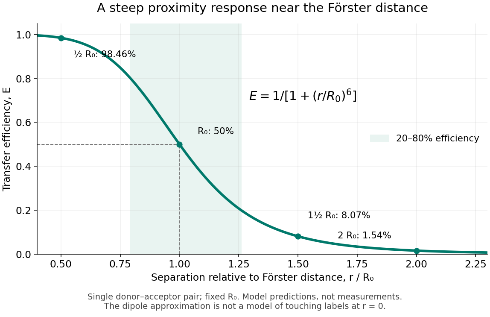

<h1 id="forster-resonance-energy-transfer">Förster resonance energy transfer</h1>

↑ **Parent:** [Biophysical measurement](biophysical-measurement.md)

[Förster resonance energy transfer](forster-resonance-energy-transfer.md) is a nonradiative transfer of [energy](energy-split.md) from an [excited state](excited-state.md) of a [FRET donor](fret-donor.md) to a nearby [FRET acceptor](fret-acceptor.md), through coupling of their [electric dipoles](electric-dipole.md). The transfer step does not emit a [photon](photon.md) that the [FRET acceptor](fret-acceptor.md) subsequently absorbs. It competes with the [FRET donor](fret-donor.md)'s own [fluorescence](fluorescence-split.md) and other routes out of its [excited state](excited-state.md). A fluorescent [FRET acceptor](fret-acceptor.md) can then emit [fluorescence](fluorescence-split.md); an absorbing but nonfluorescent [FRET acceptor](fret-acceptor.md) can still receive the transferred [energy](energy-split.md).[§3.1: nonradiative dipole coupling and a potentially nonfluorescent acceptor](advanced-fluorescence-microscopy-techniques-frap-flip-flap-fret-and-flim-by-hellen-c-ishikawa-ankerhold-and-others.md)

The striking use of [FRET](forster-resonance-energy-transfer.md) is to turn a change in molecular proximity into an optical readout. [Proteins](protein-split.md) carrying a [FRET donor](fret-donor.md) and a [FRET acceptor](fret-acceptor.md) may change the readout when they associate, as in the [chemotaxis FRET assay](chemotaxis-fret-assay.md); two labels on one [protein](protein-split.md) may report a change in its shape. Interpretation depends on the [FRET spectral overlap](fret-spectral-overlap.md), [FRET dipole orientation factor](fret-dipole-orientation-factor.md) and labeling geometry, as well as separation. A change in [FRET](forster-resonance-energy-transfer.md) is therefore evidence about proximity under specified conditions, rather than a direct measurement of an arbitrary distance.[§3.1 and §3.3: dependence on distance and orientation; inter- and intramolecular applications](advanced-fluorescence-microscopy-techniques-frap-flip-flap-fret-and-flim-by-hellen-c-ishikawa-ankerhold-and-others.md)

For a single pair with fixed [Förster distance](forster-distance.md) $R_0$ and label separation $r$, the [FRET efficiency](fret-efficiency.md) is

$$
E=\frac{1}{1+(r/R_0)^6}.
$$

At $r=R_0$, half the [FRET donor](fret-donor.md) excitations transfer [energy](energy-split.md). At $r=R_0/2$, the model gives $E=64/65\approx98.46\%$; at $r=2R_0$, it gives $E=1/65\approx1.54\%$. The sixth power makes [FRET](forster-resonance-energy-transfer.md) especially useful near the [Förster distance](forster-distance.md), with little sensitivity to further separation once transfer is already negligible. These are model calculations, not measurements of a particular pair.

**[Figure 24](#image-fret-efficiency-versus-separation-relative-to-the-forster-distance). FRET efficiency versus separation relative to the Förster distance**. Original single-pair [mathematical model](mathematical-model.md) with fixed [Förster distance](forster-distance.md). The shaded interval is $0.2\leq E\leq0.8$. The curve does not establish a universal working range or justify the [electric dipole](electric-dipole.md) approximation for overlapping labels.

**Table of contents**

- [Single-molecule Förster resonance energy transfer](single-molecule-forster-resonance-energy-transfer.md)
- [FRET donor](fret-donor.md)
- [FRET acceptor](fret-acceptor.md)
- [FRET efficiency](fret-efficiency.md)
  - [Förster distance](forster-distance.md)
    - [FRET spectral overlap](fret-spectral-overlap.md)
    - [FRET dipole orientation factor](fret-dipole-orientation-factor.md)
    - [FRET donor quantum yield](fret-donor-quantum-yield.md)
  - [FRET donor lifetime](fret-donor-lifetime.md)
- [FRET sensitized emission](fret-sensitized-emission.md)
  - [FRET optical crosstalk](fret-optical-crosstalk.md)
- [FRET photobleaching controls](fret-photobleaching-controls.md)
- [FRET proximity readout experiment](fret-proximity-readout-experiment.md)

## ↑ Ancestors (3)

1. [Biophysical measurement](biophysical-measurement.md)
2. [Biology](biology-split.md)
3. [Codex Wiki](split.md)

## ← Incoming links (9)

- [Chemotaxis FRET assay](chemotaxis-fret-assay.md)
- [Fluorescence dequenching](fluorescence-dequenching.md)
- [Förster resonance energy transfer](forster-resonance-energy-transfer.md)
- [Solution](past-exam-of-the-biochemistry-and-molecular-biology-course-of-the-university-of-cambridge/2025/paper-1/section-e/15/solution.md)
- [Solution](past-exam-of-the-biochemistry-course-of-the-university-of-cambridge/2024/paper-1/section-ii/6/solution.md)
- [Solution](past-exam-of-the-biochemistry-course-of-the-university-of-cambridge/2024/paper-2/section-ii/4/solution.md)
- [Solution](past-exam-of-the-biochemistry-course-of-the-university-of-cambridge/2025/paper-1/section-i/1/solution.md)
- [Solution](past-exam-of-the-biochemistry-course-of-the-university-of-cambridge/2025/paper-1/section-ii/3/solution.md)
- [Solution](past-exam-of-the-biochemistry-course-of-the-university-of-cambridge/2025/paper-5/section-1/1/h/solution.md)
