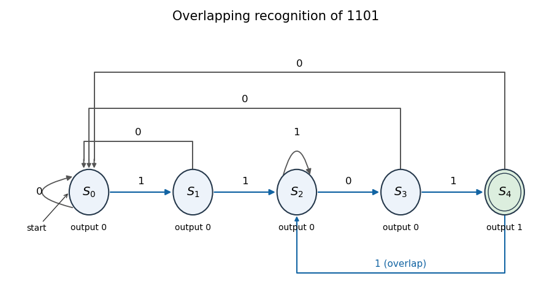
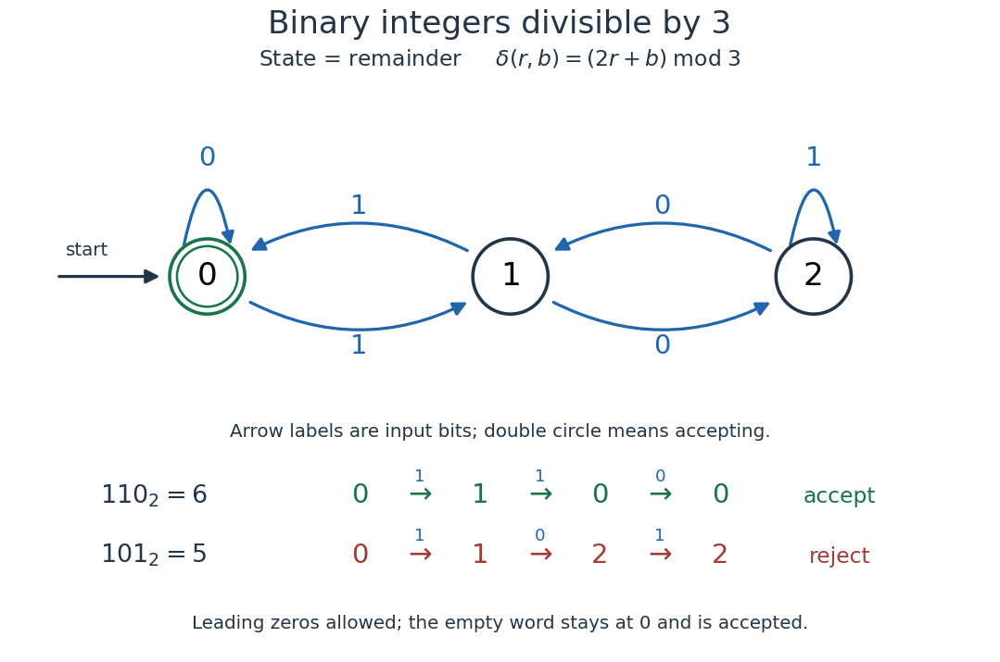
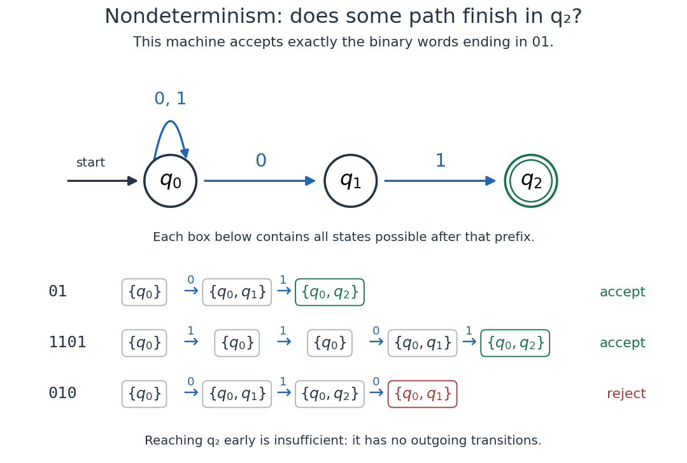
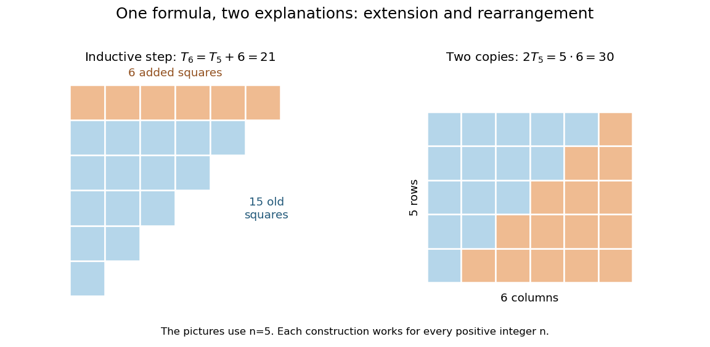
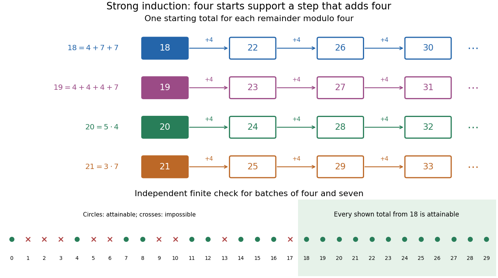
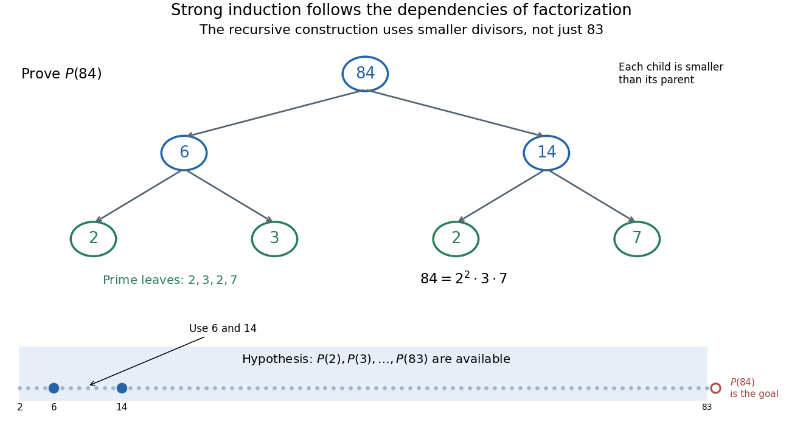

# Foundations of mathematics

↑ **Parent:** [Area of mathematics](mathematics.md#area-of-mathematics)  
ⓦ [Wiki](https://en.wikipedia.org/wiki/Foundations_of_mathematics)

Foundations of mathematics asks what our objects mean, what we assume about them, and why an argument establishes its conclusion. [Set theory](set-theory.md) gives a common language for collections and [functions](function.md); [mathematical logic](mathematical-logic.md) makes the structure of statements and deductions precise. A [mathematical definition](#mathematical-definition) fixes a meaning, an [axiom](mathematical-logic.md#axiom) supplies an assumption, and a [mathematical proof](#mathematical-proof) explains what follows. Separating these roles makes results reusable: once the [group](group.md) axioms are enough for a conclusion, that conclusion applies to every [group](group.md), regardless of how its members are represented.

The assumptions can change the answer to a familiar calculation. Over the [real numbers](arithmetic.md#real-number), $x^2=x$ factors as $x(x-1)=0$, so $x$ is zero or one. The same reasoning holds in any [integral domain](commutative-algebra.md#integral-domain), because a product can be zero only when a factor is zero. In the [ring](commutative-algebra.md#ring) of [integers](integer.md) modulo six, however, $3^2\equiv3$ and $4^2\equiv4\pmod6$: there are four solutions, represented by $0,1,3,4$. The extra solutions are [idempotents](commutative-algebra.md#idempotent), and the failed step involves [zero divisors](mathematics.md#zero-divisor). Writing the domain is part of explaining the answer.

This precision also reveals surprising possibilities. A two-dimensional grid of [natural numbers](arithmetic.md#natural-number) is a [countable set](cardinal-number.md#countable-set), while all infinite [binary sequences](sequence-and-series.md#bitstream) form an [uncountable set](cardinal-number.md#uncountable-set). The [Cantor pairing function](cardinal-number.md#cantor-pairing-function) supplies a complete enumeration of the first; [Cantor's diagonal argument](cardinal-number.md#cantor-s-diagonal-argument) defeats every proposed enumeration of the second. Both arguments are short, yet distinguish two sizes of infinity. The subject's appeal is this ability to turn a vague question into one whose assumptions, construction, and limits can all be inspected.

**Table of contents**

- [Mathematical logic](mathematical-logic.md)
  - [Logical formula](mathematical-logic.md#logical-formula)
  - [Logical fixed point](mathematical-logic.md#logical-fixed-point)
  - [Modal logic](mathematical-logic.md#modal-logic)
  - [Description logic](mathematical-logic.md#description-logic)
  - [Equisatisfiability](mathematical-logic.md#equisatisfiability)
  - [Temporal logic](mathematical-logic.md#temporal-logic)
  - [Inference rule](mathematical-logic.md#inference-rule)
  - [Logical derivation](mathematical-logic.md#logical-derivation)
  - [Negation normal form](mathematical-logic.md#negation-normal-form)
  - [Interpretation (logic)](mathematical-logic.md#interpretation-logic)
  - [Deductive reasoning](mathematical-logic.md#deductive-reasoning)
  - [Existence](mathematical-logic.md#existence)
  - [Uniqueness](mathematical-logic.md#uniqueness)
  - [Proof theory](mathematical-logic.md#proof-theory)
  - [Axiom](mathematical-logic.md#axiom)
  - [Definition (mathematics)](mathematical-logic.md#definition-mathematics)
  - [Second-order logic](mathematical-logic.md#second-order-logic)
  - [Second-order arithmetic](mathematical-logic.md#second-order-arithmetic)
  - [Formal proof](mathematical-logic.md#formal-proof)
  - [Infinitary logic](mathematical-logic.md#infinitary-logic)
  - [Propositional logic](mathematical-logic.md#propositional-logic)
  - [First-order logic](mathematical-logic.md#first-order-logic)
  - [Priestley space](mathematical-logic.md#priestley-space)
  - [Kripke semantics](mathematical-logic.md#kripke-semantics)
  - [Disjunction and existence properties](mathematical-logic.md#disjunction-and-existence-properties)
  - [Soundness](mathematical-logic.md#soundness)
  - [Free variables and bound variables](mathematical-logic.md#free-variables-and-bound-variables)
  - [Sentence (mathematical logic)](mathematical-logic.md#sentence-mathematical-logic)
  - [Theory (mathematical logic)](mathematical-logic.md#theory-mathematical-logic)
  - [Craig's theorem](mathematical-logic.md#craig-s-theorem)
  - [Overspill](mathematical-logic.md#overspill)
  - [Structure (mathematical logic)](mathematical-logic.md#structure-mathematical-logic)
- [Set theory](set-theory.md)
  - [ZF without foundation](set-theory.md#zf-without-foundation)
  - [Set-theoretic limit](set-theory.md#set-theoretic-limit)
  - [Russell's paradox](set-theory.md#russell-s-paradox)
  - [Urelement](set-theory.md#urelement)
  - [Hereditarily locally small membership model](set-theory.md#hereditarily-locally-small-membership-model)
  - [New Foundations](set-theory.md#new-foundations)
  - [Simple typed set theory with atoms](set-theory.md#simple-typed-set-theory-with-atoms)
  - [Axiom of pairing](set-theory.md#axiom-of-pairing)
  - [Axiom of extensionality](set-theory.md#axiom-of-extensionality)
  - [Independent family of sets](set-theory.md#independent-family-of-sets)
  - [Almost disjoint family on a regular cardinal](set-theory.md#almost-disjoint-family-on-a-regular-cardinal)
  - [Kappa-filtration](set-theory.md#kappa-filtration)
  - [Almost disjoint family on omega](set-theory.md#almost-disjoint-family-on-omega)
  - [Standard membership model of set theory](set-theory.md#standard-membership-model-of-set-theory)
  - [Partition relation](set-theory.md#partition-relation)
  - [Eventual domination](set-theory.md#eventual-domination)
  - [Sierpiński decomposition of the plane](set-theory.md#sierpinski-decomposition-of-the-plane)
  - [Definable continuous hierarchy](set-theory.md#definable-continuous-hierarchy)
  - [Zermelo–Fraenkel set theory](set-theory.md#zermelo-fraenkel-set-theory)
  - [Von Neumann hierarchy](set-theory.md#von-neumann-hierarchy)
  - [Definable power set](definable-power-set.md)
  - [Forcing](forcing.md)
  - [Delta-system lemma](set-theory.md#delta-system-lemma)
  - [Standard model (set theory)](set-theory.md#standard-model-set-theory)
  - [Transitive set](set-theory.md#transitive-set)
  - [Well-founded relation](set-theory.md#well-founded-relation)
  - [Extensional relation](set-theory.md#extensional-relation)
  - [Set](set.md)
  - [Finitary relation](set-theory.md#finitary-relation)
  - [Function](function.md)
  - [Zorn's lemma](set-theory.md#zorn-s-lemma)
  - [Class (set theory)](set-theory.md#class-set-theory)
  - [Axiom schema of replacement](set-theory.md#axiom-schema-of-replacement)
  - [Axiom of union](set-theory.md#axiom-of-union)
  - [Axiom of regularity](set-theory.md#axiom-of-regularity)
  - [Axiom of power set](set-theory.md#axiom-of-power-set)
  - [Cumulative hierarchy](set-theory.md#cumulative-hierarchy)
  - [Axiom schema of specification](set-theory.md#axiom-schema-of-specification)
  - [Axiom of choice](set-theory.md#axiom-of-choice)
  - [Hartogs theorem](set-theory.md#hartogs-theorem)
  - [Tarski cardinal-square theorem](set-theory.md#tarski-cardinal-square-theorem)
  - [Image and preimage of a function](set-theory.md#image-and-preimage-of-a-function)
  - [Cartesian product](set-theory.md#cartesian-product)
  - [Disjoint union](set-theory.md#disjoint-union)
  - [Fiber product of sets](set-theory.md#fiber-product-of-sets)
  - [Elementary embedding](set-theory.md#elementary-embedding)
  - [Cardinal number](cardinal-number.md)
  - [Ordinal](ordinal.md)
  - [Inner model](set-theory.md#inner-model)
  - [Descriptive set theory](descriptive-set-theory.md)
  - [Filter (set theory)](set-theory.md#filter-set-theory)
- [Mathematical definition](#mathematical-definition)
- [Computability theory](computability-theory.md)
  - [Singleton-language problem for Turing machines](computability-theory.md#singleton-language-problem-for-turing-machines)
  - [Pointwise running-time domination problem](computability-theory.md#pointwise-running-time-domination-problem)
  - [Recursive triple colouring with no computable infinite homogeneous set](computability-theory.md#recursive-triple-colouring-with-no-computable-infinite-homogeneous-set)
  - [Jockusch triple coloring computing the halting set](computability-theory.md#jockusch-triple-coloring-computing-the-halting-set)
  - [Function in intension](computability-theory.md#function-in-intension)
  - [Binary diagonally noncomputable function](computability-theory.md#binary-diagonally-noncomputable-function)
  - [Bounded simulation of a computation](computability-theory.md#bounded-simulation-of-a-computation)
  - [Productive set](computability-theory.md#productive-set)
  - [Kolmogorov complexity](computability-theory.md#kolmogorov-complexity)
  - [Undecidable decision problem](computability-theory.md#undecidable-decision-problem)
  - [Finite-injury priority construction](computability-theory.md#finite-injury-priority-construction)
  - [Turing reduction](computability-theory.md#turing-reduction)
  - [Church–Turing thesis](computability-theory.md#church-turing-thesis)
  - [Pairing function](computability-theory.md#pairing-function)
  - [Register machine](computability-theory.md#register-machine)
  - [Primitive recursive function](computability-theory.md#primitive-recursive-function)
  - [Diagonal argument](computability-theory.md#diagonal-argument)
  - [Recursively enumerable set](computability-theory.md#recursively-enumerable-set)
  - [Kleene's recursion theorem](computability-theory.md#kleene-s-recursion-theorem)
  - [Many-one reduction](computability-theory.md#many-one-reduction)
  - [Index set](computability-theory.md#index-set)
  - [Padding lemma](computability-theory.md#padding-lemma)
  - [Dovetailing](computability-theory.md#dovetailing)
  - [Smn theorem](computability-theory.md#smn-theorem)
  - [Computable function](computability-theory.md#computable-function)
  - [Arithmetical hierarchy](computability-theory.md#arithmetical-hierarchy)
  - [Recursively inseparable sets](computability-theory.md#recursively-inseparable-sets)
  - [Lambda calculus](computability-theory.md#lambda-calculus)
- [Formal language theory](#formal-language-theory)
  - [Pushdown automaton](#pushdown-automaton)
  - [Finite language](#finite-language)
  - [Shuffle of formal languages](#shuffle-of-formal-languages)
  - [Left quotient of a formal language](#left-quotient-of-a-formal-language)
  - [Padded convolution of words](#padded-convolution-of-words)
  - [Recursive language](#recursive-language)
  - [String](#string)
  - [Regular expression](#regular-expression)
  - [Formal grammar](#formal-grammar)
  - [Empty word](#empty-word)
  - [Context-free language](#context-free-language)
  - [Pumping lemma for context-free languages](#pumping-lemma-for-context-free-languages)
  - [Finite-state machine](#finite-state-machine)
  - [Regular language](#regular-language)
  - [Pumping lemma for regular languages](#pumping-lemma-for-regular-languages)
  - [Myhill-Nerode theorem](#myhill-nerode-theorem)
  - [Recursively enumerable language](#recursively-enumerable-language)
  - [Terminal and nonterminal symbols](#terminal-and-nonterminal-symbols)
  - [Abstract family of languages](#abstract-family-of-languages)
- [Graph theory](graph-theory.md)
  - [Path-cycle matching](graph-theory.md#path-cycle-matching)
  - [Tree decomposition](graph-theory.md#tree-decomposition)
  - [K-core peeling invariant](graph-theory.md#k-core-peeling-invariant)
  - [K-core](graph-theory.md#k-core)
  - [Dominating set](graph-theory.md#dominating-set)
  - [Edge cover](graph-theory.md#edge-cover)
  - [Network robustness](graph-theory.md#network-robustness)
  - [Network motif](graph-theory.md#network-motif)
  - [Réka Albert](graph-theory.md#reka-albert)
  - [Albert-László Barabási](graph-theory.md#albert-laszlo-barabasi)
  - [Duncan J. Watts](graph-theory.md#duncan-j-watts)
  - [Community detection](graph-theory.md#community-detection)
  - [Network null model](graph-theory.md#network-null-model)
  - [Network modularity](graph-theory.md#network-modularity)
  - [Louvain method](graph-theory.md#louvain-method)
  - [Eigenvector centrality](graph-theory.md#eigenvector-centrality)
  - [Degree-preserving edge rewiring](graph-theory.md#degree-preserving-edge-rewiring)
  - [Scale-free network](graph-theory.md#scale-free-network)
  - [Degree distribution](graph-theory.md#degree-distribution)
  - [Small-worldness](graph-theory.md#small-worldness)
  - [Small-world network](graph-theory.md#small-world-network)
  - [Clustering coefficient](graph-theory.md#clustering-coefficient)
  - [Spanning forest](graph-theory.md#spanning-forest)
  - [Circle graph](graph-theory.md#circle-graph)
  - [Graph bandwidth](graph-theory.md#graph-bandwidth)
  - [Interval graph](graph-theory.md#interval-graph)
  - [Pathwidth](graph-theory.md#pathwidth)
  - [Chip-firing game](graph-theory.md#chip-firing-game)
  - [De Bruijn graph](graph-theory.md#de-bruijn-graph)
  - [Geometric spanner](graph-theory.md#geometric-spanner)
  - [Graph excess](graph-theory.md#graph-excess)
  - [2-core of a graph](graph-theory.md#2-core-of-a-graph)
  - [k-core of a graph](graph-theory.md#k-core-of-a-graph)
  - [Chordal graph](graph-theory.md#chordal-graph)
  - [Johnson graph](graph-theory.md#johnson-graph)
  - [Maximum degree](graph-theory.md#maximum-degree)
  - [Four-cycle counting by common neighbours](graph-theory.md#four-cycle-counting-by-common-neighbours)
  - [Shortest path problem](shortest-path-problem.md)
  - [Graph property](graph-theory.md#graph-property)
  - [Orientation of a graph](graph-theory.md#orientation-of-a-graph)
  - [Graph intersection](graph-theory.md#graph-intersection)
  - [Kneser graph](graph-theory.md#kneser-graph)
  - [Cut vertex](graph-theory.md#cut-vertex)
  - [Hypergraph](hypergraph.md)
  - [Walk in a graph](graph-theory.md#walk-in-a-graph)
  - [Undirected graph](graph-theory.md#undirected-graph)
  - [Graph minor](graph-minor.md)
  - [Vertex cover](graph-theory.md#vertex-cover)
  - [Binomial random graph](graph-theory.md#binomial-random-graph)
  - [Graph coloring](graph-coloring.md)
  - [Graph](graph.md)
  - [Independent set (graph theory)](graph-theory.md#independent-set-graph-theory)
  - [Leaf of a graph](graph-theory.md#leaf-of-a-graph)
  - [Edge of a graph](graph-theory.md#edge-of-a-graph)
  - [Path in a graph](graph-theory.md#path-in-a-graph)
  - [Subgraph](graph-theory.md#subgraph)
  - [Join (graph theory)](graph-theory.md#join-graph-theory)
  - [Disjoint union of graphs](graph-theory.md#disjoint-union-of-graphs)
  - [Intersection graph](graph-theory.md#intersection-graph)
  - [Complete graph](graph-theory.md#complete-graph)
  - [Complete multipartite graph](graph-theory.md#complete-multipartite-graph)
  - [Laplacian matrix](graph-theory.md#laplacian-matrix)
  - [Minimum-cost flow problem](graph-theory.md#minimum-cost-flow-problem)
  - [Extremal graph theory](extremal-graph-theory.md)
  - [Flow network](flow-network.md)
  - [Eulerian graph](graph-theory.md#eulerian-graph)
  - [Line graph](graph-theory.md#line-graph)
  - [Graph drawing](graph-theory.md#graph-drawing)
  - [Planar graph](planar-graph.md)
  - [Crossing number](graph-theory.md#crossing-number)
  - [Graph neighbourhood](graph-theory.md#graph-neighbourhood)
  - [Degree (graph theory)](graph-theory.md#degree-graph-theory)
  - [Cut (graph theory)](graph-theory.md#cut-graph-theory)
  - [Bipartite graph](bipartite-graph.md)
  - [Graph homomorphism](graph-theory.md#graph-homomorphism)
  - [Directed graph](graph-theory.md#directed-graph)
  - [Adjacency matrix](graph-theory.md#adjacency-matrix)
  - [Distance (graph theory)](graph-theory.md#distance-graph-theory)
  - [Spectral graph theory](graph-theory.md#spectral-graph-theory)
  - [Bipartite adjacency matrix](graph-theory.md#bipartite-adjacency-matrix)
  - [Matching (graph theory)](matching-graph-theory.md)
  - [Ramsey theorem](graph-theory.md#ramsey-theorem)
  - [Dirac's theorem](graph-theory.md#dirac-s-theorem)
  - [Longest-path rotation](graph-theory.md#longest-path-rotation)
  - [Strongly regular graph](graph-theory.md#strongly-regular-graph)
  - [Moser spindle](graph-theory.md#moser-spindle)
  - [Probabilistic combinatorics](probabilistic-combinatorics.md)
  - [Random graph](random-graph.md)
  - [Complement graph](graph-theory.md#complement-graph)
  - [Menger theorem](graph-theory.md#menger-theorem)
  - [Graph subdivision](graph-theory.md#graph-subdivision)
  - [Bipartite vertex cover](graph-theory.md#bipartite-vertex-cover)
  - [Erdős-Gallai theorem](graph-theory.md#erdos-gallai-theorem)
  - [Prism graph](graph-theory.md#prism-graph)
  - [Squaregraph](graph-theory.md#squaregraph)
  - [Vertex cycle cover](graph-theory.md#vertex-cycle-cover)
  - [Pósa's theorem](graph-theory.md#posa-s-theorem)
  - [Pseudoforest](graph-theory.md#pseudoforest)
- [Statistical learning theory](#statistical-learning-theory)
  - [Weak PAC learning](#weak-pac-learning)
  - [VC uniform convergence theorem](#vc-uniform-convergence-theorem)
  - [Training data](#training-data)
  - [Concept class](#concept-class)
  - [Empirical risk minimization](#empirical-risk-minimization)
  - [Shattering coefficient](#shattering-coefficient)
  - [VC dimension of a vector space](#vc-dimension-of-a-vector-space)
  - [Growth bound for signs of m-term linear combinations](#growth-bound-for-signs-of-m-term-linear-combinations)
  - [AdaBoost](#adaboost)
  - [Rademacher complexity](#rademacher-complexity)
  - [Hinge loss](#hinge-loss)
  - [Stability (learning theory)](#stability-learning-theory)
  - [Decision tree learning](#decision-tree-learning)
- [Mathematical proof](#mathematical-proof)
  - [Equational reasoning](#equational-reasoning)
  - [Reductio ad absurdum](#reductio-ad-absurdum)
  - [Mathematical induction](#mathematical-induction)
  - [Counterexample](#counterexample)
  - [Structural induction](#structural-induction)
  - [Probability-preserving bijection](#probability-preserving-bijection)
- [Category theory](category-theory.md)
  - [Bicategory](category-theory.md#bicategory)
  - [Coreflexive pair](category-theory.md#coreflexive-pair)
  - [Coherent category](category-theory.md#coherent-category)
  - [Right lifting property](category-theory.md#right-lifting-property)
  - [Model category](category-theory.md#model-category)
  - [Monoidal category](category-theory.md#monoidal-category)
  - [Category of groups](category-theory.md#category-of-groups)
  - [Injective object](category-theory.md#injective-object)
  - [Universal property](category-theory.md#universal-property)
  - [Category](category.md)
  - [Symmetric monoidal category](category-theory.md#symmetric-monoidal-category)
  - [Complete join-semilattice](category-theory.md#complete-join-semilattice)
  - [Enriched category](category-theory.md#enriched-category)
  - [Monad](category-theory.md#monad)
  - [Lawvere theory](category-theory.md#lawvere-theory)
  - [Finitary monad](category-theory.md#finitary-monad)
  - [Complete Heyting algebra](category-theory.md#complete-heyting-algebra)
  - [Reflexive pair](category-theory.md#reflexive-pair)
  - [Elementary topos](category-theory.md#elementary-topos)
- [Model theory](model-theory.md)
  - [Finite model property](model-theory.md#finite-model-property)
  - [Finite model theory](model-theory.md#finite-model-theory)
  - [Recursive presentation of a structure](model-theory.md#recursive-presentation-of-a-structure)
  - [Algebraic theory](model-theory.md#algebraic-theory)
  - [Ehrenfeucht-Fraïssé game](model-theory.md#ehrenfeucht-fraisse-game)
  - [Theory of formally real fields](model-theory.md#theory-of-formally-real-fields)
  - [Theory of nontrivial torsion-free divisible Abelian groups](model-theory.md#theory-of-nontrivial-torsion-free-divisible-abelian-groups)
  - [Algebraically prime extension](model-theory.md#algebraically-prime-extension)
  - [Reduced product](model-theory.md#reduced-product)
  - [Elementary equivalence](model-theory.md#elementary-equivalence)
  - [Monster model](model-theory.md#monster-model)
  - [Complete theory](model-theory.md#complete-theory)
  - [Diagram (mathematical logic)](model-theory.md#diagram-mathematical-logic)
  - [Inductive first-order theory](model-theory.md#inductive-first-order-theory)
  - [Model-complete theory](model-theory.md#model-complete-theory)
  - [Ehrenfeucht-Mostowski model](model-theory.md#ehrenfeucht-mostowski-model)
  - [Prime model](model-theory.md#prime-model)
  - [Quantifier elimination](model-theory.md#quantifier-elimination)
  - [Ultraproduct](model-theory.md#ultraproduct)
  - [Elementary extension](model-theory.md#elementary-extension)
  - [Stable theory](model-theory.md#stable-theory)
  - [Strongly minimal theory](model-theory.md#strongly-minimal-theory)

## Mathematical logic

↑ **Parent:** [Foundations of mathematics](foundations-of-mathematics.md)

[This section is present in another page, follow this link to view it.](mathematical-logic.md)

## Set theory

↑ **Parent:** [Foundations of mathematics](foundations-of-mathematics.md)

[This section is present in another page, follow this link to view it.](set-theory.md)

## Mathematical definition

↑ **Parent:** [Foundations of mathematics](foundations-of-mathematics.md)

A specification of the meaning of a mathematical term or notation. A structural definition specifies conditions, such as the [group](group.md) axioms; a definition by a [universal property](category-theory.md#universal-property) characterizes an object by its arrows. Such a characterization does not by itself prove that the object exists. For example, existence of an [exponential object](category.md#exponential-object) is an additional property of a [category](category.md).

## Computability theory

↑ **Parent:** [Foundations of mathematics](foundations-of-mathematics.md)

[This section is present in another page, follow this link to view it.](computability-theory.md)

## Formal language theory

↑ **Parent:** [Foundations of mathematics](foundations-of-mathematics.md)

### Pushdown automaton

↑ **Parent:** [Formal language theory](#formal-language-theory)  
ⓦ [Wiki](https://en.wikipedia.org/wiki/Pushdown_automaton)

A finite control equipped with an unbounded [stack](data-structure.md#stack-data-structure). A move reads one input symbol or the [empty word](#empty-word), examines the top [stack](data-structure.md#stack-data-structure) symbol, changes control state and replaces that top by a finite [word](#string) over the [stack alphabet](information-theory.md#stack-alphabet). Nondeterministic choices give finitely many possible moves. With [acceptance by final state](#acceptance-by-final-state) and the entire input consumed, [pushdown automata](#pushdown-automaton) recognize exactly the [context-free languages](#context-free-language).

#### Acceptance by final state

↑ **Parent:** [Pushdown automaton](#pushdown-automaton)

A [pushdown automaton](#pushdown-automaton) accepts a [word](#string) if some finite run consumes all its input and reaches a designated final control state, regardless of the remaining [stack](data-structure.md#stack-data-structure) contents. Reaching a final control state while leaving unread input is insufficient.

#### Pushdown automaton configuration

↑ **Parent:** [Pushdown automaton](#pushdown-automaton)

The control state $q$, unread input [word](#string) $w$, and [stack](data-structure.md#stack-data-structure) contents $\alpha$ of a [pushdown automaton](#pushdown-automaton). A fixed convention must say which end of $\alpha$ is the top. With the top on the left, replacing top $X$ by $\gamma$ changes $X\beta$ into $\gamma\beta$.

### Finite language

↑ **Parent:** [Formal language theory](#formal-language-theory)

A [formal language](theoretical-computer-science.md#formal-language) with finitely many [words](#string). Every [finite language](#finite-language) is a [regular language](#regular-language): take a finite [union](set.md#set-union) of the [regular expressions](#regular-expression) spelling its members, with the [empty language](theoretical-computer-science.md#empty-language) represented separately when there are no members.

### Shuffle of formal languages

↑ **Parent:** [Formal language theory](#formal-language-theory)

The shuffle of two [formal languages](theoretical-computer-science.md#formal-language) consists of [words](#string) whose positions can be partitioned into two subsequences, each preserving its order, with the two resulting [words](#string) belonging to the respective languages. For [regular languages](#regular-language), a product-state [nondeterministic finite automaton](#nondeterministic-finite-automaton) advances exactly one coordinate for each letter. Common letters allow either choice; the [powerset construction](#powerset-construction) proves closure.

### Left quotient of a formal language

↑ **Parent:** [Formal language theory](#formal-language-theory)

For a [word](#string) $u$ and a [formal language](theoretical-computer-science.md#formal-language) $L$, the left quotient $u^{-1}L=\{w:uw\in L\}$ is the possible continuation language after the prefix $u$. Two prefixes have the same left quotient exactly when they are [Myhill-Nerode equivalent](#myhill-nerode-equivalence). For a [regular language](#regular-language) only finitely many distinct left quotients occur.

### Padded convolution of words

↑ **Parent:** [Formal language theory](#formal-language-theory)

The [padded convolution of words](#padded-convolution-of-words) reads two finite [words over an alphabet](#string) in parallel, extending the shorter with a fresh padding symbol $\#$ until the longer ends. Its length is $\max(|u|,|v|)$. Padding may only occur as a suffix, and a $(\#,\#)$ column is excluded. This encodes synchronous two-tape relations as [formal languages](theoretical-computer-science.md#formal-language) over a finite paired [alphabet](information-theory.md#alphabet).

### Recursive language

↑ **Parent:** [Formal language theory](#formal-language-theory)  
ⓦ [Wiki](https://en.wikipedia.org/wiki/Recursive_language)

A [formal language](theoretical-computer-science.md#formal-language) is decidable if a [Turing machine](theoretical-computer-science.md#turing-machine) halts on every input and correctly determines membership. Equivalently its encoded words form a [recursive set](computability-theory.md#computable-set). A [computably enumerable language](#recursively-enumerable-language) requires only a machine that eventually accepts every member; it may run forever on nonmembers.

#### Threshold language

↑ **Parent:** [Recursive language](#recursive-language)

For a fixed [natural number](arithmetic.md#natural-number) $a$ and a standard encoding of [natural numbers](arithmetic.md#natural-number), validate the [input](theoretical-computer-science.md#input-computer-science) and compare its encoded value with $a$. This decides $L_a$. A [well-ordering](set.md#well-order) argument can prove that an upward-closed [set](set.md) of [natural numbers](arithmetic.md#natural-number) has this form without calculating its least element. A decider may contain that fixed least element in its finite description; its existence does not give a uniform method to discover the least element from another program.

### String

↑ **Parent:** [Formal language theory](#formal-language-theory)  
ⓦ [Wiki](https://en.wikipedia.org/wiki/String_(computer_science))

A word over an alphabet $\Sigma$ is a finite sequence of symbols from $\Sigma$. The empty word has length zero, and $\Sigma^*$ denotes the set of all finite words.

#### Case-insensitive comparison

↑ **Parent:** [String](#string)

A comparison of [strings](#string) that disregards a chosen distinction between uppercase and lowercase characters. A simple convention compares characterwise lowercase forms. Full Unicode case folding is a distinct normalization operation and can change character counts.

#### Longest common prefix

↑ **Parent:** [String](#string)

The longest common prefix of two [strings](#string) is the longest [string](#string) that is a [string prefix](data-structure.md#string-prefix) of both. Its length is the number of matching initial characters before the first mismatch or the end of a [string](#string). A direct scan maintains equality of the processed prefixes and takes time linear in that length plus one. For suffixes represented by indices in a shared [array](data-structure.md#array-data-structure), no character copying is needed.

#### String suffix

↑ **Parent:** [String](#string)

A [string suffix](#string-suffix) consists of all characters from some position to the end of a [string](#string). For example, TAC has suffixes TAC, AC, C and the empty [string](#string). Sorting these in [lexicographic order](extremal-set-theory.md#lexicographic-order) groups all suffixes beginning with a given query into one interval.

#### Cyclic rotation

↑ **Parent:** [String](#string)

A [cyclic rotation](#cyclic-rotation) of a [string](#string) $xy$ is the [string](#string) $yx$, where $x$ and $y$ are consecutive pieces. For example, rotating ABC left once gives BCA. A length-$n$ [string](#string) has $n$ rotation positions, though repeated letters can make some resulting [strings](#string) identical.

#### String rewriting

↑ **Parent:** [String](#string)

#### Substring

↑ **Parent:** [String](#string)

A substring is a contiguous segment of a [string](#string). It differs from a [subsequence](sequence-and-series.md#subsequence), whose selected characters need not be adjacent.

#### Sturmian word

↑ **Parent:** [String](#string)

An infinite binary word is Sturmian if it has exactly $n+1$ distinct contiguous subwords of length $n$ for every positive [integer](integer.md) $n$.

##### Characteristic Sturmian word

↑ **Parent:** [Sturmian word](#sturmian-word)

#### Palindrome

↑ **Parent:** [String](#string)

A palindrome is a finite [string](#string) equal to its reversal. For example, the strings $010$ and $0110$ are palindromes.

##### Palindrome test

↑ **Parent:** [Palindrome](#palindrome)

Decide whether a finite [string](#string) is a [palindrome](#palindrome) by comparing corresponding symbols from opposite ends. The test needs at most half as many symbol comparisons as the [string](#string) length and can use constant auxiliary space.

#### Anagram

↑ **Parent:** [String](#string)

#### Concatenation

↑ **Parent:** [String](#string)  
ⓦ [Wiki](https://en.wikipedia.org/wiki/Concatenation)

[Concatenation](#concatenation) joins two [strings](#string) end to end, retaining the order of their symbols. For example, joining $ab$ and $ba$ gives $abba$. It has the [associative property](algebraic-operation.md#associative-property): joining $(uv)w$ or $u(vw)$ gives the same [word over an alphabet](#string). The [empty word](#empty-word) is its [identity element](algebraic-operation.md#identity-element). All finite [words over an alphabet](#string) with this [binary operation](algebraic-operation.md#binary-operation) form a [free monoid](algebraic-operation.md#free-monoid).

#### Length of a word over an alphabet

↑ **Parent:** [String](#string)

The [length of a word over an alphabet](#length-of-a-word-over-an-alphabet) is the number of symbol positions in that finite [string](#string), counting repetitions. Thus $\ell(abba)=4$ and $\ell(\varepsilon)=0$ for the [empty word](#empty-word). [Concatenation](#concatenation) satisfies $\ell(uv)=\ell(u)+\ell(v)$. This differs from the [word length](geometric-group-theory.md#word-length) of a [group](group.md) element, which minimizes over representing [words](#string) using a chosen [generating set of a group](group.md#generating-set-of-a-group).

#### Run of a word

↑ **Parent:** [String](#string)

A run of a [word over an alphabet](#string) is a maximal consecutive block of one repeated letter. For a nonempty word $w$ of length $N$, its number of runs is

$$
R(w)=1+\sum_{j=1}^{N-1}\mathbf1_{\{w_j\ne w_{j+1}\}}.
$$

Replacing a consecutive constant block changes this count only through its boundaries with the neighboring letters.

#### Border of a word

↑ **Parent:** [String](#string)

A border of a word is a nonempty prefix that is also a suffix. The full word is counted as a border; a shorter border records a way in which one occurrence can overlap the next.

### Regular expression

↑ **Parent:** [Formal language theory](#formal-language-theory)  
ⓦ [Wiki](https://en.wikipedia.org/wiki/Regular_expression)

A regular expression is built from alphabet symbols, the empty language and the empty word using finite union, concatenation and Kleene star.

#### Kleene star

↑ **Parent:** [Regular expression](#regular-expression)  
ⓦ [Wiki](https://en.wikipedia.org/wiki/Kleene_star)

The Kleene star $L^*$ of a language $L$ consists of every finite concatenation of words from $L$, including the empty concatenation.

#### Kleene theorem

↑ **Parent:** [Regular expression](#regular-expression)

This theorem characterizes a [regular language](#regular-language) by [regular expressions](#regular-expression) and acceptance by a [finite-state automaton](#finite-state-machine). Kleene's theorem states that a language is denoted by a regular expression exactly when it is accepted by a finite automaton.

### Formal grammar

↑ **Parent:** [Formal language theory](#formal-language-theory)  
ⓦ [Wiki](https://en.wikipedia.org/wiki/Formal_grammar)

A grammar $(N,\Sigma,P,S)$ generates the terminal words reachable from $S$ by finitely many productions.

#### Formation rule

↑ **Parent:** [Formal grammar](#formal-grammar)

A [formation rule](#formation-rule) specifies how well-formed expressions can be constructed from simpler expressions in a [formal language](theoretical-computer-science.md#formal-language). The [formal grammar](#formal-grammar) of [propositional formulas](mathematical-logic.md#propositional-formula) has rules for [propositional variables](mathematical-logic.md#propositional-variable), [negation](theoretical-computer-science.md#negation) and binary [logical implication](mathematical-logic.md#logical-implication).

#### Variable-based grammar

↑ **Parent:** [Formal grammar](#formal-grammar)

A variable-based grammar has disjoint finite terminal and variable alphabets $\Sigma,V$, a start variable $S\in V$, and productions $\alpha\to\beta$ in which $\alpha,\beta\in(\Sigma\cup V)^*$ and $\alpha$ contains at least one variable.

##### Unreachable nonterminal

↑ **Parent:** [Variable-based grammar](#variable-based-grammar)

A nonterminal is unreachable when no word derivable from the start symbol contains it. Productions whose left sides are unreachable do not affect the generated [language](#formal-language-theory).

##### Nonproductive nonterminal

↑ **Parent:** [Variable-based grammar](#variable-based-grammar)

A nonterminal is nonproductive when no word derived from it consists entirely of terminal symbols. Every derivation containing such a symbol therefore fails to produce a word in the generated [language](#formal-language-theory).

##### Regular grammar

↑ **Parent:** [Variable-based grammar](#variable-based-grammar)  
ⓦ [Wiki](https://en.wikipedia.org/wiki/Regular_grammar)

A right-linear regular grammar has productions of the forms $A\to wB$ and $A\to w$, where $A,B$ are variables and $w$ is a terminal word.

###### Sentential form of a right-linear regular grammar

↑ **Parent:** [Regular grammar](#regular-grammar)

Every sentential form reachable from the start variable of a right-linear grammar is either a terminal word $w$ or $wA$, where $A$ is the unique variable and occurs at the right end.

###### Accessible variable of a regular grammar

↑ **Parent:** [Regular grammar](#regular-grammar)

A variable $A$ is accessible when $S\Rightarrow^*wA$ for some terminal word $w$.

###### Looping variable of a regular grammar

↑ **Parent:** [Regular grammar](#regular-grammar)

A variable $A$ is looping when $A\Rightarrow^*wA$ for some terminal word $w$ through a nonempty derivation.

###### Terminable variable of a regular grammar

↑ **Parent:** [Regular grammar](#regular-grammar)

A variable $A$ is terminable when $A\Rightarrow^*w$ for some terminal word $w$.

###### Accessible looping terminable variable criterion

↑ **Parent:** [Regular grammar](#regular-grammar)

If a finite right-linear grammar generates an infinite language, some variable is accessible, looping, and terminable. It is the repeated variable on a sufficiently long accepting derivation.

##### Concatenation grammar

↑ **Parent:** [Variable-based grammar](#variable-based-grammar)

For grammars $G=(\Sigma,V,P,S)$ and $G'=(\Sigma,V',P',S')$ with disjoint variable sets, introduce a new variable $S_0$ and set

$$
H=(\Sigma,V\cup V'\cup\{S_0\},
P\cup P'\cup\{S_0\to SS'\},S_0).
$$

If both input grammars are variable based, then $L(H)=L(G)L(G')$.

###### Regular concatenation grammar

↑ **Parent:** [Concatenation grammar](#concatenation-grammar)

Retain every production $\alpha\to\beta$ of $P$ whose right-hand side contains a variable, replace every production $\alpha\to w$ with $w\in\Sigma^*$ by $\alpha\to wS'$, include $P'$, and use $S$ as start variable. If $G$ and $G'$ are right-linear, the resulting grammar is right-linear and generates $L(G)L(G')$.

###### Failure of the regular concatenation construction for a nonregular grammar

↑ **Parent:** [Regular concatenation grammar](#regular-concatenation-grammar)

The regular construction relies on a regular derivation having exactly one terminal rule, at its end. In a general variable-based grammar several variables may each use terminal productions, so replacing every such production can introduce several copies of the second start variable.

###### Concatenation grammar need not be regular

↑ **Parent:** [Concatenation grammar](#concatenation-grammar)

Even if both input grammars are regular, the added production $S_0\to SS'$ has two variables on its right-hand side and therefore need not be a regular production.

### Empty word

↑ **Parent:** [Formal language theory](#formal-language-theory)

The empty word is the unique word of length zero. It is the identity element for concatenation.

### Context-free language

↑ **Parent:** [Formal language theory](#formal-language-theory)  
ⓦ [Wiki](https://en.wikipedia.org/wiki/Context-free_language)

A grammar is context-free when each production has one nonterminal on its left.

#### Suffix-nonnegative binary language

↑ **Parent:** [Context-free language](#context-free-language)

A [context-free language](#context-free-language) recognized by scanning a [string](#string) over the [alphabet](information-theory.md#alphabet) $\{0,1\}$ from right to left, counting 0 as $+1$ and 1 as $-1$, and requiring every partial count to remain nonnegative. A [context-free grammar](#context-free-grammar) with a unique [parse tree](#parse-tree) for each generated [string](#string) is $S\to\epsilon\mid S0\mid S1B0$, $B\to\epsilon\mid B1B0$. To see uniqueness, reverse the [strings](#string): every nonempty nonnegative path either never returns to zero after its first step, or has a unique first return. These two cases determine the production and its component substrings.

#### Context-free grammar

↑ **Parent:** [Context-free language](#context-free-language)  
ⓦ [Wiki](https://en.wikipedia.org/wiki/Context-free_grammar)

A context-free grammar consists of terminal and nonterminal alphabets, a start symbol, and productions whose left side is one nonterminal. A derivation records the order of substitutions, while a parse tree records their hierarchical structure, so several derivations can represent one parse tree.

##### Conversion of a context-free grammar to a pushdown automaton

↑ **Parent:** [Context-free grammar](#context-free-grammar)

Store the start [nonterminal symbol](#nonterminal-symbol) on a [stack](data-structure.md#stack-data-structure). An [epsilon transition](#epsilon-transition) nondeterministically replaces its top [nonterminal symbol](#nonterminal-symbol) by a [production rule](#production-rule) right-hand side. A top [terminal symbol](#terminal-symbol) can be removed only while consuming the same input symbol. With a protected [stack bottom marker](data-structure.md#stack-bottom-marker), enter a final control state when that marker is exposed. Requiring all input to have been read implements [acceptance by final state](#acceptance-by-final-state). The [stack](data-structure.md#stack-data-structure) records the unprocessed suffix of a [leftmost derivation](#leftmost-derivation), proving equality of the recognized and generated [formal languages](theoretical-computer-science.md#formal-language).

##### Ambiguous grammar

↑ **Parent:** [Context-free grammar](#context-free-grammar)  
ⓦ [Wiki](https://en.wikipedia.org/wiki/Ambiguous_grammar)

A [context-free grammar](#context-free-grammar) is ambiguous when some accepted token sequence has two distinct [parse trees](#parse-tree). Giving a language an unambiguous [context-free grammar](#context-free-grammar) requires specifying grouping in the productions themselves, rather than relying on an unstated parser conflict rule.

##### Semantic action

↑ **Parent:** [Context-free grammar](#context-free-grammar)

An operation associated with a [context-free grammar](#context-free-grammar) production, performed when that production is recognized. [Semantic actions](#semantic-action) can construct an [abstract syntax tree](programming-language.md#abstract-syntax-tree) by combining the trees attached to its child [nonterminal symbols](#nonterminal-symbol).

##### Right-linear grammar

↑ **Parent:** [Context-free grammar](#context-free-grammar)

A right-linear grammar has productions of the form $A\to wB$ or $A\to w$, where $A,B$ are nonterminals and $w$ is a terminal word, possibly empty. Each right-hand side has at most one nonterminal, at its right end. Such grammars generate exactly [regular languages](#regular-language): regard nonterminals as states and expand each terminal word into a finite path to another state or an accepting endpoint. Conversely the transition graph of a [deterministic finite automaton](#deterministic-finite-automaton) gives these productions directly.

##### Terminal symbol

↑ **Parent:** [Context-free grammar](#context-free-grammar)

A terminal symbol belongs to the alphabet of completed words and is not replaced by a grammar production.

##### Production rule

↑ **Parent:** [Context-free grammar](#context-free-grammar)

A production rule specifies a permitted replacement during a [grammar derivation](#grammar-derivation). In a [context-free grammar](#context-free-grammar) it has the form $A\to\alpha$, with one nonterminal $A$ on the left.

##### Sentence of a formal grammar

↑ **Parent:** [Context-free grammar](#context-free-grammar)

A sentence of a grammar is a terminal word derivable from its start symbol.

##### Grammar derivation

↑ **Parent:** [Context-free grammar](#context-free-grammar)

A grammar derivation is a finite sequence of words in which each step replaces one occurrence of a production's left side by its right side. A leftmost derivation always replaces the leftmost available nonterminal.

###### Leftmost derivation

↑ **Parent:** [Grammar derivation](#grammar-derivation)

A [grammar derivation](#grammar-derivation) that always expands the leftmost remaining [nonterminal symbol](#nonterminal-symbol). In a [context-free grammar](#context-free-grammar), each [parse tree](#parse-tree) specifies exactly one [leftmost derivation](#leftmost-derivation). Two distinct [leftmost derivations](#leftmost-derivation) of the same [word](#string) therefore prove that the [context-free grammar](#context-free-grammar) is an [ambiguous grammar](#ambiguous-grammar).

##### Parse tree

↑ **Parent:** [Context-free grammar](#context-free-grammar)  
ⓦ [Wiki](https://en.wikipedia.org/wiki/Parse_tree)

A parse tree places the start symbol at its root, the symbols on the right side of a production at the children of its left-side nonterminal, and terminal symbols at its leaves. Reading the leaves from left to right gives the tree's yield.

##### Equivalent grammar

↑ **Parent:** [Context-free grammar](#context-free-grammar)

Two grammars are equivalent when they generate the same formal language.

###### Isomorphic grammar

↑ **Parent:** [Equivalent grammar](#equivalent-grammar)

Two grammars over a common terminal alphabet are isomorphic when a bijection between their nonterminal alphabets maps one start symbol to the other and maps their productions bijectively after being extended to fix every terminal symbol. Isomorphic grammars are [equivalent](#equivalent-grammar).

##### Chomsky normal form

↑ **Parent:** [Context-free grammar](#context-free-grammar)  
ⓦ [Wiki](https://en.wikipedia.org/wiki/Chomsky_normal_form)

A context-free grammar is in Chomsky normal form when every production has the form $A\to BC$ or $A\to a$, with $A,B,C$ nonterminals and $a$ a terminal. If the empty word belongs to the language, one commonly also permits the exceptional rule $S\to\epsilon$ under the usual restriction on the start symbol.

###### Epsilon production

↑ **Parent:** [Chomsky normal form](#chomsky-normal-form)

An epsilon production is a grammar production whose right-hand side is the empty word.

###### Unit production

↑ **Parent:** [Chomsky normal form](#chomsky-normal-form)

A unit production replaces one nonterminal by one nonterminal and emits no terminal symbols.

###### Conversion of a context-free grammar to Chomsky normal form

↑ **Parent:** [Chomsky normal form](#chomsky-normal-form)

To convert a [context-free grammar](#context-free-grammar) to [Chomsky normal form](#chomsky-normal-form), first add a fresh start symbol. Remove [epsilon productions](#epsilon-production), retaining the exceptional start production only when the empty word is to remain in the language; then remove [unit productions](#unit-production) and symbols that cannot participate in a terminal derivation. Replace each terminal occurring in a right-hand side of length at least two by a new nonterminal that produces that terminal. Finally split every right-hand side of length greater than two into binary productions using fresh nonterminals.

###### Chomsky-normal-form derivation length

↑ **Parent:** [Chomsky normal form](#chomsky-normal-form)

A Chomsky-normal-form parse tree for a word of length $n\geq1$ has $n$ terminal productions and $n-1$ binary productions. Every derivation represented by the tree therefore has exactly $2n-1$ steps.

###### CYK algorithm

↑ **Parent:** [Chomsky normal form](#chomsky-normal-form)  
ⓦ [Wiki](https://en.wikipedia.org/wiki/CYK_algorithm)

The CYK algorithm decides membership in a [context-free language](#context-free-language) given by a grammar in [Chomsky normal form](#chomsky-normal-form). It records, for every substring, the nonterminals that derive that substring and combines adjacent substrings using binary productions. For a word of length $n$ and a fixed grammar, it runs in $O(n^3)$ time.

###### Weak Chomsky normal form

↑ **Parent:** [Chomsky normal form](#chomsky-normal-form)

Weak Chomsky normal form additionally permits ternary productions $A\to BCD$. Compressing a two-step pattern $A\to BE$, $E\to CD$ into $A\to BCD$ preserves its generated yields whenever the intermediate variable has no other role, and saves one derivation step each time the pattern is used.

#### Context-free grammar for even palindromes

↑ **Parent:** [Context-free language](#context-free-language)

The productions $S\to0S0\mid1S1\mid00\mid11$ generate exactly the nonempty binary palindromes of even length.

#### Intersection of a context-free language with a regular language

↑ **Parent:** [Context-free language](#context-free-language)

The intersection of a context-free language with a regular language is context-free, because a pushdown automaton and a finite automaton can be run in product.

#### Closure of context-free languages under concatenation

↑ **Parent:** [Context-free language](#context-free-language)

If context-free grammars with disjoint nonterminal alphabets have start symbols $S_1,S_2$, adjoining a new start symbol and the production $S\to S_1S_2$ gives a context-free grammar for the concatenation of their languages.

#### Closure of context-free languages under Kleene star

↑ **Parent:** [Context-free language](#context-free-language)

If a [context-free grammar](#context-free-grammar) for $L$ has start symbol $S$, adjoining a new start symbol $S_0$ and productions $S_0\to\epsilon\mid SS_0$ gives a context-free grammar for the [Kleene star](#kleene-star) $L^*$.

#### Unary context-free language is regular

↑ **Parent:** [Context-free language](#context-free-language)

Every [context-free language](#context-free-language) over a one-symbol alphabet is a [regular language](#regular-language). Equivalently, the set of word lengths of a unary context-free language is ultimately periodic. This follows, for example, from the one-dimensional case of Parikh's theorem.

#### Nested-count context-free grammar

↑ **Parent:** [Context-free language](#context-free-language)

A context-free grammar can enforce sums such as $0^n1^m0^{n+m}$ by nesting one matched terminal pair for each independent count.

##### Nested two-pair count language

↑ **Parent:** [Nested-count context-free grammar](#nested-count-context-free-grammar)

The language

$$
\{a^{4r}b^{5s}c^{2s}d^{3r}:r,s\geq0\}
$$

is context-free. The grammar

$$
S\to aaaaSddd\mid T,
\qquad
T\to bbbbbTcc\mid\epsilon
$$

nests the $a,d$ dependency around the $b,c$ dependency.

### Pumping lemma for context-free languages

↑ **Parent:** [Formal language theory](#formal-language-theory)  
ⓦ [Wiki](https://en.wikipedia.org/wiki/Pumping_lemma_for_context-free_languages)

For some $p$, every sufficiently long $w$ in a context-free language has $w=uvxyz$ with $|vxy|\le p$, $|vy|>0$, and $uv^ixy^iz$ in the language for all $i\ge0$.

#### Multiplicative block-count language

↑ **Parent:** [Pumping lemma for context-free languages](#pumping-lemma-for-context-free-languages)

This [formal language](theoretical-computer-science.md#formal-language) is not a [context-free language](#context-free-language). For [pumping length](#pumping-length) $p$, use $a^p b^{p^2}c^p$. A pumpable window of length at most $p$ cannot meet both outer blocks. If pumping adds $\alpha,\beta,\gamma$ copies of $a,b,c$, then $\alpha\gamma=0$ and $1\leq\alpha+\beta+\gamma\leq p$. Preserving the product constraint would require $\beta=p(\alpha+\gamma)$, impossible both when $\alpha+\gamma=0$ and when it is positive. This contradicts the [pumping lemma for context-free languages](#pumping-lemma-for-context-free-languages).

#### Equal prime block language is not context-free

↑ **Parent:** [Pumping lemma for context-free languages](#pumping-lemma-for-context-free-languages)

The language $\{0^p1^p:p\text{ is prime}\}$ is not context-free. For a proposed pumping length, start with a larger prime $p$. Pumping unequal numbers of zeros and ones breaks equality; if the positive changes are equal to $d$, pumping with exponent $p+1$ gives the composite common block length $p(1+d)$.

#### Three-block context-free pumping obstruction

↑ **Parent:** [Pumping lemma for context-free languages](#pumping-lemma-for-context-free-languages)

For a word consisting of three long constrained blocks, a pumpable window shorter than each block cannot alter both outer blocks; pumping then breaks a required three-way count relation.

#### Pumping length

↑ **Parent:** [Pumping lemma for context-free languages](#pumping-lemma-for-context-free-languages)

A pumping length is a threshold beyond which every word in the language has a decomposition satisfying the conclusion of the relevant pumping lemma.

#### Square-count language is not context-free

↑ **Parent:** [Pumping lemma for context-free languages](#pumping-lemma-for-context-free-languages)

The language $\{a^{m^2}b^{m^2}:m\geq0\}$ is not context-free. Pump a word with both block lengths $p^2$. Unequal changes to the blocks destroy equality; an equal positive change $d\leq p$ makes both lengths $p^2+d$, which lies strictly between consecutive squares $p^2$ and $(p+1)^2$.

### Finite-state machine

↑ **Parent:** [Formal language theory](#formal-language-theory)  
ⓦ [Wiki](https://en.wikipedia.org/wiki/Finite-state_machine)

A [finite-state machine](#finite-state-machine) processes inputs using a [finite set](set.md#finite-set) of [automaton states](#automaton-state) and input-dependent [automaton transitions](#automaton-transition). An [automaton state](#automaton-state) records everything the machine remembers; an [automaton transition](#automaton-transition) says how that memory changes on the next symbol. A [finite-state machine](#finite-state-machine) may also emit outputs. Here the emphasis is on recognizing a [formal language](theoretical-computer-science.md#formal-language): start in a designated [automaton state](#automaton-state), read a [word](#string) from an [alphabet](information-theory.md#alphabet), and accept exactly when the final [automaton state](#automaton-state) is designated accepting.

Finite memory does not impose a maximum input length. A [finite-state machine](#finite-state-machine) can read arbitrarily long [words](#string), revisiting its [automaton states](#automaton-state) indefinitely. The restriction is that the part already read must be compressed into one of finitely many summaries. For [divisibility](divisibility.md) by three, a [word](#string) of [binary digits](integer.md#binary-digit) can describe an enormous [integer](integer.md), yet its [congruence class](modular-arithmetic.md#congruence-class) modulo three is all that the machine needs to retain. Two already-read [words](#string) giving the same [automaton state](#automaton-state) behave identically under every subsequent continuation in a [DFA](#deterministic-finite-automaton).

This makes [finite-state machines](#finite-state-machine) useful whenever past details can be forgotten safely: checking whether a sequence of commands follows an allowed order, or recognizing a pattern with a [regular expression](#regular-expression). The beautiful design question is which distinctions about the past matter to the future. [DFA minimization](#dfa-minimization) makes that question precise by merging [indistinguishable states of a deterministic finite automaton](#indistinguishable-states-of-a-deterministic-finite-automaton). Both [DFAs](#deterministic-finite-automaton) and [NFAs](#nondeterministic-finite-automaton) recognize exactly the [regular languages](#regular-language).

#### Transition function of a finite automaton

↑ **Parent:** [Finite-state machine](#finite-state-machine)

For a [deterministic finite automaton](#deterministic-finite-automaton) with [automaton state](#automaton-state) [set](set.md) $Q$ and input [alphabet](information-theory.md#alphabet) $\Sigma$, the [function](function.md) $\delta:Q\times\Sigma\to Q$ specifies the next [automaton state](#automaton-state) after reading one input symbol. A [nondeterministic finite automaton](#nondeterministic-finite-automaton) instead allows a [set](set.md) of possible next [automaton states](#automaton-state).

#### Singleton-language test for finite automata

↑ **Parent:** [Finite-state machine](#finite-state-machine)

To decide whether a [finite-state automaton](#finite-state-machine) accepts exactly one distinct [word](#string), first obtain some accepted [word](#string) $w$ by a [finite automaton emptiness test](#finite-automaton-emptiness-test). If there is none, answer no. Otherwise construct a [finite-state automaton](#finite-state-machine) for the accepted [formal language](theoretical-computer-science.md#formal-language) minus the [singleton](set.md#singleton-mathematics) $\{w\}$ and test it for emptiness. Answer yes exactly when that difference is empty. [Subset construction](#subset-construction-with-epsilon-transitions) handles multiple accepting runs without confusing runs with distinct [words](#string).

#### Finite automaton emptiness test

↑ **Parent:** [Finite-state machine](#finite-state-machine)

A [finite-state automaton](#finite-state-machine) recognizes a nonempty [formal language](theoretical-computer-science.md#formal-language) exactly when some accepting [automaton state](#automaton-state) is reachable from an initial [automaton state](#automaton-state). [Reachability in a graph](graph.md#reachability-in-a-graph) decides this in a finite transition graph. For an [Epsilon-NFA](#epsilon-nfa), include its [epsilon transitions](#epsilon-transition); the non-epsilon labels of a successful [graph path](graph-theory.md#path-in-a-graph) give an accepted [word](#string).

#### Next-state function

↑ **Parent:** [Finite-state machine](#finite-state-machine)

A function mapping the current [automaton state](#automaton-state) and input to the state entered at the next update. In a [Moore machine](#moore-machine), a separate output function depends only on the current state; in a [Mealy machine](#mealy-machine), it may also depend on the current input.

#### Mealy machine

↑ **Parent:** [Finite-state machine](#finite-state-machine)  
ⓦ [Wiki](https://en.wikipedia.org/wiki/Mealy_machine)

#### Self-starting finite-state machine

↑ **Parent:** [Finite-state machine](#finite-state-machine)

A hardware [finite-state machine](#finite-state-machine) whose implemented transitions eventually leave every unused [state encoding](#state-encoding) and enter the intended valid state set. If recovery must hold for arbitrary inputs, it is not enough that some input sequence can escape: there must be no indefinitely surviving unused-state path under any input sequence. Since the unused-state graph is finite, absence of a [directed cycle](graph-theory.md#directed-cycle) among unused states gives a uniform finite recovery bound. A reset or initialization rule may still be required to give the valid state its intended meaning.

#### State transition table

↑ **Parent:** [Finite-state machine](#finite-state-machine)

A table specifying the next state for each present state and input combination, together with the output if needed. For a [Moore machine](#moore-machine), output depends only on the state; for a [Mealy machine](#mealy-machine), it may also depend on the current input. A [state-transition diagram](electrical-engineering.md#state-transition-diagram) gives the same transitions as labelled [directed edges](graph-theory.md#directed-edge).

#### State encoding

↑ **Parent:** [Finite-state machine](#finite-state-machine)

An injective assignment of abstract [finite-state machine](#finite-state-machine) states to stored [bit](information-theory.md#bit) patterns. $m$ distinct states require at least $\lceil\log_2m\rceil$ binary storage elements. Encodings with unused patterns can simplify [Boolean functions](analysis-of-boolean-functions.md#boolean-function) through [don't-care conditions](analysis-of-boolean-functions.md#don-t-care-term), but the implemented next-state equations determine what those unused patterns actually do.

#### Interrupt-driven pulse sequencer

↑ **Parent:** [Finite-state machine](#finite-state-machine)

A pulse sequencer can separate event capture from output timing. A short [interrupt handler](operating-system.md#interrupt-handler) acknowledges the [event latch](operating-system.md#single-bit-event-latch) and increments a pending count. An independent [finite-state machine](#finite-state-machine) consumes one count on entering `ON`, changes to `GAP` after the pulse width, and enters `IDLE` only after the mandatory off interval. Even an empty queue must not bypass `GAP`: an arrival immediately after light-off would otherwise start too soon.

The pending count equals recorded events minus started pulses. A [critical section](operating-system.md#critical-section) protects its read-modify-write operations; declaring shared state as in [volatile-qualified objects in C](programming-language.md#volatile-qualified-objects-in-c) does not alone make each update an [atomic operation](operating-system.md#atomic-operation). Separate sequencers for different channels allow simultaneous pulses while one [hardware timer](#hardware-timer) schedules their earliest deadline. Finite queue capacity, detector rearming and dispatch resolution remain explicit assumptions.

#### Moore machine

↑ **Parent:** [Finite-state machine](#finite-state-machine)

A [Moore machine](#moore-machine) is a [finite-state machine](#finite-state-machine) whose output depends only on the current state. In a clocked implementation, a state entered at a [clock edge](computer-science.md#clock-edge) determines the following period's output. Specifying an initial state is necessary to define startup behavior.

##### Rearmable one-cycle pulse generator

↑ **Parent:** [Moore machine](#moore-machine)

A [synchronous sequential circuit](#synchronous-sequential-circuit) can use three states: armed, pulse, and waiting. Only the pulse state has output one. A reset input rearms the circuit, including when it arrives during the pulse cycle; this permits pulses on alternate [clock cycles](electrical-engineering.md#clock-cycle) while each pulse still lasts exactly one cycle.

##### One-clock Moore pulse

↑ **Parent:** [Moore machine](#moore-machine)

Enter a distinguished [Moore machine](#moore-machine) state whose output is active, and ensure that every outgoing transition leaves that state for an inactive-output state. The output then lasts one [clock period](electrical-engineering.md#clock-period). Its outgoing transitions may simultaneously recognize the start of the next event, avoiding an unnecessary idle cycle. The one-period statement refers to the synchronous logical model, with ordinary propagation delay after each [clock edge](computer-science.md#clock-edge).

##### Prefix-suffix sequence recognizer

↑ **Parent:** [Moore machine](#moore-machine)

For a fixed word $w$, store the length of the longest suffix of the received stream that is also a prefix of $w$. On a new input symbol, append it to the represented prefix and select the longest resulting suffix that is a prefix of $w$. The complete-word state signals recognition. Its outgoing transitions retain proper suffix matches, allowing overlapping occurrences rather than automatically restarting from the empty prefix. This is the finite-state form of the prefix information used by the [Knuth-Morris-Pratt algorithm](algorithm.md#knuth-morris-pratt-algorithm).

For example, recognizing $1101$ needs suffix-prefix states of lengths zero through four. After a complete match followed by one, the last two symbols are $11$, so the next state retains length two. This permits the second match in $1101101$ without clearing the useful suffix.

**[Figure 1](#image-an-overlapping-prefix-suffix-sequence-recognizer-for-1101). An overlapping prefix-suffix sequence recognizer for $1101$**.

#### Debounced toggle switch

↑ **Parent:** [Finite-state machine](#finite-state-machine)

A sampled toggle controller can reject short disturbances by requiring three consecutive high samples to toggle, and then three consecutive low samples before another high run is allowed to toggle. One four-[bit](information-theory.md#bit) [synchronous sequential circuit](#synchronous-sequential-circuit) stores output $z$, an armed [bit](information-theory.md#bit) $e$, and input history $p,q$. Initially $(p,q,e,z)=(0,0,1,0)$. Set

$$
c=a\land p\land q,\qquad d=\neg a\land\neg p\land\neg q,
\qquad(p',q')=(a,p),\qquad e'=d\lor(e\land\neg c),\qquad
z'=z\oplus(e\land c).
$$

The two [three-sample run detectors](#three-sample-run-detector) cannot assert simultaneously. A high run toggles once and clears $e$; only a complete low run rearms it. All right-hand sides use the old state, so the toggling event occurs at the third qualifying [clock edge](computer-science.md#clock-edge).

The controller has twelve distinguishable behaviours: for each $z$, three armed states count trailing highs of lengths $0,1,2$, and three disarmed states count trailing lows of lengths $0,1,2$. The run lengths are distinguished by the number of further matching samples needed before a toggle or rearm. Armed and disarmed states are distinguished by an all-high continuation. Thus at least $\lceil\log_2 12\rceil=4$ state [bits](information-theory.md#bit) are required, and the displayed design attains that bound.

#### Three-sample run detector

↑ **Parent:** [Finite-state machine](#finite-state-machine)

Store the two previous input [bits](information-theory.md#bit) in $p,q$. At the next [clock edge](computer-science.md#clock-edge), use $w=a\land p\land q$ and update $(p,q)'=(a,p)$. The output is high exactly when the present input and previous two samples are all high. Replacing each input by its [negation](theoretical-computer-science.md#negation) detects a three-sample low run. Both detectors can share the same two history [bits](information-theory.md#bit), using $a\land p\land q$ and $\neg a\land\neg p\land\neg q$. With initial history zero, the high detector cannot trigger before three actual high samples have occurred.

#### Synchronous sequential circuit

↑ **Parent:** [Finite-state machine](#finite-state-machine)

A [synchronous sequential circuit](#synchronous-sequential-circuit) stores a finite collection of [bits](information-theory.md#bit) $s$, reads inputs $a$, and updates all stored [bits](information-theory.md#bit) at each [clock edge](computer-science.md#clock-edge) according to a specified next-state function $F$. A combinational output is $G(s,a)$; an output that is itself stored is included among the state [bits](information-theory.md#bit). An initial state is part of a complete design. These equations provide a precise implementation-level description of a [finite-state machine](#finite-state-machine) without requiring a particular gate drawing.

##### Digital smoother

↑ **Parent:** [Synchronous sequential circuit](#synchronous-sequential-circuit)

A sampled [Boolean circuit](theoretical-computer-science.md#boolean-circuit) that suppresses short input changes using recent samples. A three-sample [majority function](theoretical-computer-science.md#majority-function) removes isolated one-sample changes; a stateful variant updates its stored output only after three equal input samples. These are different specifications.

##### Synchronous 110 detector

↑ **Parent:** [Synchronous sequential circuit](#synchronous-sequential-circuit)

A [synchronous sequential circuit](#synchronous-sequential-circuit) emitting a one-cycle pulse at the first low sample after at least two consecutive high samples. Three [D flip-flops](electrical-engineering.md#d-flip-flop) can implement $q_1^+=a$, $q_2^+=q_1\land a$, and $z^+=q_2\land\neg a$, with all updates using the old state. Initializing all state bits to zero excludes a false startup history. The stored output changes only at clock edges. After a detecting low sample, $q_2$ becomes zero, so the next output is zero regardless of the next input. A longer high run still ends with the same three-sample pattern.

##### Digital counter

↑ **Parent:** [Synchronous sequential circuit](#synchronous-sequential-circuit)

A [digital counter](#digital-counter) is a finite-state circuit that increments its stored value on each qualifying clock or event. A binary $w$-bit implementation naturally has modulus $2^w$. Dividing counted ticks by a known clock frequency gives a time interval, subject to wrap ambiguity and sampling accuracy.

###### Synchronous counter cascade

↑ **Parent:** [Digital counter](#digital-counter)

Coupled [digital counters](#digital-counter) sharing one clock, with a slower stage enabled by a terminal-state decode of a faster stage. Both stages sample the old state at the same [clock edge](computer-science.md#clock-edge). An enable changes whether a stage advances; it does not create a separate clock from a combinational decode.

###### Gray-code counter

↑ **Parent:** [Digital counter](#digital-counter)

A [digital counter](#digital-counter) following a [Gray code](graph.md#gray-code), so adjacent output states differ in exactly one [bit](information-theory.md#bit). The two-[bit](information-theory.md#bit) cycle $00,01,11,10$ is implemented by [D flip-flops](electrical-engineering.md#d-flip-flop) with next-state functions $G^+=H$, $H^+=\neg G$.

###### Hardware timer

↑ **Parent:** [Digital counter](#digital-counter)

A [hardware timer](#hardware-timer) uses a [clock signal](electrical-engineering.md#clock-signal) to measure intervals, commonly by a [digital counter](#digital-counter) with capture or comparison facilities. A comparison event can request an [interrupt](operating-system.md#interrupt) or change an output directly. Counter resolution, wraparound, [interrupt](operating-system.md#interrupt) latency and the hardware's comparison semantics determine the timing guarantees available to software.

##### Synchronous pulse detector with two-zero rearming

↑ **Parent:** [Synchronous sequential circuit](#synchronous-sequential-circuit)

The displayed two-register [Moore machine](#moore-machine), initialized to $q_1q_0=00$, generates a one-clock pulse on a sampled high when ready, then waits for two consecutive sampled zeros before it can generate another. The codes $00,10,11,01$ represent ready, pulse, disabled and one-zero-seen respectively. From ready a high enters pulse; from pulse the next edge leaves for disabled on a high or one-zero-seen on a low. Disabled enters one-zero-seen on a low. A second consecutive low returns to ready, whereas a high returns to disabled. This transition analysis proves the output rule, the one-period duration and the immediate first-edge response after reset. It assumes a synchronous input meeting setup and hold requirements.

#### Automaton state

↑ **Parent:** [Finite-state machine](#finite-state-machine)

An [automaton state](#automaton-state) is one possible memory configuration of a [finite-state machine](#finite-state-machine). The initial [automaton state](#automaton-state) is the starting configuration; accepting [automaton states](#automaton-state) indicate successful recognition when the whole [word](#string) has been read.

#### Automaton transition

↑ **Parent:** [Finite-state machine](#finite-state-machine)

An [automaton transition](#automaton-transition) changes an [automaton state](#automaton-state) on reading a symbol. A [DFA](#deterministic-finite-automaton) specifies one destination; an [NFA](#nondeterministic-finite-automaton) may specify several or none.

#### Dead state of a finite automaton

↑ **Parent:** [Finite-state machine](#finite-state-machine)

A [dead state of a finite automaton](#dead-state-of-a-finite-automaton) has no path to an accepting state. In a complete [deterministic finite automaton](#deterministic-finite-automaton), all dead states may be merged into one rejecting sink without changing the accepted [formal language](theoretical-computer-science.md#formal-language).

#### Generalized finite automaton

↑ **Parent:** [Finite-state machine](#finite-state-machine)

A finite directed automaton whose [edge](graph-theory.md#edge-of-a-graph) labels are [regular expressions](#regular-expression) rather than individual letters. A path accepts concatenations of words in its successive labels, with choices over all accepting paths combined by [union](set.md#set-union).

##### State elimination for finite automata

↑ **Parent:** [Generalized finite automaton](#generalized-finite-automaton)

To remove an internal state $k$, replace each surviving label by $R_{ij}\cup R_{ik}(R_{kk})^*R_{kj}$. The added term accounts for entering $k$, traversing its loop any number of times, and leaving it. Fresh initial and final states allow all old states to be eliminated, producing a [regular expression](#regular-expression) for the same language.

###### Finite-state path expression

↑ **Parent:** [State elimination for finite automata](#state-elimination-for-finite-automata)

For numbered states of a [finite-state automaton](#finite-state-machine), $R_{ij}^{(k)}$ is a [regular expression](#regular-expression) describing paths from $i$ to $j$ whose internal states have numbers at most $k$. Splitting a path at its visits to state $k$ gives $R_{ij}^{(k)}=R_{ij}^{(k-1)}+R_{ik}^{(k-1)}(R_{kk}^{(k-1)})^*R_{kj}^{(k-1)}$. At stage zero use individual edge labels and an empty-word option when the endpoints coincide. This proves the automaton-to-expression direction of [Kleene theorem](#kleene-theorem).

#### Deterministic finite automaton

↑ **Parent:** [Finite-state machine](#finite-state-machine)  
ⓦ [Wiki](https://en.wikipedia.org/wiki/Deterministic_finite_automaton)

A [deterministic finite automaton](#deterministic-finite-automaton) has exactly one [automaton transition](#automaton-transition) for every [automaton state](#automaton-state) and input symbol. Formally, a [DFA](#deterministic-finite-automaton) is a [tuple](set-theory.md#finite-tuple) $(Q,\Sigma,\delta,q_0,F)$: $Q$ is a nonempty [finite set](set.md#finite-set) of [automaton states](#automaton-state), $\Sigma$ a finite [alphabet](information-theory.md#alphabet), $\delta:Q\times\Sigma\to Q$ a [function](function.md), $q_0$ the initial [automaton state](#automaton-state), and $F\subseteq Q$ the accepting [automaton states](#automaton-state). Its unique path on a [word](#string) accepts if it ends in $F$ after consuming the entire input. Visiting $F$ earlier does not suffice.

For a concrete [binary divisibility automaton](#binary-divisibility-automaton), recognize the [words](#string) whose values in the [binary numeral system](integer.md#binary-numeral-system) are divisible by three. Choose $Q=\{0,1,2\}$, $\Sigma=\{0,1\}$, $q_0=0$, and $F=\{0\}$. Each [automaton state](#automaton-state) names the [congruence class](modular-arithmetic.md#congruence-class) of the [integer](integer.md) read so far. Appending a [binary digit](integer.md#binary-digit) $b$ changes its value $n$ to $2n+b$, so the [automaton transition](#automaton-transition) is

$$
\delta(r,b)=(2r+b)\bmod 3.
$$

The [modular arithmetic](modular-arithmetic.md) therefore needs only three [automaton states](#automaton-state), whatever the input length. The full [function](function.md) is $\delta(0,0)=0$, $\delta(0,1)=1$, $\delta(1,0)=2$, $\delta(1,1)=0$, $\delta(2,0)=1$, and $\delta(2,1)=2$.

**[Figure 2](#image-a-three-state-dfa-for-binary-digits-representing-integers-divisible-by-three-with-accepted-and-rejected-traces). A three-state DFA for binary digits representing integers divisible by three, with accepted and rejected traces**.

For $110_2=6$, the successive [automaton states](#automaton-state) are $0\to1\to0\to0$, so the [word](#string) is accepted. For $101_2=5$, they are $0\to1\to2\to2$, so it is rejected. Leading zeros are allowed: they leave the initial [automaton state](#automaton-state) unchanged. We explicitly assign value zero to the [empty word](#empty-word), which is accepted because the initial [automaton state](#automaton-state) is accepting. This is a convention for a [formal language](theoretical-computer-science.md#formal-language), rather than a claim that ordinary written numerals include a blank numeral.

The generator checks every [word](#string) of up to eight [binary digits](integer.md#binary-digit), comparing the final [automaton state](#automaton-state) with the [integer](integer.md) value modulo three. Each length $n$ includes all $2^n$ [words](#string), preserving leading zeros as distinct inputs:

| Length $n$ | [Words](#string) checked | Accepted by the [DFA](#deterministic-finite-automaton) | Values divisible by three |
| --- | --- | --- | --- |
| 0 | 1 | 1 | 1 |
| 1 | 2 | 1 | 1 |
| 2 | 4 | 2 | 2 |
| 3 | 8 | 3 | 3 |
| 4 | 16 | 6 | 6 |
| 5 | 32 | 11 | 11 |
| 6 | 64 | 22 | 22 |
| 7 | 128 | 43 | 43 |
| 8 | 256 | 86 | 86 |

All 511 checks agree. They are useful for catching a reversed arrow or mistaken label, but the reason the [DFA](#deterministic-finite-automaton) works at every length is its invariant: after reading any [word](#string) of value $n$, its [automaton state](#automaton-state) is $n\bmod3$. The update $n\mapsto2n+b$ preserves that statement by [mathematical induction](#mathematical-induction). Through the [extended transition function of a deterministic finite automaton](#extended-transition-function-of-a-deterministic-finite-automaton), this becomes $\widehat\delta(0,w)=\operatorname{value}(w)\bmod3$.

##### Product automaton

↑ **Parent:** [Deterministic finite automaton](#deterministic-finite-automaton)

A [deterministic finite automaton](#deterministic-finite-automaton) whose [automaton state](#automaton-state) is a pair of [automaton states](#automaton-state) of two given [deterministic finite automata](#deterministic-finite-automaton), updated componentwise by each input symbol. Choosing accepting pairs by a [Boolean function](analysis-of-boolean-functions.md#boolean-function) on component acceptance realizes [intersection](set.md#set-intersection), [union](set.md#set-union), or [set difference](set.md#set-difference) of the recognized [regular languages](#regular-language).

##### Extended transition function of a deterministic finite automaton

↑ **Parent:** [Deterministic finite automaton](#deterministic-finite-automaton)

For a transition function $\delta:Q\times\Sigma\to Q$, define

$$
\widehat\delta(q,\varepsilon)=q,
\qquad
\widehat\delta(q,wa)=\delta(\widehat\delta(q,w),a).
$$

The accepted language is $\{w:\widehat\delta(q_0,w)\in F\}$.

##### Accessible state of a deterministic finite automaton

↑ **Parent:** [Deterministic finite automaton](#deterministic-finite-automaton)

A state is accessible when some input word takes the initial state to it. Removing inaccessible states preserves the accepted language.

##### Indistinguishable states of a deterministic finite automaton

↑ **Parent:** [Deterministic finite automaton](#deterministic-finite-automaton)

Two states are indistinguishable when every continuation is accepted from both or rejected from both. Distinguishable states admit at least one suffix with different acceptance outcomes.

###### Quotient deterministic finite automaton by indistinguishable states

↑ **Parent:** [Indistinguishable states of a deterministic finite automaton](#indistinguishable-states-of-a-deterministic-finite-automaton)

Indistinguishability is a right-invariant equivalence relation. The quotient has states $[q]$, transition $[q]\mapsto[\delta(q,a)]$, initial state $[q_0]$, and accepting classes represented by accepting states. It accepts the original language and has no two distinct indistinguishable states.

##### Irreducible deterministic finite automaton

↑ **Parent:** [Deterministic finite automaton](#deterministic-finite-automaton)

A deterministic automaton is irreducible when every state is accessible and every pair of distinct states is distinguishable.

##### Parity-counting deterministic finite automaton

↑ **Parent:** [Deterministic finite automaton](#deterministic-finite-automaton)

To recognize prescribed parities of several symbol counts, use one state for each tuple of parities. Reading a tracked symbol toggles its coordinate and leaves all other coordinates unchanged. For two tracked symbols this gives four states indexed by $\mathbb Z_2^2$.

##### Bounded-run deterministic finite automaton

↑ **Parent:** [Deterministic finite automaton](#deterministic-finite-automaton)

To recognize words having at most $m$ consecutive copies of a symbol, use states $0,1,\ldots,m$ recording the current run length and one rejecting sink. Another symbol resets the run length to zero, while the $(m+1)$st consecutive copy enters the sink.

##### DFA minimization

↑ **Parent:** [Deterministic finite automaton](#deterministic-finite-automaton)  
ⓦ [Wiki](https://en.wikipedia.org/wiki/DFA_minimization)

[DFA minimization](#dfa-minimization) merges states with identical acceptance behavior for every suffix and removes unreachable states. It produces a [minimal deterministic finite automaton](#minimal-deterministic-finite-automaton), unique up to renaming states.

###### Minimal deterministic finite automaton

↑ **Parent:** [DFA minimization](#dfa-minimization)

A [minimal deterministic finite automaton](#minimal-deterministic-finite-automaton) is the result of [DFA minimization](#dfa-minimization). An irreducible deterministic automaton has the fewest states among deterministic automata for its language and is unique up to isomorphism. Its states are the Myhill--Nerode classes.

###### Canonical residual automaton

↑ **Parent:** [Minimal deterministic finite automaton](#minimal-deterministic-finite-automaton)

The canonical residual automaton of a [regular language](#regular-language) has its distinct [left quotients of a formal language](#left-quotient-of-a-formal-language) as states, initial state $L$, accepting states those containing the [empty word](#empty-word), and letter transition $R\mapsto a^{-1}R$. It is a complete [minimal deterministic finite automaton](#minimal-deterministic-finite-automaton); every other complete [minimal deterministic finite automaton](#minimal-deterministic-finite-automaton) for that language is [isomorphic](algebra.md#isomorphism) to it.

###### Cycle state in a minimal deterministic finite automaton for a finite language

↑ **Parent:** [Minimal deterministic finite automaton](#minimal-deterministic-finite-automaton)

In a minimal [deterministic finite automaton](#deterministic-finite-automaton) accepting a finite language, any state lying on a nonempty directed cycle is the unique rejecting sink state. It cannot reach an accept state, since traversing the cycle arbitrarily many times would produce infinitely many accepted words. Every state reachable from it also rejects every continuation, so minimality forces all such states to be the same state.

###### Binary divisibility automaton

↑ **Parent:** [Minimal deterministic finite automaton](#minimal-deterministic-finite-automaton)

For a positive integer $m$, binary strings can be tested for divisibility by $m$ with residue states $0,\ldots,m-1$ and transition

$$
r\xrightarrow{b}2r+b\pmod m,
\qquad b\in\{0,1\}.
$$

The initial and accepting residue is zero. For $m=7$, all seven states are reachable and pairwise distinguishable, so this automaton is minimal.

###### Accessible unary deterministic finite automaton

↑ **Parent:** [Minimal deterministic finite automaton](#minimal-deterministic-finite-automaton)

An accessible automaton over one letter consists of a directed tail entering one directed cycle. Its minimal quotient is obtained by merging positions having the same future binary acceptance sequence.

#### Nondeterministic finite automaton

↑ **Parent:** [Finite-state machine](#finite-state-machine)  
ⓦ [Wiki](https://en.wikipedia.org/wiki/Nondeterministic_finite_automaton)

A [nondeterministic finite automaton](#nondeterministic-finite-automaton) allows a [set](set.md) of possible destinations for each [automaton state](#automaton-state) and input symbol. Without the extra moves permitted in an [Epsilon-NFA](#epsilon-nfa), replace the [DFA](#deterministic-finite-automaton) [function](function.md) by $\Delta:Q\times\Sigma\to\mathcal P(Q)$, where $\mathcal P(Q)$ is the [power set](set.md#power-set). A [word](#string) is accepted when at least one path consumes all its symbols and ends in an accepting [automaton state](#automaton-state). These choices express [existential quantification](mathematical-logic.md#existential-quantification), not [probability](probability-theory.md#probability): no chance of choosing a particular path is assigned. One successful path suffices even if other paths fail.

Consider a three-state [NFA](#nondeterministic-finite-automaton) accepting exactly the [words](#string) of [binary digits](integer.md#binary-digit) ending in $01$. Its initial [automaton state](#automaton-state) $q_0$ loops on both $0$ and $1$; it also has an [automaton transition](#automaton-transition) $q_0\xrightarrow{0}q_1$, followed by $q_1\xrightarrow{1}q_2$. Only $q_2$ is accepting, and all unlisted [automaton transitions](#automaton-transition) are absent. Staying at $q_0$ skips an arbitrary beginning; leaving it guesses that the current zero starts the final two symbols.

**[Figure 3](#image-an-nfa-recognizing-words-ending-in-01-and-the-possible-automaton-states-after-each-symbol). An NFA recognizing words ending in $01$, and the possible automaton states after each symbol**.

The [word](#string) $01$ accepts along $q_0\to q_1\to q_2$. The [word](#string) $1101$ accepts along $q_0\to q_0\to q_0\to q_1\to q_2$. The [word](#string) $010$ rejects: a path reaching $q_2$ after $01$ cannot consume the remaining zero, while the other paths end outside $q_2$. Thus finding $01$ somewhere is insufficient; it must occur at the end.

To simulate the [NFA](#nondeterministic-finite-automaton) deterministically, retain the [set](set.md) $S$ of all currently possible [automaton states](#automaton-state). The [powerset construction](#powerset-construction) updates $S$ by taking the [union](set.md#set-union) of the destinations of its members. Here only $\{q_0\}$, $\{q_0,q_1\}$, and $\{q_0,q_2\}$ are reachable, although the full [power set](set.md#power-set) has eight members. Reading $010$ gives $\{q_0\}\to\{q_0,q_1\}\to\{q_0,q_2\}\to\{q_0,q_1\}$, which rejects. In general, an $N$-state [NFA](#nondeterministic-finite-automaton) yields a [DFA](#deterministic-finite-automaton) with at most $2^N$ [automaton states](#automaton-state). Nondeterminism can simplify a description, while the [powerset construction](#powerset-construction) keeps the memory finite.

The second generator checks all 511 [words](#string) of up to eight [binary digits](integer.md#binary-digit) against the direct test of whether their final two symbols are $01$. Exactly 127 accept, and only the three listed [sets](set.md) of [automaton states](#automaton-state) occur. In particular, the [empty word](#empty-word) rejects for this [NFA](#nondeterministic-finite-automaton).

Michael O. Rabin and Dana Scott's 1959 paper studied [finite-state machines](#finite-state-machine) as recognizers with finite internal memory. Its section 5 defines [NFAs](#nondeterministic-finite-automaton) through successful paths, and theorem 11 proves their equivalence to [DFAs](#deterministic-finite-automaton) by the [powerset construction](#powerset-construction). This gives a historical source for the distinction between many possible paths and greater recognition power: [Rabin and Scott, Finite Automata and Their Decision Problems, pp. 120–121](https://www.cs.cmu.edu/~lblum/flac/Handouts_pdf/rs.pdf).

##### Epsilon-NFA

↑ **Parent:** [Nondeterministic finite automaton](#nondeterministic-finite-automaton)

An epsilon-NFA is a [nondeterministic finite automaton](#nondeterministic-finite-automaton) that may traverse transitions labelled $\epsilon$ without consuming an input symbol.

###### Epsilon transition

↑ **Parent:** [Epsilon-NFA](#epsilon-nfa)

An [automaton transition](#automaton-transition) that consumes no input symbol. The [epsilon closure](#epsilon-closure) of a [set](set.md) of [automaton states](#automaton-state) includes all [automaton states](#automaton-state) reachable through finitely many such moves. [Pushdown automata](#pushdown-automaton) can also use moves consuming no input, while still changing their [stack](data-structure.md#stack-data-structure).

###### Epsilon closure

↑ **Parent:** [Epsilon-NFA](#epsilon-nfa)

The epsilon closure of a state set $S$ consists of every state reachable from $S$ using zero or more epsilon transitions.

###### Subset construction with epsilon transitions

↑ **Parent:** [Epsilon-NFA](#epsilon-nfa)

The subset construction converts an epsilon-NFA into a [deterministic finite automaton](#deterministic-finite-automaton). Its states are subsets of NFA states, its initial state is the [epsilon closure](#epsilon-closure) of the NFA initial state, and every symbol transition is followed by another epsilon closure.

##### Extended transition of a nondeterministic finite automaton

↑ **Parent:** [Nondeterministic finite automaton](#nondeterministic-finite-automaton)

Without epsilon transitions, define

$$
\widehat\Delta(q,\varepsilon)=\{q\},\qquad
\widehat\Delta(q,wa)=
\bigcup_{p\in\widehat\Delta(q,w)}\Delta(p,a).
$$

A word is accepted when the set reached from the initial state meets the final set.

###### Witnessing sequence for a nondeterministic automaton

↑ **Parent:** [Extended transition of a nondeterministic finite automaton](#extended-transition-of-a-nondeterministic-finite-automaton)

For $w=a_0\cdots a_{n-1}$, a witnessing sequence from $p_0$ to $p_n$ satisfies $p_{i+1}\in\Delta(p_i,a_i)$. Induction on word length shows that $q'\in\widehat\Delta(q,w)$ exactly when such a sequence runs from $q$ to $q'$.

##### Powerset construction

↑ **Parent:** [Nondeterministic finite automaton](#nondeterministic-finite-automaton)  
ⓦ [Wiki](https://en.wikipedia.org/wiki/Powerset_construction)

The powerset construction turns an NFA with state set $Q$ into a DFA with state set $\mathcal P(Q)$, transition

$$
\delta_D(S,a)=\bigcup_{q\in S}\Delta(q,a),
$$

and accepting subsets that meet the NFA final set.

##### Brzozowski automaton

↑ **Parent:** [Nondeterministic finite automaton](#nondeterministic-finite-automaton)

In the convention used here, a Brzozowski NFA has one final state, every state can reach it, and each word labels a path to it from exactly one starting state.

###### Irreducibility of the accessible subset automaton

↑ **Parent:** [Brzozowski automaton](#brzozowski-automaton)

For distinct accessible subset states, choose a state in their symmetric difference. A word taking it to the unique final state accepts from one subset; uniqueness of the starting state prevents acceptance from the other. Thus the accessible part of the subset automaton is irreducible.

### Regular language

↑ **Parent:** [Formal language theory](#formal-language-theory)  
ⓦ [Wiki](https://en.wikipedia.org/wiki/Regular_language)

A language is regular exactly when it is accepted by a finite automaton, or equivalently has finitely many Myhill-Nerode classes.

#### Infinite intersection of regular languages

↑ **Parent:** [Regular language](#regular-language)

[Regular languages](#regular-language) are closed under finite [intersection](set.md#set-intersection), but not countably infinite [intersection](set.md#set-intersection). Indeed, for any [formal language](theoretical-computer-science.md#formal-language) $K\subseteq\Sigma^*$ over a finite [alphabet](information-theory.md#alphabet), let $L_i$ contain every [word](#string) of length at least $i$, together with the members of $K$ of length less than $i$. Each $L_i$ is a [regular language](#regular-language), since its exceptional short part is a [finite language](#finite-language), and $\bigcap_{i\geq1}L_i=K$. Thus every [formal language](theoretical-computer-science.md#formal-language), including one that is not a [regular language](#regular-language), can arise in this way.

#### Single-symbol insertion into a regular language

↑ **Parent:** [Regular language](#regular-language)

For a fixed symbol $a$ and a [regular language](#regular-language) $L$, inserting exactly one $a$ at an arbitrary position preserves regularity. Make two copies of a recognizing [finite-state automaton](#finite-state-machine), one before and one after the insertion. Preserve its ordinary [automaton transitions](#automaton-transition) in each copy, and add a transition consuming $a$ from each before-state to its matching after-state. Accept only in the after-copy. Every accepting run makes exactly one of the additional moves.

### Pumping lemma for regular languages

↑ **Parent:** [Formal language theory](#formal-language-theory)  
ⓦ [Wiki](https://en.wikipedia.org/wiki/Pumping_lemma_for_regular_languages)

For a [deterministic finite automaton](#deterministic-finite-automaton) with $N$ states, every accepted word $w$ with $|w|\geq N$ has a decomposition $w=xyz$ such that $|xy|\leq N$, $|y|\geq1$, and $xy^iz$ is accepted for every integer $i\geq0$.

#### Proper-power language is not regular

↑ **Parent:** [Pumping lemma for regular languages](#pumping-lemma-for-regular-languages)

Over an alphabet containing $a,b$, the language $\{w^n:n\geq2\}$ is not [regular language](#regular-language). Intersecting it with the regular language $a^+ba^+b$ gives exactly

$$
\{a^mba^mb:m\geq1\},
$$

which fails the [pumping lemma for regular languages](#pumping-lemma-for-regular-languages).

#### Nonregular language satisfying the pumping lemma

↑ **Parent:** [Pumping lemma for regular languages](#pumping-lemma-for-regular-languages)

Let $K\subseteq\mathbb N$ be undecidable and

$$
L=\{wab^n:w\in\{a,b\}^*,\ n\in K\}\cup b^*.
$$

Pumping its first symbol always stays in $L$, so it satisfies the pumping lemma with pumping length one. Yet $L\cap ab^*=\{ab^n:n\in K\}$ is not regular, because a finite automaton for it would decide $K$.

#### Base dependence of regularity for representations of powers of two

↑ **Parent:** [Pumping lemma for regular languages](#pumping-lemma-for-regular-languages)

The base-two representations of powers of two form the regular language $10^*$. Their base-ten representations are not regular. Pumping a fixed decimal substring of length $d$ would produce powers of two $a_i$ satisfying $a_{i+1}-10^da_i=C$. After division by $a_i$ and passage to large $i$, integrality would force a power of two to equal $10^d$, contradicting unique factorization.

### Myhill-Nerode theorem

↑ **Parent:** [Formal language theory](#formal-language-theory)  
ⓦ [Wiki](https://en.wikipedia.org/wiki/Myhill–Nerode_theorem)

A language is regular exactly when indistinguishability by all suffixes has finitely many equivalence classes; these classes form its minimal DFA.

#### Myhill-Nerode equivalence

↑ **Parent:** [Myhill-Nerode theorem](#myhill-nerode-theorem)

For a language $A\subseteq\Sigma^*$, define

$$
v\sim_Aw
\quad\Longleftrightarrow\quad
\forall u\in\Sigma^*,\
vu\in A\Longleftrightarrow wu\in A.
$$

This is a right congruence, and its equivalence classes are the states of the minimal [deterministic finite automaton](#deterministic-finite-automaton) for $A$.

### Recursively enumerable language

↑ **Parent:** [Formal language theory](#formal-language-theory)  
ⓦ [Wiki](https://en.wikipedia.org/wiki/Recursively_enumerable_language)

A language is computably enumerable when a machine recognizes its members, possibly running forever on nonmembers.

#### Co-recursively enumerable language

↑ **Parent:** [Recursively enumerable language](#recursively-enumerable-language)

A [formal language](theoretical-computer-science.md#formal-language) whose [complement of a set](set.md#complement-of-a-set), relative to the [set](set.md) of all input [words](#string), is a [recursively enumerable language](#recursively-enumerable-language). A recognizer for the complement detects every negative instance eventually and need not halt on positive instances. A [formal language](theoretical-computer-science.md#formal-language) is a [decidable language](#recursive-language) exactly when it and its complement are both [recursively enumerable languages](#recursively-enumerable-language).

#### Halting problem

↑ **Parent:** [Recursively enumerable language](#recursively-enumerable-language)  
ⓦ [Wiki](https://en.wikipedia.org/wiki/Halting_problem)

The halting set is computably enumerable but undecidable, and its complement is not computably enumerable.

##### Computable bound on halting time

↑ **Parent:** [Halting problem](#halting-problem)

A machine's halting times admit a [total computable function](computability-theory.md#total-computable-function) as a bound on all inputs in its domain if and only if that domain is a [computable set](computability-theory.md#computable-set). A bound decides the domain by finite simulation; conversely, a domain decider allows returning zero outside the domain and the exactly simulated halting time inside it. In particular every machine computing a [total computable function](computability-theory.md#total-computable-function) has an exact computable running-time function, while nontotal machines may or may not have total bounds.

##### Halting set

↑ **Parent:** [Halting problem](#halting-problem)

The halting set of a [Turing machine](theoretical-computer-science.md#turing-machine) $T$ is the set of inputs on which it eventually halts. For a deterministic machine with a designated terminal state, eventual halting is invariant along every transition edge, even when that edge is traversed backwards. This observation justifies passing from forward computations to symmetric equality derivations in a [semigroup presentation](algebraic-operation.md#semigroup-presentation).

##### Diagonal halting set

↑ **Parent:** [Halting problem](#halting-problem)

For an effective enumeration of unary partial computable functions, the diagonal halting set is

$$
K=\{e:f_{e,1}(e)\text{ is defined}\}.
$$

Equivalently, for an enumeration $W_e$ of computably enumerable sets, $K=\{e:e\in W_e\}$.

###### Many-one completeness of the halting problem

↑ **Parent:** [Diagonal halting set](#diagonal-halting-set)

Every [recursively enumerable set](computability-theory.md#recursively-enumerable-set) many-one reduces to the [diagonal halting set](#diagonal-halting-set). If a program halts exactly on $X$, the [S-m-n theorem](computability-theory.md#smn-theorem) produces from $x$ an index $g(x)$ for a unary program that ignores its input and performs that computation on $x$. Then

$$
x\in X\Longleftrightarrow g(x)\in K.
$$

Conversely, a computable preimage of a recursively enumerable set is recursively enumerable.

###### Distinct representative of the halting many-one degree

↑ **Parent:** [Many-one completeness of the halting problem](#many-one-completeness-of-the-halting-problem)

If $0\notin K$, then

$$
S=\{0\}\cup\{2n+1:n\in K\}
$$

differs from $K$, while the computable map $n\mapsto2n+1$ proves $K\leq_mS$.

## Graph theory

↑ **Parent:** [Foundations of mathematics](foundations-of-mathematics.md)

[This section is present in another page, follow this link to view it.](graph-theory.md)

### Terminal and nonterminal symbols

↑ **Parent:** [Formal language theory](#formal-language-theory)  
ⓦ [Wiki](https://en.wikipedia.org/wiki/Terminal_and_nonterminal_symbols)

In a [formal grammar](#formal-grammar), [terminal symbols](#terminal-symbol) are symbols of completed words; a [nonterminal symbol](#nonterminal-symbol) is an auxiliary symbol that may be replaced by a production. The two alphabets are disjoint.

#### Nonterminal symbol

↑ **Parent:** [Terminal and nonterminal symbols](#terminal-and-nonterminal-symbols)

A nonterminal symbol is a grammar symbol that may be replaced by a production and need not occur in a completed word.

### Abstract family of languages

↑ **Parent:** [Formal language theory](#formal-language-theory)  
ⓦ [Wiki](https://en.wikipedia.org/wiki/Abstract_family_of_languages)

An [abstract family of languages](#abstract-family-of-languages) is a family closed under specified operations, including union, concatenation, iteration, appropriate homomorphisms, inverse homomorphisms and intersection with [regular languages](#regular-language). These axioms organize [closure properties of formal languages](#closure-properties-of-formal-languages).

#### Closure properties of formal languages

↑ **Parent:** [Abstract family of languages](#abstract-family-of-languages)

The axioms of an [abstract family of languages](#abstract-family-of-languages) require particular [closure properties of formal languages](#closure-properties-of-formal-languages). A language class is closed under an operation when applying that operation to members always produces another member of the class.

## Statistical learning theory

↑ **Parent:** [Foundations of mathematics](foundations-of-mathematics.md)  
ⓦ [Wiki](https://en.wikipedia.org/wiki/Statistical_learning_theory)

Statistical learning theory studies mathematical guarantees and limitations for learning from data, including how a [hypothesis class](#concept-class), [loss function](#loss-function), and sample size affect [generalization](statistical-learning.md#generalization-in-statistical-learning). It distinguishes a particular fitted rule's [prediction error](statistical-learning.md#prediction-error) from the expected performance of the learning procedure across possible [training data](#training-data).

### Weak PAC learning

↑ **Parent:** [Statistical learning theory](#statistical-learning-theory)

A [concept class](#concept-class) $C$ is weakly PAC learnable using a [hypothesis class](#concept-class) $H$ when a learning procedure has a fixed edge $\gamma>0$ such that, for every target in $C$, every input [probability distribution](probability-distribution.md), and every confidence parameter $\delta$, sufficiently many independent target-labelled examples let it return an $h\in H$ satisfying the displayed bound with probability at least $1-\delta$. The example bound must be polynomial in $1/\delta$ under this definition. Computational efficiency is an additional requirement when explicitly imposed. This distribution-wide guarantee should be distinguished from merely obtaining an advantage on one finite training sample.

### VC uniform convergence theorem

↑ **Parent:** [Statistical learning theory](#statistical-learning-theory)

A finite [VC dimension](#vc-dimension) gives simultaneous control of [empirical misclassification risk](#empirical-misclassification-risk) for every member of a [hypothesis class](#concept-class). Sufficient independent sample size is $A\eta^{-2}(v\log(2/\eta)+\log(2/\delta))$. The displayed event implies an [empirical risk minimization](#empirical-risk-minimization) rule has [misclassification risk](#misclassification-risk) at most $\inf_h R(h)+2\eta$, including for unrealizable labels.[Uniform convergence and quantitative fundamental theorem](computer-science-bibliography.md#learnability-and-vc-dimension-in-mit-6-790)

### Training data

↑ **Parent:** [Statistical learning theory](#statistical-learning-theory)

The observations used to construct a [classifier](#classifier) or other fitted rule. For a random fitted [classifier](#classifier), its [conditional misclassification risk](#conditional-misclassification-risk) conditions on these observations and evaluates an independent test pair. Auxiliary randomization used in fitting belongs to the conditioning information as well.

#### ImageNet

↑ **Parent:** [Training data](#training-data)

An image dataset organized around labelled object categories, widely used for training and testing visual recognition models. Its category labels and image statistics supply a particular learning environment, not a literal reconstruction of a developing primate’s experience.

### Concept class

↑ **Parent:** [Statistical learning theory](#statistical-learning-theory)  
ⓦ [Wiki](https://en.wikipedia.org/wiki/Concept_class)

A binary hypothesis class is a family of functions from an input space to a two-element label set, commonly $\{-1,1\}$.

#### Classifier

↑ **Parent:** [Concept class](#concept-class)

A classifier is a [function](function.md) that assigns an input to one of a discrete set of labels. A [binary classifier](#classifier) has two possible labels.

##### Affine linear classifier

↑ **Parent:** [Classifier](#classifier)

An [affine linear classifier](#affine-linear-classifier) assigns binary labels according to the sign of an [affine function](vector-space.md#affine-function). Its boundary is an [affine hyperplane](vector-space.md#affine-hyperplane), and its positive region is a [closed half-space](convex-set.md#closed-half-space) under the displayed convention. On $\mathbb R^d$ the full class has [VC dimension](#vc-dimension) $d+1$: arbitrary signs interpolate on $d+1$ [affinely independent](geometry-and-topology.md#affine-independence) points, while the [intersecting convex hull partition theorem](convex-set.md#radon-s-theorem) prevents shattering any $d+2$ points. Requiring $b=0$ gives the homogeneous case and a different [VC dimension](#vc-dimension).

#### Sign function

↑ **Parent:** [Concept class](#concept-class)  
ⓦ [Wiki](https://en.wikipedia.org/wiki/Sign_function)

The sign function records whether a real number is positive or negative, with a convention chosen separately at zero.

### Empirical risk minimization

↑ **Parent:** [Statistical learning theory](#statistical-learning-theory)  
ⓦ [Wiki](https://en.wikipedia.org/wiki/Empirical_risk_minimization)

Empirical risk minimization chooses a hypothesis that minimizes the average loss on the observed data.

#### Empirical risk

↑ **Parent:** [Empirical risk minimization](#empirical-risk-minimization)

The empirical risk of a hypothesis $h$ on observations $z_1,\ldots,z_n$ is the sample-average loss

$$
\widehat R_n(h)=\frac1n\sum_{i=1}^n\ell(h,z_i).
$$

#### Loss function

↑ **Parent:** [Empirical risk minimization](#empirical-risk-minimization)

A loss function assigns a numerical penalty to a prediction and its observed outcome. Its [expected value](expected-value.md) is the population risk optimized by a statistical learning procedure.

##### Logarithmic loss

↑ **Parent:** [Loss function](#loss-function)

The [loss function](#loss-function) assigning $-\log q(y)$ to a predicted [probability distribution](probability-distribution.md) $q$ and observed outcome $y$. It is the negative [logarithmic scoring rule](statistical-inference.md#logarithmic-scoring-rule); its [expected value](expected-value.md) under the true [probability distribution](probability-distribution.md) is [cross-entropy](information-entropy.md#cross-entropy). Predicting zero [probability](probability-theory.md#probability) for an observed outcome gives infinite loss.

##### Population risk

↑ **Parent:** [Loss function](#loss-function)

The population risk of a prediction rule is its [expected](expected-value.md) [loss](#loss-function) on a fresh observation from the target [probability distribution](probability-distribution.md).

#### Loss class

↑ **Parent:** [Empirical risk minimization](#empirical-risk-minimization)

Given a [hypothesis class](#concept-class) $\mathcal H$ and a [loss function](#loss-function) $\ell$, its loss class is the [function class](function.md#function-class)

$$
\mathcal F=\{z\mapsto\ell(h,z):h\in\mathcal H\}.
$$

It lets properties of a learning problem be studied through the random fluctuations of the losses themselves.

##### Misclassification loss

↑ **Parent:** [Loss class](#loss-class)

For a [classifier](#classifier) $h$ and a labelled example $z=(x,y)$, the misclassification loss is

$$
\ell_{0-1}(h,z)=\mathbf1_{\{h(x)\ne y\}}.
$$

It is also called zero-one loss because it is zero for a correct prediction and one for an incorrect prediction.

###### Misclassification risk

↑ **Parent:** [Misclassification loss](#misclassification-loss)

The misclassification risk of a [classifier](#classifier) is its [expected](expected-value.md) [misclassification loss](#misclassification-loss),

$$
R(h)=\mathbb P(h(X)\ne Y)=\mathbb E\ell_{0-1}(h,(X,Y)).
$$

###### Conditional misclassification risk

↑ **Parent:** [Misclassification risk](#misclassification-risk)

For a random [classifier](#classifier) $C$ determined by training information $\mathcal T$, and an [independent](random-variable.md#independent-random-variables) test pair $(X,Y)$, its conditional [misclassification risk](#misclassification-risk) is $L(C)=\mathbb P(C(X)\ne Y\mid\mathcal T)$. It is itself a training-dependent random variable. The [tower property of conditional expectation](measure-theory.md#law-of-total-expectation) gives $\mathbb E L(C)=\mathbb P(C(X)\ne Y)$.

###### Empirical misclassification risk

↑ **Parent:** [Misclassification risk](#misclassification-risk)

On labelled examples $Z_1,\ldots,Z_n$, the empirical misclassification risk is

$$
\widehat R(h)=\frac1n\sum_{i=1}^n\ell_{0-1}(h,Z_i).
$$

An [empirical risk minimizer](#empirical-risk-minimization) chooses a [classifier](#classifier) attaining the smallest value over its [hypothesis class](#concept-class).

#### Excess risk

↑ **Parent:** [Empirical risk minimization](#empirical-risk-minimization)

If $h^*$ minimizes the [population risk](#population-risk) over a [hypothesis class](#concept-class), the excess risk of $h$ is the nonnegative difference $R(h)-R(h^*)$.

#### Squared-loss empirical risk for linear prediction

↑ **Parent:** [Empirical risk minimization](#empirical-risk-minimization)

For data $(X_i,Y_i)$ and predictions $h_\beta(X)=\beta^TX$, it is convenient to write

$$
R_n(\beta)=\frac1{2n}\sum_{i=1}^n(\beta^TX_i-Y_i)^2.
$$

Its [gradient](multivariable-calculus.md#gradient) is

$$
\nabla R_n(\beta)=\frac1n\sum_{i=1}^n(\beta^TX_i-Y_i)X_i.
$$

### Shattering coefficient

↑ **Parent:** [Statistical learning theory](#statistical-learning-theory)

The shattering coefficient is

$$
s(\mathcal H,n)=\sup_{x_1,\ldots,x_n}
\left|\{(h(x_1),\ldots,h(x_n)):h\in\mathcal H\}\right|.
$$

// The existing Shattering coefficient article supplies the definition.

#### Shattering coefficient of a union

↑ **Parent:** [Shattering coefficient](#shattering-coefficient)

For binary hypothesis classes,

$$
s(\mathcal H_1\cup\mathcal H_2,n)
\leq s(\mathcal H_1,n)+s(\mathcal H_2,n),
$$

because the label vectors realized by the union form the union of the two sets of realized label vectors.

#### VC dimension

↑ **Parent:** [Shattering coefficient](#shattering-coefficient)  
ⓦ [Wiki](https://en.wikipedia.org/wiki/VC_dimension)

The VC dimension is the largest number of points on which a binary hypothesis class realizes every possible labeling.

##### VC dimension of Euclidean balls

↑ **Parent:** [VC dimension](#vc-dimension)

The positive-radius closed [Euclidean balls](normed-vector-space.md#euclidean-ball) in $\mathbb R^d$ have [VC dimension](#vc-dimension) $d+1$ for $d\geq1$. Vertices of a [regular simplex](algebraic-topology.md#regular-simplex) are shattered: interpolate any desired signs by an [affine function](vector-space.md#affine-function) $a\cdot x+b$, then perturb a sphere through the vertices to the score $1+\eta b+\eta a\cdot x-\|x\|^2$. For the upper bound, take an [affine dependence](geometry-and-topology.md#affine-dependence) $\lambda$ among $d+2$ points and orient it so that $Q=\sum_i\lambda_i\|x_i\|^2\geq0$. Labelling the positive coefficients inside and the negative coefficients outside would force $\sum_i\lambda_i(r^2-\|x_i-c\|^2)>0$, while the [affine dependence](geometry-and-topology.md#affine-dependence) makes this sum equal $-Q\leq0$. The weaker $d+2$ upper bound from unrestricted lifted [affine linear classifiers](#affine-linear-classifier) loses their fixed quadratic coefficient.

##### Sauer-Shelah lemma

↑ **Parent:** [VC dimension](#vc-dimension)  
ⓦ [Wiki](https://en.wikipedia.org/wiki/Sauer–Shelah_lemma)

If $VC(H)=D<\infty$, then $s(H,n)\leq\sum_{j=0}^D\binom nj$.

###### Half-power-set trace growth forces finite shattering

↑ **Parent:** [Sauer-Shelah lemma](#sauer-shelah-lemma)

If no $k$-set were shattered, the [Sauer-Shelah lemma](#sauer-shelah-lemma) would bound the number of traces by $\sum_{i<k}\binom{2k}{i}=(2^{2k}-\binom{2k}{k})/2<2^{2k-1}$. This strict middle-layer gap contradicts the displayed lower bound. Therefore a family with such traces at every even size has unbounded finite [VC dimension](#vc-dimension).

###### Sauer-Shelah growth bound

↑ **Parent:** [Sauer-Shelah lemma](#sauer-shelah-lemma)

The elementary estimate $\sum_{j=0}^D\binom nj\leq(n+1)^D$ converts finite VC dimension into a polynomial bound on the number of sample labelings.

##### VC dimension bound for lower orthants

↑ **Parent:** [VC dimension](#vc-dimension)

The class of lower orthants $\prod_{j=1}^p(-\infty,a_j]$ in $\mathbb R^p$ has VC dimension at most $p$. Among any $p+1$ points, choose a coordinate maximizer for each of the $p$ coordinates. A remaining point cannot be excluded while all those maximizers are included.

##### VC dimension of interval indicators

↑ **Parent:** [VC dimension](#vc-dimension)

Indicators of real intervals have VC dimension two: two ordered points can be labeled arbitrarily, while an interval containing the two outer points of a triple must contain the middle point.

###### Two-interval approximation by one interval

↑ **Parent:** [VC dimension of interval indicators](#vc-dimension-of-interval-indicators)

For a target positive [set](set.md) consisting of two disjoint intervals of total [probability](probability-theory.md#probability) $p$, choosing its heavier component has [misclassification risk](#misclassification-risk) at most $p/2$. Choosing the spanning interval has [misclassification risk](#misclassification-risk) at most $1-p$. The smaller bound is at most $1/3$. The constant is sharp: on three ordered atoms with equal masses and labels $1,0,1$, every single interval makes a mistake on at least one atom. Together with the [VC uniform convergence theorem](#vc-uniform-convergence-theorem), this gives [weak PAC learning](#weak-pac-learning) using an interval [hypothesis class](#concept-class).

##### VC dimension of intervals and their complements

↑ **Parent:** [VC dimension](#vc-dimension)

Intervals together with their label complements shatter three ordered points, but cannot realize an alternating labeling on four, so their VC dimension is three.

### VC dimension of a vector space

↑ **Parent:** [Statistical learning theory](#statistical-learning-theory)

The sign class of a $d$-dimensional real [vector space](vector-space.md) of functions has VC dimension at most $d$. If $n>d$ points were shattered, the [evaluation map](vector-space.md#linear-map) from the function space to $\mathbb R^n$ would have a nonzero vector orthogonal to its image. Choosing labels according to the signs of that vector contradicts orthogonality.

#### VC dimension upper bound for Euclidean balls

↑ **Parent:** [VC dimension of a vector space](#vc-dimension-of-a-vector-space)

The indicators of closed [Euclidean balls](normed-vector-space.md#euclidean-ball) in $\mathbb R^d$ have VC dimension at most $d+2$. Indeed,

$$
\mathbf1_{\{\lVert x-c\rVert_2^2\leq r^2\}}
=\mathbf1_{\{f_{c,r}(x)\leq0\}},
$$

where

$$
f_{c,r}(x)=\lVert x\rVert_2^2-2c^Tx+\lVert c\rVert_2^2-r^2
$$

belongs to the span of $\lVert x\rVert_2^2,x_1,\ldots,x_d,1$.

#### Quadratic feature map

↑ **Parent:** [VC dimension of a vector space](#vc-dimension-of-a-vector-space)

The map $x\mapsto(x_ix_j)_{i\leq j}$ embeds homogeneous quadratic forms in a linear function space of dimension $d(d+1)/2$.

#### Growth bound for homogeneous linear classifiers

↑ **Parent:** [VC dimension of a vector space](#vc-dimension-of-a-vector-space)

The signs of homogeneous linear forms $x\mapsto x^T\beta$ on $\mathbb R^p$ have VC dimension at most $p$. The [Sauer-Shelah growth bound](#sauer-shelah-growth-bound) therefore gives

$$
s(\mathcal H,n)\leq(n+1)^p.
$$

### Growth bound for signs of m-term linear combinations

↑ **Parent:** [Statistical learning theory](#statistical-learning-theory)

For $f=\sum_{j=1}^m\alpha_jg_j$ with $g_j$ drawn from a binary class $\mathcal G$, fixing $(g_1,\ldots,g_m)$ leaves an $m$-dimensional linear sign class. Consequently

$$
s(\operatorname{sgn}\mathcal F,n)
\leq(n+1)^m|\mathcal G|^m
$$

when $\mathcal G$ is finite, and in general

$$
s(\operatorname{sgn}\mathcal F,n)
\leq(n+1)^m s(\mathcal G,n)^m.
$$

#### Growth bound for a single-hidden-layer sign network

↑ **Parent:** [Growth bound for signs of m-term linear combinations](#growth-bound-for-signs-of-m-term-linear-combinations)

A bias-free network with $p$ inputs, $m$ sign-activated hidden nodes, and a thresholded linear output satisfies

$$
s(\mathcal H,n)\leq(n+1)^{(p+1)m}.
$$

The hidden units contribute $s(\mathcal G,n)^m\leq(n+1)^{pm}$ sample patterns, and the output weights contribute $(n+1)^m$.

### AdaBoost

↑ **Parent:** [Statistical learning theory](#statistical-learning-theory)  
ⓦ [Wiki](https://en.wikipedia.org/wiki/AdaBoost)

AdaBoost constructs an additive classifier by repeatedly fitting a base classifier to exponentially reweighted observations. Misclassified observations receive greater weight at the next iteration, and the final score is a nonnegative weighted sum of the base classifiers.

#### Exponential-loss derivation of AdaBoost

↑ **Parent:** [AdaBoost](#adaboost)

At score $F$, the [exponential classification risk](#exponential-classification-risk) weights observation $i$ proportionally to $e^{-y_iF(x_i)}$. A stage $\alpha G$ multiplies this weight by $e^{-\alpha y_iG(x_i)}$. For weighted error $\epsilon$, the loss multiplier is $(1-\epsilon)e^{-\alpha}+\epsilon e^\alpha$, minimized at the displayed value. Its minimum is $2\sqrt{\epsilon(1-\epsilon)}$. Thus errors gain weight relative to correct observations in the next stage.

// Target: foundations-of-mathematics.bigb

##### AdaBoost training error bound

↑ **Parent:** [Exponential-loss derivation of AdaBoost](#exponential-loss-derivation-of-adaboost)

For [AdaBoost](#adaboost) with initial uniform weights, labels and base predictions in $\{-1,1\}$, and edges $\gamma_m=1/2-\epsilon_m>0$, the training [exponential classification risk](#exponential-classification-risk) equals the product of stage normalizers. A wrongly classified point has exponential loss at least one, so empirical classification error is bounded by this product. The final inequality uses $\sqrt{1-4\gamma_m^2}\le e^{-2\gamma_m^2}$. The result concerns training error, not a guarantee against overfitting or mislabeled observations.

// Target: probability-and-statistics.bigb

#### Weak learner

↑ **Parent:** [AdaBoost](#adaboost)

For weighted binary data, a weak learner supplies a classifier whose weighted error is below one half. A uniform edge $\gamma>0$ for every weighting permits a quantitative [AdaBoost training error bound](#adaboost-training-error-bound). This training-weight condition is a separate assumption from merely having error below one half on the initial unweighted sample.

// Target: foundations-of-mathematics.bigb

#### Exponential classification risk

↑ **Parent:** [AdaBoost](#adaboost)

For labels $Y\in\{-1,1\}$ and a real-valued score $f$, the exponential loss is $\phi(Yf(X))=e^{-Yf(X)}$. Its population and empirical risks are

$$
R_\phi(f)=\mathbb E[e^{-Yf(X)}],
\qquad
\widehat R_\phi(f)=\frac1n\sum_{i=1}^ne^{-Y_if(X_i)}.
$$

### Rademacher complexity

↑ **Parent:** [Statistical learning theory](#statistical-learning-theory)  
ⓦ [Wiki](https://en.wikipedia.org/wiki/Rademacher_complexity)

For [independent and identically distributed random variables](random-variable.md#independent-and-identically-distributed-random-variables) $Z_1,\ldots,Z_n$ and independent [Rademacher signs](probability-distribution.md#rademacher-distribution) $\varepsilon_1,\ldots,\varepsilon_n$, the Rademacher complexity of a [function class](function.md#function-class) $\mathcal F$ is

$$
\mathcal R_n(\mathcal F)
=\mathbb E_{Z,\varepsilon}\left[
\sup_{f\in\mathcal F}\frac1n\sum_{i=1}^n\varepsilon_i f(Z_i)
\right].
$$

It measures how strongly the class can correlate with independent random signs on a random sample.

#### Empirical Rademacher complexity

↑ **Parent:** [Rademacher complexity](#rademacher-complexity)

For a fixed sample $z_{1:n}$, the empirical Rademacher complexity is

$$
\widehat{\mathcal R}(\mathcal F(z_{1:n}))
=\mathbb E_\varepsilon\left[
\sup_{f\in\mathcal F}\frac1n\sum_{i=1}^n\varepsilon_i f(z_i)
\right].
$$

Taking its [expected value](expected-value.md) over the sample gives $\mathcal R_n(\mathcal F)$.

#### Rademacher symmetrization inequality

↑ **Parent:** [Rademacher complexity](#rademacher-complexity)

For an [i.i.d. sample](random-variable.md#independent-and-identically-distributed-random-variables) and an integrable [function class](function.md#function-class) $\mathcal F$,

$$
\mathbb E\sup_{f\in\mathcal F}
\frac1n\sum_{i=1}^n\bigl(f(Z_i)-\mathbb Ef(Z_i)\bigr)
\leq2\mathcal R_n(\mathcal F).
$$

Introduce an independent ghost sample, replace each expectation by its ghost-sample average using [Jensen inequality](real-analysis.md#jensen-s-inequality), and then multiply each paired difference by an independent [Rademacher sign](probability-distribution.md#rademacher-distribution). Splitting the resulting supremum into its two sample contributions gives the factor two.

#### Rademacher excess-risk bound for empirical risk minimization

↑ **Parent:** [Rademacher complexity](#rademacher-complexity)

For a zero-one-valued [loss class](#loss-class) $\mathcal F$, the excess [misclassification risk](#misclassification-risk) of an [empirical risk minimizer](#empirical-risk-minimization) $\widehat h$ over a population minimizer $h^*$ satisfies

$$
R(\widehat h)-R(h^*)
\leq2\mathcal R_n(\mathcal F)
+\sqrt{\frac{2\log(2/\delta)}n}
$$

with [probability](probability-theory.md) at least $1-\delta$. The proof combines [Rademacher symmetrization](#rademacher-symmetrization-inequality) with the [Bounded differences inequality](probability-inequality.md#mcdiarmid-s-inequality) for the supremum of the empirical excess-loss process.

The observable version is

$$
R(\widehat h)-R(h^*)
\leq2\widehat{\mathcal R}(\mathcal F(Z_{1:n}))
+2\sqrt{\frac{2\log(3/\delta)}n}.
$$

It follows by another application of the [Bounded differences inequality](probability-inequality.md#mcdiarmid-s-inequality) to the [Empirical Rademacher complexity](#empirical-rademacher-complexity).

#### Massart finite-class lemma

↑ **Parent:** [Rademacher complexity](#rademacher-complexity)

For a finite $A\subseteq\mathbb R^n$ with $\max_{a\in A}\lVert a\rVert_2\leq R$, its empirical Rademacher complexity is at most $R\sqrt{2\log|A|}/n$.

#### Rademacher bound for bounded weighted indicators

↑ **Parent:** [Rademacher complexity](#rademacher-complexity)

For $|D_i|\leq M$ and a binary class $H$ of VC dimension at most $p$, the vectors $(D_i h(X_i))_{i=1}^n$ have norm at most $M\sqrt n$ and at most $(n+1)^p$ distinct values. The Massart finite-class lemma gives

$$
\widehat R\leq M\sqrt{\frac{2p\log(n+1)}n}.
$$

#### Rademacher complexity of a convex hull

↑ **Parent:** [Rademacher complexity](#rademacher-complexity)

A linear functional has the same supremum over a class and its convex hull. Thus taking convex combinations does not increase empirical Rademacher complexity.

#### Rademacher contraction lemma

↑ **Parent:** [Rademacher complexity](#rademacher-complexity)

Composition with an $L$-Lipschitz scalar map increases Rademacher complexity by at most the factor $L$ after centering at zero.

#### Frobenius norm Rademacher calculation

↑ **Parent:** [Rademacher complexity](#rademacher-complexity)

Independent signs cancel cross terms in $\mathbb E\lVert\sum_i\sigma_iA_i\rVert_F^2$, leaving $\sum_i\lVert A_i\rVert_F^2$.

#### Rademacher complexity of quadratic forms

↑ **Parent:** [Rademacher complexity](#rademacher-complexity)

For $h_M(x)=x^TMx$, $M\succeq0$, $\operatorname{tr}M\leq s$, and $\lVert x\rVert\leq C$, the complexity is at most $C^2s/\sqrt n$.

#### Expected excess-risk bound for empirical risk minimization

↑ **Parent:** [Rademacher complexity](#rademacher-complexity)

With the $1/n$ Rademacher convention, an empirical risk minimizer has expected excess risk at most twice the Rademacher complexity of its loss class.

### Hinge loss

↑ **Parent:** [Statistical learning theory](#statistical-learning-theory)  
ⓦ [Wiki](https://en.wikipedia.org/wiki/Hinge_loss)

The hinge loss is $\max(0,1-yh(x))$ and is one-Lipschitz in the signed margin.

#### Active hinge set

↑ **Parent:** [Hinge loss](#hinge-loss)

For a sample term $\max\{0,1-a_ix\}$, the active hinge set contains indices with $1-a_ix>0$. At strict negative margins the hinge is inactive, while zero margins allow fractional [hinge-loss optimality weights](#hinge-loss-optimality-weight). Away from zero margins, the active set stays fixed on a sufficiently small candidate solution neighborhood.

##### Active-set sensitivity of hinge-loss minimization

↑ **Parent:** [Active hinge set](#active-hinge-set)

With fixed positive quadratic regularization, if all reference hinge margins are nonzero, the one-dimensional minimizer has local formula $x(a)=(\alpha n)^{-1}\sum_{i\in I}a_i$. The [active hinge set](#active-hinge-set) is verified using continuity of this explicit candidate, then strong convexity identifies it as the optimizer. Its exact Euclidean Lipschitz modulus is $\sqrt{|I|}/(\alpha n)$.

##### Hinge-loss optimality weight

↑ **Parent:** [Active hinge set](#active-hinge-set)

The subgradient of $\max\{0,1-a_ix\}$ is $-\lambda_i a_i$, with $\lambda_i=1$ below the margin, $\lambda_i=0$ beyond it and $\lambda_i\in[0,1]$ at equality. For quadratic regularization the one-dimensional optimality condition is $\alpha nx=\sum_i\lambda_i a_i$. The optimizer can be unique even if the weights at equality are not.

### Stability (learning theory)

↑ **Parent:** [Statistical learning theory](#statistical-learning-theory)  
ⓦ [Wiki](https://en.wikipedia.org/wiki/Stability_(learning_theory))

In [statistical learning theory](#statistical-learning-theory), [Stability](#stability-learning-theory) measures how much a learned predictor or its loss changes when the training sample is perturbed. [Uniform stability of a learning algorithm](#uniform-stability-of-a-learning-algorithm) imposes a bound valid at every test example.

#### Uniform stability of a learning algorithm

↑ **Parent:** [Stability (learning theory)](#stability-learning-theory)

This is a uniform version of [Stability](#stability-learning-theory) for learning algorithms. A learning algorithm has uniform stability $\beta$ for a loss when replacing one training example changes the loss at every test example by at most $\beta$.

### Decision tree learning

↑ **Parent:** [Statistical learning theory](#statistical-learning-theory)  
ⓦ [Wiki](https://en.wikipedia.org/wiki/Decision_tree_learning)

[Decision tree learning](#decision-tree-learning) fits predictors by recursively partitioning input space. Leaves predict labels for classification or numerical values for regression; a [regression tree](#regression-tree) is the numerical-response case.

#### Regression tree

↑ **Parent:** [Decision tree learning](#decision-tree-learning)

A [regression tree](#regression-tree) is the numerical-response case of [decision tree learning](#decision-tree-learning). A regression tree recursively partitions predictor space by axis-aligned splits. At each leaf, candidate coordinates and thresholds are compared by the residual sum of squares after replacing that leaf by its two children; the selected split minimizes the total criterion. The fitted value in each terminal region is the sample mean there.

##### Decision stump

↑ **Parent:** [Regression tree](#regression-tree)  
ⓦ [Wiki](https://en.wikipedia.org/wiki/Decision_stump)

A decision stump is a [decision tree](theoretical-computer-science.md#decision-tree) with one split. A regression stump predicts a constant, usually the sample mean, in each of its two terminal regions.

###### Weighted decision stump optimization

↑ **Parent:** [Decision stump](#decision-stump)

For stumps $h(x)=\operatorname{sign}(x_i-b)$ of fixed polarity, sort observations along each coordinate and sweep the threshold across whole groups of equal values. Passing a group adds its positive-label weight and subtracts its negative-label weight from the weighted [misclassification risk](#misclassification-risk). Include thresholds below and above all observed values. Every distinct sample prediction pattern is considered, giving exact minimization in $O(nm\log m)$ [time complexity](theoretical-computer-science.md#time-complexity) for $m$ observations in $\mathbb R^n$. Coordinate sort orders can be reused across [AdaBoost](#adaboost) rounds, reducing subsequent weighted scans to $O(nm)$.

##### Conditional variance of a fixed regression-tree partition

↑ **Parent:** [Regression tree](#regression-tree)

For a deterministic partition $R_1,\ldots,R_J$ and

$$
\widetilde\gamma_j=\frac1{N_j+1}
\sum_{i=1}^nY_i\mathbf1_{R_j}(X_i),
$$

conditional independence gives

$$
\operatorname{Var}(\widetilde\gamma_j\mid X_{1:n})
=\frac{\sum_i\operatorname{Var}(Y_i\mid X_i)\mathbf1_{R_j}(X_i)}
{(N_j+1)^2}.
$$

If the conditional response variance is at most $\sigma^2$, the prediction variance at an independent test point is at most $\sigma^2J/n$.

## Mathematical proof

↑ **Parent:** [Foundations of mathematics](foundations-of-mathematics.md)  
ⓦ [Wiki](https://en.wikipedia.org/wiki/Mathematical_proof)

A mathematical proof is a finite deductive argument from stated assumptions to a conclusion. It explains why the conclusion follows for every instance covered by its hypotheses. An informal [mathematical proof](#mathematical-proof) can omit routine detail while making its assumptions and deductions clear; a [formal proof](mathematical-logic.md#formal-proof) expresses them in a specified formal language with specified inference rules. The distinction between assumptions, [propositions](mathematical-logic.md#proposition), and deductions is introduced in [Leighton and Rubinfeld, What is a proof?, sections 1–3](https://web.mit.edu/neboat/Public/6.042/proofs.pdf).

Checking examples can suggest a pattern, but need not establish a universally quantified claim. For example, the [polynomial](polynomial.md) $n^2+n+41$ is a [prime number](prime-number.md) for every [integer](integer.md) $0\leq n\leq39$, as direct trial division verifies. At $n=40$ it equals $1681=41^2$, a [composite number](number-theory.md#composite-number). Those first forty successes do not prove the claim for all [natural numbers](arithmetic.md#natural-number); one [counterexample](#counterexample) disproves it. The point is not to discard computation: it can find a conjecture, detect a mistake, or verify a finite exhaustive case analysis. The question is whether the cases checked cover the statement being claimed.

For a positive example, the sum of two [even integers](integer.md#even-number) is even: writing them as $2a$ and $2b$ with $a,b\in\mathbb Z$ gives $2a+2b=2(a+b)$, and $a+b$ is an [integer](integer.md). This direct argument handles every allowed pair at once. A useful [mathematical proof](#mathematical-proof) therefore does more than certify an answer: it exposes the mechanism and the exact assumptions that make the answer transferable.

### Equational reasoning

↑ **Parent:** [Mathematical proof](#mathematical-proof)

Prove equality of expressions through a chain of substitutions justified by definitions, previously established equalities, or algebraic laws. Each step preserves the expression's value. In a [programming language](programming-language.md) with [lazy evaluation](programming-language.md#lazy-evaluation), an asserted program law must also preserve termination and the demanded amount of a partial value, not just agree on finite defined inputs.

### Reductio ad absurdum

↑ **Parent:** [Mathematical proof](#mathematical-proof)  
ⓦ [Wiki](https://en.wikipedia.org/wiki/Reductio_ad_absurdum)

A reductio rejects an assumption by deriving an absurd or contradictory consequence from it. In a classical [mathematical proof](#mathematical-proof) of $P$, assume its negation and derive a [contradiction](mathematical-logic.md#contradiction). Constructively the same argument yields the double negation of $P$; removing it requires an additional logical principle. This differs from proving a negation directly by deriving a contradiction from the positive assumption.

### Mathematical induction

↑ **Parent:** [Mathematical proof](#mathematical-proof)  
ⓦ [Wiki](https://en.wikipedia.org/wiki/Mathematical_induction)

A [mathematical induction](#mathematical-induction) proof establishes a property $P(n)$ for every [integer](integer.md) $n\ge n_0$ by proving its [induction base case](#induction-base-case) and its [inductive step](#inductive-step). If a counterexample existed, the [well-ordering principle](arithmetic.md#well-ordering-principle-for-the-natural-numbers) would give a least one; its predecessor and the inductive implication exclude it. The starting case excludes a counterexample at $n_0$.

The useful idea is to cover infinitely many cases with two finite pieces of reasoning. The [induction base case](#induction-base-case) starts the chain, and the [inductive step](#inductive-step) shows that success at an arbitrary stage propagates to the next. It is especially natural when a construction adds one item at a time: another row of a diagram, another input processed by an [algorithm](algorithm.md), or another term of a [sequence](sequence-and-series.md#sequence). The [loop invariant](algorithm.md#loop-invariant) method is the same propagation idea applied to successive stages of a computation.

For the [triangular number](arithmetic.md#triangular-number) $T_n=1+2+\cdots+n$, the proposed formula is $T_n=n(n+1)/2$. At $n=1$, both sides are one. Assuming the formula for a fixed positive [integer](integer.md) $n$, add the next row:

$$
T_{n+1}=T_n+(n+1)=\frac{n(n+1)}2+(n+1)=\frac{(n+1)(n+2)}2.
$$

This is the desired formula at $n+1$, proving the [inductive step](#inductive-step). For example, $T_5=15$ and $T_6=15+6=21$; these numerical cases illustrate the general step rather than replace it.

**[Figure 4](#image-adding-the-next-row-gives-the-induction-step-rearranging-two-triangular-arrays-gives-the-same-formula-geometrically). Adding the next row gives the induction step; rearranging two triangular arrays gives the same formula geometrically**.

The second picture explains where the formula comes from: two copies of the triangular arrangement tile an $n$ by $n+1$ [rectangle](euclidean-geometry.md#rectangle). Thus $2T_n=n(n+1)$. The [mathematical induction](#mathematical-induction) argument certifies how the formula continues, while the rearrangement makes its factors visible. Neither picture is restricted to the five rows drawn: both constructions are specified for every positive [integer](integer.md) $n$.

#### Recursion theorem on the natural numbers

↑ **Parent:** [Mathematical induction](#mathematical-induction)

Given an initial value $a$ and a specified successor rule on a [set](set.md), there is a unique [function](function.md) on the [natural numbers](arithmetic.md#natural-number) with that initial value and successor rule. Finite compatible approximations give existence; induction gives agreement of any two approximations and uniqueness. Recursive definitions of [addition](arithmetic.md#addition) and [multiplication](arithmetic.md#multiplication) apply this theorem with the other argument fixed.

#### Inductive step

↑ **Parent:** [Mathematical induction](#mathematical-induction)

Assuming the [induction hypothesis](#induction-hypothesis) for a fixed integer, establish the next instance. Together with the [induction base case](#induction-base-case), this proves every succeeding instance by [mathematical induction](#mathematical-induction). The hypothesis is conditional within this argument, rather than an unsupported assumption that the desired theorem is already true.

#### Induction base case

↑ **Parent:** [Mathematical induction](#mathematical-induction)

The starting instance of a [mathematical induction](#mathematical-induction) proof, established directly before the [inductive step](#inductive-step) is applied. The implication $P(n)\Rightarrow P(n+1)$ alone can be true when every instance is false. For example, $\sum_{j=1}^n j=n(n+1)/2+C$ with $C\ne0$ has a formally correct successor calculation but a false base case.

#### Induction hypothesis

↑ **Parent:** [Mathematical induction](#mathematical-induction)

The assertion assumed for earlier cases during an [induction](#mathematical-induction) proof. It is a conditional assumption inside the induction step, not an assumption that all cases already hold.

#### Strong induction

↑ **Parent:** [Mathematical induction](#mathematical-induction)  
ⓦ [Wiki](https://en.wikipedia.org/wiki/Strong_induction)

[Strong induction](#strong-induction) establishes a [proposition](mathematical-logic.md#proposition) $P(n)$ for all [integers](integer.md) $n\geq n_0$. Prove $P(n_0)$; then, for each $n\geq n_0$, assume every $P(k)$ with $n_0\leq k\leq n$ and prove $P(n+1)$. The [induction hypothesis](#induction-hypothesis) includes all earlier cases, so the [inductive step](#inductive-step) can use whichever smaller indices it needs. It cannot use $P(n+1)$ itself.[§5.2.1, printed p. 125: strong induction principle](mathematics-bibliography.md#mathematics-for-computer-science-by-eric-lehman-and-others)

This is useful when a construction breaks into smaller pieces of varying sizes. A [prime factorization](prime-number.md#fundamental-theorem-of-arithmetic) splits a [composite number](number-theory.md#composite-number) into smaller [integer divisors](divisibility.md#divisor), which need not be one less than the original [integer](integer.md). A [recursive procedure](algorithm.md#recursive-procedure) can likewise call itself on several smaller [inputs](theoretical-computer-science.md#input-computer-science). The available cases should match those dependencies. [Strong induction](#strong-induction) lets the [mathematical proof](#mathematical-proof) follow the construction rather than forcing every step through the immediately preceding size.

##### Strong induction with four starting cases

↑ **Parent:** [Strong induction](#strong-induction)

Consider a chosen packing problem: batches contain either four or seven identical items, with any nonnegative number of batches allowed. Which integer totals can be formed? The claim is that **every total of at least eighteen is attainable**:

$$
\forall n\geq18,\quad\exists a,b\in\mathbb N:\quad n=4a+7b.
$$

Here $a,b$ count batches, so they must be [nonnegative integers](arithmetic.md#natural-number); the convention $\mathbb N=\{0,1,2,\ldots\}$ permits omitting either size. Four direct starting cases are

$$
18=4+7+7,\qquad19=4+4+4+7,\qquad20=4+4+4+4+4,\qquad21=7+7+7.
$$

If $n\geq21$ and every total from $18$ through $n$ is attainable, then $n-3\geq18$ is one of the cases available in the [induction hypothesis](#induction-hypothesis). Add a batch of four to its representation to obtain $n+1$. Thus the [inductive step](#inductive-step) applies to every new total from $22$ onward. Formally, one can start the [strong induction](#strong-induction) at $18$ and handle the next three totals directly before using the uniform step. The finite checks and the propagation together establish all totals, not merely those drawn below.

**[Figure 5](#image-four-starting-cases-seed-every-residue-class-when-the-step-adds-four). Four starting cases seed every residue class when the step adds four**. Original chosen batch sizes $4$ and $7$. Colored rows follow $18,22,26,\ldots$; $19,23,27,\ldots$; $20,24,28,\ldots$; and $21,25,29,\ldots$. Each arrow adds a batch of four. The lower strip exhaustively checks totals through $29$; a cross means no representation by nonnegative batch counts. The infinite conclusion comes from the [inductive step](#inductive-step), not from this finite enumeration.

Checking only $18$ and repeatedly adding four would reach only totals congruent to $18$ in [modular arithmetic](modular-arithmetic.md) modulo four. The four [induction base cases](#induction-base-case) supply all four [residue classes](modular-arithmetic.md#residue-class). The number of starting cases comes from this chosen construction, not from a universal requirement that [strong induction](#strong-induction) needs several bases. A different construction can need different starting information.

The threshold is sharp for these batch sizes. If $17=4a+7b$, reducing modulo four gives $3b\equiv1\pmod4$, so $b\equiv3\pmod4$. A nonnegative $b$ would therefore be at least three, giving $7b\geq21>17$, a [contradiction](mathematical-logic.md#contradiction). A finite failed search alone would need an explicit bound on $a,b$; this short [modular arithmetic](modular-arithmetic.md) argument supplies a general obstruction.

##### Strong induction for factorization existence

↑ **Parent:** [Strong induction](#strong-induction)

Every [integer](integer.md) $n\geq2$ has a [prime factorization](prime-number.md#fundamental-theorem-of-arithmetic). The [induction base case](#induction-base-case) $2$ is [prime](prime-number.md). For a larger [integer](integer.md), either it is [prime](prime-number.md) or it is $ab$, with $2\leq a,b<n$. The [induction hypothesis](#induction-hypothesis) supplies [prime factorizations](prime-number.md#fundamental-theorem-of-arithmetic) of both smaller [integer divisors](divisibility.md#divisor); multiplying them gives one for $n$. This proves existence, while uniqueness requires the additional argument under the [fundamental theorem of arithmetic](prime-number.md#fundamental-theorem-of-arithmetic).[§5.2.2, printed pp. 125–126: existence of a product of primes; the statement here does not include uniqueness](mathematics-bibliography.md#mathematics-for-computer-science-by-eric-lehman-and-others)

For the chosen number $84$, one possible recursive decomposition is

$$
84=6\cdot14=(2\cdot3)(2\cdot7)=2^2\cdot3\cdot7.
$$

The step at $84$ needs results for $6$ and $14$, rather than a result for $83$. Each [composite number](number-theory.md#composite-number) in this [factorization tree](prime-number.md#factorization-tree) splits into strictly smaller positive [integers](integer.md), so recursive descent terminates at [prime numbers](prime-number.md). The [tree](tree-graph-theory.md) describes one construction; another choice of [integer divisors](divisibility.md#divisor) can give a differently shaped [factorization tree](prime-number.md#factorization-tree).

**[Figure 6](#image-the-step-for-84-can-use-6-and-14-the-induction-hypothesis-covers-both). The step for 84 can use 6 and 14: the induction hypothesis covers both**. Original factorization tree $84\to6\cdot14$, followed by $6\to2\cdot3$ and $14\to2\cdot7$. Arrows show recursive dependencies toward smaller [integers](integer.md), rather than the order of increasing induction. The strip at the bottom marks the earlier cases available at the step for $84$, with the required $6$ and $14$ highlighted. No use of the unproved case $84$ is permitted in the hypothesis.

The same pattern explains the usefulness of [strong induction](#strong-induction) for [algorithm correctness](algorithm.md#algorithm-correctness). When a [recursive procedure](algorithm.md#recursive-procedure) returns answers for smaller [inputs](theoretical-computer-science.md#input-computer-science), the [induction hypothesis](#induction-hypothesis) can justify those answers; the remaining task is to justify how the current call combines them. Strictly decreasing a [nonnegative integer](arithmetic.md#natural-number) size measure establishes termination. Correctness also requires each call's conditions and its combination rule; termination alone does not make an [algorithm](algorithm.md) correct.

##### Strong induction and accumulated hypotheses

↑ **Parent:** [Strong induction](#strong-induction)

[Strong induction](#strong-induction) does not prove more than ordinary [mathematical induction](#mathematical-induction). Put $Q(n)=\bigwedge_{k=n_0}^{n}P(k)$. Ordinary [mathematical induction](#mathematical-induction) on $Q$ retains the earlier cases and obtains the next one, establishing the same conclusion. Conversely, an ordinary [inductive step](#inductive-step) can ignore the extra cases allowed in a [strong induction](#strong-induction) hypothesis.[§5.3, printed pp. 129–130: equivalence of induction formats and well ordering](mathematics-bibliography.md#mathematics-for-computer-science-by-eric-lehman-and-others)

The [well-ordering principle](arithmetic.md#well-ordering-principle-for-the-natural-numbers) gives another view. A least [counterexample](#counterexample) would have all smaller cases true, so the [strong induction](#strong-induction) step would establish that allegedly false case. The starting case excludes the beginning.

#### Backward induction

↑ **Parent:** [Mathematical induction](#mathematical-induction)  
ⓦ [Wiki](https://en.wikipedia.org/wiki/Backward_induction)

Backward induction proves or computes a finite sequence of statements by starting at its terminal index and stepping toward the initial index.

### Counterexample

↑ **Parent:** [Mathematical proof](#mathematical-proof)  
ⓦ [Wiki](https://en.wikipedia.org/wiki/Counterexample)

A counterexample is one instance satisfying a claim’s hypotheses but not its conclusion, and therefore disproves the universal claim.

### Structural induction

↑ **Parent:** [Mathematical proof](#mathematical-proof)  
ⓦ [Wiki](https://en.wikipedia.org/wiki/Structural_induction)

Structural induction proves a property of every recursively generated object by checking the initial objects and showing that every construction rule preserves the property.

#### Structural induction on lazy lists

↑ **Parent:** [Structural induction](#structural-induction)

For an [admissible predicate on lazy lists](#admissible-predicate-on-lazy-lists) $P$, prove $P(\bot)$ and $P([])$, and prove $P(xs)\Rightarrow P(x:xs)$ for every possibly partial head $x$. Constructor induction then establishes $P$ on every finite partial approximation, and admissibility extends it to limits, including infinite [lists](data-structure.md#list-abstract-data-type). Without the [bottom value](programming-language.md#bottom-value) case and the limit condition, ordinary finite [structural induction](#structural-induction) does not justify a claim about infinite data.[Recursive Functions on Lazy Lists, ITP 2014 presentation, slide 7: admissibility restriction on induction over lazy lists](https://ethz.ch/content/dam/ethz/special-interest/infk/inst-infsec/information-security-group-dam/people/andreloc/lochbihler14itps.pdf)

#### Admissible predicate on lazy lists

↑ **Parent:** [Structural induction](#structural-induction)

A [predicate](analysis-of-boolean-functions.md#predicate) on possibly partial [lists](data-structure.md#list-abstract-data-type) is admissible when it holds at the limit of every increasing chain of finite approximations on which it holds. Increasing here means replacing a [bottom value](programming-language.md#bottom-value) by more defined information while retaining already defined constructors and values. This closure condition permits a property established for finite approximations to pass to an infinite [list](data-structure.md#list-abstract-data-type). The predicate “the list is finite” lacks this closure: every finite prefix ending in an undefined tail is finite in extent, but their limit may have infinitely many constructors.

### Probability-preserving bijection

↑ **Parent:** [Mathematical proof](#mathematical-proof)

A probability-preserving bijection pairs outcomes of two events without changing their masses, proving the events have equal probability.

## Category theory

↑ **Parent:** [Foundations of mathematics](foundations-of-mathematics.md)

[This section is present in another page, follow this link to view it.](category-theory.md)

## Model theory

↑ **Parent:** [Foundations of mathematics](foundations-of-mathematics.md)

[This section is present in another page, follow this link to view it.](model-theory.md)

## ↑ Ancestors (3)

1. [Area of mathematics](mathematics.md#area-of-mathematics)
2. [Mathematics](mathematics.md)
3. [Codex Wiki](README.md)

## ← Incoming links (2)

- [Ernst Zermelo](mathematics.md#ernst-zermelo)
- [Mathematical logic](mathematical-logic.md)
