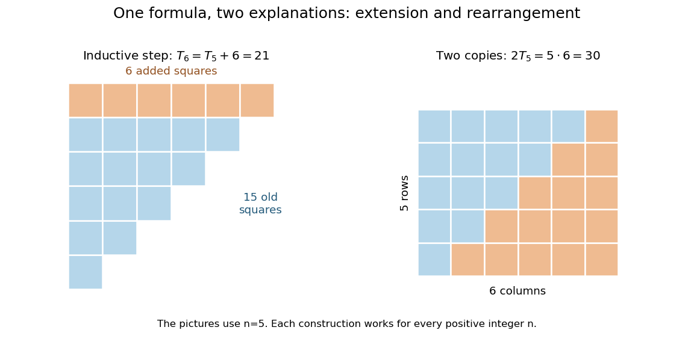
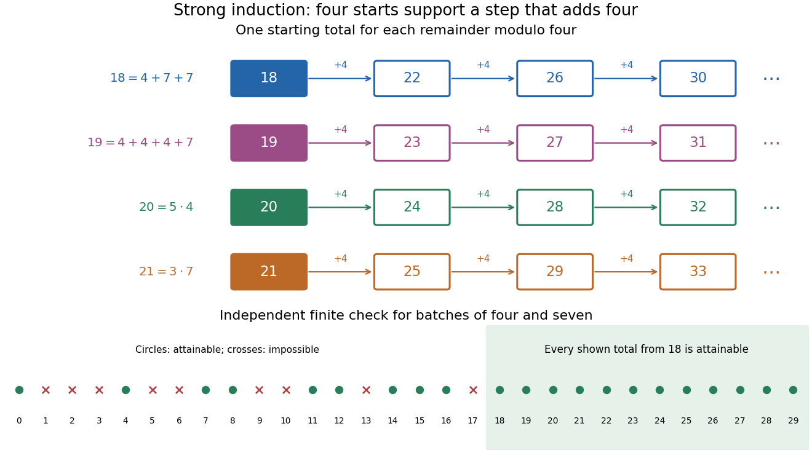

# Foundations of mathematics

↑ **Parent:** [Area of mathematics](mathematics.md#area-of-mathematics)  
ⓦ [Wiki](https://en.wikipedia.org/wiki/Foundations_of_mathematics)

Foundations of mathematics asks what our objects mean, what we assume about them, and why an argument establishes its conclusion. [Set theory](set-theory.md) gives a common language for collections and [functions](function.md); [mathematical logic](mathematical-logic.md) makes the structure of statements and deductions precise. A [mathematical definition](#mathematical-definition) fixes a meaning, an [axiom](mathematical-logic.md#axiom) supplies an assumption, and a [mathematical proof](#mathematical-proof) explains what follows. Separating these roles makes results reusable: once the [group](group.md) axioms are enough for a conclusion, that conclusion applies to every [group](group.md), regardless of how its members are represented.

The assumptions can change the answer to a familiar calculation. Over the [real numbers](arithmetic.md#real-number), $x^2=x$ factors as $x(x-1)=0$, so $x$ is zero or one. The same reasoning holds in any [integral domain](commutative-algebra.md#integral-domain), because a product can be zero only when a factor is zero. In the [ring](commutative-algebra.md#ring) of [integers](integer.md) modulo six, however, $3^2\equiv3$ and $4^2\equiv4\pmod6$: there are four solutions, represented by $0,1,3,4$. The extra solutions are [idempotents](commutative-algebra.md#idempotent), and the failed step involves [zero divisors](mathematics.md#zero-divisor). Writing the domain is part of explaining the answer.

This precision also reveals surprising possibilities. A two-dimensional grid of [natural numbers](arithmetic.md#natural-number) is a [countable set](cardinal-number.md#countable-set), while all infinite [binary sequences](sequence-and-series.md#bitstream) form an [uncountable set](cardinal-number.md#uncountable-set). The [Cantor pairing function](cardinal-number.md#cantor-pairing-function) supplies a complete enumeration of the first; [Cantor's diagonal argument](cardinal-number.md#cantor-s-diagonal-argument) defeats every proposed enumeration of the second. Both arguments are short, yet distinguish two sizes of infinity. The subject's appeal is this ability to turn a vague question into one whose assumptions, construction, and limits can all be inspected.

**Table of contents**

- [Mathematical logic](mathematical-logic.md)
  - [Existence](mathematical-logic.md#existence)
  - [Uniqueness](mathematical-logic.md#uniqueness)
  - [Proof theory](mathematical-logic.md#proof-theory)
  - [Axiom](mathematical-logic.md#axiom)
  - [Definition (mathematics)](mathematical-logic.md#definition-mathematics)
  - [Second-order logic](mathematical-logic.md#second-order-logic)
    - [Second-order relation variable](mathematical-logic.md#second-order-relation-variable)
    - [Existential second-order logic](mathematical-logic.md#existential-second-order-logic)
      - [Second-order encoding of three-colorability](mathematical-logic.md#second-order-encoding-of-three-colorability)
      - [Fagin's theorem](mathematical-logic.md#fagin-s-theorem)
    - [Henkin semantics](mathematical-logic.md#henkin-semantics)
    - [Full semantics for second-order logic](mathematical-logic.md#full-semantics-for-second-order-logic)
    - [Second-order comprehension](mathematical-logic.md#second-order-comprehension)
  - [Second-order arithmetic](mathematical-logic.md#second-order-arithmetic)
    - [Arithmetical transfinite recursion theory](mathematical-logic.md#arithmetical-transfinite-recursion-theory)
  - [Formal proof](mathematical-logic.md#formal-proof)
  - [Infinitary logic](mathematical-logic.md#infinitary-logic)
    - [Infinitary language](mathematical-logic.md#infinitary-language)
      - [Countable infinitary logic](mathematical-logic.md#countable-infinitary-logic)
        - [Scott isomorphism theorem](mathematical-logic.md#scott-isomorphism-theorem)
        - [Scott sentence](mathematical-logic.md#scott-sentence)
        - [Scott formula](mathematical-logic.md#scott-formula)
  - [Propositional logic](mathematical-logic.md#propositional-logic)
    - [Contradiction](mathematical-logic.md#contradiction)
    - [Lindenbaum algebra](mathematical-logic.md#lindenbaum-algebra)
    - [Propositional theory](mathematical-logic.md#propositional-theory)
      - [Propositional type](mathematical-logic.md#propositional-type)
        - [Extended omitting types theorem for propositional logic](mathematical-logic.md#extended-omitting-types-theorem-for-propositional-logic)
        - [Nonprincipal propositional type](mathematical-logic.md#nonprincipal-propositional-type)
    - [Propositional formula](mathematical-logic.md#propositional-formula)
      - [Propositional variable elimination](mathematical-logic.md#propositional-variable-elimination)
        - [Propositional interpolation](mathematical-logic.md#propositional-interpolation)
    - [Deduction theorem for propositional logic](mathematical-logic.md#deduction-theorem-for-propositional-logic)
    - [Classical propositional logic](mathematical-logic.md#classical-propositional-logic)
      - [Tautology](mathematical-logic.md#tautology)
      - [Logical validity](mathematical-logic.md#logical-validity)
      - [Law of excluded middle](mathematical-logic.md#law-of-excluded-middle)
      - [Double-negation elimination](mathematical-logic.md#double-negation-elimination)
    - [Boolean valuation](mathematical-logic.md#boolean-valuation)
      - [Truth table](mathematical-logic.md#truth-table)
    - [Proposition](mathematical-logic.md#proposition)
      - [Logical connective](mathematical-logic.md#logical-connective)
        - [Logical implication](mathematical-logic.md#logical-implication)
          - [Contrapositive](mathematical-logic.md#contrapositive)
          - [Converse implication](mathematical-logic.md#converse-implication)
          - [Vacuous truth](mathematical-logic.md#vacuous-truth)
        - [Logical conjunction](mathematical-logic.md#logical-conjunction)
        - [Logical disjunction](mathematical-logic.md#logical-disjunction)
        - [Logical truth](mathematical-logic.md#logical-truth)
        - [Logical falsity](mathematical-logic.md#logical-falsity)
      - [Truth value](mathematical-logic.md#truth-value)
    - [Natural deduction](mathematical-logic.md#natural-deduction)
      - [Identity weakening rule](mathematical-logic.md#identity-weakening-rule)
      - [Implication elimination rule](mathematical-logic.md#implication-elimination-rule)
      - [Implication introduction rule](mathematical-logic.md#implication-introduction-rule)
    - [Intuitionistic propositional logic](mathematical-logic.md#intuitionistic-propositional-logic)
      - [Lattice](mathematical-logic.md#lattice)
        - [Join and meet](mathematical-logic.md#join-and-meet)
          - [Join in a lattice](mathematical-logic.md#join-in-a-lattice)
          - [Meet in a lattice](mathematical-logic.md#meet-in-a-lattice)
        - [Homomorphism of lattices](mathematical-logic.md#homomorphism-of-lattices)
        - [Complete lattice](mathematical-logic.md#complete-lattice)
          - [Knaster–Tarski fixed-point theorem](mathematical-logic.md#knaster-tarski-fixed-point-theorem)
        - [Distributive lattice](mathematical-logic.md#distributive-lattice)
          - [Distributive law for lattices](mathematical-logic.md#distributive-law-for-lattices)
          - [Boolean algebra](mathematical-logic.md#boolean-algebra)
            - [Boolean prime ideal theorem](mathematical-logic.md#boolean-prime-ideal-theorem)
            - [Ideal frame of a Boolean algebra](mathematical-logic.md#ideal-frame-of-a-boolean-algebra)
            - [Complete Boolean algebra](mathematical-logic.md#complete-boolean-algebra)
            - [Double-negation Boolean algebra](mathematical-logic.md#double-negation-boolean-algebra)
          - [Lattice filter](mathematical-logic.md#lattice-filter)
            - [Prime filter of a distributive lattice](mathematical-logic.md#prime-filter-of-a-distributive-lattice)
              - [Stone prime filter theorem](mathematical-logic.md#stone-prime-filter-theorem)
          - [Lattice ideal](mathematical-logic.md#lattice-ideal)
            - [Prime lattice ideal](mathematical-logic.md#prime-lattice-ideal)
          - [Priestley duality](mathematical-logic.md#priestley-duality)
            - [Priestley dual space](mathematical-logic.md#priestley-dual-space)
              - [Clopen up-set](mathematical-logic.md#clopen-up-set)
              - [Stone map of a distributive lattice](mathematical-logic.md#stone-map-of-a-distributive-lattice)
      - [Heyting algebra](mathematical-logic.md#heyting-algebra)
        - [Heyting implication](mathematical-logic.md#heyting-implication)
          - [Pseudocomplement](mathematical-logic.md#pseudocomplement)
        - [Heyting operations on subsheaves](mathematical-logic.md#heyting-operations-on-subsheaves)
        - [Regular element of a Heyting algebra](mathematical-logic.md#regular-element-of-a-heyting-algebra)
        - [Distributivity of a Heyting algebra](mathematical-logic.md#distributivity-of-a-heyting-algebra)
      - [Implicational Curry-Howard correspondence](mathematical-logic.md#implicational-curry-howard-correspondence)
      - [Curry-Howard correspondence](mathematical-logic.md#curry-howard-correspondence)
      - [Kripke model for intuitionistic propositional logic](mathematical-logic.md#kripke-model-for-intuitionistic-propositional-logic)
        - [Kripke forcing relation](mathematical-logic.md#kripke-forcing-relation)
          - [Persistence of intuitionistic Kripke forcing](mathematical-logic.md#persistence-of-intuitionistic-kripke-forcing)
          - [Kripke countermodel](mathematical-logic.md#kripke-countermodel)
        - [Kripke completeness theorem for intuitionistic propositional logic](mathematical-logic.md#kripke-completeness-theorem-for-intuitionistic-propositional-logic)
        - [Filtration of a Kripke model](mathematical-logic.md#filtration-of-a-kripke-model)
        - [Unravelling of a Kripke model](mathematical-logic.md#unravelling-of-a-kripke-model)
        - [Finite model property of intuitionistic propositional logic](mathematical-logic.md#finite-model-property-of-intuitionistic-propositional-logic)
      - [Disjunction property of intuitionistic propositional logic](mathematical-logic.md#disjunction-property-of-intuitionistic-propositional-logic)
      - [Implication-free fragment of intuitionistic propositional logic](mathematical-logic.md#implication-free-fragment-of-intuitionistic-propositional-logic)
        - [Completeness of implication-free intuitionistic propositional logic for distributive lattices](mathematical-logic.md#completeness-of-implication-free-intuitionistic-propositional-logic-for-distributive-lattices)
      - [Implicational fragment of intuitionistic propositional logic](mathematical-logic.md#implicational-fragment-of-intuitionistic-propositional-logic)
        - [Canonical Kripke model for implicational intuitionistic logic](mathematical-logic.md#canonical-kripke-model-for-implicational-intuitionistic-logic)
        - [Kripke completeness of implicational intuitionistic logic](mathematical-logic.md#kripke-completeness-of-implicational-intuitionistic-logic)
        - [Conservativity of intuitionistic propositional logic over its implicational fragment](mathematical-logic.md#conservativity-of-intuitionistic-propositional-logic-over-its-implicational-fragment)
    - [Soundness theorem for propositional logic](mathematical-logic.md#soundness-theorem-for-propositional-logic)
    - [Completeness theorem for propositional logic](mathematical-logic.md#completeness-theorem-for-propositional-logic)
      - [Maximal consistent set truth lemma](mathematical-logic.md#maximal-consistent-set-truth-lemma)
        - [Maximum consistent propositional theory gives a model](mathematical-logic.md#maximum-consistent-propositional-theory-gives-a-model)
      - [Uncountable-language proof of propositional completeness](mathematical-logic.md#uncountable-language-proof-of-propositional-completeness)
    - [Decidability theorem for propositional logic](mathematical-logic.md#decidability-theorem-for-propositional-logic)
    - [Deductively closed set of formulae](mathematical-logic.md#deductively-closed-set-of-formulae)
    - [Consistent set of formulae](mathematical-logic.md#consistent-set-of-formulae)
    - [Finitary set of formulae](mathematical-logic.md#finitary-set-of-formulae)
    - [Increasing union of deductively closed sets](mathematical-logic.md#increasing-union-of-deductively-closed-sets)
    - [Maximal consistent set in propositional logic](mathematical-logic.md#maximal-consistent-set-in-propositional-logic)
    - [Propositional compactness theorem](mathematical-logic.md#propositional-compactness-theorem)
      - [Compactness obstruction to expressing totality over an infinite codomain](mathematical-logic.md#compactness-obstruction-to-expressing-totality-over-an-infinite-codomain)
    - [Logical equivalence](mathematical-logic.md#logical-equivalence)
  - [First-order logic](mathematical-logic.md#first-order-logic)
    - [Quantifier](mathematical-logic.md#quantifier)
    - [Finite-variable logic](mathematical-logic.md#finite-variable-logic)
      - [Least representatives of finite equivalence classes](mathematical-logic.md#least-representatives-of-finite-equivalence-classes)
      - [Variable-recycling count on a linear order](mathematical-logic.md#variable-recycling-count-on-a-linear-order)
    - [Geometric logic](mathematical-logic.md#geometric-logic)
      - [Geometric theory](mathematical-logic.md#geometric-theory)
        - [Propositional geometric theory](mathematical-logic.md#propositional-geometric-theory)
          - [Prime-filter locale of a commutative ring](mathematical-logic.md#prime-filter-locale-of-a-commutative-ring)
        - [Geometric quotient theory](mathematical-logic.md#geometric-quotient-theory)
        - [Geometric syntactic category](mathematical-logic.md#geometric-syntactic-category)
          - [Geometric syntactic topology](mathematical-logic.md#geometric-syntactic-topology)
      - [Geometric formula](mathematical-logic.md#geometric-formula)
    - [Regular logic](mathematical-logic.md#regular-logic)
      - [Regular theory](mathematical-logic.md#regular-theory)
        - [Chase completeness for regular logic](mathematical-logic.md#chase-completeness-for-regular-logic)
        - [Disjunction property of regular theories](mathematical-logic.md#disjunction-property-of-regular-theories)
        - [Regular syntactic category](mathematical-logic.md#regular-syntactic-category)
      - [Regular formula](mathematical-logic.md#regular-formula)
    - [Cartesian theory](mathematical-logic.md#cartesian-theory)
      - [Horn theory](mathematical-logic.md#horn-theory)
        - [Presheaf classifier of a Horn theory](mathematical-logic.md#presheaf-classifier-of-a-horn-theory)
      - [Cartesian syntactic category](mathematical-logic.md#cartesian-syntactic-category)
        - [Completeness of Cartesian theories](mathematical-logic.md#completeness-of-cartesian-theories)
      - [Cartesian formula](mathematical-logic.md#cartesian-formula)
    - [Coherent logic](mathematical-logic.md#coherent-logic)
      - [Frobenius rule in coherent logic](mathematical-logic.md#frobenius-rule-in-coherent-logic)
      - [Coherent theory](mathematical-logic.md#coherent-theory)
        - [Coherent theory of local rings](mathematical-logic.md#coherent-theory-of-local-rings)
        - [Classical completeness of coherent theories](mathematical-logic.md#classical-completeness-of-coherent-theories)
        - [Coherent syntactic category](mathematical-logic.md#coherent-syntactic-category)
          - [Conservative syntactic model](mathematical-logic.md#conservative-syntactic-model)
      - [Coherent sequent](mathematical-logic.md#coherent-sequent)
      - [Coherent formula](mathematical-logic.md#coherent-formula)
    - [Logical equality](mathematical-logic.md#logical-equality)
    - [Intuitionistic first-order logic](mathematical-logic.md#intuitionistic-first-order-logic)
      - [Gödel-Gentzen negative translation](mathematical-logic.md#godel-gentzen-negative-translation)
        - [Negative translation of a classical proof](mathematical-logic.md#negative-translation-of-a-classical-proof)
      - [Stability of a formula under double negation](mathematical-logic.md#stability-of-a-formula-under-double-negation)
    - [Classical first-order logic](mathematical-logic.md#classical-first-order-logic)
    - [First-order formula](mathematical-logic.md#first-order-formula)
      - [Quantifier rank](mathematical-logic.md#quantifier-rank)
        - [Rank-n equivalence of structures](mathematical-logic.md#rank-n-equivalence-of-structures)
      - [Primitive positive formula](mathematical-logic.md#primitive-positive-formula)
      - [Existential quantification](mathematical-logic.md#existential-quantification)
        - [Existential formula](mathematical-logic.md#existential-formula)
      - [Universal quantification](mathematical-logic.md#universal-quantification)
      - [Quantifier-free formula](mathematical-logic.md#quantifier-free-formula)
        - [Closed-term witness property for quantifier-free existential sentences](mathematical-logic.md#closed-term-witness-property-for-quantifier-free-existential-sentences)
        - [Quantifier-free sentence](mathematical-logic.md#quantifier-free-sentence)
      - [Atomic formula](mathematical-logic.md#atomic-formula)
    - [First-order language](mathematical-logic.md#first-order-language)
      - [First-order signature](mathematical-logic.md#first-order-signature)
      - [Language of ordered rings](mathematical-logic.md#language-of-ordered-rings)
      - [First-order term](mathematical-logic.md#first-order-term)
      - [Finite language support](mathematical-logic.md#finite-language-support)
    - [Free variable](mathematical-logic.md#free-variable)
    - [First-order sentence](mathematical-logic.md#first-order-sentence)
      - [Existential sentence](mathematical-logic.md#existential-sentence)
    - [First-order theory](mathematical-logic.md#first-order-theory)
      - [Soundness of an arithmetic theory](mathematical-logic.md#soundness-of-an-arithmetic-theory)
      - [Robinson arithmetic](mathematical-logic.md#robinson-arithmetic)
      - [Partial type](mathematical-logic.md#partial-type)
        - [Quantifier-free type](mathematical-logic.md#quantifier-free-type)
        - [A-type over a structure](mathematical-logic.md#a-type-over-a-structure)
        - [Nonprincipal partial type](mathematical-logic.md#nonprincipal-partial-type)
          - [Local omission of a partial type](mathematical-logic.md#local-omission-of-a-partial-type)
        - [Principal partial type](mathematical-logic.md#principal-partial-type)
      - [Semidecidable axiomatization](mathematical-logic.md#semidecidable-axiomatization)
        - [Craig trick](mathematical-logic.md#craig-trick)
        - [Independent tagged axiomatization](mathematical-logic.md#independent-tagged-axiomatization)
      - [Gödel numbering](mathematical-logic.md#godel-numbering)
        - [Lambda quotation](mathematical-logic.md#lambda-quotation)
          - [Self-quoting fixed point](mathematical-logic.md#self-quoting-fixed-point)
        - [Gödel number](mathematical-logic.md#godel-number)
        - [Arithmetical provability predicate](mathematical-logic.md#arithmetical-provability-predicate)
        - [Prime-exponent encoding of a finite list](mathematical-logic.md#prime-exponent-encoding-of-a-finite-list)
      - [Peano arithmetic](mathematical-logic.md#peano-arithmetic)
        - [Arithmetical comprehension theory](mathematical-logic.md#arithmetical-comprehension-theory)
        - [Primitive recursive arithmetic](mathematical-logic.md#primitive-recursive-arithmetic)
        - [Gentzen ordinal reduction for arithmetic](mathematical-logic.md#gentzen-ordinal-reduction-for-arithmetic)
        - [Prime-divisibility coding of a finite set](mathematical-logic.md#prime-divisibility-coding-of-a-finite-set)
        - [True arithmetic](mathematical-logic.md#true-arithmetic)
        - [Least-number principle](mathematical-logic.md#least-number-principle)
        - [Non-standard model of arithmetic](mathematical-logic.md#non-standard-model-of-arithmetic)
          - [Nonstandard element type](mathematical-logic.md#nonstandard-element-type)
          - [Standard cut of a nonstandard model of arithmetic](mathematical-logic.md#standard-cut-of-a-nonstandard-model-of-arithmetic)
          - [Overspill lemma](mathematical-logic.md#overspill-lemma)
      - [Diagonal lemma](mathematical-logic.md#diagonal-lemma)
        - [Gödel sentence](mathematical-logic.md#godel-sentence)
          - [Rosser sentence](mathematical-logic.md#rosser-sentence)
        - [Effective diagonal lemma](mathematical-logic.md#effective-diagonal-lemma)
        - [Crude incompleteness theorem](mathematical-logic.md#crude-incompleteness-theorem)
      - [Tennenbaum's theorem](mathematical-logic.md#tennenbaum-s-theorem)
        - [Recursively inseparable-set proof of Tennenbaum theorem](mathematical-logic.md#recursively-inseparable-set-proof-of-tennenbaum-theorem)
      - [First-order axiomatizable class](mathematical-logic.md#first-order-axiomatizable-class)
        - [First-order axiomatization of torsion-free groups](mathematical-logic.md#first-order-axiomatization-of-torsion-free-groups)
        - [First-order axiomatization of total orders](mathematical-logic.md#first-order-axiomatization-of-total-orders)
      - [Consistent first-order theory](mathematical-logic.md#consistent-first-order-theory)
        - [Formal consistency statement](mathematical-logic.md#formal-consistency-statement)
          - [Gödel second incompleteness theorem](mathematical-logic.md#godel-second-incompleteness-theorem)
          - [Consistency-strength preorder](mathematical-logic.md#consistency-strength-preorder)
            - [Relative consistency](mathematical-logic.md#relative-consistency)
            - [Consistency strength of a worldly cardinal](mathematical-logic.md#consistency-strength-of-a-worldly-cardinal)
            - [Iterated consistency progression](mathematical-logic.md#iterated-consistency-progression)
        - [Monotonicity of inconsistency](mathematical-logic.md#monotonicity-of-inconsistency)
      - [Finite character of formal proofs](mathematical-logic.md#finite-character-of-formal-proofs)
      - [Universal first-order theory](mathematical-logic.md#universal-first-order-theory)
        - [Universal consequences of a theory](mathematical-logic.md#universal-consequences-of-a-theory)
        - [Łoś-Tarski preservation theorem](mathematical-logic.md#los-tarski-preservation-theorem)
        - [Universal sentence](mathematical-logic.md#universal-sentence)
          - [Universal-existential sentence](mathematical-logic.md#universal-existential-sentence)
        - [Finite forbidden-pattern axiomatization](mathematical-logic.md#finite-forbidden-pattern-axiomatization)
    - [First-order structure](mathematical-logic.md#first-order-structure)
      - [Structure embedding](mathematical-logic.md#structure-embedding)
      - [Substructure of a first-order structure](mathematical-logic.md#substructure-of-a-first-order-structure)
        - [Simple closure](mathematical-logic.md#simple-closure)
          - [Existential embedding](mathematical-logic.md#existential-embedding)
      - [Satisfaction for a set structure](mathematical-logic.md#satisfaction-for-a-set-structure)
      - [Elementary substructure](mathematical-logic.md#elementary-substructure)
        - [Partial elementary map](mathematical-logic.md#partial-elementary-map)
        - [Tarski-Vaught test](mathematical-logic.md#tarski-vaught-test)
        - [Skolem hull](mathematical-logic.md#skolem-hull)
          - [Skolem function](mathematical-logic.md#skolem-function)
            - [Skolem expansion](mathematical-logic.md#skolem-expansion)
      - [Model of a first-order theory](mathematical-logic.md#model-of-a-first-order-theory)
        - [Definable element of a first-order structure](mathematical-logic.md#definable-element-of-a-first-order-structure)
          - [Paris model](mathematical-logic.md#paris-model)
            - [Paris models are well-founded when their complete theory has a well-founded model](mathematical-logic.md#paris-models-are-well-founded-when-their-complete-theory-has-a-well-founded-model)
            - [Paris models are rigid when their complete theory has a well-founded model](mathematical-logic.md#paris-models-are-rigid-when-their-complete-theory-has-a-well-founded-model)
      - [Automorphism of a first-order structure](mathematical-logic.md#automorphism-of-a-first-order-structure)
        - [Automorphism group of a first-order structure](mathematical-logic.md#automorphism-group-of-a-first-order-structure)
        - [First-order axiomatization of an automorphism](mathematical-logic.md#first-order-axiomatization-of-an-automorphism)
        - [Faithful automorphism action](mathematical-logic.md#faithful-automorphism-action)
        - [Rigid first-order structure](mathematical-logic.md#rigid-first-order-structure)
          - [Compactness transfer of finite nonrigidity](mathematical-logic.md#compactness-transfer-of-finite-nonrigidity)
    - [Soundness theorem for first-order logic](mathematical-logic.md#soundness-theorem-for-first-order-logic)
    - [Gödel's completeness theorem](mathematical-logic.md#godel-s-completeness-theorem)
      - [Henkin construction](mathematical-logic.md#henkin-construction)
        - [Term model](mathematical-logic.md#term-model)
          - [Truth lemma for a Henkin term model](mathematical-logic.md#truth-lemma-for-a-henkin-term-model)
        - [Henkin witness property](mathematical-logic.md#henkin-witness-property)
    - [Compactness theorem](mathematical-logic.md#compactness-theorem)
      - [Syntactic proof of first-order compactness](mathematical-logic.md#syntactic-proof-of-first-order-compactness)
      - [Compactness obstruction to axiomatizing finitely many maximal elements](mathematical-logic.md#compactness-obstruction-to-axiomatizing-finitely-many-maximal-elements)
      - [Compactness obstruction to an exclusive disjunction of infinitude](mathematical-logic.md#compactness-obstruction-to-an-exclusive-disjunction-of-infinitude)
      - [Finite structures are not first-order axiomatizable](mathematical-logic.md#finite-structures-are-not-first-order-axiomatizable)
      - [Well-orders are not first-order axiomatizable](mathematical-logic.md#well-orders-are-not-first-order-axiomatizable)
      - [Finite subaxiomatization from an equivalent finite theory](mathematical-logic.md#finite-subaxiomatization-from-an-equivalent-finite-theory)
    - [Löwenheim-Skolem theorem](mathematical-logic.md#lowenheim-skolem-theorem)
      - [Upward Lowenheim-Skolem theorem](mathematical-logic.md#upward-lowenheim-skolem-theorem)
      - [Downward Lowenheim-Skolem theorem](mathematical-logic.md#downward-lowenheim-skolem-theorem)
    - [Finite satisfiability problem for first-order logic](mathematical-logic.md#finite-satisfiability-problem-for-first-order-logic)
      - [Trakhtenbrot's theorem](mathematical-logic.md#trakhtenbrot-s-theorem)
        - [Finite validity problem for first-order logic](mathematical-logic.md#finite-validity-problem-for-first-order-logic)
  - [Priestley space](mathematical-logic.md#priestley-space)
  - [Kripke semantics](mathematical-logic.md#kripke-semantics)
  - [Disjunction and existence properties](mathematical-logic.md#disjunction-and-existence-properties)
  - [Soundness](mathematical-logic.md#soundness)
  - [Free variables and bound variables](mathematical-logic.md#free-variables-and-bound-variables)
  - [Sentence (mathematical logic)](mathematical-logic.md#sentence-mathematical-logic)
  - [Theory (mathematical logic)](mathematical-logic.md#theory-mathematical-logic)
  - [Craig's theorem](mathematical-logic.md#craig-s-theorem)
  - [Overspill](mathematical-logic.md#overspill)
  - [Structure (mathematical logic)](mathematical-logic.md#structure-mathematical-logic)
- [Set theory](set-theory.md)
  - [Russell's paradox](set-theory.md#russell-s-paradox)
  - [Urelement](set-theory.md#urelement)
    - [Basic Fraenkel permutation model](set-theory.md#basic-fraenkel-permutation-model)
  - [Hereditarily locally small membership model](set-theory.md#hereditarily-locally-small-membership-model)
  - [New Foundations](set-theory.md#new-foundations)
    - [New Foundations with urelements](set-theory.md#new-foundations-with-urelements)
      - [Type-shifting automorphism](set-theory.md#type-shifting-automorphism)
        - [Rank-shifting automorphism construction of NFU](set-theory.md#rank-shifting-automorphism-construction-of-nfu)
          - [Rank-shifting NFU model with explicit set predicate](set-theory.md#rank-shifting-nfu-model-with-explicit-set-predicate)
            - [Rank-indiscernible construction of an NFU model](set-theory.md#rank-indiscernible-construction-of-an-nfu-model)
      - [Stratified formula](set-theory.md#stratified-formula)
  - [Simple typed set theory with atoms](set-theory.md#simple-typed-set-theory-with-atoms)
    - [Typical ambiguity](set-theory.md#typical-ambiguity)
  - [Axiom of pairing](set-theory.md#axiom-of-pairing)
  - [Axiom of extensionality](set-theory.md#axiom-of-extensionality)
    - [Non-extensional membership model with one atom](set-theory.md#non-extensional-membership-model-with-one-atom)
  - [Independent family of sets](set-theory.md#independent-family-of-sets)
    - [Fichtenholz-Kantorovich independent family](set-theory.md#fichtenholz-kantorovich-independent-family)
  - [Almost disjoint family on a regular cardinal](set-theory.md#almost-disjoint-family-on-a-regular-cardinal)
    - [Essential disjointness of small subfamilies](set-theory.md#essential-disjointness-of-small-subfamilies)
  - [Kappa-filtration](set-theory.md#kappa-filtration)
    - [Club agreement of countable filtrations](set-theory.md#club-agreement-of-countable-filtrations)
  - [Almost disjoint family on omega](set-theory.md#almost-disjoint-family-on-omega)
    - [Maximal almost disjoint family on omega](set-theory.md#maximal-almost-disjoint-family-on-omega)
      - [Almost disjointness number](set-theory.md#almost-disjointness-number)
        - [Bounding-to-almost-disjointness inequality](set-theory.md#bounding-to-almost-disjointness-inequality)
  - [Standard membership model of set theory](set-theory.md#standard-membership-model-of-set-theory)
  - [Partition relation](set-theory.md#partition-relation)
    - [Finite-symmetric-difference colouring of infinite subsets](set-theory.md#finite-symmetric-difference-colouring-of-infinite-subsets)
    - [Erdős-Rado theorem for finite arities](set-theory.md#erdos-rado-theorem-for-finite-arities)
      - [Closed elementary-submodel construction of an end-homogeneous sequence](set-theory.md#closed-elementary-submodel-construction-of-an-end-homogeneous-sequence)
      - [End-homogeneous routing tree](set-theory.md#end-homogeneous-routing-tree)
    - [Erdős-Rado theorem for pairs](set-theory.md#erdos-rado-theorem-for-pairs)
      - [Ordinal partition-bound function](set-theory.md#ordinal-partition-bound-function)
    - [Finite-subset partition property](set-theory.md#finite-subset-partition-property)
      - [Small forcing preservation of finite-subset partition properties](set-theory.md#small-forcing-preservation-of-finite-subset-partition-properties)
    - [Infinite-arity partition relation](set-theory.md#infinite-arity-partition-relation)
  - [Eventual domination](set-theory.md#eventual-domination)
    - [Eventual domination on a regular cardinal](set-theory.md#eventual-domination-on-a-regular-cardinal)
      - [Long chain under eventual domination](set-theory.md#long-chain-under-eventual-domination)
    - [Bounding number](set-theory.md#bounding-number)
    - [Dominating family](set-theory.md#dominating-family)
  - [Sierpiński decomposition of the plane](set-theory.md#sierpinski-decomposition-of-the-plane)
  - [Definable continuous hierarchy](set-theory.md#definable-continuous-hierarchy)
  - [Zermelo–Fraenkel set theory](set-theory.md#zermelo-fraenkel-set-theory)
    - [Zermelo set theory](set-theory.md#zermelo-set-theory)
      - [Axiom of limitation of size](set-theory.md#axiom-of-limitation-of-size)
    - [Intuitionistic Zermelo–Fraenkel set theory](set-theory.md#intuitionistic-zermelo-fraenkel-set-theory)
      - [Boolean-valued inner universe over intuitionistic set theory](set-theory.md#boolean-valued-inner-universe-over-intuitionistic-set-theory)
        - [Boolean-valued name](set-theory.md#boolean-valued-name)
        - [Collection for Boolean-valued names](set-theory.md#collection-for-boolean-valued-names)
    - [Rieger-Bernays permutation model](set-theory.md#rieger-bernays-permutation-model)
      - [Quine atom](set-theory.md#quine-atom)
        - [Extensional cumulative universe over Quine atoms](set-theory.md#extensional-cumulative-universe-over-quine-atoms)
        - [Hereditarily finite-supported Quine-atom model](set-theory.md#hereditarily-finite-supported-quine-atom-model)
    - [Axiom of infinity](set-theory.md#axiom-of-infinity)
      - [Inductive set](set-theory.md#inductive-set)
    - [Zermelo–Fraenkel set theory with choice](set-theory.md#zermelo-fraenkel-set-theory-with-choice)
  - [Von Neumann hierarchy](set-theory.md#von-neumann-hierarchy)
    - [Countable rank-initial segment cannot model ZFC](set-theory.md#countable-rank-initial-segment-cannot-model-zfc)
    - [Lévy reflection theorem](set-theory.md#levy-reflection-theorem)
      - [Club reflection below an inaccessible cardinal](set-theory.md#club-reflection-below-an-inaccessible-cardinal)
      - [Reflection theorem for definable hierarchies](set-theory.md#reflection-theorem-for-definable-hierarchies)
      - [Ordinal described by a first-order formula](set-theory.md#ordinal-described-by-a-first-order-formula)
    - [Rank of a set](set-theory.md#rank-of-a-set)
  - [Definable power set](definable-power-set.md)
    - [Finite relation closure for set-theoretic coding](definable-power-set.md#finite-relation-closure-for-set-theoretic-coding)
    - [Constructible hierarchy](definable-power-set.md#constructible-hierarchy)
      - [Constructible sets of low rank can appear at later stages](definable-power-set.md#constructible-sets-of-low-rank-can-appear-at-later-stages)
      - [Absoluteness of constructible levels](definable-power-set.md#absoluteness-of-constructible-levels)
        - [Constructible-level absoluteness over ZF](definable-power-set.md#constructible-level-absoluteness-over-zf)
      - [Constructible universe](definable-power-set.md#constructible-universe)
        - [Shepherdson's wall](definable-power-set.md#shepherdson-s-wall)
        - [Axiom of constructibility](definable-power-set.md#axiom-of-constructibility)
        - [Separation proof in the constructible universe](definable-power-set.md#separation-proof-in-the-constructible-universe)
        - [Constructible universe theorem](definable-power-set.md#constructible-universe-theorem)
        - [Diamond theorem in the constructible universe](definable-power-set.md#diamond-theorem-in-the-constructible-universe)
        - [Countability of constructible omega-one](definable-power-set.md#countability-of-constructible-omega-one)
        - [Hereditarily countable constructible sets appear below omega-one](definable-power-set.md#hereditarily-countable-constructible-sets-appear-below-omega-one)
        - [Constructible power set](definable-power-set.md#constructible-power-set)
        - [Relative constructible universe](definable-power-set.md#relative-constructible-universe)
          - [Inner models with all reals preserve omega-one](definable-power-set.md#inner-models-with-all-reals-preserve-omega-one)
          - [Relative constructible hierarchy](definable-power-set.md#relative-constructible-hierarchy)
            - [Relative condensation lemma](definable-power-set.md#relative-condensation-lemma)
            - [Relative constructible level recognition](definable-power-set.md#relative-constructible-level-recognition)
            - [Coded relative constructible stage](definable-power-set.md#coded-relative-constructible-stage)
              - [Stage histories appear below every limit constructible level](definable-power-set.md#stage-histories-appear-below-every-limit-constructible-level)
          - [Relative constructible universe can violate the continuum hypothesis](definable-power-set.md#relative-constructible-universe-can-violate-the-continuum-hypothesis)
      - [Condensation sentence for the constructible hierarchy](definable-power-set.md#condensation-sentence-for-the-constructible-hierarchy)
      - [Well-order code](definable-power-set.md#well-order-code)
      - [Coding level of the constructible hierarchy](definable-power-set.md#coding-level-of-the-constructible-hierarchy)
      - [Condensation lemma for the constructible universe](definable-power-set.md#condensation-lemma-for-the-constructible-universe)
  - [Forcing](forcing.md)
    - [Forcing antichain](forcing.md#forcing-antichain)
    - [Cardinal collapse](forcing.md#cardinal-collapse)
    - [Cofinality-preserving forcing](forcing.md#cofinality-preserving-forcing)
    - [Martin's axiom](forcing.md#martin-s-axiom)
    - [Countable forcing](forcing.md#countable-forcing)
      - [One-Cohen-real preservation of GCH](forcing.md#one-cohen-real-preservation-of-gch)
      - [Countable forcing preserves Suslin trees](forcing.md#countable-forcing-preserves-suslin-trees)
      - [Ground-model uncountable subset lemma for countable forcing](forcing.md#ground-model-uncountable-subset-lemma-for-countable-forcing)
    - [Separative forcing order](forcing.md#separative-forcing-order)
    - [Forcing atom](forcing.md#forcing-atom)
      - [A forcing atom determines a ground-model generic filter](forcing.md#a-forcing-atom-determines-a-ground-model-generic-filter)
      - [Atomless forcing order](forcing.md#atomless-forcing-order)
        - [Generic filter for an atomless order is new](forcing.md#generic-filter-for-an-atomless-order-is-new)
    - [Product forcing](forcing.md#product-forcing)
      - [Mutual genericity for product forcing](forcing.md#mutual-genericity-for-product-forcing)
      - [Projection of a product-generic filter](forcing.md#projection-of-a-product-generic-filter)
    - [Infinite-reservoir stem forcing](forcing.md#infinite-reservoir-stem-forcing)
    - [Unbounded real over a model](forcing.md#unbounded-real-over-a-model)
    - [Cardinal-preserving forcing](forcing.md#cardinal-preserving-forcing)
    - [Forcing name](forcing.md#forcing-name)
      - [Forcing name rank](forcing.md#forcing-name-rank)
      - [Choice preservation by well-ordered names](forcing.md#choice-preservation-by-well-ordered-names)
      - [Nice forcing name](forcing.md#nice-forcing-name)
      - [Paired forcing name](forcing.md#paired-forcing-name)
      - [Forcing name for the complement of a generic filter](forcing.md#forcing-name-for-the-complement-of-a-generic-filter)
      - [Evaluation of a forcing name](forcing.md#evaluation-of-a-forcing-name)
      - [Canonical forcing name](forcing.md#canonical-forcing-name)
    - [Finite-function collapse to countable size](forcing.md#finite-function-collapse-to-countable-size)
      - [GCH preservation by a finite-function collapse](forcing.md#gch-preservation-by-a-finite-function-collapse)
    - [Standard notation for forcing](forcing.md#standard-notation-for-forcing)
    - [Jerusalem notation for forcing](forcing.md#jerusalem-notation-for-forcing)
    - [Compatible forcing conditions](forcing.md#compatible-forcing-conditions)
      - [Incompatible forcing conditions](forcing.md#incompatible-forcing-conditions)
    - [Dense subset of a forcing order](forcing.md#dense-subset-of-a-forcing-order)
      - [Dense above a forcing condition](forcing.md#dense-above-a-forcing-condition)
      - [Dense below a forcing condition](forcing.md#dense-below-a-forcing-condition)
        - [Dense-below generic meeting lemma](forcing.md#dense-below-generic-meeting-lemma)
    - [Generic filter](forcing.md#generic-filter)
      - [Maximal-antichain criterion for genericity](forcing.md#maximal-antichain-criterion-for-genericity)
      - [Rasiowa–Sikorski lemma](forcing.md#rasiowa-sikorski-lemma)
      - [Generic extension](forcing.md#generic-extension)
        - [Power-set failure in an increasing union of generic extensions](forcing.md#power-set-failure-in-an-increasing-union-of-generic-extensions)
        - [Power set in a generic extension](forcing.md#power-set-in-a-generic-extension)
        - [Forcing theorem](forcing.md#forcing-theorem)
          - [Forcing decision pattern](forcing.md#forcing-decision-pattern)
          - [Forcing preserves ordinals](forcing.md#forcing-preserves-ordinals)
          - [Forcing truth lemma](forcing.md#forcing-truth-lemma)
          - [Forcing definability lemma](forcing.md#forcing-definability-lemma)
          - [Semantic forcing relation](forcing.md#semantic-forcing-relation)
          - [Syntactic forcing relation](forcing.md#syntactic-forcing-relation)
            - [Atomic membership truth lemma for forcing](forcing.md#atomic-membership-truth-lemma-for-forcing)
            - [Existential clause of syntactic forcing](forcing.md#existential-clause-of-syntactic-forcing)
          - [Separation in a generic extension](forcing.md#separation-in-a-generic-extension)
    - [Countable transitive model](forcing.md#countable-transitive-model)
    - [Cohen forcing](forcing.md#cohen-forcing)
      - [Cohen forcing two-level continuum plateau](forcing.md#cohen-forcing-two-level-continuum-plateau)
    - [Eventually different forcing](forcing.md#eventually-different-forcing)
    - [Fn forcing](forcing.md#fn-forcing)
      - [Countable chain condition for finite-function forcing](forcing.md#countable-chain-condition-for-finite-function-forcing)
      - [Generic coordinate reals for finite-function forcing](forcing.md#generic-coordinate-reals-for-finite-function-forcing)
    - [Chain condition for forcing](forcing.md#chain-condition-for-forcing)
      - [Ground-model club containment lemma](forcing.md#ground-model-club-containment-lemma)
      - [Possible-values lemma for chain-condition forcing](forcing.md#possible-values-lemma-for-chain-condition-forcing)
        - [Cardinal preservation by chain-condition forcing](forcing.md#cardinal-preservation-by-chain-condition-forcing)
      - [Countable chain condition for forcing](forcing.md#countable-chain-condition-for-forcing)
        - [Knaster forcing](forcing.md#knaster-forcing)
          - [Knaster forcing preserves Suslin trees](forcing.md#knaster-forcing-preserves-suslin-trees)
    - [Closed forcing](forcing.md#closed-forcing)
      - [Closed forcing adds no short ground-valued sequences](forcing.md#closed-forcing-adds-no-short-ground-valued-sequences)
      - [Countably closed forcing](forcing.md#countably-closed-forcing)
        - [Diamond-sequence forcing](forcing.md#diamond-sequence-forcing)
        - [Countable-condition collapse](forcing.md#countable-condition-collapse)
      - [Closed forcing adds no short ordinal sequences](forcing.md#closed-forcing-adds-no-short-ordinal-sequences)
        - [Cardinal preservation by closed forcing](forcing.md#cardinal-preservation-by-closed-forcing)
    - [Antichain in a forcing order](forcing.md#antichain-in-a-forcing-order)
    - [Centered subset of a forcing order](forcing.md#centered-subset-of-a-forcing-order)
      - [Sigma-centered forcing](forcing.md#sigma-centered-forcing)
    - [Hechler forcing](forcing.md#hechler-forcing)
      - [Dominating real](forcing.md#dominating-real)
    - [Nice name for a real](forcing.md#nice-name-for-a-real)
    - [Finite-condition Lévy collapse](forcing.md#finite-condition-levy-collapse)
      - [Finite Lévy collapse to omega-one](forcing.md#finite-levy-collapse-to-omega-one)
      - [Maximal-antichain sizes in the finite Lévy collapse](forcing.md#maximal-antichain-sizes-in-the-finite-levy-collapse)
  - [Delta-system lemma](set-theory.md#delta-system-lemma)
    - [Generalized delta-system lemma](set-theory.md#generalized-delta-system-lemma)
    - [Delta-system](set-theory.md#delta-system)
      - [Erdős–Rado sunflower lemma](set-theory.md#erdos-rado-sunflower-lemma)
    - [Delta-system lemma at a regular uncountable cardinal](set-theory.md#delta-system-lemma-at-a-regular-uncountable-cardinal)
  - [Standard model (set theory)](set-theory.md#standard-model-set-theory)
  - [Transitive set](set-theory.md#transitive-set)
    - [Transitive model](set-theory.md#transitive-model)
      - [Well-founded model of set theory](set-theory.md#well-founded-model-of-set-theory)
      - [Ordinal height of a model of set theory](set-theory.md#ordinal-height-of-a-model-of-set-theory)
        - [Uncountable transitive set model has uncountable ordinal height](set-theory.md#uncountable-transitive-set-model-has-uncountable-ordinal-height)
          - [Countable-ordinal correctness under constructibility](set-theory.md#countable-ordinal-correctness-under-constructibility)
  - [Well-founded relation](set-theory.md#well-founded-relation)
    - [Intersection-power-set predecessor relation](set-theory.md#intersection-power-set-predecessor-relation)
    - [Power-set-predecessor relation](set-theory.md#power-set-predecessor-relation)
    - [Well-founded induction](set-theory.md#well-founded-induction)
    - [Well-founded recursion](set-theory.md#well-founded-recursion)
      - [Recursive powerset mapping](set-theory.md#recursive-powerset-mapping)
      - [Ordinal rank function for a relation](set-theory.md#ordinal-rank-function-for-a-relation)
        - [Rank of a well-founded tree](set-theory.md#rank-of-a-well-founded-tree)
          - [Maurey hierarchy of finite sets](set-theory.md#maurey-hierarchy-of-finite-sets)
    - [Set-like relation](set-theory.md#set-like-relation)
  - [Extensional relation](set-theory.md#extensional-relation)
  - [Set](set.md)
    - [Solution set](set.md#solution-set)
    - [Cover (topology)](set.md#cover-topology)
    - [Element of a set](set.md#element-of-a-set)
    - [Partition of a set](set.md#partition-of-a-set)
      - [Colouring of a set](set.md#colouring-of-a-set)
    - [Coinfinite set](set.md#coinfinite-set)
    - [Dedekind-finite set](set.md#dedekind-finite-set)
      - [Finite repetition-free sequences preserve Dedekind-finiteness](set.md#finite-repetition-free-sequences-preserve-dedekind-finiteness)
      - [Infinite Dedekind-finite set](set.md#infinite-dedekind-finite-set)
    - [Set difference](set.md#set-difference)
    - [Complement of a set](set.md#complement-of-a-set)
      - [Universal set](set.md#universal-set)
    - [Venn diagram](set.md#venn-diagram)
    - [Pointed set](set.md#pointed-set)
    - [Multiset](set.md#multiset)
    - [Nondecreasing family of sets](set.md#nondecreasing-family-of-sets)
    - [Power set](set.md#power-set)
      - [Cantor's theorem](set.md#cantor-s-theorem)
    - [Finite set](set.md#finite-set)
    - [Infinite set](set.md#infinite-set)
    - [Empty set](set.md#empty-set)
    - [Singleton (mathematics)](set.md#singleton-mathematics)
    - [Distinct elements](set.md#distinct-elements)
    - [Generating set](set.md#generating-set)
    - [Subset](set.md#subset)
      - [Set inclusion](set.md#set-inclusion)
    - [Set union](set.md#set-union)
      - [Finite union](set.md#finite-union)
      - [Countable union](set.md#countable-union)
    - [Set intersection](set.md#set-intersection)
      - [Finite intersection](set.md#finite-intersection)
      - [Disjoint sets](set.md#disjoint-sets)
      - [Countable intersection](set.md#countable-intersection)
    - [Symmetric difference](set.md#symmetric-difference)
      - [Finite symmetric difference](set.md#finite-symmetric-difference)
    - [Pair](set.md#pair)
      - [Ordered pair](set.md#ordered-pair)
        - [Kuratowski ordered pair](set.md#kuratowski-ordered-pair)
      - [Unordered pair](set.md#unordered-pair)
    - [Preorder](set.md#preorder)
      - [Hoare domination preorder](set.md#hoare-domination-preorder)
        - [Finite-subset lifting of a well-quasi-order](set.md#finite-subset-lifting-of-a-well-quasi-order)
      - [Well-quasi-ordering](set.md#well-quasi-ordering)
        - [Perfect subsequence lemma](set.md#perfect-subsequence-lemma)
        - [Finite product closure of well-quasi-orderings](set.md#finite-product-closure-of-well-quasi-orderings)
        - [Better-quasi-ordering](set.md#better-quasi-ordering)
          - [Power-set closure of better-quasi-orderings](set.md#power-set-closure-of-better-quasi-orderings)
          - [Continuous array in better-quasi-order theory](set.md#continuous-array-in-better-quasi-order-theory)
          - [Barrier in better-quasi-order theory](set.md#barrier-in-better-quasi-order-theory)
            - [Nash-Williams barrier partition theorem](set.md#nash-williams-barrier-partition-theorem)
        - [Rado order](set.md#rado-order)
          - [Bad barrier array for the Rado order](set.md#bad-barrier-array-for-the-rado-order)
        - [Higman's lemma](set.md#higman-s-lemma)
        - [Bad sequence](set.md#bad-sequence)
          - [Minimal bad sequence](set.md#minimal-bad-sequence)
        - [Finite bad-sequence tree](set.md#finite-bad-sequence-tree)
        - [Kruskal's tree theorem](set.md#kruskal-s-tree-theorem)
          - [Labelled version of Kruskal's tree theorem](set.md#labelled-version-of-kruskal-s-tree-theorem)
          - [Friedman's finite form of Kruskal's theorem](set.md#friedman-s-finite-form-of-kruskal-s-theorem)
    - [Partially ordered set](set.md#partially-ordered-set)
      - [Order ideal](set.md#order-ideal)
      - [Zeta transform](set.md#zeta-transform)
      - [Sperner property](set.md#sperner-property)
      - [Ranked partially ordered set](set.md#ranked-partially-ordered-set)
        - [Rank function of a partially ordered set](set.md#rank-function-of-a-partially-ordered-set)
      - [Upper and lower sets](set.md#upper-and-lower-sets)
      - [Greatest element and least element](set.md#greatest-element-and-least-element)
        - [Greatest element](set.md#greatest-element)
      - [Maximal and minimal elements](set.md#maximal-and-minimal-elements)
        - [Maximal element of a partially ordered set](set.md#maximal-element-of-a-partially-ordered-set)
        - [Minimal element of a partially ordered set](set.md#minimal-element-of-a-partially-ordered-set)
      - [Upper and lower bounds](set.md#upper-and-lower-bounds)
        - [Upper bound in a partially ordered set](set.md#upper-bound-in-a-partially-ordered-set)
          - [Least upper bound in a partially ordered set](set.md#least-upper-bound-in-a-partially-ordered-set)
      - [Increasing function on a partially ordered set](set.md#increasing-function-on-a-partially-ordered-set)
      - [Szpilrajn extension theorem](set.md#szpilrajn-extension-theorem)
      - [Dilworth's theorem](set.md#dilworth-s-theorem)
      - [Lower bound in a partially ordered set](set.md#lower-bound-in-a-partially-ordered-set)
        - [Greatest lower bound in a partially ordered set](set.md#greatest-lower-bound-in-a-partially-ordered-set)
      - [Chain-complete partially ordered set](set.md#chain-complete-partially-ordered-set)
      - [Complete partial order](set.md#complete-partial-order)
        - [Directed-complete partial order](set.md#directed-complete-partial-order)
          - [Scott continuous map](set.md#scott-continuous-map)
          - [Pointed complete partial order](set.md#pointed-complete-partial-order)
            - [Embedding-projection pair](set.md#embedding-projection-pair)
              - [Inverse-limit solution of the reflexive domain equation](set.md#inverse-limit-solution-of-the-reflexive-domain-equation)
            - [Function space of complete partial orders](set.md#function-space-of-complete-partial-orders)
              - [Pointwise directed supremum](set.md#pointwise-directed-supremum)
          - [Least fixed point from a directed family of maps](set.md#least-fixed-point-from-a-directed-family-of-maps)
      - [Product order](set.md#product-order)
        - [Maximal external point](set.md#maximal-external-point)
          - [Expected number of coordinatewise maxima](set.md#expected-number-of-coordinatewise-maxima)
      - [Strict partial order](set.md#strict-partial-order)
        - [Reflexification of a strict partial order](set.md#reflexification-of-a-strict-partial-order)
      - [Chain-poset nonembedding lemma](set.md#chain-poset-nonembedding-lemma)
      - [Set-theoretic tree](set.md#set-theoretic-tree)
        - [Branching form of the tree property](set.md#branching-form-of-the-tree-property)
        - [Splitting tree](set.md#splitting-tree)
        - [Tree with unique limits](set.md#tree-with-unique-limits)
        - [Well-pruned set-theoretic tree](set.md#well-pruned-set-theoretic-tree)
          - [Unbounded-extension kernel of a regular tree](set.md#unbounded-extension-kernel-of-a-regular-tree)
        - [Kappa-tree](set.md#kappa-tree)
          - [Tree property](set.md#tree-property)
          - [Uniformly narrow regular-height tree branch theorem](set.md#uniformly-narrow-regular-height-tree-branch-theorem)
        - [Kurepa tree](set.md#kurepa-tree)
          - [Kurepa tree from an inaccessible binary tree](set.md#kurepa-tree-from-an-inaccessible-binary-tree)
          - [Kurepa hypothesis](set.md#kurepa-hypothesis)
          - [Kurepa-family hypothesis](set.md#kurepa-family-hypothesis)
        - [Aronszajn tree](set.md#aronszajn-tree)
          - [Coherent-injection Aronszajn tree](set.md#coherent-injection-aronszajn-tree)
          - [Suslin tree](set.md#suslin-tree)
            - [Suslin-tree obstruction to Martin's axiom](set.md#suslin-tree-obstruction-to-martin-s-axiom)
          - [Special Aronszajn tree](set.md#special-aronszajn-tree)
            - [Rationally labelled Aronszajn tree construction](set.md#rationally-labelled-aronszajn-tree-construction)
              - [Bounded rational extension property](set.md#bounded-rational-extension-property)
          - [Aleph-two Aronszajn tree](set.md#aleph-two-aronszajn-tree)
        - [Normal set-theoretic tree](set.md#normal-set-theoretic-tree)
        - [Cofinal branch](set.md#cofinal-branch)
        - [Tree antichain](set.md#tree-antichain)
      - [Chain in a partial order](set.md#chain-in-a-partial-order)
      - [Differential poset](set.md#differential-poset)
        - [Normal ordering identity for up and down operators](set.md#normal-ordering-identity-for-up-and-down-operators)
      - [Filter (mathematics)](set.md#filter-mathematics)
        - [Principal filter in an ordered set](set.md#principal-filter-in-an-ordered-set)
      - [Linear extension](set.md#linear-extension)
        - [Reduced adjacent-swap path between linear extensions](set.md#reduced-adjacent-swap-path-between-linear-extensions)
      - [Order-preserving function](set.md#order-preserving-function)
        - [Inflationary map](set.md#inflationary-map)
        - [Strict order-preserving function](set.md#strict-order-preserving-function)
      - [Order dimension](set.md#order-dimension)
        - [Two-dimensional partially ordered set](set.md#two-dimensional-partially-ordered-set)
          - [Finite-local characterization of two-dimensional partially ordered sets](set.md#finite-local-characterization-of-two-dimensional-partially-ordered-sets)
      - [Chain in a partially ordered set](set.md#chain-in-a-partially-ordered-set)
      - [Directed set](set.md#directed-set)
    - [Total order](set.md#total-order)
      - [Minimum of a subset of a total order](set.md#minimum-of-a-subset-of-a-total-order)
      - [Maximum of a subset of a total order](set.md#maximum-of-a-subset-of-a-total-order)
      - [Totally ordered set](set.md#totally-ordered-set)
      - [Dense order](set.md#dense-order)
      - [Aleph-one-like linear order](set.md#aleph-one-like-linear-order)
        - [Stationary encoding in an aleph-one-like dense order](set.md#stationary-encoding-in-an-aleph-one-like-dense-order)
      - [Order topology](set.md#order-topology)
        - [Lexicographic order topology on the real plane](set.md#lexicographic-order-topology-on-the-real-plane)
      - [Countable chain condition for a linear order](set.md#countable-chain-condition-for-a-linear-order)
      - [Order-dense subset](set.md#order-dense-subset)
      - [Order completeness](set.md#order-completeness)
        - [Dedekind completion](set.md#dedekind-completion)
      - [Order isomorphism](set.md#order-isomorphism)
      - [Order sum](set.md#order-sum)
      - [Order automorphism](set.md#order-automorphism)
        - [Rigid dense subset of the real line](set.md#rigid-dense-subset-of-the-real-line)
        - [Extension of an order automorphism from a dense subset](set.md#extension-of-an-order-automorphism-from-a-dense-subset)
      - [Strict total order](set.md#strict-total-order)
      - [Well-order](set.md#well-order)
        - [Decidable well-order](set.md#decidable-well-order)
      - [Empty order](set.md#empty-order)
      - [Initial segment](set.md#initial-segment)
  - [Binary relation](set-theory.md#binary-relation)
    - [Binary relations with no empty row or column](set-theory.md#binary-relations-with-no-empty-row-or-column)
    - [Preference relation](set-theory.md#preference-relation)
      - [Closed convergence of preference relations](set-theory.md#closed-convergence-of-preference-relations)
        - [Uniform utility convergence need not preserve closed preference convergence](set-theory.md#uniform-utility-convergence-need-not-preserve-closed-preference-convergence)
      - [Indifference relation](set-theory.md#indifference-relation)
      - [Strict preference](set-theory.md#strict-preference)
    - [Composition of relations](set-theory.md#composition-of-relations)
    - [Reflexive relation](set-theory.md#reflexive-relation)
      - [Reflexive closure](set-theory.md#reflexive-closure)
    - [Symmetric relation](set-theory.md#symmetric-relation)
      - [Symmetric closure](set-theory.md#symmetric-closure)
    - [Antisymmetric relation](set-theory.md#antisymmetric-relation)
    - [Transitive relation](set-theory.md#transitive-relation)
      - [Transitive closure (relation)](set-theory.md#transitive-closure-relation)
    - [Equivalence relation](set-theory.md#equivalence-relation)
      - [Composition of commuting equivalence relations](set-theory.md#composition-of-commuting-equivalence-relations)
      - [Commuting equivalence relations](set-theory.md#commuting-equivalence-relations)
      - [Equivalence closure](set-theory.md#equivalence-closure)
      - [Union of equivalence relations](set-theory.md#union-of-equivalence-relations)
      - [Intersection of equivalence relations](set-theory.md#intersection-of-equivalence-relations)
      - [Co-computably enumerable equivalence relation](set-theory.md#co-computably-enumerable-equivalence-relation)
        - [Semidecidable least-representative transversal](set-theory.md#semidecidable-least-representative-transversal)
      - [Equivalence of partial functions modulo finite changes](set-theory.md#equivalence-of-partial-functions-modulo-finite-changes)
      - [Equivalence class](set-theory.md#equivalence-class)
        - [Equivalence class representative](set-theory.md#equivalence-class-representative)
      - [Equivalence relation induced by a function](set-theory.md#equivalence-relation-induced-by-a-function)
        - [Prime-support equivalence relation](set-theory.md#prime-support-equivalence-relation)
      - [Quotient set](set-theory.md#quotient-set)
        - [Canonical projection of a quotient set](set-theory.md#canonical-projection-of-a-quotient-set)
  - [Function](function.md)
    - [Integer-valued function](function.md#integer-valued-function)
    - [Unimodal function](function.md#unimodal-function)
    - [Scalar-valued function](function.md#scalar-valued-function)
    - [Implicit function](function.md#implicit-function)
    - [Function evaluation](function.md#function-evaluation)
    - [Function input](function.md#function-input)
    - [Function output](function.md#function-output)
    - [Quotient of functions](function.md#quotient-of-functions)
    - [Codomain](function.md#codomain)
    - [Self-map](function.md#self-map)
      - [Idempotent function](function.md#idempotent-function)
        - [Idempotent matrix](function.md#idempotent-matrix)
    - [Function composition](function.md#function-composition)
    - [Germ (mathematics)](function.md#germ-mathematics)
    - [Nonnegative function](function.md#nonnegative-function)
    - [Commuting functions](function.md#commuting-functions)
    - [Finite modification of the identity on the real line](function.md#finite-modification-of-the-identity-on-the-real-line)
    - [Pointwise periodic self-map](function.md#pointwise-periodic-self-map)
      - [Uniform period criterion for pointwise periodic maps](function.md#uniform-period-criterion-for-pointwise-periodic-maps)
    - [Vector-valued function](function.md#vector-valued-function)
    - [Set function](function.md#set-function)
      - [Finite additivity of a set function](function.md#finite-additivity-of-a-set-function)
      - [Supermodular set function](function.md#supermodular-set-function)
      - [Submodular set function](function.md#submodular-set-function)
    - [Function collision](function.md#function-collision)
    - [Fiber of a function](function.md#fiber-of-a-function)
      - [Factorization through a surjection](function.md#factorization-through-a-surjection)
    - [Translation of a function](function.md#translation-of-a-function)
    - [Graph of a function](function.md#graph-of-a-function)
      - [Compact graph of a continuous map](function.md#compact-graph-of-a-continuous-map)
      - [Closed graph of a map into a Hausdorff space](function.md#closed-graph-of-a-map-into-a-hausdorff-space)
    - [Partial function](function.md#partial-function)
      - [Partial unary operation](function.md#partial-unary-operation)
      - [Composition of partial functions](function.md#composition-of-partial-functions)
    - [Domain of a function](function.md#domain-of-a-function)
      - [Preserve the domain when simplifying a function](function.md#preserve-the-domain-when-simplifying-a-function)
      - [Domain of a partial function](function.md#domain-of-a-partial-function)
    - [Restriction (mathematics)](function.md#restriction-mathematics)
    - [Function class](function.md#function-class)
    - [Support](function.md#support)
      - [Compact support](function.md#compact-support)
    - [Identity function](function.md#identity-function)
    - [Inverse function](function.md#inverse-function)
      - [Horizontal line test](function.md#horizontal-line-test)
      - [Inverse function rule](function.md#inverse-function-rule)
      - [Right inverse](function.md#right-inverse)
        - [Right-inverse characterization of the axiom of choice](function.md#right-inverse-characterization-of-the-axiom-of-choice)
      - [Left inverse](function.md#left-inverse)
    - [Projection (mathematics)](function.md#projection-mathematics)
      - [Projection map](function.md#projection-map)
        - [Empty-set cases for Cartesian projections](function.md#empty-set-cases-for-cartesian-projections)
    - [Fixed point](function.md#fixed-point)
    - [Conjugate functions](function.md#conjugate-functions)
    - [Piecewise linear function](function.md#piecewise-linear-function)
      - [Linear interpolation](function.md#linear-interpolation)
    - [Bounded function](function.md#bounded-function)
      - [Unbounded function](function.md#unbounded-function)
    - [Constant function](function.md#constant-function)
    - [Nonconstant function](function.md#nonconstant-function)
    - [Real-valued function](function.md#real-valued-function)
      - [Global maximum](function.md#global-maximum)
      - [Positive part of a real-valued function](function.md#positive-part-of-a-real-valued-function)
      - [Negative part of a real-valued function](function.md#negative-part-of-a-real-valued-function)
    - [Bijection](function.md#bijection)
    - [Periodic function](function.md#periodic-function)
      - [Periodic extension](function.md#periodic-extension)
      - [Fundamental period of a function](function.md#fundamental-period-of-a-function)
        - [Continuous periodic functions have a least positive period](function.md#continuous-periodic-functions-have-a-least-positive-period)
        - [Periodic function without a least positive period](function.md#periodic-function-without-a-least-positive-period)
      - [Period group of a function](function.md#period-group-of-a-function)
      - [Simply periodic function](function.md#simply-periodic-function)
      - [Cardinality of integer-periodic function spaces](function.md#cardinality-of-integer-periodic-function-spaces)
      - [Period average](function.md#period-average)
      - [Triangular wave](function.md#triangular-wave)
        - [Fourier cosine series of a triangular wave](function.md#fourier-cosine-series-of-a-triangular-wave)
  - [Zorn's lemma](set-theory.md#zorn-s-lemma)
    - [Zorn's lemma in a finite poset](set-theory.md#zorn-s-lemma-in-a-finite-poset)
    - [Vector space bases from Zorn's lemma](set-theory.md#vector-space-bases-from-zorn-s-lemma)
    - [Finite greedy basis extension and choice](set-theory.md#finite-greedy-basis-extension-and-choice)
    - [Proof outline of Zorn's lemma](set-theory.md#proof-outline-of-zorn-s-lemma)
  - [Class (set theory)](set-theory.md#class-set-theory)
    - [Set-theoretic class function](set-theory.md#set-theoretic-class-function)
    - [Proper class](set-theory.md#proper-class)
    - [Transitive class](set-theory.md#transitive-class)
      - [Basic set-theoretic axioms inherited by a transitive class](set-theory.md#basic-set-theoretic-axioms-inherited-by-a-transitive-class)
      - [Formula relativization to a class](set-theory.md#formula-relativization-to-a-class)
        - [Set-theoretic absoluteness](set-theory.md#set-theoretic-absoluteness)
          - [Delta-one absoluteness](set-theory.md#delta-one-absoluteness)
          - [Absoluteness of well-foundedness](set-theory.md#absoluteness-of-well-foundedness)
          - [Absolute formula](set-theory.md#absolute-formula)
          - [Absoluteness of cardinalhood in limit ranks](set-theory.md#absoluteness-of-cardinalhood-in-limit-ranks)
          - [Upward absolute formula](set-theory.md#upward-absolute-formula)
          - [Downward absolute formula](set-theory.md#downward-absolute-formula)
          - [Bounded formula in set theory](set-theory.md#bounded-formula-in-set-theory)
            - [ZF-equivalent bounded formula](set-theory.md#zf-equivalent-bounded-formula)
          - [Absoluteness of infinitude between transitive models](set-theory.md#absoluteness-of-infinitude-between-transitive-models)
          - [Downward absoluteness of cardinalhood](set-theory.md#downward-absoluteness-of-cardinalhood)
          - [Upward absoluteness of countability](set-theory.md#upward-absoluteness-of-countability)
          - [Nonabsoluteness of singular cardinalhood](set-theory.md#nonabsoluteness-of-singular-cardinalhood)
          - [Cardinal nonabsoluteness in a small transitive model](set-theory.md#cardinal-nonabsoluteness-in-a-small-transitive-model)
          - [Strong-inaccessibility absoluteness from rank agreement](set-theory.md#strong-inaccessibility-absoluteness-from-rank-agreement)
          - [Lévy hierarchy](set-theory.md#levy-hierarchy)
            - [Delta-one formula modulo ZFC](set-theory.md#delta-one-formula-modulo-zfc)
            - [Pi-one formula in set theory](set-theory.md#pi-one-formula-in-set-theory)
            - [Sigma-one formula in set theory](set-theory.md#sigma-one-formula-in-set-theory)
            - [Pi-one formula modulo ZF](set-theory.md#pi-one-formula-modulo-zf)
              - [Regular cardinalhood is Pi-one definable](set-theory.md#regular-cardinalhood-is-pi-one-definable)
              - [Cardinalhood is Pi-one definable](set-theory.md#cardinalhood-is-pi-one-definable)
            - [Delta-one formula in set theory](set-theory.md#delta-one-formula-in-set-theory)
  - [Axiom schema of replacement](set-theory.md#axiom-schema-of-replacement)
    - [Axiom schema of collection](set-theory.md#axiom-schema-of-collection)
    - [Full second-order replacement rank obstruction](set-theory.md#full-second-order-replacement-rank-obstruction)
  - [Axiom of union](set-theory.md#axiom-of-union)
  - [Axiom of regularity](set-theory.md#axiom-of-regularity)
    - [Epsilon induction](set-theory.md#epsilon-induction)
      - [Epsilon-recursion theorem](set-theory.md#epsilon-recursion-theorem)
  - [Axiom of power set](set-theory.md#axiom-of-power-set)
  - [Cumulative hierarchy](set-theory.md#cumulative-hierarchy)
    - [Transitive closure](set-theory.md#transitive-closure)
      - [Transitive closure preserves set-theoretic rank](set-theory.md#transitive-closure-preserves-set-theoretic-rank)
      - [Hereditarily small set](set-theory.md#hereditarily-small-set)
        - [Power-set failure in hereditarily small sets](set-theory.md#power-set-failure-in-hereditarily-small-sets)
      - [Finite-power-set hereditary-small construction](set-theory.md#finite-power-set-hereditary-small-construction)
      - [Hereditarily countable set](set-theory.md#hereditarily-countable-set)
        - [Axioms satisfied by hereditarily countable sets](set-theory.md#axioms-satisfied-by-hereditarily-countable-sets)
        - [Countable membership coding](set-theory.md#countable-membership-coding)
        - [Countable-subset closure](set-theory.md#countable-subset-closure)
        - [Reasonable set](set-theory.md#reasonable-set)
    - [Hereditarily finite set](set-theory.md#hereditarily-finite-set)
    - [Finite von Neumann ordinal](set-theory.md#finite-von-neumann-ordinal)
  - [Axiom schema of specification](set-theory.md#axiom-schema-of-specification)
    - [Restricted set comprehension](set-theory.md#restricted-set-comprehension)
    - [Relativized closure criterion for separation](set-theory.md#relativized-closure-criterion-for-separation)
  - [Axiom of choice](set-theory.md#axiom-of-choice)
    - [Axiom of global choice](set-theory.md#axiom-of-global-choice)
    - [Axiom of countable choice](set-theory.md#axiom-of-countable-choice)
      - [Countable product compactness implies countable choice](set-theory.md#countable-product-compactness-implies-countable-choice)
    - [Choice function](set-theory.md#choice-function)
    - [Restricted axiom of choice](set-theory.md#restricted-axiom-of-choice)
    - [Well-ordering theorem](set-theory.md#well-ordering-theorem)
      - [Choice-function well-ordering construction](set-theory.md#choice-function-well-ordering-construction)
    - [Cardinal comparability principle](set-theory.md#cardinal-comparability-principle)
  - [Hartogs theorem](set-theory.md#hartogs-theorem)
    - [Hartogs number](set-theory.md#hartogs-number)
      - [Hartogs numbers under choice](set-theory.md#hartogs-numbers-under-choice)
  - [Tarski cardinal-square theorem](set-theory.md#tarski-cardinal-square-theorem)
  - [Image and preimage of a function](set-theory.md#image-and-preimage-of-a-function)
    - [Image of a function](set-theory.md#image-of-a-function)
    - [Preimage](set-theory.md#preimage)
  - [Cartesian product](set-theory.md#cartesian-product)
    - [Affine section of a planar set](set-theory.md#affine-section-of-a-planar-set)
      - [Universal planar set for countable real sections](set-theory.md#universal-planar-set-for-countable-real-sections)
    - [Universal property of Cartesian products](set-theory.md#universal-property-of-cartesian-products)
      - [Joint injectivity of a pair of functions](set-theory.md#joint-injectivity-of-a-pair-of-functions)
    - [Finite tuple](set-theory.md#finite-tuple)
  - [Disjoint union](set-theory.md#disjoint-union)
  - [Fiber product of sets](set-theory.md#fiber-product-of-sets)
  - [Elementary embedding](set-theory.md#elementary-embedding)
    - [Elementarity](set-theory.md#elementarity)
    - [Kunen inconsistency theorem](set-theory.md#kunen-inconsistency-theorem)
    - [Critical point of an elementary embedding](set-theory.md#critical-point-of-an-elementary-embedding)
    - [Ultrapower embedding](set-theory.md#ultrapower-embedding)
    - [Beta-strong elementary embedding](set-theory.md#beta-strong-elementary-embedding)
      - [One-strong cardinal](set-theory.md#one-strong-cardinal)
      - [Beta-stable cardinal property](set-theory.md#beta-stable-cardinal-property)
        - [Reflection by a beta-strong embedding](set-theory.md#reflection-by-a-beta-strong-embedding)
          - [Reflection below a cardinal](set-theory.md#reflection-below-a-cardinal)
    - [Kunen critical sequence](set-theory.md#kunen-critical-sequence)
      - [Kunen lemma](set-theory.md#kunen-lemma)
  - [Cardinal number](cardinal-number.md)
    - [Limit cardinal](cardinal-number.md#limit-cardinal)
    - [Cardinality](cardinal-number.md#cardinality)
    - [Successor cardinal](cardinal-number.md#successor-cardinal)
    - [Cofinality](cardinal-number.md#cofinality)
      - [Cofinality of a continuous cardinal hierarchy](cardinal-number.md#cofinality-of-a-continuous-cardinal-hierarchy)
      - [Cofinal map](cardinal-number.md#cofinal-map)
      - [Cofinality of an increasing ordinal supremum](cardinal-number.md#cofinality-of-an-increasing-ordinal-supremum)
      - [Singular cardinal](cardinal-number.md#singular-cardinal)
        - [Bukovský-Hechler theorem](cardinal-number.md#bukovsky-hechler-theorem)
        - [Singular cardinal enumeration](cardinal-number.md#singular-cardinal-enumeration)
          - [Cardinal fixed point of the singular cardinal enumeration](cardinal-number.md#cardinal-fixed-point-of-the-singular-cardinal-enumeration)
        - [Singular cardinals hypothesis](cardinal-number.md#singular-cardinals-hypothesis)
      - [Cofinal function](cardinal-number.md#cofinal-function)
      - [Regular cardinal](cardinal-number.md#regular-cardinal)
    - [Large cardinal](cardinal-number.md#large-cardinal)
      - [Supercompact cardinal](cardinal-number.md#supercompact-cardinal)
        - [Supercompact Sigma-two downward reflection](cardinal-number.md#supercompact-sigma-two-downward-reflection)
      - [Mahlo cardinal](cardinal-number.md#mahlo-cardinal)
        - [Mahloness is downward absolute to the constructible universe](cardinal-number.md#mahloness-is-downward-absolute-to-the-constructible-universe)
      - [Weakly inaccessible cardinal](cardinal-number.md#weakly-inaccessible-cardinal)
        - [Weakly Mahlo cardinal](cardinal-number.md#weakly-mahlo-cardinal)
        - [Model of ZFC without weakly inaccessible cardinals](cardinal-number.md#model-of-zfc-without-weakly-inaccessible-cardinals)
      - [Strong limit cardinal](cardinal-number.md#strong-limit-cardinal)
        - [Singular strong limit power-set identity](cardinal-number.md#singular-strong-limit-power-set-identity)
      - [Strongly inaccessible cardinal](cardinal-number.md#strongly-inaccessible-cardinal)
        - [Inaccessible limit of inaccessibles](cardinal-number.md#inaccessible-limit-of-inaccessibles)
          - [Rank cutoff at the first inaccessible limit of inaccessibles](cardinal-number.md#rank-cutoff-at-the-first-inaccessible-limit-of-inaccessibles)
        - [Keisler extension property](cardinal-number.md#keisler-extension-property)
      - [Worldly cardinal](cardinal-number.md#worldly-cardinal)
        - [Worldly cardinals below an inaccessible cardinal](cardinal-number.md#worldly-cardinals-below-an-inaccessible-cardinal)
        - [Nested transitive models from a worldly cardinal](cardinal-number.md#nested-transitive-models-from-a-worldly-cardinal)
        - [Arithmetic absoluteness for a rank-initial model](cardinal-number.md#arithmetic-absoluteness-for-a-rank-initial-model)
      - [Kappa-satisfiable theory](cardinal-number.md#kappa-satisfiable-theory)
      - [Least-occurrence order on cardinal properties](cardinal-number.md#least-occurrence-order-on-cardinal-properties)
        - [Nontransitivity of the least-occurrence order on cardinal properties](cardinal-number.md#nontransitivity-of-the-least-occurrence-order-on-cardinal-properties)
      - [Weakly compact cardinal](cardinal-number.md#weakly-compact-cardinal)
      - [Measurable cardinal](cardinal-number.md#measurable-cardinal)
        - [Omega-measurable cardinal](cardinal-number.md#omega-measurable-cardinal)
          - [Least omega-measurable cardinal is measurable](cardinal-number.md#least-omega-measurable-cardinal-is-measurable)
        - [Measurable cardinal is a strong limit cardinal](cardinal-number.md#measurable-cardinal-is-a-strong-limit-cardinal)
        - [Measurable cardinal is one-strong](cardinal-number.md#measurable-cardinal-is-one-strong)
        - [Two measurable cardinals under an ultrapower embedding](cardinal-number.md#two-measurable-cardinals-under-an-ultrapower-embedding)
        - [Moved critical point is not an ambient cardinal under GCH](cardinal-number.md#moved-critical-point-is-not-an-ambient-cardinal-under-gch)
      - [Strongly compact cardinal](cardinal-number.md#strongly-compact-cardinal)
    - [Countable set](cardinal-number.md#countable-set)
      - [Countability of disjoint positive-length intervals](cardinal-number.md#countability-of-disjoint-positive-length-intervals)
      - [Countability of finite subsets of a countable set](cardinal-number.md#countability-of-finite-subsets-of-a-countable-set)
      - [Cardinalities of monotone natural-number functions](cardinal-number.md#cardinalities-of-monotone-natural-number-functions)
      - [Countability of integer polynomial rings](cardinal-number.md#countability-of-integer-polynomial-rings)
      - [Countable closure under real polynomial roots](cardinal-number.md#countable-closure-under-real-polynomial-roots)
      - [Countability of pairwise disjoint open disks](cardinal-number.md#countability-of-pairwise-disjoint-open-disks)
      - [Increasing chain of countable sets](cardinal-number.md#increasing-chain-of-countable-sets)
        - [Cardinal bound for an increasing chain of countable sets](cardinal-number.md#cardinal-bound-for-an-increasing-chain-of-countable-sets)
      - [Finite Cartesian power of a countable set](cardinal-number.md#finite-cartesian-power-of-a-countable-set)
      - [Countable union of explicitly ordered finite lists without choice](cardinal-number.md#countable-union-of-explicitly-ordered-finite-lists-without-choice)
      - [Countability from vanishing averages of distinct sequences](cardinal-number.md#countability-from-vanishing-averages-of-distinct-sequences)
      - [Countably infinite set](cardinal-number.md#countably-infinite-set)
        - [Increasing enumeration of an infinite subset of natural numbers](cardinal-number.md#increasing-enumeration-of-an-infinite-subset-of-natural-numbers)
      - [Countable union of countable sets](cardinal-number.md#countable-union-of-countable-sets)
        - [Parabola obstruction to countable line coverings](cardinal-number.md#parabola-obstruction-to-countable-line-coverings)
      - [Cantor pairing function](cardinal-number.md#cantor-pairing-function)
      - [Cantor's diagonal argument](cardinal-number.md#cantor-s-diagonal-argument)
    - [Uncountable set](cardinal-number.md#uncountable-set)
      - [Uncountability of permutations of a countably infinite set](cardinal-number.md#uncountability-of-permutations-of-a-countably-infinite-set)
      - [Uncountability of surjections onto a nontrivial finite set](cardinal-number.md#uncountability-of-surjections-onto-a-nontrivial-finite-set)
    - [Initial ordinal](cardinal-number.md#initial-ordinal)
      - [Aleph number](cardinal-number.md#aleph-number)
        - [Every infinite cardinal is an aleph](cardinal-number.md#every-infinite-cardinal-is-an-aleph)
    - [Cardinal arithmetic](cardinal-number.md#cardinal-arithmetic)
      - [Gimel function](cardinal-number.md#gimel-function)
        - [Gimel recursion for cardinal exponentiation](cardinal-number.md#gimel-recursion-for-cardinal-exponentiation)
        - [Gimel hypothesis](cardinal-number.md#gimel-hypothesis)
      - [Beth number](cardinal-number.md#beth-number)
      - [Product-sum comparison lemma](cardinal-number.md#product-sum-comparison-lemma)
      - [Infinite cardinal arithmetic](cardinal-number.md#infinite-cardinal-arithmetic)
        - [Currying law for cardinal exponentiation](cardinal-number.md#currying-law-for-cardinal-exponentiation)
        - [Square of an infinite cardinal](cardinal-number.md#square-of-an-infinite-cardinal)
        - [Sum and product of two infinite cardinals](cardinal-number.md#sum-and-product-of-two-infinite-cardinals)
        - [Cardinality of a finite union of infinite sets](cardinal-number.md#cardinality-of-a-finite-union-of-infinite-sets)
        - [Countable family of distinct infinite cardinalities with a largest member](cardinal-number.md#countable-family-of-distinct-infinite-cardinalities-with-a-largest-member)
        - [Cardinal exponentiation between two and the exponent](cardinal-number.md#cardinal-exponentiation-between-two-and-the-exponent)
      - [Kőnig's theorem (set theory)](cardinal-number.md#konig-s-theorem-set-theory)
      - [Hausdorff formula for cardinal exponentiation](cardinal-number.md#hausdorff-formula-for-cardinal-exponentiation)
      - [Continuum hypothesis](cardinal-number.md#continuum-hypothesis)
        - [Freiling axiom of symmetry](cardinal-number.md#freiling-axiom-of-symmetry)
          - [Freiling theorem](cardinal-number.md#freiling-theorem)
        - [Generalized continuum hypothesis](cardinal-number.md#generalized-continuum-hypothesis)
    - [Cantor-Schröder-Bernstein theorem](cardinal-number.md#cantor-schroder-bernstein-theorem)
      - [Sparse-shift bijection between nonnegative and positive integers](cardinal-number.md#sparse-shift-bijection-between-nonnegative-and-positive-integers)
      - [Injection-chain proof of the Cantor-Schröder-Bernstein theorem](cardinal-number.md#injection-chain-proof-of-the-cantor-schroder-bernstein-theorem)
  - [Ordinal](ordinal.md)
    - [Hardy hierarchy](ordinal.md#hardy-hierarchy)
    - [Finite ordinal](ordinal.md#finite-ordinal)
    - [Bounded successor characterization of finite ordinals](ordinal.md#bounded-successor-characterization-of-finite-ordinals)
    - [Club set](ordinal.md#club-set)
      - [Club of closure points for countable set-valued functions](ordinal.md#club-of-closure-points-for-countable-set-valued-functions)
      - [Diagonal intersection](ordinal.md#diagonal-intersection)
      - [Club sequence](ordinal.md#club-sequence)
        - [Square principle](ordinal.md#square-principle)
        - [Minimal walk along a club sequence](ordinal.md#minimal-walk-along-a-club-sequence)
          - [Minimal-walk tree](ordinal.md#minimal-walk-tree)
          - [Trace coherence lemma for minimal walks](ordinal.md#trace-coherence-lemma-for-minimal-walks)
          - [First-divergence lemma for minimal walks](ordinal.md#first-divergence-lemma-for-minimal-walks)
      - [Stationary set](ordinal.md#stationary-set)
        - [Stationary partition at a successor cardinal](ordinal.md#stationary-partition-at-a-successor-cardinal)
        - [Non-reflecting subset](ordinal.md#non-reflecting-subset)
          - [Nonreflection of fixed order-type fibers](ordinal.md#nonreflection-of-fixed-order-type-fibers)
        - [Stationarity in a limit ordinal](ordinal.md#stationarity-in-a-limit-ordinal)
        - [Stationary partition by cofinal-sequence fibers](ordinal.md#stationary-partition-by-cofinal-sequence-fibers)
        - [Ulam matrix on omega-one](ordinal.md#ulam-matrix-on-omega-one)
          - [Disjoint stationary subsets of omega-one](ordinal.md#disjoint-stationary-subsets-of-omega-one)
        - [Diamond principle](ordinal.md#diamond-principle)
          - [CCC forcing cannot create diamond](ordinal.md#ccc-forcing-cannot-create-diamond)
          - [Stationary diamond principle](ordinal.md#stationary-diamond-principle)
            - [Stationary diamond at a regular cardinal](ordinal.md#stationary-diamond-at-a-regular-cardinal)
              - [Countable-family diamond principle](ordinal.md#countable-family-diamond-principle)
                - [Countable-family diamond equivalence](ordinal.md#countable-family-diamond-equivalence)
            - [Antichain sealing by diamond](ordinal.md#antichain-sealing-by-diamond)
        - [Club principle](ordinal.md#club-principle)
          - [Stationary-indexed club principle](ordinal.md#stationary-indexed-club-principle)
        - [Regressive function](ordinal.md#regressive-function)
          - [Fodor lemma](ordinal.md#fodor-lemma)
            - [Filtration form of Fodor lemma](ordinal.md#filtration-form-of-fodor-lemma)
        - [Stationarity of ordinals of prescribed cofinality](ordinal.md#stationarity-of-ordinals-of-prescribed-cofinality)
      - [Club filter](ordinal.md#club-filter)
        - [Stationary nonclosed member of the club filter](ordinal.md#stationary-nonclosed-member-of-the-club-filter)
        - [Club filter completeness](ordinal.md#club-filter-completeness)
      - [Closed unbounded class of ordinals](ordinal.md#closed-unbounded-class-of-ordinals)
    - [Successor ordinal](ordinal.md#successor-ordinal)
    - [Countable ordinal](ordinal.md#countable-ordinal)
    - [Order type](ordinal.md#order-type)
      - [Mostowski collapse theorem](ordinal.md#mostowski-collapse-theorem)
        - [Mostowski collapse](ordinal.md#mostowski-collapse)
        - [Transitive collapse fixes transitive subsets](ordinal.md#transitive-collapse-fixes-transitive-subsets)
    - [Limit ordinal](ordinal.md#limit-ordinal)
    - [Normal function on an ordinal](ordinal.md#normal-function-on-an-ordinal)
      - [Fixed point of a normal ordinal function](ordinal.md#fixed-point-of-a-normal-ordinal-function)
    - [Transfinite recursion](ordinal.md#transfinite-recursion)
      - [Natural-number recursion theorem](ordinal.md#natural-number-recursion-theorem)
    - [Transfinite induction](ordinal.md#transfinite-induction)
    - [Ordinal addition](ordinal.md#ordinal-addition)
      - [Associativity of ordinal addition](ordinal.md#associativity-of-ordinal-addition)
      - [Commuting ordinal addition](ordinal.md#commuting-ordinal-addition)
    - [Ordinal multiplication](ordinal.md#ordinal-multiplication)
      - [Ordinal division algorithm](ordinal.md#ordinal-division-algorithm)
      - [Commuting squares of ordinals](ordinal.md#commuting-squares-of-ordinals)
      - [Distributive law for ordinal multiplication](ordinal.md#distributive-law-for-ordinal-multiplication)
    - [Ordinal exponentiation](ordinal.md#ordinal-exponentiation)
      - [Epsilon zero](ordinal.md#epsilon-zero)
    - [Derived-set iteration of a well-order](ordinal.md#derived-set-iteration-of-a-well-order)
      - [Derived sets of an ordinal](ordinal.md#derived-sets-of-an-ordinal)
    - [Ordinal interval](ordinal.md#ordinal-interval)
    - [First uncountable ordinal](ordinal.md#first-uncountable-ordinal)
      - [First uncountable ordinal is regular](ordinal.md#first-uncountable-ordinal-is-regular)
      - [Tail of the first uncountable ordinal](ordinal.md#tail-of-the-first-uncountable-ordinal)
    - [Second uncountable ordinal](ordinal.md#second-uncountable-ordinal)
    - [Cantor normal form](ordinal.md#cantor-normal-form)
      - [Generalized Cantor normal form](ordinal.md#generalized-cantor-normal-form)
      - [Commensurable ordinals](ordinal.md#commensurable-ordinals)
      - [Computable Cantor normal form notation](ordinal.md#computable-cantor-normal-form-notation)
        - [Slow well-ordering below epsilon zero](ordinal.md#slow-well-ordering-below-epsilon-zero)
      - [Leading term of an ordinal](ordinal.md#leading-term-of-an-ordinal)
        - [Greatest power of omega below an ordinal](ordinal.md#greatest-power-of-omega-below-an-ordinal)
        - [Leading exponent of an ordinal product](ordinal.md#leading-exponent-of-an-ordinal-product)
    - [Additively indecomposable ordinal](ordinal.md#additively-indecomposable-ordinal)
      - [Additively closed ordinal](ordinal.md#additively-closed-ordinal)
      - [Division by an additively indecomposable ordinal](ordinal.md#division-by-an-additively-indecomposable-ordinal)
      - [Multiplicatively closed ordinal](ordinal.md#multiplicatively-closed-ordinal)
        - [Multiplicative closure criterion for a power of omega](ordinal.md#multiplicative-closure-criterion-for-a-power-of-omega)
    - [Ordinal arithmetic](ordinal.md#ordinal-arithmetic)
      - [Fundamental sequence of a limit ordinal](ordinal.md#fundamental-sequence-of-a-limit-ordinal)
      - [Fast-growing hierarchy](ordinal.md#fast-growing-hierarchy)
        - [Eventual dominance in a fast-growing hierarchy](ordinal.md#eventual-dominance-in-a-fast-growing-hierarchy)
      - [Hessenberg natural sum](ordinal.md#hessenberg-natural-sum)
        - [Shuffle bound for ordinal partitions](ordinal.md#shuffle-bound-for-ordinal-partitions)
          - [Ordinal partition bound](ordinal.md#ordinal-partition-bound)
  - [Inner model](set-theory.md#inner-model)
    - [Constructible-universe obstruction to a uniform inner-model proof of failure of choice](set-theory.md#constructible-universe-obstruction-to-a-uniform-inner-model-proof-of-failure-of-choice)
  - [Descriptive set theory](descriptive-set-theory.md)
    - [Baire space of sequences](descriptive-set-theory.md#baire-space-of-sequences)
    - [Infinite game of perfect information](descriptive-set-theory.md#infinite-game-of-perfect-information)
      - [Covering of an infinite game](descriptive-set-theory.md#covering-of-an-infinite-game)
        - [Depth-stabilizing inverse limit of game coverings](descriptive-set-theory.md#depth-stabilizing-inverse-limit-of-game-coverings)
        - [Unravelling of a game payoff](descriptive-set-theory.md#unravelling-of-a-game-payoff)
          - [Announcement-and-challenge covering of a closed payoff](descriptive-set-theory.md#announcement-and-challenge-covering-of-a-closed-payoff)
      - [Buchi game](descriptive-set-theory.md#buchi-game)
      - [Strategy in an infinite game](descriptive-set-theory.md#strategy-in-an-infinite-game)
        - [Winning strategy in an infinite game](descriptive-set-theory.md#winning-strategy-in-an-infinite-game)
      - [Determined infinite game](descriptive-set-theory.md#determined-infinite-game)
        - [Borel determinacy theorem](descriptive-set-theory.md#borel-determinacy-theorem)
        - [Choice diagonalization of an undetermined game](descriptive-set-theory.md#choice-diagonalization-of-an-undetermined-game)
        - [Open determinacy](descriptive-set-theory.md#open-determinacy)
          - [Clopen determinacy with terminal losses](descriptive-set-theory.md#clopen-determinacy-with-terminal-losses)
          - [Winning-position attractor in an infinite game](descriptive-set-theory.md#winning-position-attractor-in-an-infinite-game)
        - [Axiom of determinacy](descriptive-set-theory.md#axiom-of-determinacy)
          - [Projective determinacy](descriptive-set-theory.md#projective-determinacy)
      - [Quasistrategy](descriptive-set-theory.md#quasistrategy)
        - [Quasidetermined infinite game](descriptive-set-theory.md#quasidetermined-infinite-game)
          - [Choice characterization of quasideterminacy](descriptive-set-theory.md#choice-characterization-of-quasideterminacy)
    - [Uniformization of a binary relation](descriptive-set-theory.md#uniformization-of-a-binary-relation)
      - [Uniformization from determinacy](descriptive-set-theory.md#uniformization-from-determinacy)
    - [Pointclass](descriptive-set-theory.md#pointclass)
      - [Analytic set](descriptive-set-theory.md#analytic-set)
        - [Coanalytic set](descriptive-set-theory.md#coanalytic-set)
      - [Projective hierarchy](descriptive-set-theory.md#projective-hierarchy)
        - [Projective set](descriptive-set-theory.md#projective-set)
    - [Perfect set property](descriptive-set-theory.md#perfect-set-property)
    - [Suslin representation](descriptive-set-theory.md#suslin-representation)
      - [X-Suslin set](descriptive-set-theory.md#x-suslin-set)
        - [Kappa-Suslin set](descriptive-set-theory.md#kappa-suslin-set)
          - [Every set of reals is continuum-Suslin](descriptive-set-theory.md#every-set-of-reals-is-continuum-suslin)
          - [Successor-Suslin decomposition](descriptive-set-theory.md#successor-suslin-decomposition)
          - [Aleph-one-Suslin decomposition into analytic sets](descriptive-set-theory.md#aleph-one-suslin-decomposition-into-analytic-sets)
    - [Set of well-order codes](descriptive-set-theory.md#set-of-well-order-codes)
      - [Boundedness theorem for well-order codes](descriptive-set-theory.md#boundedness-theorem-for-well-order-codes)
      - [Solovay rank-comparison game](descriptive-set-theory.md#solovay-rank-comparison-game)
      - [Causal rank-raising map on well-order codes](descriptive-set-theory.md#causal-rank-raising-map-on-well-order-codes)
    - [Projectively well-ordered inner model](descriptive-set-theory.md#projectively-well-ordered-inner-model)
      - [First uncountable ordinal of an inner model](descriptive-set-theory.md#first-uncountable-ordinal-of-an-inner-model)
      - [Projective determinacy collapses the inner-model omega-one](descriptive-set-theory.md#projective-determinacy-collapses-the-inner-model-omega-one)
    - [Friedman–Moschovakis coding lemma](descriptive-set-theory.md#friedman-moschovakis-coding-lemma)
      - [Friedman–Moschovakis coding game](descriptive-set-theory.md#friedman-moschovakis-coding-game)
  - [Filter (set theory)](set-theory.md#filter-set-theory)
    - [Pushforward filter](set-theory.md#pushforward-filter)
    - [Convergence of a filter](set-theory.md#convergence-of-a-filter)
    - [Addition of filters on the natural numbers](set-theory.md#addition-of-filters-on-the-natural-numbers)
    - [Filter quantifier](set-theory.md#filter-quantifier)
      - [Boolean failure of the cofinite-filter quantifier](set-theory.md#boolean-failure-of-the-cofinite-filter-quantifier)
      - [Conjunction law for filter quantifiers](set-theory.md#conjunction-law-for-filter-quantifiers)
    - [Free filter](set-theory.md#free-filter)
      - [Membership in a free filter is detected by its ultrafilter extensions](set-theory.md#membership-in-a-free-filter-is-detected-by-its-ultrafilter-extensions)
    - [Kappa-complete filter](set-theory.md#kappa-complete-filter)
      - [Cobounded filter on a regular cardinal](set-theory.md#cobounded-filter-on-a-regular-cardinal)
    - [Cofinite filter](set-theory.md#cofinite-filter)
      - [Cofinite set](set-theory.md#cofinite-set)
    - [Ultrafilter lemma](set-theory.md#ultrafilter-lemma)
      - [Ultrafilter selection from a partition-rich family](set-theory.md#ultrafilter-selection-from-a-partition-rich-family)
    - [Ultrafilter](set-theory.md#ultrafilter)
      - [Fine ultrafilter](set-theory.md#fine-ultrafilter)
        - [Normal ultrafilter on small subsets](set-theory.md#normal-ultrafilter-on-small-subsets)
      - [Normal ultrafilter on a cardinal](set-theory.md#normal-ultrafilter-on-a-cardinal)
      - [Ultrafilter with arithmetic-progression-rich members](set-theory.md#ultrafilter-with-arithmetic-progression-rich-members)
      - [Ultrafilter with finite-sums members](set-theory.md#ultrafilter-with-finite-sums-members)
      - [Number of ultrafilters on an infinite set](set-theory.md#number-of-ultrafilters-on-an-infinite-set)
      - [Pushforward ultrafilter](set-theory.md#pushforward-ultrafilter)
      - [Fubini product of ultrafilters](set-theory.md#fubini-product-of-ultrafilters)
      - [Ultrafilter functor](set-theory.md#ultrafilter-functor)
        - [Terminal finite-coproduct-preserving set endofunctor](set-theory.md#terminal-finite-coproduct-preserving-set-endofunctor)
      - [Principal ultrafilter](set-theory.md#principal-ultrafilter)
      - [Nonprincipal ultrafilter](set-theory.md#nonprincipal-ultrafilter)
        - [Small set is absent from a complete nonprincipal ultrafilter](set-theory.md#small-set-is-absent-from-a-complete-nonprincipal-ultrafilter)
      - [Countably complete ultrafilter](set-theory.md#countably-complete-ultrafilter)
      - [Stone-Čech compactification of the natural numbers](set-theory.md#stone-cech-compactification-of-the-natural-numbers)
        - [No nontrivial convergent sequences in the Stone-Čech compactification](set-theory.md#no-nontrivial-convergent-sequences-in-the-stone-cech-compactification)
        - [Compact Hausdorff topology on ultrafilters](set-theory.md#compact-hausdorff-topology-on-ultrafilters)
        - [Addition on the Stone-Čech compactification of the natural numbers](set-theory.md#addition-on-the-stone-cech-compactification-of-the-natural-numbers)
          - [Idempotent ultrafilter](set-theory.md#idempotent-ultrafilter)
            - [Tail finite-sums semigroup](set-theory.md#tail-finite-sums-semigroup)
            - [Zero-residue constraint for idempotent ultrafilters](set-theory.md#zero-residue-constraint-for-idempotent-ultrafilters)
            - [Idempotent-ultrafilter star-set lemma](set-theory.md#idempotent-ultrafilter-star-set-lemma)
          - [Idempotent ultrafilter on the natural numbers](set-theory.md#idempotent-ultrafilter-on-the-natural-numbers)
      - [Ultralimit](set-theory.md#ultralimit)
        - [Ultrafilter characterization of compact Hausdorff spaces](set-theory.md#ultrafilter-characterization-of-compact-hausdorff-spaces)
- [Mathematical definition](#mathematical-definition)
- [Computability theory](computability-theory.md)
  - [Recursive triple colouring with no computable infinite homogeneous set](computability-theory.md#recursive-triple-colouring-with-no-computable-infinite-homogeneous-set)
  - [Jockusch triple coloring computing the halting set](computability-theory.md#jockusch-triple-coloring-computing-the-halting-set)
  - [Function in intension](computability-theory.md#function-in-intension)
    - [Function in extension](computability-theory.md#function-in-extension)
  - [Binary diagonally noncomputable function](computability-theory.md#binary-diagonally-noncomputable-function)
  - [Bounded simulation of a computation](computability-theory.md#bounded-simulation-of-a-computation)
  - [Productive set](computability-theory.md#productive-set)
    - [Productivity of arithmetic truth](computability-theory.md#productivity-of-arithmetic-truth)
  - [Kolmogorov complexity](computability-theory.md#kolmogorov-complexity)
    - [Plain Kolmogorov complexity](computability-theory.md#plain-kolmogorov-complexity)
      - [Incompressible string](computability-theory.md#incompressible-string)
        - [Immunity of incompressible strings](computability-theory.md#immunity-of-incompressible-strings)
    - [Optimal description machine](computability-theory.md#optimal-description-machine)
  - [Undecidable decision problem](computability-theory.md#undecidable-decision-problem)
  - [Finite-injury priority construction](computability-theory.md#finite-injury-priority-construction)
    - [Priority restraint](computability-theory.md#priority-restraint)
      - [Preservation of a restrained oracle computation](computability-theory.md#preservation-of-a-restrained-oracle-computation)
    - [Private-witness diagonalization for incomparable enumerable sets](computability-theory.md#private-witness-diagonalization-for-incomparable-enumerable-sets)
    - [Friedberg–Muchnik theorem](computability-theory.md#friedberg-muchnik-theorem)
    - [Finite injury](computability-theory.md#finite-injury)
  - [Turing reduction](computability-theory.md#turing-reduction)
    - [Oracle-assisted finite-extension construction](computability-theory.md#oracle-assisted-finite-extension-construction)
    - [Turing functional](computability-theory.md#turing-functional)
      - [Oracle use](computability-theory.md#oracle-use)
    - [Turing degree](computability-theory.md#turing-degree)
      - [Kleene–Post incomparability theorem](computability-theory.md#kleene-post-incomparability-theorem)
      - [Post problem](computability-theory.md#post-problem)
  - [Church–Turing thesis](computability-theory.md#church-turing-thesis)
  - [Pairing function](computability-theory.md#pairing-function)
    - [Primitive recursive pairing function](computability-theory.md#primitive-recursive-pairing-function)
    - [Decimal trailing-zero pairing function](computability-theory.md#decimal-trailing-zero-pairing-function)
  - [Register machine](computability-theory.md#register-machine)
    - [String register machine](computability-theory.md#string-register-machine)
      - [Characteristic-function register machine](computability-theory.md#characteristic-function-register-machine)
        - [One-register separation for equal block lengths](computability-theory.md#one-register-separation-for-equal-block-lengths)
        - [String register-machine suffix test](computability-theory.md#string-register-machine-suffix-test)
        - [Complementing a characteristic-function register machine](computability-theory.md#complementing-a-characteristic-function-register-machine)
  - [Primitive recursive function](computability-theory.md#primitive-recursive-function)
    - [Primitive recursive syntax and arity checking](computability-theory.md#primitive-recursive-syntax-and-arity-checking)
      - [Total computable diagonal over primitive recursive syntax](computability-theory.md#total-computable-diagonal-over-primitive-recursive-syntax)
      - [Primitive recursive function in intension](computability-theory.md#primitive-recursive-function-in-intension)
    - [Bounded halting predicate](computability-theory.md#bounded-halting-predicate)
    - [Bounded minimization](computability-theory.md#bounded-minimization)
    - [Predecessor function](computability-theory.md#predecessor-function)
    - [Initial function of recursion theory](computability-theory.md#initial-function-of-recursion-theory)
      - [Zero function](computability-theory.md#zero-function)
      - [Successor function](computability-theory.md#successor-function)
      - [Projection function](computability-theory.md#projection-function)
    - [Function composition in recursion theory](computability-theory.md#function-composition-in-recursion-theory)
    - [Primitive recursion](computability-theory.md#primitive-recursion)
    - [Composition-only recursive function](computability-theory.md#composition-only-recursive-function)
    - [Structural induction for primitive recursive functions](computability-theory.md#structural-induction-for-primitive-recursive-functions)
      - [Every primitive recursive function is total](computability-theory.md#every-primitive-recursive-function-is-total)
    - [Existential bounded representation of a primitive recursive function](computability-theory.md#existential-bounded-representation-of-a-primitive-recursive-function)
      - [Gödel beta-function sequence coding](computability-theory.md#godel-beta-function-sequence-coding)
        - [Factorial graph formula via remainder coding](computability-theory.md#factorial-graph-formula-via-remainder-coding)
        - [Finite witness array coding](computability-theory.md#finite-witness-array-coding)
  - [Diagonal argument](computability-theory.md#diagonal-argument)
  - [Recursively enumerable set](computability-theory.md#recursively-enumerable-set)
    - [Simple set](computability-theory.md#simple-set)
      - [Sparse-witness construction of a simple set](computability-theory.md#sparse-witness-construction-of-a-simple-set)
    - [Immune set](computability-theory.md#immune-set)
    - [Nonempty computably enumerable sets are primitive recursive ranges](computability-theory.md#nonempty-computably-enumerable-sets-are-primitive-recursive-ranges)
    - [Computable set](computability-theory.md#computable-set)
    - [Domain and range characterizations of a nonempty computably enumerable set](computability-theory.md#domain-and-range-characterizations-of-a-nonempty-computably-enumerable-set)
  - [Kleene's recursion theorem](computability-theory.md#kleene-s-recursion-theorem)
  - [Many-one reduction](computability-theory.md#many-one-reduction)
    - [Many-one degree](computability-theory.md#many-one-degree)
    - [Computable reduction by staged enumeration](computability-theory.md#computable-reduction-by-staged-enumeration)
    - [Many-one complete set](computability-theory.md#many-one-complete-set)
  - [Index set](computability-theory.md#index-set)
    - [Extensional property of programs](computability-theory.md#extensional-property-of-programs)
    - [Rice's theorem](computability-theory.md#rice-s-theorem)
    - [Infinite-domain index set](computability-theory.md#infinite-domain-index-set)
      - [Infinite-domain range-restriction index set](computability-theory.md#infinite-domain-range-restriction-index-set)
    - [Cofinite index set](computability-theory.md#cofinite-index-set)
  - [Padding lemma](computability-theory.md#padding-lemma)
  - [Dovetailing](computability-theory.md#dovetailing)
  - [Smn theorem](computability-theory.md#smn-theorem)
  - [Computable function](computability-theory.md#computable-function)
    - [Universal partial computable function](computability-theory.md#universal-partial-computable-function)
    - [Kleene normal form theorem](computability-theory.md#kleene-normal-form-theorem)
    - [Mu operator](computability-theory.md#mu-operator)
    - [Total computable function](computability-theory.md#total-computable-function)
      - [Provably total computable function](computability-theory.md#provably-total-computable-function)
    - [Truncated computation function](computability-theory.md#truncated-computation-function)
    - [Ackermann function](computability-theory.md#ackermann-function)
      - [Inverse Ackermann function](computability-theory.md#inverse-ackermann-function)
  - [Arithmetical hierarchy](computability-theory.md#arithmetical-hierarchy)
    - [Bounded quantifier](computability-theory.md#bounded-quantifier)
      - [Arithmetic bounded formula](computability-theory.md#arithmetic-bounded-formula)
      - [Delta-0 formula](computability-theory.md#delta-0-formula)
    - [Sigma-1 formula](computability-theory.md#sigma-1-formula)
      - [Pi-1 formula](computability-theory.md#pi-1-formula)
    - [Sigma-1 set](computability-theory.md#sigma-1-set)
    - [Pi-2 set](computability-theory.md#pi-2-set)
      - [Totality problem](computability-theory.md#totality-problem)
        - [Totality problem is not computably enumerable](computability-theory.md#totality-problem-is-not-computably-enumerable)
  - [Recursively inseparable sets](computability-theory.md#recursively-inseparable-sets)
  - [Lambda calculus](computability-theory.md#lambda-calculus)
    - [Normal-order reduction](computability-theory.md#normal-order-reduction)
    - [Lambda model](computability-theory.md#lambda-model)
      - [Reflexive domain](computability-theory.md#reflexive-domain)
        - [Graph model of lambda calculus](computability-theory.md#graph-model-of-lambda-calculus)
          - [Approximation theorem for the graph model](computability-theory.md#approximation-theorem-for-the-graph-model)
          - [Indexed lambda term](computability-theory.md#indexed-lambda-term)
            - [Indexed beta reduction](computability-theory.md#indexed-beta-reduction)
    - [Lambda term](computability-theory.md#lambda-term)
      - [Lambda application](computability-theory.md#lambda-application)
      - [Lambda abstraction](computability-theory.md#lambda-abstraction)
    - [Untyped lambda calculus](computability-theory.md#untyped-lambda-calculus)
      - [Eta conversion](computability-theory.md#eta-conversion)
      - [Combinatory logic](computability-theory.md#combinatory-logic)
        - [Bracket abstraction](computability-theory.md#bracket-abstraction)
        - [Combinatory logic term](computability-theory.md#combinatory-logic-term)
          - [Weak combinatory reduction](computability-theory.md#weak-combinatory-reduction)
      - [Head normal form](computability-theory.md#head-normal-form)
        - [Böhm tree](computability-theory.md#bohm-tree)
          - [Finite Böhm approximant](computability-theory.md#finite-bohm-approximant)
          - [Böhm transformation](computability-theory.md#bohm-transformation)
            - [Böhm-out lemma](computability-theory.md#bohm-out-lemma)
              - [Böhm separation theorem](computability-theory.md#bohm-separation-theorem)
        - [Unsolvable lambda term](computability-theory.md#unsolvable-lambda-term)
          - [Easy lambda term](computability-theory.md#easy-lambda-term)
        - [Solvable lambda term](computability-theory.md#solvable-lambda-term)
      - [Beta reduction](computability-theory.md#beta-reduction)
        - [Diamond property of a reduction relation](computability-theory.md#diamond-property-of-a-reduction-relation)
          - [Church-Rosser property of a reduction relation](computability-theory.md#church-rosser-property-of-a-reduction-relation)
        - [Parallel beta reduction](computability-theory.md#parallel-beta-reduction)
          - [Complete development of a lambda term](computability-theory.md#complete-development-of-a-lambda-term)
        - [Normal-order beta reduction](computability-theory.md#normal-order-beta-reduction)
          - [Standardization theorem for beta reduction](computability-theory.md#standardization-theorem-for-beta-reduction)
          - [Normal-order normalization theorem](computability-theory.md#normal-order-normalization-theorem)
        - [Capture-avoiding substitution](computability-theory.md#capture-avoiding-substitution)
        - [Beta equivalence](computability-theory.md#beta-equivalence)
          - [Undecidability of beta equivalence](computability-theory.md#undecidability-of-beta-equivalence)
        - [Beta-redex](computability-theory.md#beta-redex)
        - [Beta-normal form](computability-theory.md#beta-normal-form)
      - [Combinator](computability-theory.md#combinator)
        - [Omega combinator](computability-theory.md#omega-combinator)
        - [Fixed-point combinator](computability-theory.md#fixed-point-combinator)
          - [Turing fixed-point combinator](computability-theory.md#turing-fixed-point-combinator)
          - [Curry fixed-point combinator](computability-theory.md#curry-fixed-point-combinator)
          - [Fixed-point theorem for the untyped lambda calculus](computability-theory.md#fixed-point-theorem-for-the-untyped-lambda-calculus)
          - [Recursively enumerable fixed-point combinators](computability-theory.md#recursively-enumerable-fixed-point-combinators)
    - [Alpha equivalence](computability-theory.md#alpha-equivalence)
    - [Church-Rosser theorem](computability-theory.md#church-rosser-theorem)
    - [Simply typed lambda calculus](computability-theory.md#simply-typed-lambda-calculus)
      - [Typed lambda term](computability-theory.md#typed-lambda-term)
      - [Weak normalization theorem for simply typed lambda calculus](computability-theory.md#weak-normalization-theorem-for-simply-typed-lambda-calculus)
    - [Church encoding](computability-theory.md#church-encoding)
      - [Church numeral](computability-theory.md#church-numeral)
        - [Church numeral arithmetic](computability-theory.md#church-numeral-arithmetic)
        - [Church numeral zero test](computability-theory.md#church-numeral-zero-test)
        - [Church pair](computability-theory.md#church-pair)
        - [Lambda-definable function](computability-theory.md#lambda-definable-function)
          - [Lambda definition of the successor function](computability-theory.md#lambda-definition-of-the-successor-function)
          - [Lambda definition of primitive recursion](computability-theory.md#lambda-definition-of-primitive-recursion)
            - [Lambda definition of primitive recursion by pair iteration](computability-theory.md#lambda-definition-of-primitive-recursion-by-pair-iteration)
          - [Lambda-definable partial function](computability-theory.md#lambda-definable-partial-function)
            - [Lambda representation of partial computable functions](computability-theory.md#lambda-representation-of-partial-computable-functions)
              - [Lambda simulation of a Turing machine](computability-theory.md#lambda-simulation-of-a-turing-machine)
            - [Strict sequencing of partial numeral computations](computability-theory.md#strict-sequencing-of-partial-numeral-computations)
            - [Lambda definition of unbounded minimization](computability-theory.md#lambda-definition-of-unbounded-minimization)
      - [Church Boolean](computability-theory.md#church-boolean)
    - [Normal form (abstract rewriting)](computability-theory.md#normal-form-abstract-rewriting)
      - [Strong normalization theorem for simply typed lambda calculus](computability-theory.md#strong-normalization-theorem-for-simply-typed-lambda-calculus)
- [Formal language theory](#formal-language-theory)
  - [Shuffle of formal languages](#shuffle-of-formal-languages)
  - [Left quotient of a formal language](#left-quotient-of-a-formal-language)
  - [Padded convolution of words](#padded-convolution-of-words)
  - [Recursive language](#recursive-language)
  - [String](#string)
    - [String suffix](#string-suffix)
    - [Cyclic rotation](#cyclic-rotation)
    - [String rewriting](#string-rewriting)
    - [Substring](#substring)
    - [Sturmian word](#sturmian-word)
      - [Characteristic Sturmian word](#characteristic-sturmian-word)
    - [Palindrome](#palindrome)
      - [Palindrome test](#palindrome-test)
    - [Anagram](#anagram)
    - [Concatenation](#concatenation)
    - [Length of a word over an alphabet](#length-of-a-word-over-an-alphabet)
    - [Run of a word](#run-of-a-word)
    - [Border of a word](#border-of-a-word)
  - [Regular expression](#regular-expression)
    - [Kleene star](#kleene-star)
    - [Kleene theorem](#kleene-theorem)
  - [Formal grammar](#formal-grammar)
    - [Variable-based grammar](#variable-based-grammar)
      - [Unreachable nonterminal](#unreachable-nonterminal)
      - [Nonproductive nonterminal](#nonproductive-nonterminal)
      - [Regular grammar](#regular-grammar)
        - [Sentential form of a right-linear regular grammar](#sentential-form-of-a-right-linear-regular-grammar)
        - [Accessible variable of a regular grammar](#accessible-variable-of-a-regular-grammar)
        - [Looping variable of a regular grammar](#looping-variable-of-a-regular-grammar)
        - [Terminable variable of a regular grammar](#terminable-variable-of-a-regular-grammar)
        - [Accessible looping terminable variable criterion](#accessible-looping-terminable-variable-criterion)
      - [Concatenation grammar](#concatenation-grammar)
        - [Regular concatenation grammar](#regular-concatenation-grammar)
          - [Failure of the regular concatenation construction for a nonregular grammar](#failure-of-the-regular-concatenation-construction-for-a-nonregular-grammar)
        - [Concatenation grammar need not be regular](#concatenation-grammar-need-not-be-regular)
  - [Empty word](#empty-word)
  - [Context-free language](#context-free-language)
    - [Context-free grammar](#context-free-grammar)
      - [Right-linear grammar](#right-linear-grammar)
      - [Terminal symbol](#terminal-symbol)
      - [Production rule](#production-rule)
      - [Sentence of a formal grammar](#sentence-of-a-formal-grammar)
      - [Grammar derivation](#grammar-derivation)
      - [Parse tree](#parse-tree)
      - [Equivalent grammar](#equivalent-grammar)
        - [Isomorphic grammar](#isomorphic-grammar)
      - [Chomsky normal form](#chomsky-normal-form)
        - [Epsilon production](#epsilon-production)
        - [Unit production](#unit-production)
        - [Conversion of a context-free grammar to Chomsky normal form](#conversion-of-a-context-free-grammar-to-chomsky-normal-form)
        - [Chomsky-normal-form derivation length](#chomsky-normal-form-derivation-length)
        - [CYK algorithm](#cyk-algorithm)
        - [Weak Chomsky normal form](#weak-chomsky-normal-form)
    - [Context-free grammar for even palindromes](#context-free-grammar-for-even-palindromes)
    - [Intersection of a context-free language with a regular language](#intersection-of-a-context-free-language-with-a-regular-language)
    - [Closure of context-free languages under concatenation](#closure-of-context-free-languages-under-concatenation)
    - [Closure of context-free languages under Kleene star](#closure-of-context-free-languages-under-kleene-star)
    - [Unary context-free language is regular](#unary-context-free-language-is-regular)
    - [Nested-count context-free grammar](#nested-count-context-free-grammar)
      - [Nested two-pair count language](#nested-two-pair-count-language)
  - [Pumping lemma for context-free languages](#pumping-lemma-for-context-free-languages)
    - [Equal prime block language is not context-free](#equal-prime-block-language-is-not-context-free)
    - [Three-block context-free pumping obstruction](#three-block-context-free-pumping-obstruction)
    - [Pumping length](#pumping-length)
    - [Square-count language is not context-free](#square-count-language-is-not-context-free)
  - [Finite-state machine](#finite-state-machine)
    - [Automaton state](#automaton-state)
    - [Automaton transition](#automaton-transition)
    - [Dead state of a finite automaton](#dead-state-of-a-finite-automaton)
    - [Generalized finite automaton](#generalized-finite-automaton)
      - [State elimination for finite automata](#state-elimination-for-finite-automata)
        - [Finite-state path expression](#finite-state-path-expression)
    - [Deterministic finite automaton](#deterministic-finite-automaton)
      - [Extended transition function of a deterministic finite automaton](#extended-transition-function-of-a-deterministic-finite-automaton)
      - [Accessible state of a deterministic finite automaton](#accessible-state-of-a-deterministic-finite-automaton)
      - [Indistinguishable states of a deterministic finite automaton](#indistinguishable-states-of-a-deterministic-finite-automaton)
        - [Quotient deterministic finite automaton by indistinguishable states](#quotient-deterministic-finite-automaton-by-indistinguishable-states)
      - [Irreducible deterministic finite automaton](#irreducible-deterministic-finite-automaton)
      - [Parity-counting deterministic finite automaton](#parity-counting-deterministic-finite-automaton)
      - [Bounded-run deterministic finite automaton](#bounded-run-deterministic-finite-automaton)
      - [DFA minimization](#dfa-minimization)
        - [Minimal deterministic finite automaton](#minimal-deterministic-finite-automaton)
          - [Canonical residual automaton](#canonical-residual-automaton)
          - [Cycle state in a minimal deterministic finite automaton for a finite language](#cycle-state-in-a-minimal-deterministic-finite-automaton-for-a-finite-language)
          - [Binary divisibility automaton](#binary-divisibility-automaton)
          - [Accessible unary deterministic finite automaton](#accessible-unary-deterministic-finite-automaton)
    - [Nondeterministic finite automaton](#nondeterministic-finite-automaton)
      - [Epsilon-NFA](#epsilon-nfa)
        - [Epsilon closure](#epsilon-closure)
        - [Subset construction with epsilon transitions](#subset-construction-with-epsilon-transitions)
      - [Extended transition of a nondeterministic finite automaton](#extended-transition-of-a-nondeterministic-finite-automaton)
        - [Witnessing sequence for a nondeterministic automaton](#witnessing-sequence-for-a-nondeterministic-automaton)
      - [Powerset construction](#powerset-construction)
      - [Brzozowski automaton](#brzozowski-automaton)
        - [Irreducibility of the accessible subset automaton](#irreducibility-of-the-accessible-subset-automaton)
  - [Regular language](#regular-language)
  - [Pumping lemma for regular languages](#pumping-lemma-for-regular-languages)
    - [Proper-power language is not regular](#proper-power-language-is-not-regular)
    - [Nonregular language satisfying the pumping lemma](#nonregular-language-satisfying-the-pumping-lemma)
    - [Base dependence of regularity for representations of powers of two](#base-dependence-of-regularity-for-representations-of-powers-of-two)
  - [Myhill-Nerode theorem](#myhill-nerode-theorem)
    - [Myhill-Nerode equivalence](#myhill-nerode-equivalence)
  - [Recursively enumerable language](#recursively-enumerable-language)
    - [Halting problem](#halting-problem)
      - [Computable bound on halting time](#computable-bound-on-halting-time)
      - [Halting set](#halting-set)
      - [Diagonal halting set](#diagonal-halting-set)
        - [Many-one completeness of the halting problem](#many-one-completeness-of-the-halting-problem)
          - [Distinct representative of the halting many-one degree](#distinct-representative-of-the-halting-many-one-degree)
  - [Terminal and nonterminal symbols](#terminal-and-nonterminal-symbols)
    - [Nonterminal symbol](#nonterminal-symbol)
  - [Abstract family of languages](#abstract-family-of-languages)
    - [Closure properties of formal languages](#closure-properties-of-formal-languages)
- [Graph theory](graph-theory.md)
  - [Network robustness](graph-theory.md#network-robustness)
    - [Network redundancy](graph-theory.md#network-redundancy)
    - [Network resilience](graph-theory.md#network-resilience)
      - [Cascading failure](graph-theory.md#cascading-failure)
  - [Network motif](graph-theory.md#network-motif)
  - [Réka Albert](graph-theory.md#reka-albert)
    - [Work by Réka Albert](graph-theory.md#work-by-reka-albert)
  - [Albert-László Barabási](graph-theory.md#albert-laszlo-barabasi)
    - [Work by Albert-László Barabási](graph-theory.md#work-by-albert-laszlo-barabasi)
  - [Duncan J. Watts](graph-theory.md#duncan-j-watts)
    - [Work by Duncan J. Watts](graph-theory.md#work-by-duncan-j-watts)
  - [Community detection](graph-theory.md#community-detection)
  - [Network null model](graph-theory.md#network-null-model)
  - [Network modularity](graph-theory.md#network-modularity)
  - [Louvain method](graph-theory.md#louvain-method)
  - [Eigenvector centrality](graph-theory.md#eigenvector-centrality)
  - [Degree-preserving edge rewiring](graph-theory.md#degree-preserving-edge-rewiring)
  - [Scale-free network](graph-theory.md#scale-free-network)
  - [Degree distribution](graph-theory.md#degree-distribution)
  - [Small-worldness](graph-theory.md#small-worldness)
  - [Small-world network](graph-theory.md#small-world-network)
  - [Clustering coefficient](graph-theory.md#clustering-coefficient)
  - [Spanning forest](graph-theory.md#spanning-forest)
  - [Circle graph](graph-theory.md#circle-graph)
    - [Permutation graph](graph-theory.md#permutation-graph)
      - [Permutation diagram](graph-theory.md#permutation-diagram)
  - [Graph bandwidth](graph-theory.md#graph-bandwidth)
  - [Interval graph](graph-theory.md#interval-graph)
  - [Pathwidth](graph-theory.md#pathwidth)
  - [Chip-firing game](graph-theory.md#chip-firing-game)
    - [Abelian sandpile model](graph-theory.md#abelian-sandpile-model)
  - [De Bruijn graph](graph-theory.md#de-bruijn-graph)
  - [Geometric spanner](graph-theory.md#geometric-spanner)
  - [Graph excess](graph-theory.md#graph-excess)
    - [Bicyclic graph](graph-theory.md#bicyclic-graph)
      - [Labelled bicyclic graph count](graph-theory.md#labelled-bicyclic-graph-count)
      - [Bicyclic kernel classification](graph-theory.md#bicyclic-kernel-classification)
  - [2-core of a graph](graph-theory.md#2-core-of-a-graph)
    - [Leaf pruning for the 2-core](graph-theory.md#leaf-pruning-for-the-2-core)
    - [Why the 2-core is unique](graph-theory.md#why-the-2-core-is-unique)
    - [Bridges and connectivity in the 2-core](graph-theory.md#bridges-and-connectivity-in-the-2-core)
    - [Graph kernel](graph-theory.md#graph-kernel)
  - [k-core of a graph](graph-theory.md#k-core-of-a-graph)
  - [Chordal graph](graph-theory.md#chordal-graph)
    - [Triangulation of an undirected graph](graph-theory.md#triangulation-of-an-undirected-graph)
    - [Perfect elimination ordering](graph-theory.md#perfect-elimination-ordering)
      - [Simplicial vertex (graph theory)](graph-theory.md#simplicial-vertex-graph-theory)
      - [Maximum cardinality search](graph-theory.md#maximum-cardinality-search)
  - [Johnson graph](graph-theory.md#johnson-graph)
    - [Distance in a Johnson graph](graph-theory.md#distance-in-a-johnson-graph)
    - [Maximal cliques of a Johnson graph](graph-theory.md#maximal-cliques-of-a-johnson-graph)
  - [Maximum degree](graph-theory.md#maximum-degree)
  - [Four-cycle counting by common neighbours](graph-theory.md#four-cycle-counting-by-common-neighbours)
  - [Shortest path problem](shortest-path-problem.md)
    - [Shortest path](shortest-path-problem.md#shortest-path)
    - [Label-setting shortest-path algorithm](shortest-path-problem.md#label-setting-shortest-path-algorithm)
    - [Bellman inequalities](shortest-path-problem.md#bellman-inequalities)
    - [Label-correcting shortest-path algorithm](shortest-path-problem.md#label-correcting-shortest-path-algorithm)
    - [Bellman-Ford algorithm](shortest-path-problem.md#bellman-ford-algorithm)
      - [Synchronous Bellman-Ford recurrence](shortest-path-problem.md#synchronous-bellman-ford-recurrence)
      - [Bellman-Ford negative-cycle detection](shortest-path-problem.md#bellman-ford-negative-cycle-detection)
      - [All-to-one Bellman-Ford recurrence](shortest-path-problem.md#all-to-one-bellman-ford-recurrence)
    - [Dijkstra algorithm](shortest-path-problem.md#dijkstra-algorithm)
      - [Tentative distance](shortest-path-problem.md#tentative-distance)
      - [Edge relaxation](shortest-path-problem.md#edge-relaxation)
      - [Shortest-path predecessor](shortest-path-problem.md#shortest-path-predecessor)
  - [Graph property](graph-theory.md#graph-property)
    - [Common-center graph property](graph-theory.md#common-center-graph-property)
      - [Certificates for the common-center graph property](graph-theory.md#certificates-for-the-common-center-graph-property)
      - [Alternating count of common-center graphs](graph-theory.md#alternating-count-of-common-center-graphs)
    - [Speed of a graph property](graph-theory.md#speed-of-a-graph-property)
    - [Hereditary graph property](graph-theory.md#hereditary-graph-property)
      - [Colouring number of a hereditary graph property](graph-theory.md#colouring-number-of-a-hereditary-graph-property)
        - [Hereditary graph enumeration theorem](graph-theory.md#hereditary-graph-enumeration-theorem)
      - [Clique-independent partition class](graph-theory.md#clique-independent-partition-class)
    - [Subgraph-closed graph property](graph-theory.md#subgraph-closed-graph-property)
      - [Enumeration of subgraph-closed graph properties](graph-theory.md#enumeration-of-subgraph-closed-graph-properties)
  - [Orientation of a graph](graph-theory.md#orientation-of-a-graph)
    - [Acyclic orientation](graph-theory.md#acyclic-orientation)
      - [Order-induced acyclic orientation](graph-theory.md#order-induced-acyclic-orientation)
    - [Strong orientation](graph-theory.md#strong-orientation)
      - [Robbins' theorem](graph-theory.md#robbins-theorem)
    - [Outdegree orientation criterion](graph-theory.md#outdegree-orientation-criterion)
  - [Graph intersection](graph-theory.md#graph-intersection)
  - [Kneser graph](graph-theory.md#kneser-graph)
    - [Lovász theorem on Kneser graphs](graph-theory.md#lovasz-theorem-on-kneser-graphs)
  - [Cut vertex](graph-theory.md#cut-vertex)
    - [Biconnected component](graph-theory.md#biconnected-component)
    - [DFS discovery time](graph-theory.md#dfs-discovery-time)
    - [DFS lowpoint](graph-theory.md#dfs-lowpoint)
  - [Hypergraph](hypergraph.md)
    - [Subhypergraph](hypergraph.md#subhypergraph)
      - [Induced subhypergraph](hypergraph.md#induced-subhypergraph)
    - [Matching in a hypergraph](hypergraph.md#matching-in-a-hypergraph)
    - [Hypergraph link graph](hypergraph.md#hypergraph-link-graph)
      - [Fano completion through three matchings](hypergraph.md#fano-completion-through-three-matchings)
    - [Hypergraph colouring](hypergraph.md#hypergraph-colouring)
      - [Hypergraph chromatic index](hypergraph.md#hypergraph-chromatic-index)
        - [Auxiliary matching construction for hypergraph edge colouring](hypergraph.md#auxiliary-matching-construction-for-hypergraph-edge-colouring)
      - [Property B](hypergraph.md#property-b)
        - [Bipartite three-uniform hypergraph](hypergraph.md#bipartite-three-uniform-hypergraph)
      - [Hypergraph chromatic number](hypergraph.md#hypergraph-chromatic-number)
    - [Linear hypergraph](hypergraph.md#linear-hypergraph)
    - [Vertex of a hypergraph](hypergraph.md#vertex-of-a-hypergraph)
    - [Labelled hypergraph copy count](hypergraph.md#labelled-hypergraph-copy-count)
    - [Multipartite hypergraph](hypergraph.md#multipartite-hypergraph)
    - [Edge of a hypergraph](hypergraph.md#edge-of-a-hypergraph)
    - [Polychromatic hypergraph colouring](hypergraph.md#polychromatic-hypergraph-colouring)
      - [Four-vertex obstruction to polychromatic three-colouring](hypergraph.md#four-vertex-obstruction-to-polychromatic-three-colouring)
    - [Hypergraph isomorphism](hypergraph.md#hypergraph-isomorphism)
    - [Hyperedge](hypergraph.md#hyperedge)
    - [Polychromatic coloring of a hypergraph](hypergraph.md#polychromatic-coloring-of-a-hypergraph)
      - [Polychromatic coloring of integer translates](hypergraph.md#polychromatic-coloring-of-integer-translates)
    - [Extremal hypergraph theory](hypergraph.md#extremal-hypergraph-theory)
      - [Fano-plane Turán theorem](hypergraph.md#fano-plane-turan-theorem)
        - [Fano stability](hypergraph.md#fano-stability)
      - [Cyclic Turán covering construction](hypergraph.md#cyclic-turan-covering-construction)
      - [Turán density](hypergraph.md#turan-density)
        - [Hypergraph supersaturation by sampling](hypergraph.md#hypergraph-supersaturation-by-sampling)
        - [de Caen bound for hypergraph Turán density](hypergraph.md#de-caen-bound-for-hypergraph-turan-density)
    - [Multihypergraph](hypergraph.md#multihypergraph)
    - [Hypergraph independent set](hypergraph.md#hypergraph-independent-set)
      - [Hypergraph container](hypergraph.md#hypergraph-container)
        - [Hypergraph container theorem](hypergraph.md#hypergraph-container-theorem)
        - [Golden rule for container algorithms](hypergraph.md#golden-rule-for-container-algorithms)
        - [Container fingerprint](hypergraph.md#container-fingerprint)
    - [Hypergraph vertex degree](hypergraph.md#hypergraph-vertex-degree)
      - [Hypergraph degree measure](hypergraph.md#hypergraph-degree-measure)
      - [Hypergraph codegree](hypergraph.md#hypergraph-codegree)
    - [Uniform hypergraph](hypergraph.md#uniform-hypergraph)
      - [Hereditary hypergraph property](hypergraph.md#hereditary-hypergraph-property)
        - [Normalized speed of a hereditary hypergraph property](hypergraph.md#normalized-speed-of-a-hereditary-hypergraph-property)
      - [Octahedral quasirandomness of a three-uniform hypergraph](hypergraph.md#octahedral-quasirandomness-of-a-three-uniform-hypergraph)
        - [Counting lemma for octahedrally quasirandom three-uniform hypergraphs](hypergraph.md#counting-lemma-for-octahedrally-quasirandom-three-uniform-hypergraphs)
      - [Link hypergraph](hypergraph.md#link-hypergraph)
      - [Countable random uniform hypergraph](hypergraph.md#countable-random-uniform-hypergraph)
      - [Hypergraph extension property](hypergraph.md#hypergraph-extension-property)
        - [Universal countable uniform hypergraph](hypergraph.md#universal-countable-uniform-hypergraph)
          - [Maximal-vertex deletion in a countable universal hypergraph](hypergraph.md#maximal-vertex-deletion-in-a-countable-universal-hypergraph)
      - [Strong regularity for three-uniform hypergraphs](hypergraph.md#strong-regularity-for-three-uniform-hypergraphs)
        - [Triad in a hypergraph regularity partition](hypergraph.md#triad-in-a-hypergraph-regularity-partition)
          - [Tetrahedron counting lemma](hypergraph.md#tetrahedron-counting-lemma)
      - [Hypergraph removal](hypergraph.md#hypergraph-removal)
        - [Tetrahedron removal lemma](hypergraph.md#tetrahedron-removal-lemma)
      - [Complete uniform hypergraph](hypergraph.md#complete-uniform-hypergraph)
        - [Strong saturation of a uniform hypergraph](hypergraph.md#strong-saturation-of-a-uniform-hypergraph)
          - [Exterior-power quotient bound for strong hypergraph saturation](hypergraph.md#exterior-power-quotient-bound-for-strong-hypergraph-saturation)
        - [Three-uniform tetrahedron](hypergraph.md#three-uniform-tetrahedron)
      - [Hypergraph complement](hypergraph.md#hypergraph-complement)
  - [Walk in a graph](graph-theory.md#walk-in-a-graph)
    - [Trail in a graph](graph-theory.md#trail-in-a-graph)
    - [Closed walk](graph-theory.md#closed-walk)
  - [Undirected graph](graph-theory.md#undirected-graph)
    - [Multiple edges](graph-theory.md#multiple-edges)
  - [Graph minor](graph-minor.md)
    - [Topological minor](graph-minor.md#topological-minor)
    - [Rooted branch-set reduction](graph-minor.md#rooted-branch-set-reduction)
    - [Complete graph minor density threshold](graph-minor.md#complete-graph-minor-density-threshold)
      - [Dense minor with bounded order and high minimum degree](graph-minor.md#dense-minor-with-bounded-order-and-high-minimum-degree)
    - [Branch set of a graph minor](graph-minor.md#branch-set-of-a-graph-minor)
      - [Random branch-set construction of a complete graph minor](graph-minor.md#random-branch-set-construction-of-a-complete-graph-minor)
    - [Edge contraction](graph-minor.md#edge-contraction)
  - [Vertex cover](graph-theory.md#vertex-cover)
    - [Minimum vertex cover](graph-theory.md#minimum-vertex-cover)
      - [Vertex cover number](graph-theory.md#vertex-cover-number)
    - [3-SAT reduction to vertex cover](graph-theory.md#3-sat-reduction-to-vertex-cover)
  - [Binomial random graph](graph-theory.md#binomial-random-graph)
    - [Poisson threshold for vertices lying in no triangle](graph-theory.md#poisson-threshold-for-vertices-lying-in-no-triangle)
    - [Deferred edge exposure in greedy independent-set colouring](graph-theory.md#deferred-edge-exposure-in-greedy-independent-set-colouring)
    - [Strictly balanced graph](graph-theory.md#strictly-balanced-graph)
      - [Poisson limit for strictly balanced subgraph counts](graph-theory.md#poisson-limit-for-strictly-balanced-subgraph-counts)
    - [Missing common-neighbour count in a binomial random graph](graph-theory.md#missing-common-neighbour-count-in-a-binomial-random-graph)
      - [Diameter bound for a fixed-density binomial random graph](graph-theory.md#diameter-bound-for-a-fixed-density-binomial-random-graph)
    - [Chromatic number of a binomial random graph](graph-theory.md#chromatic-number-of-a-binomial-random-graph)
      - [Independent sets in every large subset of a dense random graph](graph-theory.md#independent-sets-in-every-large-subset-of-a-dense-random-graph)
    - [Vertex exposure for chromatic number](graph-theory.md#vertex-exposure-for-chromatic-number)
    - [Chromatic number of the half-density binomial random graph](graph-theory.md#chromatic-number-of-the-half-density-binomial-random-graph)
    - [Clique count in a binomial random graph](graph-theory.md#clique-count-in-a-binomial-random-graph)
      - [Fixed-size clique appearance threshold](graph-theory.md#fixed-size-clique-appearance-threshold)
        - [Growing clique size can invalidate a first-moment appearance criterion](graph-theory.md#growing-clique-size-can-invalidate-a-first-moment-appearance-criterion)
      - [Overlap formula for the variance of a clique count](graph-theory.md#overlap-formula-for-the-variance-of-a-clique-count)
        - [Growing-clique overlap bound](graph-theory.md#growing-clique-overlap-bound)
    - [Triangle count in a binomial random graph](graph-theory.md#triangle-count-in-a-binomial-random-graph)
      - [Triangle variance in a binomial random graph](graph-theory.md#triangle-variance-in-a-binomial-random-graph)
        - [Triangle-existence threshold in a binomial random graph](graph-theory.md#triangle-existence-threshold-in-a-binomial-random-graph)
      - [Poisson limit for triangles in a binomial random graph](graph-theory.md#poisson-limit-for-triangles-in-a-binomial-random-graph)
    - [Triangle with an attached leaf in a binomial random graph](graph-theory.md#triangle-with-an-attached-leaf-in-a-binomial-random-graph)
  - [Graph coloring](graph-coloring.md)
    - [Two-coloring](graph-coloring.md#two-coloring)
    - [Proper vertex coloring](graph-coloring.md#proper-vertex-coloring)
    - [Semi-random palette refinement for triangle-free colouring](graph-coloring.md#semi-random-palette-refinement-for-triangle-free-colouring)
    - [Colour savings from sparse neighbourhoods](graph-coloring.md#colour-savings-from-sparse-neighbourhoods)
    - [Coloring entropy weight](graph-coloring.md#coloring-entropy-weight)
      - [Entropy weight of a graph cover](graph-coloring.md#entropy-weight-of-a-graph-cover)
    - [Greedy coloring](graph-coloring.md#greedy-coloring)
      - [Extension of a partial colouring by neighbour-colour savings](graph-coloring.md#extension-of-a-partial-colouring-by-neighbour-colour-savings)
        - [Neighbour-colour saving](graph-coloring.md#neighbour-colour-saving)
    - [Three-colourability problem](graph-coloring.md#three-colourability-problem)
    - [Three-colour clause gadget](graph-coloring.md#three-colour-clause-gadget)
    - [Boolean-pair colouring gadget](graph-coloring.md#boolean-pair-colouring-gadget)
    - [Greedy colouring by removing independent sets](graph-coloring.md#greedy-colouring-by-removing-independent-sets)
    - [Lovász number](graph-coloring.md#lovasz-number)
      - [Orthonormal representation of a graph](graph-coloring.md#orthonormal-representation-of-a-graph)
        - [Tensor-product capacity bound from an orthonormal representation](graph-coloring.md#tensor-product-capacity-bound-from-an-orthonormal-representation)
      - [Complement theta number](graph-coloring.md#complement-theta-number)
    - [Vector coloring](graph-coloring.md#vector-coloring)
      - [Strict vector coloring](graph-coloring.md#strict-vector-coloring)
      - [Random hyperplane rounding](graph-coloring.md#random-hyperplane-rounding)
    - [Semicoloring](graph-coloring.md#semicoloring)
      - [Semicoloring by independent hyperplanes](graph-coloring.md#semicoloring-by-independent-hyperplanes)
    - [Edge coloring](graph-coloring.md#edge-coloring)
      - [Proper edge coloring](graph-coloring.md#proper-edge-coloring)
        - [Edge coloring as scheduling](graph-coloring.md#edge-coloring-as-scheduling)
      - [List edge coloring](graph-coloring.md#list-edge-coloring)
        - [List-chromatic index](graph-coloring.md#list-chromatic-index)
          - [Galvin theorem for bipartite list edge coloring](graph-coloring.md#galvin-theorem-for-bipartite-list-edge-coloring)
      - [Chromatic index](graph-coloring.md#chromatic-index)
        - [Chromatic index bounds](graph-coloring.md#chromatic-index-bounds)
      - [Tait coloring](graph-coloring.md#tait-coloring)
    - [Chromatic number](graph-coloring.md#chromatic-number)
      - [Chromatic number of Euclidean space](graph-coloring.md#chromatic-number-of-euclidean-space)
      - [Colour-critical vertex](graph-coloring.md#colour-critical-vertex)
      - [Mycielskian](graph-coloring.md#mycielskian)
        - [Grötzsch graph](graph-coloring.md#grotzsch-graph)
        - [Mycielski shadow vertex](graph-coloring.md#mycielski-shadow-vertex)
        - [Mycielski apex](graph-coloring.md#mycielski-apex)
        - [Mycielskian chromatic increase](graph-coloring.md#mycielskian-chromatic-increase)
        - [Mycielskian triangle preservation](graph-coloring.md#mycielskian-triangle-preservation)
        - [Triangle-free graphs with arbitrarily large chromatic number](graph-coloring.md#triangle-free-graphs-with-arbitrarily-large-chromatic-number)
      - [Graphs of arbitrarily high girth and chromatic number](graph-coloring.md#graphs-of-arbitrarily-high-girth-and-chromatic-number)
      - [Brooks' theorem](graph-coloring.md#brooks-theorem)
    - [Edge chromatic number](graph-coloring.md#edge-chromatic-number)
      - [Vizing's theorem](graph-coloring.md#vizing-s-theorem)
        - [Vizing fan lemma](graph-coloring.md#vizing-fan-lemma)
    - [Kempe chain](graph-coloring.md#kempe-chain)
    - [Chromatic polynomial](graph-coloring.md#chromatic-polynomial)
      - [Chromatic polynomial determines a Turán graph](graph-coloring.md#chromatic-polynomial-determines-a-turan-graph)
      - [Deletion-contraction recurrence for the chromatic polynomial](graph-coloring.md#deletion-contraction-recurrence-for-the-chromatic-polynomial)
      - [Chromatic polynomial after attaching a leaf](graph-coloring.md#chromatic-polynomial-after-attaching-a-leaf)
  - [Graph](graph.md)
    - [Sparse graph](graph.md#sparse-graph)
    - [Graph adjacency](graph.md#graph-adjacency)
    - [Simple graph](graph.md#simple-graph)
    - [Loop (graph theory)](graph.md#loop-graph-theory)
    - [Torus graph](graph.md#torus-graph)
    - [Dual graph](graph.md#dual-graph)
    - [Cubic graph](graph.md#cubic-graph)
      - [Heawood graph](graph.md#heawood-graph)
        - [Heawood torus map](graph.md#heawood-torus-map)
    - [Strong product of graphs](graph.md#strong-product-of-graphs)
      - [Strong graph power](graph.md#strong-graph-power)
        - [Shannon capacity of a graph](graph.md#shannon-capacity-of-a-graph)
          - [Haemers rank bound](graph.md#haemers-rank-bound)
            - [Polynomial representation of a graph](graph.md#polynomial-representation-of-a-graph)
          - [Complement-pair capacity gain](graph.md#complement-pair-capacity-gain)
            - [Nonadditivity of Shannon capacity](graph.md#nonadditivity-of-shannon-capacity)
          - [Pentagon capacity code](graph.md#pentagon-capacity-code)
    - [Incidence matrix](graph.md#incidence-matrix)
    - [Amenable graph](graph.md#amenable-graph)
      - [Følner set](graph.md#folner-set)
    - [Multigraph](graph.md#multigraph)
      - [Bouquet graph](graph.md#bouquet-graph)
    - [Distance-transitive graph](graph.md#distance-transitive-graph)
      - [Distance-transitive action on a graph](graph.md#distance-transitive-action-on-a-graph)
      - [Symplectic dual polar graph](graph.md#symplectic-dual-polar-graph)
    - [Vertex-transitive graph](graph.md#vertex-transitive-graph)
    - [Triangular lattice](graph.md#triangular-lattice)
    - [False twin](graph.md#false-twin)
      - [False-twin class](graph.md#false-twin-class)
    - [Graph power](graph.md#graph-power)
      - [Square of a cycle](graph.md#square-of-a-cycle)
    - [Graph cut](graph.md#graph-cut)
      - [Balanced component cut](graph.md#balanced-component-cut)
    - [Oriented incidence matrix](graph.md#oriented-incidence-matrix)
      - [Incidence pseudoinverse decomposition](graph.md#incidence-pseudoinverse-decomposition)
    - [Cartesian product of graphs](graph.md#cartesian-product-of-graphs)
    - [Ladder graph](graph.md#ladder-graph)
      - [Doubly infinite ladder graph](graph.md#doubly-infinite-ladder-graph)
    - [Cubic lattice](graph.md#cubic-lattice)
      - [Amenable boundary growth of lattice boxes](graph.md#amenable-boundary-growth-of-lattice-boxes)
    - [Vertex set](graph.md#vertex-set)
    - [Graph blow-up](graph.md#graph-blow-up)
      - [Dense clique family blow-up lemma](graph.md#dense-clique-family-blow-up-lemma)
      - [Vertex cloning in a graph](graph.md#vertex-cloning-in-a-graph)
    - [Multipartite graph](graph.md#multipartite-graph)
    - [Reachability in a graph](graph.md#reachability-in-a-graph)
    - [Graph search](graph.md#graph-search)
      - [Best-first search](graph.md#best-first-search)
    - [Tripartite graph](graph.md#tripartite-graph)
      - [Tripartite graph encoding of a grid](graph.md#tripartite-graph-encoding-of-a-grid)
    - [Graph automorphism](graph.md#graph-automorphism)
      - [Quasi-transitive graph](graph.md#quasi-transitive-graph)
    - [Bridge (graph theory)](graph.md#bridge-graph-theory)
    - [Hypercube graph](graph.md#hypercube-graph)
      - [Gray code](graph.md#gray-code)
    - [Square lattice](graph.md#square-lattice)
    - [Connectivity (graph theory)](graph.md#connectivity-graph-theory)
      - [Connected graph](graph.md#connected-graph)
        - [Component (graph theory)](graph.md#component-graph-theory)
          - [Supermodularity of graph component count](graph.md#supermodularity-of-graph-component-count)
          - [Tree component](graph.md#tree-component)
          - [Largest component of a graph](graph.md#largest-component-of-a-graph)
    - [Vertex (graph theory)](graph.md#vertex-graph-theory)
    - [Graph isomorphism](graph.md#graph-isomorphism)
    - [Triangle in a graph](graph.md#triangle-in-a-graph)
      - [Edge-disjoint triangles](graph.md#edge-disjoint-triangles)
      - [Triangle count](graph.md#triangle-count)
      - [Triangle-free graph](graph.md#triangle-free-graph)
        - [Triangle-free chromatic lower bound at bounded maximum degree](graph.md#triangle-free-chromatic-lower-bound-at-bounded-maximum-degree)
      - [Edge-triangle incidence bound](graph.md#edge-triangle-incidence-bound)
    - [Vertex neighbourhood](graph.md#vertex-neighbourhood)
  - [Independent set (graph theory)](graph-theory.md#independent-set-graph-theory)
    - [Independence polynomial](graph-theory.md#independence-polynomial)
    - [Maximal independent set](graph-theory.md#maximal-independent-set)
    - [Independent transversal](graph-theory.md#independent-transversal)
    - [Degree-ordered independent-set entropy bound](graph-theory.md#degree-ordered-independent-set-entropy-bound)
    - [Independence number](graph-theory.md#independence-number)
      - [Caro-Wei bound](graph-theory.md#caro-wei-bound)
      - [Triangle-free graph with sub-power independence number](graph-theory.md#triangle-free-graph-with-sub-power-independence-number)
    - [Greedy independent-set bound](graph-theory.md#greedy-independent-set-bound)
    - [Locally sparse graph independence bound](graph-theory.md#locally-sparse-graph-independence-bound)
      - [Shearer independence bound for a triangle-free graph](graph-theory.md#shearer-independence-bound-for-a-triangle-free-graph)
  - [Leaf of a graph](graph-theory.md#leaf-of-a-graph)
  - [Edge of a graph](graph-theory.md#edge-of-a-graph)
  - [Path in a graph](graph-theory.md#path-in-a-graph)
    - [Hamiltonian path](graph-theory.md#hamiltonian-path)
    - [Edge-disjoint paths](graph-theory.md#edge-disjoint-paths)
    - [Ray in a graph](graph-theory.md#ray-in-a-graph)
    - [Path graph](graph-theory.md#path-graph)
    - [Cycle in a graph](graph-theory.md#cycle-in-a-graph)
      - [Induced cycle](graph-theory.md#induced-cycle)
      - [Girth](graph-theory.md#girth)
      - [Odd cycle](graph-theory.md#odd-cycle)
      - [Cycle graph](graph-theory.md#cycle-graph)
        - [Wheel graph](graph-theory.md#wheel-graph)
        - [Hamilton cycle](graph-theory.md#hamilton-cycle)
          - [Hamiltonian graph](graph-theory.md#hamiltonian-graph)
          - [Necessary conditions for a Hamilton cycle](graph-theory.md#necessary-conditions-for-a-hamilton-cycle)
          - [Weighted Hamilton cycle](graph-theory.md#weighted-hamilton-cycle)
          - [Icosian game](graph-theory.md#icosian-game)
        - [Pancyclic graph](graph-theory.md#pancyclic-graph)
    - [Long path from minimum degree](graph-theory.md#long-path-from-minimum-degree)
    - [Erdős-Gallai path edge bound](graph-theory.md#erdos-gallai-path-edge-bound)
  - [Subgraph](graph-theory.md#subgraph)
    - [Spanning subgraph](graph-theory.md#spanning-subgraph)
    - [Induced subgraph](graph-theory.md#induced-subgraph)
    - [Three-colourable two-thirds subgraph lemma](graph-theory.md#three-colourable-two-thirds-subgraph-lemma)
  - [Join (graph theory)](graph-theory.md#join-graph-theory)
  - [Disjoint union of graphs](graph-theory.md#disjoint-union-of-graphs)
  - [Intersection graph](graph-theory.md#intersection-graph)
  - [Complete graph](graph-theory.md#complete-graph)
    - [Edge count of a complete graph](graph-theory.md#edge-count-of-a-complete-graph)
    - [Clique (graph theory)](graph-theory.md#clique-graph-theory)
      - [Maximum clique](graph-theory.md#maximum-clique)
      - [Maximal clique](graph-theory.md#maximal-clique)
      - [Edge-disjoint clique packing](graph-theory.md#edge-disjoint-clique-packing)
        - [Clique-packing amplification of moment bounds](graph-theory.md#clique-packing-amplification-of-moment-bounds)
        - [Clique conflict graph](graph-theory.md#clique-conflict-graph)
      - [Clique number](graph-theory.md#clique-number)
      - [Pairwise intersections need not give a common intersection](graph-theory.md#pairwise-intersections-need-not-give-a-common-intersection)
    - [Adjacency-matrix quadratic relation for a complete graph](graph-theory.md#adjacency-matrix-quadratic-relation-for-a-complete-graph)
  - [Complete multipartite graph](graph-theory.md#complete-multipartite-graph)
    - [Octahedral graph](graph-theory.md#octahedral-graph)
    - [Balancing a multipartite edge-triangle objective](graph-theory.md#balancing-a-multipartite-edge-triangle-objective)
    - [Balanced complete multipartite blow-up](graph-theory.md#balanced-complete-multipartite-blow-up)
  - [Laplacian matrix](graph-theory.md#laplacian-matrix)
    - [Graph Laplacian eigenvalue](graph-theory.md#graph-laplacian-eigenvalue)
    - [Weighted graph Laplacian](graph-theory.md#weighted-graph-laplacian)
    - [Degree matrix](graph-theory.md#degree-matrix)
    - [Graph Laplacian quadratic form](graph-theory.md#graph-laplacian-quadratic-form)
    - [Kernel of a graph Laplacian](graph-theory.md#kernel-of-a-graph-laplacian)
    - [Diffusion on a graph](graph-theory.md#diffusion-on-a-graph)
    - [Laplacian spectrum of a complete graph](graph-theory.md#laplacian-spectrum-of-a-complete-graph)
  - [Minimum-cost flow problem](graph-theory.md#minimum-cost-flow-problem)
    - [Minimum-cost maximum flow](graph-theory.md#minimum-cost-maximum-flow)
    - [Two-resource path packing as minimum-cost circulation](graph-theory.md#two-resource-path-packing-as-minimum-cost-circulation)
    - [Feasible flow](graph-theory.md#feasible-flow)
    - [Capacitated flow optimality conditions](graph-theory.md#capacitated-flow-optimality-conditions)
    - [Flow balance](graph-theory.md#flow-balance)
    - [Uncapacitated minimum-cost flow](graph-theory.md#uncapacitated-minimum-cost-flow)
      - [Network dual potential](graph-theory.md#network-dual-potential)
        - [Dual network potentials from shortest-path distances](graph-theory.md#dual-network-potentials-from-shortest-path-distances)
        - [Network reduced cost](graph-theory.md#network-reduced-cost)
    - [Network simplex algorithm](graph-theory.md#network-simplex-algorithm)
      - [Network simplex tree basis](graph-theory.md#network-simplex-tree-basis)
  - [Extremal graph theory](extremal-graph-theory.md)
    - [Supersaturation](extremal-graph-theory.md#supersaturation)
      - [Clique supersaturation by sampling](extremal-graph-theory.md#clique-supersaturation-by-sampling)
    - [Extremal number](extremal-graph-theory.md#extremal-number)
      - [Extremal graph for disjoint cliques](extremal-graph-theory.md#extremal-graph-for-disjoint-cliques)
      - [Monotonicity of the normalized extremal number](extremal-graph-theory.md#monotonicity-of-the-normalized-extremal-number)
      - [Mantel theorem](extremal-graph-theory.md#mantel-theorem)
        - [Triangle lower bound one edge above the Mantel threshold](extremal-graph-theory.md#triangle-lower-bound-one-edge-above-the-mantel-threshold)
    - [Turán's theorem](extremal-graph-theory.md#turan-s-theorem)
      - [Edit-distance stability for clique-free graphs](extremal-graph-theory.md#edit-distance-stability-for-clique-free-graphs)
        - [Bipartite stability from few odd cycles](extremal-graph-theory.md#bipartite-stability-from-few-odd-cycles)
      - [Turán graph](extremal-graph-theory.md#turan-graph)
        - [Triangle support line between bipartite and tripartite Turan graphs](extremal-graph-theory.md#triangle-support-line-between-bipartite-and-tripartite-turan-graphs)
      - [Zykov symmetrization](extremal-graph-theory.md#zykov-symmetrization)
        - [Edge-triangle symmetrization](extremal-graph-theory.md#edge-triangle-symmetrization)
      - [Quadratic Turan edge bound](extremal-graph-theory.md#quadratic-turan-edge-bound)
      - [Rhombus-free edge bound](extremal-graph-theory.md#rhombus-free-edge-bound)
        - [Triangular prism graph](extremal-graph-theory.md#triangular-prism-graph)
    - [Erdős-Stone theorem](extremal-graph-theory.md#erdos-stone-theorem)
      - [Logarithmic Erdős-Stone theorem](extremal-graph-theory.md#logarithmic-erdos-stone-theorem)
        - [Logarithmic clique blow-up from minimum degree](extremal-graph-theory.md#logarithmic-clique-blow-up-from-minimum-degree)
        - [Random obstruction to larger clique blow-ups](extremal-graph-theory.md#random-obstruction-to-larger-clique-blow-ups)
      - [High-minimum-degree multipartite stability subgraph](extremal-graph-theory.md#high-minimum-degree-multipartite-stability-subgraph)
        - [Minimum degree of an extremal forbidden-subgraph graph](extremal-graph-theory.md#minimum-degree-of-an-extremal-forbidden-subgraph-graph)
    - [Kővári–Sós–Turán theorem](extremal-graph-theory.md#kovari-sos-turan-theorem)
  - [Flow network](flow-network.md)
    - [Circulation in a flow network](flow-network.md#circulation-in-a-flow-network)
    - [Vertex capacity](flow-network.md#vertex-capacity)
    - [Maximum flow problem](flow-network.md#maximum-flow-problem)
      - [Dinic's algorithm](flow-network.md#dinic-s-algorithm)
      - [Sports elimination by maximum flow](flow-network.md#sports-elimination-by-maximum-flow)
      - [Treatment capacity as a sink arc](flow-network.md#treatment-capacity-as-a-sink-arc)
      - [Server connectivity under component failures](flow-network.md#server-connectivity-under-component-failures)
      - [Edmonds–Karp algorithm](flow-network.md#edmonds-karp-algorithm)
      - [Maximum flow with vertex capacities](flow-network.md#maximum-flow-with-vertex-capacities)
        - [Vertex splitting](flow-network.md#vertex-splitting)
    - [Flow network edge capacity](flow-network.md#flow-network-edge-capacity)
    - [Capacity constraint](flow-network.md#capacity-constraint)
    - [Cut of a flow network](flow-network.md#cut-of-a-flow-network)
      - [Minimum cut](flow-network.md#minimum-cut)
        - [Diagonal cut in a nearest-neighbour lattice flow](flow-network.md#diagonal-cut-in-a-nearest-neighbour-lattice-flow)
      - [Cut capacity](flow-network.md#cut-capacity)
    - [Flow](flow-network.md#flow)
      - [Unit flow](flow-network.md#unit-flow)
      - [Divergence of a flow](flow-network.md#divergence-of-a-flow)
        - [Flow conservation](flow-network.md#flow-conservation)
      - [Strength of a flow](flow-network.md#strength-of-a-flow)
      - [Energy of a flow](flow-network.md#energy-of-a-flow)
        - [Finite-energy flow criterion for transience](flow-network.md#finite-energy-flow-criterion-for-transience)
    - [Max-flow min-cut theorem](flow-network.md#max-flow-min-cut-theorem)
      - [Residual reachability certificate for maximum flow](flow-network.md#residual-reachability-certificate-for-maximum-flow)
      - [Uniform capacity perturbation of a flow network](flow-network.md#uniform-capacity-perturbation-of-a-flow-network)
      - [Integral max-flow theorem](flow-network.md#integral-max-flow-theorem)
      - [Kőnig's theorem (graph theory)](flow-network.md#konig-s-theorem-graph-theory)
      - [Residual network](flow-network.md#residual-network)
        - [Residual maximum flow is the remaining optimality gap](flow-network.md#residual-maximum-flow-is-the-remaining-optimality-gap)
        - [Augmenting path](flow-network.md#augmenting-path)
          - [Widest augmenting path](flow-network.md#widest-augmenting-path)
            - [Geometric convergence of widest-path augmentation](flow-network.md#geometric-convergence-of-widest-path-augmentation)
          - [Ford-Fulkerson algorithm](flow-network.md#ford-fulkerson-algorithm)
            - [Integrality of the Ford-Fulkerson algorithm](flow-network.md#integrality-of-the-ford-fulkerson-algorithm)
      - [Parametric maximum flow with one source capacity](flow-network.md#parametric-maximum-flow-with-one-source-capacity)
  - [Eulerian graph](graph-theory.md#eulerian-graph)
    - [Edge support of a graph](graph-theory.md#edge-support-of-a-graph)
    - [Seven Bridges of Königsberg](graph-theory.md#seven-bridges-of-konigsberg)
    - [Eulerian trail](graph-theory.md#eulerian-trail)
      - [Eulerian cycle](graph-theory.md#eulerian-cycle)
    - [Euler circuit](graph-theory.md#euler-circuit)
    - [Euler circuit criterion](graph-theory.md#euler-circuit-criterion)
      - [Hierholzer's algorithm](graph-theory.md#hierholzer-s-algorithm)
  - [Line graph](graph-theory.md#line-graph)
    - [Line graph of a regular graph is Eulerian](graph-theory.md#line-graph-of-a-regular-graph-is-eulerian)
  - [Graph drawing](graph-theory.md#graph-drawing)
  - [Planar graph](planar-graph.md)
    - [Kuratowski's theorem](planar-graph.md#kuratowski-s-theorem)
    - [Plane graph](planar-graph.md#plane-graph)
      - [Face of a plane graph](planar-graph.md#face-of-a-plane-graph)
        - [Outer face](planar-graph.md#outer-face)
        - [Facial boundary walk](planar-graph.md#facial-boundary-walk)
    - [Honeycomb lattice](planar-graph.md#honeycomb-lattice)
      - [Martini lattice](planar-graph.md#martini-lattice)
    - [Four color theorem](planar-graph.md#four-color-theorem)
    - [Five color theorem](planar-graph.md#five-color-theorem)
    - [Planar map](planar-graph.md#planar-map)
      - [Face of a planar map](planar-graph.md#face-of-a-planar-map)
      - [Rooted planar map](planar-graph.md#rooted-planar-map)
      - [Planar quadrangulation](planar-graph.md#planar-quadrangulation)
        - [Trivial bijection between planar maps and quadrangulations](planar-graph.md#trivial-bijection-between-planar-maps-and-quadrangulations)
    - [Planar dual graph](planar-graph.md#planar-dual-graph)
      - [Planar cluster-count identity](planar-graph.md#planar-cluster-count-identity)
      - [Dual bond percolation](planar-graph.md#dual-bond-percolation)
        - [Three-terminal cell partition duality](planar-graph.md#three-terminal-cell-partition-duality)
        - [Dual contour bound for a finite planar cluster](planar-graph.md#dual-contour-bound-for-a-finite-planar-cluster)
      - [Planar duality for rectangle crossings](planar-graph.md#planar-duality-for-rectangle-crossings)
        - [Exact self-dual rectangle crossing probability](planar-graph.md#exact-self-dual-rectangle-crossing-probability)
    - [Euler formula for a connected planar graph](planar-graph.md#euler-formula-for-a-connected-planar-graph)
      - [Small faces of a spherical polyhedral graph](planar-graph.md#small-faces-of-a-spherical-polyhedral-graph)
      - [Planar graph edge bound](planar-graph.md#planar-graph-edge-bound)
        - [Bipartite planar graph edge bound](planar-graph.md#bipartite-planar-graph-edge-bound)
        - [Nonplanarity by edge counts](planar-graph.md#nonplanarity-by-edge-counts)
      - [Planar girth edge bound](planar-graph.md#planar-girth-edge-bound)
      - [Triangle-pentagon planar edge bound](planar-graph.md#triangle-pentagon-planar-edge-bound)
        - [Icosidodecahedral graph](planar-graph.md#icosidodecahedral-graph)
  - [Crossing number](graph-theory.md#crossing-number)
    - [Crossing lemma](graph-theory.md#crossing-lemma)
      - [Crossing lemma for multigraphs](graph-theory.md#crossing-lemma-for-multigraphs)
  - [Graph neighbourhood](graph-theory.md#graph-neighbourhood)
    - [Neighbour of a vertex](graph-theory.md#neighbour-of-a-vertex)
    - [Closed graph neighbourhood](graph-theory.md#closed-graph-neighbourhood)
    - [External vertex boundary](graph-theory.md#external-vertex-boundary)
    - [Common neighbour](graph-theory.md#common-neighbour)
  - [Degree (graph theory)](graph-theory.md#degree-graph-theory)
    - [In-degree](graph-theory.md#in-degree)
    - [Degree sequence](graph-theory.md#degree-sequence)
    - [Outdegree](graph-theory.md#outdegree)
    - [Average degree of a graph](graph-theory.md#average-degree-of-a-graph)
    - [Regular graph](graph-theory.md#regular-graph)
      - [Nested matching criterion for a regular subgraph](graph-theory.md#nested-matching-criterion-for-a-regular-subgraph)
      - [Short-cycle expectation in a uniform regular graph](graph-theory.md#short-cycle-expectation-in-a-uniform-regular-graph)
      - [Petersen graph](graph-theory.md#petersen-graph)
      - [Constant eigenvector of a regular graph](graph-theory.md#constant-eigenvector-of-a-regular-graph)
      - [Connected regular graph with two adjacency eigenvalues](graph-theory.md#connected-regular-graph-with-two-adjacency-eigenvalues)
    - [Degree-biased vertex distribution](graph-theory.md#degree-biased-vertex-distribution)
    - [Universal vertex](graph-theory.md#universal-vertex)
    - [Minimum degree of a graph](graph-theory.md#minimum-degree-of-a-graph)
    - [Maximum degree of a graph](graph-theory.md#maximum-degree-of-a-graph)
    - [Locally finite graph](graph-theory.md#locally-finite-graph)
      - [Graph exhaustion](graph-theory.md#graph-exhaustion)
  - [Cut (graph theory)](graph-theory.md#cut-graph-theory)
    - [Edge cutset](graph-theory.md#edge-cutset)
    - [Maximum cut](graph-theory.md#maximum-cut)
    - [Random cut lower bound](graph-theory.md#random-cut-lower-bound)
      - [Balanced random cut lower bound](graph-theory.md#balanced-random-cut-lower-bound)
    - [Unfriendly partition](graph-theory.md#unfriendly-partition)
      - [Unfriendly partition theorem for a finite graph](graph-theory.md#unfriendly-partition-theorem-for-a-finite-graph)
      - [Unfriendly partition theorem for a countable locally finite graph](graph-theory.md#unfriendly-partition-theorem-for-a-countable-locally-finite-graph)
      - [Random unfriendly partition of a countable infinite-degree graph](graph-theory.md#random-unfriendly-partition-of-a-countable-infinite-degree-graph)
  - [Bipartite graph](bipartite-graph.md)
    - [Bipartite lattice](bipartite-graph.md#bipartite-lattice)
    - [Crown graph](bipartite-graph.md#crown-graph)
    - [Biadjacency matrix](bipartite-graph.md#biadjacency-matrix)
    - [Normalized adjacency operator of a bipartite graph](bipartite-graph.md#normalized-adjacency-operator-of-a-bipartite-graph)
    - [Biregular graph](bipartite-graph.md#biregular-graph)
      - [Independent-set bound for biregular graphs](bipartite-graph.md#independent-set-bound-for-biregular-graphs)
      - [Quasirandom bipartite graph](bipartite-graph.md#quasirandom-bipartite-graph)
        - [Spectral discrepancy bound for a biregular graph](bipartite-graph.md#spectral-discrepancy-bound-for-a-biregular-graph)
        - [Centered four-cycle identity for a biregular graph](bipartite-graph.md#centered-four-cycle-identity-for-a-biregular-graph)
    - [Half graph](bipartite-graph.md#half-graph)
      - [Boundary rank obstruction in a half graph](bipartite-graph.md#boundary-rank-obstruction-in-a-half-graph)
    - [Odd-cycle characterization of bipartite graphs](bipartite-graph.md#odd-cycle-characterization-of-bipartite-graphs)
    - [Complete bipartite graph](bipartite-graph.md#complete-bipartite-graph)
      - [Common neighbourhood from bipartite density](bipartite-graph.md#common-neighbourhood-from-bipartite-density)
      - [Star (graph theory)](bipartite-graph.md#star-graph-theory)
    - [Two-colourability criterion for bipartite graphs](bipartite-graph.md#two-colourability-criterion-for-bipartite-graphs)
  - [Graph homomorphism](graph-theory.md#graph-homomorphism)
    - [Graph embedding](graph-theory.md#graph-embedding)
    - [Homomorphism density](graph-theory.md#homomorphism-density)
      - [Sidorenko conjecture](graph-theory.md#sidorenko-conjecture)
        - [Sidorenko inequality for trees](graph-theory.md#sidorenko-inequality-for-trees)
  - [Directed graph](graph-theory.md#directed-graph)
    - [Strongly connected component](graph-theory.md#strongly-connected-component)
    - [Functional graph](graph-theory.md#functional-graph)
    - [Kernel-perfect directed graph](graph-theory.md#kernel-perfect-directed-graph)
      - [Kernel list-coloring lemma](graph-theory.md#kernel-list-coloring-lemma)
    - [Kernel of a directed graph](graph-theory.md#kernel-of-a-directed-graph)
    - [Plünnecke graph](graph-theory.md#plunnecke-graph)
      - [Weighted cut lemma for commutative graphs](graph-theory.md#weighted-cut-lemma-for-commutative-graphs)
      - [Graph magnification ratio](graph-theory.md#graph-magnification-ratio)
    - [Coherent cyclic order of a digraph](graph-theory.md#coherent-cyclic-order-of-a-digraph)
      - [Cyclic stability of a digraph order](graph-theory.md#cyclic-stability-of-a-digraph-order)
    - [Tournament (graph theory)](graph-theory.md#tournament-graph-theory)
      - [Transitive tournament](graph-theory.md#transitive-tournament)
      - [Landau's theorem on tournament scores](graph-theory.md#landau-s-theorem-on-tournament-scores)
      - [Median order of a tournament](graph-theory.md#median-order-of-a-tournament)
        - [Half-sparse median-order embedding](graph-theory.md#half-sparse-median-order-embedding)
      - [Regular tournament](graph-theory.md#regular-tournament)
    - [Directed cycle](graph-theory.md#directed-cycle)
      - [Spanning circuit family](graph-theory.md#spanning-circuit-family)
        - [Circuit-cover bound by independence number](graph-theory.md#circuit-cover-bound-by-independence-number)
    - [Rooted directed graph](graph-theory.md#rooted-directed-graph)
      - [Bisimulation](graph-theory.md#bisimulation)
        - [Bisimulation game](graph-theory.md#bisimulation-game)
        - [Bisimilarity](graph-theory.md#bisimilarity)
    - [Skeleton of a directed graph](graph-theory.md#skeleton-of-a-directed-graph)
    - [Cycle cover of a directed graph](graph-theory.md#cycle-cover-of-a-directed-graph)
    - [Directed edge](graph-theory.md#directed-edge)
    - [Directed walk](graph-theory.md#directed-walk)
      - [Closed directed walk](graph-theory.md#closed-directed-walk)
    - [Directed path](graph-theory.md#directed-path)
    - [Strong connectivity](graph-theory.md#strong-connectivity)
    - [Adjacency matrix of a directed graph](graph-theory.md#adjacency-matrix-of-a-directed-graph)
  - [Adjacency matrix](graph-theory.md#adjacency-matrix)
    - [Walk count from powers of an adjacency matrix](graph-theory.md#walk-count-from-powers-of-an-adjacency-matrix)
  - [Distance (graph theory)](graph-theory.md#distance-graph-theory)
    - [Average shortest path length](graph-theory.md#average-shortest-path-length)
    - [Path metric](graph-theory.md#path-metric)
    - [Graph diameter](graph-theory.md#graph-diameter)
      - [Linear independence of adjacency powers up to the diameter](graph-theory.md#linear-independence-of-adjacency-powers-up-to-the-diameter)
  - [Spectral graph theory](graph-theory.md#spectral-graph-theory)
    - [Expander mixing lemma](graph-theory.md#expander-mixing-lemma)
    - [Graph eigenvalue](graph-theory.md#graph-eigenvalue)
  - [Bipartite adjacency matrix](graph-theory.md#bipartite-adjacency-matrix)
    - [Perfect matching from a nonzero determinant](graph-theory.md#perfect-matching-from-a-nonzero-determinant)
  - [Matching (graph theory)](matching-graph-theory.md)
    - [Unmatched vertex in a matching](matching-graph-theory.md#unmatched-vertex-in-a-matching)
    - [Matching saturation](matching-graph-theory.md#matching-saturation)
    - [Stable matching in a bipartite graph](matching-graph-theory.md#stable-matching-in-a-bipartite-graph)
      - [Mutual-worst edge in stable matchings](matching-graph-theory.md#mutual-worst-edge-in-stable-matchings)
      - [Gale-Shapley algorithm](matching-graph-theory.md#gale-shapley-algorithm)
        - [Proposer-optimal stable matching](matching-graph-theory.md#proposer-optimal-stable-matching)
          - [Receiver-pessimal stable matching](matching-graph-theory.md#receiver-pessimal-stable-matching)
      - [Blocking pair in stable matching](matching-graph-theory.md#blocking-pair-in-stable-matching)
    - [Near-perfect matching](matching-graph-theory.md#near-perfect-matching)
    - [Matching generating function](matching-graph-theory.md#matching-generating-function)
      - [Annealing ratios for a matching generating function](matching-graph-theory.md#annealing-ratios-for-a-matching-generating-function)
    - [Alternating path in a matching](matching-graph-theory.md#alternating-path-in-a-matching)
    - [Augmenting path in a matching](matching-graph-theory.md#augmenting-path-in-a-matching)
      - [Berge's theorem](matching-graph-theory.md#berge-s-theorem)
      - [Short augmenting paths in a dense bipartite graph](matching-graph-theory.md#short-augmenting-paths-in-a-dense-bipartite-graph)
    - [Perfect matching](matching-graph-theory.md#perfect-matching)
      - [Flexible vertex in a balanced bipartite graph](matching-graph-theory.md#flexible-vertex-in-a-balanced-bipartite-graph)
      - [Minimum-weight perfect matching](matching-graph-theory.md#minimum-weight-perfect-matching)
      - [One-factorization](matching-graph-theory.md#one-factorization)
    - [Maximal matching](matching-graph-theory.md#maximal-matching)
      - [Greedy matching](matching-graph-theory.md#greedy-matching)
    - [Matching number](matching-graph-theory.md#matching-number)
    - [Maximum cardinality matching](matching-graph-theory.md#maximum-cardinality-matching)
    - [Maximum-weight matching](matching-graph-theory.md#maximum-weight-matching)
    - [Hall's marriage theorem](matching-graph-theory.md#hall-s-marriage-theorem)
      - [Hall condition](matching-graph-theory.md#hall-condition)
        - [Hall obstruction](matching-graph-theory.md#hall-obstruction)
      - [Hall allocation model](matching-graph-theory.md#hall-allocation-model)
      - [System of distinct representatives](matching-graph-theory.md#system-of-distinct-representatives)
      - [Hall theorem proof outline](matching-graph-theory.md#hall-theorem-proof-outline)
      - [Random bipartite matching from empty-rectangle exclusion](matching-graph-theory.md#random-bipartite-matching-from-empty-rectangle-exclusion)
      - [Hall matching of maximal separated sets](matching-graph-theory.md#hall-matching-of-maximal-separated-sets)
      - [Degree-weighted Hall condition](matching-graph-theory.md#degree-weighted-hall-condition)
      - [Measurable Hall theorem](matching-graph-theory.md#measurable-hall-theorem)
      - [Hall induction through a tight set](matching-graph-theory.md#hall-induction-through-a-tight-set)
      - [Regular bipartite graph has a perfect matching](matching-graph-theory.md#regular-bipartite-graph-has-a-perfect-matching)
    - [Regular-graph matching bound from unmatched vertices](matching-graph-theory.md#regular-graph-matching-bound-from-unmatched-vertices)
      - [Disjoint union of triangles as a sharp matching example](matching-graph-theory.md#disjoint-union-of-triangles-as-a-sharp-matching-example)
  - [Ramsey theorem](graph-theory.md#ramsey-theorem)
    - [Diagonal Ramsey number](graph-theory.md#diagonal-ramsey-number)
      - [Binomial upper bound for a Ramsey number](graph-theory.md#binomial-upper-bound-for-a-ramsey-number)
      - [Monochromatic-triangle counting formula](graph-theory.md#monochromatic-triangle-counting-formula)
    - [Graph Ramsey number](graph-theory.md#graph-ramsey-number)
      - [Triangle-free Ramsey lower bound by alteration](graph-theory.md#triangle-free-ramsey-lower-bound-by-alteration)
      - [Off-diagonal graph Ramsey number](graph-theory.md#off-diagonal-graph-ramsey-number)
        - [Clique-path Ramsey number](graph-theory.md#clique-path-ramsey-number)
      - [Ramsey number of a star](graph-theory.md#ramsey-number-of-a-star)
      - [Paw graph](graph-theory.md#paw-graph)
        - [Ramsey number of the paw graph](graph-theory.md#ramsey-number-of-the-paw-graph)
    - [Uniform hypergraph Ramsey number](graph-theory.md#uniform-hypergraph-ramsey-number)
      - [Erdős-Hajnal bound for the three-edge hypergraph on four vertices](graph-theory.md#erdos-hajnal-bound-for-the-three-edge-hypergraph-on-four-vertices)
    - [Canonical Ramsey theorem](graph-theory.md#canonical-ramsey-theorem)
    - [Partition regular equation](graph-theory.md#partition-regular-equation)
  - [Dirac's theorem](graph-theory.md#dirac-s-theorem)
  - [Longest-path rotation](graph-theory.md#longest-path-rotation)
    - [Neighbourhood bound for a square-free bipartite graph](graph-theory.md#neighbourhood-bound-for-a-square-free-bipartite-graph)
  - [Strongly regular graph](graph-theory.md#strongly-regular-graph)
    - [Triangle-free graphs with three common neighbours](graph-theory.md#triangle-free-graphs-with-three-common-neighbours)
    - [Adjacency-matrix relation for a strongly regular graph](graph-theory.md#adjacency-matrix-relation-for-a-strongly-regular-graph)
    - [Three-eigenvalue characterization of a connected strongly regular graph](graph-theory.md#three-eigenvalue-characterization-of-a-connected-strongly-regular-graph)
  - [Moser spindle](graph-theory.md#moser-spindle)
  - [Probabilistic combinatorics](probabilistic-combinatorics.md)
    - [Semi-random method](probabilistic-combinatorics.md#semi-random-method)
      - [Rödl nibble](probabilistic-combinatorics.md#rodl-nibble)
    - [Probabilistic method](probabilistic-combinatorics.md#probabilistic-method)
      - [Triangle deletion in the alteration method](probabilistic-combinatorics.md#triangle-deletion-in-the-alteration-method)
      - [Dense integer sets with only logarithmic-length progressions](probabilistic-combinatorics.md#dense-integer-sets-with-only-logarithmic-length-progressions)
    - [With high probability](probabilistic-combinatorics.md#with-high-probability)
    - [Subcritical component bound for a binomial random graph](probabilistic-combinatorics.md#subcritical-component-bound-for-a-binomial-random-graph)
      - [Sharp subcritical largest-component scale](probabilistic-combinatorics.md#sharp-subcritical-largest-component-scale)
      - [Unicyclic component](probabilistic-combinatorics.md#unicyclic-component)
        - [Labelled unicyclic graph count](probabilistic-combinatorics.md#labelled-unicyclic-graph-count)
    - [Hamiltonicity-to-pancyclicity sprinkling principle](probabilistic-combinatorics.md#hamiltonicity-to-pancyclicity-sprinkling-principle)
    - [Random alteration method](probabilistic-combinatorics.md#random-alteration-method)
    - [Lovász local lemma](probabilistic-combinatorics.md#lovasz-local-lemma)
      - [Local lemma Ramsey lower bound](probabilistic-combinatorics.md#local-lemma-ramsey-lower-bound)
      - [Dependency-degree obstruction on a rooted tree](probabilistic-combinatorics.md#dependency-degree-obstruction-on-a-rooted-tree)
      - [Compactness extension of the Lovász local lemma](probabilistic-combinatorics.md#compactness-extension-of-the-lovasz-local-lemma)
      - [Asymmetric Lovász local lemma](probabilistic-combinatorics.md#asymmetric-lovasz-local-lemma)
      - [Dependency graph of events](probabilistic-combinatorics.md#dependency-graph-of-events)
        - [Independence digraph of events](probabilistic-combinatorics.md#independence-digraph-of-events)
      - [Lopsided Lovász local lemma](probabilistic-combinatorics.md#lopsided-lovasz-local-lemma)
        - [Correlation graph of events](probabilistic-combinatorics.md#correlation-graph-of-events)
    - [Dependent random choice](probabilistic-combinatorics.md#dependent-random-choice)
      - [Dense bipartite common-neighbour lemma](probabilistic-combinatorics.md#dense-bipartite-common-neighbour-lemma)
      - [Bounded-degree bipartite Ramsey bound](probabilistic-combinatorics.md#bounded-degree-bipartite-ramsey-bound)
      - [Common-neighbourhood sampling bound](probabilistic-combinatorics.md#common-neighbourhood-sampling-bound)
      - [Complete-bipartite Ramsey completion lemma](probabilistic-combinatorics.md#complete-bipartite-ramsey-completion-lemma)
      - [Rich set in a graph](probabilistic-combinatorics.md#rich-set-in-a-graph)
        - [Rich-set embedding lemma](probabilistic-combinatorics.md#rich-set-embedding-lemma)
    - [Edge density of a bipartite graph](probabilistic-combinatorics.md#edge-density-of-a-bipartite-graph)
      - [Bipartite four-cycle count](probabilistic-combinatorics.md#bipartite-four-cycle-count)
        - [Bipartite four-cycle density](probabilistic-combinatorics.md#bipartite-four-cycle-density)
      - [Regular pair of vertex sets](probabilistic-combinatorics.md#regular-pair-of-vertex-sets)
        - [Dense regular pair from edge surplus](probabilistic-combinatorics.md#dense-regular-pair-from-edge-surplus)
        - [Irregular pair of vertex sets](probabilistic-combinatorics.md#irregular-pair-of-vertex-sets)
        - [Regular clique counting lemma](probabilistic-combinatorics.md#regular-clique-counting-lemma)
          - [Regular triangle counting lemma](probabilistic-combinatorics.md#regular-triangle-counting-lemma)
        - [Regular pair of bipartite partitions](probabilistic-combinatorics.md#regular-pair-of-bipartite-partitions)
          - [Bipartite Szemerédi regularity lemma](probabilistic-combinatorics.md#bipartite-szemeredi-regularity-lemma)
        - [Szemerédi regularity lemma](probabilistic-combinatorics.md#szemeredi-regularity-lemma)
          - [Weighted Szemerédi regularity lemma](probabilistic-combinatorics.md#weighted-szemeredi-regularity-lemma)
            - [Small-cell deletion in weighted regularity](probabilistic-combinatorics.md#small-cell-deletion-in-weighted-regularity)
          - [Energy-increment proof of Szemerédi regularity](probabilistic-combinatorics.md#energy-increment-proof-of-szemeredi-regularity)
          - [Induced regularity template lemma](probabilistic-combinatorics.md#induced-regularity-template-lemma)
          - [Clique removal lemma](probabilistic-combinatorics.md#clique-removal-lemma)
            - [Triangle removal lemma](probabilistic-combinatorics.md#triangle-removal-lemma)
          - [Equitable regularity energy](probabilistic-combinatorics.md#equitable-regularity-energy)
            - [Equalization with a controlled exceptional set](probabilistic-combinatorics.md#equalization-with-a-controlled-exceptional-set)
            - [Refinement variance identity for regularity energy](probabilistic-combinatorics.md#refinement-variance-identity-for-regularity-energy)
        - [Graph embedding lemma for regular pairs](probabilistic-combinatorics.md#graph-embedding-lemma-for-regular-pairs)
          - [Odd-cycle copies from positive triangle density](probabilistic-combinatorics.md#odd-cycle-copies-from-positive-triangle-density)
          - [Triangle embedding lemma for regular pairs](probabilistic-combinatorics.md#triangle-embedding-lemma-for-regular-pairs)
        - [Reduced graph of a regularity partition](probabilistic-combinatorics.md#reduced-graph-of-a-regularity-partition)
    - [Szemerédi's theorem](probabilistic-combinatorics.md#szemeredi-s-theorem)
      - [Dense three-term progressions force four-term progressions](probabilistic-combinatorics.md#dense-three-term-progressions-force-four-term-progressions)
    - [Locally dense graph thinning lemma](probabilistic-combinatorics.md#locally-dense-graph-thinning-lemma)
    - [Minimum-degree Ramsey lower bound](probabilistic-combinatorics.md#minimum-degree-ramsey-lower-bound)
  - [Random graph](random-graph.md)
    - [Watts-Strogatz model](random-graph.md#watts-strogatz-model)
    - [Configuration model](random-graph.md#configuration-model)
      - [Bounded-degree pairing avoidance estimate](random-graph.md#bounded-degree-pairing-avoidance-estimate)
      - [Half-edge of a graph](random-graph.md#half-edge-of-a-graph)
    - [Preferential attachment](random-graph.md#preferential-attachment)
      - [Barabási-Albert model](random-graph.md#barabasi-albert-model)
      - [Linearized chord diagram model](random-graph.md#linearized-chord-diagram-model)
        - [First-vertex degree in the LCD model](random-graph.md#first-vertex-degree-in-the-lcd-model)
        - [Uniform linearized chord diagram](random-graph.md#uniform-linearized-chord-diagram)
    - [Random k-out graph](random-graph.md#random-k-out-graph)
      - [Connectivity of random k-out graphs](random-graph.md#connectivity-of-random-k-out-graphs)
    - [Rado graph](random-graph.md#rado-graph)
    - [Achlioptas process](random-graph.md#achlioptas-process)
      - [Continuity of fixed-choice percolation](random-graph.md#continuity-of-fixed-choice-percolation)
      - [Persistence of unsampled graph components](random-graph.md#persistence-of-unsampled-graph-components)
      - [Forced merging of large components](random-graph.md#forced-merging-of-large-components)
      - [Component-band vertex count](random-graph.md#component-band-vertex-count)
    - [Simultaneous giant for fixed random-edge choice](random-graph.md#simultaneous-giant-for-fixed-random-edge-choice)
    - [Giant component](random-graph.md#giant-component)
      - [Barely-supercritical largest-component expectation](random-graph.md#barely-supercritical-largest-component-expectation)
      - [Logarithmic-regime giant component](random-graph.md#logarithmic-regime-giant-component)
    - [Isolated vertex](random-graph.md#isolated-vertex)
    - [Erdős-Rényi model](random-graph.md#erdos-renyi-model)
      - [Breadth-first exploration of a binomial random graph](random-graph.md#breadth-first-exploration-of-a-binomial-random-graph)
      - [Uniform random graph process](random-graph.md#uniform-random-graph-process)
        - [Connectivity hitting time equals disappearance of isolated vertices](random-graph.md#connectivity-hitting-time-equals-disappearance-of-isolated-vertices)
        - [Marked-set connectivity threshold](random-graph.md#marked-set-connectivity-threshold)
      - [Tree-component expectation in the Erdős-Rényi model](random-graph.md#tree-component-expectation-in-the-erdos-renyi-model)
        - [Fixed-order tree-component window](random-graph.md#fixed-order-tree-component-window)
      - [Monotone graph property](random-graph.md#monotone-graph-property)
        - [Threshold function for a monotone graph property](random-graph.md#threshold-function-for-a-monotone-graph-property)
        - [Monotone coupling of binomial random graphs](random-graph.md#monotone-coupling-of-binomial-random-graphs)
      - [Sprinkling of a binomial random graph](random-graph.md#sprinkling-of-a-binomial-random-graph)
      - [Isolated vertices in the Erdős-Rényi model](random-graph.md#isolated-vertices-in-the-erdos-renyi-model)
        - [Isolated-vertex threshold in the Erdős-Rényi model](random-graph.md#isolated-vertex-threshold-in-the-erdos-renyi-model)
      - [Connectivity threshold in the Erdős-Rényi model](random-graph.md#connectivity-threshold-in-the-erdos-renyi-model)
        - [Connectivity of a fixed-density binomial random graph](random-graph.md#connectivity-of-a-fixed-density-binomial-random-graph)
        - [Critical-window connectivity probability of a binomial random graph](random-graph.md#critical-window-connectivity-probability-of-a-binomial-random-graph)
      - [Expected subgraph count in the Erdős-Rényi model](random-graph.md#expected-subgraph-count-in-the-erdos-renyi-model)
        - [Sparse clique-count concentration](random-graph.md#sparse-clique-count-concentration)
          - [Pendant extensions of sparse clique copies](random-graph.md#pendant-extensions-of-sparse-clique-copies)
        - [Vertex-disjoint sparse clique copies](random-graph.md#vertex-disjoint-sparse-clique-copies)
  - [Complement graph](graph-theory.md#complement-graph)
    - [Simultaneously bipartite graph and complement](graph-theory.md#simultaneously-bipartite-graph-and-complement)
  - [Menger theorem](graph-theory.md#menger-theorem)
    - [Vertex separator](graph-theory.md#vertex-separator)
    - [Local connectivity](graph-theory.md#local-connectivity)
    - [Internally vertex-disjoint paths](graph-theory.md#internally-vertex-disjoint-paths)
    - [Set version of Menger theorem](graph-theory.md#set-version-of-menger-theorem)
      - [Fan lemma](graph-theory.md#fan-lemma)
    - [Linked graph](graph-theory.md#linked-graph)
      - [Four-connected planar obstruction to two-linkage](graph-theory.md#four-connected-planar-obstruction-to-two-linkage)
      - [Rooted dense minor linkage](graph-theory.md#rooted-dense-minor-linkage)
    - [Vertex connectivity](graph-theory.md#vertex-connectivity)
      - [Rooted separation of a graph](graph-theory.md#rooted-separation-of-a-graph)
      - [k-connected graph](graph-theory.md#k-connected-graph)
        - [Dirac circumference theorem](graph-theory.md#dirac-circumference-theorem)
          - [Longest-cycle attachment argument](graph-theory.md#longest-cycle-attachment-argument)
        - [3-connected graph](graph-theory.md#3-connected-graph)
    - [Edge connectivity](graph-theory.md#edge-connectivity)
    - [Whitney inequalities for graph connectivity](graph-theory.md#whitney-inequalities-for-graph-connectivity)
      - [Connectivity realization construction](graph-theory.md#connectivity-realization-construction)
  - [Graph subdivision](graph-theory.md#graph-subdivision)
    - [Branch vertex of a graph subdivision](graph-theory.md#branch-vertex-of-a-graph-subdivision)
    - [Branch path of a graph subdivision](graph-theory.md#branch-path-of-a-graph-subdivision)
    - [Complete graph subdivision](graph-theory.md#complete-graph-subdivision)
  - [Bipartite vertex cover](graph-theory.md#bipartite-vertex-cover)
  - [Erdős-Gallai theorem](graph-theory.md#erdos-gallai-theorem)
  - [Prism graph](graph-theory.md#prism-graph)
  - [Squaregraph](graph-theory.md#squaregraph)
  - [Vertex cycle cover](graph-theory.md#vertex-cycle-cover)
  - [Pósa's theorem](graph-theory.md#posa-s-theorem)
  - [Pseudoforest](graph-theory.md#pseudoforest)
- [Statistical learning theory](#statistical-learning-theory)
  - [Training data](#training-data)
  - [Concept class](#concept-class)
    - [Classifier](#classifier)
    - [Sign function](#sign-function)
  - [Empirical risk minimization](#empirical-risk-minimization)
    - [Empirical risk](#empirical-risk)
    - [Loss function](#loss-function)
      - [Logarithmic loss](#logarithmic-loss)
      - [Population risk](#population-risk)
    - [Loss class](#loss-class)
      - [Misclassification loss](#misclassification-loss)
        - [Misclassification risk](#misclassification-risk)
          - [Conditional misclassification risk](#conditional-misclassification-risk)
          - [Empirical misclassification risk](#empirical-misclassification-risk)
    - [Excess risk](#excess-risk)
    - [Squared-loss empirical risk for linear prediction](#squared-loss-empirical-risk-for-linear-prediction)
  - [Shattering coefficient](#shattering-coefficient)
    - [Shattering coefficient of a union](#shattering-coefficient-of-a-union)
    - [VC dimension](#vc-dimension)
      - [Sauer-Shelah lemma](#sauer-shelah-lemma)
        - [Half-power-set trace growth forces finite shattering](#half-power-set-trace-growth-forces-finite-shattering)
        - [Sauer-Shelah growth bound](#sauer-shelah-growth-bound)
      - [VC dimension bound for lower orthants](#vc-dimension-bound-for-lower-orthants)
      - [VC dimension of interval indicators](#vc-dimension-of-interval-indicators)
      - [VC dimension of intervals and their complements](#vc-dimension-of-intervals-and-their-complements)
  - [VC dimension of a vector space](#vc-dimension-of-a-vector-space)
    - [VC dimension upper bound for Euclidean balls](#vc-dimension-upper-bound-for-euclidean-balls)
    - [Quadratic feature map](#quadratic-feature-map)
    - [Growth bound for homogeneous linear classifiers](#growth-bound-for-homogeneous-linear-classifiers)
  - [Growth bound for signs of m-term linear combinations](#growth-bound-for-signs-of-m-term-linear-combinations)
    - [Growth bound for a single-hidden-layer sign network](#growth-bound-for-a-single-hidden-layer-sign-network)
  - [AdaBoost](#adaboost)
    - [Exponential-loss derivation of AdaBoost](#exponential-loss-derivation-of-adaboost)
      - [AdaBoost training error bound](#adaboost-training-error-bound)
    - [Weak learner](#weak-learner)
    - [Exponential classification risk](#exponential-classification-risk)
  - [Rademacher complexity](#rademacher-complexity)
    - [Empirical Rademacher complexity](#empirical-rademacher-complexity)
    - [Rademacher symmetrization inequality](#rademacher-symmetrization-inequality)
    - [Rademacher excess-risk bound for empirical risk minimization](#rademacher-excess-risk-bound-for-empirical-risk-minimization)
    - [Massart finite-class lemma](#massart-finite-class-lemma)
    - [Rademacher bound for bounded weighted indicators](#rademacher-bound-for-bounded-weighted-indicators)
    - [Rademacher complexity of a convex hull](#rademacher-complexity-of-a-convex-hull)
    - [Rademacher contraction lemma](#rademacher-contraction-lemma)
    - [Frobenius norm Rademacher calculation](#frobenius-norm-rademacher-calculation)
    - [Rademacher complexity of quadratic forms](#rademacher-complexity-of-quadratic-forms)
    - [Expected excess-risk bound for empirical risk minimization](#expected-excess-risk-bound-for-empirical-risk-minimization)
  - [Hinge loss](#hinge-loss)
    - [Active hinge set](#active-hinge-set)
      - [Active-set sensitivity of hinge-loss minimization](#active-set-sensitivity-of-hinge-loss-minimization)
      - [Hinge-loss optimality weight](#hinge-loss-optimality-weight)
  - [Stability (learning theory)](#stability-learning-theory)
    - [Uniform stability of a learning algorithm](#uniform-stability-of-a-learning-algorithm)
  - [Decision tree learning](#decision-tree-learning)
    - [Regression tree](#regression-tree)
      - [Decision stump](#decision-stump)
      - [Conditional variance of a fixed regression-tree partition](#conditional-variance-of-a-fixed-regression-tree-partition)
- [Mathematical proof](#mathematical-proof)
  - [Reductio ad absurdum](#reductio-ad-absurdum)
  - [Mathematical induction](#mathematical-induction)
    - [Inductive step](#inductive-step)
    - [Induction base case](#induction-base-case)
    - [Induction hypothesis](#induction-hypothesis)
    - [Strong induction](#strong-induction)
      - [Strong induction with four starting cases](#strong-induction-with-four-starting-cases)
      - [Strong induction for factorization existence](#strong-induction-for-factorization-existence)
      - [Strong induction and accumulated hypotheses](#strong-induction-and-accumulated-hypotheses)
    - [Backward induction](#backward-induction)
  - [Counterexample](#counterexample)
  - [Structural induction](#structural-induction)
  - [Probability-preserving bijection](#probability-preserving-bijection)
- [Category theory](category-theory.md)
  - [Bicategory](category-theory.md#bicategory)
  - [Coreflexive pair](category-theory.md#coreflexive-pair)
  - [Coherent category](category-theory.md#coherent-category)
    - [Coherent functor](category-theory.md#coherent-functor)
    - [Coherent topology](category-theory.md#coherent-topology)
    - [Unions of subobjects are pushouts](category-theory.md#unions-of-subobjects-are-pushouts)
  - [Right lifting property](category-theory.md#right-lifting-property)
  - [Model category](category-theory.md#model-category)
    - [Small object argument](category-theory.md#small-object-argument)
      - [Relative cell complex](category-theory.md#relative-cell-complex)
      - [Sequentially small object](category-theory.md#sequentially-small-object)
    - [Projective model structure on nonnegative chain complexes](category-theory.md#projective-model-structure-on-nonnegative-chain-complexes)
      - [Generating cofibrations for nonnegative chain complexes](category-theory.md#generating-cofibrations-for-nonnegative-chain-complexes)
        - [Lifting characterization of an acyclic chain-complex fibration](category-theory.md#lifting-characterization-of-an-acyclic-chain-complex-fibration)
      - [Acyclic fibration in the projective chain-complex model structure](category-theory.md#acyclic-fibration-in-the-projective-chain-complex-model-structure)
    - [Model cofibration](category-theory.md#model-cofibration)
    - [Model fibration](category-theory.md#model-fibration)
    - [Model weak equivalence](category-theory.md#model-weak-equivalence)
  - [Monoidal category](category-theory.md#monoidal-category)
    - [Product and coproduct monoidal structures on sets](category-theory.md#product-and-coproduct-monoidal-structures-on-sets)
    - [Triangle identity for a monoidal category](category-theory.md#triangle-identity-for-a-monoidal-category)
    - [Pentagon identity for a monoidal category](category-theory.md#pentagon-identity-for-a-monoidal-category)
    - [Unit identities derived from the monoidal pentagon and triangle](category-theory.md#unit-identities-derived-from-the-monoidal-pentagon-and-triangle)
    - [Yang–Baxter operator](category-theory.md#yang-baxter-operator)
    - [Dual pair in a monoidal category](category-theory.md#dual-pair-in-a-monoidal-category)
      - [Quantum dimension](category-theory.md#quantum-dimension)
      - [Snake identity](category-theory.md#snake-identity)
      - [Coevaluation morphism](category-theory.md#coevaluation-morphism)
      - [Evaluation morphism](category-theory.md#evaluation-morphism)
    - [Left closed monoidal category](category-theory.md#left-closed-monoidal-category)
    - [Comonoid](category-theory.md#comonoid)
      - [Counit](category-theory.md#counit)
      - [Comultiplication](category-theory.md#comultiplication)
      - [Comonoid morphism](category-theory.md#comonoid-morphism)
    - [Monoid object](category-theory.md#monoid-object)
      - [Frobenius monoid](category-theory.md#frobenius-monoid)
      - [Bimonoid](category-theory.md#bimonoid)
        - [Coquasitriangular structure](category-theory.md#coquasitriangular-structure)
      - [Monoid morphism](category-theory.md#monoid-morphism)
    - [Braided monoidal category](category-theory.md#braided-monoidal-category)
      - [Free braided monoidal category on one object](category-theory.md#free-braided-monoidal-category-on-one-object)
      - [Braid category](category-theory.md#braid-category)
      - [Braided monoidal functor](category-theory.md#braided-monoidal-functor)
      - [Braiding](category-theory.md#braiding)
    - [Opmonoidal functor](category-theory.md#opmonoidal-functor)
      - [Opmonoidal natural transformation](category-theory.md#opmonoidal-natural-transformation)
    - [Monoidal functor](category-theory.md#monoidal-functor)
      - [Frobenius monoidal functor](category-theory.md#frobenius-monoidal-functor)
      - [Strong monoidal functor](category-theory.md#strong-monoidal-functor)
        - [Strict monoidal functor](category-theory.md#strict-monoidal-functor)
    - [Strict monoidal category](category-theory.md#strict-monoidal-category)
    - [Monoidal coherence theorem](category-theory.md#monoidal-coherence-theorem)
      - [Termination proof of monoidal coherence](category-theory.md#termination-proof-of-monoidal-coherence)
      - [Word normalization proof of monoidal coherence](category-theory.md#word-normalization-proof-of-monoidal-coherence)
    - [Unitor](category-theory.md#unitor)
    - [Associator](category-theory.md#associator)
    - [Monoidal unit object](category-theory.md#monoidal-unit-object)
    - [Monoidal tensor product](category-theory.md#monoidal-tensor-product)
  - [Category of groups](category-theory.md#category-of-groups)
  - [Injective object](category-theory.md#injective-object)
  - [Universal property](category-theory.md#universal-property)
  - [Category](category.md)
    - [Duality (category theory)](category.md#duality-category-theory)
    - [Morphism in a category](category.md#morphism-in-a-category)
    - [Small projective object](category.md#small-projective-object)
    - [Category of small categories](category.md#category-of-small-categories)
      - [Indiscrete category](category.md#indiscrete-category)
      - [Discrete category](category.md#discrete-category)
      - [Free category on independent arrows](category.md#free-category-on-independent-arrows)
    - [Preadditive category](category.md#preadditive-category)
    - [Coreflective subcategory](category.md#coreflective-subcategory)
    - [Generating set in a category](category.md#generating-set-in-a-category)
    - [Composition in a category](category.md#composition-in-a-category)
    - [Object of a category](category.md#object-of-a-category)
    - [Terminal category](category.md#terminal-category)
    - [Nested partial unary operation category](category.md#nested-partial-unary-operation-category)
      - [Free extension of nested partial unary operations](category.md#free-extension-of-nested-partial-unary-operations)
        - [Split-coequalizer lifting for a fixed-point-domain operation](category.md#split-coequalizer-lifting-for-a-fixed-point-domain-operation)
    - [Coseparator](category.md#coseparator)
      - [Cogenerating set](category.md#cogenerating-set)
        - [Evaluation embedding into cogenerator products](category.md#evaluation-embedding-into-cogenerator-products)
      - [Equalizer presentation by powers of a coseparator](category.md#equalizer-presentation-by-powers-of-a-coseparator)
    - [Category of rings](category.md#category-of-rings)
    - [Skeletal category](category.md#skeletal-category)
      - [Skeleton of a category](category.md#skeleton-of-a-category)
    - [Subcategory](category.md#subcategory)
      - [Replete subcategory](category.md#replete-subcategory)
      - [Full subcategory](category.md#full-subcategory)
    - [Groupoid](category.md#groupoid)
    - [Functor](functor.md)
      - [Bifunctor](functor.md#bifunctor)
      - [Discrete opfibration](functor.md#discrete-opfibration)
        - [Connected components of discrete-opfibration pullbacks](functor.md#connected-components-of-discrete-opfibration-pullbacks)
      - [Full functor](functor.md#full-functor)
      - [Flat functor](functor.md#flat-functor)
        - [Flat functor and finite-limit preservation](functor.md#flat-functor-and-finite-limit-preservation)
      - [Kan extension](functor.md#kan-extension)
      - [Finite-limit-preserving functor](functor.md#finite-limit-preserving-functor)
        - [Regular functor](functor.md#regular-functor)
      - [Conservative functor](functor.md#conservative-functor)
      - [Limit-reflecting functor](functor.md#limit-reflecting-functor)
        - [Limits reflected by full and faithful functors](functor.md#limits-reflected-by-full-and-faithful-functors)
        - [Limit-creating functor](functor.md#limit-creating-functor)
          - [Creation of limits up to isomorphism](functor.md#creation-of-limits-up-to-isomorphism)
      - [Colimit-preserving functor](functor.md#colimit-preserving-functor)
      - [Limit-preserving functor](functor.md#limit-preserving-functor)
        - [Equalizer preservation by pullback-preserving functors](functor.md#equalizer-preservation-by-pullback-preserving-functors)
      - [Forgetful functor](functor.md#forgetful-functor)
      - [Endofunctor](functor.md#endofunctor)
        - [Comonad](functor.md#comonad)
          - [Cartesian comonad](functor.md#cartesian-comonad)
          - [Idempotent comonad](functor.md#idempotent-comonad)
          - [Coalgebra for a comonad](functor.md#coalgebra-for-a-comonad)
            - [Category of coalgebras for a comonad](functor.md#category-of-coalgebras-for-a-comonad)
              - [Cartesian closure for a finite-limit-preserving comonad](functor.md#cartesian-closure-for-a-finite-limit-preserving-comonad)
              - [Subobject classifier of a coalgebra topos](functor.md#subobject-classifier-of-a-coalgebra-topos)
              - [Exponentials in a coalgebra topos](functor.md#exponentials-in-a-coalgebra-topos)
              - [Cofree coalgebra](functor.md#cofree-coalgebra)
      - [Finite-limit-preserving set-valued functor](functor.md#finite-limit-preserving-set-valued-functor)
      - [Equivalence of categories](functor.md#equivalence-of-categories)
        - [Essential surjectivity](functor.md#essential-surjectivity)
        - [Isomorphism of categories](functor.md#isomorphism-of-categories)
      - [Functor category](functor.md#functor-category)
        - [Pointwise monomorphism in a set-valued functor category](functor.md#pointwise-monomorphism-in-a-set-valued-functor-category)
        - [Pointwise limits in a functor category](functor.md#pointwise-limits-in-a-functor-category)
        - [Constant diagram functor](functor.md#constant-diagram-functor)
          - [Adjoints to constant presheaves on open sets](functor.md#adjoints-to-constant-presheaves-on-open-sets)
            - [Five adjoints for constant presheaves on open sets](functor.md#five-adjoints-for-constant-presheaves-on-open-sets)
        - [Presheaf (category theory)](functor.md#presheaf-category-theory)
        - [Presheaf category](functor.md#presheaf-category)
          - [Canonical colimit presentation of a presheaf](functor.md#canonical-colimit-presentation-of-a-presheaf)
          - [Free cocompletion](functor.md#free-cocompletion)
          - [Grothendieck topology](functor.md#grothendieck-topology)
            - [Double-negation topology](functor.md#double-negation-topology)
              - [Separating tower site with vanishing product](functor.md#separating-tower-site-with-vanishing-product)
            - [Zariski coverage on finitely presented rings](functor.md#zariski-coverage-on-finitely-presented-rings)
            - [Coverage on a category](functor.md#coverage-on-a-category)
              - [Rigid coverage](functor.md#rigid-coverage)
              - [J-irreducible object of a site](functor.md#j-irreducible-object-of-a-site)
            - [Site (category theory)](functor.md#site-category-theory)
            - [Atomic topology](functor.md#atomic-topology)
              - [Atomic finite-surjection site](functor.md#atomic-finite-surjection-site)
                - [Primitive element of an atomic finite-surjection sheaf](functor.md#primitive-element-of-an-atomic-finite-surjection-sheaf)
                  - [Primitive decomposition of an atomic finite-surjection sheaf](functor.md#primitive-decomposition-of-an-atomic-finite-surjection-sheaf)
                  - [Primitive-element kernel rigidity lemma](functor.md#primitive-element-kernel-rigidity-lemma)
                - [Descent identities for the atomic finite-surjection site](functor.md#descent-identities-for-the-atomic-finite-surjection-site)
              - [Common-refinement condition for nonempty-sieve coverage](functor.md#common-refinement-condition-for-nonempty-sieve-coverage)
            - [Subcanonical topology](functor.md#subcanonical-topology)
            - [Sheaf on a site](functor.md#sheaf-on-a-site)
          - [Sieve (category theory)](functor.md#sieve-category-theory)
            - [Dense sieve](functor.md#dense-sieve)
            - [J-closed sieve](functor.md#j-closed-sieve)
          - [Presheaf topos](functor.md#presheaf-topos)
            - [Slice-small presheaf construction](functor.md#slice-small-presheaf-construction)
            - [Exponential in a presheaf category](functor.md#exponential-in-a-presheaf-category)
        - [Arrow category](functor.md#arrow-category)
          - [Adjoint chain for evaluation in an arrow category](functor.md#adjoint-chain-for-evaluation-in-an-arrow-category)
          - [Category of injective functions](functor.md#category-of-injective-functions)
        - [Representable functor](functor.md#representable-functor)
          - [Representable retract criterion](functor.md#representable-retract-criterion)
          - [Representability from a solution set](functor.md#representability-from-a-solution-set)
          - [Left adjoint to a covariant representable functor](functor.md#left-adjoint-to-a-covariant-representable-functor)
          - [Covariant representables preserve limits](functor.md#covariant-representables-preserve-limits)
          - [Colimit criterion for representability of a presheaf](functor.md#colimit-criterion-for-representability-of-a-presheaf)
            - [Small-limit preservation is insufficient for the large elements-colimit criterion](functor.md#small-limit-preservation-is-insufficient-for-the-large-elements-colimit-criterion)
          - [Canonical colimit presentation of a covariant set-valued functor](functor.md#canonical-colimit-presentation-of-a-covariant-set-valued-functor)
          - [Representation of a functor](functor.md#representation-of-a-functor)
            - [Uniqueness of functor representations](functor.md#uniqueness-of-functor-representations)
            - [Functoriality of chosen representations](functor.md#functoriality-of-chosen-representations)
            - [Universal element of a set-valued functor](functor.md#universal-element-of-a-set-valued-functor)
          - [Yoneda lemma](functor.md#yoneda-lemma)
            - [Density formula for presheaves](functor.md#density-formula-for-presheaves)
            - [Yoneda embedding](functor.md#yoneda-embedding)
              - [Yoneda embedding detects split epimorphisms](functor.md#yoneda-embedding-detects-split-epimorphisms)
              - [Yoneda embedding preserves exponentials](functor.md#yoneda-embedding-preserves-exponentials)
              - [Covariant Yoneda embedding](functor.md#covariant-yoneda-embedding)
        - [Pointwise epimorphism in a functor category](functor.md#pointwise-epimorphism-in-a-functor-category)
          - [Pushout witness for failure of pointwise surjectivity](functor.md#pushout-witness-for-failure-of-pointwise-surjectivity)
      - [Monofunctor](functor.md#monofunctor)
      - [Natural transformation](functor.md#natural-transformation)
        - [Dinatural transformation](functor.md#dinatural-transformation)
        - [Natural isomorphism](functor.md#natural-isomorphism)
          - [Natural bijection](functor.md#natural-bijection)
        - [Naturality](functor.md#naturality)
      - [Full and faithful functor](functor.md#full-and-faithful-functor)
      - [Faithful functor](functor.md#faithful-functor)
    - [Balanced category](category.md#balanced-category)
    - [Reflective subcategory](category.md#reflective-subcategory)
      - [Compact Hausdorff reflection](category.md#compact-hausdorff-reflection)
      - [Limits in a reflective subcategory](category.md#limits-in-a-reflective-subcategory)
      - [Left-exact reflective subcategory](category.md#left-exact-reflective-subcategory)
        - [Exponentials in a left-exact reflective subcategory](category.md#exponentials-in-a-left-exact-reflective-subcategory)
      - [Reflector](category.md#reflector)
      - [Closure operation induced by a left-exact reflector](category.md#closure-operation-induced-by-a-left-exact-reflector)
    - [Congruence on a category](category.md#congruence-on-a-category)
      - [Category of partial maps localized at subterminal objects](category.md#category-of-partial-maps-localized-at-subterminal-objects)
    - [Small category](category.md#small-category)
    - [Locally small category](category.md#locally-small-category)
      - [Hom-set](category.md#hom-set)
    - [Opposite category](category.md#opposite-category)
    - [Connected category](category.md#connected-category)
      - [Connected component of a category](category.md#connected-component-of-a-category)
    - [Category of sets](category.md#category-of-sets)
      - [Category of finite sets](category.md#category-of-finite-sets)
      - [Category of pointed sets](category.md#category-of-pointed-sets)
      - [Category of partial functions](category.md#category-of-partial-functions)
      - [Finite-limit-and-colimit preserving endofunctor of sets](category.md#finite-limit-and-colimit-preserving-endofunctor-of-sets)
        - [Ultrapower endofunctor of sets](category.md#ultrapower-endofunctor-of-sets)
    - [Category of ordinals in reverse order](category.md#category-of-ordinals-in-reverse-order)
    - [Pointed category](category.md#pointed-category)
      - [Pseudo-epimorphism](category.md#pseudo-epimorphism)
        - [Pseudo-epimorphism factorization through the kernel of a cokernel](category.md#pseudo-epimorphism-factorization-through-the-kernel-of-a-cokernel)
      - [Zero object](category.md#zero-object)
        - [Zero morphism](category.md#zero-morphism)
      - [Kernel in a category](category.md#kernel-in-a-category)
      - [Cokernel in a category](category.md#cokernel-in-a-category)
        - [Cokernel invariance under pushout](category.md#cokernel-invariance-under-pushout)
      - [Normal monomorphism](category.md#normal-monomorphism)
        - [Closure of normal monomorphisms forces abelianness](category.md#closure-of-normal-monomorphisms-forces-abelianness)
      - [Conormal epimorphism](category.md#conormal-epimorphism)
    - [Monomorphism](category.md#monomorphism)
      - [Extremal monomorphism](category.md#extremal-monomorphism)
      - [Split monomorphism](category.md#split-monomorphism)
        - [Absolute monomorphism](category.md#absolute-monomorphism)
        - [Retract in a category](category.md#retract-in-a-category)
      - [Strong monomorphism](category.md#strong-monomorphism)
        - [Four-object strong nonregular monomorphism](category.md#four-object-strong-nonregular-monomorphism)
        - [Balanced categories with pullbacks have strong monomorphisms](category.md#balanced-categories-with-pullbacks-have-strong-monomorphisms)
        - [Strict monomorphism](category.md#strict-monomorphism)
        - [Regular monomorphism](category.md#regular-monomorphism)
        - [Intersection of strong subobjects](category.md#intersection-of-strong-subobjects)
      - [Anodyne morphism in a category](category.md#anodyne-morphism-in-a-category)
        - [Saturated object with respect to anodyne morphisms](category.md#saturated-object-with-respect-to-anodyne-morphisms)
          - [Saturated reflection from a strong-subobject intersection](category.md#saturated-reflection-from-a-strong-subobject-intersection)
    - [Epimorphism](category.md#epimorphism)
      - [Extremal epimorphism](category.md#extremal-epimorphism)
        - [Nonregular extremal epimorphism in the category of categories](category.md#nonregular-extremal-epimorphism-in-the-category-of-categories)
      - [Split epimorphism](category.md#split-epimorphism)
      - [Regular epimorphism](category.md#regular-epimorphism)
        - [Regular epimorphisms are strong epimorphisms](category.md#regular-epimorphisms-are-strong-epimorphisms)
      - [Strong epimorphism](category.md#strong-epimorphism)
        - [Left lifting property against monomorphisms](category.md#left-lifting-property-against-monomorphisms)
          - [Binary-product criterion for lifting-only strong epimorphisms](category.md#binary-product-criterion-for-lifting-only-strong-epimorphisms)
          - [Right-factor cancellation for lifting-only strong morphisms](category.md#right-factor-cancellation-for-lifting-only-strong-morphisms)
          - [Monic lifting-only strong morphisms are invertible](category.md#monic-lifting-only-strong-morphisms-are-invertible)
        - [Regular-epimorphism-monomorphism factorization from kernel pairs](category.md#regular-epimorphism-monomorphism-factorization-from-kernel-pairs)
        - [Strong epimorphism in the category of small categories](category.md#strong-epimorphism-in-the-category-of-small-categories)
        - [Strong quotient](category.md#strong-quotient)
    - [Subobject](category.md#subobject)
      - [Well-pointed object in a category](category.md#well-pointed-object-in-a-category)
      - [Intersection of subobjects](category.md#intersection-of-subobjects)
        - [Minimal supported subobject](category.md#minimal-supported-subobject)
      - [Well-copowered category](category.md#well-copowered-category)
      - [Image factorization](category.md#image-factorization)
        - [Image factorization in an abelian category](category.md#image-factorization-in-an-abelian-category)
          - [Pullback stability of abelian image factorization](category.md#pullback-stability-of-abelian-image-factorization)
          - [Functoriality of abelian image factorization](category.md#functoriality-of-abelian-image-factorization)
        - [Frobenius reciprocity for subobjects](category.md#frobenius-reciprocity-for-subobjects)
      - [Well-powered category](category.md#well-powered-category)
    - [Projective object](category.md#projective-object)
      - [Projectivity detected by all first left derived functors](category.md#projectivity-detected-by-all-first-left-derived-functors)
      - [Covariant representables are projective](category.md#covariant-representables-are-projective)
      - [Coproducts of projective objects are projective](category.md#coproducts-of-projective-objects-are-projective)
      - [Indecomposable projective object](category.md#indecomposable-projective-object)
      - [Irreducible projective in a set-valued functor category](category.md#irreducible-projective-in-a-set-valued-functor-category)
      - [Projective cover of a set-valued functor by representables](category.md#projective-cover-of-a-set-valued-functor-by-representables)
    - [Terminal object](category.md#terminal-object)
      - [Weakly terminal set](category.md#weakly-terminal-set)
      - [Subterminal object](category.md#subterminal-object)
        - [Subterminal sheaf](category.md#subterminal-sheaf)
    - [Initial object](category.md#initial-object)
      - [Weakly initial set](category.md#weakly-initial-set)
        - [Initial-object lemma for complete categories with a weakly initial set](category.md#initial-object-lemma-for-complete-categories-with-a-weakly-initial-set)
      - [Strict initial object](category.md#strict-initial-object)
    - [Diagram (category theory)](category.md#diagram-category-theory)
      - [Cone over a diagram](category.md#cone-over-a-diagram)
        - [Categorical limit](category.md#categorical-limit)
          - [End of a functor](category.md#end-of-a-functor)
          - [Hom-set detection of categorical limits](category.md#hom-set-detection-of-categorical-limits)
          - [Limit functor](category.md#limit-functor)
          - [Finite limit](category.md#finite-limit)
            - [Finite limits from terminal objects and pullbacks](category.md#finite-limits-from-terminal-objects-and-pullbacks)
            - [Cartesian category](category.md#cartesian-category)
            - [Product (category theory)](category.md#product-category-theory)
              - [Categorical diagonal](category.md#categorical-diagonal)
            - [Equaliser](category.md#equaliser)
              - [Split equalizer](category.md#split-equalizer)
                - [Split equalizers associated with a monad](category.md#split-equalizers-associated-with-a-monad)
            - [Pullback (category theory)](category.md#pullback-category-theory)
              - [Base change of a pullback square](category.md#base-change-of-a-pullback-square)
              - [Pullback pasting lemma](category.md#pullback-pasting-lemma)
              - [Kernel pair](category.md#kernel-pair)
                - [Epimorphisms in an abelian category are coequalizers of their kernel pairs](category.md#epimorphisms-in-an-abelian-category-are-coequalizers-of-their-kernel-pairs)
          - [Construction of small limits from products and equalizers](category.md#construction-of-small-limits-from-products-and-equalizers)
          - [Complete category](category.md#complete-category)
          - [Initial functor](category.md#initial-functor)
            - [Representable test for initial functors](category.md#representable-test-for-initial-functors)
            - [Cone restriction along an initial functor](category.md#cone-restriction-along-an-initial-functor)
      - [Cocone under a diagram](category.md#cocone-under-a-diagram)
    - [Colimit](category.md#colimit)
      - [Coend of a functor](category.md#coend-of-a-functor)
      - [Pushout](category.md#pushout)
      - [Construction of finite colimits from coproducts and reflexive coequalizers](category.md#construction-of-finite-colimits-from-coproducts-and-reflexive-coequalizers)
      - [Pushout in a category](category.md#pushout-in-a-category)
        - [Pushout of groups](category.md#pushout-of-groups)
      - [Cocomplete category](category.md#cocomplete-category)
      - [Coproduct](category.md#coproduct)
        - [Countable coproduct](category.md#countable-coproduct)
      - [Coequalizer](category.md#coequalizer)
        - [Split coequalizer](category.md#split-coequalizer)
          - [Functor-split coequalizer pair](category.md#functor-split-coequalizer-pair)
      - [Multicolimit](category.md#multicolimit)
      - [Commutation of limits and colimits](category.md#commutation-of-limits-and-colimits)
        - [Commutation of iterated categorical limits](category.md#commutation-of-iterated-categorical-limits)
        - [Common quotient obstruction to commutation of fixed points and orbits](category.md#common-quotient-obstruction-to-commutation-of-fixed-points-and-orbits)
        - [Commutation of fixed points and orbit quotients for coprime groups](category.md#commutation-of-fixed-points-and-orbit-quotients-for-coprime-groups)
      - [Filtered category](category.md#filtered-category)
        - [Filtered colimit in a category](category.md#filtered-colimit-in-a-category)
          - [Directed colimits created by the abelian-group forgetful functor](category.md#directed-colimits-created-by-the-abelian-group-forgetful-functor)
        - [Weakly filtered category](category.md#weakly-filtered-category)
        - [Filtered colimits commute with finite limits in sets](category.md#filtered-colimits-commute-with-finite-limits-in-sets)
          - [Finite-stage equality in a filtered set colimit](category.md#finite-stage-equality-in-a-filtered-set-colimit)
          - [Cofiltered limits need not commute with finite colimits in sets](category.md#cofiltered-limits-need-not-commute-with-finite-colimits-in-sets)
      - [Sifted category](category.md#sifted-category)
      - [Local state classifier](category.md#local-state-classifier)
    - [Idempotent morphism](category.md#idempotent-morphism)
      - [Splitting of an idempotent morphism](category.md#splitting-of-an-idempotent-morphism)
        - [Idempotent splitting through a coequalizer](category.md#idempotent-splitting-through-a-coequalizer)
      - [Cauchy-complete category](category.md#cauchy-complete-category)
        - [Idempotent ideal in a finite category](category.md#idempotent-ideal-in-a-finite-category)
      - [Karoubi envelope](category.md#karoubi-envelope)
    - [Regular category](category.md#regular-category)
      - [Regular-logic separation of a proper subobject](category.md#regular-logic-separation-of-a-proper-subobject)
      - [Capital regular category](category.md#capital-regular-category)
        - [Power of sets as a capital regular category](category.md#power-of-sets-as-a-capital-regular-category)
          - [Conservativity of set products on totally supported families](category.md#conservativity-of-set-products-on-totally-supported-families)
        - [Capitalization of a small regular category](category.md#capitalization-of-a-small-regular-category)
        - [Global sections of a capital regular category](category.md#global-sections-of-a-capital-regular-category)
      - [Support of an object in a regular category](category.md#support-of-an-object-in-a-regular-category)
        - [Almost total support for a regular category](category.md#almost-total-support-for-a-regular-category)
          - [Conservative regular representation in sets](category.md#conservative-regular-representation-in-sets)
        - [Well-supported object](category.md#well-supported-object)
      - [Regular coverage](category.md#regular-coverage)
        - [Irreducible representable sheaf for the regular coverage](category.md#irreducible-representable-sheaf-for-the-regular-coverage)
        - [Local membership closure for the regular coverage](category.md#local-membership-closure-for-the-regular-coverage)
      - [Glued ring categories counterexample to regularity](category.md#glued-ring-categories-counterexample-to-regularity)
      - [Left-exact reflective subcategory of a regular category](category.md#left-exact-reflective-subcategory-of-a-regular-category)
      - [Image of a morphism in a regular category](category.md#image-of-a-morphism-in-a-regular-category)
      - [Category of relations](category.md#category-of-relations)
        - [Category of relations (sets)](category.md#category-of-relations-sets)
        - [Total functional relations define morphisms](category.md#total-functional-relations-define-morphisms)
        - [Graph of a morphism as a relation](category.md#graph-of-a-morphism-as-a-relation)
    - [Comma category](category.md#comma-category)
      - [Slice category](category.md#slice-category)
        - [Slice of a set-valued functor category](category.md#slice-of-a-set-valued-functor-category)
        - [Finite completeness of slice categories](category.md#finite-completeness-of-slice-categories)
      - [Limits in a comma category of a limit-preserving functor](category.md#limits-in-a-comma-category-of-a-limit-preserving-functor)
      - [Solution-set condition](category.md#solution-set-condition)
      - [Universal arrow from an object to a functor](category.md#universal-arrow-from-an-object-to-a-functor)
        - [Representability through the category of elements](category.md#representability-through-the-category-of-elements)
      - [Category of elements](category.md#category-of-elements)
        - [Covariant density presentation](category.md#covariant-density-presentation)
    - [Adjoint functors](category.md#adjoint-functors)
      - [Preservation obstructions to extending an adjoint chain](category.md#preservation-obstructions-to-extending-an-adjoint-chain)
      - [Adjoint chain for the objects of a category](category.md#adjoint-chain-for-the-objects-of-a-category)
      - [Discrete-indiscrete adjunction](category.md#discrete-indiscrete-adjunction)
      - [Boolean ultrafilter-power-set adjunction](category.md#boolean-ultrafilter-power-set-adjunction)
      - [Idempotent adjunction](category.md#idempotent-adjunction)
      - [Adjoint functor theorem](category.md#adjoint-functor-theorem)
      - [Left Kan extension](category.md#left-kan-extension)
        - [Left Kan extension as a comma-category colimit](category.md#left-kan-extension-as-a-comma-category-colimit)
        - [Bounded subfunctor solution set for precomposition](category.md#bounded-subfunctor-solution-set-for-precomposition)
      - [Freyd general adjoint functor theorem](category.md#freyd-general-adjoint-functor-theorem)
      - [Right-adjoint criterion using comma-category colimits](category.md#right-adjoint-criterion-using-comma-category-colimits)
      - [Mate correspondence](category.md#mate-correspondence)
      - [Galois connection](category.md#galois-connection)
        - [Adjoints of inverse image on power sets](category.md#adjoints-of-inverse-image-on-power-sets)
      - [Unit and counit of an adjunction](category.md#unit-and-counit-of-an-adjunction)
        - [Counit of an adjunction](category.md#counit-of-an-adjunction)
        - [Unit of an adjunction](category.md#unit-of-an-adjunction)
        - [Triangle identities for an adjunction](category.md#triangle-identities-for-an-adjunction)
          - [One-triangle adjunction idempotent](category.md#one-triangle-adjunction-idempotent)
            - [Splitting a one-triangle adjunction idempotent](category.md#splitting-a-one-triangle-adjunction-idempotent)
        - [Fully faithful adjoint criterion](category.md#fully-faithful-adjoint-criterion)
          - [Double-adjoint comparison transformation](category.md#double-adjoint-comparison-transformation)
        - [Faithful left adjoint criterion](category.md#faithful-left-adjoint-criterion)
        - [Pointwise-monic unit-and-counit criterion](category.md#pointwise-monic-unit-and-counit-criterion)
          - [Pointwise-monic adjunction over a non-balanced poset](category.md#pointwise-monic-adjunction-over-a-non-balanced-poset)
      - [Adjoint functor theorem for complete lattices](category.md#adjoint-functor-theorem-for-complete-lattices)
      - [Right Kan extension](category.md#right-kan-extension)
      - [Special adjoint functor theorem](category.md#special-adjoint-functor-theorem)
        - [Limit form of the special adjoint functor theorem](category.md#limit-form-of-the-special-adjoint-functor-theorem)
          - [Cogenerator bound for comma-category solution sets](category.md#cogenerator-bound-for-comma-category-solution-sets)
      - [Cartesian closed category](category.md#cartesian-closed-category)
        - [Locally Cartesian closed category](category.md#locally-cartesian-closed-category)
        - [Cartesian closed monoid](category.md#cartesian-closed-monoid)
        - [Extensional reflexive object](category.md#extensional-reflexive-object)
        - [Exponential object](category.md#exponential-object)
          - [Exponential of covariant set-valued functors](category.md#exponential-of-covariant-set-valued-functors)
          - [Currying](category.md#currying)
          - [Evaluation map of an exponential object](category.md#evaluation-map-of-an-exponential-object)
          - [Exponential of monoid sets](category.md#exponential-of-monoid-sets)
            - [Nondecidable exponential of decidable monoid sets](category.md#nondecidable-exponential-of-decidable-monoid-sets)
            - [Monoid condition for decidable exponentials](category.md#monoid-condition-for-decidable-exponentials)
          - [Currying adjunction for small categories](category.md#currying-adjunction-for-small-categories)
        - [Exponential ideal](category.md#exponential-ideal)
          - [Reflector product criterion for an exponential ideal](category.md#reflector-product-criterion-for-an-exponential-ideal)
        - [Exponentiable object](category.md#exponentiable-object)
          - [Exponentiability test using a coseparator](category.md#exponentiability-test-using-a-coseparator)
          - [Product of exponentiable objects is exponentiable](category.md#product-of-exponentiable-objects-is-exponentiable)
          - [Zero object is the only exponentiable object in a pointed category](category.md#zero-object-is-the-only-exponentiable-object-in-a-pointed-category)
          - [Exponentiability criterion in the category of T0 spaces](category.md#exponentiability-criterion-in-the-category-of-t0-spaces)
        - [Cartesian closed category of posets](category.md#cartesian-closed-category-of-posets)
        - [Tiny object](category.md#tiny-object)
          - [Tiny covariant functor on a Cauchy-complete category with an initial object is representable](category.md#tiny-covariant-functor-on-a-cauchy-complete-category-with-an-initial-object-is-representable)
          - [Tiny covariant representable functor on a category with binary coproducts](category.md#tiny-covariant-representable-functor-on-a-category-with-binary-coproducts)
          - [Tiny objects are closed under finite products](category.md#tiny-objects-are-closed-under-finite-products)
          - [Representable presheaves are the tiny objects of an idempotent-complete finite-product category](category.md#representable-presheaves-are-the-tiny-objects-of-an-idempotent-complete-finite-product-category)
    - [Category of metric spaces and non-expansive maps](category.md#category-of-metric-spaces-and-non-expansive-maps)
      - [Non-expansive map](category.md#non-expansive-map)
      - [Category of bounded metric spaces and non-expansive maps](category.md#category-of-bounded-metric-spaces-and-non-expansive-maps)
        - [Metric exponential candidate](category.md#metric-exponential-candidate)
          - [Interpolating metric space](category.md#interpolating-metric-space)
      - [Quotient metric](category.md#quotient-metric)
    - [Final functor](category.md#final-functor)
      - [Finality of a functor](category.md#finality-of-a-functor)
      - [Cocone extension along a final functor](category.md#cocone-extension-along-a-final-functor)
    - [Discrete fibration](category.md#discrete-fibration)
      - [Unique lifting property of a discrete fibration](category.md#unique-lifting-property-of-a-discrete-fibration)
      - [Orthogonality of final functors and discrete fibrations](category.md#orthogonality-of-final-functors-and-discrete-fibrations)
      - [Final-discrete-fibration factorization](category.md#final-discrete-fibration-factorization)
        - [Uniqueness of a final-discrete-fibration factorization](category.md#uniqueness-of-a-final-discrete-fibration-factorization)
        - [Connected-component presheaf of a functor](category.md#connected-component-presheaf-of-a-functor)
    - [Category of fields](category.md#category-of-fields)
    - [Compact object (mathematics)](category.md#compact-object-mathematics)
  - [Symmetric monoidal category](category-theory.md#symmetric-monoidal-category)
  - [Complete join-semilattice](category-theory.md#complete-join-semilattice)
    - [Category of complete join-semilattices](category-theory.md#category-of-complete-join-semilattices)
      - [Biproducts of complete join-semilattices](category-theory.md#biproducts-of-complete-join-semilattices)
  - [Enriched category](category-theory.md#enriched-category)
    - [Commutative-monoid enrichment](category-theory.md#commutative-monoid-enrichment)
      - [Transported addition on the multiplicative natural-number monoid](category-theory.md#transported-addition-on-the-multiplicative-natural-number-monoid)
    - [Underlying category of an enriched category](category-theory.md#underlying-category-of-an-enriched-category)
    - [Self-enrichment of a closed symmetric monoidal category](category-theory.md#self-enrichment-of-a-closed-symmetric-monoidal-category)
    - [Poset-enriched adjunction](category-theory.md#poset-enriched-adjunction)
      - [Left adjoint relation is a function](category-theory.md#left-adjoint-relation-is-a-function)
    - [Semi-additive category](category-theory.md#semi-additive-category)
      - [Biproduct](category-theory.md#biproduct)
        - [Biproduct-induced addition of morphisms](category-theory.md#biproduct-induced-addition-of-morphisms)
        - [Countable biproducts in an additive category force triviality](category-theory.md#countable-biproducts-in-an-additive-category-force-triviality)
      - [Additive category](category-theory.md#additive-category)
        - [Semisimple category](category-theory.md#semisimple-category)
        - [Additive category with truncated primary torsion](category-theory.md#additive-category-with-truncated-primary-torsion)
        - [Additive functor](category-theory.md#additive-functor)
          - [Right-exact additive functor](category-theory.md#right-exact-additive-functor)
        - [Abelian category](category-theory.md#abelian-category)
          - [Cofinitary abelian category](category-theory.md#cofinitary-abelian-category)
          - [Finitary abelian category](category-theory.md#finitary-abelian-category)
            - [Coproduct-to-product comparison in a finitary abelian category](category-theory.md#coproduct-to-product-comparison-in-a-finitary-abelian-category)
          - [Category of abelian groups](category-theory.md#category-of-abelian-groups)
          - [Abelian category with enough projectives](category-theory.md#abelian-category-with-enough-projectives)
          - [Hereditary abelian category with enough projectives](category-theory.md#hereditary-abelian-category-with-enough-projectives)
          - [Kernel squares in an abelian category](category-theory.md#kernel-squares-in-an-abelian-category)
          - [Zero-cokernel criterion for epimorphisms](category-theory.md#zero-cokernel-criterion-for-epimorphisms)
          - [Pullback stability of epimorphisms in an abelian category](category-theory.md#pullback-stability-of-epimorphisms-in-an-abelian-category)
            - [Pullback of an epimorphism is a pushout in an abelian category](category-theory.md#pullback-of-an-epimorphism-is-a-pushout-in-an-abelian-category)
          - [Every abelian category is regular](category-theory.md#every-abelian-category-is-regular)
          - [Image and coimage in an abelian category](category-theory.md#image-and-coimage-in-an-abelian-category)
            - [Coimage](category-theory.md#coimage)
          - [Exact sequence in an abelian category](category-theory.md#exact-sequence-in-an-abelian-category)
            - [Short exact sequence in an abelian category](category-theory.md#short-exact-sequence-in-an-abelian-category)
              - [Schanuel lemma in an abelian category](category-theory.md#schanuel-lemma-in-an-abelian-category)
              - [Pullback of a short exact sequence in an abelian category](category-theory.md#pullback-of-a-short-exact-sequence-in-an-abelian-category)
            - [Five lemma](category-theory.md#five-lemma)
              - [Five lemma via image factorization](category-theory.md#five-lemma-via-image-factorization)
            - [Snake lemma](category-theory.md#snake-lemma)
          - [Complex in an abelian category](category-theory.md#complex-in-an-abelian-category)
            - [Additive indexing category for chain complexes](category-theory.md#additive-indexing-category-for-chain-complexes)
            - [Homology object](category-theory.md#homology-object)
              - [Self-duality of homology](category-theory.md#self-duality-of-homology)
  - [Monad](category-theory.md#monad)
    - [Square reader monad](category-theory.md#square-reader-monad)
    - [Equalizer submonad of a monad](category-theory.md#equalizer-submonad-of-a-monad)
    - [Monad morphism](category-theory.md#monad-morphism)
      - [Restriction of monad algebras](category-theory.md#restriction-of-monad-algebras)
    - [List monad](category-theory.md#list-monad)
      - [List-monad algebras are monoids](category-theory.md#list-monad-algebras-are-monoids)
    - [Unit and multiplication of a monad](category-theory.md#unit-and-multiplication-of-a-monad)
    - [Opmonoidal monad](category-theory.md#opmonoidal-monad)
    - [Shift monad on order-preserving maps of natural numbers](category-theory.md#shift-monad-on-order-preserving-maps-of-natural-numbers)
    - [Idempotent monad](category-theory.md#idempotent-monad)
    - [Monad structure on a terminal endofunctor](category-theory.md#monad-structure-on-a-terminal-endofunctor)
      - [Ultrafilter monad](category-theory.md#ultrafilter-monad)
    - [Monad induced by an adjunction](category-theory.md#monad-induced-by-an-adjunction)
      - [Category of adjunctions inducing a fixed monad](category-theory.md#category-of-adjunctions-inducing-a-fixed-monad)
    - [Algebra for a monad](category-theory.md#algebra-for-a-monad)
      - [Reflexive free-algebra presentation of a monad algebra](category-theory.md#reflexive-free-algebra-presentation-of-a-monad-algebra)
      - [Unit law for a monad algebra](category-theory.md#unit-law-for-a-monad-algebra)
      - [Free algebra functor](category-theory.md#free-algebra-functor)
      - [Morphism of algebras for a monad](category-theory.md#morphism-of-algebras-for-a-monad)
    - [Eilenberg-Moore category](category-theory.md#eilenberg-moore-category)
      - [Monad algebra forgetful functor creates split coequalizers](category-theory.md#monad-algebra-forgetful-functor-creates-split-coequalizers)
      - [Monad algebra forgetful functor creates limits](category-theory.md#monad-algebra-forgetful-functor-creates-limits)
      - [Free-forgetful Eilenberg-Moore adjunction](category-theory.md#free-forgetful-eilenberg-moore-adjunction)
      - [Adjoint lifting theorem for monad algebra functors](category-theory.md#adjoint-lifting-theorem-for-monad-algebra-functors)
      - [Coproduct presentation for monad algebras](category-theory.md#coproduct-presentation-for-monad-algebras)
        - [Finite colimits of monad algebras from reflexive coequalizers](category-theory.md#finite-colimits-of-monad-algebras-from-reflexive-coequalizers)
      - [Eilenberg-Moore comparison functor](category-theory.md#eilenberg-moore-comparison-functor)
        - [Full faithfulness from counit coequalizers](category-theory.md#full-faithfulness-from-counit-coequalizers)
          - [Full comparison and reflection of split coequalizers](category-theory.md#full-comparison-and-reflection-of-split-coequalizers)
        - [Terminality of the Eilenberg-Moore adjunction](category-theory.md#terminality-of-the-eilenberg-moore-adjunction)
        - [Left adjoint to the Eilenberg-Moore comparison functor](category-theory.md#left-adjoint-to-the-eilenberg-moore-comparison-functor)
          - [Comparison-adjunction unit criterion](category-theory.md#comparison-adjunction-unit-criterion)
        - [Monadic length](category-theory.md#monadic-length)
          - [Monadic tower for nested partial unary operations](category-theory.md#monadic-tower-for-nested-partial-unary-operations)
      - [Monadic adjunction](category-theory.md#monadic-adjunction)
        - [Crude monadicity theorem](category-theory.md#crude-monadicity-theorem)
        - [Comonadic adjunction](category-theory.md#comonadic-adjunction)
          - [Beck comonadicity theorem](category-theory.md#beck-comonadicity-theorem)
        - [Beck's monadicity theorem](category-theory.md#beck-s-monadicity-theorem)
    - [Monad on a left adjoint induces a comonad on its right adjoint](category-theory.md#monad-on-a-left-adjoint-induces-a-comonad-on-its-right-adjoint)
    - [Kleisli category](category-theory.md#kleisli-category)
      - [Initiality of the Kleisli adjunction](category-theory.md#initiality-of-the-kleisli-adjunction)
      - [Kleisli comparison functor](category-theory.md#kleisli-comparison-functor)
      - [Free functor into a Kleisli category](category-theory.md#free-functor-into-a-kleisli-category)
    - [Pointwise monad on a functor category](category-theory.md#pointwise-monad-on-a-functor-category)
    - [Precomposition monad on a functor category](category-theory.md#precomposition-monad-on-a-functor-category)
  - [Lawvere theory](category-theory.md#lawvere-theory)
  - [Finitary monad](category-theory.md#finitary-monad)
  - [Complete Heyting algebra](category-theory.md#complete-heyting-algebra)
    - [Subframe](category-theory.md#subframe)
    - [Completely prime filter](category-theory.md#completely-prime-filter)
    - [Preframe](category-theory.md#preframe)
      - [Preframe tensor product](category-theory.md#preframe-tensor-product)
        - [Frame coreflection of a preframe monoid](category-theory.md#frame-coreflection-of-a-preframe-monoid)
    - [Nucleus on a frame](category-theory.md#nucleus-on-a-frame)
      - [Relative nucleus assembly](category-theory.md#relative-nucleus-assembly)
      - [Closed nucleus](category-theory.md#closed-nucleus)
      - [Open nucleus](category-theory.md#open-nucleus)
    - [Locale](category-theory.md#locale)
      - [Connected locale](category-theory.md#connected-locale)
      - [Well-inside relation](category-theory.md#well-inside-relation)
        - [Regular locale](category-theory.md#regular-locale)
      - [Extremally disconnected locale](category-theory.md#extremally-disconnected-locale)
        - [Gleason cover of a compact regular locale](category-theory.md#gleason-cover-of-a-compact-regular-locale)
      - [Open locale](category-theory.md#open-locale)
        - [Totally connected locale](category-theory.md#totally-connected-locale)
        - [Positive open of a locale](category-theory.md#positive-open-of-a-locale)
      - [Totally unordered locale](category-theory.md#totally-unordered-locale)
      - [Hausdorff locale](category-theory.md#hausdorff-locale)
      - [Compact locale](category-theory.md#compact-locale)
        - [Localic Tychonoff theorem](category-theory.md#localic-tychonoff-theorem)
      - [Sublocale](category-theory.md#sublocale)
        - [Booleanization of a locale](category-theory.md#booleanization-of-a-locale)
        - [Flat sublocale](category-theory.md#flat-sublocale)
          - [Joyal extension lemma](category-theory.md#joyal-extension-lemma)
        - [Dense sublocale](category-theory.md#dense-sublocale)
        - [Closed sublocale](category-theory.md#closed-sublocale)
    - [Frame-point adjunction](category-theory.md#frame-point-adjunction)
    - [Open-set frame](category-theory.md#open-set-frame)
    - [Point of a frame](category-theory.md#point-of-a-frame)
    - [Frame homomorphism](category-theory.md#frame-homomorphism)
    - [Category of matrices valued in a frame](category-theory.md#category-of-matrices-valued-in-a-frame)
  - [Reflexive pair](category-theory.md#reflexive-pair)
    - [Reflexive coequalizer](category-theory.md#reflexive-coequalizer)
    - [Coequalizer of a reflexive pair from a pushout](category-theory.md#coequalizer-of-a-reflexive-pair-from-a-pushout)
    - [Internal groupoid](category-theory.md#internal-groupoid)
      - [Reflexive-pair groupoid formula in a preadditive category](category-theory.md#reflexive-pair-groupoid-formula-in-a-preadditive-category)
      - [Reflexive pair in an additive category is an internal groupoid](category-theory.md#reflexive-pair-in-an-additive-category-is-an-internal-groupoid)
  - [Elementary topos](category-theory.md#elementary-topos)
    - [Two-valued topos](category-theory.md#two-valued-topos)
    - [Irreducible object in a topos](category-theory.md#irreducible-object-in-a-topos)
    - [Boolean topos](category-theory.md#boolean-topos)
    - [Logical functor](category-theory.md#logical-functor)
    - [Power object](category-theory.md#power-object)
      - [Power objects in a slice category](category-theory.md#power-objects-in-a-slice-category)
      - [Power object of a subobject](category-theory.md#power-object-of-a-subobject)
      - [Contravariant power-object functor](category-theory.md#contravariant-power-object-functor)
        - [Power-object monadicity](category-theory.md#power-object-monadicity)
          - [Products and coproducts of fixed cardinality in a topos](category-theory.md#products-and-coproducts-of-fixed-cardinality-in-a-topos)
        - [Power objects turn coreflexive equalizers into coequalizers](category-theory.md#power-objects-turn-coreflexive-equalizers-into-coequalizers)
    - [Atom in a topos](category-theory.md#atom-in-a-topos)
    - [Global sections functor](category-theory.md#global-sections-functor)
    - [Geometric morphism](category-theory.md#geometric-morphism)
      - [Hyperconnected-localic factorization](category-theory.md#hyperconnected-localic-factorization)
      - [Hyperconnected geometric morphism](category-theory.md#hyperconnected-geometric-morphism)
      - [Localic geometric morphism](category-theory.md#localic-geometric-morphism)
      - [Diaconescu equivalence for geometric morphisms](category-theory.md#diaconescu-equivalence-for-geometric-morphisms)
      - [Global sections geometric morphism](category-theory.md#global-sections-geometric-morphism)
      - [Inverse image functor of a geometric morphism](category-theory.md#inverse-image-functor-of-a-geometric-morphism)
      - [Essential geometric morphism](category-theory.md#essential-geometric-morphism)
      - [Surjection-embedding factorization of a geometric morphism](category-theory.md#surjection-embedding-factorization-of-a-geometric-morphism)
      - [Geometric embedding](category-theory.md#geometric-embedding)
        - [Subtopos](category-theory.md#subtopos)
      - [Surjective geometric morphism](category-theory.md#surjective-geometric-morphism)
        - [Surjectivity detected by the subobject classifier](category-theory.md#surjectivity-detected-by-the-subobject-classifier)
      - [Local topos](category-theory.md#local-topos)
        - [Open cover criterion for a local sheaf topos](category-theory.md#open-cover-criterion-for-a-local-sheaf-topos)
        - [Initial object criterion for a covariant local topos](category-theory.md#initial-object-criterion-for-a-covariant-local-topos)
      - [Geometric morphism induced by a functor](category-theory.md#geometric-morphism-induced-by-a-functor)
        - [Full-faithfulness criterion for presheaf geometric embeddings](category-theory.md#full-faithfulness-criterion-for-presheaf-geometric-embeddings)
        - [Retract criterion for surjective presheaf geometric morphisms](category-theory.md#retract-criterion-for-surjective-presheaf-geometric-morphisms)
    - [Grothendieck topos](category-theory.md#grothendieck-topos)
      - [Classifying topos](category-theory.md#classifying-topos)
        - [Generic local ring](category-theory.md#generic-local-ring)
          - [Kock-Lawvere axiom for the generic local ring](category-theory.md#kock-lawvere-axiom-for-the-generic-local-ring)
        - [Classifying topos of strict linear orders](category-theory.md#classifying-topos-of-strict-linear-orders)
        - [Classifying topos of linear orders](category-theory.md#classifying-topos-of-linear-orders)
        - [Classifying topos of strict partial orders](category-theory.md#classifying-topos-of-strict-partial-orders)
        - [Classifying topos of partial orders](category-theory.md#classifying-topos-of-partial-orders)
        - [Duality between geometric quotients and subtoposes](category-theory.md#duality-between-geometric-quotients-and-subtoposes)
        - [Morita equivalence of geometric theories](category-theory.md#morita-equivalence-of-geometric-theories)
        - [Classifying topos of integral domains](category-theory.md#classifying-topos-of-integral-domains)
          - [Finite-tuple weak-field property of the generic integral domain](category-theory.md#finite-tuple-weak-field-property-of-the-generic-integral-domain)
          - [Empty-cover criterion for the domain-classifying site](category-theory.md#empty-cover-criterion-for-the-domain-classifying-site)
        - [Quotient-theory coverage](category-theory.md#quotient-theory-coverage)
        - [Generic model of an algebraic theory](category-theory.md#generic-model-of-an-algebraic-theory)
    - [Decidable object in a topos](category-theory.md#decidable-object-in-a-topos)
      - [Decidability in a set-valued functor category](category-theory.md#decidability-in-a-set-valued-functor-category)
      - [Quotients of decidable objects](category-theory.md#quotients-of-decidable-objects)
    - [Internal logic of a topos](category-theory.md#internal-logic-of-a-topos)
    - [Subobject classifier](category-theory.md#subobject-classifier)
      - [Shift epimorphism of the natural-number presheaf classifier](category-theory.md#shift-epimorphism-of-the-natural-number-presheaf-classifier)
      - [Monic endomorphism of a subobject classifier](category-theory.md#monic-endomorphism-of-a-subobject-classifier)
      - [Internal Heyting algebra of truth values](category-theory.md#internal-heyting-algebra-of-truth-values)
    - [Lawvere-Tierney topology](category-theory.md#lawvere-tierney-topology)
      - [Dense monomorphism classifier](category-theory.md#dense-monomorphism-classifier)
      - [Quasi-closed local operator](category-theory.md#quasi-closed-local-operator)
        - [Boolean cover by a generic quasi-closed subtopos](category-theory.md#boolean-cover-by-a-generic-quasi-closed-subtopos)
      - [Closed local operator](category-theory.md#closed-local-operator)
      - [Open local operator](category-theory.md#open-local-operator)
        - [Least dense truth characterizes an open local operator](category-theory.md#least-dense-truth-characterizes-an-open-local-operator)
        - [Complementary open and closed local operators](category-theory.md#complementary-open-and-closed-local-operators)
      - [Closure operation of a local operator](category-theory.md#closure-operation-of-a-local-operator)
        - [j-closed monomorphism](category-theory.md#j-closed-monomorphism)
        - [j-dense monomorphism](category-theory.md#j-dense-monomorphism)
      - [j-sheaf](category-theory.md#j-sheaf)
        - [j-separated object](category-theory.md#j-separated-object)
        - [Closed-subobject classifier](category-theory.md#closed-subobject-classifier)
        - [Sheaf reflector for a local operator](category-theory.md#sheaf-reflector-for-a-local-operator)
          - [Subobject-classifier preservation criterion for a sheaf reflector](category-theory.md#subobject-classifier-preservation-criterion-for-a-sheaf-reflector)
- [Model theory](model-theory.md)
  - [Finite model theory](model-theory.md#finite-model-theory)
    - [Asymptotic equivalence of formulas](model-theory.md#asymptotic-equivalence-of-formulas)
    - [Partial fixed-point logic](model-theory.md#partial-fixed-point-logic)
    - [Gaifman graph](model-theory.md#gaifman-graph)
      - [Hanf locality lemma](model-theory.md#hanf-locality-lemma)
  - [Recursive presentation of a structure](model-theory.md#recursive-presentation-of-a-structure)
    - [Computable isomorphism](model-theory.md#computable-isomorphism)
  - [Algebraic theory](model-theory.md#algebraic-theory)
    - [Finitely presented models of an algebraic theory](model-theory.md#finitely-presented-models-of-an-algebraic-theory)
  - [Ehrenfeucht-Fraïssé game](model-theory.md#ehrenfeucht-fraisse-game)
    - [Interval threshold strategy for discrete linear orders](model-theory.md#interval-threshold-strategy-for-discrete-linear-orders)
    - [Ehrenfeucht-Fraïssé theorem](model-theory.md#ehrenfeucht-fraisse-theorem)
      - [Failure of finite-round game equivalence in infinite languages](model-theory.md#failure-of-finite-round-game-equivalence-in-infinite-languages)
  - [Theory of formally real fields](model-theory.md#theory-of-formally-real-fields)
  - [Theory of nontrivial torsion-free divisible Abelian groups](model-theory.md#theory-of-nontrivial-torsion-free-divisible-abelian-groups)
    - [Theory of torsion-free divisible Abelian groups allowing the trivial group](model-theory.md#theory-of-torsion-free-divisible-abelian-groups-allowing-the-trivial-group)
  - [Algebraically prime extension](model-theory.md#algebraically-prime-extension)
  - [Reduced product](model-theory.md#reduced-product)
  - [Elementary equivalence](model-theory.md#elementary-equivalence)
  - [Monster model](model-theory.md#monster-model)
    - [Orbit of a definable set in a monster model](model-theory.md#orbit-of-a-definable-set-in-a-monster-model)
  - [Complete theory](model-theory.md#complete-theory)
    - [Categorical theory](model-theory.md#categorical-theory)
      - [Omega-categorical theory](model-theory.md#omega-categorical-theory)
        - [Ryll-Nardzewski theorem](model-theory.md#ryll-nardzewski-theorem)
          - [Reduct of an aleph-zero-categorical theory](model-theory.md#reduct-of-an-aleph-zero-categorical-theory)
      - [Morley categoricity theorem](model-theory.md#morley-categoricity-theorem)
      - [Reduct need not preserve uncountable categoricity](model-theory.md#reduct-need-not-preserve-uncountable-categoricity)
      - [Nonstandard model of the additive integers](model-theory.md#nonstandard-model-of-the-additive-integers)
      - [Aleph-zero-categoricity of an infinite-dimensional vector space over a finite field](model-theory.md#aleph-zero-categoricity-of-an-infinite-dimensional-vector-space-over-a-finite-field)
  - [Diagram (mathematical logic)](model-theory.md#diagram-mathematical-logic)
    - [Elementary diagram of a structure](model-theory.md#elementary-diagram-of-a-structure)
    - [Method of diagrams](model-theory.md#method-of-diagrams)
      - [Diagram embedding criterion for universal theories](model-theory.md#diagram-embedding-criterion-for-universal-theories)
      - [Finitely satisfiable type is realized in an elementary extension](model-theory.md#finitely-satisfiable-type-is-realized-in-an-elementary-extension)
  - [Inductive first-order theory](model-theory.md#inductive-first-order-theory)
  - [Model-complete theory](model-theory.md#model-complete-theory)
    - [Model companion](model-theory.md#model-companion)
    - [Theory of real closed fields](model-theory.md#theory-of-real-closed-fields)
      - [Quantifier elimination for ordered real closed fields](model-theory.md#quantifier-elimination-for-ordered-real-closed-fields)
      - [Non-Archimedean real closed field](model-theory.md#non-archimedean-real-closed-field)
      - [Model-theoretic proof of Hilbert's seventeenth problem](model-theory.md#model-theoretic-proof-of-hilbert-s-seventeenth-problem)
  - [Ehrenfeucht-Mostowski model](model-theory.md#ehrenfeucht-mostowski-model)
    - [Order-indiscernible sequence](model-theory.md#order-indiscernible-sequence)
    - [Ehrenfeucht-Mostowski theorem](model-theory.md#ehrenfeucht-mostowski-theorem)
      - [Ultraproduct proof of the Ehrenfeucht-Mostowski theorem](model-theory.md#ultraproduct-proof-of-the-ehrenfeucht-mostowski-theorem)
      - [Models with arbitrarily large automorphism groups](model-theory.md#models-with-arbitrarily-large-automorphism-groups)
  - [Prime model](model-theory.md#prime-model)
    - [Atomic model](model-theory.md#atomic-model)
      - [Countable atomic model without a countable saturated model](model-theory.md#countable-atomic-model-without-a-countable-saturated-model)
      - [Countable atomic model is prime](model-theory.md#countable-atomic-model-is-prime)
      - [One-point extension between atomic models](model-theory.md#one-point-extension-between-atomic-models)
  - [Quantifier elimination](model-theory.md#quantifier-elimination)
    - [Extension axioms for an unrestricted binary relation](model-theory.md#extension-axioms-for-an-unrestricted-binary-relation)
    - [Common-substructure test for quantifier elimination](model-theory.md#common-substructure-test-for-quantifier-elimination)
      - [Existential common-substructure test for quantifier elimination](model-theory.md#existential-common-substructure-test-for-quantifier-elimination)
        - [Algebraically prime extension test for quantifier elimination](model-theory.md#algebraically-prime-extension-test-for-quantifier-elimination)
    - [Partial embedding](model-theory.md#partial-embedding)
    - [Quantifier elimination for algebraically closed fields](model-theory.md#quantifier-elimination-for-algebraically-closed-fields)
      - [Type space of an algebraically closed field over a subfield](model-theory.md#type-space-of-an-algebraically-closed-field-over-a-subfield)
    - [Theory of the random graph](model-theory.md#theory-of-the-random-graph)
      - [Quantifier elimination for the random graph](model-theory.md#quantifier-elimination-for-the-random-graph)
      - [Algebraic and definable closure in the random graph](model-theory.md#algebraic-and-definable-closure-in-the-random-graph)
      - [Three-type space of the random graph](model-theory.md#three-type-space-of-the-random-graph)
    - [Back-and-forth method](model-theory.md#back-and-forth-method)
      - [Effective back-and-forth construction](model-theory.md#effective-back-and-forth-construction)
    - [Dense linear order without endpoints](model-theory.md#dense-linear-order-without-endpoints)
      - [Ehrenfeucht theory of an increasing named sequence](model-theory.md#ehrenfeucht-theory-of-an-increasing-named-sequence)
      - [Suslin line](model-theory.md#suslin-line)
        - [Suslin hypothesis](model-theory.md#suslin-hypothesis)
      - [Quantifier elimination for dense linear orders without endpoints](model-theory.md#quantifier-elimination-for-dense-linear-orders-without-endpoints)
  - [Ultraproduct](model-theory.md#ultraproduct)
    - [Countable saturation of an ultraproduct over omega](model-theory.md#countable-saturation-of-an-ultraproduct-over-omega)
    - [Ultrapower](model-theory.md#ultrapower)
      - [Model-theoretic ultralimit](model-theory.md#model-theoretic-ultralimit)
        - [Alternating ultrapowers give isomorphic ultralimits](model-theory.md#alternating-ultrapowers-give-isomorphic-ultralimits)
        - [Frayne embedding lemma](model-theory.md#frayne-embedding-lemma)
      - [Diagonal argument for ultrapower cardinality](model-theory.md#diagonal-argument-for-ultrapower-cardinality)
    - [Łoś theorem](model-theory.md#los-theorem)
      - [Dense-extension filter semantics](model-theory.md#dense-extension-filter-semantics)
      - [Infinite field of positive characteristic from an ultraproduct](model-theory.md#infinite-field-of-positive-characteristic-from-an-ultraproduct)
  - [Elementary extension](model-theory.md#elementary-extension)
    - [Saturated model](model-theory.md#saturated-model)
      - [Omega-saturated model](model-theory.md#omega-saturated-model)
      - [Saturated elementary extension theorem](model-theory.md#saturated-elementary-extension-theorem)
      - [Countable saturation of a nonprincipal ultraproduct over omega](model-theory.md#countable-saturation-of-a-nonprincipal-ultraproduct-over-omega)
      - [Saturation implies homogeneity](model-theory.md#saturation-implies-homogeneity)
      - [Homogeneity plus realization of empty-set types implies saturation](model-theory.md#homogeneity-plus-realization-of-empty-set-types-implies-saturation)
      - [Universal model](model-theory.md#universal-model)
      - [Homogeneous model](model-theory.md#homogeneous-model)
      - [Universal homogeneous model is saturated](model-theory.md#universal-homogeneous-model-is-saturated)
      - [Small elementary submodel meeting every definable equivalence class](model-theory.md#small-elementary-submodel-meeting-every-definable-equivalence-class)
    - [Elementary chain theorem](model-theory.md#elementary-chain-theorem)
      - [Directed limit of elementary embeddings](model-theory.md#directed-limit-of-elementary-embeddings)
    - [Complete type](model-theory.md#complete-type)
      - [Algebraic type](model-theory.md#algebraic-type)
      - [Type space](model-theory.md#type-space)
        - [Stone topology on a type space](model-theory.md#stone-topology-on-a-type-space)
        - [Isolated type](model-theory.md#isolated-type)
          - [Density of isolated types from a prime model](model-theory.md#density-of-isolated-types-from-a-prime-model)
        - [Omitted type](model-theory.md#omitted-type)
          - [Omitting types theorem](model-theory.md#omitting-types-theorem)
            - [Henkin omission extension lemma](model-theory.md#henkin-omission-extension-lemma)
        - [Realization of a type in an elementary extension](model-theory.md#realization-of-a-type-in-an-elementary-extension)
        - [Total disconnectedness of a type space](model-theory.md#total-disconnectedness-of-a-type-space)
        - [One-types over the natural numbers in the rational order](model-theory.md#one-types-over-the-natural-numbers-in-the-rational-order)
      - [Aleph-zero-homogeneous model](model-theory.md#aleph-zero-homogeneous-model)
  - [Stable theory](model-theory.md#stable-theory)
    - [Fundamental theorem of stability](model-theory.md#fundamental-theorem-of-stability)
      - [Definable type](model-theory.md#definable-type)
        - [Stable trace of a definable set](model-theory.md#stable-trace-of-a-definable-set)
    - [Omega-stability implies stability in every infinite cardinal](model-theory.md#omega-stability-implies-stability-in-every-infinite-cardinal)
    - [Order property](model-theory.md#order-property)
      - [Order property implies instability](model-theory.md#order-property-implies-instability)
  - [Strongly minimal theory](model-theory.md#strongly-minimal-theory)
    - [Model-theoretic algebraic closure](model-theory.md#model-theoretic-algebraic-closure)
      - [Model-theoretic definable closure](model-theory.md#model-theoretic-definable-closure)
      - [Pregeometry](model-theory.md#pregeometry)
        - [Basis of a pregeometry](model-theory.md#basis-of-a-pregeometry)
          - [Dimension of a pregeometry](model-theory.md#dimension-of-a-pregeometry)
        - [Generic type in a strongly minimal theory](model-theory.md#generic-type-in-a-strongly-minimal-theory)
        - [Independent set in a strongly minimal theory](model-theory.md#independent-set-in-a-strongly-minimal-theory)
    - [Homogeneity of models of a countable strongly minimal theory](model-theory.md#homogeneity-of-models-of-a-countable-strongly-minimal-theory)

## Mathematical logic

↑ **Parent:** [Foundations of mathematics](foundations-of-mathematics.md)

[This section is present in another page, follow this link to view it.](mathematical-logic.md)

## Set theory

↑ **Parent:** [Foundations of mathematics](foundations-of-mathematics.md)

[This section is present in another page, follow this link to view it.](set-theory.md)

## Mathematical definition

↑ **Parent:** [Foundations of mathematics](foundations-of-mathematics.md)

A specification of the meaning of a mathematical term or notation. A structural definition specifies conditions, such as the [group](group.md) axioms; a definition by a [universal property](category-theory.md#universal-property) characterizes an object by its arrows. Such a characterization does not by itself prove that the object exists. For example, existence of an [exponential object](category.md#exponential-object) is an additional property of a [category](category.md).

## Computability theory

↑ **Parent:** [Foundations of mathematics](foundations-of-mathematics.md)

[This section is present in another page, follow this link to view it.](computability-theory.md)

## Formal language theory

↑ **Parent:** [Foundations of mathematics](foundations-of-mathematics.md)

### Shuffle of formal languages

↑ **Parent:** [Formal language theory](#formal-language-theory)

The shuffle of two [formal languages](theoretical-computer-science.md#formal-language) consists of [words](#string) whose positions can be partitioned into two subsequences, each preserving its order, with the two resulting [words](#string) belonging to the respective languages. For [regular languages](#regular-language), a product-state [nondeterministic finite automaton](#nondeterministic-finite-automaton) advances exactly one coordinate for each letter. Common letters allow either choice; the [powerset construction](#powerset-construction) proves closure.

### Left quotient of a formal language

↑ **Parent:** [Formal language theory](#formal-language-theory)

For a [word](#string) $u$ and a [formal language](theoretical-computer-science.md#formal-language) $L$, the left quotient $u^{-1}L=\{w:uw\in L\}$ is the possible continuation language after the prefix $u$. Two prefixes have the same left quotient exactly when they are [Myhill-Nerode equivalent](#myhill-nerode-equivalence). For a [regular language](#regular-language) only finitely many distinct left quotients occur.

### Padded convolution of words

↑ **Parent:** [Formal language theory](#formal-language-theory)

The [padded convolution of words](#padded-convolution-of-words) reads two finite [words over an alphabet](#string) in parallel, extending the shorter with a fresh padding symbol $\#$ until the longer ends. Its length is $\max(|u|,|v|)$. Padding may only occur as a suffix, and a $(\#,\#)$ column is excluded. This encodes synchronous two-tape relations as [formal languages](theoretical-computer-science.md#formal-language) over a finite paired [alphabet](information-theory.md#alphabet).

### Recursive language

↑ **Parent:** [Formal language theory](#formal-language-theory)  
ⓦ [Wiki](https://en.wikipedia.org/wiki/Recursive_language)

A [formal language](theoretical-computer-science.md#formal-language) is decidable if a [Turing machine](theoretical-computer-science.md#turing-machine) halts on every input and correctly determines membership. Equivalently its encoded words form a [recursive set](computability-theory.md#computable-set). A [computably enumerable language](#recursively-enumerable-language) requires only a machine that eventually accepts every member; it may run forever on nonmembers.

### String

↑ **Parent:** [Formal language theory](#formal-language-theory)  
ⓦ [Wiki](https://en.wikipedia.org/wiki/String_(computer_science))

A word over an alphabet $\Sigma$ is a finite sequence of symbols from $\Sigma$. The empty word has length zero, and $\Sigma^*$ denotes the set of all finite words.

#### String suffix

↑ **Parent:** [String](#string)

A [string suffix](#string-suffix) consists of all characters from some position to the end of a [string](#string). For example, TAC has suffixes TAC, AC, C and the empty [string](#string). Sorting these in [lexicographic order](extremal-set-theory.md#lexicographic-order) groups all suffixes beginning with a given query into one interval.

#### Cyclic rotation

↑ **Parent:** [String](#string)

A [cyclic rotation](#cyclic-rotation) of a [string](#string) $xy$ is the [string](#string) $yx$, where $x$ and $y$ are consecutive pieces. For example, rotating ABC left once gives BCA. A length-$n$ [string](#string) has $n$ rotation positions, though repeated letters can make some resulting [strings](#string) identical.

#### String rewriting

↑ **Parent:** [String](#string)

#### Substring

↑ **Parent:** [String](#string)

A substring is a contiguous segment of a [string](#string). It differs from a [subsequence](sequence-and-series.md#subsequence), whose selected characters need not be adjacent.

#### Sturmian word

↑ **Parent:** [String](#string)

An infinite binary word is Sturmian if it has exactly $n+1$ distinct contiguous subwords of length $n$ for every positive [integer](integer.md) $n$.

##### Characteristic Sturmian word

↑ **Parent:** [Sturmian word](#sturmian-word)

#### Palindrome

↑ **Parent:** [String](#string)

A palindrome is a finite [string](#string) equal to its reversal. For example, the strings $010$ and $0110$ are palindromes.

##### Palindrome test

↑ **Parent:** [Palindrome](#palindrome)

Decide whether a finite [string](#string) is a [palindrome](#palindrome) by comparing corresponding symbols from opposite ends. The test needs at most half as many symbol comparisons as the [string](#string) length and can use constant auxiliary space.

#### Anagram

↑ **Parent:** [String](#string)

#### Concatenation

↑ **Parent:** [String](#string)  
ⓦ [Wiki](https://en.wikipedia.org/wiki/Concatenation)

[Concatenation](#concatenation) joins two [strings](#string) end to end, retaining the order of their symbols. For example, joining $ab$ and $ba$ gives $abba$. It has the [associative property](algebraic-operation.md#associative-property): joining $(uv)w$ or $u(vw)$ gives the same [word over an alphabet](#string). The [empty word](#empty-word) is its [identity element](algebraic-operation.md#identity-element). All finite [words over an alphabet](#string) with this [binary operation](algebraic-operation.md#binary-operation) form a [free monoid](algebraic-operation.md#free-monoid).

#### Length of a word over an alphabet

↑ **Parent:** [String](#string)

The [length of a word over an alphabet](#length-of-a-word-over-an-alphabet) is the number of symbol positions in that finite [string](#string), counting repetitions. Thus $\ell(abba)=4$ and $\ell(\varepsilon)=0$ for the [empty word](#empty-word). [Concatenation](#concatenation) satisfies $\ell(uv)=\ell(u)+\ell(v)$. This differs from the [word length](geometric-group-theory.md#word-length) of a [group](group.md) element, which minimizes over representing [words](#string) using a chosen [generating set of a group](group.md#generating-set-of-a-group).

#### Run of a word

↑ **Parent:** [String](#string)

A run of a [word over an alphabet](#string) is a maximal consecutive block of one repeated letter. For a nonempty word $w$ of length $N$, its number of runs is

$$
R(w)=1+\sum_{j=1}^{N-1}\mathbf1_{\{w_j\ne w_{j+1}\}}.
$$

Replacing a consecutive constant block changes this count only through its boundaries with the neighboring letters.

#### Border of a word

↑ **Parent:** [String](#string)

A border of a word is a nonempty prefix that is also a suffix. The full word is counted as a border; a shorter border records a way in which one occurrence can overlap the next.

### Regular expression

↑ **Parent:** [Formal language theory](#formal-language-theory)  
ⓦ [Wiki](https://en.wikipedia.org/wiki/Regular_expression)

A regular expression is built from alphabet symbols, the empty language and the empty word using finite union, concatenation and Kleene star.

#### Kleene star

↑ **Parent:** [Regular expression](#regular-expression)  
ⓦ [Wiki](https://en.wikipedia.org/wiki/Kleene_star)

The Kleene star $L^*$ of a language $L$ consists of every finite concatenation of words from $L$, including the empty concatenation.

#### Kleene theorem

↑ **Parent:** [Regular expression](#regular-expression)

This theorem characterizes a [regular language](#regular-language) by [regular expressions](#regular-expression) and acceptance by a [finite-state automaton](#finite-state-machine). Kleene's theorem states that a language is denoted by a regular expression exactly when it is accepted by a finite automaton.

### Formal grammar

↑ **Parent:** [Formal language theory](#formal-language-theory)  
ⓦ [Wiki](https://en.wikipedia.org/wiki/Formal_grammar)

A grammar $(N,\Sigma,P,S)$ generates the terminal words reachable from $S$ by finitely many productions.

#### Variable-based grammar

↑ **Parent:** [Formal grammar](#formal-grammar)

A variable-based grammar has disjoint finite terminal and variable alphabets $\Sigma,V$, a start variable $S\in V$, and productions $\alpha\to\beta$ in which $\alpha,\beta\in(\Sigma\cup V)^*$ and $\alpha$ contains at least one variable.

##### Unreachable nonterminal

↑ **Parent:** [Variable-based grammar](#variable-based-grammar)

A nonterminal is unreachable when no word derivable from the start symbol contains it. Productions whose left sides are unreachable do not affect the generated [language](#formal-language-theory).

##### Nonproductive nonterminal

↑ **Parent:** [Variable-based grammar](#variable-based-grammar)

A nonterminal is nonproductive when no word derived from it consists entirely of terminal symbols. Every derivation containing such a symbol therefore fails to produce a word in the generated [language](#formal-language-theory).

##### Regular grammar

↑ **Parent:** [Variable-based grammar](#variable-based-grammar)  
ⓦ [Wiki](https://en.wikipedia.org/wiki/Regular_grammar)

A right-linear regular grammar has productions of the forms $A\to wB$ and $A\to w$, where $A,B$ are variables and $w$ is a terminal word.

###### Sentential form of a right-linear regular grammar

↑ **Parent:** [Regular grammar](#regular-grammar)

Every sentential form reachable from the start variable of a right-linear grammar is either a terminal word $w$ or $wA$, where $A$ is the unique variable and occurs at the right end.

###### Accessible variable of a regular grammar

↑ **Parent:** [Regular grammar](#regular-grammar)

A variable $A$ is accessible when $S\Rightarrow^*wA$ for some terminal word $w$.

###### Looping variable of a regular grammar

↑ **Parent:** [Regular grammar](#regular-grammar)

A variable $A$ is looping when $A\Rightarrow^*wA$ for some terminal word $w$ through a nonempty derivation.

###### Terminable variable of a regular grammar

↑ **Parent:** [Regular grammar](#regular-grammar)

A variable $A$ is terminable when $A\Rightarrow^*w$ for some terminal word $w$.

###### Accessible looping terminable variable criterion

↑ **Parent:** [Regular grammar](#regular-grammar)

If a finite right-linear grammar generates an infinite language, some variable is accessible, looping, and terminable. It is the repeated variable on a sufficiently long accepting derivation.

##### Concatenation grammar

↑ **Parent:** [Variable-based grammar](#variable-based-grammar)

For grammars $G=(\Sigma,V,P,S)$ and $G'=(\Sigma,V',P',S')$ with disjoint variable sets, introduce a new variable $S_0$ and set

$$
H=(\Sigma,V\cup V'\cup\{S_0\},
P\cup P'\cup\{S_0\to SS'\},S_0).
$$

If both input grammars are variable based, then $L(H)=L(G)L(G')$.

###### Regular concatenation grammar

↑ **Parent:** [Concatenation grammar](#concatenation-grammar)

Retain every production $\alpha\to\beta$ of $P$ whose right-hand side contains a variable, replace every production $\alpha\to w$ with $w\in\Sigma^*$ by $\alpha\to wS'$, include $P'$, and use $S$ as start variable. If $G$ and $G'$ are right-linear, the resulting grammar is right-linear and generates $L(G)L(G')$.

###### Failure of the regular concatenation construction for a nonregular grammar

↑ **Parent:** [Regular concatenation grammar](#regular-concatenation-grammar)

The regular construction relies on a regular derivation having exactly one terminal rule, at its end. In a general variable-based grammar several variables may each use terminal productions, so replacing every such production can introduce several copies of the second start variable.

###### Concatenation grammar need not be regular

↑ **Parent:** [Concatenation grammar](#concatenation-grammar)

Even if both input grammars are regular, the added production $S_0\to SS'$ has two variables on its right-hand side and therefore need not be a regular production.

### Empty word

↑ **Parent:** [Formal language theory](#formal-language-theory)

The empty word is the unique word of length zero. It is the identity element for concatenation.

### Context-free language

↑ **Parent:** [Formal language theory](#formal-language-theory)  
ⓦ [Wiki](https://en.wikipedia.org/wiki/Context-free_language)

A grammar is context-free when each production has one nonterminal on its left.

#### Context-free grammar

↑ **Parent:** [Context-free language](#context-free-language)  
ⓦ [Wiki](https://en.wikipedia.org/wiki/Context-free_grammar)

A context-free grammar consists of terminal and nonterminal alphabets, a start symbol, and productions whose left side is one nonterminal. A derivation records the order of substitutions, while a parse tree records their hierarchical structure, so several derivations can represent one parse tree.

##### Right-linear grammar

↑ **Parent:** [Context-free grammar](#context-free-grammar)

A right-linear grammar has productions of the form $A\to wB$ or $A\to w$, where $A,B$ are nonterminals and $w$ is a terminal word, possibly empty. Each right-hand side has at most one nonterminal, at its right end. Such grammars generate exactly [regular languages](#regular-language): regard nonterminals as states and expand each terminal word into a finite path to another state or an accepting endpoint. Conversely the transition graph of a [deterministic finite automaton](#deterministic-finite-automaton) gives these productions directly.

##### Terminal symbol

↑ **Parent:** [Context-free grammar](#context-free-grammar)

A terminal symbol belongs to the alphabet of completed words and is not replaced by a grammar production.

##### Production rule

↑ **Parent:** [Context-free grammar](#context-free-grammar)

A production rule specifies a permitted replacement during a [grammar derivation](#grammar-derivation). In a [context-free grammar](#context-free-grammar) it has the form $A\to\alpha$, with one nonterminal $A$ on the left.

##### Sentence of a formal grammar

↑ **Parent:** [Context-free grammar](#context-free-grammar)

A sentence of a grammar is a terminal word derivable from its start symbol.

##### Grammar derivation

↑ **Parent:** [Context-free grammar](#context-free-grammar)

A grammar derivation is a finite sequence of words in which each step replaces one occurrence of a production's left side by its right side. A leftmost derivation always replaces the leftmost available nonterminal.

##### Parse tree

↑ **Parent:** [Context-free grammar](#context-free-grammar)  
ⓦ [Wiki](https://en.wikipedia.org/wiki/Parse_tree)

A parse tree places the start symbol at its root, the symbols on the right side of a production at the children of its left-side nonterminal, and terminal symbols at its leaves. Reading the leaves from left to right gives the tree's yield.

##### Equivalent grammar

↑ **Parent:** [Context-free grammar](#context-free-grammar)

Two grammars are equivalent when they generate the same formal language.

###### Isomorphic grammar

↑ **Parent:** [Equivalent grammar](#equivalent-grammar)

Two grammars over a common terminal alphabet are isomorphic when a bijection between their nonterminal alphabets maps one start symbol to the other and maps their productions bijectively after being extended to fix every terminal symbol. Isomorphic grammars are [equivalent](#equivalent-grammar).

##### Chomsky normal form

↑ **Parent:** [Context-free grammar](#context-free-grammar)  
ⓦ [Wiki](https://en.wikipedia.org/wiki/Chomsky_normal_form)

A context-free grammar is in Chomsky normal form when every production has the form $A\to BC$ or $A\to a$, with $A,B,C$ nonterminals and $a$ a terminal. If the empty word belongs to the language, one commonly also permits the exceptional rule $S\to\epsilon$ under the usual restriction on the start symbol.

###### Epsilon production

↑ **Parent:** [Chomsky normal form](#chomsky-normal-form)

An epsilon production is a grammar production whose right-hand side is the empty word.

###### Unit production

↑ **Parent:** [Chomsky normal form](#chomsky-normal-form)

A unit production replaces one nonterminal by one nonterminal and emits no terminal symbols.

###### Conversion of a context-free grammar to Chomsky normal form

↑ **Parent:** [Chomsky normal form](#chomsky-normal-form)

To convert a [context-free grammar](#context-free-grammar) to [Chomsky normal form](#chomsky-normal-form), first add a fresh start symbol. Remove [epsilon productions](#epsilon-production), retaining the exceptional start production only when the empty word is to remain in the language; then remove [unit productions](#unit-production) and symbols that cannot participate in a terminal derivation. Replace each terminal occurring in a right-hand side of length at least two by a new nonterminal that produces that terminal. Finally split every right-hand side of length greater than two into binary productions using fresh nonterminals.

###### Chomsky-normal-form derivation length

↑ **Parent:** [Chomsky normal form](#chomsky-normal-form)

A Chomsky-normal-form parse tree for a word of length $n\geq1$ has $n$ terminal productions and $n-1$ binary productions. Every derivation represented by the tree therefore has exactly $2n-1$ steps.

###### CYK algorithm

↑ **Parent:** [Chomsky normal form](#chomsky-normal-form)  
ⓦ [Wiki](https://en.wikipedia.org/wiki/CYK_algorithm)

The CYK algorithm decides membership in a [context-free language](#context-free-language) given by a grammar in [Chomsky normal form](#chomsky-normal-form). It records, for every substring, the nonterminals that derive that substring and combines adjacent substrings using binary productions. For a word of length $n$ and a fixed grammar, it runs in $O(n^3)$ time.

###### Weak Chomsky normal form

↑ **Parent:** [Chomsky normal form](#chomsky-normal-form)

Weak Chomsky normal form additionally permits ternary productions $A\to BCD$. Compressing a two-step pattern $A\to BE$, $E\to CD$ into $A\to BCD$ preserves its generated yields whenever the intermediate variable has no other role, and saves one derivation step each time the pattern is used.

#### Context-free grammar for even palindromes

↑ **Parent:** [Context-free language](#context-free-language)

The productions $S\to0S0\mid1S1\mid00\mid11$ generate exactly the nonempty binary palindromes of even length.

#### Intersection of a context-free language with a regular language

↑ **Parent:** [Context-free language](#context-free-language)

The intersection of a context-free language with a regular language is context-free, because a pushdown automaton and a finite automaton can be run in product.

#### Closure of context-free languages under concatenation

↑ **Parent:** [Context-free language](#context-free-language)

If context-free grammars with disjoint nonterminal alphabets have start symbols $S_1,S_2$, adjoining a new start symbol and the production $S\to S_1S_2$ gives a context-free grammar for the concatenation of their languages.

#### Closure of context-free languages under Kleene star

↑ **Parent:** [Context-free language](#context-free-language)

If a [context-free grammar](#context-free-grammar) for $L$ has start symbol $S$, adjoining a new start symbol $S_0$ and productions $S_0\to\epsilon\mid SS_0$ gives a context-free grammar for the [Kleene star](#kleene-star) $L^*$.

#### Unary context-free language is regular

↑ **Parent:** [Context-free language](#context-free-language)

Every [context-free language](#context-free-language) over a one-symbol alphabet is a [regular language](#regular-language). Equivalently, the set of word lengths of a unary context-free language is ultimately periodic. This follows, for example, from the one-dimensional case of Parikh's theorem.

#### Nested-count context-free grammar

↑ **Parent:** [Context-free language](#context-free-language)

A context-free grammar can enforce sums such as $0^n1^m0^{n+m}$ by nesting one matched terminal pair for each independent count.

##### Nested two-pair count language

↑ **Parent:** [Nested-count context-free grammar](#nested-count-context-free-grammar)

The language

$$
\{a^{4r}b^{5s}c^{2s}d^{3r}:r,s\geq0\}
$$

is context-free. The grammar

$$
S\to aaaaSddd\mid T,
\qquad
T\to bbbbbTcc\mid\epsilon
$$

nests the $a,d$ dependency around the $b,c$ dependency.

### Pumping lemma for context-free languages

↑ **Parent:** [Formal language theory](#formal-language-theory)  
ⓦ [Wiki](https://en.wikipedia.org/wiki/Pumping_lemma_for_context-free_languages)

For some $p$, every sufficiently long $w$ in a context-free language has $w=uvxyz$ with $|vxy|\le p$, $|vy|>0$, and $uv^ixy^iz$ in the language for all $i\ge0$.

#### Equal prime block language is not context-free

↑ **Parent:** [Pumping lemma for context-free languages](#pumping-lemma-for-context-free-languages)

The language $\{0^p1^p:p\text{ is prime}\}$ is not context-free. For a proposed pumping length, start with a larger prime $p$. Pumping unequal numbers of zeros and ones breaks equality; if the positive changes are equal to $d$, pumping with exponent $p+1$ gives the composite common block length $p(1+d)$.

#### Three-block context-free pumping obstruction

↑ **Parent:** [Pumping lemma for context-free languages](#pumping-lemma-for-context-free-languages)

For a word consisting of three long constrained blocks, a pumpable window shorter than each block cannot alter both outer blocks; pumping then breaks a required three-way count relation.

#### Pumping length

↑ **Parent:** [Pumping lemma for context-free languages](#pumping-lemma-for-context-free-languages)

A pumping length is a threshold beyond which every word in the language has a decomposition satisfying the conclusion of the relevant pumping lemma.

#### Square-count language is not context-free

↑ **Parent:** [Pumping lemma for context-free languages](#pumping-lemma-for-context-free-languages)

The language $\{a^{m^2}b^{m^2}:m\geq0\}$ is not context-free. Pump a word with both block lengths $p^2$. Unequal changes to the blocks destroy equality; an equal positive change $d\leq p$ makes both lengths $p^2+d$, which lies strictly between consecutive squares $p^2$ and $(p+1)^2$.

### Finite-state machine

↑ **Parent:** [Formal language theory](#formal-language-theory)  
ⓦ [Wiki](https://en.wikipedia.org/wiki/Finite-state_machine)

A [finite-state machine](#finite-state-machine) processes inputs using a [finite set](set.md#finite-set) of [automaton states](#automaton-state) and input-dependent [automaton transitions](#automaton-transition). An [automaton state](#automaton-state) records everything the machine remembers; an [automaton transition](#automaton-transition) says how that memory changes on the next symbol. A [finite-state machine](#finite-state-machine) may also emit outputs. Here the emphasis is on recognizing a [formal language](theoretical-computer-science.md#formal-language): start in a designated [automaton state](#automaton-state), read a [word](#string) from an [alphabet](information-theory.md#alphabet), and accept exactly when the final [automaton state](#automaton-state) is designated accepting.

Finite memory does not impose a maximum input length. A [finite-state machine](#finite-state-machine) can read arbitrarily long [words](#string), revisiting its [automaton states](#automaton-state) indefinitely. The restriction is that the part already read must be compressed into one of finitely many summaries. For [divisibility](divisibility.md) by three, a [word](#string) of [binary digits](integer.md#binary-digit) can describe an enormous [integer](integer.md), yet its [congruence class](modular-arithmetic.md#congruence-class) modulo three is all that the machine needs to retain. Two already-read [words](#string) giving the same [automaton state](#automaton-state) behave identically under every subsequent continuation in a [DFA](#deterministic-finite-automaton).

This makes [finite-state machines](#finite-state-machine) useful whenever past details can be forgotten safely: checking whether a sequence of commands follows an allowed order, or recognizing a pattern with a [regular expression](#regular-expression). The beautiful design question is which distinctions about the past matter to the future. [DFA minimization](#dfa-minimization) makes that question precise by merging [indistinguishable states of a deterministic finite automaton](#indistinguishable-states-of-a-deterministic-finite-automaton). Both [DFAs](#deterministic-finite-automaton) and [NFAs](#nondeterministic-finite-automaton) recognize exactly the [regular languages](#regular-language).

#### Automaton state

↑ **Parent:** [Finite-state machine](#finite-state-machine)

An [automaton state](#automaton-state) is one possible memory configuration of a [finite-state machine](#finite-state-machine). The initial [automaton state](#automaton-state) is the starting configuration; accepting [automaton states](#automaton-state) indicate successful recognition when the whole [word](#string) has been read.

#### Automaton transition

↑ **Parent:** [Finite-state machine](#finite-state-machine)

An [automaton transition](#automaton-transition) changes an [automaton state](#automaton-state) on reading a symbol. A [DFA](#deterministic-finite-automaton) specifies one destination; an [NFA](#nondeterministic-finite-automaton) may specify several or none.

#### Dead state of a finite automaton

↑ **Parent:** [Finite-state machine](#finite-state-machine)

A [dead state of a finite automaton](#dead-state-of-a-finite-automaton) has no path to an accepting state. In a complete [deterministic finite automaton](#deterministic-finite-automaton), all dead states may be merged into one rejecting sink without changing the accepted [formal language](theoretical-computer-science.md#formal-language).

#### Generalized finite automaton

↑ **Parent:** [Finite-state machine](#finite-state-machine)

A finite directed automaton whose [edge](graph-theory.md#edge-of-a-graph) labels are [regular expressions](#regular-expression) rather than individual letters. A path accepts concatenations of words in its successive labels, with choices over all accepting paths combined by [union](set.md#set-union).

##### State elimination for finite automata

↑ **Parent:** [Generalized finite automaton](#generalized-finite-automaton)

To remove an internal state $k$, replace each surviving label by $R_{ij}\cup R_{ik}(R_{kk})^*R_{kj}$. The added term accounts for entering $k$, traversing its loop any number of times, and leaving it. Fresh initial and final states allow all old states to be eliminated, producing a [regular expression](#regular-expression) for the same language.

###### Finite-state path expression

↑ **Parent:** [State elimination for finite automata](#state-elimination-for-finite-automata)

For numbered states of a [finite-state automaton](#finite-state-machine), $R_{ij}^{(k)}$ is a [regular expression](#regular-expression) describing paths from $i$ to $j$ whose internal states have numbers at most $k$. Splitting a path at its visits to state $k$ gives $R_{ij}^{(k)}=R_{ij}^{(k-1)}+R_{ik}^{(k-1)}(R_{kk}^{(k-1)})^*R_{kj}^{(k-1)}$. At stage zero use individual edge labels and an empty-word option when the endpoints coincide. This proves the automaton-to-expression direction of [Kleene theorem](#kleene-theorem).

#### Deterministic finite automaton

↑ **Parent:** [Finite-state machine](#finite-state-machine)  
ⓦ [Wiki](https://en.wikipedia.org/wiki/Deterministic_finite_automaton)

A [deterministic finite automaton](#deterministic-finite-automaton) has exactly one [automaton transition](#automaton-transition) for every [automaton state](#automaton-state) and input symbol. Formally, a [DFA](#deterministic-finite-automaton) is a [tuple](set-theory.md#finite-tuple) $(Q,\Sigma,\delta,q_0,F)$: $Q$ is a nonempty [finite set](set.md#finite-set) of [automaton states](#automaton-state), $\Sigma$ a finite [alphabet](information-theory.md#alphabet), $\delta:Q\times\Sigma\to Q$ a [function](function.md), $q_0$ the initial [automaton state](#automaton-state), and $F\subseteq Q$ the accepting [automaton states](#automaton-state). Its unique path on a [word](#string) accepts if it ends in $F$ after consuming the entire input. Visiting $F$ earlier does not suffice.

For a concrete [binary divisibility automaton](#binary-divisibility-automaton), recognize the [words](#string) whose values in the [binary numeral system](integer.md#binary-numeral-system) are divisible by three. Choose $Q=\{0,1,2\}$, $\Sigma=\{0,1\}$, $q_0=0$, and $F=\{0\}$. Each [automaton state](#automaton-state) names the [congruence class](modular-arithmetic.md#congruence-class) of the [integer](integer.md) read so far. Appending a [binary digit](integer.md#binary-digit) $b$ changes its value $n$ to $2n+b$, so the [automaton transition](#automaton-transition) is

$$
\delta(r,b)=(2r+b)\bmod 3.
$$

The [modular arithmetic](modular-arithmetic.md) therefore needs only three [automaton states](#automaton-state), whatever the input length. The full [function](function.md) is $\delta(0,0)=0$, $\delta(0,1)=1$, $\delta(1,0)=2$, $\delta(1,1)=0$, $\delta(2,0)=1$, and $\delta(2,1)=2$.

**[Figure 1](#image-a-three-state-dfa-for-binary-digits-representing-integers-divisible-by-three-with-accepted-and-rejected-traces). A three-state DFA for binary digits representing integers divisible by three, with accepted and rejected traces**.

For $110_2=6$, the successive [automaton states](#automaton-state) are $0\to1\to0\to0$, so the [word](#string) is accepted. For $101_2=5$, they are $0\to1\to2\to2$, so it is rejected. Leading zeros are allowed: they leave the initial [automaton state](#automaton-state) unchanged. We explicitly assign value zero to the [empty word](#empty-word), which is accepted because the initial [automaton state](#automaton-state) is accepting. This is a convention for a [formal language](theoretical-computer-science.md#formal-language), rather than a claim that ordinary written numerals include a blank numeral.

The generator checks every [word](#string) of up to eight [binary digits](integer.md#binary-digit), comparing the final [automaton state](#automaton-state) with the [integer](integer.md) value modulo three. Each length $n$ includes all $2^n$ [words](#string), preserving leading zeros as distinct inputs:

| Length $n$ | [Words](#string) checked | Accepted by the [DFA](#deterministic-finite-automaton) | Values divisible by three |
| --- | --- | --- | --- |
| 0 | 1 | 1 | 1 |
| 1 | 2 | 1 | 1 |
| 2 | 4 | 2 | 2 |
| 3 | 8 | 3 | 3 |
| 4 | 16 | 6 | 6 |
| 5 | 32 | 11 | 11 |
| 6 | 64 | 22 | 22 |
| 7 | 128 | 43 | 43 |
| 8 | 256 | 86 | 86 |

All 511 checks agree. They are useful for catching a reversed arrow or mistaken label, but the reason the [DFA](#deterministic-finite-automaton) works at every length is its invariant: after reading any [word](#string) of value $n$, its [automaton state](#automaton-state) is $n\bmod3$. The update $n\mapsto2n+b$ preserves that statement by [mathematical induction](#mathematical-induction). Through the [extended transition function of a deterministic finite automaton](#extended-transition-function-of-a-deterministic-finite-automaton), this becomes $\widehat\delta(0,w)=\operatorname{value}(w)\bmod3$.

##### Extended transition function of a deterministic finite automaton

↑ **Parent:** [Deterministic finite automaton](#deterministic-finite-automaton)

For a transition function $\delta:Q\times\Sigma\to Q$, define

$$
\widehat\delta(q,\varepsilon)=q,
\qquad
\widehat\delta(q,wa)=\delta(\widehat\delta(q,w),a).
$$

The accepted language is $\{w:\widehat\delta(q_0,w)\in F\}$.

##### Accessible state of a deterministic finite automaton

↑ **Parent:** [Deterministic finite automaton](#deterministic-finite-automaton)

A state is accessible when some input word takes the initial state to it. Removing inaccessible states preserves the accepted language.

##### Indistinguishable states of a deterministic finite automaton

↑ **Parent:** [Deterministic finite automaton](#deterministic-finite-automaton)

Two states are indistinguishable when every continuation is accepted from both or rejected from both. Distinguishable states admit at least one suffix with different acceptance outcomes.

###### Quotient deterministic finite automaton by indistinguishable states

↑ **Parent:** [Indistinguishable states of a deterministic finite automaton](#indistinguishable-states-of-a-deterministic-finite-automaton)

Indistinguishability is a right-invariant equivalence relation. The quotient has states $[q]$, transition $[q]\mapsto[\delta(q,a)]$, initial state $[q_0]$, and accepting classes represented by accepting states. It accepts the original language and has no two distinct indistinguishable states.

##### Irreducible deterministic finite automaton

↑ **Parent:** [Deterministic finite automaton](#deterministic-finite-automaton)

A deterministic automaton is irreducible when every state is accessible and every pair of distinct states is distinguishable.

##### Parity-counting deterministic finite automaton

↑ **Parent:** [Deterministic finite automaton](#deterministic-finite-automaton)

To recognize prescribed parities of several symbol counts, use one state for each tuple of parities. Reading a tracked symbol toggles its coordinate and leaves all other coordinates unchanged. For two tracked symbols this gives four states indexed by $\mathbb Z_2^2$.

##### Bounded-run deterministic finite automaton

↑ **Parent:** [Deterministic finite automaton](#deterministic-finite-automaton)

To recognize words having at most $m$ consecutive copies of a symbol, use states $0,1,\ldots,m$ recording the current run length and one rejecting sink. Another symbol resets the run length to zero, while the $(m+1)$st consecutive copy enters the sink.

##### DFA minimization

↑ **Parent:** [Deterministic finite automaton](#deterministic-finite-automaton)  
ⓦ [Wiki](https://en.wikipedia.org/wiki/DFA_minimization)

[DFA minimization](#dfa-minimization) merges states with identical acceptance behavior for every suffix and removes unreachable states. It produces a [minimal deterministic finite automaton](#minimal-deterministic-finite-automaton), unique up to renaming states.

###### Minimal deterministic finite automaton

↑ **Parent:** [DFA minimization](#dfa-minimization)

A [minimal deterministic finite automaton](#minimal-deterministic-finite-automaton) is the result of [DFA minimization](#dfa-minimization). An irreducible deterministic automaton has the fewest states among deterministic automata for its language and is unique up to isomorphism. Its states are the Myhill--Nerode classes.

###### Canonical residual automaton

↑ **Parent:** [Minimal deterministic finite automaton](#minimal-deterministic-finite-automaton)

The canonical residual automaton of a [regular language](#regular-language) has its distinct [left quotients of a formal language](#left-quotient-of-a-formal-language) as states, initial state $L$, accepting states those containing the [empty word](#empty-word), and letter transition $R\mapsto a^{-1}R$. It is a complete [minimal deterministic finite automaton](#minimal-deterministic-finite-automaton); every other complete [minimal deterministic finite automaton](#minimal-deterministic-finite-automaton) for that language is [isomorphic](algebra.md#isomorphism) to it.

###### Cycle state in a minimal deterministic finite automaton for a finite language

↑ **Parent:** [Minimal deterministic finite automaton](#minimal-deterministic-finite-automaton)

In a minimal [deterministic finite automaton](#deterministic-finite-automaton) accepting a finite language, any state lying on a nonempty directed cycle is the unique rejecting sink state. It cannot reach an accept state, since traversing the cycle arbitrarily many times would produce infinitely many accepted words. Every state reachable from it also rejects every continuation, so minimality forces all such states to be the same state.

###### Binary divisibility automaton

↑ **Parent:** [Minimal deterministic finite automaton](#minimal-deterministic-finite-automaton)

For a positive integer $m$, binary strings can be tested for divisibility by $m$ with residue states $0,\ldots,m-1$ and transition

$$
r\xrightarrow{b}2r+b\pmod m,
\qquad b\in\{0,1\}.
$$

The initial and accepting residue is zero. For $m=7$, all seven states are reachable and pairwise distinguishable, so this automaton is minimal.

###### Accessible unary deterministic finite automaton

↑ **Parent:** [Minimal deterministic finite automaton](#minimal-deterministic-finite-automaton)

An accessible automaton over one letter consists of a directed tail entering one directed cycle. Its minimal quotient is obtained by merging positions having the same future binary acceptance sequence.

#### Nondeterministic finite automaton

↑ **Parent:** [Finite-state machine](#finite-state-machine)  
ⓦ [Wiki](https://en.wikipedia.org/wiki/Nondeterministic_finite_automaton)

A [nondeterministic finite automaton](#nondeterministic-finite-automaton) allows a [set](set.md) of possible destinations for each [automaton state](#automaton-state) and input symbol. Without the extra moves permitted in an [Epsilon-NFA](#epsilon-nfa), replace the [DFA](#deterministic-finite-automaton) [function](function.md) by $\Delta:Q\times\Sigma\to\mathcal P(Q)$, where $\mathcal P(Q)$ is the [power set](set.md#power-set). A [word](#string) is accepted when at least one path consumes all its symbols and ends in an accepting [automaton state](#automaton-state). These choices express [existential quantification](mathematical-logic.md#existential-quantification), not [probability](probability-theory.md#probability): no chance of choosing a particular path is assigned. One successful path suffices even if other paths fail.

Consider a three-state [NFA](#nondeterministic-finite-automaton) accepting exactly the [words](#string) of [binary digits](integer.md#binary-digit) ending in $01$. Its initial [automaton state](#automaton-state) $q_0$ loops on both $0$ and $1$; it also has an [automaton transition](#automaton-transition) $q_0\xrightarrow{0}q_1$, followed by $q_1\xrightarrow{1}q_2$. Only $q_2$ is accepting, and all unlisted [automaton transitions](#automaton-transition) are absent. Staying at $q_0$ skips an arbitrary beginning; leaving it guesses that the current zero starts the final two symbols.

**[Figure 2](#image-an-nfa-recognizing-words-ending-in-01-and-the-possible-automaton-states-after-each-symbol). An NFA recognizing words ending in $01$, and the possible automaton states after each symbol**.

The [word](#string) $01$ accepts along $q_0\to q_1\to q_2$. The [word](#string) $1101$ accepts along $q_0\to q_0\to q_0\to q_1\to q_2$. The [word](#string) $010$ rejects: a path reaching $q_2$ after $01$ cannot consume the remaining zero, while the other paths end outside $q_2$. Thus finding $01$ somewhere is insufficient; it must occur at the end.

To simulate the [NFA](#nondeterministic-finite-automaton) deterministically, retain the [set](set.md) $S$ of all currently possible [automaton states](#automaton-state). The [powerset construction](#powerset-construction) updates $S$ by taking the [union](set.md#set-union) of the destinations of its members. Here only $\{q_0\}$, $\{q_0,q_1\}$, and $\{q_0,q_2\}$ are reachable, although the full [power set](set.md#power-set) has eight members. Reading $010$ gives $\{q_0\}\to\{q_0,q_1\}\to\{q_0,q_2\}\to\{q_0,q_1\}$, which rejects. In general, an $N$-state [NFA](#nondeterministic-finite-automaton) yields a [DFA](#deterministic-finite-automaton) with at most $2^N$ [automaton states](#automaton-state). Nondeterminism can simplify a description, while the [powerset construction](#powerset-construction) keeps the memory finite.

The second generator checks all 511 [words](#string) of up to eight [binary digits](integer.md#binary-digit) against the direct test of whether their final two symbols are $01$. Exactly 127 accept, and only the three listed [sets](set.md) of [automaton states](#automaton-state) occur. In particular, the [empty word](#empty-word) rejects for this [NFA](#nondeterministic-finite-automaton).

Michael O. Rabin and Dana Scott's 1959 paper studied [finite-state machines](#finite-state-machine) as recognizers with finite internal memory. Its section 5 defines [NFAs](#nondeterministic-finite-automaton) through successful paths, and theorem 11 proves their equivalence to [DFAs](#deterministic-finite-automaton) by the [powerset construction](#powerset-construction). This gives a historical source for the distinction between many possible paths and greater recognition power: [Rabin and Scott, Finite Automata and Their Decision Problems, pp. 120–121](https://www.cs.cmu.edu/~lblum/flac/Handouts_pdf/rs.pdf).

##### Epsilon-NFA

↑ **Parent:** [Nondeterministic finite automaton](#nondeterministic-finite-automaton)

An epsilon-NFA is a [nondeterministic finite automaton](#nondeterministic-finite-automaton) that may traverse transitions labelled $\epsilon$ without consuming an input symbol.

###### Epsilon closure

↑ **Parent:** [Epsilon-NFA](#epsilon-nfa)

The epsilon closure of a state set $S$ consists of every state reachable from $S$ using zero or more epsilon transitions.

###### Subset construction with epsilon transitions

↑ **Parent:** [Epsilon-NFA](#epsilon-nfa)

The subset construction converts an epsilon-NFA into a [deterministic finite automaton](#deterministic-finite-automaton). Its states are subsets of NFA states, its initial state is the [epsilon closure](#epsilon-closure) of the NFA initial state, and every symbol transition is followed by another epsilon closure.

##### Extended transition of a nondeterministic finite automaton

↑ **Parent:** [Nondeterministic finite automaton](#nondeterministic-finite-automaton)

Without epsilon transitions, define

$$
\widehat\Delta(q,\varepsilon)=\{q\},\qquad
\widehat\Delta(q,wa)=
\bigcup_{p\in\widehat\Delta(q,w)}\Delta(p,a).
$$

A word is accepted when the set reached from the initial state meets the final set.

###### Witnessing sequence for a nondeterministic automaton

↑ **Parent:** [Extended transition of a nondeterministic finite automaton](#extended-transition-of-a-nondeterministic-finite-automaton)

For $w=a_0\cdots a_{n-1}$, a witnessing sequence from $p_0$ to $p_n$ satisfies $p_{i+1}\in\Delta(p_i,a_i)$. Induction on word length shows that $q'\in\widehat\Delta(q,w)$ exactly when such a sequence runs from $q$ to $q'$.

##### Powerset construction

↑ **Parent:** [Nondeterministic finite automaton](#nondeterministic-finite-automaton)  
ⓦ [Wiki](https://en.wikipedia.org/wiki/Powerset_construction)

The powerset construction turns an NFA with state set $Q$ into a DFA with state set $\mathcal P(Q)$, transition

$$
\delta_D(S,a)=\bigcup_{q\in S}\Delta(q,a),
$$

and accepting subsets that meet the NFA final set.

##### Brzozowski automaton

↑ **Parent:** [Nondeterministic finite automaton](#nondeterministic-finite-automaton)

In the convention used here, a Brzozowski NFA has one final state, every state can reach it, and each word labels a path to it from exactly one starting state.

###### Irreducibility of the accessible subset automaton

↑ **Parent:** [Brzozowski automaton](#brzozowski-automaton)

For distinct accessible subset states, choose a state in their symmetric difference. A word taking it to the unique final state accepts from one subset; uniqueness of the starting state prevents acceptance from the other. Thus the accessible part of the subset automaton is irreducible.

### Regular language

↑ **Parent:** [Formal language theory](#formal-language-theory)  
ⓦ [Wiki](https://en.wikipedia.org/wiki/Regular_language)

A language is regular exactly when it is accepted by a finite automaton, or equivalently has finitely many Myhill-Nerode classes.

### Pumping lemma for regular languages

↑ **Parent:** [Formal language theory](#formal-language-theory)  
ⓦ [Wiki](https://en.wikipedia.org/wiki/Pumping_lemma_for_regular_languages)

For a [deterministic finite automaton](#deterministic-finite-automaton) with $N$ states, every accepted word $w$ with $|w|\geq N$ has a decomposition $w=xyz$ such that $|xy|\leq N$, $|y|\geq1$, and $xy^iz$ is accepted for every integer $i\geq0$.

#### Proper-power language is not regular

↑ **Parent:** [Pumping lemma for regular languages](#pumping-lemma-for-regular-languages)

Over an alphabet containing $a,b$, the language $\{w^n:n\geq2\}$ is not [regular language](#regular-language). Intersecting it with the regular language $a^+ba^+b$ gives exactly

$$
\{a^mba^mb:m\geq1\},
$$

which fails the [pumping lemma for regular languages](#pumping-lemma-for-regular-languages).

#### Nonregular language satisfying the pumping lemma

↑ **Parent:** [Pumping lemma for regular languages](#pumping-lemma-for-regular-languages)

Let $K\subseteq\mathbb N$ be undecidable and

$$
L=\{wab^n:w\in\{a,b\}^*,\ n\in K\}\cup b^*.
$$

Pumping its first symbol always stays in $L$, so it satisfies the pumping lemma with pumping length one. Yet $L\cap ab^*=\{ab^n:n\in K\}$ is not regular, because a finite automaton for it would decide $K$.

#### Base dependence of regularity for representations of powers of two

↑ **Parent:** [Pumping lemma for regular languages](#pumping-lemma-for-regular-languages)

The base-two representations of powers of two form the regular language $10^*$. Their base-ten representations are not regular. Pumping a fixed decimal substring of length $d$ would produce powers of two $a_i$ satisfying $a_{i+1}-10^da_i=C$. After division by $a_i$ and passage to large $i$, integrality would force a power of two to equal $10^d$, contradicting unique factorization.

### Myhill-Nerode theorem

↑ **Parent:** [Formal language theory](#formal-language-theory)  
ⓦ [Wiki](https://en.wikipedia.org/wiki/Myhill–Nerode_theorem)

A language is regular exactly when indistinguishability by all suffixes has finitely many equivalence classes; these classes form its minimal DFA.

#### Myhill-Nerode equivalence

↑ **Parent:** [Myhill-Nerode theorem](#myhill-nerode-theorem)

For a language $A\subseteq\Sigma^*$, define

$$
v\sim_Aw
\quad\Longleftrightarrow\quad
\forall u\in\Sigma^*,\
vu\in A\Longleftrightarrow wu\in A.
$$

This is a right congruence, and its equivalence classes are the states of the minimal [deterministic finite automaton](#deterministic-finite-automaton) for $A$.

### Recursively enumerable language

↑ **Parent:** [Formal language theory](#formal-language-theory)  
ⓦ [Wiki](https://en.wikipedia.org/wiki/Recursively_enumerable_language)

A language is computably enumerable when a machine recognizes its members, possibly running forever on nonmembers.

#### Halting problem

↑ **Parent:** [Recursively enumerable language](#recursively-enumerable-language)  
ⓦ [Wiki](https://en.wikipedia.org/wiki/Halting_problem)

The halting set is computably enumerable but undecidable, and its complement is not computably enumerable.

##### Computable bound on halting time

↑ **Parent:** [Halting problem](#halting-problem)

A machine's halting times admit a [total computable function](computability-theory.md#total-computable-function) as a bound on all inputs in its domain if and only if that domain is a [computable set](computability-theory.md#computable-set). A bound decides the domain by finite simulation; conversely, a domain decider allows returning zero outside the domain and the exactly simulated halting time inside it. In particular every machine computing a [total computable function](computability-theory.md#total-computable-function) has an exact computable running-time function, while nontotal machines may or may not have total bounds.

##### Halting set

↑ **Parent:** [Halting problem](#halting-problem)

The halting set of a [Turing machine](theoretical-computer-science.md#turing-machine) $T$ is the set of inputs on which it eventually halts. For a deterministic machine with a designated terminal state, eventual halting is invariant along every transition edge, even when that edge is traversed backwards. This observation justifies passing from forward computations to symmetric equality derivations in a [semigroup presentation](algebraic-operation.md#semigroup-presentation).

##### Diagonal halting set

↑ **Parent:** [Halting problem](#halting-problem)

For an effective enumeration of unary partial computable functions, the diagonal halting set is

$$
K=\{e:f_{e,1}(e)\text{ is defined}\}.
$$

Equivalently, for an enumeration $W_e$ of computably enumerable sets, $K=\{e:e\in W_e\}$.

###### Many-one completeness of the halting problem

↑ **Parent:** [Diagonal halting set](#diagonal-halting-set)

Every [recursively enumerable set](computability-theory.md#recursively-enumerable-set) many-one reduces to the [diagonal halting set](#diagonal-halting-set). If a program halts exactly on $X$, the [S-m-n theorem](computability-theory.md#smn-theorem) produces from $x$ an index $g(x)$ for a unary program that ignores its input and performs that computation on $x$. Then

$$
x\in X\Longleftrightarrow g(x)\in K.
$$

Conversely, a computable preimage of a recursively enumerable set is recursively enumerable.

###### Distinct representative of the halting many-one degree

↑ **Parent:** [Many-one completeness of the halting problem](#many-one-completeness-of-the-halting-problem)

If $0\notin K$, then

$$
S=\{0\}\cup\{2n+1:n\in K\}
$$

differs from $K$, while the computable map $n\mapsto2n+1$ proves $K\leq_mS$.

## Graph theory

↑ **Parent:** [Foundations of mathematics](foundations-of-mathematics.md)

[This section is present in another page, follow this link to view it.](graph-theory.md)

### Terminal and nonterminal symbols

↑ **Parent:** [Formal language theory](#formal-language-theory)  
ⓦ [Wiki](https://en.wikipedia.org/wiki/Terminal_and_nonterminal_symbols)

In a [formal grammar](#formal-grammar), [terminal symbols](#terminal-symbol) are symbols of completed words; a [nonterminal symbol](#nonterminal-symbol) is an auxiliary symbol that may be replaced by a production. The two alphabets are disjoint.

#### Nonterminal symbol

↑ **Parent:** [Terminal and nonterminal symbols](#terminal-and-nonterminal-symbols)

A nonterminal symbol is a grammar symbol that may be replaced by a production and need not occur in a completed word.

### Abstract family of languages

↑ **Parent:** [Formal language theory](#formal-language-theory)  
ⓦ [Wiki](https://en.wikipedia.org/wiki/Abstract_family_of_languages)

An [abstract family of languages](#abstract-family-of-languages) is a family closed under specified operations, including union, concatenation, iteration, appropriate homomorphisms, inverse homomorphisms and intersection with [regular languages](#regular-language). These axioms organize [closure properties of formal languages](#closure-properties-of-formal-languages).

#### Closure properties of formal languages

↑ **Parent:** [Abstract family of languages](#abstract-family-of-languages)

The axioms of an [abstract family of languages](#abstract-family-of-languages) require particular [closure properties of formal languages](#closure-properties-of-formal-languages). A language class is closed under an operation when applying that operation to members always produces another member of the class.

## Statistical learning theory

↑ **Parent:** [Foundations of mathematics](foundations-of-mathematics.md)  
ⓦ [Wiki](https://en.wikipedia.org/wiki/Statistical_learning_theory)

Statistical learning theory studies mathematical guarantees and limitations for learning from data, including how a [hypothesis class](#concept-class), [loss function](#loss-function), and sample size affect [generalization](statistical-learning.md#generalization-in-statistical-learning). It distinguishes a particular fitted rule's [prediction error](statistical-learning.md#prediction-error) from the expected performance of the learning procedure across possible [training data](#training-data).

### Training data

↑ **Parent:** [Statistical learning theory](#statistical-learning-theory)

The observations used to construct a [classifier](#classifier) or other fitted rule. For a random fitted [classifier](#classifier), its [conditional misclassification risk](#conditional-misclassification-risk) conditions on these observations and evaluates an independent test pair. Auxiliary randomization used in fitting belongs to the conditioning information as well.

### Concept class

↑ **Parent:** [Statistical learning theory](#statistical-learning-theory)  
ⓦ [Wiki](https://en.wikipedia.org/wiki/Concept_class)

A binary hypothesis class is a family of functions from an input space to a two-element label set, commonly $\{-1,1\}$.

#### Classifier

↑ **Parent:** [Concept class](#concept-class)

A classifier is a [function](function.md) that assigns an input to one of a discrete set of labels. A [binary classifier](#classifier) has two possible labels.

#### Sign function

↑ **Parent:** [Concept class](#concept-class)  
ⓦ [Wiki](https://en.wikipedia.org/wiki/Sign_function)

The sign function records whether a real number is positive or negative, with a convention chosen separately at zero.

### Empirical risk minimization

↑ **Parent:** [Statistical learning theory](#statistical-learning-theory)  
ⓦ [Wiki](https://en.wikipedia.org/wiki/Empirical_risk_minimization)

Empirical risk minimization chooses a hypothesis that minimizes the average loss on the observed data.

#### Empirical risk

↑ **Parent:** [Empirical risk minimization](#empirical-risk-minimization)

The empirical risk of a hypothesis $h$ on observations $z_1,\ldots,z_n$ is the sample-average loss

$$
\widehat R_n(h)=\frac1n\sum_{i=1}^n\ell(h,z_i).
$$

#### Loss function

↑ **Parent:** [Empirical risk minimization](#empirical-risk-minimization)

A loss function assigns a numerical penalty to a prediction and its observed outcome. Its [expected value](expected-value.md) is the population risk optimized by a statistical learning procedure.

##### Logarithmic loss

↑ **Parent:** [Loss function](#loss-function)

The [loss function](#loss-function) assigning $-\log q(y)$ to a predicted [probability distribution](probability-distribution.md) $q$ and observed outcome $y$. It is the negative [logarithmic scoring rule](statistical-inference.md#logarithmic-scoring-rule); its [expected value](expected-value.md) under the true [probability distribution](probability-distribution.md) is [cross-entropy](information-entropy.md#cross-entropy). Predicting zero [probability](probability-theory.md#probability) for an observed outcome gives infinite loss.

##### Population risk

↑ **Parent:** [Loss function](#loss-function)

The population risk of a prediction rule is its [expected](expected-value.md) [loss](#loss-function) on a fresh observation from the target [probability distribution](probability-distribution.md).

#### Loss class

↑ **Parent:** [Empirical risk minimization](#empirical-risk-minimization)

Given a [hypothesis class](#concept-class) $\mathcal H$ and a [loss function](#loss-function) $\ell$, its loss class is the [function class](function.md#function-class)

$$
\mathcal F=\{z\mapsto\ell(h,z):h\in\mathcal H\}.
$$

It lets properties of a learning problem be studied through the random fluctuations of the losses themselves.

##### Misclassification loss

↑ **Parent:** [Loss class](#loss-class)

For a [classifier](#classifier) $h$ and a labelled example $z=(x,y)$, the misclassification loss is

$$
\ell_{0-1}(h,z)=\mathbf1_{\{h(x)\ne y\}}.
$$

It is also called zero-one loss because it is zero for a correct prediction and one for an incorrect prediction.

###### Misclassification risk

↑ **Parent:** [Misclassification loss](#misclassification-loss)

The misclassification risk of a [classifier](#classifier) is its [expected](expected-value.md) [misclassification loss](#misclassification-loss),

$$
R(h)=\mathbb P(h(X)\ne Y)=\mathbb E\ell_{0-1}(h,(X,Y)).
$$

###### Conditional misclassification risk

↑ **Parent:** [Misclassification risk](#misclassification-risk)

For a random [classifier](#classifier) $C$ determined by training information $\mathcal T$, and an [independent](random-variable.md#independent-random-variables) test pair $(X,Y)$, its conditional [misclassification risk](#misclassification-risk) is $L(C)=\mathbb P(C(X)\ne Y\mid\mathcal T)$. It is itself a training-dependent random variable. The [tower property of conditional expectation](measure-theory.md#law-of-total-expectation) gives $\mathbb E L(C)=\mathbb P(C(X)\ne Y)$.

###### Empirical misclassification risk

↑ **Parent:** [Misclassification risk](#misclassification-risk)

On labelled examples $Z_1,\ldots,Z_n$, the empirical misclassification risk is

$$
\widehat R(h)=\frac1n\sum_{i=1}^n\ell_{0-1}(h,Z_i).
$$

An [empirical risk minimizer](#empirical-risk-minimization) chooses a [classifier](#classifier) attaining the smallest value over its [hypothesis class](#concept-class).

#### Excess risk

↑ **Parent:** [Empirical risk minimization](#empirical-risk-minimization)

If $h^*$ minimizes the [population risk](#population-risk) over a [hypothesis class](#concept-class), the excess risk of $h$ is the nonnegative difference $R(h)-R(h^*)$.

#### Squared-loss empirical risk for linear prediction

↑ **Parent:** [Empirical risk minimization](#empirical-risk-minimization)

For data $(X_i,Y_i)$ and predictions $h_\beta(X)=\beta^TX$, it is convenient to write

$$
R_n(\beta)=\frac1{2n}\sum_{i=1}^n(\beta^TX_i-Y_i)^2.
$$

Its [gradient](multivariable-calculus.md#gradient) is

$$
\nabla R_n(\beta)=\frac1n\sum_{i=1}^n(\beta^TX_i-Y_i)X_i.
$$

### Shattering coefficient

↑ **Parent:** [Statistical learning theory](#statistical-learning-theory)

The shattering coefficient is

$$
s(\mathcal H,n)=\sup_{x_1,\ldots,x_n}
\left|\{(h(x_1),\ldots,h(x_n)):h\in\mathcal H\}\right|.
$$

#### Shattering coefficient of a union

↑ **Parent:** [Shattering coefficient](#shattering-coefficient)

For binary hypothesis classes,

$$
s(\mathcal H_1\cup\mathcal H_2,n)
\leq s(\mathcal H_1,n)+s(\mathcal H_2,n),
$$

because the label vectors realized by the union form the union of the two sets of realized label vectors.

#### VC dimension

↑ **Parent:** [Shattering coefficient](#shattering-coefficient)  
ⓦ [Wiki](https://en.wikipedia.org/wiki/VC_dimension)

The VC dimension is the largest number of points on which a binary hypothesis class realizes every possible labeling.

##### Sauer-Shelah lemma

↑ **Parent:** [VC dimension](#vc-dimension)  
ⓦ [Wiki](https://en.wikipedia.org/wiki/Sauer–Shelah_lemma)

If $VC(H)=D<\infty$, then $s(H,n)\leq\sum_{j=0}^D\binom nj$.

###### Half-power-set trace growth forces finite shattering

↑ **Parent:** [Sauer-Shelah lemma](#sauer-shelah-lemma)

If no $k$-set were shattered, the [Sauer-Shelah lemma](#sauer-shelah-lemma) would bound the number of traces by $\sum_{i<k}\binom{2k}{i}=(2^{2k}-\binom{2k}{k})/2<2^{2k-1}$. This strict middle-layer gap contradicts the displayed lower bound. Therefore a family with such traces at every even size has unbounded finite [VC dimension](#vc-dimension).

###### Sauer-Shelah growth bound

↑ **Parent:** [Sauer-Shelah lemma](#sauer-shelah-lemma)

The elementary estimate $\sum_{j=0}^D\binom nj\leq(n+1)^D$ converts finite VC dimension into a polynomial bound on the number of sample labelings.

##### VC dimension bound for lower orthants

↑ **Parent:** [VC dimension](#vc-dimension)

The class of lower orthants $\prod_{j=1}^p(-\infty,a_j]$ in $\mathbb R^p$ has VC dimension at most $p$. Among any $p+1$ points, choose a coordinate maximizer for each of the $p$ coordinates. A remaining point cannot be excluded while all those maximizers are included.

##### VC dimension of interval indicators

↑ **Parent:** [VC dimension](#vc-dimension)

Indicators of real intervals have VC dimension two: two ordered points can be labeled arbitrarily, while an interval containing the two outer points of a triple must contain the middle point.

##### VC dimension of intervals and their complements

↑ **Parent:** [VC dimension](#vc-dimension)

Intervals together with their label complements shatter three ordered points, but cannot realize an alternating labeling on four, so their VC dimension is three.

### VC dimension of a vector space

↑ **Parent:** [Statistical learning theory](#statistical-learning-theory)

The sign class of a $d$-dimensional real [vector space](vector-space.md) of functions has VC dimension at most $d$. If $n>d$ points were shattered, the [evaluation map](vector-space.md#linear-map) from the function space to $\mathbb R^n$ would have a nonzero vector orthogonal to its image. Choosing labels according to the signs of that vector contradicts orthogonality.

#### VC dimension upper bound for Euclidean balls

↑ **Parent:** [VC dimension of a vector space](#vc-dimension-of-a-vector-space)

The indicators of closed [Euclidean balls](normed-vector-space.md#euclidean-ball) in $\mathbb R^d$ have VC dimension at most $d+2$. Indeed,

$$
\mathbf1_{\{\lVert x-c\rVert_2^2\leq r^2\}}
=\mathbf1_{\{f_{c,r}(x)\leq0\}},
$$

where

$$
f_{c,r}(x)=\lVert x\rVert_2^2-2c^Tx+\lVert c\rVert_2^2-r^2
$$

belongs to the span of $\lVert x\rVert_2^2,x_1,\ldots,x_d,1$.

#### Quadratic feature map

↑ **Parent:** [VC dimension of a vector space](#vc-dimension-of-a-vector-space)

The map $x\mapsto(x_ix_j)_{i\leq j}$ embeds homogeneous quadratic forms in a linear function space of dimension $d(d+1)/2$.

#### Growth bound for homogeneous linear classifiers

↑ **Parent:** [VC dimension of a vector space](#vc-dimension-of-a-vector-space)

The signs of homogeneous linear forms $x\mapsto x^T\beta$ on $\mathbb R^p$ have VC dimension at most $p$. The [Sauer-Shelah growth bound](#sauer-shelah-growth-bound) therefore gives

$$
s(\mathcal H,n)\leq(n+1)^p.
$$

### Growth bound for signs of m-term linear combinations

↑ **Parent:** [Statistical learning theory](#statistical-learning-theory)

For $f=\sum_{j=1}^m\alpha_jg_j$ with $g_j$ drawn from a binary class $\mathcal G$, fixing $(g_1,\ldots,g_m)$ leaves an $m$-dimensional linear sign class. Consequently

$$
s(\operatorname{sgn}\mathcal F,n)
\leq(n+1)^m|\mathcal G|^m
$$

when $\mathcal G$ is finite, and in general

$$
s(\operatorname{sgn}\mathcal F,n)
\leq(n+1)^m s(\mathcal G,n)^m.
$$

#### Growth bound for a single-hidden-layer sign network

↑ **Parent:** [Growth bound for signs of m-term linear combinations](#growth-bound-for-signs-of-m-term-linear-combinations)

A bias-free network with $p$ inputs, $m$ sign-activated hidden nodes, and a thresholded linear output satisfies

$$
s(\mathcal H,n)\leq(n+1)^{(p+1)m}.
$$

The hidden units contribute $s(\mathcal G,n)^m\leq(n+1)^{pm}$ sample patterns, and the output weights contribute $(n+1)^m$.

### AdaBoost

↑ **Parent:** [Statistical learning theory](#statistical-learning-theory)  
ⓦ [Wiki](https://en.wikipedia.org/wiki/AdaBoost)

AdaBoost constructs an additive classifier by repeatedly fitting a base classifier to exponentially reweighted observations. Misclassified observations receive greater weight at the next iteration, and the final score is a nonnegative weighted sum of the base classifiers.

#### Exponential-loss derivation of AdaBoost

↑ **Parent:** [AdaBoost](#adaboost)

At score $F$, the [exponential classification risk](#exponential-classification-risk) weights observation $i$ proportionally to $e^{-y_iF(x_i)}$. A stage $\alpha G$ multiplies this weight by $e^{-\alpha y_iG(x_i)}$. For weighted error $\epsilon$, the loss multiplier is $(1-\epsilon)e^{-\alpha}+\epsilon e^\alpha$, minimized at the displayed value. Its minimum is $2\sqrt{\epsilon(1-\epsilon)}$. Thus errors gain weight relative to correct observations in the next stage.

// Target: foundations-of-mathematics.bigb

##### AdaBoost training error bound

↑ **Parent:** [Exponential-loss derivation of AdaBoost](#exponential-loss-derivation-of-adaboost)

For [AdaBoost](#adaboost) with initial uniform weights, labels and base predictions in $\{-1,1\}$, and edges $\gamma_m=1/2-\epsilon_m>0$, the training [exponential classification risk](#exponential-classification-risk) equals the product of stage normalizers. A wrongly classified point has exponential loss at least one, so empirical classification error is bounded by this product. The final inequality uses $\sqrt{1-4\gamma_m^2}\le e^{-2\gamma_m^2}$. The result concerns training error, not a guarantee against overfitting or mislabeled observations.

// Target: probability-and-statistics.bigb

#### Weak learner

↑ **Parent:** [AdaBoost](#adaboost)

For weighted binary data, a weak learner supplies a classifier whose weighted error is below one half. A uniform edge $\gamma>0$ for every weighting permits a quantitative [AdaBoost training error bound](#adaboost-training-error-bound). This training-weight condition is a separate assumption from merely having error below one half on the initial unweighted sample.

// Target: foundations-of-mathematics.bigb

#### Exponential classification risk

↑ **Parent:** [AdaBoost](#adaboost)

For labels $Y\in\{-1,1\}$ and a real-valued score $f$, the exponential loss is $\phi(Yf(X))=e^{-Yf(X)}$. Its population and empirical risks are

$$
R_\phi(f)=\mathbb E[e^{-Yf(X)}],
\qquad
\widehat R_\phi(f)=\frac1n\sum_{i=1}^ne^{-Y_if(X_i)}.
$$

### Rademacher complexity

↑ **Parent:** [Statistical learning theory](#statistical-learning-theory)  
ⓦ [Wiki](https://en.wikipedia.org/wiki/Rademacher_complexity)

For [independent and identically distributed random variables](random-variable.md#independent-and-identically-distributed-random-variables) $Z_1,\ldots,Z_n$ and independent [Rademacher signs](probability-distribution.md#rademacher-distribution) $\varepsilon_1,\ldots,\varepsilon_n$, the Rademacher complexity of a [function class](function.md#function-class) $\mathcal F$ is

$$
\mathcal R_n(\mathcal F)
=\mathbb E_{Z,\varepsilon}\left[
\sup_{f\in\mathcal F}\frac1n\sum_{i=1}^n\varepsilon_i f(Z_i)
\right].
$$

It measures how strongly the class can correlate with independent random signs on a random sample.

#### Empirical Rademacher complexity

↑ **Parent:** [Rademacher complexity](#rademacher-complexity)

For a fixed sample $z_{1:n}$, the empirical Rademacher complexity is

$$
\widehat{\mathcal R}(\mathcal F(z_{1:n}))
=\mathbb E_\varepsilon\left[
\sup_{f\in\mathcal F}\frac1n\sum_{i=1}^n\varepsilon_i f(z_i)
\right].
$$

Taking its [expected value](expected-value.md) over the sample gives $\mathcal R_n(\mathcal F)$.

#### Rademacher symmetrization inequality

↑ **Parent:** [Rademacher complexity](#rademacher-complexity)

For an [i.i.d. sample](random-variable.md#independent-and-identically-distributed-random-variables) and an integrable [function class](function.md#function-class) $\mathcal F$,

$$
\mathbb E\sup_{f\in\mathcal F}
\frac1n\sum_{i=1}^n\bigl(f(Z_i)-\mathbb Ef(Z_i)\bigr)
\leq2\mathcal R_n(\mathcal F).
$$

Introduce an independent ghost sample, replace each expectation by its ghost-sample average using [Jensen inequality](real-analysis.md#jensen-s-inequality), and then multiply each paired difference by an independent [Rademacher sign](probability-distribution.md#rademacher-distribution). Splitting the resulting supremum into its two sample contributions gives the factor two.

#### Rademacher excess-risk bound for empirical risk minimization

↑ **Parent:** [Rademacher complexity](#rademacher-complexity)

For a zero-one-valued [loss class](#loss-class) $\mathcal F$, the excess [misclassification risk](#misclassification-risk) of an [empirical risk minimizer](#empirical-risk-minimization) $\widehat h$ over a population minimizer $h^*$ satisfies

$$
R(\widehat h)-R(h^*)
\leq2\mathcal R_n(\mathcal F)
+\sqrt{\frac{2\log(2/\delta)}n}
$$

with [probability](probability-theory.md) at least $1-\delta$. The proof combines [Rademacher symmetrization](#rademacher-symmetrization-inequality) with the [Bounded differences inequality](probability-inequality.md#mcdiarmid-s-inequality) for the supremum of the empirical excess-loss process.

The observable version is

$$
R(\widehat h)-R(h^*)
\leq2\widehat{\mathcal R}(\mathcal F(Z_{1:n}))
+2\sqrt{\frac{2\log(3/\delta)}n}.
$$

It follows by another application of the [Bounded differences inequality](probability-inequality.md#mcdiarmid-s-inequality) to the [Empirical Rademacher complexity](#empirical-rademacher-complexity).

#### Massart finite-class lemma

↑ **Parent:** [Rademacher complexity](#rademacher-complexity)

For a finite $A\subseteq\mathbb R^n$ with $\max_{a\in A}\lVert a\rVert_2\leq R$, its empirical Rademacher complexity is at most $R\sqrt{2\log|A|}/n$.

#### Rademacher bound for bounded weighted indicators

↑ **Parent:** [Rademacher complexity](#rademacher-complexity)

For $|D_i|\leq M$ and a binary class $H$ of VC dimension at most $p$, the vectors $(D_i h(X_i))_{i=1}^n$ have norm at most $M\sqrt n$ and at most $(n+1)^p$ distinct values. The Massart finite-class lemma gives

$$
\widehat R\leq M\sqrt{\frac{2p\log(n+1)}n}.
$$

#### Rademacher complexity of a convex hull

↑ **Parent:** [Rademacher complexity](#rademacher-complexity)

A linear functional has the same supremum over a class and its convex hull. Thus taking convex combinations does not increase empirical Rademacher complexity.

#### Rademacher contraction lemma

↑ **Parent:** [Rademacher complexity](#rademacher-complexity)

Composition with an $L$-Lipschitz scalar map increases Rademacher complexity by at most the factor $L$ after centering at zero.

#### Frobenius norm Rademacher calculation

↑ **Parent:** [Rademacher complexity](#rademacher-complexity)

Independent signs cancel cross terms in $\mathbb E\lVert\sum_i\sigma_iA_i\rVert_F^2$, leaving $\sum_i\lVert A_i\rVert_F^2$.

#### Rademacher complexity of quadratic forms

↑ **Parent:** [Rademacher complexity](#rademacher-complexity)

For $h_M(x)=x^TMx$, $M\succeq0$, $\operatorname{tr}M\leq s$, and $\lVert x\rVert\leq C$, the complexity is at most $C^2s/\sqrt n$.

#### Expected excess-risk bound for empirical risk minimization

↑ **Parent:** [Rademacher complexity](#rademacher-complexity)

With the $1/n$ Rademacher convention, an empirical risk minimizer has expected excess risk at most twice the Rademacher complexity of its loss class.

### Hinge loss

↑ **Parent:** [Statistical learning theory](#statistical-learning-theory)  
ⓦ [Wiki](https://en.wikipedia.org/wiki/Hinge_loss)

The hinge loss is $\max(0,1-yh(x))$ and is one-Lipschitz in the signed margin.

#### Active hinge set

↑ **Parent:** [Hinge loss](#hinge-loss)

For a sample term $\max\{0,1-a_ix\}$, the active hinge set contains indices with $1-a_ix>0$. At strict negative margins the hinge is inactive, while zero margins allow fractional [hinge-loss optimality weights](#hinge-loss-optimality-weight). Away from zero margins, the active set stays fixed on a sufficiently small candidate solution neighborhood.

##### Active-set sensitivity of hinge-loss minimization

↑ **Parent:** [Active hinge set](#active-hinge-set)

With fixed positive quadratic regularization, if all reference hinge margins are nonzero, the one-dimensional minimizer has local formula $x(a)=(\alpha n)^{-1}\sum_{i\in I}a_i$. The [active hinge set](#active-hinge-set) is verified using continuity of this explicit candidate, then strong convexity identifies it as the optimizer. Its exact Euclidean Lipschitz modulus is $\sqrt{|I|}/(\alpha n)$.

##### Hinge-loss optimality weight

↑ **Parent:** [Active hinge set](#active-hinge-set)

The subgradient of $\max\{0,1-a_ix\}$ is $-\lambda_i a_i$, with $\lambda_i=1$ below the margin, $\lambda_i=0$ beyond it and $\lambda_i\in[0,1]$ at equality. For quadratic regularization the one-dimensional optimality condition is $\alpha nx=\sum_i\lambda_i a_i$. The optimizer can be unique even if the weights at equality are not.

### Stability (learning theory)

↑ **Parent:** [Statistical learning theory](#statistical-learning-theory)  
ⓦ [Wiki](https://en.wikipedia.org/wiki/Stability_(learning_theory))

In [statistical learning theory](#statistical-learning-theory), [Stability](#stability-learning-theory) measures how much a learned predictor or its loss changes when the training sample is perturbed. [Uniform stability of a learning algorithm](#uniform-stability-of-a-learning-algorithm) imposes a bound valid at every test example.

#### Uniform stability of a learning algorithm

↑ **Parent:** [Stability (learning theory)](#stability-learning-theory)

This is a uniform version of [Stability](#stability-learning-theory) for learning algorithms. A learning algorithm has uniform stability $\beta$ for a loss when replacing one training example changes the loss at every test example by at most $\beta$.

### Decision tree learning

↑ **Parent:** [Statistical learning theory](#statistical-learning-theory)  
ⓦ [Wiki](https://en.wikipedia.org/wiki/Decision_tree_learning)

[Decision tree learning](#decision-tree-learning) fits predictors by recursively partitioning input space. Leaves predict labels for classification or numerical values for regression; a [regression tree](#regression-tree) is the numerical-response case.

#### Regression tree

↑ **Parent:** [Decision tree learning](#decision-tree-learning)

A [regression tree](#regression-tree) is the numerical-response case of [decision tree learning](#decision-tree-learning). A regression tree recursively partitions predictor space by axis-aligned splits. At each leaf, candidate coordinates and thresholds are compared by the residual sum of squares after replacing that leaf by its two children; the selected split minimizes the total criterion. The fitted value in each terminal region is the sample mean there.

##### Decision stump

↑ **Parent:** [Regression tree](#regression-tree)  
ⓦ [Wiki](https://en.wikipedia.org/wiki/Decision_stump)

A decision stump is a [decision tree](theoretical-computer-science.md#decision-tree) with one split. A regression stump predicts a constant, usually the sample mean, in each of its two terminal regions.

##### Conditional variance of a fixed regression-tree partition

↑ **Parent:** [Regression tree](#regression-tree)

For a deterministic partition $R_1,\ldots,R_J$ and

$$
\widetilde\gamma_j=\frac1{N_j+1}
\sum_{i=1}^nY_i\mathbf1_{R_j}(X_i),
$$

conditional independence gives

$$
\operatorname{Var}(\widetilde\gamma_j\mid X_{1:n})
=\frac{\sum_i\operatorname{Var}(Y_i\mid X_i)\mathbf1_{R_j}(X_i)}
{(N_j+1)^2}.
$$

If the conditional response variance is at most $\sigma^2$, the prediction variance at an independent test point is at most $\sigma^2J/n$.

## Mathematical proof

↑ **Parent:** [Foundations of mathematics](foundations-of-mathematics.md)  
ⓦ [Wiki](https://en.wikipedia.org/wiki/Mathematical_proof)

A mathematical proof is a finite deductive argument from stated assumptions to a conclusion. It explains why the conclusion follows for every instance covered by its hypotheses. An informal [mathematical proof](#mathematical-proof) can omit routine detail while making its assumptions and deductions clear; a [formal proof](mathematical-logic.md#formal-proof) expresses them in a specified formal language with specified inference rules. The distinction between assumptions, [propositions](mathematical-logic.md#proposition), and deductions is introduced in [Leighton and Rubinfeld, What is a proof?, sections 1–3](https://web.mit.edu/neboat/Public/6.042/proofs.pdf).

Checking examples can suggest a pattern, but need not establish a universally quantified claim. For example, the [polynomial](polynomial.md) $n^2+n+41$ is a [prime number](prime-number.md) for every [integer](integer.md) $0\leq n\leq39$, as direct trial division verifies. At $n=40$ it equals $1681=41^2$, a [composite number](number-theory.md#composite-number). Those first forty successes do not prove the claim for all [natural numbers](arithmetic.md#natural-number); one [counterexample](#counterexample) disproves it. The point is not to discard computation: it can find a conjecture, detect a mistake, or verify a finite exhaustive case analysis. The question is whether the cases checked cover the statement being claimed.

For a positive example, the sum of two [even integers](integer.md#even-number) is even: writing them as $2a$ and $2b$ with $a,b\in\mathbb Z$ gives $2a+2b=2(a+b)$, and $a+b$ is an [integer](integer.md). This direct argument handles every allowed pair at once. A useful [mathematical proof](#mathematical-proof) therefore does more than certify an answer: it exposes the mechanism and the exact assumptions that make the answer transferable.

### Reductio ad absurdum

↑ **Parent:** [Mathematical proof](#mathematical-proof)  
ⓦ [Wiki](https://en.wikipedia.org/wiki/Reductio_ad_absurdum)

A reductio rejects an assumption by deriving an absurd or contradictory consequence from it. In a classical [mathematical proof](#mathematical-proof) of $P$, assume its negation and derive a [contradiction](mathematical-logic.md#contradiction). Constructively the same argument yields the double negation of $P$; removing it requires an additional logical principle. This differs from proving a negation directly by deriving a contradiction from the positive assumption.

### Mathematical induction

↑ **Parent:** [Mathematical proof](#mathematical-proof)  
ⓦ [Wiki](https://en.wikipedia.org/wiki/Mathematical_induction)

A [mathematical induction](#mathematical-induction) proof establishes a property $P(n)$ for every [integer](integer.md) $n\ge n_0$ by proving its [induction base case](#induction-base-case) and its [inductive step](#inductive-step). If a counterexample existed, the [well-ordering principle](arithmetic.md#well-ordering-principle-for-the-natural-numbers) would give a least one; its predecessor and the inductive implication exclude it. The starting case excludes a counterexample at $n_0$.

The useful idea is to cover infinitely many cases with two finite pieces of reasoning. The [induction base case](#induction-base-case) starts the chain, and the [inductive step](#inductive-step) shows that success at an arbitrary stage propagates to the next. It is especially natural when a construction adds one item at a time: another row of a diagram, another input processed by an [algorithm](algorithm.md), or another term of a [sequence](sequence-and-series.md#sequence). The [loop invariant](algorithm.md#loop-invariant) method is the same propagation idea applied to successive stages of a computation.

For the [triangular number](arithmetic.md#triangular-number) $T_n=1+2+\cdots+n$, the proposed formula is $T_n=n(n+1)/2$. At $n=1$, both sides are one. Assuming the formula for a fixed positive [integer](integer.md) $n$, add the next row:

$$
T_{n+1}=T_n+(n+1)=\frac{n(n+1)}2+(n+1)=\frac{(n+1)(n+2)}2.
$$

This is the desired formula at $n+1$, proving the [inductive step](#inductive-step). For example, $T_5=15$ and $T_6=15+6=21$; these numerical cases illustrate the general step rather than replace it.

**[Figure 3](#image-adding-the-next-row-gives-the-induction-step-rearranging-two-triangular-arrays-gives-the-same-formula-geometrically). Adding the next row gives the induction step; rearranging two triangular arrays gives the same formula geometrically**.

The second picture explains where the formula comes from: two copies of the triangular arrangement tile an $n$ by $n+1$ [rectangle](euclidean-geometry.md#rectangle). Thus $2T_n=n(n+1)$. The [mathematical induction](#mathematical-induction) argument certifies how the formula continues, while the rearrangement makes its factors visible. Neither picture is restricted to the five rows drawn: both constructions are specified for every positive [integer](integer.md) $n$.

#### Inductive step

↑ **Parent:** [Mathematical induction](#mathematical-induction)

Assuming the [induction hypothesis](#induction-hypothesis) for a fixed integer, establish the next instance. Together with the [induction base case](#induction-base-case), this proves every succeeding instance by [mathematical induction](#mathematical-induction). The hypothesis is conditional within this argument, rather than an unsupported assumption that the desired theorem is already true.

#### Induction base case

↑ **Parent:** [Mathematical induction](#mathematical-induction)

The starting instance of a [mathematical induction](#mathematical-induction) proof, established directly before the [inductive step](#inductive-step) is applied. The implication $P(n)\Rightarrow P(n+1)$ alone can be true when every instance is false. For example, $\sum_{j=1}^n j=n(n+1)/2+C$ with $C\ne0$ has a formally correct successor calculation but a false base case.

#### Induction hypothesis

↑ **Parent:** [Mathematical induction](#mathematical-induction)

The assertion assumed for earlier cases during an [induction](#mathematical-induction) proof. It is a conditional assumption inside the induction step, not an assumption that all cases already hold.

#### Strong induction

↑ **Parent:** [Mathematical induction](#mathematical-induction)  
ⓦ [Wiki](https://en.wikipedia.org/wiki/Strong_induction)

[Strong induction](#strong-induction) establishes a [proposition](mathematical-logic.md#proposition) $P(n)$ for all [integers](integer.md) $n\geq n_0$. Prove $P(n_0)$; then, for each $n\geq n_0$, assume every $P(k)$ with $n_0\leq k\leq n$ and prove $P(n+1)$. The [induction hypothesis](#induction-hypothesis) includes all earlier cases, so the [inductive step](#inductive-step) can use whichever smaller indices it needs. It cannot use $P(n+1)$ itself.[§5.2.1, printed p. 125: strong induction principle](mathematics-bibliography.md#mathematics-for-computer-science-by-eric-lehman-and-others)

This is useful when a construction breaks into smaller pieces of varying sizes. A [prime factorization](prime-number.md#fundamental-theorem-of-arithmetic) splits a [composite number](number-theory.md#composite-number) into smaller [integer divisors](divisibility.md#divisor), which need not be one less than the original [integer](integer.md). A [recursive procedure](algorithm.md#recursive-procedure) can likewise call itself on several smaller [inputs](theoretical-computer-science.md#input-computer-science). The available cases should match those dependencies. [Strong induction](#strong-induction) lets the [mathematical proof](#mathematical-proof) follow the construction rather than forcing every step through the immediately preceding size.

##### Strong induction with four starting cases

↑ **Parent:** [Strong induction](#strong-induction)

Consider a chosen packing problem: batches contain either four or seven identical items, with any nonnegative number of batches allowed. Which integer totals can be formed? The claim is that **every total of at least eighteen is attainable**:

$$
\forall n\geq18,\quad\exists a,b\in\mathbb N:\quad n=4a+7b.
$$

Here $a,b$ count batches, so they must be [nonnegative integers](arithmetic.md#natural-number); the convention $\mathbb N=\{0,1,2,\ldots\}$ permits omitting either size. Four direct starting cases are

$$
18=4+7+7,\qquad19=4+4+4+7,\qquad20=4+4+4+4+4,\qquad21=7+7+7.
$$

If $n\geq21$ and every total from $18$ through $n$ is attainable, then $n-3\geq18$ is one of the cases available in the [induction hypothesis](#induction-hypothesis). Add a batch of four to its representation to obtain $n+1$. Thus the [inductive step](#inductive-step) applies to every new total from $22$ onward. Formally, one can start the [strong induction](#strong-induction) at $18$ and handle the next three totals directly before using the uniform step. The finite checks and the propagation together establish all totals, not merely those drawn below.

**[Figure 4](#image-four-starting-cases-seed-every-residue-class-when-the-step-adds-four). Four starting cases seed every residue class when the step adds four**. Original chosen batch sizes $4$ and $7$. Colored rows follow $18,22,26,\ldots$; $19,23,27,\ldots$; $20,24,28,\ldots$; and $21,25,29,\ldots$. Each arrow adds a batch of four. The lower strip exhaustively checks totals through $29$; a cross means no representation by nonnegative batch counts. The infinite conclusion comes from the [inductive step](#inductive-step), not from this finite enumeration.

Checking only $18$ and repeatedly adding four would reach only totals congruent to $18$ in [modular arithmetic](modular-arithmetic.md) modulo four. The four [induction base cases](#induction-base-case) supply all four [residue classes](modular-arithmetic.md#residue-class). The number of starting cases comes from this chosen construction, not from a universal requirement that [strong induction](#strong-induction) needs several bases. A different construction can need different starting information.

The threshold is sharp for these batch sizes. If $17=4a+7b$, reducing modulo four gives $3b\equiv1\pmod4$, so $b\equiv3\pmod4$. A nonnegative $b$ would therefore be at least three, giving $7b\geq21>17$, a [contradiction](mathematical-logic.md#contradiction). A finite failed search alone would need an explicit bound on $a,b$; this short [modular arithmetic](modular-arithmetic.md) argument supplies a general obstruction.

##### Strong induction for factorization existence

↑ **Parent:** [Strong induction](#strong-induction)

Every [integer](integer.md) $n\geq2$ has a [prime factorization](prime-number.md#fundamental-theorem-of-arithmetic). The [induction base case](#induction-base-case) $2$ is [prime](prime-number.md). For a larger [integer](integer.md), either it is [prime](prime-number.md) or it is $ab$, with $2\leq a,b<n$. The [induction hypothesis](#induction-hypothesis) supplies [prime factorizations](prime-number.md#fundamental-theorem-of-arithmetic) of both smaller [integer divisors](divisibility.md#divisor); multiplying them gives one for $n$. This proves existence, while uniqueness requires the additional argument under the [fundamental theorem of arithmetic](prime-number.md#fundamental-theorem-of-arithmetic).[§5.2.2, printed pp. 125–126: existence of a product of primes; the statement here does not include uniqueness](mathematics-bibliography.md#mathematics-for-computer-science-by-eric-lehman-and-others)

For the chosen number $84$, one possible recursive decomposition is

$$
84=6\cdot14=(2\cdot3)(2\cdot7)=2^2\cdot3\cdot7.
$$

The step at $84$ needs results for $6$ and $14$, rather than a result for $83$. Each [composite number](number-theory.md#composite-number) in this [factorization tree](prime-number.md#factorization-tree) splits into strictly smaller positive [integers](integer.md), so recursive descent terminates at [prime numbers](prime-number.md). The [tree](tree-graph-theory.md) describes one construction; another choice of [integer divisors](divisibility.md#divisor) can give a differently shaped [factorization tree](prime-number.md#factorization-tree).

**[Figure 5](#image-the-step-for-84-can-use-6-and-14-the-induction-hypothesis-covers-both). The step for 84 can use 6 and 14: the induction hypothesis covers both**. Original factorization tree $84\to6\cdot14$, followed by $6\to2\cdot3$ and $14\to2\cdot7$. Arrows show recursive dependencies toward smaller [integers](integer.md), rather than the order of increasing induction. The strip at the bottom marks the earlier cases available at the step for $84$, with the required $6$ and $14$ highlighted. No use of the unproved case $84$ is permitted in the hypothesis.

The same pattern explains the usefulness of [strong induction](#strong-induction) for [algorithm correctness](algorithm.md#algorithm-correctness). When a [recursive procedure](algorithm.md#recursive-procedure) returns answers for smaller [inputs](theoretical-computer-science.md#input-computer-science), the [induction hypothesis](#induction-hypothesis) can justify those answers; the remaining task is to justify how the current call combines them. Strictly decreasing a [nonnegative integer](arithmetic.md#natural-number) size measure establishes termination. Correctness also requires each call's conditions and its combination rule; termination alone does not make an [algorithm](algorithm.md) correct.

##### Strong induction and accumulated hypotheses

↑ **Parent:** [Strong induction](#strong-induction)

[Strong induction](#strong-induction) does not prove more than ordinary [mathematical induction](#mathematical-induction). Put $Q(n)=\bigwedge_{k=n_0}^{n}P(k)$. Ordinary [mathematical induction](#mathematical-induction) on $Q$ retains the earlier cases and obtains the next one, establishing the same conclusion. Conversely, an ordinary [inductive step](#inductive-step) can ignore the extra cases allowed in a [strong induction](#strong-induction) hypothesis.[§5.3, printed pp. 129–130: equivalence of induction formats and well ordering](mathematics-bibliography.md#mathematics-for-computer-science-by-eric-lehman-and-others)

The [well-ordering principle](arithmetic.md#well-ordering-principle-for-the-natural-numbers) gives another view. A least [counterexample](#counterexample) would have all smaller cases true, so the [strong induction](#strong-induction) step would establish that allegedly false case. The starting case excludes the beginning.

#### Backward induction

↑ **Parent:** [Mathematical induction](#mathematical-induction)  
ⓦ [Wiki](https://en.wikipedia.org/wiki/Backward_induction)

Backward induction proves or computes a finite sequence of statements by starting at its terminal index and stepping toward the initial index.

### Counterexample

↑ **Parent:** [Mathematical proof](#mathematical-proof)  
ⓦ [Wiki](https://en.wikipedia.org/wiki/Counterexample)

A counterexample is one instance satisfying a claim’s hypotheses but not its conclusion, and therefore disproves the universal claim.

### Structural induction

↑ **Parent:** [Mathematical proof](#mathematical-proof)  
ⓦ [Wiki](https://en.wikipedia.org/wiki/Structural_induction)

Structural induction proves a property of every recursively generated object by checking the initial objects and showing that every construction rule preserves the property.

### Probability-preserving bijection

↑ **Parent:** [Mathematical proof](#mathematical-proof)

A probability-preserving bijection pairs outcomes of two events without changing their masses, proving the events have equal probability.

## Category theory

↑ **Parent:** [Foundations of mathematics](foundations-of-mathematics.md)

[This section is present in another page, follow this link to view it.](category-theory.md)

## Model theory

↑ **Parent:** [Foundations of mathematics](foundations-of-mathematics.md)

[This section is present in another page, follow this link to view it.](model-theory.md)

## ↑ Ancestors (3)

1. [Area of mathematics](mathematics.md#area-of-mathematics)
2. [Mathematics](mathematics.md)
3. [Codex Wiki](README.md)

## ← Incoming links (1)

- [Mathematical logic](mathematical-logic.md)
