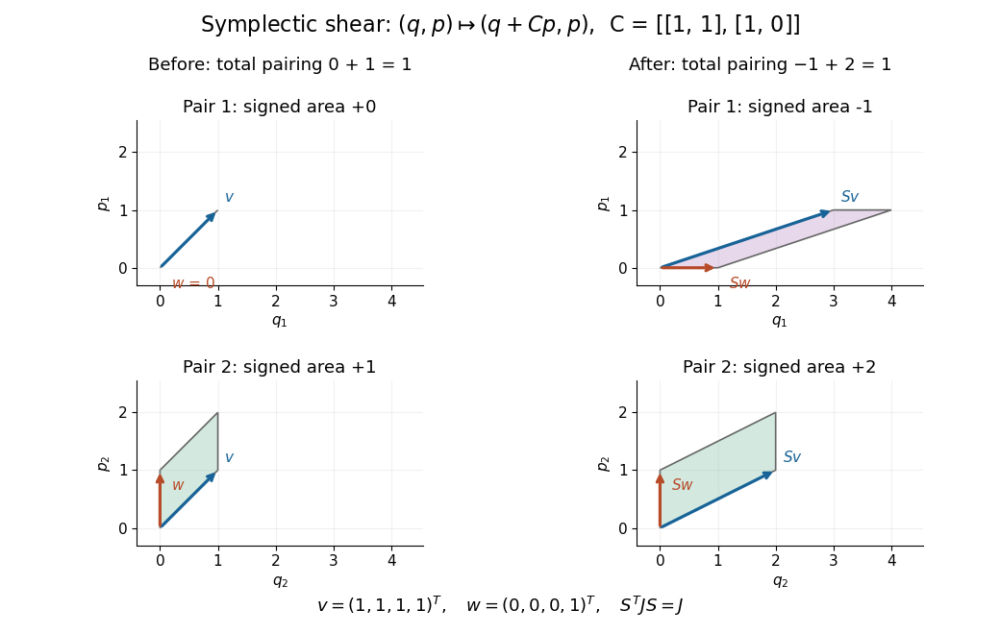

# Four-dimensional symplectic basis change

↑ **Parent:** [Symplectic basis](symplectic-basis.md)

On $K^4$, use the [standard basis](standard-basis.md) $\mathcal U=(u_1,u_2,u_3,u_4)$ and the [alternating bilinear form](alternating-bilinear-form.md) with [matrix](matrix.md) $J$ above for $n=2$. A second [symplectic basis](symplectic-basis.md) is

$$
e_1=u_1,\quad e_2=u_2,\quad
f_1=u_1+u_2+u_3,\quad f_2=u_1+u_4.
$$

For instance, $\omega(f_1,f_2)=1-1=0$, while $\omega(e_1,f_1)=\omega(e_2,f_2)=1$ and the cross-pairings vanish. The [change of basis](change-of-basis.md) [matrix](matrix.md), whose columns are these new [basis vectors](basis-vector.md) in $\mathcal U$, is

$$
S=\begin{pmatrix}
1&0&1&1\\
0&1&1&0\\
0&0&1&0\\
0&0&0&1
\end{pmatrix}
=\begin{pmatrix}I_2&C\\0&I_2\end{pmatrix},\qquad
C=\begin{pmatrix}1&1\\1&0\end{pmatrix}.
$$

The [symmetric matrix](symmetric-matrix.md) $C$ makes $S^TJS=J$, so $S$ is a [symplectic matrix](symplectic-matrix.md). Explicitly, multiplying the blocks gives a lower-right block $C^T-C=0$; the other blocks agree with $J$. For a fixed [vector](vector.md), [change of basis](change-of-basis.md) means $[v]_{\mathcal U}=S[v]_{\mathcal B}$, hence

$$
[v]_{\mathcal U}=(3,2,1,1)^T\quad\Longleftrightarrow\quad
[v]_{\mathcal B}=(1,1,1,1)^T,\qquad
[w]_{\mathcal U}=(1,0,0,1)^T\quad\Longleftrightarrow\quad
[w]_{\mathcal B}=(0,0,0,1)^T.
$$

Their [symplectic form](symplectic-form.md) gives $3\cdot0+2\cdot1-1\cdot1-1\cdot0=1$ in $\mathcal U$, and $1\cdot0+1\cdot1-1\cdot0-1\cdot0=1$ in $\mathcal B$. The separate coordinate-plane contributions change, but their sum does not.

The same [matrix](matrix.md) also represents an active [symplectic linear map](symplectic-linear-map.md): keeping one [basis](basis.md) fixed, it sends $(q,p)$ to $(q+Cp,p)$. The following diagram shows this active interpretation over the [real numbers](real-number.md). Its preserved total pairing is precisely the test used for linear [canonical transformations](canonical-transformation.md).

**[Figure 8](#image-a-symplectic-shear-redistributes-projected-areas-while-preserving-their-sum). A symplectic shear redistributes projected areas while preserving their sum**. Before the map the two signed areas are zero and one; afterwards they are minus one and two. The block shear q maps to q plus Cp with symmetric C, so the total symplectic pairing remains one.

## ↑ Ancestors (9)

1. [Symplectic basis](symplectic-basis.md)
2. [Symplectic vector space](symplectic-vector-space.md)
3. [Nondegenerate bilinear form](nondegenerate-bilinear-form.md)
4. [Bilinear form](bilinear-form-split.md)
5. [Linear algebra](linear-algebra-split.md)
6. [Algebra](algebra-split.md)
7. [Area of mathematics](area-of-mathematics.md)
8. [Mathematics](mathematics-split.md)
9. [Codex Wiki](split.md)
