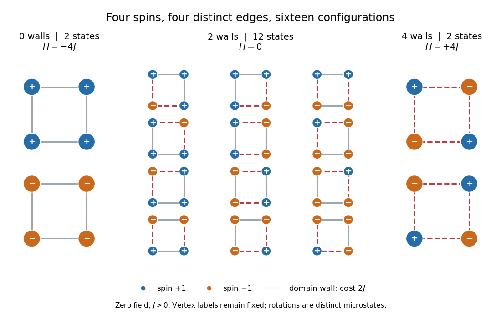

# Four-spin Ising ring

↑ **Parent:** [Ising model](ising-model.md)

Take a [cycle graph](cycle-graph.md) with four labeled [graph vertices](vertex-graph-theory.md) and four distinct [edges](edge-of-a-graph.md) $\{1,2\},\{2,3\},\{3,4\},\{4,1\}$. Set $h=0$, $J>0$, and impose [periodic boundary conditions](periodic-boundary-conditions.md) by writing $\sigma_5=\sigma_1$. The square drawing represents a one-dimensional ring: it has no diagonal interactions and is not a two-dimensional [lattice](lattice.md).

Call an [edge](edge-of-a-graph.md) between opposite [Ising spins](ising-spin-variable.md) a [domain wall](domain-wall.md). If $d$ is their number, the four bond products sum to $4-2d$, so the [energy](energy-split.md) is

$$
H=-4J+2Jd.
$$

Each [domain wall](domain-wall.md) costs $2J$ relative to an aligned bond. Returning around the ring must return to the starting [Ising spin](ising-spin-variable.md), so $d$ is even: equivalently, $\prod_{i=1}^{4}(\sigma_i\sigma_{i+1})=1$. Choosing an even set of $d$ wall [edges](edge-of-a-graph.md) and then choosing $\sigma_1$ determines the entire pattern. The [state degeneracy](state-degeneracy.md) is therefore $g_d=2\binom{4}{d}$, using a [binomial coefficient](binomial-coefficient-split.md).

| [Domain walls](domain-wall.md) $d$ | [State degeneracy](state-degeneracy.md) $g_d$ | [Energy](energy-split.md) $H$ | Total [Boltzmann factor](boltzmann-factor.md) weight |
| --- | --- | --- | --- |
| $0$ | $2$ | $-4J$ | $2e^{4\beta J}$ |
| $2$ | $12$ | $0$ | $12$ |
| $4$ | $2$ | $4J$ | $2e^{-4\beta J}$ |

The twelve middle [microstates](microstate.md) consist of eight patterns with one exceptional [Ising spin](ising-spin-variable.md) and four patterns with two adjacent $+1$ [Ising spins](ising-spin-variable.md) and two adjacent $-1$ [Ising spins](ising-spin-variable.md). The two alternating patterns have four [domain walls](domain-wall.md). All $2+12+2=16$ [microstates](microstate.md) are shown below.

**[Figure 3](#image-all-sixteen-configurations-of-the-four-spin-ising-ring-grouped-by-domain-walls-and-energy). All sixteen configurations of the four-spin Ising ring, grouped by domain walls and energy**. Original enumeration of the four distinct ring [edges](edge-of-a-graph.md). Blue vertices denote $+1$ [Ising spins](ising-spin-variable.md), orange vertices denote $-1$ [Ising spins](ising-spin-variable.md), and dashed red [edges](edge-of-a-graph.md) mark [domain walls](domain-wall.md). These are exact model configurations.

Writing $K=\beta J$, the [partition function](canonical-partition-function.md) and the [probability](probability.md) of each [energy](energy-split.md) class are

$$
Z=2e^{4K}+12+2e^{-4K}=4\cosh(4K)+12,\qquad
P(d)=\frac{g_de^{K(4-2d)}}{Z}.
$$

For an original exact example, choose $K=(\ln2)/4$. Then $e^{4K}=2$, $Z=17$, and $P(d=0)=4/17$, $P(d=2)=12/17$, $P(d=4)=1/17$. Each aligned [microstate](microstate.md) has [probability](probability.md) $2/17$, each middle [microstate](microstate.md) $1/17$, and each alternating [microstate](microstate.md) $1/34$: multiply by [state degeneracy](state-degeneracy.md) before comparing whole classes. As $K\to0$, all sixteen [microstates](microstate.md) become equally likely, but the class [probabilities](probability.md) approach $1/8,3/4,1/8$. As $K\to\infty$, the two all-aligned [microstates](microstate.md) each have limiting [probability](probability.md) $1/2$.

**Table of contents**

- [Ising ring bond correlation](ising-ring-bond-correlation.md)
- [Ising ring magnetization fluctuations](ising-ring-magnetization-fluctuations.md)

## ↑ Ancestors (6)

1. [Ising model](ising-model.md)
2. [Spin model](spin-model-split.md)
3. [Statistical physics](statistical-physics-split.md)
4. [Branches of physics](branches-of-physics.md)
5. [Physics](physics-split.md)
6. [Codex Wiki](split.md)

## ← Incoming links (3)

- [Ising model](ising-model.md)
- [Ising ring bond correlation](ising-ring-bond-correlation.md)
- [Ising ring magnetization fluctuations](ising-ring-magnetization-fluctuations.md)
