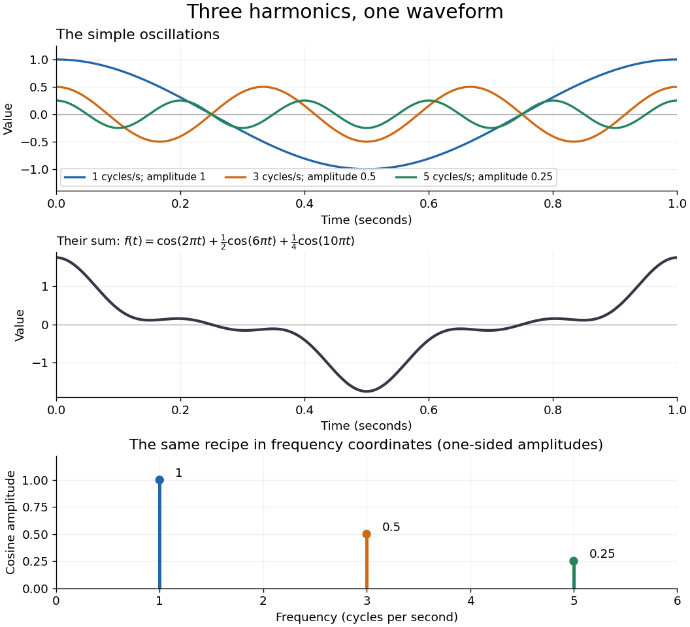

# Fourier analysis

↑ **Parent:** [Analysis](analysis-split.md)  
ⓦ [Wiki](https://en.wikipedia.org/wiki/Fourier_analysis)

[Fourier analysis](fourier-analysis-split.md) describes a [function](function-split.md) by the [oscillations](oscillation.md) that compose it. A graph records values at successive positions or times; a [frequency spectrum](frequency-spectrum.md) records how much of each [frequency](frequency.md) is present, together with its [wave phase](phase-waves.md). The same complicated shape can become a short list of simple components. For [periodic functions](periodic-function.md), the components form a [Fourier series](fourier-series-split.md); on the whole real line, the [Fourier transform](fourier-transform.md) uses a continuous range of [frequencies](frequency.md), and the [Fourier inversion theorem](fourier-inversion-theorem.md) puts them back together.

For a concrete example, consider the [trigonometric polynomial](trigonometric-polynomial.md)

$$
f(t)=\cos(2\pi t)+\frac12\cos(6\pi t)+\frac14\cos(10\pi t).
$$

With $t$ measured in seconds, its three [Fourier harmonics](fourier-harmonic.md) have [frequencies](frequency.md) $1$, $3$, and $5$ cycles per second and [amplitudes](wave-amplitude.md) $1$, $1/2$, and $1/4$. Each [cosine](cosine.md) has zero [wave phase](phase-waves.md). Adding them creates the sharper peaks in the figure. The [frequency spectrum](frequency-spectrum.md) makes the recipe immediately visible; changing an [amplitude](wave-amplitude.md) changes the shape without changing the component's [frequency](frequency.md). [Fourier orthogonality](fourier-orthogonality.md) lets us recover each [Fourier coefficient](fourier-coefficient.md) by averaging against the corresponding [sine](sine.md) or [cosine](cosine.md), because the other [Fourier harmonics](fourier-harmonic.md) cancel over a full [period of a function](period-of-a-function.md).

**[Figure 1](#image-three-fourier-harmonics-their-sum-and-their-amplitude-spectrum). Three Fourier harmonics, their sum, and their amplitude spectrum**.

The deeper reason these components are so useful is that they simplify operations. By [Euler's formula](euler-s-formula.md), the [exponential function](exponential-function.md) $e^{i\omega x}$ packages a [cosine](cosine.md) and a [sine](sine.md) into one [Fourier mode](fourier-mode.md). A [translation](translation-geometry.md) or a [derivative](derivative.md) changes only its multiplier:

$$
e^{i\omega(x-a)}=e^{-i\omega a}e^{i\omega x},\qquad \frac{d}{dx}e^{i\omega x}=i\omega e^{i\omega x}.
$$

Thus [Fourier modes](fourier-mode.md) are simultaneous [eigenfunctions](eigenfunction.md) of these operations. In [Fourier series](fourier-series-split.md), this gives a literal [diagonalization](diagonalization-of-a-matrix.md) in the [Fourier basis](fourier-basis.md); on the real line, the [Fourier transform](fourier-transform.md) gives the continuous counterpart, with each [frequency](frequency.md) handled separately. The [Translation property of the Fourier transform](translation-property-of-the-fourier-transform.md) and the [Fourier transform of a derivative](fourier-transform-of-a-derivative.md) turn shifting and differentiating a whole [function](function-split.md) into multiplication of its [Fourier transform](fourier-transform.md). A [convolution](convolution.md) likewise becomes multiplication by the [convolution theorem](convolution-theorem.md). This is beautiful because one description simplifies several apparently different operations at once.

For example, the [heat equation](heat-equation.md) $u_t=\kappa u_{xx}$, with [thermal diffusivity](thermal-diffusivity.md) $\kappa>0$, evolves a spatial [Fourier mode](fourier-mode.md) as

$$
u(x,t)=A e^{-\kappa\omega^2t}e^{i\omega x}.
$$

Fine ripples have larger [angular frequencies](angular-frequency.md) and decay faster: the formula explains why heating smooths a jagged temperature profile. For a general initial profile with sufficient regularity, the [Fourier transform](fourier-transform.md) gives $\widehat u(\omega,t)=e^{-\kappa\omega^2t}\widehat u(\omega,0)$, and [Fourier inversion](fourier-inversion-theorem.md) recovers the temperature. Similarly, multiplying selected parts of a [frequency spectrum](frequency-spectrum.md) suppresses unwanted components. Claude E. Shannon's _Communication in the Presence of Noise_ (1949), Section III, describes ideal filtering as a projection that retains some [frequency](frequency.md) coordinates and removes others.[Shannon 1949, Section III, p. 13: filtering in frequency coordinates](https://fab.cba.mit.edu/classes/S62.12/docs/Shannon_noise.pdf)

The physical motivation is already visible in Joseph Fourier's _Théorie analytique de la chaleur_ (1822). Chapter III constructs heat profiles using sums of [sines](sine.md) and [cosines](cosine.md); Chapter IX, articles 355–359, passes from [Fourier series](fourier-series-split.md) to [integrals](integral.md) as the spatial interval becomes unbounded. These heat problems explain the motivation for the discrete and continuous descriptions. Their modern formulations specify which [functions](function-split.md) admit reconstruction and in what sense the expansions converge.[Fourier 1822, Chapter III: trigonometric representations of heat profiles](https://fr.wikisource.org/wiki/Th%C3%A9orie_analytique_de_la_chaleur/Chapitre_3)[Fourier 1822, Chapter IX, articles 355–359: from series to integrals](https://fr.wikisource.org/wiki/Th%C3%A9orie_analytique_de_la_chaleur/Chapitre_9)

**Table of contents**

- [Frequency spectrum](frequency-spectrum.md)
- [Spatial frequency](spatial-frequency.md)
- [Nyquist–Shannon sampling theorem](nyquist-shannon-sampling-theorem.md)
  - [Aliasing](aliasing.md)
  - [Strictly supercritical sampling alias counterexample](strictly-supercritical-sampling-alias-counterexample.md)
  - [Sampling expansion by periodic Fourier projection](sampling-expansion-by-periodic-fourier-projection.md)
  - [Nyquist spatial frequency](nyquist-spatial-frequency.md)
- [Euclidean lattice](euclidean-lattice.md)
  - [Lenstra-Lenstra-Lovász lattice basis reduction algorithm](lenstra-lenstra-lovasz-lattice-basis-reduction-algorithm.md)
  - [Complex lattice](complex-lattice.md)
    - [Homothety of complex lattices](homothety-of-complex-lattices.md)
  - [Tetracode length-isospectral lattice construction](tetracode-length-isospectral-lattice-construction.md)
    - [Rationally independent axis weights obstruct a lattice isometry](rationally-independent-axis-weights-obstruct-a-lattice-isometry.md)
    - [Parity congruence description of tetracode lattices](parity-congruence-description-of-tetracode-lattices.md)
    - [Coordinate reflection bijection for tetracode lattices](coordinate-reflection-bijection-for-tetracode-lattices.md)
  - [Covolume](covolume.md)
  - [Shortest-independent-vector basis lemma](shortest-independent-vector-basis-lemma.md)
  - [Lattice-point asymptotics by fundamental cells](lattice-point-asymptotics-by-fundamental-cells.md)
  - [Dual lattice](dual-lattice.md)
    - [Characters of a real torus](characters-of-a-real-torus.md)
- [Poisson summation formula](poisson-summation-formula.md)
  - [Periodization of an integrable function](periodization-of-an-integrable-function.md)
  - [Periodization of a Schwartz function](periodization-of-a-schwartz-function.md)
  - [Poisson summation formula for a Euclidean lattice](poisson-summation-formula-for-a-euclidean-lattice.md)
- [Orthogonality of complex exponentials](orthogonality-of-complex-exponentials.md)
  - [Finite-interval Parseval identities](finite-interval-parseval-identities.md)
- [Wavelet](wavelet.md)
  - [Discrete wavelet transform](discrete-wavelet-transform.md)
  - [Wavelet series](wavelet-series.md)
  - [Tensor-product wavelet basis](tensor-product-wavelet-basis.md)
    - [Wavelet approximation across a curve](wavelet-approximation-across-a-curve.md)
    - [Tensor-product wavelet](tensor-product-wavelet.md)
  - [Interval-adapted wavelet basis](interval-adapted-wavelet-basis.md)
    - [Boundary wavelet](boundary-wavelet.md)
      - [Cohen-Daubechies-Vial interval wavelet construction](cohen-daubechies-vial-interval-wavelet-construction.md)
  - [Vanishing moment](vanishing-moment.md)
    - [Wavelet polynomial annihilation](wavelet-polynomial-annihilation.md)
    - [Second-difference analyzing function](second-difference-analyzing-function.md)
    - [Jump response of a localized analyzing function](jump-response-of-a-localized-analyzing-function.md)
    - [Vanishing moments and Fourier zeros](vanishing-moments-and-fourier-zeros.md)
    - [Smooth-mask vanishing-moment criterion](smooth-mask-vanishing-moment-criterion.md)
      - [Integer-frequency zeros of a scaling function](integer-frequency-zeros-of-a-scaling-function.md)
  - [Orthonormal wavelet](orthonormal-wavelet.md)
    - [Daubechies wavelet](daubechies-wavelet.md)
    - [Haar wavelet](haar-wavelet.md)
      - [Uniform hard-threshold convergence of normalized Haar expansions](uniform-hard-threshold-convergence-of-normalized-haar-expansions.md)
        - [Geometric bound for omitted Haar details](geometric-bound-for-omitted-haar-details.md)
      - [Haar refinement identity](haar-refinement-identity.md)
      - [Haar projection](haar-projection.md)
        - [Haar projection error for a Lipschitz function](haar-projection-error-for-a-lipschitz-function.md)
        - [Haar approximation error for a function of bounded variation](haar-approximation-error-for-a-function-of-bounded-variation.md)
        - [Haar projection estimator in Gaussian white noise](haar-projection-estimator-in-gaussian-white-noise.md)
          - [Supremum norm risk of a Haar projection estimator](supremum-norm-risk-of-a-haar-projection-estimator.md)
      - [Haar scaling function](haar-scaling-function.md)
  - [Multiresolution analysis](multiresolution-analysis.md)
    - [Wavelet approximation complexity](wavelet-approximation-complexity.md)
    - [Wavelet projection](wavelet-projection.md)
    - [Scaling function](scaling-function.md)
      - [Complementary transition bands for a scaling function](complementary-transition-bands-for-a-scaling-function.md)
      - [Orthonormal translates and Fourier periodization](orthonormal-translates-and-fourier-periodization.md)
      - [Periodic phase change of a scaling function](periodic-phase-change-of-a-scaling-function.md)
        - [Lacunary scaling-phase regularity counterexample](lacunary-scaling-phase-regularity-counterexample.md)
      - [Scaling refinement equation](scaling-refinement-equation.md)
        - [Low-pass filter of a multiresolution analysis](low-pass-filter-of-a-multiresolution-analysis.md)
        - [Quadrature mirror filter](quadrature-mirror-filter.md)
          - [Wavelet completion of a multiresolution filter](wavelet-completion-of-a-multiresolution-filter.md)
      - [MRA projection Fourier identity](mra-projection-fourier-identity.md)
    - [Meyer-Mallat theorem](meyer-mallat-theorem.md)
    - [Shannon scaling function](shannon-scaling-function.md)
      - [Shannon scaling mask](shannon-scaling-mask.md)
- [Fourier mode](fourier-mode.md)
- [Schwartz space](schwartz-space.md)
  - [Schwartz seminorm](schwartz-seminorm.md)
  - [Schwartz-Bruhat space](schwartz-bruhat-space.md)
    - [Schwartz-Bruhat function](schwartz-bruhat-function.md)
  - [Schwartz function](schwartz-function.md)
  - [Tempered distribution](tempered-distribution.md)
    - [Convolution of a tempered distribution with a Schwartz function](convolution-of-a-tempered-distribution-with-a-schwartz-function.md)
    - [Radial tempered distribution](radial-tempered-distribution.md)
      - [Radial Schwartz approximation of tempered distributions](radial-schwartz-approximation-of-tempered-distributions.md)
    - [Weak convergence of tempered distributions](weak-convergence-of-tempered-distributions.md)
    - [Fourier transform of a tempered distribution](fourier-transform-of-a-tempered-distribution.md)
      - [Fourier transform of the absolute logarithm](fourier-transform-of-the-absolute-logarithm.md)
      - [Fourier transform of the Heaviside step function](fourier-transform-of-the-heaviside-step-function.md)
      - [Principal-value Fourier transform of a real pole](principal-value-fourier-transform-of-a-real-pole.md)
      - [Rotation equivariance of the Fourier transform](rotation-equivariance-of-the-fourier-transform.md)
      - [Fourier derivative identities for distributions](fourier-derivative-identities-for-distributions.md)
      - [Fourier transform of the logarithm of one plus x squared](fourier-transform-of-the-logarithm-of-one-plus-x-squared.md)
    - [Positive distribution](positive-distribution.md)
- [Fourier inversion theorem](fourier-inversion-theorem.md)
  - [Continuous version of Fourier inversion](continuous-version-of-fourier-inversion.md)
  - [Fourier transform of a derivative](fourier-transform-of-a-derivative.md)
  - [Inverse Fourier transforms of phase factors](inverse-fourier-transforms-of-phase-factors.md)
  - [Translation property of the Fourier transform](translation-property-of-the-fourier-transform.md)
- [Fourier transform of a triangular function](fourier-transform-of-a-triangular-function.md)
  - [Triangular function](triangular-function.md)
  - [Squared sinc function](squared-sinc-function.md)
  - [Triangular frequency cutoff](triangular-frequency-cutoff.md)
    - [Positive-Fourier-transform L1 bound](positive-fourier-transform-l1-bound.md)
- [Convolution](convolution.md)
  - [Convolution kernel](convolution-kernel.md)
  - [Hörmander integral kernel condition](hormander-integral-kernel-condition.md)
    - [Annularly cancelling singular convolution kernel](annularly-cancelling-singular-convolution-kernel.md)
      - [Oscillatory tail estimate for a singular kernel](oscillatory-tail-estimate-for-a-singular-kernel.md)
    - [Calderón–Zygmund weak type criterion for convolution](calderon-zygmund-weak-type-criterion-for-convolution.md)
    - [Cancellation estimate outside a dilated cube](cancellation-estimate-outside-a-dilated-cube.md)
  - [Fourier decay of repeated interval convolutions](fourier-decay-of-repeated-interval-convolutions.md)
  - [Periodic convolution operator](periodic-convolution-operator.md)
    - [Admissible data for a periodic convolution inverse](admissible-data-for-a-periodic-convolution-inverse.md)
      - [High-frequency obstruction for nonperiodic exponential data](high-frequency-obstruction-for-nonperiodic-exponential-data.md)
  - [Convolution of distributions with a compactly supported factor](convolution-of-distributions-with-a-compactly-supported-factor.md)
  - [Differentiation commutes with convolution](differentiation-commutes-with-convolution.md)
  - [Smoothing convolution with a test function](smoothing-convolution-with-a-test-function.md)
  - [Convolution of L infinity and L1 functions](convolution-of-l-infinity-and-l1-functions.md)
    - [Steinhaus theorem](steinhaus-theorem.md)
      - [Difference-set overlap bound on an interval](difference-set-overlap-bound-on-an-interval.md)
  - [Approximate identity](approximate-identity.md)
    - [Mass normalization in mollified singular integrals](mass-normalization-in-mollified-singular-integrals.md)
    - [One-sided exponential approximate identity](one-sided-exponential-approximate-identity.md)
    - [Powered-cosine approximate identity on a torus](powered-cosine-approximate-identity-on-a-torus.md)
    - [Sinc approximate identity](sinc-approximate-identity.md)
      - [Sinc-squared summation of a sequence tending to zero](sinc-squared-summation-of-a-sequence-tending-to-zero.md)
    - [Cauchy approximate identity](cauchy-approximate-identity.md)
  - [Young's convolution inequality](young-s-convolution-inequality.md)
  - [Discrete convolution](discrete-convolution.md)
    - [Circular convolution](circular-convolution.md)
    - [Zero padding](zero-padding.md)
  - [Convolution theorem](convolution-theorem.md)
    - [Exponential kernel convolved with an interval indicator](exponential-kernel-convolved-with-an-interval-indicator.md)
    - [Gamma density from repeated exponential convolution](gamma-density-from-repeated-exponential-convolution.md)
- [Riemann-Lebesgue lemma](riemann-lebesgue-lemma.md)
  - [Arbitrarily slow Fourier coefficient decay](arbitrarily-slow-fourier-coefficient-decay.md)
  - [Step-function proof of the Riemann-Lebesgue lemma](step-function-proof-of-the-riemann-lebesgue-lemma.md)
  - [Weakly null sine sequence in L1](weakly-null-sine-sequence-in-l1.md)
  - [Radial power integrability criterion](radial-power-integrability-criterion.md)
  - [Interpolation between L2 and Linfinity by a pointwise bound](interpolation-between-l2-and-linfinity-by-a-pointwise-bound.md)
- [Dirichlet integral](dirichlet-integral.md)
- [Plancherel theorem](plancherel-theorem.md)
  - [Orthogonality of integer translates](orthogonality-of-integer-translates.md)
  - [Plancherel theorem for locally compact abelian groups](plancherel-theorem-for-locally-compact-abelian-groups.md)
  - [L2 density from a square-integrable Fourier transform](l2-density-from-a-square-integrable-fourier-transform.md)
- [Parseval identity](parseval-identity.md)
  - [Even rational Parseval integral](even-rational-parseval-integral.md)
- [Fourier transform of a Gaussian](fourier-transform-of-a-gaussian.md)
  - [Complex Gaussian Fourier transform](complex-gaussian-fourier-transform.md)
- [Khintchine inequality](khintchine-inequality.md)
  - [Kahane-Khintchine inequality](kahane-khintchine-inequality.md)
    - [Sharp Rademacher second-moment inequality](sharp-rademacher-second-moment-inequality.md)
- [Fourier restriction theory](fourier-restriction-theory.md)
  - [Discrete paraboloid](discrete-paraboloid.md)
    - [Isotropic-line obstruction to finite-field restriction](isotropic-line-obstruction-to-finite-field-restriction.md)
    - [Finite-field paraboloid fourth-moment extension estimate](finite-field-paraboloid-fourth-moment-extension-estimate.md)
  - [Restriction-to-rectangle overlap principle](restriction-to-rectangle-overlap-principle.md)
  - [Fourier extension operator](fourier-extension-operator.md)
    - [Gaussian positivity for even extension moments](gaussian-positivity-for-even-extension-moments.md)
    - [Circle cap Fourier lower bound](circle-cap-fourier-lower-bound.md)
    - [Fourier extension estimate](fourier-extension-estimate.md)
      - [Local fourth-moment restriction estimate for the circle](local-fourth-moment-restriction-estimate-for-the-circle.md)
  - [Decoupling inequality](decoupling-inequality.md)
    - [Decoupling inequality for the parabola](decoupling-inequality-for-the-parabola.md)
    - [Fourier-support almost orthogonality](fourier-support-almost-orthogonality.md)
  - [Local constancy principle](local-constancy-principle.md)
  - [Constructive interference](constructive-interference.md)
  - [Kakeya inequality](kakeya-inequality.md)
    - [Kakeya maximal function](kakeya-maximal-function.md)
      - [Kakeya maximal conjecture](kakeya-maximal-conjecture.md)
        - [Planar Kakeya maximal estimate](planar-kakeya-maximal-estimate.md)
          - [Planar Kakeya neighborhood lower bound](planar-kakeya-neighborhood-lower-bound.md)
    - [Trilinear Kakeya inequality in three dimensions](trilinear-kakeya-inequality-in-three-dimensions.md)
  - [Moment curve](moment-curve.md)
    - [Cubic moment curve](cubic-moment-curve.md)

## ↑ Ancestors (4)

1. [Analysis](analysis-split.md)
2. [Area of mathematics](area-of-mathematics.md)
3. [Mathematics](mathematics-split.md)
4. [Codex Wiki](split.md)

## ← Incoming links (8)

- [Cooley-Tukey FFT algorithm](cooley-tukey-fft-algorithm.md)
- [Euler's formula](euler-s-formula.md)
- [Fourier analysis](fourier-analysis-split.md)
- [Group velocity](group-velocity.md)
- [Solution](past-exam-of-the-mathematics-course-of-the-university-of-cambridge/2013/iii/paper-63/6/solution.md)
- [Solution](past-exam-of-the-mathematics-course-of-the-university-of-cambridge/2014/iii/paper-24/5/solution.md)
- [Signal processing](signal-processing.md)
- [Symmetry of the first-order monochromatic alpha tensor](symmetry-of-the-first-order-monochromatic-alpha-tensor.md)
