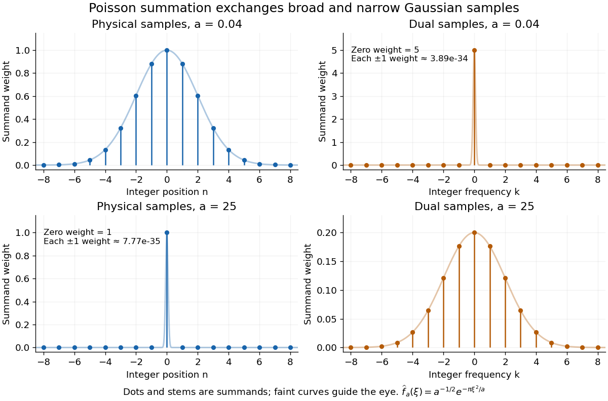
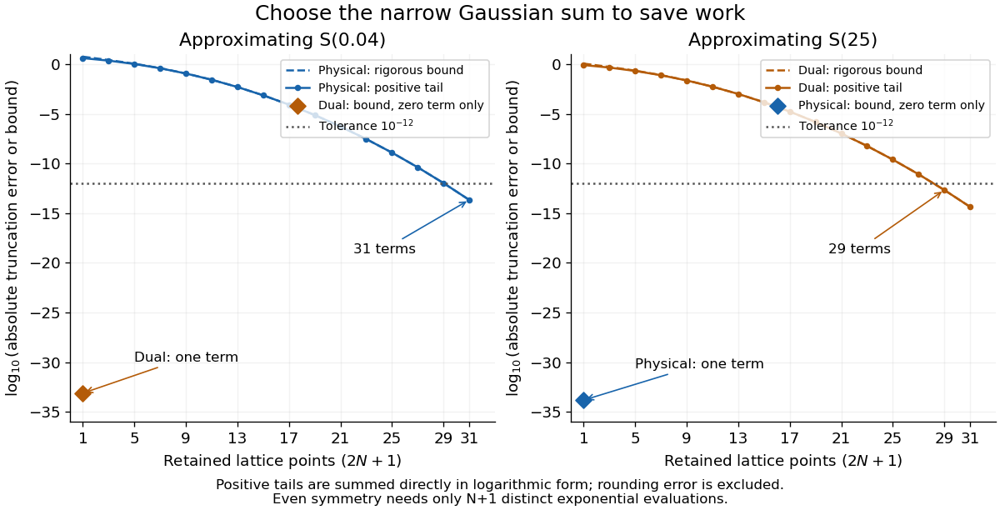
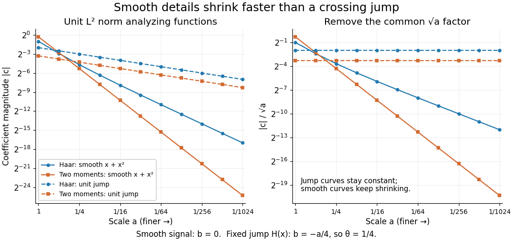

# Fourier analysis

↑ **Parent:** [Analysis](analysis.md)  
ⓦ [Wiki](https://en.wikipedia.org/wiki/Fourier_analysis)

[Fourier analysis](fourier-analysis.md) describes a [function](function.md) by the [oscillations](wave.md#oscillation) that compose it. A graph records values at successive positions or times; a [frequency spectrum](#frequency-spectrum) records how much of each [frequency](wave.md#frequency) is present, together with its [wave phase](wave.md#phase-waves). The same complicated shape can become a short list of simple components. For [periodic functions](function.md#periodic-function), the components form a [Fourier series](fourier-series.md); on the whole real line, the [Fourier transform](fourier-transform.md) uses a continuous range of [frequencies](wave.md#frequency), and the [Fourier inversion theorem](#fourier-inversion-theorem) puts them back together.

For a concrete example, consider the [trigonometric polynomial](fourier-series.md#trigonometric-polynomial)

$$
f(t)=\cos(2\pi t)+\frac12\cos(6\pi t)+\frac14\cos(10\pi t).
$$

With $t$ measured in seconds, its three [Fourier harmonics](fourier-series.md#fourier-harmonic) have [frequencies](wave.md#frequency) $1$, $3$, and $5$ cycles per second and [amplitudes](wave.md#wave-amplitude) $1$, $1/2$, and $1/4$. Each [cosine](geometry-and-topology.md#cosine) has zero [wave phase](wave.md#phase-waves). Adding them creates the sharper peaks in the figure. The [frequency spectrum](#frequency-spectrum) makes the recipe immediately visible; changing an [amplitude](wave.md#wave-amplitude) changes the shape without changing the component's [frequency](wave.md#frequency). [Fourier orthogonality](fourier-series.md#fourier-orthogonality) lets us recover each [Fourier coefficient](fourier-series.md#fourier-coefficient) by averaging against the corresponding [sine](geometry-and-topology.md#sine) or [cosine](geometry-and-topology.md#cosine), because the other [Fourier harmonics](fourier-series.md#fourier-harmonic) cancel over a full [period of a function](mathematics.md#period-of-a-function).

**[Figure 1](#image-three-fourier-harmonics-their-sum-and-their-amplitude-spectrum). Three Fourier harmonics, their sum, and their amplitude spectrum**.

The deeper reason these components are so useful is that they simplify operations. By [Euler's formula](complex-analysis.md#euler-s-formula), the [exponential function](calculus.md#exponential-function) $e^{i\omega x}$ packages a [cosine](geometry-and-topology.md#cosine) and a [sine](geometry-and-topology.md#sine) into one [Fourier mode](#fourier-mode). A [translation](geometry-and-topology.md#translation-geometry) or a [derivative](calculus.md#derivative) changes only its multiplier:

$$
e^{i\omega(x-a)}=e^{-i\omega a}e^{i\omega x},\qquad \frac{d}{dx}e^{i\omega x}=i\omega e^{i\omega x}.
$$

Thus [Fourier modes](#fourier-mode) are simultaneous [eigenfunctions](linear-operator-theory.md#eigenfunction) of these operations. In [Fourier series](fourier-series.md), this gives a literal [diagonalization](linear-operator-theory.md#diagonalization-of-a-matrix) in the [Fourier basis](fourier-series.md#fourier-basis); on the real line, the [Fourier transform](fourier-transform.md) gives the continuous counterpart, with each [frequency](wave.md#frequency) handled separately. The [Translation property of the Fourier transform](#translation-property-of-the-fourier-transform) and the [Fourier transform of a derivative](#fourier-transform-of-a-derivative) turn shifting and differentiating a whole [function](function.md) into multiplication of its [Fourier transform](fourier-transform.md). A [convolution](#convolution) likewise becomes multiplication by the [convolution theorem](#convolution-theorem). This is beautiful because one description simplifies several apparently different operations at once.

For example, the [heat equation](diffusion-equation.md#heat-equation) $u_t=\kappa u_{xx}$, with [thermal diffusivity](heat.md#thermal-diffusivity) $\kappa>0$, evolves a spatial [Fourier mode](#fourier-mode) as

$$
u(x,t)=A e^{-\kappa\omega^2t}e^{i\omega x}.
$$

Fine ripples have larger [angular frequencies](lagrangian-mechanics.md#angular-frequency) and decay faster: the formula explains why heating smooths a jagged temperature profile. For a general initial profile with sufficient regularity, the [Fourier transform](fourier-transform.md) gives $\widehat u(\omega,t)=e^{-\kappa\omega^2t}\widehat u(\omega,0)$, and [Fourier inversion](#fourier-inversion-theorem) recovers the temperature. Similarly, multiplying selected parts of a [frequency spectrum](#frequency-spectrum) suppresses unwanted components. Claude E. Shannon's _Communication in the Presence of Noise_ (1949), Section III, describes ideal filtering as a projection that retains some [frequency](wave.md#frequency) coordinates and removes others.[Shannon 1949, Section III, p. 13: filtering in frequency coordinates](https://fab.cba.mit.edu/classes/S62.12/docs/Shannon_noise.pdf)

The physical motivation is already visible in Joseph Fourier's _Théorie analytique de la chaleur_ (1822). Chapter III constructs heat profiles using sums of [sines](geometry-and-topology.md#sine) and [cosines](geometry-and-topology.md#cosine); Chapter IX, articles 355–359, passes from [Fourier series](fourier-series.md) to [integrals](integral.md) as the spatial interval becomes unbounded. These heat problems explain the motivation for the discrete and continuous descriptions. Their modern formulations specify which [functions](function.md) admit reconstruction and in what sense the expansions converge.[Fourier 1822, Chapter III: trigonometric representations of heat profiles](https://fr.wikisource.org/wiki/Th%C3%A9orie_analytique_de_la_chaleur/Chapitre_3)[Fourier 1822, Chapter IX, articles 355–359: from series to integrals](https://fr.wikisource.org/wiki/Th%C3%A9orie_analytique_de_la_chaleur/Chapitre_9)

**Table of contents**

- [Infrared cutoff](#infrared-cutoff)
- [Fourier shell correlation](#fourier-shell-correlation)
- [Cross-correlation](#cross-correlation)
  - [Correlator](#correlator)
  - [Autocorrelation of a square-integrable function](#autocorrelation-of-a-square-integrable-function)
- [Wiener-Khinchin theorem](#wiener-khinchin-theorem)
- [Frequency spectrum](#frequency-spectrum)
  - [Spectrogram](#spectrogram)
- [Spatial frequency](#spatial-frequency)
- [Nyquist–Shannon sampling theorem](#nyquist-shannon-sampling-theorem)
  - [Nyquist frequency](#nyquist-frequency)
  - [Aliasing](#aliasing)
    - [Anti-aliasing filter](#anti-aliasing-filter)
  - [Strictly supercritical sampling alias counterexample](#strictly-supercritical-sampling-alias-counterexample)
  - [Sampling expansion by periodic Fourier projection](#sampling-expansion-by-periodic-fourier-projection)
  - [Nyquist spatial frequency](#nyquist-spatial-frequency)
- [Euclidean lattice](#euclidean-lattice)
  - [Lattice reduction](#lattice-reduction)
    - [Lagrange lattice reduction](#lagrange-lattice-reduction)
  - [Lenstra-Lenstra-Lovász lattice basis reduction algorithm](#lenstra-lenstra-lovasz-lattice-basis-reduction-algorithm)
  - [Complex lattice](#complex-lattice)
    - [Homothety of complex lattices](#homothety-of-complex-lattices)
  - [Tetracode length-isospectral lattice construction](#tetracode-length-isospectral-lattice-construction)
    - [Rationally independent axis weights obstruct a lattice isometry](#rationally-independent-axis-weights-obstruct-a-lattice-isometry)
    - [Parity congruence description of tetracode lattices](#parity-congruence-description-of-tetracode-lattices)
    - [Coordinate reflection bijection for tetracode lattices](#coordinate-reflection-bijection-for-tetracode-lattices)
  - [Covolume](#covolume)
  - [Shortest-independent-vector basis lemma](#shortest-independent-vector-basis-lemma)
  - [Lattice-point asymptotics by fundamental cells](#lattice-point-asymptotics-by-fundamental-cells)
  - [Dual lattice](#dual-lattice)
    - [Characters of a real torus](#characters-of-a-real-torus)
- [Poisson summation formula](#poisson-summation-formula)
  - [Gaussian Poisson summation identity](#gaussian-poisson-summation-identity)
    - [Gaussian sum truncation bound](#gaussian-sum-truncation-bound)
  - [Periodization of an integrable function](#periodization-of-an-integrable-function)
  - [Periodization of a Schwartz function](#periodization-of-a-schwartz-function)
  - [Poisson summation formula for a Euclidean lattice](#poisson-summation-formula-for-a-euclidean-lattice)
- [Orthogonality of complex exponentials](#orthogonality-of-complex-exponentials)
  - [Finite-interval Parseval identities](#finite-interval-parseval-identities)
- [Wavelet](#wavelet)
  - [Discrete wavelet transform](#discrete-wavelet-transform)
  - [Wavelet series](#wavelet-series)
  - [Tensor-product wavelet basis](#tensor-product-wavelet-basis)
    - [Wavelet approximation across a curve](#wavelet-approximation-across-a-curve)
    - [Tensor-product wavelet](#tensor-product-wavelet)
  - [Interval-adapted wavelet basis](#interval-adapted-wavelet-basis)
    - [Boundary wavelet](#boundary-wavelet)
      - [Cohen-Daubechies-Vial interval wavelet construction](#cohen-daubechies-vial-interval-wavelet-construction)
  - [Vanishing moment](#vanishing-moment)
    - [Wavelet polynomial annihilation](#wavelet-polynomial-annihilation)
    - [Second-difference analyzing function](#second-difference-analyzing-function)
    - [Jump response of a localized analyzing function](#jump-response-of-a-localized-analyzing-function)
    - [Vanishing moments and Fourier zeros](#vanishing-moments-and-fourier-zeros)
    - [Smooth-mask vanishing-moment criterion](#smooth-mask-vanishing-moment-criterion)
      - [Integer-frequency zeros of a scaling function](#integer-frequency-zeros-of-a-scaling-function)
  - [Orthonormal wavelet](#orthonormal-wavelet)
    - [Daubechies wavelet](#daubechies-wavelet)
    - [Haar wavelet](#haar-wavelet)
      - [Uniform hard-threshold convergence of normalized Haar expansions](#uniform-hard-threshold-convergence-of-normalized-haar-expansions)
        - [Geometric bound for omitted Haar details](#geometric-bound-for-omitted-haar-details)
      - [Haar refinement identity](#haar-refinement-identity)
      - [Haar projection](#haar-projection)
        - [Haar projection error for a Lipschitz function](#haar-projection-error-for-a-lipschitz-function)
        - [Haar approximation error for a function of bounded variation](#haar-approximation-error-for-a-function-of-bounded-variation)
        - [Haar projection estimator in Gaussian white noise](#haar-projection-estimator-in-gaussian-white-noise)
          - [Supremum norm risk of a Haar projection estimator](#supremum-norm-risk-of-a-haar-projection-estimator)
      - [Haar scaling function](#haar-scaling-function)
  - [Multiresolution analysis](#multiresolution-analysis)
    - [Wavelet approximation complexity](#wavelet-approximation-complexity)
    - [Wavelet projection](#wavelet-projection)
    - [Scaling function](#scaling-function)
      - [Complementary transition bands for a scaling function](#complementary-transition-bands-for-a-scaling-function)
      - [Orthonormal translates and Fourier periodization](#orthonormal-translates-and-fourier-periodization)
      - [Periodic phase change of a scaling function](#periodic-phase-change-of-a-scaling-function)
        - [Lacunary scaling-phase regularity counterexample](#lacunary-scaling-phase-regularity-counterexample)
      - [Scaling refinement equation](#scaling-refinement-equation)
        - [Low-pass filter of a multiresolution analysis](#low-pass-filter-of-a-multiresolution-analysis)
        - [Quadrature mirror filter](#quadrature-mirror-filter)
          - [Wavelet completion of a multiresolution filter](#wavelet-completion-of-a-multiresolution-filter)
      - [MRA projection Fourier identity](#mra-projection-fourier-identity)
    - [Meyer-Mallat theorem](#meyer-mallat-theorem)
    - [Shannon scaling function](#shannon-scaling-function)
      - [Shannon scaling mask](#shannon-scaling-mask)
- [Fourier mode](#fourier-mode)
- [Schwartz space](#schwartz-space)
  - [Schwartz seminorm](#schwartz-seminorm)
  - [Schwartz-Bruhat space](#schwartz-bruhat-space)
    - [Schwartz-Bruhat function](#schwartz-bruhat-function)
  - [Schwartz function](#schwartz-function)
  - [Tempered distribution](#tempered-distribution)
    - [Convolution of a tempered distribution with a Schwartz function](#convolution-of-a-tempered-distribution-with-a-schwartz-function)
    - [Radial tempered distribution](#radial-tempered-distribution)
      - [Radial Schwartz approximation of tempered distributions](#radial-schwartz-approximation-of-tempered-distributions)
    - [Weak convergence of tempered distributions](#weak-convergence-of-tempered-distributions)
    - [Fourier transform of a tempered distribution](#fourier-transform-of-a-tempered-distribution)
      - [Fourier transform of the absolute logarithm](#fourier-transform-of-the-absolute-logarithm)
      - [Fourier transform of the Heaviside step function](#fourier-transform-of-the-heaviside-step-function)
      - [Principal-value Fourier transform of a real pole](#principal-value-fourier-transform-of-a-real-pole)
      - [Rotation equivariance of the Fourier transform](#rotation-equivariance-of-the-fourier-transform)
      - [Fourier derivative identities for distributions](#fourier-derivative-identities-for-distributions)
      - [Fourier transform of the logarithm of one plus x squared](#fourier-transform-of-the-logarithm-of-one-plus-x-squared)
    - [Positive distribution](#positive-distribution)
- [Fourier inversion theorem](#fourier-inversion-theorem)
  - [Continuous version of Fourier inversion](#continuous-version-of-fourier-inversion)
  - [Fourier transform of a derivative](#fourier-transform-of-a-derivative)
  - [Inverse Fourier transforms of phase factors](#inverse-fourier-transforms-of-phase-factors)
  - [Translation property of the Fourier transform](#translation-property-of-the-fourier-transform)
- [Fourier transform of a triangular function](#fourier-transform-of-a-triangular-function)
  - [Triangular function](#triangular-function)
  - [Squared sinc function](#squared-sinc-function)
  - [Triangular frequency cutoff](#triangular-frequency-cutoff)
    - [Positive-Fourier-transform L1 bound](#positive-fourier-transform-l1-bound)
- [Convolution](#convolution)
  - [Deconvolution](#deconvolution)
    - [Regularized spectral deconvolution](#regularized-spectral-deconvolution)
  - [Box smoothing of a two-sided exponential](#box-smoothing-of-a-two-sided-exponential)
  - [Convolution kernel](#convolution-kernel)
  - [Hörmander integral kernel condition](#hormander-integral-kernel-condition)
    - [Annularly cancelling singular convolution kernel](#annularly-cancelling-singular-convolution-kernel)
      - [Oscillatory tail estimate for a singular kernel](#oscillatory-tail-estimate-for-a-singular-kernel)
    - [Calderón–Zygmund weak type criterion for convolution](#calderon-zygmund-weak-type-criterion-for-convolution)
    - [Cancellation estimate outside a dilated cube](#cancellation-estimate-outside-a-dilated-cube)
  - [Fourier decay of repeated interval convolutions](#fourier-decay-of-repeated-interval-convolutions)
  - [Periodic convolution operator](#periodic-convolution-operator)
    - [Admissible data for a periodic convolution inverse](#admissible-data-for-a-periodic-convolution-inverse)
      - [High-frequency obstruction for nonperiodic exponential data](#high-frequency-obstruction-for-nonperiodic-exponential-data)
  - [Convolution of distributions with a compactly supported factor](#convolution-of-distributions-with-a-compactly-supported-factor)
  - [Differentiation commutes with convolution](#differentiation-commutes-with-convolution)
  - [Smoothing convolution with a test function](#smoothing-convolution-with-a-test-function)
  - [Convolution of L infinity and L1 functions](#convolution-of-l-infinity-and-l1-functions)
    - [Steinhaus theorem](#steinhaus-theorem)
      - [Difference-set overlap bound on an interval](#difference-set-overlap-bound-on-an-interval)
  - [Approximate identity](#approximate-identity)
    - [Mass normalization in mollified singular integrals](#mass-normalization-in-mollified-singular-integrals)
    - [One-sided exponential approximate identity](#one-sided-exponential-approximate-identity)
    - [Powered-cosine approximate identity on a torus](#powered-cosine-approximate-identity-on-a-torus)
    - [Sinc approximate identity](#sinc-approximate-identity)
      - [Sinc-squared summation of a sequence tending to zero](#sinc-squared-summation-of-a-sequence-tending-to-zero)
    - [Cauchy approximate identity](#cauchy-approximate-identity)
  - [Young's convolution inequality](#young-s-convolution-inequality)
  - [Discrete convolution](#discrete-convolution)
    - [XOR convolution](#xor-convolution)
    - [Cyclic convolution](#cyclic-convolution)
    - [Circular convolution](#circular-convolution)
    - [Zero padding](#zero-padding)
  - [Convolution theorem](#convolution-theorem)
    - [Self-convolution of a bilateral exponential](#self-convolution-of-a-bilateral-exponential)
    - [Exponential kernel convolved with an interval indicator](#exponential-kernel-convolved-with-an-interval-indicator)
    - [Gamma density from repeated exponential convolution](#gamma-density-from-repeated-exponential-convolution)
- [Riemann-Lebesgue lemma](#riemann-lebesgue-lemma)
  - [Arbitrarily slow Fourier coefficient decay](#arbitrarily-slow-fourier-coefficient-decay)
  - [Step-function proof of the Riemann-Lebesgue lemma](#step-function-proof-of-the-riemann-lebesgue-lemma)
  - [Weakly null sine sequence in L1](#weakly-null-sine-sequence-in-l1)
  - [Radial power integrability criterion](#radial-power-integrability-criterion)
  - [Interpolation between L2 and Linfinity by a pointwise bound](#interpolation-between-l2-and-linfinity-by-a-pointwise-bound)
- [Dirichlet integral](#dirichlet-integral)
- [Plancherel theorem](#plancherel-theorem)
  - [Orthogonality of integer translates](#orthogonality-of-integer-translates)
  - [Plancherel theorem for locally compact abelian groups](#plancherel-theorem-for-locally-compact-abelian-groups)
  - [L2 density from a square-integrable Fourier transform](#l2-density-from-a-square-integrable-fourier-transform)
- [Parseval identity](#parseval-identity)
  - [Even rational Parseval integral](#even-rational-parseval-integral)
- [Fourier transform of a Gaussian](#fourier-transform-of-a-gaussian)
  - [Complex Gaussian Fourier transform](#complex-gaussian-fourier-transform)
- [Khintchine inequality](#khintchine-inequality)
  - [Kahane-Khintchine inequality](#kahane-khintchine-inequality)
    - [Sharp Rademacher second-moment inequality](#sharp-rademacher-second-moment-inequality)
- [Fourier restriction theory](#fourier-restriction-theory)
  - [Discrete paraboloid](#discrete-paraboloid)
    - [Isotropic-line obstruction to finite-field restriction](#isotropic-line-obstruction-to-finite-field-restriction)
    - [Finite-field paraboloid fourth-moment extension estimate](#finite-field-paraboloid-fourth-moment-extension-estimate)
  - [Restriction-to-rectangle overlap principle](#restriction-to-rectangle-overlap-principle)
  - [Fourier extension operator](#fourier-extension-operator)
    - [Gaussian positivity for even extension moments](#gaussian-positivity-for-even-extension-moments)
    - [Circle cap Fourier lower bound](#circle-cap-fourier-lower-bound)
    - [Fourier extension estimate](#fourier-extension-estimate)
      - [Local fourth-moment restriction estimate for the circle](#local-fourth-moment-restriction-estimate-for-the-circle)
  - [Decoupling inequality](#decoupling-inequality)
    - [Decoupling inequality for the parabola](#decoupling-inequality-for-the-parabola)
    - [Fourier-support almost orthogonality](#fourier-support-almost-orthogonality)
  - [Local constancy principle](#local-constancy-principle)
  - [Constructive interference](#constructive-interference)
  - [Kakeya inequality](#kakeya-inequality)
    - [Kakeya maximal function](#kakeya-maximal-function)
      - [Kakeya maximal conjecture](#kakeya-maximal-conjecture)
        - [Planar Kakeya maximal estimate](#planar-kakeya-maximal-estimate)
          - [Planar Kakeya neighborhood lower bound](#planar-kakeya-neighborhood-lower-bound)
    - [Trilinear Kakeya inequality in three dimensions](#trilinear-kakeya-inequality-in-three-dimensions)
  - [Moment curve](#moment-curve)
    - [Cubic moment curve](#cubic-moment-curve)

## Infrared cutoff

↑ **Parent:** [Fourier analysis](fourier-analysis.md)

A lower included [wavenumber](wave-equation.md#wavenumber). A finite periodic patch of size $L$ has smallest nonzero [wavenumber](wave-equation.md#wavenumber) of order $2\pi/L$; supports and [boundary conditions](differential-equation.md#boundary-condition) can change the factor. The cutoff limits large-scale fluctuations.

## Fourier shell correlation

↑ **Parent:** [Fourier analysis](fourier-analysis.md)

[Fourier shell correlation](#fourier-shell-correlation) compares two three-dimensional maps using their complex [Fourier transform](fourier-transform.md) coefficients in successive reciprocal-space shells. Independent half-map refinement helps distinguish reproducible signal from overfitting; masking and correlated inputs can bias the result.

## Cross-correlation

↑ **Parent:** [Fourier analysis](fourier-analysis.md)

For this sign convention, cross-correlation compares a function with translated copies of another, conjugating the first factor. If $f,g\in L^1(\mathbb R)$, [Fubini's theorem](measure-theory.md#fubini-s-theorem) gives [Fourier transform](fourier-transform.md) $\widehat{f\star g}(k)=\overline{\widehat f(k)}\widehat g(k)$. Indeed, the substitution $s=x+y$ factors the double integral into $\int\overline{f(y)}e^{iky}dy$ and $\int g(s)e^{-iks}ds$. The zero-lag value for $f=g\in L^2$ is the squared [L2 norm](real-analysis.md#l2-norm). [Fourier inversion](#fourier-inversion-theorem) applied to this correlation proves the [Parseval identity](#parseval-identity), first for [Schwartz functions](#schwartz-function) and then by density for [L2 space](measure-theory.md#l2-space-is-a-hilbert-space).

### Correlator

↑ **Parent:** [Cross-correlation](#cross-correlation)

A device or algorithm that estimates the [cross-correlation](#cross-correlation) of input signals, often by multiplying one signal by a delayed or complex-conjugated copy of another and averaging. In [radio interferometry](astrophysics.md#radio-interferometry), calibrated complex correlations supply [complex visibilities](astrophysics.md#complex-visibility). Delay tracking, channel width and integration duration determine which field information survives that averaging.

### Autocorrelation of a square-integrable function

↑ **Parent:** [Cross-correlation](#cross-correlation)

This deterministic, unnormalized [cross-correlation](#cross-correlation) of a function with itself exists for every shift when $f\in L^2$, by the [Cauchy-Schwarz inequality](probability-and-statistics.md#cauchy-schwarz-inequality). It satisfies $h(0)=\|f\|_2^2$ and $h(-x)=\overline{h(x)}$. With [Fourier transform](fourier-transform.md) convention $\widehat f(k)=\int e^{-ikx}f(x)dx$, its transform is $|\widehat f|^2$, in the [tempered distribution](#tempered-distribution) sense when the correlation is not integrable. [Fourier inversion](#fourier-inversion-theorem) at zero gives the [Parseval identity](#parseval-identity), first for [Schwartz functions](#schwartz-function) and then by approximation in [L2 space](measure-theory.md#l2-space-is-a-hilbert-space). Unlike the normalized statistical [autocorrelation](time-series.md#autocorrelation), its value at zero is not generally one.

## Wiener-Khinchin theorem

↑ **Parent:** [Fourier analysis](fourier-analysis.md)  
ⓦ [Wiki](https://en.wikipedia.org/wiki/Wiener–Khinchin_theorem)

The [Wiener-Khinchin theorem](#wiener-khinchin-theorem) relates the autocorrelation of a [weakly stationary process](time-series.md#weakly-stationary-process) to its power spectral density by a [Fourier transform](fourier-transform.md). The displayed convention is appropriate when the optical correlation is $\Gamma(\tau)=\langle f^*(t)f(t+\tau)\rangle$ and the analytic field contains $e^{-i\omega t}$. A [Lorentzian line shape](stellar-astrophysics.md#lorentzian-line-shape) of half-width $\kappa$ gives exponential correlation decay $e^{-\kappa|\tau|}$, including the carrier factor $e^{-i\omega\tau}$ when the full field is correlated.

## Frequency spectrum

↑ **Parent:** [Fourier analysis](fourier-analysis.md)

A [frequency spectrum](#frequency-spectrum) describes the [frequency](wave.md#frequency) components of a [function](function.md). A [Fourier series](fourier-series.md) supplies discrete [Fourier coefficients](fourier-series.md#fourier-coefficient); the [Fourier transform](fourier-transform.md) of an [integrable function](measure-theory.md#lebesgue-integrable-function) supplies a continuous, generally complex-valued description. An [amplitude](wave.md#wave-amplitude) plot shows magnitudes and omits [wave phases](wave.md#phase-waves), so it need not determine the original [function](function.md). In the example with three [Fourier harmonics](fourier-series.md#fourier-harmonic) above, the one-sided [amplitude](wave.md#wave-amplitude) plot has heights $1$, $1/2$, and $1/4$. The corresponding complex [Fourier coefficients](fourier-series.md#fourier-coefficient) at positive and negative [frequencies](wave.md#frequency) each have half those heights: $\cos(2\pi\nu t)=(e^{2\pi i\nu t}+e^{-2\pi i\nu t})/2$.

### Spectrogram

↑ **Parent:** [Frequency spectrum](#frequency-spectrum)  
ⓦ [Wiki](https://en.wikipedia.org/wiki/Spectrogram)

A [spectrogram](#spectrogram) displays how a local [frequency spectrum](#frequency-spectrum) changes over [time](classical-mechanics.md#time-in-physics), usually using colour for squared [Fourier transform](fourier-transform.md) magnitude. Longer analysis windows give finer [frequency](wave.md#frequency) spacing while averaging over a longer [time](classical-mechanics.md#time-in-physics) interval.

## Spatial frequency

↑ **Parent:** [Fourier analysis](fourier-analysis.md)

[Spatial frequency](#spatial-frequency) is the number of oscillation cycles per unit length. A ripple with spatial period $\Lambda$ has [frequency](wave.md#frequency) $\nu=1/\Lambda$; its angular wavenumber is $k=2\pi\nu$. In two dimensions the spatial-frequency vector specifies the orientation and period of a plane-wave pattern.

<h2 id="nyquist-shannon-sampling-theorem">Nyquist–Shannon sampling theorem</h2>

↑ **Parent:** [Fourier analysis](fourier-analysis.md)  
ⓦ [Wiki](https://en.wikipedia.org/wiki/Nyquist–Shannon_sampling_theorem)

The [Nyquist–Shannon sampling theorem](#nyquist-shannon-sampling-theorem) says that a [bandlimited function](fourier-transform.md#bandlimited-function) can be recovered exactly from equally spaced samples, provided the sampling rate is high enough. It is the bridge between a continuous waveform and a sequence of numbers: the missing values between samples are determined by the restriction on its [frequencies](wave.md#frequency).

Here is a precise finite-energy version. Let $f\in L^2(\mathbb R)$, meaning $\int_{\mathbb R}|f(t)|^2\,dt<\infty$, and suppose its [Fourier transform](fourier-transform.md), defined through the [Plancherel theorem](#plancherel-theorem), is zero outside $[-2\pi B,2\pi B]$. Thus $B>0$ is the largest allowed ordinary [frequency](wave.md#frequency), in cycles per second, rather than an [angular frequency](lagrangian-mechanics.md#angular-frequency). Set $T=1/f_s$, where $f_s$ is the number of samples per second. If $f_s\geq2B$, the continuous representative of $f$ is recovered by

$$
f(t)=\sum_{n\in\mathbb Z}f(nT)\,\frac{\sin\bigl(\pi(t/T-n)\bigr)}{\pi(t/T-n)}.
$$

The quotient is the normalized [sinc function](fourier-transform.md#sinc-function), with value one when its argument is zero. Each shifted [sinc function](fourier-transform.md#sinc-function) is one at its own sampling time and zero at every other sampling time. Its coefficient is therefore exactly the required sample value. For this [L2 space](measure-theory.md#l2-space-is-a-hilbert-space) formulation, the reconstruction converges in the [L2 space](measure-theory.md#l2-space-is-a-hilbert-space) norm and uniformly in $t$. The critical rate $f_s=2B$ is allowed for this class; choosing $f_s>2B$ leaves a gap between the occupied [frequencies](wave.md#frequency) and the sampling boundary.

For a numerical example, a [bandlimited function](fourier-transform.md#bandlimited-function) with no [frequencies](wave.md#frequency) above $3$ cycles per second can be reconstructed from its samples every $0.1$ seconds: $f_s=10>6$. Exact reconstruction uses the whole sequence indexed by $\mathbb Z$. A finite recording and a finite sum of [sinc functions](fourier-transform.md#sinc-function) introduce truncation error; joining adjacent samples by straight lines is generally a different reconstruction.

The obstruction is [aliasing](#aliasing). At sampling rate $f_s=10$, the two distinct waveforms

$$
f_2(t)=\cos(2\pi\cdot2t),\qquad f_8(t)=\cos(2\pi\cdot8t)
$$

have identical samples at $t=n/10$, because

$$
\cos(2\pi\cdot8n/10)=\cos(2\pi n-2\pi\cdot2n/10)=\cos(2\pi\cdot2n/10).
$$

The samples alone cannot tell whether the waveform oscillates twice or eight times per second. If we know in advance that all [frequencies](wave.md#frequency) are below $5$, the $8$-cycle waveform is excluded and the ambiguity disappears. These pure [cosines](geometry-and-topology.md#cosine) are an illustrative [aliasing](#aliasing) example, rather than members of the finite-energy [L2 space](measure-theory.md#l2-space-is-a-hilbert-space) class in the stated theorem.

**[Figure 2](#image-two-and-eight-cycles-per-second-are-distinguishable-at-twenty-samples-per-second-but-alias-at-ten). Two and eight cycles per second are distinguishable at twenty samples per second but alias at ten**.

Exactly at a sampling boundary, the function class matters. At rate $f_s$, the [sine](geometry-and-topology.md#sine) $\sin(2\pi(f_s/2)t)$ has zero values at every $n/f_s$. It is a nonzero waveform indistinguishable from zero on that grid, but has infinite energy and is excluded by the finite-energy hypothesis above. This explains why a rule intended to cover arbitrary pure [sinusoids](geometry-and-topology.md#sinusoid) should demand a strict inequality. For spatial data, replace seconds by distance: the [Nyquist spatial frequency](#nyquist-spatial-frequency) is $1/(2p)$ for sample pitch $p$.

The proof idea is short: the samples are [Fourier coefficients](fourier-series.md#fourier-coefficient) of the [Fourier transform](fourier-transform.md) restricted to a sampling-sized [frequency](wave.md#frequency) interval. Because a [bandlimited function](fourier-transform.md#bandlimited-function) has no contribution outside that interval, its [Fourier series](fourier-series.md) determines the whole [Fourier transform](fourier-transform.md); [Fourier inversion](#fourier-inversion-theorem) then gives the [sinc function](fourier-transform.md#sinc-function) expansion. See [sampling expansion by periodic Fourier projection](#sampling-expansion-by-periodic-fourier-projection) for this connection.

Claude E. Shannon's _Communication in the Presence of Noise_ (1949), Section II, Theorem 1 and equation (7), gives the sampling statement and reconstruction using shifted [sinc functions](fourier-transform.md#sinc-function) in a communication setting. Shannon explicitly notes earlier mathematical forms and credits Nyquist with emphasizing the sampling interval in telegraphy.[Shannon 1949, Proceedings of the IRE 37(1), pp. 10–21; sampling theorem on pp. 11–12](https://fab.cba.mit.edu/classes/S62.12/docs/Shannon_noise.pdf)

### Nyquist frequency

↑ **Parent:** [Nyquist–Shannon sampling theorem](#nyquist-shannon-sampling-theorem)

For uniform samples at rate $f_s$, the frequency $f_s/2$ is the Nyquist frequency. A real baseband signal confined below this boundary can avoid spectral overlap when an appropriate [anti-aliasing filter](#anti-aliasing-filter) is used.

### Aliasing

↑ **Parent:** [Nyquist–Shannon sampling theorem](#nyquist-shannon-sampling-theorem)

[Aliasing](#aliasing) is the inability to distinguish different continuous [frequencies](wave.md#frequency) from sampled values. The identity above says that [frequencies](wave.md#frequency) separated by an integer multiple of the sampling rate $f_s$ give identical samples of a complex [Fourier mode](#fourier-mode). For real [cosines](geometry-and-topology.md#cosine), changing the sign of a [frequency](wave.md#frequency) also gives the same waveform, explaining the $2$-versus-$8$ example at rate $10$. The [Nyquist–Shannon sampling theorem](#nyquist-shannon-sampling-theorem) prevents this ambiguity within its specified class of [bandlimited functions](fourier-transform.md#bandlimited-function). Before sampling, unwanted higher [frequencies](wave.md#frequency) must be suppressed if they would violate that assumption; once two waveforms give the same samples, those samples cannot identify which was present.

#### Anti-aliasing filter

↑ **Parent:** [Aliasing](#aliasing)

An [anti-aliasing filter](#anti-aliasing-filter) suppresses signal components outside the intended acquisition band before sampling. For voltage recording it is an analogue filter ahead of the [analog-to-digital converter](electrical-engineering.md#analog-to-digital-converter), with a transition band allowed below half the sampling rate. Once two frequencies have become indistinguishable through [aliasing](#aliasing), a digital filter generally cannot recover the lost distinction. The [Nyquist–Shannon sampling theorem](#nyquist-shannon-sampling-theorem) concerns an already [bandlimited function](fourier-transform.md#bandlimited-function); a physical filter approximates that prerequisite.

### Strictly supercritical sampling alias counterexample

↑ **Parent:** [Nyquist–Shannon sampling theorem](#nyquist-shannon-sampling-theorem)

For every $\epsilon>0$, choose a nonzero smooth spectral bump supported in $(-\epsilon_0,\epsilon_0)$ with $\epsilon_0<\min(\epsilon,\pi)$, and let $h$ be its inverse Fourier transform. Then $g$ is a nonzero [Schwartz function](#schwartz-function), vanishes on all integer samples, and its transform is the difference of bumps shifted to $\pi$ and $-\pi$. Its support lies strictly within $[-\pi-\epsilon,\pi+\epsilon]$. Thus even a small bandwidth increase destroys uniqueness from unit-spaced samples.

### Sampling expansion by periodic Fourier projection

↑ **Parent:** [Nyquist–Shannon sampling theorem](#nyquist-shannon-sampling-theorem)

When the continuous [Fourier transform](fourier-transform.md) $F$ of an [integrable function](measure-theory.md#lebesgue-integrable-function) vanishes outside $[-\pi,\pi]$, its periodic [Fourier coefficients](fourier-series.md#fourier-coefficient) are the integer samples of the continuous representative of $f$, with the sign of the index reversed. Projecting $F$ in $L^2[-\pi,\pi]$ and then applying the [Fourier inversion theorem](#fourier-inversion-theorem) gives the displayed reconstruction using the normalized [sinc function](fourier-transform.md#sinc-function), with each quotient defined as one when $t=n$. The [Cauchy-Schwarz inequality](probability-and-statistics.md#cauchy-schwarz-inequality) controls the reconstruction error uniformly in $t$. [Bessel's inequality](hilbert-space.md#bessel-s-inequality) bounds the vector of shifted [sinc functions](fourier-transform.md#sinc-function), giving absolute uniform tails when the sample sequence belongs to $\ell^2$.

### Nyquist spatial frequency

↑ **Parent:** [Nyquist–Shannon sampling theorem](#nyquist-shannon-sampling-theorem)

Samples spaced by pitch $p$ can distinguish spatial frequencies strictly below $1/(2p)$ cycles per unit length. Thus the shortest limiting wavelength is $2p$; exactly at the limit a sinusoid's phase can make all samples vanish. A practical [deformable mirror](optical-instrument.md#deformable-mirror) has additional limits from actuator influence functions and finite pupil geometry.

## Euclidean lattice

↑ **Parent:** [Fourier analysis](fourier-analysis.md)

A Euclidean lattice is a discrete subgroup $\Lambda\subseteq\mathbb R^n$ spanning the ambient vector space. Its covolume $m(\Lambda)$ is the volume of a fundamental parallelepiped.

### Lattice reduction

↑ **Parent:** [Euclidean lattice](#euclidean-lattice)

#### Lagrange lattice reduction

↑ **Parent:** [Lattice reduction](#lattice-reduction)

<h3 id="lenstra-lenstra-lovasz-lattice-basis-reduction-algorithm">Lenstra-Lenstra-Lovász lattice basis reduction algorithm</h3>

↑ **Parent:** [Euclidean lattice](#euclidean-lattice)  
ⓦ [Wiki](https://en.wikipedia.org/wiki/Lenstra–Lenstra–Lovász_lattice_basis_reduction_algorithm)

For an integer basis of a [Euclidean lattice](#euclidean-lattice), the algorithm uses integer column operations and swaps to obtain a size-reduced basis with Gram-Schmidt coefficients $|\mu_{ij}|\le1/2$ and the condition $\delta\|b_i^*\|^2\le\|b_{i+1}^*\|^2+\mu_{i+1,i}^2\|b_i^*\|^2$. It preserves the lattice and exposes short vectors and near-relations. It is useful for improving proven Diophantine bounds by encoding scaled logarithms in integer coordinates. A certified lower bound for every nonzero lattice vector is $\min_i\|b_i^*\|$: in a nonzero integer linear combination, project onto the last nonzero Gram-Schmidt direction. Better-reduced bases improve this lower bound. Rounding and logarithm errors must still be bounded before turning it into a certified lower bound for a [logarithmic form](diophantine-approximation.md#linear-form-in-logarithms-of-algebraic-numbers).

### Complex lattice

↑ **Parent:** [Euclidean lattice](#euclidean-lattice)

A complex lattice is a discrete rank-two subgroup of the complex plane, generated by two real-linearly independent periods. An oriented basis can be chosen with $\operatorname{Im}(\omega_1/\omega_2)>0$. Scaling by $\omega_2^{-1}$ then gives $\mathbb Z\tau+\mathbb Z$ for a point in the [complex upper half-plane](complex-analysis.md#upper-half-plane-complex-analysis).

#### Homothety of complex lattices

↑ **Parent:** [Complex lattice](#complex-lattice)

Two [complex lattices](#complex-lattice) are homothetic when multiplication by one nonzero complex number takes one onto the other. Changes between oriented integral bases have determinant one, so normalized period ratios classify these classes by $SL_2(\mathbb Z)\backslash\mathbb H$. The [lattice Eisenstein sums](modular-function.md#lattice-eisenstein-sum) scale as $G_k(a\Lambda)=a^{-k}G_k(\Lambda)$.

### Tetracode length-isospectral lattice construction

↑ **Parent:** [Euclidean lattice](#euclidean-lattice)

For the skew matrix $S=\left(\begin{smallmatrix}0&1&1&1\\-1&0&-1&1\\-1&1&0&-1\\-1&-1&1&0\end{smallmatrix}\right)$, both [Euclidean lattices](#euclidean-lattice) reduce to the [tetracode](coding-theory.md#tetracode) modulo $3$. A reflection depending on the reduction coset matches their vectors coordinatewise in absolute value. Their weighted [length spectra](hyperbolic-geometry.md#length-spectrum) agree for all positive diagonal axis weights. Rationally independent weights force any possible [linear isometry](hilbert-space.md#linear-isometry-of-hilbert-spaces) to be a coordinate sign change; the code then forces an overall sign, which does not identify the two lattices.

#### Rationally independent axis weights obstruct a lattice isometry

↑ **Parent:** [Tetracode length-isospectral lattice construction](#tetracode-length-isospectral-lattice-construction)

Choose positive axis weights linearly independent over the rationals, and suppose both integer [Euclidean lattices](#euclidean-lattice) contain $q\mathbb Z^d$ for some positive integer $q$. A length-preserving linear map sends each $qe_i$ to an integer vector with exactly that absolute-coordinate pattern, by the displayed implication. Thus the map must be a diagonal sign change. For the four-coordinate [tetracode](coding-theory.md#tetracode), preserving the code forces all four signs to agree, because each of its four nonzero projective words has support on a different triple of coordinates. A global sign cannot exchange the two odd-vector parity conditions, proving nonisometry for these weights.

#### Parity congruence description of tetracode lattices

↑ **Parent:** [Tetracode length-isospectral lattice construction](#tetracode-length-isospectral-lattice-construction)

Add respectively the conditions $\sum_i x_i\equiv0\pmod4$ and $\sum_i x_i-2x_1\equiv0\pmod4$ to the displayed common conditions. These define the two integer [Euclidean lattices](#euclidean-lattice) underlying the [tetracode length-isospectral lattice construction](#tetracode-length-isospectral-lattice-construction). They coincide on their all-even vectors and differ on all-odd vectors. Reflecting a coordinate divisible by three preserves the code condition; on odd vectors it changes the coordinate sum by two modulo four, while on even vectors both conditions remain satisfied. This yields the [coordinate reflection bijection for tetracode lattices](#coordinate-reflection-bijection-for-tetracode-lattices).

#### Coordinate reflection bijection for tetracode lattices

↑ **Parent:** [Tetracode length-isospectral lattice construction](#tetracode-length-isospectral-lattice-construction)

For the [tetracode length-isospectral lattice construction](#tetracode-length-isospectral-lattice-construction) $L_\pm=(\pm3I+S)\mathbb Z^4$, choose the first coordinate $i$ divisible by three and reverse its sign. Such a coordinate always exists because each nonzero [tetracode](coding-theory.md#tetracode) word has one zero coordinate. The reflection preserves the reduction modulo three and switches the two lattice membership conditions modulo four. It is an involution between $L_+$ and $L_-$ preserving every absolute coordinate, so arbitrary positive diagonal weights preserve equality of their vector-length multisets.

### Covolume

↑ **Parent:** [Euclidean lattice](#euclidean-lattice)

The covolume of a full [Euclidean lattice](#euclidean-lattice) is the [Lebesgue measure](measure-theory.md#lebesgue-measure) of a fundamental parallelepiped in its ambient [inner product space](inner-product.md#inner-product-space). In orthonormal coordinates it is $|\det B|$ for a lattice basis matrix $B$. Scaling the lattice by $t>0$ multiplies the [covolume](#covolume) by $t^n$; the [dual lattice](#dual-lattice) has reciprocal [covolume](#covolume).

### Shortest-independent-vector basis lemma

↑ **Parent:** [Euclidean lattice](#euclidean-lattice)

In a rank-two [Euclidean lattice](#euclidean-lattice), a shortest nonzero vector $v$ and a shortest vector $w\notin\mathbb Zv$ form a basis. The shortest vector is primitive. If the vertical coordinate of $w$ has index $m\geq2$ in the projection lattice, a vector with smaller positive vertical coordinate can be reduced horizontally to length squared at most $(|v|^2+|w|^2)/4<|w|^2$, a contradiction. This lemma need not hold in higher rank.

### Lattice-point asymptotics by fundamental cells

↑ **Parent:** [Euclidean lattice](#euclidean-lattice)

For a full-rank [Euclidean lattice](#euclidean-lattice) of covolume $A$ in $\mathbb R^d$, bounded fundamental cells compare lattice points in a radius-$R$ ball with the volumes of balls of radii $R\pm C$. Hence $N(R)=\operatorname{vol}(B_1)R^d/A+O(R^{d-1})$. A lattice norm multiset therefore determines the covolume, which is useful for the [spectrum of a flat torus](second-fundamental-form.md#spectrum-of-a-flat-torus).

### Dual lattice

↑ **Parent:** [Euclidean lattice](#euclidean-lattice)  
ⓦ [Wiki](https://en.wikipedia.org/wiki/Dual_lattice)

The [dual lattice](#dual-lattice) of a full-rank [Euclidean lattice](#euclidean-lattice) $\Lambda\subset\mathbb R^n$ is

$$
\Lambda^\vee=\{y\in\mathbb R^n:\langle x,y\rangle\in\mathbb Z\text{ for every }x\in\Lambda\}.
$$

Here $\langle x,y\rangle$ is the Euclidean [inner product](inner-product.md). If the columns of an invertible [matrix](vector-space.md#matrix) $B$ form a [basis](vector-space.md#basis) of $\Lambda=B\mathbb Z^n$, then

$$
\Lambda^\vee=B^{-\mathsf T}\mathbb Z^n,\qquad m(\Lambda^\vee)=|\det B|^{-1}=m(\Lambda)^{-1}.
$$

Indeed, $y$ belongs to the [dual lattice](#dual-lattice) exactly when $B^{\mathsf T}y\in\mathbb Z^n$; $B^{-\mathsf T}$ denotes the [transpose](vector-space.md#transpose) of the [matrix inverse](matrix-inverse.md). The reciprocal [covolume](#covolume) follows by taking the [determinant](multilinear-algebra.md#determinant). With the [Fourier transform](fourier-transform.md) kernel $e^{-2\pi i\langle x,y\rangle}$, these are precisely the [frequencies](wave.md#frequency) of the [characters of a real torus](#characters-of-a-real-torus): translating $x$ by any $\lambda\in\Lambda$ leaves $e^{2\pi i\langle x,y\rangle}$ unchanged. In one dimension, $(h\mathbb Z)^\vee=h^{-1}\mathbb Z$ for $h>0$: increasing the spacing in physical space decreases the spacing in [frequency](wave.md#frequency) space.

#### Characters of a real torus

↑ **Parent:** [Dual lattice](#dual-lattice)

Every continuous [group homomorphism](group-theory.md#group-homomorphism) $\mathbb R^n/\Lambda\to\mathbb C^\times$ is $x+\Lambda\mapsto e^{2\pi i\langle u,x\rangle}$ for a unique $u$ in the [dual lattice](#dual-lattice). Compactness forces unit modulus, and lifting the character to the simply connected cover makes its phase a real linear functional. These characters are the frequencies of torus [Fourier series](fourier-series.md).

## Poisson summation formula

↑ **Parent:** [Fourier analysis](fourier-analysis.md)  
ⓦ [Wiki](https://en.wikipedia.org/wiki/Poisson_summation_formula)

The [Poisson summation formula](#poisson-summation-formula) equates sample sums of a [function](function.md) and its [Fourier transform](fourier-transform.md). Exchanging broad and narrow sums can save work. Use the convention

$$
\widehat f(\xi)=\int_{\mathbb R}f(x)e^{-2\pi i\xi x}\,dx.
$$

For every [Schwartz function](#schwartz-function) $f\in\mathcal S(\mathbb R)$,

$$
\boxed{\sum_{n\in\mathbb Z}f(n)=\sum_{k\in\mathbb Z}\widehat f(k).}
$$

Both [series](sequence-and-series.md#series-mathematics) have [absolute convergence](sequence-and-series.md#absolute-convergence). A sufficient hypothesis is that $f$ is [smooth](analysis.md#smooth-function) and $\sup_x(1+|x|)^M|f^{(r)}(x)|<\infty$ for all nonnegative [integers](integer.md) $M,r$; its [Fourier transform](fourier-transform.md) is then also a [Schwartz function](#schwartz-function).[§3, Definition 32 and Exercise 54: Schwartz hypotheses and Poisson summation on the integer lattice](mathematics-bibliography.md#245c-notes-2-the-fourier-transform-by-terence-tao) This assumption controls both decay and regularity; mere membership of an [L1 space](measure-theory.md#l1-space) does not control values at individual sampling points, as [periodization of an integrable function](#periodization-of-an-integrable-function) illustrates.

Here $\xi$ counts cycles per unit length. In the angular convention used elsewhere in [Fourier analysis](fourier-analysis.md), $\widetilde f(\omega)=\int f(x)e^{-i\omega x}\,dx$, so $\widehat f(\xi)=\widetilde f(2\pi\xi)$ and the right-hand side becomes $\sum_k\widetilde f(2\pi k)$. Keeping the [Fourier transform](fourier-transform.md) convention explicit prevents stray $2\pi$ factors. Changing the sample spacing leads to the [Poisson summation formula for a Euclidean lattice](#poisson-summation-formula-for-a-euclidean-lattice).

### Gaussian Poisson summation identity

↑ **Parent:** [Poisson summation formula](#poisson-summation-formula)

Take the [Gaussian function](calculus.md#gaussian-function) $f_a(x)=e^{-\pi ax^2}$ with $a>0$. Every [derivative](calculus.md#derivative) is a [polynomial](polynomial.md) times the same [Gaussian function](calculus.md#gaussian-function), so $f_a$ is a [Schwartz function](#schwartz-function). The [Fourier transform of a Gaussian](#fourier-transform-of-a-gaussian) gives, in the cycles convention,

$$
\widehat f_a(\xi)=a^{-1/2}e^{-\pi\xi^2/a}.
$$

Thus the [Poisson summation formula](#poisson-summation-formula) gives the exact identity

$$
S(a):=\sum_{n\in\mathbb Z}e^{-\pi an^2}
=\frac1{\sqrt a}\sum_{k\in\mathbb Z}e^{-\pi k^2/a}
=\frac1{\sqrt a}S(1/a),\qquad a>0.
$$

The [Gaussian Fourier transform](#fourier-transform-of-a-gaussian) is given in scaled form in Exercise 41 of [Terence Tao](mathematics.md#terence-tao)'s _245C, Notes 2: The Fourier transform_.[§3, Exercise 41: transform of a scaled Gaussian; put r=1/sqrt(a) and adjust its prefactor](mathematics-bibliography.md#245c-notes-2-the-fourier-transform-by-terence-tao) The identity is also the imaginary-axis transformation of the [Jacobi theta function](modular-function.md#jacobi-theta-function). At $a=1$ the [Gaussian function](calculus.md#gaussian-function) is its own [Fourier transform](fourier-transform.md); at reciprocal values of $a$ its spatial and spectral widths exchange.

For a short derivation of the [Gaussian Fourier transform](#fourier-transform-of-a-gaussian), write $H(\xi)=\widehat f_a(\xi)$. Differentiation under the [integral](integral.md) and [integration by parts](calculus.md#integration-by-parts), using $f_a'(x)=-2\pi axf_a(x)$, give

$$
H'(\xi)=-2\pi i\int_{\mathbb R}xf_a(x)e^{-2\pi i\xi x}\,dx
=-\frac{2\pi\xi}{a}H(\xi).
$$

The [Gaussian integral](integral.md#gaussian-integral) gives $H(0)=a^{-1/2}$, so this [ordinary differential equation](differential-equation.md#ordinary-differential-equation) yields the claimed formula. The decay of the [Gaussian function](calculus.md#gaussian-function) justifies these steps and removes the boundary term.[Lecture 17, §17.1, Lemma 17.9 and proof, printed p. 3: differential-equation proof for the unit Gaussian; scaled here to a\>0](mathematics-bibliography.md#number-theory-i-mit-18-785-fall-2021/lecture-17-the-functional-equation)

**[Figure 3](#image-gaussian-weights-at-integer-physical-and-dual-points-for-reciprocal-parameters-0-04-and-25). Gaussian weights at integer physical and dual points for reciprocal parameters 0.04 and 25**.

For $a=0.04$, the physical [Gaussian function](calculus.md#gaussian-function) has width parameter $1/\sqrt a=5$, while its [Fourier transform](fourier-transform.md) has width parameter $\sqrt a=0.2$. Many physical samples matter, but the dual zero sample already gives

$$
S(0.04)=5\left(1+2e^{-25\pi}+2e^{-100\pi}+\cdots\right),\qquad
0<S(0.04)-5<7.774\times10^{-34}.
$$

For $a=25$, use the physical side instead:

$$
S(25)=1+2e^{-25\pi}+2e^{-100\pi}+\cdots,\qquad
0<S(25)-1<1.555\times10^{-34}.
$$

These are bounds on the full positive tails, obtained below, rather than estimates based only on the first omitted term. Ordinary floating-point arithmetic rounds these sums to $5$ and $1$; the exact [real numbers](arithmetic.md#real-number) are slightly larger. A [Gaussian sum truncation bound](#gaussian-sum-truncation-bound) lets us choose the cheaper side and certify its truncation error before evaluating it.

#### Gaussian sum truncation bound

↑ **Parent:** [Gaussian Poisson summation identity](#gaussian-poisson-summation-identity)

For $b>0$ and a nonnegative [integer](integer.md) $N$, define the symmetric [partial sum](sequence-and-series.md#partial-sum) and its positive remainder by

$$
S_N(b)=1+2\sum_{n=1}^{N}e^{-\pi bn^2},\qquad R_N(b)=S(b)-S_N(b).
$$

Successive omitted terms have ratio $e^{-\pi b(2n+1)}\leq e^{-\pi b(2N+3)}$ for $n\geq N+1$. Bounding them by a [geometric series](sequence-and-series.md#geometric-series) gives

$$
0<R_N(b)\leq B_N(b):=\frac{2e^{-\pi b(N+1)^2}}{1-e^{-\pi b(2N+3)}}.
$$

Consequently the physical approximation to $S(a)$ has error at most $B_N(a)$, while the dual approximation $a^{-1/2}S_N(1/a)$ has error at most $a^{-1/2}B_N(1/a)$. The prefactor must be included when setting an absolute error tolerance.

For a truncation error below $10^{-12}$, at $a=0.04$ the physical side first passes this bound with $N=15$: $31$ lattice points give $B_{15}(0.04)<2.172\times10^{-14}$, whereas $N=14$ gives $B_{14}(0.04)>10^{-12}$. The dual side needs only $k=0$. At $a=25$ the physical side needs only $n=0$, whereas the dual side first passes the bound with $N=14$: $29$ lattice points give $25^{-1/2}B_{14}(0.04)<2.146\times10^{-13}$. These counts measure symmetric lattice terms; using the [even function](calculus.md#even-function) symmetry reduces the distinct [exponential function](calculus.md#exponential-function) evaluations to $N+1$. Truncation bounds do not include rounding error in a numerical implementation.

**[Figure 4](#image-positive-gaussian-tails-and-rigorous-bounds-versus-retained-lattice-points-showing-the-efficient-side-at-reciprocal-scales). Positive Gaussian tails and rigorous bounds versus retained lattice points, showing the efficient side at reciprocal scales**.

### Periodization of an integrable function

↑ **Parent:** [Poisson summation formula](#poisson-summation-formula)

For $F\in L^1(\mathbb R)$ the periodization is absolutely convergent almost everywhere in a period by integrating the sum of absolute values. Its [Fourier series](fourier-series.md) coefficient is $c_n=\widetilde F(n)/(2\pi)$, where $\widetilde F(\omega)=\int_{\mathbb R}F(x)e^{-i\omega x}\,dx$. Absolute integrability permits integrating term by term and changing variables across the disjoint period intervals. This coefficient identity does not by itself assert pointwise convergence of the ordinary Fourier series. Even uniform convergence of the original periodization cannot repair arbitrary point values: $F=\mathbf1_{\{0\}}$ has zero transform and a nonzero periodization at multiples of $2\pi$. Additional regularity, such as a continuous piecewise continuously differentiable periodization, validates the pointwise [Poisson summation formula](#poisson-summation-formula) in this setting.

// Target: fluid-mechanics.bigb

### Periodization of a Schwartz function

↑ **Parent:** [Poisson summation formula](#poisson-summation-formula)

For a [Schwartz function](#schwartz-function) on the [real numbers](arithmetic.md#real-number), its periodization $P_f$ is a [smooth](analysis.md#smooth-function) [periodic function](function.md#periodic-function) of [period of a function](mathematics.md#period-of-a-function) one. Rapid decay gives [uniform convergence](sequence-and-series.md#uniform-convergence) on $[0,1]$ of the defining [series](sequence-and-series.md#series-mathematics) and each differentiated [series](sequence-and-series.md#series-mathematics). Its $k$th [Fourier coefficient](fourier-series.md#fourier-coefficient) is

$$
c_k=\int_0^1P_f(x)e^{-2\pi ikx}\,dx
=\sum_{n\in\mathbb Z}\int_n^{n+1}f(u)e^{-2\pi iku}\,du
=\widehat f(k).
$$

The change of variable $u=x+n$ uses $e^{2\pi ikn}=1$. Rapidly decreasing [Fourier coefficients](fourier-series.md#fourier-coefficient) give the absolutely and uniformly convergent [Fourier series](fourier-series.md) $P_f(x)=\sum_k\widehat f(k)e^{2\pi ikx}$. Evaluation at $x=0$ proves the [Poisson summation formula](#poisson-summation-formula).[Lecture 17, §17.1, Theorem 17.8 and proof, printed p. 3: periodization and Fourier coefficients](mathematics-bibliography.md#number-theory-i-mit-18-785-fall-2021/lecture-17-the-functional-equation)

The same identity explains [aliasing](#aliasing) in the [Nyquist–Shannon sampling theorem](#nyquist-shannon-sampling-theorem): applying the [Poisson summation formula](#poisson-summation-formula) to the [Schwartz function](#schwartz-function) $x\mapsto f(x)e^{-2\pi i\xi x}$ gives

$$
\sum_{n\in\mathbb Z}f(n)e^{-2\pi i\xi n}
=\sum_{k\in\mathbb Z}\widehat f(\xi+k).
$$

The sampled spectrum is periodic in [frequency](wave.md#frequency), and shifted copies of the continuous [Fourier transform](fourier-transform.md) add together. When those copies overlap, the samples cannot separate their contributions. The [Nyquist–Shannon sampling theorem](#nyquist-shannon-sampling-theorem) adds a [bandlimited function](fourier-transform.md#bandlimited-function) hypothesis to make reconstruction possible.

### Poisson summation formula for a Euclidean lattice

↑ **Parent:** [Poisson summation formula](#poisson-summation-formula)

Let $\Lambda=B\mathbb Z^d$ be a full-rank [Euclidean lattice](#euclidean-lattice), with [covolume](#covolume) $m(\Lambda)=|\det B|$ and [dual lattice](#dual-lattice) $\Lambda^\vee=B^{-\mathsf T}\mathbb Z^d$. For a [Schwartz function](#schwartz-function) $f\in\mathcal S(\mathbb R^d)$ use the [Fourier transform](fourier-transform.md) convention

$$
\widehat f(y)=\int_{\mathbb R^d}f(x)e^{-2\pi i\langle x,y\rangle}\,dx.
$$

Then the [Poisson summation formula](#poisson-summation-formula) becomes

$$
\boxed{\sum_{\lambda\in\Lambda}f(\lambda)
=\frac1{m(\Lambda)}\sum_{\mu\in\Lambda^\vee}\widehat f(\mu).}
$$

Both [series](sequence-and-series.md#series-mathematics) have [absolute convergence](sequence-and-series.md#absolute-convergence). To see the normalization, apply integer-lattice [Poisson summation](#poisson-summation-formula) to $g(u)=f(Bu)$. The [change of variables formula](multivariable-calculus.md#change-of-variables-formula) gives $\widehat g(k)=|\det B|^{-1}\widehat f(B^{-\mathsf T}k)$, yielding both the reciprocal [covolume](#covolume) factor and the [dual lattice](#dual-lattice) argument. The factor is the physical lattice-point density. In particular, for spacing $h>0$,

$$
\sum_{n\in\mathbb Z}f(hn)=\frac1h\sum_{k\in\mathbb Z}\widehat f(k/h).
$$

For the [Gaussian function](calculus.md#gaussian-function) $f(x)=e^{-\pi a\|x\|^2}$ with $a>0$, the product of the one-dimensional [Gaussian Fourier transforms](#fourier-transform-of-a-gaussian) gives

$$
\sum_{\lambda\in\Lambda}e^{-\pi a\|\lambda\|^2}
=\frac{a^{-d/2}}{m(\Lambda)}\sum_{\mu\in\Lambda^\vee}e^{-\pi\|\mu\|^2/a}.
$$

Here $\|\cdot\|$ is the [Euclidean norm](normed-vector-space.md#euclidean-norm). As a normalization check, take $\Lambda=\operatorname{diag}(2,3)\mathbb Z^2$. Its [covolume](#covolume) is $6$, and its [dual lattice](#dual-lattice) is $\operatorname{diag}(1/2,1/3)\mathbb Z^2$, so

$$
\sum_{m,n\in\mathbb Z}e^{-\pi a(4m^2+9n^2)}
=\frac1{6a}\sum_{p,q\in\mathbb Z}e^{-\pi(p^2/4+q^2/9)/a}.
$$

This also follows by multiplying two [Gaussian Poisson summation identities](#gaussian-poisson-summation-identity) with parameters $4a$ and $9a$. If one instead uses an angular [Fourier transform](fourier-transform.md) kernel $e^{-i\langle x,\omega\rangle}$, the reciprocal [frequencies](wave.md#frequency) are $2\pi\Lambda^\vee$, while the prefactor remains $m(\Lambda)^{-1}$.

## Orthogonality of complex exponentials

↑ **Parent:** [Fourier analysis](fourier-analysis.md)

For [integers](integer.md) $m$ and $n$,

$$
\int_0^1 e^{2\pi imx}\overline{e^{2\pi inx}}\,dx=
\begin{cases}1,&m=n,\\0,&m\ne n.\end{cases}
$$

This orthogonality extracts matching coefficients when two [Fourier series](fourier-series.md) are integrated over one period.

### Finite-interval Parseval identities

↑ **Parent:** [Orthogonality of complex exponentials](#orthogonality-of-complex-exponentials)

For the [trigonometric polynomial](fourier-series.md#trigonometric-polynomial) $F(t)=\sum_{k=1}^N b_ke(kt)$, [orthogonality of complex exponentials](#orthogonality-of-complex-exponentials) gives

$$
\int_0^1|F|^2=\sum_{k=1}^N|b_k|^2,\qquad
\int_0^1|F\prime|^2=4\pi^2\sum_{k=1}^Nk^2|b_k|^2\leq4\pi^2N^2\sum_{k=1}^N|b_k|^2.
$$

Indeed, expand each square and use $\int_0^1e(jt)\,dt=0$ for every nonzero [integer](integer.md) $j$, and one for $j=0$.

## Wavelet

↑ **Parent:** [Fourier analysis](fourier-analysis.md)  
ⓦ [Wiki](https://en.wikipedia.org/wiki/Wavelet)

A wavelet is a localized analyzing [function](function.md) whose shifted and scaled copies examine a [signal](electrical-engineering.md#signal) at different positions and resolutions. Its usefulness is to separate **where a change occurs** from **how large a region that change spans**. A brief feature can contribute to a few nearby [wavelet](#wavelet) coefficients instead of being described entirely through global oscillations.

The [Haar wavelet](#haar-wavelet) is the simplest example: compare the first half of an [interval](real-analysis.md#interval-mathematics) with the second. A constant value contributes nothing to this contrast, while a difference between the halves survives. Moving the [function](function.md) changes which part of the [signal](electrical-engineering.md#signal) is examined; shrinking it compares smaller neighbouring regions. In an [orthonormal wavelet](#orthonormal-wavelet) construction, these comparisons fit together without duplicating squared-norm contributions.

A [scaling function](#scaling-function) retains the coarse information that such contrasts omit. The [discrete wavelet transform](#discrete-wavelet-transform) computes both coarse values and details, and the [wavelet series](#wavelet-series) recombines them. This gives [signal processing](electrical-engineering.md#signal-processing) a representation that can expose local structure and support [image compression](data-compression.md#image-compression). The transform itself is reversible in the complete orthonormal representation; discarding coefficients introduces approximation error. [Gilbert Strang, Wavelet Transforms versus Fourier Transforms (1993): localized bases and reconstruction](https://arxiv.org/pdf/math/9304214)

### Discrete wavelet transform

↑ **Parent:** [Wavelet](#wavelet)

A discrete wavelet transform computes multiscale approximation and detail coefficients from sampled data. For the [Haar wavelet](#haar-wavelet), replace each adjacent pair $(u,v)$ by

$$
a=\frac{u+v}{\sqrt2},\qquad d=\frac{u-v}{\sqrt2}.
$$

The approximation coefficient $a$ is $\sqrt2$ times the pair's [arithmetic mean](arithmetic.md#arithmetic-mean); it is not the ordinary mean. The detail coefficient $d$ records their signed contrast. Repeat on the approximation coefficients until only one remains, keeping every detail coefficient.

For a worked example, start with the vector $(2,4,6,8)$. The first pass gives approximation coefficients $(3\sqrt2,7\sqrt2)$ and detail coefficients $(-\sqrt2,-\sqrt2)$. Transforming the remaining pair gives the coarse coefficient $10$ and the half-to-half detail $-4$. In the order coarse value, coarse detail, then fine details, the transform is

$$
\boxed{(2,4,6,8)\longmapsto(10,-4,-\sqrt2,-\sqrt2).}
$$

This is an [orthogonal matrix](linear-algebra.md#orthogonal-matrix) transformation. Each pair preserves $u^2+v^2=a^2+d^2$, so the full transform preserves the squared [Euclidean norm](normed-vector-space.md#euclidean-norm):

$$
2^2+4^2+6^2+8^2=120=10^2+(-4)^2+(-\sqrt2)^2+(-\sqrt2)^2.
$$

The [inverse function](function.md#inverse-function) for each pair is $u=(a+d)/\sqrt2$, $v=(a-d)/\sqrt2$. Reversing the passes therefore recovers every original value. This squared-norm bookkeeping is often called signal energy; it need not represent physical [energy](energy.md). [MathWorks: Haar transforms, approximation/detail coefficients and squared-norm conservation](https://www.mathworks.com/help/wavelet/ug/haar-transforms-for-time-series-data-and-images.html)

Continuous and discrete normalizations differ. If $n=2^J$ data values are interpreted as the heights of a [step function](measure-theory.md#step-function) on $n$ equal cells of $[0,1]$, its normalized [L2 inner product](measure-theory.md#l2-inner-product) coefficients are the discrete coefficients divided by $\sqrt n$. For our four values they are $(5,-2,-1/\sqrt2,-1/\sqrt2)$, as the [Haar projection](#haar-projection) example shows. The same normalization is used by the [wavelet regression estimator](nonparametric-statistics.md#wavelet-regression-estimator) on $[0,1]$.

Under [independent](random-variable.md#independent-random-variables) [Gaussian noise](probability-distribution.md#gaussian-noise) with a common [variance](variance.md), [orthogonality](inner-product.md#orthogonal-vectors) preserves that coefficient noise [variance](variance.md) and independence. It does not make every arbitrary correlated [signal](electrical-engineering.md#signal) independent: this statistical conclusion uses the Gaussian model and its equal-variance independent inputs.

### Wavelet series

↑ **Parent:** [Wavelet](#wavelet)

For an [orthonormal wavelet](#orthonormal-wavelet) and its [scaling function](#scaling-function), set $\phi_{j,k}(x)=2^{j/2}\phi(2^jx-k)$ and similarly for $\psi$. The coarse scaling functions together with nonnegative-resolution wavelets form an [orthonormal basis](inner-product.md#orthonormal-basis) of $L^2(\mathbb R)$. The coefficients are the corresponding [L2 inner products](measure-theory.md#l2-inner-product). The series converges in the [L2 norm](real-analysis.md#l2-norm), and the [Parseval identity for a Hilbertian basis](hilbert-space.md#parseval-identity-for-a-hilbertian-basis) equates squared norm with the sum of squared coefficients. Pointwise convergence requires additional hypotheses.

### Tensor-product wavelet basis

↑ **Parent:** [Wavelet](#wavelet)

From a one-dimensional [multiresolution analysis](#multiresolution-analysis), the simultaneous-scale two-dimensional detail space splits as $(W_j\otimes V_j)\oplus(V_j\otimes W_j)\oplus(W_j\otimes W_j)$. Its generating [wavelets](#wavelet) are $\psi\otimes\varphi$, $\varphi\otimes\psi$, and $\psi\otimes\psi$. Their normalized dilates are $2^j\Psi(2^j\cdot-k)$ for $k\in\mathbb Z^2$. Include a coarse scaling family when working on a bounded square.

#### Wavelet approximation across a curve

↑ **Parent:** [Tensor-product wavelet basis](#tensor-product-wavelet-basis)

A finite-length smooth curve meets $O(2^j)$ supports of localized two-dimensional [wavelets](#wavelet) at scale $j$. For a bounded function, their coefficients are $O(2^{-j})$, so their total squared energy at that scale is $O(2^{-j})$. Keeping these coefficients through level $J$ uses $O(2^J)$ terms and leaves squared error $O(2^{-J})$. Polynomial cancellation, or adequate approximation of the remaining smooth regions, therefore gives [best N-term approximation](hilbert-space.md#best-n-term-approximation) squared error $O(N^{-1})$.

#### Tensor-product wavelet

↑ **Parent:** [Tensor-product wavelet basis](#tensor-product-wavelet-basis)

A tensor-product wavelet is a product of one-dimensional [wavelets](#wavelet) and [scaling functions](#scaling-function), with at least one wavelet factor. In two dimensions, the three simultaneous-scale types are $\psi\otimes\varphi$, $\varphi\otimes\psi$ and $\psi\otimes\psi$. Their translates and normalized dilates form a [tensor-product wavelet basis](#tensor-product-wavelet-basis).

### Interval-adapted wavelet basis

↑ **Parent:** [Wavelet](#wavelet)

An interval-adapted wavelet basis is an [orthonormal basis](inner-product.md#orthonormal-basis) of $L^2[0,1]$ made of a finite coarse [scaling function](#scaling-function) family and resolution-indexed [wavelets](#wavelet). A localized construction modifies only a bounded number of functions near each endpoint at every level. Boundary modification must preserve nested refinement spaces and the required [vanishing moments](#vanishing-moment); simple restriction of a whole-line basis does not do so.

#### Boundary wavelet

↑ **Parent:** [Interval-adapted wavelet basis](#interval-adapted-wavelet-basis)

A boundary wavelet replaces a translated interior [wavelet](#wavelet) whose [support of a function](function.md#support) meets a domain endpoint. Compatible finite boundary refinement matrices preserve orthogonality and localization across scales. If the coarse boundary spaces reproduce [polynomials](polynomial.md) of degree less than $q$, their detail-space [orthogonal complements](hilbert-space.md#orthogonal-complement) have $q$ [vanishing moments](#vanishing-moment).

##### Cohen-Daubechies-Vial interval wavelet construction

↑ **Parent:** [Boundary wavelet](#boundary-wavelet)

This construction adapts compactly supported orthonormal [wavelets](#wavelet) to an interval by finite changes near its endpoints. It preserves local support, polynomial reproduction, nested approximation spaces and orthogonal detail spaces. The resulting basis contains coarse [scaling functions](#scaling-function), unchanged interior [wavelets](#wavelet), and finitely many [boundary wavelets](#boundary-wavelet) per endpoint and per scale, without forcing periodic or zero boundary values.

### Vanishing moment

↑ **Parent:** [Wavelet](#wavelet)

A [vanishing moment](#vanishing-moment) is a cancellation condition: positive and negative parts of an analyzing [function](function.md) balance when weighted by a [monomial](polynomial.md#monomial). Having $q$ [vanishing moments](#vanishing-moment) means that the first $q$ such balances hold, starting with the unweighted [integral](integral.md):

$$
\int_{\mathbb R}x^r\psi(x)\,dx=0,\qquad r=0,\ldots,q-1,\qquad q\geq1.
$$

Consequently a [wavelet](#wavelet) ignores local [polynomial](polynomial.md) trends of [degree of a polynomial](polynomial.md#degree-of-a-polynomial) less than $q$. A [smooth](analysis.md#smooth-function) feature is close to its [Taylor polynomial](calculus.md#taylor-polynomial), so only the small [Taylor remainder](calculus.md#taylor-remainder) contributes to its detail coefficient. A [jump discontinuity](calculus.md#jump-discontinuity) cannot be approximated this way across its edge; its [jump response of a localized analyzing function](#jump-response-of-a-localized-analyzing-function) can remain large relative to details from a [smooth](analysis.md#smooth-function) region.[Wavelet Bases, §7.2.1, printed p. 206, equation (7.69) and the paragraph explaining cancellation of Taylor polynomials](mathematics-bibliography.md#a-wavelet-tour-of-signal-processing-by-stephane-mallat/wavelet-bases)

These are ordinary absolutely convergent [integrals](integral.md), not a prescription for assigning values to divergent expressions. A sufficient assumption is

$$
\int_{\mathbb R}(1+|x|^{q-1})|\psi(x)|\,dx<\infty.
$$

It makes $ψ$ and all $x^r\psi$ for $r<q$ [integrable functions](measure-theory.md#lebesgue-integrable-function). Being [square-integrable](measure-theory.md#square-integrable-function) alone does not ensure these weighted [integrals](integral.md) exist. For a [square-integrable function](measure-theory.md#square-integrable-function) with [compact support](function.md#compact-support), the [Cauchy-Schwarz inequality](probability-and-statistics.md#cauchy-schwarz-inequality) guarantees every such weighted [integral](integral.md) is finite. Saying **exactly $q$** [vanishing moments](#vanishing-moment) additionally requires an existing, nonzero next [integral](integral.md) $\int x^q\psi(x)\,dx$; the usual phrase “has $q$” allows more cancellation.

#### Wavelet polynomial annihilation

↑ **Parent:** [Vanishing moment](#vanishing-moment)

For $a>0$ and $b\in\mathbb R$, define the shifted, scaled analyzing [function](function.md) and its coefficient by

$$
\psi_{a,b}(x)=a^{-1/2}\psi\!\left(\frac{x-b}{a}\right),\qquad c_\psi(f;a,b)=\int_{\mathbb R}f(x)\overline{\psi_{a,b}(x)}\,dx=\sqrt a\int_{\mathbb R}f(b+au)\overline{\psi(u)}\,du.
$$

Assume the product is [integrable](measure-theory.md#integrability); for example this holds for a [locally integrable function](distribution-theory.md#locally-integrable-function) $f$ and a bounded analyzing [function](function.md) with [compact support](function.md#compact-support). The bar is [complex conjugation](complex-analysis.md#complex-conjugation). This normalization preserves the [L2 norm](real-analysis.md#l2-norm) of the analyzing [function](function.md). If $p$ is a [polynomial](polynomial.md) of [degree of a polynomial](polynomial.md#degree-of-a-polynomial) less than $q$, then $p(b+au)$ is a sum of [monomials](polynomial.md#monomial) $u^r$ with $r<q$. [Linearity of integration](integral.md#linearity-of-integration) and the [vanishing moments](#vanishing-moment) give $c_\psi(p;a,b)=0$ at every position and scale. Nonzero [polynomials](polynomial.md) on the whole [real line](real-analysis.md#real-line) are not [square-integrable](measure-theory.md#square-integrable-function), so this cancellation is an [integral](integral.md) pairing; it is not a claim that these [polynomials](polynomial.md) are vectors of $L^2(\mathbb R)$.

Here is a quantitative reason that [smooth](analysis.md#smooth-function) regions yield small details. Let $ψ$ have [compact support](function.md#compact-support) and $q$ [vanishing moments](#vanishing-moment), and suppose $f$ is $q$ times [continuously differentiable](multivariable-calculus.md#continuously-differentiable-function) on an [interval](real-analysis.md#interval-mathematics) containing $b$ and $b+a\operatorname{supp}\psi$. Subtract its degree-$(q-1)$ [Taylor polynomial](calculus.md#taylor-polynomial) at $b$. If $|f^{(q)}|\leq M$ on that [interval](real-analysis.md#interval-mathematics), the [Taylor remainder](calculus.md#taylor-remainder) bound gives

$$
|c_\psi(f;a,b)|\leq\frac{M}{q!}a^{q+1/2}\int_{\mathbb R}|u|^q|\psi(u)|\,du.
$$

The factor $a^q$ comes from the [Taylor remainder](calculus.md#taylor-remainder); $a^{1/2}$ comes from the coefficient normalization. Thus the analyzing [function](function.md) measures the departure from the local [polynomial](polynomial.md) trend, rather than the height of $f$ itself. The [wavelet coefficient decay for Hölder functions](sobolev-space.md#wavelet-coefficient-decay-for-holder-functions) uses the same argument with a [Hölder-Taylor remainder bound](sobolev-space.md#holder-taylor-remainder-bound). These estimates concern regularity of $f$ on the analyzing [function](function.md)'s entire [support of a function](function.md#support); extra [vanishing moments](#vanishing-moment) alone do not make $ψ$ [smooth](analysis.md#smooth-function) or establish an [orthonormal wavelet](#orthonormal-wavelet) construction.[Wavelet Zoom, §6.1.1, printed p. 141, equations (6.1)–(6.2); §6.1.2, printed p. 143, Polynomial Suppression, equations (6.6)–(6.8)](mathematics-bibliography.md#a-wavelet-tour-of-signal-processing-by-stephane-mallat/wavelet-zoom)

#### Second-difference analyzing function

↑ **Parent:** [Vanishing moment](#vanishing-moment)

The [Haar wavelet](#haar-wavelet) provides an explicit one-[vanishing moment](#vanishing-moment) comparison:

$$
h(u)=\begin{cases}1&0\leq u<1/2,\\-1&1/2\leq u<1,\\0&\text{otherwise},\end{cases}\qquad \int h=0,\quad \int uh(u)\,du=-\frac14,\quad\|h\|_2=1.
$$

It cancels a constant [polynomial](polynomial.md), but not a nonconstant [affine function](vector-space.md#affine-function). To obtain two [vanishing moments](#vanishing-moment) by an equally transparent construction, take three adjacent unit [intervals](real-analysis.md#interval-mathematics) with heights proportional to $1,-2,1$:

$$
\eta(u)=\frac1{\sqrt6}\begin{cases}1&0\leq u<1,\\-2&1\leq u<2,\\1&2\leq u<3,\\0&\text{otherwise}.\end{cases}
$$

The [L2 norm](real-analysis.md#l2-norm) normalization follows from $1^2+(-2)^2+1^2=6$. Direct [integration](integral.md) gives

$$
\int\eta=\frac{1-2+1}{\sqrt6}=0,\qquad \int u\eta(u)\,du=\frac{1/2-2(3/2)+5/2}{\sqrt6}=0,\qquad \int u^2\eta(u)\,du=\frac2{\sqrt6}\ne0.
$$

Thus $η$ has exactly two [vanishing moments](#vanishing-moment). In fact its coefficient is a [finite difference](finite-difference.md) of adjacent local [integrals](integral.md):

$$
c_\eta(f;a,b)=\frac{\sqrt a}{\sqrt6}(A_0-2A_1+A_2),\qquad A_j=\int_j^{j+1}f(b+au)\,du.
$$

The weights are those of the [second-order central difference](finite-difference.md#second-order-central-difference). The first moment balances the centres of the three [intervals](real-analysis.md#interval-mathematics); it is not enough merely to balance their signed areas.

**[Figure 5](#image-signed-overlaps-of-the-haar-and-second-difference-analyzing-functions-with-constant-linear-and-quadratic-test-polynomials). Signed overlaps of the Haar and second-difference analyzing functions with constant, linear, and quadratic test polynomials**.

This $η$ is a normalized analyzing [function](function.md), with no [orthonormal basis](inner-product.md#orthonormal-basis) assertion. Indeed, its unit translate has nonzero [L2 inner product](measure-theory.md#l2-inner-product):

$$
\int_{\mathbb R}\eta(u)\eta(u-1)\,du=\frac{(-2)(1)+(1)(-2)}6=-\frac23.
$$

Hence these translates already fail [orthogonality](inner-product.md#orthogonal-vectors). The [Daubechies wavelet](#daubechies-wavelet) construction imposes additional refinement and [orthogonality](inner-product.md#orthogonal-vectors) requirements; two [vanishing moments](#vanishing-moment) and unit [L2 norm](real-analysis.md#l2-norm) by themselves do not supply those requirements.

#### Jump response of a localized analyzing function

↑ **Parent:** [Vanishing moment](#vanishing-moment)

Let $\psi$ be an [integrable function](measure-theory.md#lebesgue-integrable-function) with at least one [vanishing moment](#vanishing-moment). For a unit [jump discontinuity](calculus.md#jump-discontinuity) $f(x)=H(x-x_0)$, where $H$ is the [Heaviside step function](integral-transform.md#heaviside-step-function), substitution into the coefficient gives

$$
c_\psi(f;a,b)=\sqrt a\int_\theta^\infty\overline{\psi(u)}\,du,\qquad\theta=\frac{x_0-b}{a}.
$$

The signed [integral](integral.md) of the whole analyzing [function](function.md) is zero, but the [jump discontinuity](calculus.md#jump-discontinuity) cuts through its [support of a function](function.md#support) and usually leaves an unbalanced partial [integral](integral.md). At fixed relative position $θ$ with nonzero partial [integral](integral.md), the coefficient decays as $\sqrt a$, slower than the $a^{q+1/2}$ [Taylor remainder](calculus.md#taylor-remainder) bound on a [smooth](analysis.md#smooth-function) region. “Edges survive” means this relative contrast: the normalized coefficients still tend to zero as $a\to0$.

For an original exact comparison, use the [smooth](analysis.md#smooth-function) [polynomial](polynomial.md) $f(x)=x+x^2$ at $b=0$. The [Haar wavelet](#haar-wavelet) $h$ and the [second-difference analyzing function](#second-difference-analyzing-function) $η$ give

$$
c_h(f;a,0)=-\frac{a^{3/2}+a^{5/2}}4,\qquad c_\eta(f;a,0)=\frac2{\sqrt6}a^{5/2}.
$$

The linear term cancels for $η$; it remains for $h$. For the fixed unit [jump discontinuity](calculus.md#jump-discontinuity) $H(x)$, choose $b=-a/4$ so that $θ=1/4$ at every scale. Then

$$
c_h(H;a,-a/4)=-\frac{\sqrt a}{4},\qquad c_\eta(H;a,-a/4)=-\frac{\sqrt a}{4\sqrt6}.
$$

**[Figure 6](#image-exact-normalized-detail-coefficients-across-scales-for-a-smooth-polynomial-and-a-fixed-unit-jump). Exact normalized detail coefficients across scales for a smooth polynomial and a fixed unit jump**.

Position matters. If an analyzing [function](function.md)'s [support of a function](function.md#support) lies entirely on one constant side of the [jump discontinuity](calculus.md#jump-discontinuity), its coefficient is zero. Even a crossing can cancel: $η$ has zero partial [integral](integral.md) at $θ=3/2$. A [jump discontinuity](calculus.md#jump-discontinuity) on a [dyadic interval](real-analysis.md#dyadic-interval) boundary can likewise escape finer [Haar wavelets](#haar-wavelet) whose [supports](function.md#support) do not cross it. These examples describe particular [functions](function.md) and normalizations, not a universal ranking of [wavelets](#wavelet) for [signal processing](electrical-engineering.md#signal-processing).

#### Vanishing moments and Fourier zeros

↑ **Parent:** [Vanishing moment](#vanishing-moment)

Use the [Fourier transform](fourier-transform.md) convention $\widehat\psi(\omega)=\int\psi(x)e^{-i\omega x}\,dx$. If $ψ$ and $x^r\psi$ for $r<q$ are [integrable functions](measure-theory.md#lebesgue-integrable-function), [moment differentiation of the Fourier transform](fourier-transform.md#moment-differentiation-of-the-fourier-transform) yields a $C^{q-1}$ [Fourier transform](fourier-transform.md) and

$$
\widehat\psi^{(r)}(0)=(-i)^r\int_{\mathbb R}x^r\psi(x)\,dx,\qquad 0\leq r<q.
$$

The [dominated convergence theorem](measure-theory.md#dominated-convergence-theorem) justifies these [derivatives](calculus.md#derivative). Under these assumptions, $q$ [vanishing moments](#vanishing-moment) are equivalent to vanishing [derivatives](calculus.md#derivative) through order $q-1$ at zero. For $q>1$ this gives a [Peano zero](calculus.md#peano-zero) $\widehat\psi(\omega)=o(|\omega|^{q-1})$; for $q=1$ it gives $\widehat\psi(\omega)=o(1)$. It does not by itself justify a $q$th [derivative](calculus.md#derivative) or an $O(|\omega|^q)$ estimate.

If also $\int|x|^q|\psi(x)|\,dx<\infty$, subtract the degree-$(q-1)$ [Taylor polynomial](calculus.md#taylor-polynomial) of $e^{-i\omega x}$ inside the [integral](integral.md). Its [Taylor remainder](calculus.md#taylor-remainder) gives the stronger bound

$$
|\widehat\psi(\omega)|\leq\frac{|\omega|^q}{q!}\int_{\mathbb R}|x|^q|\psi(x)|\,dx.
$$

For an [integrable function](measure-theory.md#lebesgue-integrable-function) with [compact support](function.md#compact-support), every weighted [integral](integral.md) exists and its [Fourier transform](fourier-transform.md) extends to an [entire function](holomorphic-function.md#entire-function). The language “zero of order at least $q$” is then literal [analytic function](holomorphic-function.md) terminology. If the next [integral](integral.md) is nonzero, the order is exactly $q$. The [smooth-mask vanishing-moment criterion](#smooth-mask-vanishing-moment-criterion) relates these cancellations to a refinement mask under its additional hypotheses.[Wavelet Bases, §7.2.1, printed p. 206, Theorem 7.4 and proof of (i) ⇔ (ii): decay assumptions and differentiation of the Fourier transform](mathematics-bibliography.md#a-wavelet-tour-of-signal-processing-by-stephane-mallat/wavelet-bases)

#### Smooth-mask vanishing-moment criterion

↑ **Parent:** [Vanishing moment](#vanishing-moment)

Suppose an integrable [orthonormal](inner-product.md#orthonormal-set) [scaling function](#scaling-function) has a [low-pass filter of a multiresolution analysis](#low-pass-filter-of-a-multiresolution-analysis) that is $C^{p-1}$ near $\pi$, and its [Fourier transform](fourier-transform.md) is $C^{p-1}$ near zero. If the associated [wavelet](#wavelet) has $p$ integrable [vanishing moments](#vanishing-moment), then $m^{(k)}(\pi)=0$ for $k<p$. Indeed, [moment differentiation of the Fourier transform](fourier-transform.md#moment-differentiation-of-the-fourier-transform) makes $\widehat\psi^{(k)}(0)=0$, while $|\widehat\varphi(0)|=1$. In $\widehat\psi(2t)=e^{-it}\overline{m(t+\pi)}\widehat\varphi(t)$, division by the nonzero [smooth](analysis.md#smooth-function) factor proves the conclusion. With only [continuity](calculus.md#continuous-function) of that factor one still obtains a [Peano zero](calculus.md#peano-zero), but not automatically higher ordinary [derivatives](calculus.md#derivative).

##### Integer-frequency zeros of a scaling function

↑ **Parent:** [Smooth-mask vanishing-moment criterion](#smooth-mask-vanishing-moment-criterion)

Assume the [scaling function](#scaling-function) [Fourier transform](fourier-transform.md) and the [MRA low-pass filter](#low-pass-filter-of-a-multiresolution-analysis) are $C^{p-1}$, and $m^{(k)}(\pi)=0$ for $k<p$. For every nonzero [integer](integer.md) $j$, write $j=2^r\ell$ with $\ell$ odd. Iterating the [scaling refinement equation](#scaling-refinement-equation) at $2\pi j+t$ supplies a factor $m(\pi\ell+t/2^{r+1})$. All its [derivatives](calculus.md#derivative) of order less than $p$ vanish at $t=0$, by periodicity. The [product rule](calculus.md#product-rule) gives $\widehat\varphi^{(k)}(2\pi j)=0$ for $k<p$.

### Orthonormal wavelet

↑ **Parent:** [Wavelet](#wavelet)  
ⓦ [Wiki](https://en.wikipedia.org/wiki/Orthonormal_wavelet)

An orthonormal wavelet $\psi$ generates an [orthonormal basis](inner-product.md#orthonormal-basis) of $L^2(\mathbb R)$ through

$$
\psi_{j,k}(x)=2^{j/2}\psi(2^jx-k),\qquad j,k\in\mathbb Z.
$$

The factor $2^{j/2}$ compensates for the shrinking [support of a function](function.md#support), keeping the [L2 norm](real-analysis.md#l2-norm) equal to one. [Orthogonality](inner-product.md#orthogonal-vectors) makes different coefficients separate squared-norm contributions, and completeness allows the [wavelet series](#wavelet-series) to recover any [square-integrable function](measure-theory.md#square-integrable-function) in the [L2 norm](real-analysis.md#l2-norm).

For the [Haar wavelet](#haar-wavelet), wavelets at one scale have disjoint [supports](function.md#support). At different scales their [dyadic intervals](real-analysis.md#dyadic-interval) are either disjoint or nested. On the support of the finer wavelet, the coarser one is constant, while the finer one has zero [integral](integral.md), so their [L2 inner product](measure-theory.md#l2-inner-product) is zero. Together with the unit [L2 norm](real-analysis.md#l2-norm), this explains [orthonormality](inner-product.md#orthonormal-set). On the bounded [interval](real-analysis.md#interval-mathematics) $[0,1]$, add the constant [Haar scaling function](#haar-scaling-function) and use $j\geq0$, $0\leq k<2^j$; the constant function is not an $L^2(\mathbb R)$ basis element on the whole line.

#### Daubechies wavelet

↑ **Parent:** [Orthonormal wavelet](#orthonormal-wavelet)  
ⓦ [Wiki](https://en.wikipedia.org/wiki/Daubechies_wavelet)

A Daubechies wavelet of order $q$ is a [compact support](function.md#compact-support) [orthonormal wavelet](#orthonormal-wavelet) with $q$ [vanishing moments](#vanishing-moment) and a minimal-length finite refinement filter. The minimal filter has $2q$ taps, giving support length $2q-1$ in the standard dyadic normalization. Its low-pass symbol has a zero of order $q$ at $\pi$. Increasing order improves polynomial cancellation and, for sufficiently large order, regularity, at the price of a wider support.

#### Haar wavelet

↑ **Parent:** [Orthonormal wavelet](#orthonormal-wavelet)  
ⓦ [Wiki](https://en.wikipedia.org/wiki/Haar_wavelet)

The Haar wavelet is a signed contrast between two adjacent half-intervals:

$$
\psi(x)=
\begin{cases}
1,&0\leq x<1/2,\\
-1,&1/2\leq x<1,\\
0,&\text{otherwise}.
\end{cases}
$$

It has [compact support](function.md#compact-support), zero [integral](integral.md), and unit [L2 norm](real-analysis.md#l2-norm): $\int\psi=1/2-1/2=0$ and $\int|\psi|^2=1$. The zero integral is its one [vanishing moment](#vanishing-moment). Its [Haar scaling function](#haar-scaling-function) is $\phi=\mathbf1_{[0,1)}$, which records a coarse value rather than a contrast. Endpoint conventions do not alter the [L2 inner products](measure-theory.md#l2-inner-product).

The normalized copies $\psi_{j,k}(x)=2^{j/2}\psi(2^jx-k)$ compare the halves of the [dyadic interval](real-analysis.md#dyadic-interval) $[k2^{-j},(k+1)2^{-j})$. Narrower copies are taller so that their [L2 norms](real-analysis.md#l2-norm) stay one. Thus a coefficient identifies both a location, through $k$, and a scale, through $j$.

**[Figure 7](#image-the-haar-wavelet-and-two-finer-localized-contrasts-have-zero-integral-and-unit-l2-norm). The Haar wavelet and two finer localized contrasts have zero integral and unit L2 norm**.

For a simple [step function](measure-theory.md#step-function) $f$ equal to $2$ on $[0,1/2)$ and $6$ on $[1/2,1)$, its coarse coefficient is $\langle f,\phi\rangle=4$, while its first contrast is $\langle f,\psi\rangle=-2$. Thus **$f=4\phi-2\psi$**. The negative coefficient raises the second half and lowers the first. Finer contrasts vanish because $f$ is constant on each half. A jump aligned with this [dyadic interval](real-analysis.md#dyadic-interval) boundary therefore needs only two nonzero coefficients; jumps at other positions can require details at many scales.

Its [jump discontinuities](calculus.md#jump-discontinuity) make the [Haar wavelet](#haar-wavelet) particularly transparent for changes between neighbouring regions, while limiting approximation of smooth variation. A [Daubechies wavelet](#daubechies-wavelet) uses a more elaborate pattern to obtain additional [vanishing moments](#vanishing-moment) and, at sufficiently high order, smoother basis functions. The elementary [Haar refinement identity](#haar-refinement-identity) has coefficients $h_0=h_1=1/\sqrt2$ and explains how the coarse and fine descriptions fit together.

The historical source is Alfred Haar's [Zur Theorie der orthogonalen Funktionensysteme, Mathematische Annalen 69 (1910), pp. 331–371](https://history-of-approximation-theory.com/fpapers/haar1910.pdf). Chapter III, beginning on page 361, constructs the constant function and these localized piecewise-constant orthogonal functions. Its original endpoint assignments differ from the half-open convention used here, without changing [L2 inner products](measure-theory.md#l2-inner-product).

##### Uniform hard-threshold convergence of normalized Haar expansions

↑ **Parent:** [Haar wavelet](#haar-wavelet)

Use the full orthonormal Haar system, including the constant function. Dyadic partial sums are cell averages and converge uniformly for continuous $f$. On a cell of length $\ell$, a normalized detail has $|c_H|\leq\omega_f(\ell)\sqrt\ell$ and pointwise size $|H|=\ell^{-1/2}$. Fix a coarse level where the modulus is small. Above a level chosen by $\delta/\sqrt\ell$ reaching that small modulus, no detail can survive the threshold. Below it, omitted details along any one dyadic chain sum to a geometric bound. Thus the thresholded expansion differs from a sufficiently fine cell average by a uniformly small amount.

###### Geometric bound for omitted Haar details

↑ **Parent:** [Uniform hard-threshold convergence of normalized Haar expansions](#uniform-hard-threshold-convergence-of-normalized-haar-expansions)

At each point there is at most one supported [Haar wavelet](#haar-wavelet) per scale. If a detail coefficient is below $\delta$, its value there is at most $\delta2^{j/2}/\sqrt L$. Summing these bounds up to level $K$ gives the displayed geometric estimate. Selecting $K$ so the final term is of the order of the [modulus of continuity](topological-analysis.md#modulus-of-continuity) controls all omitted fine details, even though arbitrary deletions from a uniformly convergent series need not preserve convergence.

##### Haar refinement identity

↑ **Parent:** [Haar wavelet](#haar-wavelet)

The normalized [Haar scaling functions](#haar-scaling-function) and wavelets obey

$$
\varphi_{j,k}=2^{-1/2}(\varphi_{j+1,2k}+\varphi_{j+1,2k+1}),\qquad
\psi_{j,k}=2^{-1/2}(\varphi_{j+1,2k}-\varphi_{j+1,2k+1}).
$$

This orthogonal two-by-two transformation gives the [multiresolution analysis](#multiresolution-analysis) decomposition $V_{j+1}=V_j\oplus W_j$. Iterating it expresses a [Haar approximation](#haar-projection) either through level-$j$ cell averages or through coarse averages and all wavelet details at lower levels. The identities remain valid locally for coefficient integrals of [locally integrable functions](distribution-theory.md#locally-integrable-function), without a global $L^2$ assumption.

##### Haar projection

↑ **Parent:** [Haar wavelet](#haar-wavelet)

The [Haar projection](#haar-projection) at level $J$ is the [orthogonal projection](hilbert-space.md#orthogonal-projection) onto the [functions](function.md) constant on level-$J$ [dyadic intervals](real-analysis.md#dyadic-interval). On each cell it replaces $f$ by its [cell average](integral.md#average-value-of-a-function). This is the closest cellwise-constant approximation in the [L2 norm](real-analysis.md#l2-norm), because choosing a constant $c$ on a cell minimizes $\int_I|f-c|^2$ at its [cell average](integral.md#average-value-of-a-function).

On $[0,1]$, take the [step function](measure-theory.md#step-function) with values $2,4,6,8$ on successive quarter-intervals. At level zero, its [Haar projection](#haar-projection) is the constant $5$. At level one, it has values $3$ and $7$ on the two halves. At level two, it recovers the four original values exactly. With normalized [Haar wavelets](#haar-wavelet), these approximations are

$$
P_0f=5\phi,\qquad
P_1f=5\phi-2\psi,\qquad
P_2f=5\phi-2\psi-\frac1{\sqrt2}\psi_{1,0}-\frac1{\sqrt2}\psi_{1,1}.
$$

The coefficients are [L2 inner products](measure-theory.md#l2-inner-product), so they differ from the discrete vector coefficients by the factor $1/\sqrt4=1/2$. Their squared sum also has a direct meaning:

$$
\|f\|_2^2=\frac{2^2+4^2+6^2+8^2}{4}
=30=5^2+(-2)^2+\left(-\frac1{\sqrt2}\right)^2+\left(-\frac1{\sqrt2}\right)^2.
$$

The approximation errors in squared [L2 norm](real-analysis.md#l2-norm) of $P_0f,P_1f,P_2f$ are respectively $5,1,0$: each added detail removes exactly its own squared coefficient from the error.

**[Figure 8](#image-coarse-mean-half-interval-contrasts-and-quarter-interval-details-reconstruct-the-same-four-step-function). Coarse mean, half-interval contrasts and quarter-interval details reconstruct the same four-step function**.

The [Haar projection](#haar-projection) can be expressed using level-$J$ [Haar scaling functions](#haar-scaling-function), or through a coarse scaling family and the [Haar wavelets](#haar-wavelet) at intermediate levels. On $[0,1]$ with lowest level zero, that coarse family is the single constant function $\phi$. On the whole [real line](real-analysis.md#real-line), use the integer translates of a coarse [Haar scaling function](#haar-scaling-function) instead; one global constant is not [square-integrable](measure-theory.md#square-integrable-function). Refinement improves the representation while retaining the earlier coefficients.

###### Haar projection error for a Lipschitz function

↑ **Parent:** [Haar projection](#haar-projection)

The [Haar projection](#haar-projection) replaces a [function](function.md) by its mean on each [dyadic interval](real-analysis.md#dyadic-interval) of length $2^{-j}$. For a function satisfying [Lipschitz continuity](real-analysis.md#lipschitz-continuity) with constant $L$, every value in a cell differs from its cell mean by at most $L2^{-j}$. This bound holds for all points with a consistent endpoint convention, and requires no global [L2 norm](real-analysis.md#l2-norm) assumption when the projection is defined by local averages.

###### Haar approximation error for a function of bounded variation

↑ **Parent:** [Haar projection](#haar-projection)

Finite [total variation of a function](real-analysis.md#total-variation-of-a-function) on $\mathbb R$ gives the following error bound for averaging on dyadic cells of length $\delta=2^{-j}$:

$$
\|H_j(f)-f\|_1\le\delta\operatorname{TV}(f).
$$

The cell error is at most its length times the oscillation on that cell, and the sum of the oscillations is at most the total variation. This proves that the difference is integrable even if $f$ is not globally in $L^1$. For an even function decreasing to zero on the positive half-line, $\operatorname{TV}(f)\le2f(0)$ and the bound becomes $f(0)2^{1-j}$.

###### Haar projection estimator in Gaussian white noise

↑ **Parent:** [Haar projection](#haar-projection)

In the [Gaussian white noise model](gaussian-process.md#gaussian-white-noise-model), estimate a [Haar scaling function](#haar-scaling-function) coefficient by $\int\phi_{J,k}\,dY$. The resulting [Haar projection](#haar-projection) estimator is an [unbiased estimator](statistical-modelling.md#unbiased-estimator) with [independent](random-variable.md#independent-random-variables) coefficient errors of [variance](variance.md) $1/n$. On each cell it is the observed path increment divided by the cell length. This gives a finite-dimensional estimator without imposing smoothness on the drift.

###### Supremum norm risk of a Haar projection estimator

↑ **Parent:** [Haar projection estimator in Gaussian white noise](#haar-projection-estimator-in-gaussian-white-noise)

The cellwise error of the [Haar projection estimator in Gaussian white noise](#haar-projection-estimator-in-gaussian-white-noise) is $\sqrt{2^J/n}$ times a standard normal variable. Its [supremum norm](normed-vector-space.md#supremum-norm) is therefore exactly that factor times the [Gaussian maximum](probability-distribution.md#gaussian-maximum) over $2^J$ cells. The [Gaussian maximum bound without independence](probability-distribution.md#gaussian-maximum-bound-without-independence) gives expected error at most $\sqrt{2^J(2J+2)\log2/n}$. This concerns the stochastic error about the projection; approximation bias must be added when estimating the full drift.

##### Haar scaling function

↑ **Parent:** [Haar wavelet](#haar-wavelet)

At level $J$, a [Haar scaling function](#haar-scaling-function) is the normalized [indicator function](measure-theory.md#indicator-function) $\phi_{J,k}=2^{J/2}\mathbf1_{I_{J,k}}$ of the [dyadic interval](real-analysis.md#dyadic-interval) $I_{J,k}=[k2^{-J},(k+1)2^{-J})$. Its [L2 norm](real-analysis.md#l2-norm) is one because its squared height is $2^J$ and its support length is $2^{-J}$.

For a real [square-integrable function](measure-theory.md#square-integrable-function) $f$, its coefficient is

$$
\langle f,\phi_{J,k}\rangle
=2^{J/2}\int_{I_{J,k}}f(x)\,dx
=2^{-J/2}\overline f_{I_{J,k}}.
$$

Multiplying the coefficient by the [Haar scaling function](#haar-scaling-function) restores the [cell average](integral.md#average-value-of-a-function) on that interval. The disjoint [supports](function.md#support) make the functions at one level an [orthonormal basis](inner-product.md#orthonormal-basis) of the cellwise-constant subspace. This normalization is also what turns coefficient [variances](variance.md) in the [Gaussian white noise model](gaussian-process.md#gaussian-white-noise-model) into $1/n$ and cellwise variances into $2^J/n$ in the [Haar projection estimator in Gaussian white noise](#haar-projection-estimator-in-gaussian-white-noise).

### Multiresolution analysis

↑ **Parent:** [Wavelet](#wavelet)  
ⓦ [Wiki](https://en.wikipedia.org/wiki/Multiresolution_analysis)

A multiresolution analysis organizes a [function](function.md) into successively finer approximation spaces. In the usual orthonormal construction on $L^2(\mathbb R)$, these are [closed](topology.md#closed-set) [linear subspaces](vector-space.md#vector-subspace) $(V_j)_{j\in\mathbb Z}$ with

$$
V_j\subseteq V_{j+1},\qquad
\overline{\bigcup_jV_j}=L^2(\mathbb R),\qquad
\bigcap_jV_j=\{0\}.
$$

Rescaling relates the levels: $f(x)\in V_j$ if and only if $f(2x)\in V_{j+1}$. Integer translates of a [scaling function](#scaling-function) form an [orthonormal basis](inner-product.md#orthonormal-basis) of $V_0$. The detail space is the [orthogonal complement](hilbert-space.md#orthogonal-complement) of $V_j$ inside $V_{j+1}$, giving $V_{j+1}=V_j\oplus W_j$. Coarse information and new details therefore fit together without overlap in squared [L2 norm](real-analysis.md#l2-norm).

For the [Haar wavelet](#haar-wavelet), $V_j$ consists of [square-integrable functions](measure-theory.md#square-integrable-function) constant on cells of length $2^{-j}$. Splitting every cell into two halves creates one new contrast per old cell, the [Haar refinement identity](#haar-refinement-identity). On the bounded example $[0,1]$, the first three spaces have dimensions $1,2,4$: a whole-interval mean, two half-interval means, and four quarter-interval means. The [Haar projection](#haar-projection) diagram displays those three resolutions. This bounded construction starts at level zero; the displayed intersection condition refers to the full family on the [real line](real-analysis.md#real-line).

The usefulness is a controlled way to increase resolution. Earlier coarse information remains available while new [wavelet](#wavelet) coefficients identify what the finer description adds. The [wavelet approximation complexity](#wavelet-approximation-complexity) connects this extra resolution to both approximation error and the number of coefficients being estimated. [Gilbert Strang (1993), sections 1 and 3: Haar spaces, refinement and multiresolution](https://arxiv.org/pdf/math/9304214)

#### Wavelet approximation complexity

↑ **Parent:** [Multiresolution analysis](#multiresolution-analysis)

An orthonormal [multiresolution analysis](#multiresolution-analysis) separates coarse [scaling functions](#scaling-function) from progressively finer [wavelet](#wavelet) details. On a bounded interval, the approximation space at level $J$ has dimension of order $2^J$. Higher resolution reduces projection bias but estimates more noisy coefficients. In an orthonormal Gaussian sequence model with coefficient noise variance $\sigma^2/n$, risk is the omitted squared coefficient sum plus $\sigma^2d_J/n$. Selecting or shrinking individual detail coefficients yields spatially adaptive complexity; a data-selected subset need not have effective degrees of freedom equal to its raw selected count.

#### Wavelet projection

↑ **Parent:** [Multiresolution analysis](#multiresolution-analysis)

The wavelet projection is the [orthogonal projection](hilbert-space.md#orthogonal-projection) onto the approximation space $V_J$. Iterating $V_{j+1}=V_j\oplus W_j$ expresses it as the coarse part of the [wavelet series](#wavelet-series) plus details at levels below $J$. [Orthogonality](inner-product.md#orthogonal-vectors) gives $\|m-P_Jm\|_2^2=\sum_{j\geq J,k}|b_{j,k}|^2$, which tends to zero by the [Parseval identity for a Hilbertian basis](hilbert-space.md#parseval-identity-for-a-hilbertian-basis). The projection can also be represented by $A_J(x,y)=\sum_k\phi_{J,k}(x)\phi_{J,k}(y)$ as an [integral kernel](functional-analysis.md#integral-kernel) in the Hilbert-space sense.

#### Scaling function

↑ **Parent:** [Multiresolution analysis](#multiresolution-analysis)

A scaling function generates the approximation space $V_0$ of a [multiresolution analysis](#multiresolution-analysis) by its integer translates. In an orthonormal construction those translates form an [orthonormal basis](inner-product.md#orthonormal-basis), and $\varphi_{j,k}(x)=2^{j/2}\varphi(2^jx-k)$ generate $V_j$. Integrable orthonormal [scaling functions](#scaling-function) have $|\widehat\varphi(0)|=1$, as follows from density and the [MRA projection Fourier identity](#mra-projection-fourier-identity).

##### Complementary transition bands for a scaling function

↑ **Parent:** [Scaling function](#scaling-function)

Let a real measurable [Fourier transform](fourier-transform.md) equal one on $|t|<2\pi/3$, vanish on $|t|\ge4\pi/3$, and satisfy the displayed complementary identity on the positive transition band. On a fundamental interval, either only the central translate is nonzero, or exactly the two complementary translates contribute. Thus [orthonormal translates and Fourier periodization](#orthonormal-translates-and-fourier-periodization) holds. The periodic mask defined on $[-\pi,\pi]$ by $m(t)=f(2t)$ for $|t|<2\pi/3$ and $m(t)=0$ otherwise satisfies the [scaling refinement equation](#scaling-refinement-equation) in Fourier form. A concrete even transition is $f(t)=\cos(\pi(3|t|/(2\pi)-1)/2)$ on the transition bands. For complex-valued $f$, ordinary squares cannot replace absolute squares: transition values $i$ and $\sqrt2$ have squares summing to one but squared moduli summing to three.

##### Orthonormal translates and Fourier periodization

↑ **Parent:** [Scaling function](#scaling-function)

With $\widehat\phi(\xi)=\int\phi(x)e^{-ix\xi}\,dx$ in the [Plancherel theorem](#plancherel-theorem) sense, the integer translates of $\phi\in L^2(\mathbb R)$ are orthonormal exactly when

$$
\sum_{k\in\mathbb Z}|\widehat\phi(t+2\pi k)|^2=1\quad\text{almost everywhere}.
$$

The [Fourier coefficients](fourier-series.md#fourier-coefficient) of the periodized energy are the translate inner products. [Uniqueness of Fourier coefficients in L1](fourier-series.md#uniqueness-of-fourier-coefficients-in-l1) therefore proves both directions. No absolute integrability assumption on $\phi$ is required.

##### Periodic phase change of a scaling function

↑ **Parent:** [Scaling function](#scaling-function)

If a periodic unimodular [function](function.md) $a$ and its inverse have absolutely summable [Fourier coefficients](fourier-series.md#fourier-coefficient), replacing $\widehat\varphi_0$ by $\widehat\varphi=a\widehat\varphi_0$ preserves the [orthonormal](inner-product.md#orthonormal-set) integer-translate span and integrability of an integrable [scaling function](#scaling-function). In physical space this is an absolutely summable combination of [integer](integer.md) [function translations](function.md#translation-of-a-function). The new [MRA low-pass filter](#low-pass-filter-of-a-multiresolution-analysis) is $m(t)=a(2t)m_0(t)/a(t)$. A rough phase can therefore preserve the [multiresolution analysis](#multiresolution-analysis) while changing [MRA low-pass filter](#low-pass-filter-of-a-multiresolution-analysis) regularity.

###### Lacunary scaling-phase regularity counterexample

↑ **Parent:** [Periodic phase change of a scaling function](#periodic-phase-change-of-a-scaling-function)

Let

$$
\theta(t)=\sum_{n\ge0}2^{-n}\sin(2^nt),\qquad a(t)=e^{i\theta(t)}.
$$

The [Fourier coefficients](fourier-series.md#fourier-coefficient) of $\theta$ are absolutely summable, so $a$ belongs to the [Wiener algebra](fourier-series.md#wiener-algebra), as does $a^{-1}$. The identity $\theta(2t)=\theta(t)+\theta(t+\pi)$ implies $a(2t)=a(t)a(t+\pi)$. Starting with a compactly supported [Daubechies wavelet](#daubechies-wavelet) having $p\ge3$ [vanishing moments](#vanishing-moment), the [periodic phase change of a scaling function](#periodic-phase-change-of-a-scaling-function) gives $m(t)=a(t+\pi)m_0(t)$, while the canonical high-pass construction leaves $\widehat\psi(2t)=e^{-it}\overline{m_0(t+\pi)}\widehat\varphi_0(t)$ unchanged.

At a dyadic point $t_0=2\pi k/2^j$, the terms of the [difference quotient](calculus.md#difference-quotient) with $n\ge j$ and $2^n|h|\le1$ each contribute $1+O((2^nh)^2)$. Their number tends to infinity, their total error is bounded, and the remaining tail contributes a bounded amount. Hence $(\theta(t_0+h)-\theta(t_0))/h=\log_2(1/|h|)+O(1)$, so neither $\theta$ nor $a$ has a finite [derivative](calculus.md#derivative) there. These points are [dense](topology.md#dense-set). Away from the isolated zero of $m_0$ near $\pi$, multiplication by its nonzero [smooth](analysis.md#smooth-function) value cannot remove this nondifferentiability. Thus the new [MRA low-pass filter](#low-pass-filter-of-a-multiresolution-analysis) is not [differentiable](analysis.md#differentiable-function) throughout any neighborhood of $\pi$, despite integrability of the [scaling function](#scaling-function) and unchanged [vanishing moments](#vanishing-moment). Ordinary higher [derivatives](calculus.md#derivative) at $\pi$ cannot be inferred, although the corresponding [Peano zero](calculus.md#peano-zero) survives.

##### Scaling refinement equation

↑ **Parent:** [Scaling function](#scaling-function)

Nesting in an orthonormal [multiresolution analysis](#multiresolution-analysis) expresses a [scaling function](#scaling-function) in the finer-scale [orthonormal basis](inner-product.md#orthonormal-basis). The associated low-pass symbol is $m(\xi)=2^{-1/2}\sum_kh_ke^{-ik\xi}$, and $\widehat\varphi(2\xi)=m(\xi)\widehat\varphi(\xi)$. If $\varphi$ has [compact support](function.md#compact-support), only finitely many coefficients $h_k$ are nonzero. With $\widehat\varphi(0)=1$, iteration gives $\widehat\varphi(\xi)=\prod_{j\ge1}m(\xi/2^j)$ when the limit exists.

###### Low-pass filter of a multiresolution analysis

↑ **Parent:** [Scaling refinement equation](#scaling-refinement-equation)

For an [orthonormal](inner-product.md#orthonormal-set) [scaling function](#scaling-function) satisfying $\varphi(x)=\sqrt2\sum_kh_k\varphi(2x-k)$, its low-pass [Fourier series](fourier-series.md) symbol is $m(\xi)=2^{-1/2}\sum_kh_ke^{-ik\xi}$. The [scaling refinement equation](#scaling-refinement-equation) becomes $\widehat\varphi(2\xi)=m(\xi)\widehat\varphi(\xi)$. The symbol is initially an almost-everywhere defined periodic [function](function.md); the assumption that the [scaling function](#scaling-function) is [Lebesgue integrable](measure-theory.md#lebesgue-integrable-function) alone does not make it [smooth](analysis.md#smooth-function). The [orthonormal](inner-product.md#orthonormal-set) translates give the [quadrature mirror filter](#quadrature-mirror-filter) identity.

###### Quadrature mirror filter

↑ **Parent:** [Scaling refinement equation](#scaling-refinement-equation)

For an orthonormal [wavelet](#wavelet) refinement filter, $\sum_kh_k\overline{h_{k-2n}}=\delta_{n0}$ is equivalent to the displayed identity. A high-pass filter can be chosen with coefficients $g_k=(-1)^k\overline{h_{1-k}}$. In frequency, its symbol is $e^{-i\xi}\overline{m(\xi+\pi)}$, up to a constant phase. The two channels split an approximation space into a coarser approximation and its [orthogonal complement](hilbert-space.md#orthogonal-complement).

###### Wavelet completion of a multiresolution filter

↑ **Parent:** [Quadrature mirror filter](#quadrature-mirror-filter)

For a [scaling refinement equation](#scaling-refinement-equation) $\phi=\sum_na_n\phi(2\cdot-n)$, set $m(t)=\frac12\sum_na_ne^{-int}$. The [quadrature mirror filter](#quadrature-mirror-filter) identity makes the two rows $(m(t),m(t+\pi))$ and $(q(t),q(t+\pi))$ a unitary matrix, where $q(t)=-e^{-it}\overline{m(t+\pi)}$. The complementary coefficients $b_n=(-1)^n\overline{a_{1-n}}$ yield $\psi=\sum_nb_n\phi(2\cdot-n)$. In a [multiresolution analysis](#multiresolution-analysis), coefficient-space completeness shows its translates form an [orthonormal basis](inner-product.md#orthonormal-basis) of $V_1\ominus V_0$, hence its dilations and translates form an [orthonormal wavelet](#orthonormal-wavelet) basis of the whole space.

##### MRA projection Fourier identity

↑ **Parent:** [Scaling function](#scaling-function)

Use $\widehat f(\xi)=\int f(x)e^{-ix\xi}\,dx$ and let $P_j$ be the [orthogonal projection](hilbert-space.md#orthogonal-projection) onto the closed span of the orthonormal translates and dilates of a [scaling function](#scaling-function). If $\widehat f$ is supported in $[-R,R]$ and $R<\pi2^j$, then

$$
\|P_jf\|_2^2=\frac1{2\pi}\int|\widehat f(\xi)|^2|\widehat\varphi(2^{-j}\xi)|^2\,d\xi.
$$

Indeed, the [Plancherel theorem](#plancherel-theorem) writes the coefficient against $\varphi_{j,k}$ as $2^{-j/2}(2\pi)^{-1}\int\widehat f(\xi)\overline{\widehat\varphi(2^{-j}\xi)}e^{ik2^{-j}\xi}\,d\xi$. With $\xi=2^j\theta$, these are $2^{j/2}$ times the [Fourier series](fourier-series.md) coefficients of $\widehat f(2^j\theta)\overline{\widehat\varphi(\theta)}$ on $[-\pi,\pi]$. The [Parseval identity](#parseval-identity) proves the formula. It shows that continuity and unit modulus at zero imply density of the refinement spaces, and conversely that density forces this unit modulus when the [Fourier transform](fourier-transform.md) is continuous at zero.

#### Meyer-Mallat theorem

↑ **Parent:** [Multiresolution analysis](#multiresolution-analysis)

The Meyer-Mallat theorem associates an orthonormal wavelet basis to every orthonormal multiresolution analysis.

#### Shannon scaling function

↑ **Parent:** [Multiresolution analysis](#multiresolution-analysis)

The Shannon scaling function is $\phi(x)=\sin(\pi x)/(\pi x)$ and has a rectangular Fourier transform.

##### Shannon scaling mask

↑ **Parent:** [Shannon scaling function](#shannon-scaling-function)

With the unnormalized [Fourier transform](fourier-transform.md), the [scaling function](#scaling-function) with transform $1_{[-\pi,\pi)}$ is $\phi(x)=\sin(\pi x)/(\pi x)$. Its integer translates are orthonormal by [orthonormal translates and Fourier periodization](#orthonormal-translates-and-fourier-periodization). Its refinement mask is the periodic indicator of $[-\pi/2,\pi/2)$, with $a_0=1$ and $a_n=2\sin(n\pi/2)/(\pi n)$. It belongs to $L^2$ but not $L^1$, so its transform is naturally interpreted through the [Plancherel theorem](#plancherel-theorem).

## Fourier mode

↑ **Parent:** [Fourier analysis](fourier-analysis.md)

A [Fourier mode](#fourier-mode) is a single complex oscillatory component $e^{i\omega x}$. Its real and imaginary parts are a [cosine](geometry-and-topology.md#cosine) and a [sine](geometry-and-topology.md#sine); $\omega$ is the spatial [angular frequency](lagrangian-mechanics.md#angular-frequency). Every constant-coefficient [differential operator](analysis.md#differential-operator) acts on it by multiplication: $P(\partial_x)e^{i\omega x}=P(i\omega)e^{i\omega x}$. In particular, $\partial_x^2e^{i\omega x}=-\omega^2e^{i\omega x}$. These [eigenfunctions](linear-operator-theory.md#eigenfunction) reduce a [partial differential equation](partial-differential-equation.md) such as the [heat equation](diffusion-equation.md#heat-equation) to separate equations for each [frequency](wave.md#frequency). On the real line a pure [Fourier mode](#fourier-mode) is not in the [L2 space](measure-theory.md#l2-space-is-a-hilbert-space); the [Fourier transform](fourier-transform.md) uses such modes in a continuous superposition.

## Schwartz space

↑ **Parent:** [Fourier analysis](fourier-analysis.md)  
ⓦ [Wiki](https://en.wikipedia.org/wiki/Schwartz_space)

The Schwartz space $\mathcal S(\mathbb R^n)$ consists of smooth functions whose derivatives decay faster than every inverse polynomial. Its Fréchet topology is generated by the seminorms

$$
p_{\alpha,\beta}(\varphi)=\sup_{x\in\mathbb R^n}|x^\alpha D^\beta\varphi(x)|.
$$

It is dense in every $H^s(\mathbb R^n)$.

### Schwartz seminorm

↑ **Parent:** [Schwartz space](#schwartz-space)

These [seminorms](topological-vector-space.md#seminorm) measure all polynomially weighted [derivatives](calculus.md#derivative) and generate the Fréchet topology of the [Schwartz space](#schwartz-space). Finitely many such bounds control each weighted [derivative](calculus.md#derivative)'s integrable norm by adding a spatial decay factor stronger than $\langle x\rangle^{-n}$. [Continuity](calculus.md#continuous-function) of the [Fourier transform](fourier-transform.md) follows by applying those bounds after differentiation and [integration by parts](calculus.md#integration-by-parts). Equivalent families use powers of $\langle x\rangle$ instead of individual monomials.

### Schwartz-Bruhat space

↑ **Parent:** [Schwartz space](#schwartz-space)

For a non-Archimedean [local field](non-archimedean-analysis.md#local-field) $F$, the Schwartz-Bruhat space $\mathcal S(F)$ consists of the locally constant, compactly supported complex-valued functions on $F$.

#### Schwartz-Bruhat function

↑ **Parent:** [Schwartz-Bruhat space](#schwartz-bruhat-space)

A Schwartz-Bruhat function on a non-Archimedean [local field](non-archimedean-analysis.md#local-field) is a locally constant, compactly supported complex-valued function, or an element of the [Schwartz-Bruhat space](#schwartz-bruhat-space). A sufficiently small open additive subgroup leaves it invariant under translation, and only finitely many cosets meet its support.

### Schwartz function

↑ **Parent:** [Schwartz space](#schwartz-space)

A Schwartz function is an element of the [Schwartz space](#schwartz-space): it is a [smooth function](analysis.md#smooth-function) and every derivative decreases faster than every inverse polynomial. Equivalently, $x^\alpha D^\beta f(x)$ defines a [bounded function](function.md#bounded-function) for every pair of [multi-indices](distribution-theory.md#multi-index-notation) $\alpha,\beta$.

### Tempered distribution

↑ **Parent:** [Schwartz space](#schwartz-space)  
ⓦ [Wiki](https://en.wikipedia.org/wiki/Tempered_distribution)

A tempered distribution is a continuous linear functional on the [Schwartz space](#schwartz-space). Tempered distributions include functions of at most polynomial growth and admit a [Fourier transform](fourier-transform.md) by duality.

#### Convolution of a tempered distribution with a Schwartz function

↑ **Parent:** [Tempered distribution](#tempered-distribution)

For $T\in\mathcal S'$ and $\psi\in\mathcal S$, define $(T*\psi)(x)=\langle T_y,\psi(x-y)\rangle$. Translations are smooth in the [Schwartz space](#schwartz-space), so every derivative is $\partial^\alpha(T*\psi)(x)=\langle T,\partial^\alpha\psi(x-\cdot)\rangle$. The finite-seminorm continuity estimate for $T$ implies $|\partial^\alpha(T*\psi)(x)|\leq C_\alpha(1+|x|)^m$ for one $m$. Thus the result is a [smooth function](analysis.md#smooth-function) defining a [tempered distribution](#tempered-distribution), but it need not be a [Schwartz function](#schwartz-function): $1*\psi=1$ when $\int\psi=1$. If both factors are radial, testing the rotation action on the translated $\psi$ shows that the convolution is radial.

#### Radial tempered distribution

↑ **Parent:** [Tempered distribution](#tempered-distribution)

For $n>1$, a [tempered distribution](#tempered-distribution) $T$ on $\mathbb R^n$ is radial when $T\circ R=T$ for every $R\in SO(n)$, where $\langle T\circ R,\varphi\rangle=\langle T,\varphi\circ R^t\rangle$. This agrees with the usual [radial function](partial-differential-equation.md#radial-function) definition for regular smooth distributions, because the [special orthogonal group](linear-algebra.md#special-orthogonal-group) acts transitively on spheres.

##### Radial Schwartz approximation of tempered distributions

↑ **Parent:** [Radial tempered distribution](#radial-tempered-distribution)

Choose a radial [mollifier](distribution-theory.md#mollifier) $\rho\in C_c^\infty$ with integral one and support in the unit ball, and a radial [cutoff function](distribution-theory.md#cutoff-function) $\chi\in C_c^\infty$ equal to one there. For a [radial tempered distribution](#radial-tempered-distribution) $T$, the functions

$$
f_j(x)=\chi(x/j)(T*\rho_{1/j})(x),\qquad \rho_\varepsilon(x)=\varepsilon^{-n}\rho(x/\varepsilon),
$$

are radial [Schwartz functions](#schwartz-function). Smoothness comes from [convolution of a tempered distribution with a Schwartz function](#convolution-of-a-tempered-distribution-with-a-schwartz-function), and compact support comes from the cutoff. Pairing with $\varphi$ gives $\langle f_j,\varphi\rangle=\langle T,\check\rho_{1/j}*(\chi(\cdot/j)\varphi)\rangle$. With $q_m(\varphi)=\max_{|\beta|\leq m}\sup_x(1+|x|)^m|\partial^\beta\varphi(x)|$, the cutoff tail and the [mean value theorem](calculus.md#mean-value-theorem) give

$$
q_m\!\left(\check\rho_{1/j}*(\chi(\cdot/j)\varphi)-\varphi\right)\leq C_mj^{-1}q_{m+1}(\varphi).
$$

The continuity estimate for $T$ therefore proves $f_j\to T$ even in the [strong dual topology](continuous-dual-space.md#strong-dual-topology). Inserting a cutoff is essential because convolution alone need not give rapid decay.

#### Weak convergence of tempered distributions

↑ **Parent:** [Tempered distribution](#tempered-distribution)

A sequence $u_j\in\mathcal S'$ converges weakly to $u$ if $\langle u_j,\varphi\rangle\to\langle u,\varphi\rangle$ for every [Schwartz function](#schwartz-function) $\varphi$. This is the weak-star topology of the continuous dual of the [Schwartz space](#schwartz-space), and differs from choosing a strong dual topology defined by uniform convergence on bounded sets of test functions.

#### Fourier transform of a tempered distribution

↑ **Parent:** [Tempered distribution](#tempered-distribution)

With $\widehat\varphi(\xi)=\int e^{-ix\cdot\xi}\varphi(x)\,dx$, the Fourier transform of a [tempered distribution](#tempered-distribution) is defined by

$$
\langle\widehat u,\varphi\rangle=\langle u,\widehat\varphi\rangle.
$$

Continuity of the [Fourier transform](fourier-transform.md) on the [Schwartz space](#schwartz-space) makes this well defined. For regular integrable functions, [Fubini's theorem](measure-theory.md#fubini-s-theorem) shows that it agrees with the ordinary transform. The inverse convention has factor $(2\pi)^{-n}$ and the positive exponential.

##### Fourier transform of the absolute logarithm

↑ **Parent:** [Fourier transform of a tempered distribution](#fourier-transform-of-a-tempered-distribution)

The [distributional derivative](distribution-theory.md#distributional-derivative) of $\log|x|$ is the [principal-value reciprocal distribution](distribution-theory.md#principal-value-reciprocal-distribution). Its transform is $-i\pi\operatorname{sgn}k$. Dividing the derivative-transform relation by $ik$ gives the displayed [finite-part inverse-absolute-value distribution](distribution-theory.md#finite-part-inverse-absolute-value-distribution), with an undetermined delta term fixed by the finite-part convention.

##### Fourier transform of the Heaviside step function

↑ **Parent:** [Fourier transform of a tempered distribution](#fourier-transform-of-a-tempered-distribution)

With the $e^{-ikx}$ convention, exponential damping on the positive half-line gives $1/(a+ik)$. Its even part tends to $\pi\delta(k)$ and its odd part to $-i\operatorname{PV}(1/k)$. Thus the [Heaviside step function](integral-transform.md#heaviside-step-function) transform requires a [Cauchy principal value](complex-analysis.md#cauchy-principal-value), not an ordinary reciprocal function at zero.

##### Principal-value Fourier transform of a real pole

↑ **Parent:** [Fourier transform of a tempered distribution](#fourier-transform-of-a-tempered-distribution)

A real [simple pole](isolated-singularity.md#simple-pole) is not locally integrable in the ordinary improper sense. Its symmetric [Cauchy principal value](complex-analysis.md#cauchy-principal-value) defines a [tempered distribution](#tempered-distribution). For the $e^{-ikx}$ transform convention, contour indentation or sine integration gives the displayed nondecaying oscillatory contribution. Upper and lower boundary-value prescriptions instead change it by $\mp i\pi\delta(x-a)$ before transforming. A [pole](isolated-singularity.md#pole) prescription must therefore be stated before claiming a Fourier [asymptotic expansion](asymptotic-expansion.md).

##### Rotation equivariance of the Fourier transform

↑ **Parent:** [Fourier transform of a tempered distribution](#fourier-transform-of-a-tempered-distribution)

For an orthogonal matrix $R$, a unit-Jacobian change of variables gives $\widehat{\varphi\circ R^t}=\widehat\varphi\circ R^t$. The dual definition of the [Fourier transform of a tempered distribution](#fourier-transform-of-a-tempered-distribution) consequently gives

$$
\widehat{T\circ R}=\widehat T\circ R.
$$

Since the [Fourier transform](fourier-transform.md) is invertible on the [Schwartz space](#schwartz-space) and its dual, a [tempered distribution](#tempered-distribution) is invariant under a rotation group exactly when its transform is invariant. This includes [radial tempered distributions](#radial-tempered-distribution).

##### Fourier derivative identities for distributions

↑ **Parent:** [Fourier transform of a tempered distribution](#fourier-transform-of-a-tempered-distribution)

For $D_j=-i\partial_j$, the [Fourier transform of a tempered distribution](#fourier-transform-of-a-tempered-distribution) satisfies

$$
\widehat{D^\alpha u}=\xi^\alpha\widehat u,
\qquad \widehat{x^\beta u}=(-1)^{|\beta|}D^\beta\widehat u.
$$

The base cases follow from $\langle D_ju,\varphi\rangle=i\langle u,\partial_j\varphi\rangle$ and [integration by parts](calculus.md#integration-by-parts) in the Fourier integral. Iterating gives the [multi-index](distribution-theory.md#multi-index-notation) formulas. The $D$ convention matters: for the unscaled derivative, $\widehat{\partial_j u}=i\xi_j\widehat u$.

##### Fourier transform of the logarithm of one plus x squared

↑ **Parent:** [Fourier transform of a tempered distribution](#fourier-transform-of-a-tempered-distribution)

For $u(x)=\tfrac12\log(1+x^2)$, the angular-frequency transform is the [tempered distribution](#tempered-distribution)

$$
\langle\widehat u,\varphi\rangle
=-\pi\int_{\mathbb R}\frac{\varphi(\xi)-\varphi(0)}{|\xi|}e^{-|\xi|}\,d\xi.
$$

The numerator cancels the singularity at zero and makes this integral absolutely convergent. Differentiating $u$ and using $\widehat{(1+x^2)^{-1}}=\pi e^{-|\xi|}$ determines this expression up to a [Dirac delta distribution](distribution-theory.md#dirac-delta-function). That delta coefficient is zero: testing with the expanding Gaussian $\varphi_n(x)=(2\sqrt\pi)^{-1}e^{-x^2/(4n)}$ makes both the proposed expression and $\langle u,\widehat\varphi_n\rangle$ tend to zero, while $\varphi_n(0)$ stays fixed. Changing the subtraction convention would change the delta coefficient.

#### Positive distribution

↑ **Parent:** [Tempered distribution](#tempered-distribution)

A real distribution $u$ is positive when $u[\phi]\geq0$ for every nonnegative test function $\phi$. Every positive distribution has order zero and is represented locally by a positive measure.

## Fourier inversion theorem

↑ **Parent:** [Fourier analysis](fourier-analysis.md)  
ⓦ [Wiki](https://en.wikipedia.org/wiki/Fourier_inversion_theorem)

The [Fourier inversion theorem](#fourier-inversion-theorem) makes decomposition into [frequencies](wave.md#frequency) reversible: a complete [Fourier transform](fourier-transform.md), including its [wave phases](wave.md#phase-waves), determines the original [function](function.md) up to equality [almost everywhere](measure-theory.md#almost-everywhere). With the angular-frequency convention

$$
\widehat f(\xi)=\int_{\mathbb R^n}e^{-ix\cdot\xi}f(x)\,dx,
$$

if $f$ and $\widehat f$ belong to the [L1 space](measure-theory.md#l1-space), then

$$
f(x)=\frac1{(2\pi)^n}\int_{\mathbb R^n}e^{ix\cdot\xi}\widehat f(\xi)d\xi
$$

[almost everywhere](measure-theory.md#almost-everywhere). The right side is a continuous representative of $f$. If $f$ itself is continuous, equality holds everywhere, as explained by the [continuous version of Fourier inversion](#continuous-version-of-fourier-inversion). The integrability hypotheses ensure that both displayed [integrals](integral.md) are ordinary absolutely convergent [integrals](integral.md). For arbitrary elements of the [L2 space](measure-theory.md#l2-space-is-a-hilbert-space), the [Plancherel theorem](#plancherel-theorem) instead supplies inversion in the [L2 space](measure-theory.md#l2-space-is-a-hilbert-space) norm.

Each factor $e^{ix\cdot\xi}$ is a [Fourier mode](#fourier-mode); the inverse [integral](integral.md) adds them with the complex weights $\widehat f(\xi)/(2\pi)^n$. The normalization is part of the recipe. In one dimension, writing ordinary [frequency](wave.md#frequency) as $\nu=\xi/(2\pi)$ gives the equivalent pair

$$
F(\nu)=\int_{\mathbb R}f(t)e^{-2\pi i\nu t}\,dt,\qquad f(t)=\int_{\mathbb R}F(\nu)e^{2\pi i\nu t}\,d\nu,
$$

where $F(\nu)=\widehat f(2\pi\nu)$. Reversing both exponential signs gives another equivalent convention, but the forward and inverse formulas must use opposite signs consistently.

For example, the [Fourier transform of a Gaussian](#fourier-transform-of-a-gaussian) gives

$$
f(x)=e^{-ax^2},\qquad \widehat f(\xi)=\sqrt{\frac\pi a}\,e^{-\xi^2/(4a)},\qquad a>0.
$$

[Fourier inversion](#fourier-inversion-theorem) says that a weighted continuum of [oscillations](wave.md#oscillation) reconstructs this smooth [Gaussian function](calculus.md#gaussian-function). Narrowing the original [Gaussian function](calculus.md#gaussian-function) by increasing $a$ broadens its [frequency spectrum](#frequency-spectrum). This is a concrete demonstration that a sharply localized shape needs a wider range of [frequencies](wave.md#frequency).

Inversion is what makes a [frequency](wave.md#frequency) calculation useful: transform a [function](function.md), solve the simpler problem there, then return to the original variables. A brief proof outline is to multiply $\widehat f(\xi)$ by $e^{-\epsilon|\xi|^2}$, $\epsilon>0$. The inverse [integral](integral.md) becomes [convolution](#convolution) with a normalized [Gaussian function](calculus.md#gaussian-function), an [approximate identity](#approximate-identity). As $\epsilon$ tends to zero, [dominated convergence](measure-theory.md#dominated-convergence-theorem) gives the unregularized inverse [integral](integral.md), while the [approximate identity](#approximate-identity) recovers $f$ [almost everywhere](measure-theory.md#almost-everywhere). Joseph Fourier's _Théorie analytique de la chaleur_ (1822), Chapter IX, article 417, contains a cosine double-integral representation antecedent to this modern formula; the hypotheses above are the modern statement.[Fourier 1822, Chapter IX, article 417: cosine integral representation](https://fr.wikisource.org/wiki/Th%C3%A9orie_analytique_de_la_chaleur/Chapitre_9)

### Continuous version of Fourier inversion

↑ **Parent:** [Fourier inversion theorem](#fourier-inversion-theorem)

When $\widehat f\in L^1$, its inverse Fourier integral is continuous by dominated convergence. If $f$ is also continuous and Fourier inversion identifies the two functions almost everywhere, then they agree everywhere.

### Fourier transform of a derivative

↑ **Parent:** [Fourier inversion theorem](#fourier-inversion-theorem)

For a [Schwartz function](#schwartz-function), with the angular-frequency convention,

$$
\widehat{f'}(k)=ik\widehat f(k).
$$

More generally, the identity holds when [integration by parts](calculus.md#integration-by-parts) is justified and the boundary term vanishes. Repeated [differentiation](calculus.md#differentiation) gives $\widehat{f^{(m)}}(k)=(ik)^m\widehat f(k)$. The short proof transfers the [derivative](calculus.md#derivative) from $f$ to $e^{-ikx}$ by [integration by parts](calculus.md#integration-by-parts). High [frequencies](wave.md#frequency) receive larger multipliers, so rapid ripples contribute more strongly to a [derivative](calculus.md#derivative). For the [heat equation](diffusion-equation.md#heat-equation), the second [derivative](calculus.md#derivative) becomes multiplication by $-k^2$, directly explaining the faster decay of fine spatial structure.

### Inverse Fourier transforms of phase factors

↑ **Parent:** [Fourier inversion theorem](#fourier-inversion-theorem)

For the angular-frequency convention,

$$
\mathcal F^{-1}[e^{ika}]=\delta(x+a),
\qquad
\mathcal F^{-1}[e^{-ika}]=\delta(x-a).
$$

Consequently cosine transforms to the half-sum of the two shifted deltas, while sine transforms to their signed difference divided by $2i$.

### Translation property of the Fourier transform

↑ **Parent:** [Fourier inversion theorem](#fourier-inversion-theorem)

For an [integrable function](measure-theory.md#lebesgue-integrable-function) and the angular-frequency convention,

$$
\mathcal F[f(x-a)](k)=e^{-ika}\widehat f(k),
$$

so a [translation](geometry-and-topology.md#translation-geometry) multiplies each [frequency](wave.md#frequency) component by a factor of modulus one. The [amplitude](wave.md#wave-amplitude) of every component stays the same, while its [wave phase](wave.md#phase-waves) changes by $-ka$. For example, delaying $\cos(2\pi\nu t)$ by $a$ produces $\cos(2\pi\nu t-2\pi\nu a)$: faster [oscillations](wave.md#oscillation) accumulate a larger [wave phase](wave.md#phase-waves) shift for the same delay. Substituting $y=x-a$ in the defining [Fourier transform](fourier-transform.md) is the entire proof. Conversely, this multiplier in the [Fourier transform](fourier-transform.md) produces a [translation](geometry-and-topology.md#translation-geometry) after [Fourier inversion](#fourier-inversion-theorem).

## Fourier transform of a triangular function

↑ **Parent:** [Fourier analysis](fourier-analysis.md)

For $\theta_n(x)=(1-|x|/n)_+$,

$$
\widehat\theta_n(\xi)
=\frac{2(1-\cos(n\xi))}{n\xi^2}
=n\left(\frac{\sin(n\xi/2)}{n\xi/2}\right)^2,
$$

with value $n$ at zero.

### Triangular function

↑ **Parent:** [Fourier transform of a triangular function](#fourier-transform-of-a-triangular-function)  
ⓦ [Wiki](https://en.wikipedia.org/wiki/Triangular_function)

The triangular function

$$
\operatorname{tri}(x)=(1-|x|)\mathbf1_{[-1,1]}(x)
$$

has angular-frequency Fourier transform $4\sin^2(\xi/2)/\xi^2$.

Equivalently, this is the [convolution](#convolution) of two unit-width [rectangular functions](electrical-engineering.md#rectangular-function): the overlap length is $1-|x|$ when $|x|<1$, and zero otherwise. Time rescaling and amplitude changes give [triangular pulses](#triangular-function) with different widths and heights. The [convolution theorem](#convolution-theorem) also obtains the displayed transform by squaring $\sin(\xi/2)/(\xi/2)$, with continuous value one at zero.

### Squared sinc function

↑ **Parent:** [Fourier transform of a triangular function](#fourier-transform-of-a-triangular-function)

The squared sinc function is nonnegative and integrable; it occurs as the Fourier transform of a triangular function.

It is the pointwise square of the [sinc function](fourier-transform.md#sinc-function), with its normalization inherited from that function.

### Triangular frequency cutoff

↑ **Parent:** [Fourier transform of a triangular function](#fourier-transform-of-a-triangular-function)

The cutoffs $\theta_n(\xi)=(1-|\xi|/n)_+$ increase pointwise to one, while their Fourier transforms are nonnegative and have integral $2\pi$ under the angular-frequency convention.

#### Positive-Fourier-transform L1 bound

↑ **Parent:** [Triangular frequency cutoff](#triangular-frequency-cutoff)

If $f\in L^1\cap L^\infty$ and $\widehat f\geq0$, testing against triangular frequency cutoffs and using monotone convergence gives $\lVert\widehat f\rVert_1\leq2\pi\lVert f\rVert_\infty$.

## Convolution

↑ **Parent:** [Fourier analysis](fourier-analysis.md)  
ⓦ [Wiki](https://en.wikipedia.org/wiki/Convolution)

Convolution combines two [functions](function.md) by adding their products over all ways of splitting an argument. For [Lebesgue integrable functions](measure-theory.md#lebesgue-integrable-function) $f,g$ on the [real line](real-analysis.md#real-line), their convolution is

$$
(f*g)(x)=\int_{\mathbb R}f(y)g(x-y)\,dy.
$$

The arguments $y$ and $x-y$ always add to $x$. For $f,g$ in the [L1 space](measure-theory.md#l1-space), the [integral](integral.md) exists [almost everywhere](measure-theory.md#almost-everywhere) and defines another element of the [L1 space](measure-theory.md#l1-space), with $\|f*g\|_1\leq\|f\|_1\|g\|_1$ by [Young's convolution inequality](#young-s-convolution-inequality). Particular examples below have a value at every $x$.

To see what the [integral](integral.md) counts, take the [indicator function](measure-theory.md#indicator-function) $q=\mathbf1_{[0,1]}$. The product $q(y)q(x-y)$ equals one exactly when $y$ belongs to both [intervals](real-analysis.md#interval-mathematics) $[0,1]$ and $[x-1,x]$. Its [integral](integral.md) is their overlap [length](physics.md#length), so

$$
(q*q)(x)=\begin{cases}
x,&0\leq x\leq1,\\
2-x,&1<x\leq2,\\
0,&\text{otherwise}.
\end{cases}
$$

At $x=1/2$, the overlap is $[0,1/2]$ and the output is $1/2$; at $x=1$, the two [intervals](real-analysis.md#interval-mathematics) coincide and the output is one. The result is the shifted [triangular function](#triangular-function) $\operatorname{tri}(x-1)$. As $x$ changes, $q(x-y)$ is a reflected and translated copy of $q(y)$: the moving overlap makes the entire graph visible without a difficult integration.

**[Figure 9](#image-convolving-two-interval-indicators-measures-their-moving-overlap-and-produces-a-triangular-function). Convolving two interval indicators measures their moving overlap and produces a triangular function**.

The same calculation gives the [probability distribution](probability-distribution.md) of a sum of two [independent random variables](random-variable.md#independent-random-variables). If $X,Y$ are [independent random variables](random-variable.md#independent-random-variables) with the [continuous uniform distribution](continuous-probability-distribution.md#continuous-uniform-distribution) on $[0,1]$, each has [probability density function](continuous-probability-distribution.md#probability-density-function) $q$. Their sum has [probability density function](continuous-probability-distribution.md#probability-density-function) $q*q$ by [convolution of probability densities](probability-distribution.md#convolution-of-independent-random-variables). The [probability density function](continuous-probability-distribution.md#probability-density-function) at one is larger than near zero or two because there are more combinations of the two inputs giving that sum. Its total [integral](integral.md) is one; its [expected value](expected-value.md) is one and its [variance](variance.md) is $1/6$. These follow equally from integrating the [triangular function](#triangular-function) or from [linearity of expectation](expected-value.md#linearity-of-expectation) and [variance additivity for independent random variables](variance.md#variance-additivity-for-independent-random-variables).

Convolution also gives a useful averaging operation. For $\varepsilon>0$, let $k_\varepsilon(y)=\mathbf1_{[-\varepsilon,\varepsilon]}(y)/(2\varepsilon)$. Then

$$
(f*k_\varepsilon)(x)=\frac1{2\varepsilon}\int_{x-\varepsilon}^{x+\varepsilon}f(u)\,du,
$$

the mean of $f$ in a neighborhood of $x$. A smaller $\varepsilon$ examines a smaller neighborhood. For a [continuous function](calculus.md#continuous-function) $f$, this mean tends to $f(x)$ as $\varepsilon\to0$, an example of an [approximate identity](#approximate-identity). Integrating a sharp input against a distributed [convolution kernel](#convolution-kernel) can produce a smoother output; the triangular example turns two discontinuous inputs into a continuous output.

In [signal processing](electrical-engineering.md#signal-processing), a [linear time-invariant system](electrical-engineering.md#linear-time-invariant-system) combines shifted copies of its [impulse response](green-s-function.md#impulse-response) by the same rule. In discrete time, an input value at index $m$ contributes a scaled response $a_m h_{n-m}$ at index $n$, and [discrete convolution](#discrete-convolution) sums these contributions. This is the superposition interpretation developed in [Oppenheim, MIT Signals and Systems, Lecture 4, convolution sums and integrals](https://ocw.mit.edu/courses/res-6-007-signals-and-systems-spring-2011/0400ba59406d52d94c079d99928156ee_MITRES_6_007S11_lec04.pdf). The [convolution theorem](#convolution-theorem) then gives another description: transform both inputs with a [Fourier transform](fourier-transform.md) and multiply their transforms. Combining shifts, combining independent quantities and multiplying frequency descriptions are three faces of the same operation.

### Deconvolution

↑ **Parent:** [Convolution](#convolution)

[Deconvolution](#deconvolution) is the [inverse problem](inverse-problem.md) of recovering an input $f$ from a known response kernel $h$ and measured output $g=h*f$. The [convolution theorem](#convolution-theorem) turns it into $G=HF$, but division by a small $H$ amplifies [noise](electrical-engineering.md#noise-signal-processing) and a zero of $H$ loses information in the corresponding mode. A unique stable inverse requires assumptions on the operator and admissible inputs; a formal [Fourier transform](fourier-transform.md) quotient alone does not establish either property.

#### Regularized spectral deconvolution

↑ **Parent:** [Deconvolution](#deconvolution)

[Tikhonov regularization](inverse-problem.md#tikhonov-regularization) of [deconvolution](#deconvolution) can minimize $|HF-G|^2+\lambda|F|^2$ separately at each [frequency](wave.md#frequency). Completing the square gives $F_\lambda=H^*G/(|H|^2+\lambda)$ for $\lambda>0$. The [regularization parameter](inverse-problem.md#regularization-parameter) trades reduced [noise](electrical-engineering.md#noise-signal-processing) amplification against bias: the reconstruction multiplies the true noiseless component by $|H|^2/(|H|^2+\lambda)$ and the [noise](electrical-engineering.md#noise-signal-processing) by $H^*/(|H|^2+\lambda)$.

### Box smoothing of a two-sided exponential

↑ **Parent:** [Convolution](#convolution)

For $a,b>0$, the [convolution](#convolution) of the normalized interval indicator $(2a)^{-1}\mathbf1_{[-a,a]}$ with the two-sided exponential $(2b)^{-1}e^{-|x|/b}$ is

$$
w(x)=\begin{cases}[1-e^{-a/b}\cosh(x/b)]/(2a),&|x|\leq a,\\\sinh(a/b)e^{-|x|/b}/(2a),&|x|\geq a.\end{cases}
$$

Split the defining integral at $t=x$ in the interior case; outside the interval the absolute value has a fixed sign. These elementary integrals prove the formula and its continuity at the joining points. With [Fourier transform](fourier-transform.md) convention $\widehat w(k)=\int w(x)e^{-ikx}dx$, the [convolution theorem](#convolution-theorem) gives $\widehat w(k)=\sin(ak)/[ak(1+b^2k^2)]$, using its continuous value at $k=0$. [Parseval's identity](#parseval-identity) can therefore turn the squared integral of this rational-trigonometric transform into a piecewise elementary real-space integral.

### Convolution kernel

↑ **Parent:** [Convolution](#convolution)

A convolution kernel is the fixed [function](function.md) $h$ in an operator $T_hf=f*h$. It specifies how shifted input values are weighted. The averaging kernel $k_\varepsilon$ above has nonnegative values and [integral](integral.md) one; arbitrary [convolution kernels](#convolution-kernel) need not have either property. A [linear time-invariant system](electrical-engineering.md#linear-time-invariant-system) uses its [impulse response](green-s-function.md#impulse-response) as a kernel when its output admits this representation.

<h3 id="hormander-integral-kernel-condition">Hörmander integral kernel condition</h3>

↑ **Parent:** [Convolution](#convolution)

This integral smoothness condition on a [convolution](#convolution) kernel controls how translations change the kernel away from the translation scale. It need not imply differentiability. Coupled with an $L^2$ operator bound, it yields a [weak type (1,1)](functional-analysis.md#weak-type-1-1) bound through the [Calderón–Zygmund decomposition](harmonic-analysis.md#calderon-zygmund-decomposition). It is distinct from the bracket-generating condition for differential operators also named after Hörmander.

#### Annularly cancelling singular convolution kernel

↑ **Parent:** [Hörmander integral kernel condition](#hormander-integral-kernel-condition)

A measurable [convolution](#convolution) kernel satisfying the displayed size and cancellation properties together with the [Hörmander integral kernel condition](#hormander-integral-kernel-condition) defines uniformly bounded Fourier multipliers after deletion of a ball at the origin. The deleted-ball kernels belong to $L^2$, although they need not belong to $L^1$ at infinity. Cancellation controls low-frequency integration near the deleted ball; translation by half an oscillation controls the far tail through the [oscillatory tail estimate for a singular kernel](#oscillatory-tail-estimate-for-a-singular-kernel).

##### Oscillatory tail estimate for a singular kernel

↑ **Parent:** [Annularly cancelling singular convolution kernel](#annularly-cancelling-singular-convolution-kernel)

For $\xi\ne0$ set $y=\xi/(2|\xi|^2)$, and take $R>r\geq4|y|$. Translation by $y$ reverses the oscillatory exponential's sign. Comparing the original annulus with its translate gives twice the integral as an integrable kernel difference plus boundary-shell errors. The shell errors are bounded by $C_dA|y|(r^{-1}+R^{-1})$. The displayed estimate follows by enlarging the constant. Its right-hand side tends to zero as $r\to\infty$, proving convergence of the Fourier integral's improper far tail without absolute integrability of $K$ itself.

<h4 id="calderon-zygmund-weak-type-criterion-for-convolution">Calderón–Zygmund weak type criterion for convolution</h4>

↑ **Parent:** [Hörmander integral kernel condition](#hormander-integral-kernel-condition)

Suppose a [convolution](#convolution) operator has $L^2$ operator norm at most $A$, and its kernel satisfies the [Hörmander integral kernel condition](#hormander-integral-kernel-condition) with constant $C$. Under hypotheses making its integrals well-defined, the [Calderón–Zygmund decomposition](harmonic-analysis.md#calderon-zygmund-decomposition) gives [weak type (1,1)](functional-analysis.md#weak-type-1-1). Indeed, the bounded part has squared $L^2$ norm at most $2^d\lambda\|f\|_1$. The bad cubes occupy at most $\|f\|_1/\lambda$, while outside their $4\sqrt d$ dilations the [cancellation estimate outside a dilated cube](#cancellation-estimate-outside-a-dilated-cube) bounds the bad image in $L^1$. Applying distributional estimates to these three regions gives $|\{|Tf|>\lambda\}|\leq((4\sqrt d)^d+2^{d+2}A^2+4C)\|f\|_1/\lambda$.

#### Cancellation estimate outside a dilated cube

↑ **Parent:** [Hörmander integral kernel condition](#hormander-integral-kernel-condition)

If $K$ obeys the [Hörmander integral kernel condition](#hormander-integral-kernel-condition) with constant $C$, and an integrable $b$ is supported in a cube $Q$ with $\int b=0$, then $\int_{(LQ)^c}|K*b|\leq C\|b\|_1$ for $L=4\sqrt d$. Here $LQ$ is the concentric cube with multiplied side length. Subtract the kernel value at the cube center inside the [convolution](#convolution); outside $LQ$, every source displacement is smaller than half the observation displacement. [Tonelli theorem](measure-theory.md#tonelli-theorem) and the integral kernel condition give the bound.

### Fourier decay of repeated interval convolutions

↑ **Parent:** [Convolution](#convolution)

For the [Fourier transform](fourier-transform.md) convention $\widehat f(\xi)=\int f(x)e^{-2\pi i\xi x}\,dx$, integration gives $\widehat{1_{[0,1]}}(\xi)=(1-e^{-2\pi i\xi})/(2\pi i\xi)$, with value one at zero. The [convolution theorem](#convolution-theorem) makes the transform of the $m$-fold [convolution](#convolution) its $m$th power. This is a simple way to construct compactly supported functions with prescribed polynomial Fourier decay.

### Periodic convolution operator

↑ **Parent:** [Convolution](#convolution)

A [periodic convolution operator](#periodic-convolution-operator) with continuous periodic kernel is compact on $L^2[0,2\pi]$, since its kernel is square integrable. In the normalized [Fourier series](fourier-series.md) basis it is diagonal, with multipliers $c_n=\int_0^{2\pi}K(x)e^{-inx}dx$. These multipliers include the full integral rather than its normalized [Fourier coefficient](fourier-series.md#fourier-coefficient).

#### Admissible data for a periodic convolution inverse

↑ **Parent:** [Periodic convolution operator](#periodic-convolution-operator)

When all multipliers are nonzero, the [Moore–Penrose inverse of an operator](inverse-problem.md#moore-penrose-inverse-of-an-operator) acts by dividing each [Fourier coefficient](fourier-series.md#fourier-coefficient) $y_n$ by $c_n$. Its data domain is precisely the square-summability condition displayed. The dense range need not be closed, and writing the formal inverse series does not establish the [Picard criterion](inverse-problem.md#picard-criterion).

##### High-frequency obstruction for nonperiodic exponential data

↑ **Parent:** [Admissible data for a periodic convolution inverse](#admissible-data-for-a-periodic-convolution-inverse)

For a continuously differentiable periodic kernel, integration by parts and the [Riemann-Lebesgue lemma](#riemann-lebesgue-lemma) give $c_n=o(1/|n|)$. Nonperiodic data $e^{\alpha x}$ with $\alpha\notin i\mathbb Z$ have [Fourier coefficients](fourier-series.md#fourier-coefficient) asymptotic to a nonzero multiple of $1/n$. Their inverse coefficients $y_n/c_n$ therefore fail square summability, and there is no Hilbert-space inverse or least-squares minimizer. Periodic exponential data $\alpha=im$ instead give the single-mode solution $e^{imx}/c_m$.

### Convolution of distributions with a compactly supported factor

↑ **Parent:** [Convolution](#convolution)

If $v$ is a [compactly supported distribution](distribution-theory.md#compactly-supported-distribution) and $u$ is any [distribution](distribution-theory.md#distribution-mathematical-analysis), define $\langle u*v,\phi\rangle=\langle u_x,\langle v_y,\phi(x+y)\rangle\rangle$. The inner function is smooth and supported in $\operatorname{supp}\phi-\operatorname{supp}v$, hence is a [test function](distribution-theory.md#test-function) for $u$. Finite-order estimates prove continuity, while the [tensor product of distributions](distribution-theory.md#tensor-product-of-distributions) proves commutativity after inserting compact cutoffs. For every [test function](distribution-theory.md#test-function) $\psi$, $(u*v)*\psi=u*(v*\psi)$; evaluating at zero against reflected [test functions](distribution-theory.md#test-function) proves uniqueness. If both [distributions](distribution-theory.md#distribution-mathematical-analysis) have [compact support](function.md#compact-support), $\operatorname{supp}(u*v)\subset\operatorname{supp}u+\operatorname{supp}v$ and the [convolution theorem](#convolution-theorem) gives $\widehat{u*v}=\widehat u\widehat v$. Without a compact factor or another support/growth condition, arbitrary distributional [convolution](#convolution) is not generally defined.

### Differentiation commutes with convolution

↑ **Parent:** [Convolution](#convolution)

For a [distribution](distribution-theory.md#distribution-mathematical-analysis) and a compactly supported smooth kernel, differentiation with constant coefficients commutes with [convolution](#convolution) wherever the kernel support stays inside the domain. The identity follows by testing against the translated kernel and tracking the sign of its derivative. A variable coefficient must remain inside the product before [convolution](#convolution); in general $(bu)_\sigma\ne bu_\sigma$.

### Smoothing convolution with a test function

↑ **Parent:** [Convolution](#convolution)

For any [distribution](distribution-theory.md#distribution-mathematical-analysis) $E\in\mathcal D'$ and any [test function](distribution-theory.md#test-function) $f$, the [convolution](#convolution) $(E*f)(x)=\langle E_y,f(x-y)\rangle$ is a [smooth function](analysis.md#smooth-function). On a compact set of $x$ values, the translated test functions and all their derivatives have supports in one fixed compact set, so distributional continuity permits every derivative:

$$
\partial^\alpha(E*f)(x)=\langle E_y,\partial^\alpha f(x-y)\rangle.
$$

For constant-coefficient operators, $P(D)(E*f)=(P(D)E)*f$. Hence a [fundamental solution of a linear differential operator](distribution-theory.md#fundamental-solution-of-a-linear-differential-operator) supplies a smooth particular solution for every compactly supported smooth datum. No temperedness of $E$ is needed.

### Convolution of L infinity and L1 functions

↑ **Parent:** [Convolution](#convolution)

For $f\in L^\infty(\mathbb R^n)$ and $g\in L^1(\mathbb R^n)$,

$$
(f*g)(x)=\int_{\mathbb R^n}f(y)g(x-y)\,dy
$$

is bounded by $\|f\|_\infty\|g\|_1$. Continuity follows from

$$
|(f*g)(x+h)-(f*g)(x)|
\le\|f\|_\infty\|\tau_hg-g\|_1
$$

and continuity of translation in $L^1$.

#### Steinhaus theorem

↑ **Parent:** [Convolution of L infinity and L1 functions](#convolution-of-l-infinity-and-l1-functions)  
ⓦ [Wiki](https://en.wikipedia.org/wiki/Steinhaus_theorem)

If a Lebesgue-measurable set $A\subset\mathbb R^n$ has positive measure, then its difference set $A-A$ contains an open neighbourhood of zero. For finite measure, the convolution $\mathbf1_A*\mathbf1_{-A}$ is continuous and positive at zero; the general case follows by taking a finite positive-measure subset.

##### Difference-set overlap bound on an interval

↑ **Parent:** [Steinhaus theorem](#steinhaus-theorem)

If a measurable set $E\subseteq[0,L]$ has measure $m(E)=L/2+\alpha$, then for $|t|<2\alpha$ the sets $E$ and $E+t$ lie in an interval of length $L+|t|$, so

$$
m(E\cap(E+t))\geq2m(E)-(L+|t|)>0.
$$

Thus $(-2\alpha,2\alpha)\subseteq E-E$. This quantitative overlap argument is a bounded form of the [Steinhaus theorem](#steinhaus-theorem).

### Approximate identity

↑ **Parent:** [Convolution](#convolution)  
ⓦ [Wiki](https://en.wikipedia.org/wiki/Approximate_identity)

An approximate identity is a family of integrable kernels $K_\varepsilon$ whose total mass is one and whose mass concentrates near zero as $\varepsilon\to0$. Under standard hypotheses, $f*K_\varepsilon$ converges to $f$ in norm and at almost every Lebesgue point.

#### Mass normalization in mollified singular integrals

↑ **Parent:** [Approximate identity](#approximate-identity)

For a bounded [Fourier multiplier operator](fourier-transform.md#fourier-multiplier-operator) $T$ on $L^2$ and a [bump function](analysis.md#bump-function) $\phi$, the displayed convolution identity follows by multiplying Fourier transforms. The convergence holds in $L^2$ and [almost everywhere](measure-theory.md#almost-everywhere) by the [approximate identity](#approximate-identity) theorem, after accounting for the integral of the kernel. The limit is $T(f)$ when $\int\phi=1$. Smoothness and compact support alone do not imply this normalization.

#### One-sided exponential approximate identity

↑ **Parent:** [Approximate identity](#approximate-identity)

If $L>0$ and $f$ is bounded and continuous at zero, the positive kernel $ne^{-nx}$ has mass $1-e^{-nL}$ on $[0,L]$, tending to one, and mass at most $e^{-n\delta}$ outside $[0,\delta]$. Split the integral of $f(x)-f(0)$ at $\delta$: [continuity](calculus.md#continuous-function) makes the near part arbitrarily small, and boundedness times the exponentially small tail controls the far part. This proves the displayed endpoint [approximate identity](#approximate-identity). A shrinking cutoff $L_n=n^{-1/2}$ still captures mass $1-e^{-\sqrt n}$ and therefore gives the same limit.

#### Powered-cosine approximate identity on a torus

↑ **Parent:** [Approximate identity](#approximate-identity)

On the [torus](topological-surface.md#torus) $\mathbb T^2$ with normalized [Haar measure](measure.md#haar-measure), choose $c_N$ so that $\int K_N=1$. The kernel is a nonnegative [trigonometric polynomial](fourier-series.md#trigonometric-polynomial). Its base $2+\cos s+\cos t$ has unique maximum four at the origin. Outside any fixed neighborhood its maximum is $q<4$, while in a smaller neighborhood of positive measure it is at least some $q'>q$. Normalization consequently bounds the exterior kernel by $C(q/q')^N$, which tends to zero. [Convolution](#convolution) with these kernels gives uniform [trigonometric polynomial](fourier-series.md#trigonometric-polynomial) approximation to every [continuous function](calculus.md#continuous-function) on the torus.

#### Sinc approximate identity

↑ **Parent:** [Approximate identity](#approximate-identity)

In the distributional sense,

$$
\frac{\sin(nx)}{\pi x}\longrightarrow\delta(x).
$$

This kernel is not positive, but testing it against a smooth compactly supported function and using the Dirichlet integral proves convergence.

##### Sinc-squared summation of a sequence tending to zero

↑ **Parent:** [Sinc approximate identity](#sinc-approximate-identity)

If $A_r\to0$, then for nonzero $k$ the weighted series is absolutely convergent and its tail after $n$ is bounded by $2\sup_{r>n}|A_r|/(nk^2)$. This follows from $|\sin(rk)|\le1$ and the reciprocal-square tail bound. For $N=\lfloor1/|k|\rfloor$, the prefix multiplied by $|k|$ tends to zero by splitting at a fixed index where $|A_r|$ becomes small. The multiplied tail is bounded by $2\sup_{r>N}|A_r|/(N|k|)$, which tends to zero. Thus the whole multiplied series tends to zero as $k\to0$. Omitting $k^{-2}$ from the unmultiplied tail bound is invalid.

#### Cauchy approximate identity

↑ **Parent:** [Approximate identity](#approximate-identity)

The Cauchy approximate identity is

$$
\delta_\varepsilon(x)=\frac{\varepsilon}{\pi(\varepsilon^2+x^2)}.
$$

It is a [probability density](wave-function.md#probability-density) of total mass one, and its mass outside every fixed neighbourhood of zero tends to zero as $\varepsilon\to0$. It therefore converges to the [Dirac delta function](distribution-theory.md#dirac-delta-function) as a [distribution](distribution-theory.md#distribution-mathematical-analysis).

<h3 id="young-s-convolution-inequality">Young's convolution inequality</h3>

↑ **Parent:** [Convolution](#convolution)  
ⓦ [Wiki](https://en.wikipedia.org/wiki/Young's_convolution_inequality)

If $1\leq p,q,r\leq\infty$ satisfy $1+1/r=1/p+1/q$, then

$$
\lVert f*g\rVert_r\leq\lVert f\rVert_p\lVert g\rVert_q.
$$

### Discrete convolution

↑ **Parent:** [Convolution](#convolution)

For [sequences](sequence-and-series.md#sequence) $a,b$ indexed by the [integers](integer.md), discrete convolution adds products whose indices sum to the output index:

$$
(a*b)_n=\sum_{m\in\mathbb Z}a_m b_{n-m}.
$$

For finite sequences, treat every unspecified entry as zero; the sum then has finitely many nonzero terms. For infinite sequences, a convergence hypothesis is needed, for example [absolute summability](sequence-and-series.md#absolute-convergence) of both sequences.

Take $a=(1,2,1)$ at indices $0,1,2$ and $b=(1,1)$ at indices $0,1$. Their [convolution](#convolution) is **$(1,3,3,1)$** at indices $0,1,2,3$:

$$
c_0=1\cdot1=1,\quad c_1=1\cdot1+2\cdot1=3,\quad c_2=2\cdot1+1\cdot1=3,\quad c_3=1\cdot1=1.
$$

Equivalently, $c_n=a_n+a_{n-1}$: add an unshifted and a one-step shifted copy of $a$. This explains the output by superposition, with every index included.

**[Figure 10](#image-discrete-convolution-combines-index-pairs-shifted-copies-polynomial-coefficients-and-outcome-counts). Discrete convolution combines index pairs, shifted copies, polynomial coefficients and outcome counts**.

The same products appear in [polynomial](polynomial.md) multiplication and [generating functions](sequence-and-series.md#generating-function):

$$
(1+2z+z^2)(1+z)=1+3z+3z^2+z^3.
$$

A term $a_mz^m$ times $b_kz^k$ contributes to coefficient $m+k$, precisely the index condition in [discrete convolution](#discrete-convolution). In probability, $a$ counts the outcomes of two independent fair coin tosses by their number of heads, while $b$ counts the outcomes of one more toss. Dividing the output by eight gives the [probability mass function](probability-distribution.md#probability-mass-function) $(1,3,3,1)/8$ of the [binomial distribution](discrete-probability-distribution.md#binomial-distribution) with $n=3$ and $p=1/2$. No new arithmetic is needed to pass from coefficient multiplication to counting independent sums.

The full finite [convolution](#convolution) is different from [circular convolution](#circular-convolution), where indices wrap modulo a chosen length. Wrapping this four-term output to length three adds its last entry to its first and gives $(2,3,3)$. When using a [discrete Fourier transform](discrete-fourier-transform.md) to compute the full [convolution](#convolution), [zero padding](#zero-padding) to length at least the sum of the input lengths minus one prevents this wraparound. [Oppenheim, MIT Digital Signal Processing, Lecture 10, circular convolution and zero padding](https://ocw.mit.edu/courses/res-6-008-digital-signal-processing-spring-2011/610905d8154ec2bfc090cf78022249a5_MITRES_6_008S11_lec10.pdf)

#### XOR convolution

↑ **Parent:** [Discrete convolution](#discrete-convolution)

For arrays indexed by $b$-bit [nonnegative integers](arithmetic.md#natural-number), their XOR convolution is $(a*_\oplus c)_r=\sum_i a_i c_{i\oplus r}$, where $\oplus$ is [bitwise exclusive or](theoretical-computer-science.md#exclusive-or). If entries count choices of [Grundy numbers](game-theory.md#grundy-number), its repeated application counts sums of [impartial games](game-theory.md#impartial-game) with a specified combined [Grundy number](game-theory.md#grundy-number). The [Hadamard transform](quantum-theory.md#hadamard-transform) turns this operation into pointwise multiplication.

#### Cyclic convolution

↑ **Parent:** [Discrete convolution](#discrete-convolution)

For arrays $a,b$ indexed by [integers](integer.md) modulo $k$, their cyclic convolution is

$$
(a*_k b)_r=\sum_{i=0}^{k-1}a_i b_{(r-i)\bmod k}.
$$

When $a_i$ and $b_j$ count choices with respective [residue classes](modular-arithmetic.md#residue-class) $i$ and $j$, the cyclic convolution counts pairs whose sum has [residue class](modular-arithmetic.md#residue-class) $r$. Repeated cyclic convolution therefore counts sums of longer sequences. The [discrete Fourier transform](discrete-fourier-transform.md) converts cyclic convolution into pointwise multiplication.

#### Circular convolution

↑ **Parent:** [Discrete convolution](#discrete-convolution)  
ⓦ [Wiki](https://en.wikipedia.org/wiki/Circular_convolution)

Circular convolution of two length-$N$ [sequences](sequence-and-series.md#sequence) uses [modular arithmetic](modular-arithmetic.md) for their indices. Extending both inputs periodically gives the displayed formula. Equivalently, fold a finite [discrete convolution](#discrete-convolution) into residue classes modulo $N$ by adding entries whose indices are congruent. The [discrete Fourier transform](discrete-fourier-transform.md) of the circular convolution is the product of the two [discrete Fourier transforms](discrete-fourier-transform.md), with the usual unnormalized forward transform and $1/N$ inverse convention.

#### Zero padding

↑ **Parent:** [Discrete convolution](#discrete-convolution)

Zero padding extends a finite [sequence](sequence-and-series.md#sequence) by zero entries to a specified length. For input lengths $r,s$, their full [discrete convolution](#discrete-convolution) has length at most $r+s-1$. Padding both inputs to $N\geq r+s-1$ allows [circular convolution](#circular-convolution) to represent this full result without folded entries.

### Convolution theorem

↑ **Parent:** [Convolution](#convolution)  
ⓦ [Wiki](https://en.wikipedia.org/wiki/Convolution_theorem)

For [Lebesgue integrable functions](measure-theory.md#lebesgue-integrable-function) $f,g$ on $\mathbb R$, use the [Fourier transform](fourier-transform.md) convention $\widehat f(\xi)=\int_{\mathbb R}f(x)e^{-2\pi ix\xi}\,dx$. Then

$$
\widehat{f*g}(\xi)=\widehat f(\xi)\widehat g(\xi).
$$

Thus the [integral](integral.md) combining all translated products becomes an ordinary multiplication at each [frequency](wave.md#frequency). Different [Fourier transform](fourier-transform.md) normalizations can place a constant in this identity; fixing the convention prevents that ambiguity. Its use in filtering is illustrated by [Brad Osgood, Stanford EE261, Lecture 9, convolution and Fourier-domain filtering](https://see.stanford.edu/materials/lsoftaee261/transcripts/TheFourierTransformAndItsApplications-Lecture09.pdf).

For the [indicator function](measure-theory.md#indicator-function) $q=\mathbf1_{[0,1]}$,

$$
\widehat q(\xi)=e^{-\pi i\xi}\operatorname{sinc}(\xi),\qquad \operatorname{sinc}(\xi)=\frac{\sin(\pi\xi)}{\pi\xi},
$$

with $\operatorname{sinc}(0)=1$. Therefore the [triangular function](#triangular-function) $q*q$ has [Fourier transform](fourier-transform.md) $e^{-2\pi i\xi}\operatorname{sinc}^2(\xi)$. The extra factor of the [sinc function](fourier-transform.md#sinc-function) improves the large-frequency bound from a constant times $1/|\xi|$ to one times $1/|\xi|^2$, matching the smoother output in the overlap picture. [Fourier decay of repeated interval convolutions](#fourier-decay-of-repeated-interval-convolutions) extends this calculation to further repetitions.

For a proof outline, [Fubini's theorem](measure-theory.md#fubini-s-theorem) permits exchanging the two [integrals](integral.md) because the integral of $|f(y)g(x-y)|$ over $(x,y)$ is $\|f\|_1\|g\|_1<\infty$. Set $u=x-y$ in the inner [integral](integral.md):

$$
\begin{aligned}
\widehat{f*g}(\xi)&=\int_{\mathbb R}\!\int_{\mathbb R}f(y)g(x-y)e^{-2\pi ix\xi}\,dy\,dx\\
&=\int_{\mathbb R}\!\int_{\mathbb R}f(y)g(u)e^{-2\pi i(y+u)\xi}\,du\,dy\\
&=\widehat f(\xi)\widehat g(\xi).
\end{aligned}
$$

The factorization of the [complex exponential](calculus.md#complex-exponential-function) is the mechanism behind the simplification. The [discrete convolution](#discrete-convolution) version similarly turns coefficient sums into products of [generating functions](sequence-and-series.md#generating-function).

#### Self-convolution of a bilateral exponential

↑ **Parent:** [Convolution theorem](#convolution-theorem)

For $a>0$ and $x\geq0$, split the [convolution](#convolution) integral at $y=0$ and $y=x$. The three contributions are $e^{-ax}/(2a)$, $xe^{-ax}$ and $e^{-ax}/(2a)$. Evenness gives the displayed answer for all real $x$.

With [Fourier transform](fourier-transform.md) convention $\widetilde f(k)=\int f(x)e^{-ikx}dx$, one has $\widetilde f(k)=2a/(a^2+k^2)$. The [convolution theorem](#convolution-theorem) and [Fourier inversion theorem](#fourier-inversion-theorem) therefore yield

$$
\boxed{\int_{\mathbb R}\frac{e^{ikx}}{(a^2+k^2)^2}dk=\frac{\pi}{2a^3}(1+a|x|)e^{-a|x|}.}
$$

The value at $x=0$ is $\pi/(2a^3)$. Multiplying $f$ by $a/2$ instead gives a normalized [Laplace distribution](continuous-probability-distribution.md#laplace-distribution); its self-convolution is the density $a(1+a|x|)e^{-a|x|}/4$.

#### Exponential kernel convolved with an interval indicator

↑ **Parent:** [Convolution theorem](#convolution-theorem)

For $a,b>0$, the convolution of $e^{-a|x|}$ with the indicator of $[-b,b]$ is $2e^{-a|x|}\sinh(ab)/a$ outside the interval and $2[1-e^{-ab}\cosh(ax)]/a$ inside it. With Fourier convention $\widetilde f(k)=\int f(x)e^{-ikx}\,dx$, their transforms are $2a/(a^2+k^2)$ and $2\sin(bk)/k$. Fourier inversion therefore evaluates $\int_{\mathbb R}\sin(bk)e^{ikx}/[k(a^2+k^2)]\,dk$ as $\pi h(x)/(2a)$.

#### Gamma density from repeated exponential convolution

↑ **Parent:** [Convolution theorem](#convolution-theorem)

For $F(x)=e^{-x}\mathbf 1_{x\geq0}$, induction in the convolution integral gives

$$
F^{*n}(x)=\frac{x^{n-1}e^{-x}}{(n-1)!}\mathbf 1_{x\geq0}.
$$

Its Fourier transform in the angular-frequency convention is $(1+ik)^{-n}$.

## Riemann-Lebesgue lemma

↑ **Parent:** [Fourier analysis](fourier-analysis.md)  
ⓦ [Wiki](https://en.wikipedia.org/wiki/Riemann–Lebesgue_lemma)

If $f\in L^1(\mathbb R^n)$, then its Fourier transform is continuous and tends to zero as $|\xi|\to\infty$. Approximate $f$ in $L^1$ by a compactly supported smooth function; integration by parts makes the approximant's transform decay, while $\|\widehat f-\widehat g\|_\infty\leq\|f-g\|_1$ transfers the conclusion.

### Arbitrarily slow Fourier coefficient decay

↑ **Parent:** [Riemann-Lebesgue lemma](#riemann-lebesgue-lemma)

Given any positive $k(n)\to\infty$, choose increasing integers $n_j$ with $k(n_j)\geq j2^j$. The absolutely uniformly convergent series $g(t)=\sum_j2^{-j}e^{in_jt}$ is continuous, and its Fourier coefficient at $n_j$ is exactly $2^{-j}$. The displayed unbounded limsup follows, although every individual continuous function still has coefficients tending to zero by the [Riemann-Lebesgue lemma](#riemann-lebesgue-lemma).

### Step-function proof of the Riemann-Lebesgue lemma

↑ **Parent:** [Riemann-Lebesgue lemma](#riemann-lebesgue-lemma)

For a continuous real [function](function.md) $f$ on $[a,b]$, [uniform step approximation on a compact interval](uniform-approximation.md#uniform-step-approximation-on-a-compact-interval) gives a finite [step function](measure-theory.md#step-function) $g=\sum_jc_j\mathbf1_{I_j}$ with small uniform error. Each cosine integral over an interval has absolute value at most $2/|\omega|$. Therefore

$$
\left|\int_a^bf(t)\cos(\omega t)\,dt\right|
\le(b-a)\|f-g\|_\infty+\frac2{|\omega|}\sum_j|c_j|.
$$

First choose $g$ to make the first term small, then let $|\omega|$ grow with $g$ fixed. This proves the cosine version of the [Riemann-Lebesgue lemma](#riemann-lebesgue-lemma) without differentiating $f$; the sine and complex-exponential versions follow in the same way.

### Weakly null sine sequence in L1

↑ **Parent:** [Riemann-Lebesgue lemma](#riemann-lebesgue-lemma)

The functions $f_n(t)=\sin(nt)$ converge weakly to zero in $L^1([0,2\pi])$. Indeed, every $g\in L^\infty$ also belongs to $L^1$ on this finite interval, and the [Riemann-Lebesgue lemma](#riemann-lebesgue-lemma) gives $\int_0^{2\pi}g(t)\sin(nt)\,dt\to0$. However,

$$
\lVert f_n\rVert_1=\int_0^{2\pi}|\sin(nt)|\,dt=4,
$$

so $L^1([0,2\pi])$ does not have the [Schur property](continuous-dual-space.md#schur-property).

### Radial power integrability criterion

↑ **Parent:** [Riemann-Lebesgue lemma](#riemann-lebesgue-lemma)

If a radial function on $\mathbb R^n$ behaves like $r^a$ near zero and like $r^{-b}$ at infinity, then its $q$th power is locally integrable at zero exactly when $aq>-n$ and integrable at infinity exactly when $bq>n$. This follows from the radial measure factor $r^{n-1}\,dr$.

### Interpolation between L2 and Linfinity by a pointwise bound

↑ **Parent:** [Riemann-Lebesgue lemma](#riemann-lebesgue-lemma)

For $2\leq p<\infty$,

$$
\|h\|_p^p
\leq\|h\|_\infty^{p-2}\|h\|_2^2.
$$

Thus every function in $L^2\cap L^\infty$ belongs to every $L^p$ between them.

## Dirichlet integral

↑ **Parent:** [Fourier analysis](fourier-analysis.md)  
ⓦ [Wiki](https://en.wikipedia.org/wiki/Dirichlet_integral)

The Dirichlet integral is the conditionally convergent improper integral

$$
\int_0^\infty\frac{\sin x}{x}\,dx=\frac\pi2.
$$

It controls the jump behavior of Fourier transforms and Fourier inversion at discontinuities.

## Plancherel theorem

↑ **Parent:** [Fourier analysis](fourier-analysis.md)  
ⓦ [Wiki](https://en.wikipedia.org/wiki/Plancherel_theorem)

For the unnormalized angular-frequency transform,

$$
\int_{\mathbb R^n}|\widehat f(\xi)|^2\,d\xi
=(2\pi)^n\int_{\mathbb R^n}|f(x)|^2\,dx.
$$

After normalization, the Fourier transform extends unitarily to $L^2$. For integrable $f$ and $\widehat f$, inversion and Fubini give the identity directly.

### Orthogonality of integer translates

↑ **Parent:** [Plancherel theorem](#plancherel-theorem)

With the Fourier convention $\widehat f(t)=\int f(x)e^{-itx}\,dx$, translation by $k$ multiplies the transform by $e^{ikt}$. The [Plancherel theorem](#plancherel-theorem) gives the displayed correlation identity for every square-integrable function, by extension from integrable square-integrable functions. Thus distinct integer translates are orthogonal exactly when the nonzero integer Fourier [integrals](integral.md) of $|\widehat f|^2$ vanish. The products in both [integrals](integral.md) are integrable by the [Cauchy-Schwarz inequality](probability-and-statistics.md#cauchy-schwarz-inequality).

### Plancherel theorem for locally compact abelian groups

↑ **Parent:** [Plancherel theorem](#plancherel-theorem)

For $h\in C_c(G)$, apply [Fourier inversion on a locally compact abelian group](fourier-transform.md#fourier-inversion-on-a-locally-compact-abelian-group) at the identity to $h*h^*$, whose transform is $|\widehat h|^2$. This proves the displayed norm identity on $C_c(G)$. Density and completeness give a unique linear isometric extension to all $L^2(G)$. On $L^1\cap L^2$ it agrees almost everywhere with the integral [Fourier transform on a locally compact abelian group](fourier-transform.md#fourier-transform-on-a-locally-compact-abelian-group).

### L2 density from a square-integrable Fourier transform

↑ **Parent:** [Plancherel theorem](#plancherel-theorem)

If a [finite measure](measure.md#finite-measure) on $\mathbb R^n$ has square-integrable [Fourier transform](fourier-transform.md), the [Plancherel theorem](#plancherel-theorem) gives an $L^2$ inverse transform $g$. Pairing with every [Schwartz function](#schwartz-function) and using [Fourier inversion](#fourier-inversion-theorem) identifies the measure with $g\,dx$. This establishes absolute continuity, rather than presuming it. For a positive measure, $g\ge0$ and $g\in L^1$ as well. Multiplication by $f\in L^\infty(\mu)$ yields $\|\widehat{f\,d\mu}\|_2\le\|\widehat\mu\|_2\|f\|_{L^\infty(\mu)}$.

## Parseval identity

↑ **Parent:** [Fourier analysis](fourier-analysis.md)  
ⓦ [Wiki](https://en.wikipedia.org/wiki/Parseval_identity)

For $f,g\in L^2(\mathbb R^n)$ and the convention $\widehat f(\xi)=\int f(x)e^{-ix\cdot\xi}\,dx$,

$$
\int_{\mathbb R^n}f(x)\overline{g(x)}\,dx
=\frac1{(2\pi)^n}\int_{\mathbb R^n}\widehat f(\xi)\overline{\widehat g(\xi)}\,d\xi.
$$

### Even rational Parseval integral

↑ **Parent:** [Parseval identity](#parseval-identity)

Applying the Parseval identity to the repeated exponential convolution gives

$$
\int_{-\infty}^{\infty}\frac{dk}{(1+k^2)^{n+1}}
=\frac{\pi(2n)!}{2^{2n}(n!)^2}
=\frac\pi{4^n}\binom{2n}{n}.
$$

## Fourier transform of a Gaussian

↑ **Parent:** [Fourier analysis](fourier-analysis.md)

With $\widehat f(k)=\int_{\mathbb R}f(x)e^{-ikx}dx$ and $a>0$,

$$
\widehat{e^{-ax^2+ibx}}(k)
=\sqrt{\frac\pi a}\exp\left(-\frac{(k-b)^2}{4a}\right).
$$

### Complex Gaussian Fourier transform

↑ **Parent:** [Fourier transform of a Gaussian](#fourier-transform-of-a-gaussian)

With kernel $e^{-2\pi i\langle u,x\rangle}$ and $\operatorname{Im}\tau>0$, the [Fourier transform](fourier-transform.md) of $e^{\pi i\tau|x|^2}$ is $(-i\tau)^{-n/2}e^{-\pi i|u|^2/\tau}$. Choose the logarithm of $-i\tau$ on the right half-plane. The ordinary real [Gaussian Fourier transform](#fourier-transform-of-a-gaussian) proves the identity at $\tau=it$; holomorphic continuation proves the complex formula.

## Khintchine inequality

↑ **Parent:** [Fourier analysis](fourier-analysis.md)  
ⓦ [Wiki](https://en.wikipedia.org/wiki/Khintchine_inequality)

For independent Rademacher signs $\varepsilon_n$, every $0<p<\infty$ admits constants $A_p,B_p>0$ such that

$$
A_p\left(\sum_n|a_n|^2\right)^{1/2}
\leq\left(\mathbb E\left|\sum_n\varepsilon_na_n\right|^p\right)^{1/p}
\leq B_p\left(\sum_n|a_n|^2\right)^{1/2}.
$$

### Kahane-Khintchine inequality

↑ **Parent:** [Khintchine inequality](#khintchine-inequality)

For a [Rademacher sum](probability-distribution.md#rademacher-sum) in a [normed vector space](normed-vector-space.md), any two fixed positive moments of its [norm](normed-vector-space.md#norm) are comparable with constants depending only on those moments. The [sharp Rademacher second-moment inequality](#sharp-rademacher-second-moment-inequality) gives the sharp first-to-second moment comparison $\|S\|_{L^2}\leq\sqrt2\|S\|_{L^1}$ for arbitrary coefficients.

#### Sharp Rademacher second-moment inequality

↑ **Parent:** [Kahane-Khintchine inequality](#kahane-khintchine-inequality)

For $S=\sum_i a_i\epsilon_i$ and $F=\|S\|$, the [even-function spectral gap on a hypercube](analysis-of-boolean-functions.md#even-function-spectral-gap-on-a-hypercube) gives $2\operatorname{Var}(F)\leq-\mathbb E[FLF]$. A norming functional supplied by the [Hahn-Banach theorem](functional-analysis.md#hahn-banach-theorem) and convexity of the [norm](normed-vector-space.md#norm) gives $LF\geq-F$, because $LS=-S$. Hence the Dirichlet form is at most $\mathbb EF^2$, proving the inequality. Two equal scalar coefficients attain equality, so the constant is sharp.

## Fourier restriction theory

↑ **Parent:** [Fourier analysis](fourier-analysis.md)  
ⓦ [Wiki](https://en.wikipedia.org/wiki/Fourier_restriction_theory)

Fourier restriction theory studies estimates for Fourier transforms restricted to curved submanifolds and for the corresponding extension operators.

### Discrete paraboloid

↑ **Parent:** [Fourier restriction theory](#fourier-restriction-theory)

The discrete paraboloid is the graph of the sum-of-squares [quadratic form](quadratic-form.md) in a vector space over a finite field. Its surface measure is normalized counting measure, of total mass one. A [Fourier extension operator](#fourier-extension-operator) takes a function on this graph to its character sum in the ambient finite vector space. Ambient counting measure and normalized surface measure must be distinguished when defining a restriction constant.

#### Isotropic-line obstruction to finite-field restriction

↑ **Parent:** [Discrete paraboloid](#discrete-paraboloid)

If $i^2=-1$ in the prime field, the line $\ell=\{(t,it,0):t\in\mathbb F_p\}$ lies in the three-dimensional [discrete paraboloid](#discrete-paraboloid). Its indicator has normalized surface $L^2$ norm $p^{-1/2}$. Its extension is $p^{-1}$ on the two-dimensional annihilator plane and zero elsewhere. Thus its ambient $\ell^q$ norm is $p^{2/q-1}$, proving the displayed lower bound, which diverges for $q<4$.

#### Finite-field paraboloid fourth-moment extension estimate

↑ **Parent:** [Discrete paraboloid](#discrete-paraboloid)

For the three-dimensional [discrete paraboloid](#discrete-paraboloid) over an odd prime field, the surface transform away from zero has magnitude at most $p^{-1}$, by completing squares and evaluating [Quadratic Gauss sums](quadratic-residue.md#quadratic-gauss-sum). The adjoint-composition convolution kernel is the transform of the surface measure. Subtract its unit mass at the origin. Convolution by the remainder has $\ell^1\to\ell^\infty$ norm at most $p^{-1}$ and $\ell^2\to\ell^2$ norm at most $p$. The [Riesz-Thorin interpolation theorem](continuous-dual-space.md#riesz-thorin-theorem) gives $\ell^{4/3}\to\ell^4$ norm at most one; adding the identity kernel gives at most two. The adjoint-composition identity and duality therefore give the displayed extension constant for normalized surface measure and ambient counting measure. This argument works for either quadratic character of minus one.

### Restriction-to-rectangle overlap principle

↑ **Parent:** [Fourier restriction theory](#fourier-restriction-theory)

Assume a finite diagonal [Fourier extension estimate](#fourier-extension-estimate) on the [unit circle](complex-analysis.md#complex-unit-circle). For direction-separated rectangles of dimensions $\delta^{-2}\times\delta^{-1}$, choose disjoint frequency caps and translate their transforms to the rectangles by the [Fourier modulation and translation identity](fourier-transform.md#modulation-property-of-the-fourier-transform). Randomize their signs. Disjointness gives an input $p$th-power [norm](normed-vector-space.md#norm) at most $C M\delta$; the [Khintchine inequality](#khintchine-inequality) converts the averaged output [norm](normed-vector-space.md#norm) into the square function. The [circle cap Fourier lower bound](#circle-cap-fourier-lower-bound) gives $\delta^p\int(\sum_R\mathbf1_R)^{p/2}\lesssim_p M\delta$. Each rectangle has area $\delta^{-3}$, giving the displayed form. Input cap disjointness is compatible with arbitrary spatial rectangle overlap.

### Fourier extension operator

↑ **Parent:** [Fourier restriction theory](#fourier-restriction-theory)

A [Fourier extension operator](#fourier-extension-operator) forms an oscillatory integral from a density on a frequency surface with measure $\sigma$. The opposite sign in the phase merely reflects the output variable, so it gives identical [Lp norms](real-analysis.md#lp-norm). In the usual dual formulation it is the adjoint of restricting the [Fourier transform](fourier-transform.md) to that surface.

#### Gaussian positivity for even extension moments

↑ **Parent:** [Fourier extension operator](#fourier-extension-operator)

Let $\mu$ be a finite positive surface measure and $|f|\leq1$. Expand $|\widehat{f\mu}(x)|^{2k}$ and integrate against $e^{-\pi|x|^2/R^2}$. The [Fourier transform of a Gaussian](#fourier-transform-of-a-gaussian) turns the oscillatory kernel into $R^d e^{-\pi R^2|\sum_{j\leq k}\omega_j-\sum_{j>k}\omega_j|^2}$, which is nonnegative. Taking absolute values of the bounded amplitudes gives an upper bound by the same moment with $f=1$. This weighted positivity is valid even when $f$ is merely measurable; it transfers a scalar surface-decay estimate to a local bounded-density moment estimate.

#### Circle cap Fourier lower bound

↑ **Parent:** [Fourier extension operator](#fourier-extension-operator)

For normalized circle measure and a nonnegative cutoff near $(1,0)$, equal to one on $|\theta|\le\delta/C$ and supported on $|\theta|\le2\delta/C$, remove the constant phase $e^{-i\xi_1}$. On $|\xi_1|\le\delta^{-2}$, $|\xi_2|\le\delta^{-1}$, the remaining phase has magnitude at most $2/C^2+2/C$. Taking $C$ sufficiently large keeps its real part positive and comparable to one, so the [Fourier transform](fourier-transform.md) has magnitude at least a constant times the cap mass, which is at least $\delta/(\pi C)$. No upper bound on the cutoff is required for this lower bound.

#### Fourier extension estimate

↑ **Parent:** [Fourier extension operator](#fourier-extension-operator)

An extension estimate is a [norm](normed-vector-space.md#norm) bound for the [Fourier extension operator](#fourier-extension-operator), uniform over its input. The exponents encode the curvature and scale of the frequency surface. For normalized circle measure, a cap of angular width $\delta$ produces size comparable to $\delta$ on a rectangle of dimensions $\delta^{-2}\times\delta^{-1}$. This single-cap example forces $p\ge4$ for a finite diagonal estimate with the same exponent $p$ on both sides.

##### Local fourth-moment restriction estimate for the circle

↑ **Parent:** [Fourier extension estimate](#fourier-extension-estimate)

On the [unit circle](complex-analysis.md#complex-unit-circle), the arclength-measure transform satisfies $|\widehat\sigma(x)|\lesssim(1+|x|)^{-1/2}$. This follows by removing angular neighborhoods of width $|x|^{-1/2}$ around the two stationary points and integrating by parts on the remainder. [Gaussian positivity for even extension moments](#gaussian-positivity-for-even-extension-moments) bounds the weighted fourth moment for any bounded $f$ by that for $f=1$. Radial integration of $(1+r)^{-2}e^{-\pi r^2/R^2}$ with area element $r\,dr$ costs only $\log R$, proving the displayed local estimate. Modulated disjoint caps and random signs convert it into the [planar Kakeya neighborhood lower bound](#planar-kakeya-neighborhood-lower-bound).

### Decoupling inequality

↑ **Parent:** [Fourier restriction theory](#fourier-restriction-theory)

A decoupling inequality controls an $L^p$ norm of a function with Fourier support near a curved set by an $\ell^2$ sum of norms of pieces supported near smaller caps.

#### Decoupling inequality for the parabola

↑ **Parent:** [Decoupling inequality](#decoupling-inequality)

For Fourier supports in $R^{-1/2}\times R^{-1}$ caps along the parabola,

$$
\left\|\sum_\theta f_\theta\right\|_p
\lesssim_\epsilon R^\epsilon\left(1+R^{1/2-3/p}\right)
\left(\sum_\theta\|f_\theta\|_p^2\right)^{1/2}.
$$

#### Fourier-support almost orthogonality

↑ **Parent:** [Decoupling inequality](#decoupling-inequality)

Functions with pairwise disjoint, or uniformly finitely overlapping, Fourier supports are almost orthogonal in $L^2$ by the [Plancherel theorem](#plancherel-theorem).

### Local constancy principle

↑ **Parent:** [Fourier restriction theory](#fourier-restriction-theory)

A function whose Fourier support has widths $N$ in spatial-frequency directions and $N^2$ in a time-frequency direction varies only on the dual scales $N^{-1}$ and $N^{-2}$. Convolution with an adapted Schwartz kernel makes this quantitative.

### Constructive interference

↑ **Parent:** [Fourier restriction theory](#fourier-restriction-theory)

Constructive interference occurs when many oscillatory phases nearly agree, making their exponential terms add with comparable arguments and producing a large value of the sum.

### Kakeya inequality

↑ **Parent:** [Fourier restriction theory](#fourier-restriction-theory)

Kakeya inequalities bound overlaps of long thin tubes with controlled directions.

These tube estimates are used to study [Kakeya sets](combinatorics.md#kakeya-set) and their dimension.

#### Kakeya maximal function

↑ **Parent:** [Kakeya inequality](#kakeya-inequality)

For a direction $e$, the [Kakeya maximal function](#kakeya-maximal-function) is the supremum over translations of normalized averages of $|f|$ over unit-length [Kakeya tubes](combinatorics.md#kakeya-tube) in direction $e$. It measures how large a function can be on at least one thin tube in each direction. Normalizing by tube volume is essential when comparing different thicknesses.

##### Kakeya maximal conjecture

↑ **Parent:** [Kakeya maximal function](#kakeya-maximal-function)

The maximal estimate used in the classical [Kakeya set](combinatorics.md#kakeya-set) problem asks, for every $\varepsilon>0$, for a bound from $L^n(\mathbb R^n)$ to $L^n(S^{n-1})$ with loss at most $\delta^{-\varepsilon}$. Constants may depend on dimension and $\varepsilon$, but not tube thickness or the function. Applied to an [indicator function](measure-theory.md#indicator-function) of a neighborhood of a [Kakeya set](combinatorics.md#kakeya-set), it gives the [Kakeya Minkowski dimension conjecture](combinatorics.md#kakeya-minkowski-dimension-conjecture).

###### Planar Kakeya maximal estimate

↑ **Parent:** [Kakeya maximal conjecture](#kakeya-maximal-conjecture)

For a separated angular net, two translated unit rectangles of width $\delta$ intersect in area at most a constant times $\delta^2/(\delta+\alpha)$, where $\alpha$ is their unoriented angular distance. Each row of their intersection matrix therefore has sum at most $C\delta\log(2/\delta)$. Applying the [Schur test](topological-vector-space.md#schur-test) to the adjoint averaging operator gives the displayed bound. A wider-tube comparison extends it from the net to all directions. Since $\sqrt{\log(2/\delta)}\lesssim_\varepsilon\delta^{-\varepsilon}$, this proves the planar version of the [Kakeya maximal conjecture](#kakeya-maximal-conjecture).

###### Planar Kakeya neighborhood lower bound

↑ **Parent:** [Planar Kakeya maximal estimate](#planar-kakeya-maximal-estimate)

Choose $M\asymp\delta^{-1}$ angularly separated unit segments in a bounded [Kakeya set](combinatorics.md#kakeya-set), and let $F$ sum the indicators of their [Kakeya tubes](combinatorics.md#kakeya-tube). Then $\int F\asymp1$. Two tubes at angular separation $\alpha$ intersect in area at most $C\delta^2/(\delta+\alpha)$, so summing each harmonic angular row gives $\int F^2\lesssim\log(2/\delta)$. The [Cauchy-Schwarz inequality](probability-and-statistics.md#cauchy-schwarz-inequality) on their union proves the displayed neighborhood lower bound. Since $|E_\delta|\lesssim\delta^2N_\delta(E)$, both planar [Minkowski dimensions](geometry-and-topology.md#box-counting-dimension) equal two.

#### Trilinear Kakeya inequality in three dimensions

↑ **Parent:** [Kakeya inequality](#kakeya-inequality)

For three transverse families of $R^{1/2}\times R^{1/2}\times R$ tubes in $\mathbb R^3$,

$$
\left\|\prod_{j=1}^3\left(\sum_{T\in\mathcal T_j}\chi_T\right)^{1/3}\right\|_{3/2}
\lesssim_\epsilon R^{1+\epsilon}\prod_{j=1}^3|\mathcal T_j|^{1/3}.
$$

### Moment curve

↑ **Parent:** [Fourier restriction theory](#fourier-restriction-theory)  
ⓦ [Wiki](https://en.wikipedia.org/wiki/Moment_curve)

The degree-$d$ moment curve is $\gamma(t)=(t,t^2,\ldots,t^d)$. Tangent or radial directions from separated parameter intervals are quantitatively transverse by the Vandermonde determinant.

#### Cubic moment curve

↑ **Parent:** [Moment curve](#moment-curve)

The cubic moment curve is $\mathcal M^3=\{(t,t^2,t^3):0\leq t\leq1\}\subset\mathbb R^3$.

## ↑ Ancestors (4)

1. [Analysis](analysis.md)
2. [Area of mathematics](mathematics.md#area-of-mathematics)
3. [Mathematics](mathematics.md)
4. [Codex Wiki](README.md)

## ← Incoming links (11)

- [BCS coherence length](fermi-liquid.md#bcs-coherence-length)
- [Cooley-Tukey FFT algorithm](discrete-fourier-transform.md#cooley-tukey-fft-algorithm)
- [Euler's formula](complex-analysis.md#euler-s-formula)
- [Fourier analysis](fourier-analysis.md)
- [Group velocity](dispersion-relation.md#group-velocity)
- [Off-axis holography](physical-optics.md#off-axis-holography)
- [Solution](past-exam-of-the-mathematics-course-of-the-university-of-cambridge/2013/iii/paper-63.md#6/solution)
- [Solution](past-exam-of-the-mathematics-course-of-the-university-of-cambridge/2014/iii/paper-24.md#5/solution)
- [Poisson summation formula](#poisson-summation-formula)
- [Signal processing](electrical-engineering.md#signal-processing)
- [Symmetry of the first-order monochromatic alpha tensor](resistive-magnetohydrodynamics.md#symmetry-of-the-first-order-monochromatic-alpha-tensor)
