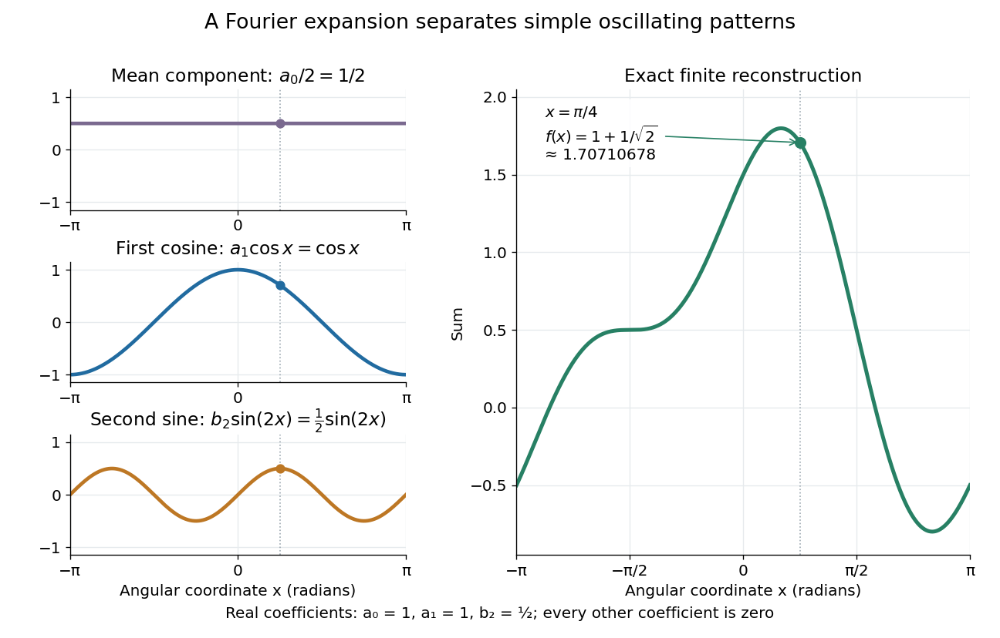

# Fourier series

↑ **Parent:** [Analysis](analysis.md)  
ⓦ [Wiki](https://en.wikipedia.org/wiki/Fourier_series)

A [Fourier series](fourier-series.md) describes a [periodic function](function.md#periodic-function) through [sines](geometry-and-topology.md#sine) and [cosines](geometry-and-topology.md#cosine) whose frequencies are [integer](integer.md) multiples of one base [frequency](wave.md#frequency). These [Fourier harmonics](#fourier-harmonic) give a useful alternative to describing the value at every input: each [Fourier coefficient](#fourier-coefficient) measures how much of one oscillating pattern is present. For a real, integrable [function](function.md) of period $2\pi$, the real form is

$$
f(x)\sim\frac{a_0}{2}+\sum_{n=1}^{\infty}\bigl[a_n\cos(nx)+b_n\sin(nx)\bigr],
\qquad
a_n=\frac1\pi\int_{-\pi}^{\pi}f(x)\cos(nx)\,dx,
\qquad
b_n=\frac1\pi\int_{-\pi}^{\pi}f(x)\sin(nx)\,dx.
$$

The cosine formula includes $n=0$; the sine formula uses $n\geq1$. Thus $a_0/2$ is the mean value over a [period](mathematics.md#period-of-a-function), not $a_0$ itself. The symbol $\sim$ associates a [function](function.md) with its [Fourier coefficients](#fourier-coefficient); an equality requires a specified kind of convergence, such as [pointwise convergence](sequence-and-series.md#pointwise-convergence). For general period $T>0$, replace $nx$ by $2\pi nt/T$ and the coefficient prefactor by $2/T$. [Fourier orthogonality](#fourier-orthogonality) explains why integrating against one mode removes the others. [Daniel Stroock, Basic Theory of Fourier Series: orthogonality and periodic expansions](https://ocw.mit.edu/courses/res-18-015-topics-in-fourier-analysis-spring-2024/mitres_18_015_s24_lec01.pdf).

For a finite example, take

$$
f(x)=\frac12+\cos x+\frac12\sin(2x).
$$

Its mean is $1/2$, its real [Fourier coefficients](#fourier-coefficient) are $a_0=1$, $a_1=1$, $b_2=1/2$, and all other $a_n,b_n$ vanish. At $x=\pi/4$, the three contributions add to $1/2+1/\sqrt2+1/2=1+1/\sqrt2\approx1.70710678$. The [function](function.md) is already a [trigonometric polynomial](#trigonometric-polynomial), so retaining these modes reconstructs it exactly. Here $x$ is an angular coordinate in [radians](geometry-and-topology.md#radian); if it instead represents time, a base [angular frequency](lagrangian-mechanics.md#angular-frequency) must supply the corresponding units.

**[Figure 1](#image-three-simple-components-reconstruct-a-periodic-signal-exactly). Three simple components reconstruct a periodic signal exactly**. The [constant function](function.md#constant-function) $1/2$, the [cosine](geometry-and-topology.md#cosine) $\cos x$, and the [sine](geometry-and-topology.md#sine) $\tfrac12\sin(2x)$ add to the displayed [trigonometric polynomial](#trigonometric-polynomial). The marked input $x=\pi/4$ has output $1+1/\sqrt2$. Each contribution can be measured separately by its [Fourier coefficient](#fourier-coefficient).

The change of viewpoint is useful because many [linear](vector-space.md#linearity) problems act separately on these modes. The second [derivative](calculus.md#derivative) maps $\sin(nx)$ to $-n^2\sin(nx)$ and maps $\cos(nx)$ in the same way. Consequently a differential equation that is complicated for a whole profile can become a simpler calculation for each [Fourier harmonic](#fourier-harmonic). A [linear time-invariant system](electrical-engineering.md#linear-time-invariant-system) similarly has a separate response to each [complex exponential](calculus.md#complex-exponential-function). [Superposition](vector-space.md#superposition-principle) combines the responses when the relevant sums and operations are justified. [MIT Calculus with Applications, section 30.8: Fourier series and forced responses](https://ocw.mit.edu/ans7870/18/18.013a/textbook/HTML/chapter30/section08.html).

The infinite case contains a subtlety absent from the finite example. Under [pointwise convergence of a piecewise smooth Fourier series](#pointwise-convergence-of-a-piecewise-smooth-fourier-series), the value at a [jump discontinuity](calculus.md#jump-discontinuity) is the average of the two one-sided limits. For a [square-integrable function](measure-theory.md#square-integrable-function), the [complex Fourier series](#complex-fourier-series) instead converges in the $L^2$ norm: the integrated squared error tends to zero. Neither statement says that the error becomes small everywhere at once. A [square wave](#square-wave) shows the difference vividly through the [Gibbs phenomenon](#gibbs-phenomenon).

A historical source for this connection between profiles and modes is [Joseph Fourier](mathematics.md#joseph-fourier)'s 1822 book Théorie analytique de la chaleur. Chapter III develops expansions in [sines](geometry-and-topology.md#sine) and [cosines](geometry-and-topology.md#cosine) while studying the propagation of [heat](heat.md). The [heat equation](diffusion-equation.md#heat-equation) gives a continuing application of this approach. [Propagation de la chaleur dans un solide rectangle infini](mathematics-bibliography.md#theorie-analytique-de-la-chaleur-by-joseph-fourier/propagation-de-la-chaleur-dans-un-solide-rectangle-infini).

**Table of contents**

- [Fourier series of a periodic rectangular pulse](#fourier-series-of-a-periodic-rectangular-pulse)
  - [Pulse-width scale of Fourier coefficients](#pulse-width-scale-of-fourier-coefficients)
- [Fourier series of a half-wave rectified ramp](#fourier-series-of-a-half-wave-rectified-ramp)
- [Fourier series of a noninteger-frequency cosine](#fourier-series-of-a-noninteger-frequency-cosine)
- [Fourier solution of a first-order equation with periodic forcing](#fourier-solution-of-a-first-order-equation-with-periodic-forcing)
- [Fourier series of a periodically extended exponential](#fourier-series-of-a-periodically-extended-exponential)
- [Fourier series of a half-wave rectified sinusoid](#fourier-series-of-a-half-wave-rectified-sinusoid)
- [Translation of a Fourier series](#translation-of-a-fourier-series)
- [Fourier series of periodic hyperbolic sine and cosine](#fourier-series-of-periodic-hyperbolic-sine-and-cosine)
- [Square wave](#square-wave)
- [Gibbs phenomenon](#gibbs-phenomenon)
- [Fourier series of a noninteger-frequency sine](#fourier-series-of-a-noninteger-frequency-sine)
- [Fourier orthogonality](#fourier-orthogonality)
- [Uniqueness of a trigonometric series outside a finite set](#uniqueness-of-a-trigonometric-series-outside-a-finite-set)
- [Riemann summation of a convergent trigonometric series](#riemann-summation-of-a-convergent-trigonometric-series)
- [Decay of coefficients of an almost-everywhere convergent trigonometric series](#decay-of-coefficients-of-an-almost-everywhere-convergent-trigonometric-series)
- [Periodic triangular bump](#periodic-triangular-bump)
- [Du Bois-Reymond theorem](#du-bois-reymond-theorem)
- [Smooth-window Fourier coefficients of a periodic distribution](#smooth-window-fourier-coefficients-of-a-periodic-distribution)
- [Fourier coefficients of a periodic logarithmic singularity](#fourier-coefficients-of-a-periodic-logarithmic-singularity)
- [Cohomological equation on a Diophantine torus](#cohomological-equation-on-a-diophantine-torus)
  - [Translated conjugacy of a Diophantine vector field](#translated-conjugacy-of-a-diophantine-vector-field)
  - [Analytic estimate for the torus cohomological equation](#analytic-estimate-for-the-torus-cohomological-equation)
- [Kahane-Katznelson divergence theorem](#kahane-katznelson-divergence-theorem)
- [Orthogonality of integer Fourier modes](#orthogonality-of-integer-fourier-modes)
- [Dirichlet-Jordan convergence theorem](#dirichlet-jordan-convergence-theorem)
- [Fourier series of a periodically extended quadratic arch](#fourier-series-of-a-periodically-extended-quadratic-arch)
- [Pointwise convergence of a piecewise smooth Fourier series](#pointwise-convergence-of-a-piecewise-smooth-fourier-series)
- [Complex Fourier series](#complex-fourier-series)
- [Reciprocal-square sine series positivity](#reciprocal-square-sine-series-positivity)
- [Wiener algebra](#wiener-algebra)
  - [Character space of the Wiener algebra](#character-space-of-the-wiener-algebra)
  - [Analytic Wiener algebra](#analytic-wiener-algebra)
    - [Character space of the analytic Wiener algebra](#character-space-of-the-analytic-wiener-algebra)
- [Fourier harmonic](#fourier-harmonic)
- [Cotangent partial-fraction Fourier kernel](#cotangent-partial-fraction-fourier-kernel)
  - [Cosecant partial-fraction identity](#cosecant-partial-fraction-identity)
- [Fourier basis](#fourier-basis)
- [Fourier sine series](#fourier-sine-series)
  - [Double Fourier sine series](#double-fourier-sine-series)
  - [Fourier sine series of a symmetric tent](#fourier-sine-series-of-a-symmetric-tent)
  - [Sine expansion and Rayleigh quotient of a parabolic Dirichlet trial](#sine-expansion-and-rayleigh-quotient-of-a-parabolic-dirichlet-trial)
  - [Fourier series of a periodic sawtooth](#fourier-series-of-a-periodic-sawtooth)
  - [Fourier sine series of a squared sine](#fourier-sine-series-of-a-squared-sine)
  - [Fourier sine series of an odd quadratic arch](#fourier-sine-series-of-an-odd-quadratic-arch)
  - [Uniform bound for harmonic sine polynomials](#uniform-bound-for-harmonic-sine-polynomials)
  - [Fourier sine basis](#fourier-sine-basis)
- [Leibniz formula for π](#leibniz-formula-for-pi)
- [Trigonometric polynomial](#trigonometric-polynomial)
  - [Bernstein inequality for trigonometric polynomials](#bernstein-inequality-for-trigonometric-polynomials)
  - [Gram matrix representation of a trigonometric polynomial](#gram-matrix-representation-of-a-trigonometric-polynomial)
    - [Rank-one spectral-factor Gram matrix](#rank-one-spectral-factor-gram-matrix)
  - [Fejér–Riesz theorem](#fejer-riesz-theorem)
  - [Even multiplicity of unit-circle roots of a nonnegative trigonometric polynomial](#even-multiplicity-of-unit-circle-roots-of-a-nonnegative-trigonometric-polynomial)
  - [Conjugate symmetry of trigonometric polynomial coefficients](#conjugate-symmetry-of-trigonometric-polynomial-coefficients)
    - [Reciprocal-conjugate root pairing](#reciprocal-conjugate-root-pairing)
- [Fourier partial sum](#fourier-partial-sum)
  - [Generic unbounded Fourier sums at a fixed point](#generic-unbounded-fourier-sums-at-a-fixed-point)
  - [de la Vallée Poussin sum](#de-la-vallee-poussin-sum)
  - [Bounded nonconvergent Fourier partial sums](#bounded-nonconvergent-fourier-partial-sums)
  - [Frequency-separated Fourier block series](#frequency-separated-fourier-block-series)
  - [Compact-set Fourier amplification lemma](#compact-set-fourier-amplification-lemma)
    - [Positive-real logarithmic amplifier for short arcs](#positive-real-logarithmic-amplifier-for-short-arcs)
  - [Dirichlet kernel](#dirichlet-kernel)
    - [Dirichlet kernel harmonic lower bound](#dirichlet-kernel-harmonic-lower-bound)
- [Fejér kernel](#fejer-kernel)
  - [Fejér sum](#fejer-sum)
    - [Hölder error bound for Fejér summation](#holder-error-bound-for-fejer-summation)
    - [Fejér first-moment approximation bound](#fejer-first-moment-approximation-bound)
      - [Fractional-scale Fejér approximation bound](#fractional-scale-fejer-approximation-bound)
    - [Fejér second-modulus approximation bound](#fejer-second-modulus-approximation-bound)
      - [Fejér saturation on a Fourier mode](#fejer-saturation-on-a-fourier-mode)
    - [Fejér summation is a uniform-norm contraction](#fejer-summation-is-a-uniform-norm-contraction)
- [Fourier coefficient](#fourier-coefficient)
  - [Fourier sine coefficient](#fourier-sine-coefficient)
  - [Periodic dilation annihilates low Fourier modes](#periodic-dilation-annihilates-low-fourier-modes)
  - [Absolute Fourier convergence from a square-integrable derivative](#absolute-fourier-convergence-from-a-square-integrable-derivative)
  - [Uniqueness of Fourier coefficients in L1](#uniqueness-of-fourier-coefficients-in-l1)
  - [Fourier coefficient decay of an analytic periodic function](#fourier-coefficient-decay-of-an-analytic-periodic-function)
  - [Termwise differentiation of a Fourier series](#termwise-differentiation-of-a-fourier-series)
- [Fourier cosine series](#fourier-cosine-series)
  - [Half-range Fourier cosine series](#half-range-fourier-cosine-series)
    - [Fourier cosine coefficients of a sine mode](#fourier-cosine-coefficients-of-a-sine-mode)
- [Fourier series of x cubed minus pi squared x](#fourier-series-of-x-cubed-minus-pi-squared-x)

## Fourier series of a periodic rectangular pulse

↑ **Parent:** [Fourier series](fourier-series.md)

An even train of [rectangular pulses](electrical-engineering.md#rectangular-function) of width $w<T$, [period](mathematics.md#period-of-a-function) $T$ and unit area per pulse has [Fourier coefficients](#fourier-coefficient) $a_n=(2/T)\operatorname{sinc}(\pi nw/T)$ for $n\geq0$. Here the [sinc function](fourier-transform.md#sinc-function) is normalized as $\operatorname{sinc}z=\sin z/z$, and the constant contribution is $a_0/2=1/T$. Integrating the [cosine](geometry-and-topology.md#cosine) over the pulse proves the formula; evenness eliminates the [sine](geometry-and-topology.md#sine) coefficients. At a pulse edge, [pointwise convergence of a piecewise smooth Fourier series](#pointwise-convergence-of-a-piecewise-smooth-fourier-series) gives the mean of the one-sided values rather than a prescribed endpoint value.

### Pulse-width scale of Fourier coefficients

↑ **Parent:** [Fourier series of a periodic rectangular pulse](#fourier-series-of-a-periodic-rectangular-pulse)

For the [Fourier series of a periodic rectangular pulse](#fourier-series-of-a-periodic-rectangular-pulse), the [sinc function](fourier-transform.md#sinc-function) is nearly one when $nw/T\ll1$ and has its first zero at $nw/T=1$. Thus narrowing a pulse increases the range of significant [Fourier coefficients](#fourier-coefficient). Only integer harmonic indices occur, so an envelope zero need not be an exactly vanishing coefficient.

## Fourier series of a half-wave rectified ramp

↑ **Parent:** [Fourier series](fourier-series.md)

Extend $f(x)=\max(0,2x)$ on $(-1,1)$ with period two. Its [Fourier coefficients](#fourier-coefficient) in the basis $\cos(n\pi x),\sin(n\pi x)$ are $a_0=1$, $a_n=2[(-1)^n-1]/(n\pi)^2$, and $b_n=2(-1)^{n+1}/(n\pi)$, by [integration by parts](calculus.md#integration-by-parts) on $(0,1)$. Thus

$$
f(x)\sim\frac12-\frac4{\pi^2}\sum_{r=0}^{\infty}\frac{\cos((2r+1)\pi x)}{(2r+1)^2}+\frac2\pi\sum_{n=1}^{\infty}\frac{(-1)^{n+1}\sin(n\pi x)}n.
$$

Its [even](calculus.md#even-function) part is the periodic extension of $|x|$ and its [odd](calculus.md#odd-function) part is the [Fourier series of a periodic sawtooth](#fourier-series-of-a-periodic-sawtooth) for $x$. The cosine terms converge absolutely and uniformly; the sine terms account for the jump at odd integers. At each jump, the full [Fourier series](fourier-series.md) has value $1$, the average of the two one-sided limits $0$ and $2$.

## Fourier series of a noninteger-frequency cosine

↑ **Parent:** [Fourier series](fourier-series.md)

Extend $\cos(\mu x)$ from $[-\pi,\pi]$ with period $2\pi$. It is an [even function](calculus.md#even-function), so all sine [Fourier coefficients](#fourier-coefficient) vanish. The product-to-sum identity gives

$$
a_0=\frac{2\sin(\pi\mu)}{\pi\mu},\qquad
a_n=\frac{2\mu(-1)^n\sin(\pi\mu)}{\pi(\mu^2-n^2)}\quad(n\geq1).
$$

Indeed, integrate $\cos(\mu x)\cos(nx)$ on $[0,\pi]$ and use $\sin(\pi(\mu\pm n))=(-1)^n\sin(\pi\mu)$. Thus

$$
f(x)=\frac{\sin(\pi\mu)}{\pi\mu}
+\frac{2\mu\sin(\pi\mu)}\pi\sum_{n=1}^\infty\frac{(-1)^n\cos(nx)}{\mu^2-n^2}.
$$

The coefficients are $O(n^{-2})$, so the series converges absolutely and uniformly. The [Dirichlet-Jordan convergence theorem](#dirichlet-jordan-convergence-theorem) identifies it with the periodic function everywhere, including the endpoints because the two endpoint values agree. Substituting a noninteger rational frequency and a convenient $x$ yields explicit [series](sequence-and-series.md#series-mathematics) sums. Integer frequencies require taking removable limits rather than substituting into a zero denominator.

## Fourier solution of a first-order equation with periodic forcing

↑ **Parent:** [Fourier series](fourier-series.md)

Let $\alpha,\beta$ be nonzero real constants and let $f$ be a [smooth](analysis.md#smooth-function) [periodic function](function.md#periodic-function) of period $2\pi$, with real [Fourier coefficients](#fourier-coefficient) $c_n,d_n$. Write the unknown [periodic solution](differential-equation.md#periodic-solution) with [Fourier coefficients](#fourier-coefficient) $a_n,b_n$. [Fourier orthogonality](#fourier-orthogonality) applied to the equation gives

$$
\beta a_0=c_0,\qquad
\beta a_n+\alpha n b_n=c_n,\qquad
\beta b_n-\alpha n a_n=d_n.
$$

Solving these two-by-two [linear systems](linear-algebra.md#system-of-linear-equations) gives

$$
a_n=\frac{\beta c_n-\alpha n d_n}{\beta^2+\alpha^2n^2},\qquad
b_n=\frac{\alpha n c_n+\beta d_n}{\beta^2+\alpha^2n^2}\quad(n\geq1).
$$

The smooth forcing has rapidly decreasing [Fourier coefficients](#fourier-coefficient), so the resulting series and its [derivatives](calculus.md#derivative) converge and satisfy the equation. Uniqueness follows because the difference of two solutions is $Ce^{-\beta x/\alpha}$, which is periodic only when $C=0$. A single sinusoidal forcing therefore gives a single sinusoidal response with changed amplitude and phase.

## Fourier series of a periodically extended exponential

↑ **Parent:** [Fourier series](fourier-series.md)

Let $L>0$ and real $\kappa\ne0$. Extend $e^{\kappa x}$ with period $2L$. In the [Fourier series](fourier-series.md) convention $a_0/2+\sum_{n\geq1}[a_n\cos(n\pi x/L)+b_n\sin(n\pi x/L)]$, put $q_n=n\pi/L$. Direct [integration](integral.md) gives

$$
a_0=\frac{2\sinh(\kappa L)}{\kappa L},\qquad
a_n=\frac{2\kappa(-1)^n\sinh(\kappa L)}{L(\kappa^2+q_n^2)},\qquad
b_n=-\frac{2q_n(-1)^n\sinh(\kappa L)}{L(\kappa^2+q_n^2)}.
$$

For example, the required [antiderivatives](integral.md#antiderivative) are $e^{\kappa x}(\kappa\cos q_nx+q_n\sin q_nx)/(\kappa^2+q_n^2)$ and $e^{\kappa x}(\kappa\sin q_nx-q_n\cos q_nx)/(\kappa^2+q_n^2)$. The [Dirichlet-Jordan convergence theorem](#dirichlet-jordan-convergence-theorem) gives the exponential value away from the jumps and their midpoint $\cosh(\kappa L)$ at odd multiples of $L$. For $\kappa=0$, the [function](function.md) is identically one, with $a_0=2$ and all other [Fourier coefficients](#fourier-coefficient) zero.

## Fourier series of a half-wave rectified sinusoid

↑ **Parent:** [Fourier series](fourier-series.md)

For $V(t)=V_0\max(\sin\omega t,0)$, with period $2\pi/\omega$, [half-wave rectification](electrical-circuit.md#half-wave-rectifier) gives

$$
V(t)=\frac{V_0}{\pi}+\frac{V_0}{2}\sin\omega t
-\frac{2V_0}{\pi}\sum_{m=1}^\infty\frac{\cos(2m\omega t)}{4m^2-1}.
$$

The [Fourier coefficients](#fourier-coefficient) are $a_0=2V_0/\pi$, $b_1=V_0/2$, $a_{2m}=-2V_0/[\pi(4m^2-1)]$, with all remaining coefficients zero. To derive the cosine coefficients, integrate $\sin s\cos ns$ over $0<s<\pi$ and use the product-to-sum identity. The sine coefficients follow from [orthogonality](inner-product.md#orthogonal-vectors). A half-period delay reverses only the fundamental sine term and leaves the constant and even-frequency cosine terms unchanged, by [translation of a Fourier series](#translation-of-a-fourier-series).

## Translation of a Fourier series

↑ **Parent:** [Fourier series](fourier-series.md)

For a period-$L$ [Fourier series](fourier-series.md) written as $a_0/2+\sum_{n\geq1}(a_n\cos k_nx+b_n\sin k_nx)$, where $k_n=2\pi n/L$, translating the [function](function.md) by $\ell$ to $g(x)=f(x-\ell)$ rotates each pair of [Fourier coefficients](#fourier-coefficient):

$$
a_n^{(g)}=a_n\cos(k_n\ell)-b_n\sin(k_n\ell),\qquad
b_n^{(g)}=a_n\sin(k_n\ell)+b_n\cos(k_n\ell).
$$

The constant coefficient is unchanged. These formulas follow by the sine and cosine subtraction identities. In the [complex Fourier series](#complex-fourier-series), the same statement is $\widehat g_n=e^{-ik_n\ell}\widehat f_n$. An integer-period translation changes no [Fourier coefficient](#fourier-coefficient).

## Fourier series of periodic hyperbolic sine and cosine

↑ **Parent:** [Fourier series](fourier-series.md)

For $\beta>0$, periodically extend $\cosh(\beta x)$ and $\sinh(\beta x)$ from $-1<x\leq1$ with period $2$. Their [Fourier series](fourier-series.md) are

$$
\cosh(\beta x)=\frac{\sinh\beta}{\beta}+2\beta\sinh\beta\sum_{n=1}^{\infty}\frac{(-1)^n\cos(n\pi x)}{\beta^2+n^2\pi^2},
$$

and, away from odd integers,

$$
\sinh(\beta x)=2\pi\sinh\beta\sum_{n=1}^{\infty}\frac{(-1)^{n+1}n\sin(n\pi x)}{\beta^2+n^2\pi^2}.
$$

The first identity follows by [integration](integral.md) of $\cosh(\beta x)\cos(n\pi x)$ on $[-1,1]$, using the [antiderivative](integral.md#antiderivative)

$$
\frac{\beta\sinh(\beta x)\cos(n\pi x)+n\pi\cosh(\beta x)\sin(n\pi x)}{\beta^2+n^2\pi^2}.
$$

For the second identity, [integration by parts](calculus.md#integration-by-parts) and $d\cosh(\beta x)/dx=\beta\sinh(\beta x)$ show that its sine coefficient is $-n\pi/\beta$ times the first series' cosine coefficient. This avoids assuming that a [Fourier series](fourier-series.md) can always be differentiated term by term. The periodic [hyperbolic cosine](calculus.md#hyperbolic-cosine) is continuous, so its series converges to it everywhere. The periodic [hyperbolic sine](calculus.md#hyperbolic-sine) has a [jump discontinuity](calculus.md#jump-discontinuity) at each odd integer: the [Dirichlet-Jordan convergence theorem](#dirichlet-jordan-convergence-theorem) gives the average of its two limiting values, namely zero, there. Both identities hold in the sense of [mean-square convergence](convergence-of-random-variables.md#convergence-in-l2), which suffices for [Parseval's identity](fourier-analysis.md#parseval-identity).

## Square wave

↑ **Parent:** [Fourier series](fourier-series.md)  
ⓦ [Wiki](https://en.wikipedia.org/wiki/Square_wave)

A [square wave](#square-wave) alternates between two constant levels for equal halves of a [period](mathematics.md#period-of-a-function). Choose a $2\pi$-periodic [function](function.md) equal to $1$ on $(0,\pi)$ and $-1$ on $(-\pi,0)$, with value zero at the jumps. Its [odd function](calculus.md#odd-function) symmetry makes the mean and every cosine [Fourier coefficient](#fourier-coefficient) vanish. Directly integrating the two constant pieces gives

$$
a_0=a_n=0,\qquad b_n=\frac{2[1-(-1)^n]}{\pi n},\qquad
f(x)\sim\frac4\pi\sum_{k=0}^{\infty}\frac{\sin((2k+1)x)}{2k+1}.
$$

Thus only [odd](calculus.md#odd-function) sine [Fourier harmonics](#fourier-harmonic) occur, with amplitudes decreasing like the reciprocal of their frequency multiplier. Every finite [Fourier partial sum](#fourier-partial-sum) is smooth, yet their [pointwise limit](sequence-and-series.md#pointwise-limit) has jumps. At those jumps the [Fourier series](fourier-series.md) converges to zero, the midpoint of the two levels, regardless of which value we assign to the original [function](function.md) there.

This example explains how smooth components can encode sharp transitions. Increasing the number of [Fourier harmonics](#fourier-harmonic) narrows the transition region, but also produces the persistent overshoot described by the [Gibbs phenomenon](#gibbs-phenomenon). The illustrated square wave and coefficient calculation are mathematical constructions, not measurements of a physical device.

## Gibbs phenomenon

↑ **Parent:** [Fourier series](fourier-series.md)  
ⓦ [Wiki](https://en.wikipedia.org/wiki/Gibbs_phenomenon)

The [Gibbs phenomenon](#gibbs-phenomenon) is the persistent overshoot near a [jump discontinuity](calculus.md#jump-discontinuity) in ordinary truncated [Fourier series](fourier-series.md). For this [square wave](#square-wave), retain $M$ nonzero odd modes:

$$
Q_M(x)=\frac4\pi\sum_{k=0}^{M-1}\frac{\sin((2k+1)x)}{2k+1}.
$$

As $M$ grows, the first peak approaches the jump while its height tends to approximately $1.17897974$. This is an excess of about $0.17898$ above the upper level $1$, or $8.949\%$ of the jump size $2$. The narrower region does not imply a vanishing maximum error. At the jump itself every $Q_M(0)=0$. These observations are compatible with [pointwise convergence](sequence-and-series.md#pointwise-convergence) and $L^2$ convergence but exclude [uniform convergence](sequence-and-series.md#uniform-convergence) to the discontinuous [square wave](#square-wave). [NIST DLMF, section 6.16(i): square-wave overshoot and its limiting height](https://dlmf.nist.gov/6.16).

**[Figure 2](#image-more-fourier-harmonics-narrow-a-transition-while-leaving-a-persistent-overshoot). More Fourier harmonics narrow a transition while leaving a persistent overshoot**. Left: the constructed [square wave](#square-wave) and sums of $3$, $10$ and $50$ nonzero odd [Fourier harmonics](#fourier-harmonic). Right: the same sums near the jump at zero, with each first positive peak marked. The highest frequency retained is $2M-1$, so a count of $M$ nonzero terms differs from a cutoff at frequency $M$. The limiting peak is approximately $1.17898$, while the level above the jump is $1$.

For this particular sum, its [derivative](calculus.md#derivative) is $Q_M'(x)=(2/\pi)\sin(2Mx)/\sin x$ away from multiples of $\pi$, so the first positive peak is exactly at $x=\pi/(2M)$. There,

$$
Q_M\!\left(\frac\pi{2M}\right)
=\frac2M\sum_{k=0}^{M-1}\frac{\sin(\pi u_k)}{\pi u_k},\qquad u_k=\frac{k+1/2}{M}.
$$

This is a midpoint [Riemann sum](real-analysis.md#riemann-sum) tending to $2\operatorname{Si}(\pi)/\pi$, where $\operatorname{Si}$ is the [sine integral](integral.md#sine-integral). It gives a short explanation of the nonzero limiting excess.

The phenomenon matters whenever a sharp boundary is represented by a limited set of [Fourier harmonics](#fourier-harmonic): a visible ripple can be a property of the approximation rather than an oscillation in the original profile. [Josiah Willard Gibbs](mathematics.md#josiah-willard-gibbs) reported the phenomenon in his 1899 letter “Fourier's Series” in Nature, volume 59, page 606. This is a documented historical report, without a claim of first discovery. [Gibbs, Fourier's Series, 1899](https://www.nature.com/articles/059606a0).

## Fourier series of a noninteger-frequency sine

↑ **Parent:** [Fourier series](fourier-series.md)

For real noninteger $\lambda$, the periodic extension from $[-\pi,\pi]$ has the displayed [Fourier series](fourier-series.md), obtained by the product-to-sum identity in the sine coefficient integral. It equals the original function in the open interval and zero at the periodic endpoint jumps. At $\lambda=1/2$, [Parseval's identity](fourier-analysis.md#parseval-identity) gives $\sum_{n\geq1}n^2/(4n^2-1)^2=\pi^2/64$. Integer frequencies instead already belong to the ordinary sine basis and should not be substituted into the removable coefficient singularities without taking limits.

## Fourier orthogonality

↑ **Parent:** [Fourier series](fourier-series.md)

The [complex exponential functions](calculus.md#complex-exponential-function) $e^{int}$, for [integers](integer.md) $n$, are [orthogonal](inner-product.md#orthogonal-vectors) under the normalized [integral](integral.md) [inner product](inner-product.md) over a complete [period](mathematics.md#period-of-a-function). If $n=m$, the integrand $e^{i(n-m)t}$ is one; otherwise its [antiderivative](integral.md#antiderivative) has equal endpoint values, giving zero. For the real modes, $\int_{-\pi}^{\pi}\cos^2(nt)\,dt=\int_{-\pi}^{\pi}\sin^2(nt)\,dt=\pi$ for $n\geq1$, while every mixed sine-cosine integral and every unequal-frequency pairing vanishes.

This makes the coefficient formulas useful: multiply a [trigonometric polynomial](#trigonometric-polynomial) by one mode and integrate, and all other modes cancel. For $f(x)=1/2+\cos x+\tfrac12\sin(2x)$, integration against $\cos x$ gives $\pi$, and against $\sin(2x)$ gives $\pi/2$, recovering $a_1=1$ and $b_2=1/2$. Division by the squared [norm](normed-vector-space.md#norm) of the mode supplies the normalization. A full [period](mathematics.md#period-of-a-function) matters; truncating the integration interval generally destroys these cancellations.

## Uniqueness of a trigonometric series outside a finite set

↑ **Parent:** [Fourier series](fourier-series.md)

If the symmetric partial sums of $\sum_{r\in\mathbb Z}a_re^{irt}$ tend to zero at every point outside a finite set, then all coefficients vanish. Almost-everywhere convergence first gives $a_{\pm n}\to0$. The twice-integrated series $F(t)=a_0t^2/2-\sum_{r\ne0}a_re^{irt}/r^2$ is continuous. [Riemann summation of a convergent trigonometric series](#riemann-summation-of-a-convergent-trigonometric-series) makes its symmetric second derivative zero away from the exceptional points, so it is affine on each intervening interval. [Sinc-squared summation of a sequence tending to zero](fourier-analysis.md#sinc-squared-summation-of-a-sequence-tending-to-zero) makes its symmetric first-order quotient zero everywhere, removing all possible affine corners. The globally affine function differs from a periodic function by $a_0t^2/2$, forcing $a_0=0$; periodicity then makes it constant, and integration against each nonzero frequency gives $a_r=0$.

## Riemann summation of a convergent trigonometric series

↑ **Parent:** [Fourier series](fourier-series.md)

Suppose the symmetric partial sums converge at a fixed point. Group positive and negative frequencies together, let $S_n$ be the resulting partial sums and set $w(x)=(\sin x/x)^2$, with $w(0)=1$. [Summation by parts](analytic-number-theory.md#abel-s-summation-formula) expresses the weighted sum as $\sum_{n\ge0}S_n[w(nk)-w((n+1)k)]$, where $k=|h|/2$. The total variation of these weights is at most $\int_0^\infty|w'(x)|dx<\infty$, independently of $k$, and each fixed difference tends to zero. Subtract the limiting value of $S_n$ and split into a finite prefix and a uniformly small tail to prove convergence to that value. This is a regular summation method even though the sinc-squared weights need not decrease monotonically.

## Decay of coefficients of an almost-everywhere convergent trigonometric series

↑ **Parent:** [Fourier series](fourier-series.md)

If symmetric partial sums $\sum_{r=-n}^n a_re^{irt}$ converge almost everywhere on the circle, then $a_n,a_{-n}\to0$. Their successive differences $T_n=a_ne^{int}+a_{-n}e^{-int}$ tend to zero almost everywhere. If $M_n=|a_n|+|a_{-n}|$ failed to tend to zero, choose a subsequence with $M_n\ge\varepsilon$. The normalized $T_n/M_n$ are bounded by one and tend to zero almost everywhere, so [dominated convergence](measure-theory.md#dominated-convergence-theorem) makes their squared integrals tend to zero. [Fourier orthogonality](#fourier-orthogonality) instead makes those integrals $(|a_n|^2+|a_{-n}|^2)/M_n^2\ge1/2$, a contradiction.

## Periodic triangular bump

↑ **Parent:** [Fourier series](fourier-series.md)

For $0<\varepsilon\le1/2$, this continuous function on $\mathbb R/\mathbb Z$ has nonnegative [Fourier coefficients](#fourier-coefficient)

$$
\widehat b_\varepsilon(r)=\varepsilon\left(\frac{\sin(\pi r\varepsilon)}{\pi r\varepsilon}\right)^2,
\qquad \widehat b_\varepsilon(0)=\varepsilon.
$$

It is $\varepsilon^{-1}$ times the periodic [convolution](fourier-analysis.md#convolution) of two indicators of $[-\varepsilon/2,\varepsilon/2]$. Its [Fourier series](fourier-series.md) is absolutely convergent, $\sum_r\widehat b_\varepsilon(r)=b_\varepsilon(0)=1$, and $\sum_{|r|>R}\widehat b_\varepsilon(r)\ll1/(\varepsilon R)$. Consequently, if all $N$ points $t_n$ avoid the interval $\|t\|<\varepsilon$, some frequency $1\le r\ll\varepsilon^{-2}$ satisfies $|\sum_ne(rt_n)|\gg N\varepsilon$. This detects missing small neighborhoods by a large [exponential sum](analytic-number-theory.md#exponential-sum).

## Du Bois-Reymond theorem

↑ **Parent:** [Fourier series](fourier-series.md)

There are [continuous functions](calculus.md#continuous-function) whose [Fourier series](fourier-series.md) diverges at a prescribed point. In contrast, the [Fejér kernel](#fejer-kernel) is nonnegative and has integral one, so [Fejér summation is a uniform-norm contraction](#fejer-summation-is-a-uniform-norm-contraction). The resulting [Fejér sums](#fejer-sum) need not be positive: for the [constant function](function.md#constant-function) $f=-1$, every sum is $-1$.

## Smooth-window Fourier coefficients of a periodic distribution

↑ **Parent:** [Fourier series](fourier-series.md)

A smooth compactly supported window with $\sum_{j\in\mathbb Z}\chi(x+j)=1$ permits multiplying every periodic [distribution](distribution-theory.md#distribution-mathematical-analysis) unambiguously. Its [Fourier transform](fourier-transform.md) sampled at integer harmonics gives the periodic coefficients. The sharp window $H(x)-H(x-1)$ works for locally integrable functions but can be undefined at singular period endpoints, such as delta derivatives.

## Fourier coefficients of a periodic logarithmic singularity

↑ **Parent:** [Fourier series](fourier-series.md)

For the period-one continuation of $\log|x-1/2|$, symmetry and [integration by parts](calculus.md#integration-by-parts) give $c_m=-(-1)^m\operatorname{Si}(\pi m)/(\pi m)$ for $m\ne0$. Thus the [sine integral](integral.md#sine-integral) asymptotic gives $c_m=-(-1)^m/(2m)+1/(\pi^2m^2)+O(m^{-4})$ as $m\to+\infty$. Translation of the logarithmic singularity causes the alternating phase; the endpoint derivative mismatch causes the next term.

## Cohomological equation on a Diophantine torus

↑ **Parent:** [Fourier series](fourier-series.md)

For a [Diophantine frequency vector](diophantine-approximation.md#diophantine-frequency-vector), the equation $\omega\cdot\partial_x f=g$ on a periodic [torus](topological-surface.md#torus) has an analytic solution on each smaller complex strip exactly when $g$ has zero average. Its nonzero [Fourier coefficients](#fourier-coefficient) are $f_k=g_k/(i k\cdot\omega)$, and its zero coefficient is arbitrary. Thus the normalized zero-mean solution is unique.

### Translated conjugacy of a Diophantine vector field

↑ **Parent:** [Cohomological equation on a Diophantine torus](#cohomological-equation-on-a-diophantine-torus)

For a sufficiently small analytic periodic [vector field](multivariable-calculus.md#vector-field) $w$, a near-identity angular [diffeomorphism](geometry-and-topology.md#diffeomorphism) $\chi$ and a constant vector $a$ solve $D\chi\,\omega=\omega+w\circ\chi+a$. They satisfy $\chi-\mathrm{id}=O(w)$, $a=O(w)$; if $\langle w\rangle=0$, then $a=O(w^2)$. For the defect $e=\mathcal D_\omega\chi-\omega-w\circ\chi-a$, set $A=D\chi$, choose $\Delta a=\langle A^{-1}\rangle^{-1}\langle A^{-1}e\rangle$, and solve $\mathcal D_\omega v=A^{-1}(\Delta a-e)$ with zero mean. Updating $\chi$ by $Av$ leaves a quadratic defect $(De)v-[w(\chi+Av)-w(\chi)-Dw(\chi)Av]$. The [torus small-divisor estimate](#analytic-estimate-for-the-torus-cohomological-equation) and geometrically decreasing strip losses yield a convergent analytic iteration.

### Analytic estimate for the torus cohomological equation

↑ **Parent:** [Cohomological equation on a Diophantine torus](#cohomological-equation-on-a-diophantine-torus)

If $g$ is analytic on a complex strip of width $\sigma$ and has zero mean, the normalized solution satisfies $\|f\|_{\sigma-\delta}\le C_{n,\tau}\gamma^{-1}\delta^{-(n+\tau)}\|g\|_\sigma$. Fourier decay supplies $e^{-\delta|k|_1}$ after the strip loss, and lattice-shell counting bounds the remaining sum $\sum_{k\ne0}|k|_1^\tau e^{-\delta|k|_1}$. This simple bound is sufficient for analytic conjugacy iterations even when sharper estimates are available.

## Kahane-Katznelson divergence theorem

↑ **Parent:** [Fourier series](fourier-series.md)

Every null subset of the circle lies in the divergence set of the [Fourier series](fourier-series.md) of some continuous complex-valued [function](function.md). One can arrange unbounded [Fourier partial sums](#fourier-partial-sum) there. The [compact-set Fourier amplification lemma](#compact-set-fourier-amplification-lemma), [compact batching of a small open set](measure-theory.md#compact-batching-of-a-small-open-set) and [frequency-separated Fourier block series](#frequency-separated-fourier-block-series) construct the function by a summable series of small blocks. The result covers nonclosed and dense null sets; it does not require the divergence set to equal the originally specified set.

## Orthogonality of integer Fourier modes

↑ **Parent:** [Fourier series](fourier-series.md)

For an integer $m$, direct integration gives zero unless $m=0$, in which case it gives one. Products of this identity on the unit cube turn [integrals](integral.md) of finite [exponential sums](analytic-number-theory.md#exponential-sum) into counts of integer solutions. This is the elementary orthogonality used in the [Vinogradov mean value](analytic-number-theory.md#vinogradov-mean-value).

## Dirichlet-Jordan convergence theorem

↑ **Parent:** [Fourier series](fourier-series.md)

The [Fourier series](fourier-series.md) of a periodic function of [bounded variation](real-analysis.md#total-variation-of-a-function) converges at each point to the mean of its two one-sided limits. In particular, it converges to the function at continuity points. Periodizing a compact interval introduces jumps at its integer endpoints; their half-values explain the half-weight convention in the [Van der Corput sum-integral lemma](analytic-number-theory.md#van-der-corput-sum-integral-lemma). The conclusion is pointwise convergence, not a claim of [absolute convergence](sequence-and-series.md#absolute-convergence) of every such Fourier series.

## Fourier series of a periodically extended quadratic arch

↑ **Parent:** [Fourier series](fourier-series.md)

The period-one extension of $x(1-x)$ on $[0,1]$ has [Fourier series](fourier-series.md) $1/6-\pi^{-2}\sum_{n\ge1}n^{-2}\cos(2\pi nx)$. Endpoint agreement makes the periodic function continuous. Its derivative series is $(2/\pi)\sum_{n\ge1}n^{-1}\sin(2\pi nx)$, which equals $1-2x$ in the open unit interval and converges to zero at integers, the midpoint of the derivative's jump. [Termwise differentiation of a Fourier series](#termwise-differentiation-of-a-fourier-series) applies locally away from the corners.

## Pointwise convergence of a piecewise smooth Fourier series

↑ **Parent:** [Fourier series](fourier-series.md)

For a periodic [function](function.md) that is piecewise continuously differentiable with finitely many pieces, its [Fourier series](fourier-series.md) converges at each point to the average of the two one-sided limits. At a point of continuity this is the function value. This includes the identified interval endpoints, whose two limits belong to the periodic extension. Absolute summability of the [Fourier coefficients](#fourier-coefficient) additionally gives uniform convergence.

## Complex Fourier series

↑ **Parent:** [Fourier series](fourier-series.md)

The complex form of a [Fourier series](fourier-series.md) for period $2L$ uses coefficients $c_n=(2L)^{-1}\int_{-L}^Lf(x)e^{-in\pi x/L}dx$ and complex exponentials $e^{in\pi x/L}$. For [square-integrable functions](measure-theory.md#square-integrable-function) it converges in the $L^2$ norm, and the [Parseval identity](fourier-analysis.md#parseval-identity) is $(2L)^{-1}\int|f|^2=\sum_n|c_n|^2$. Real functions satisfy $c_{-n}=\overline{c_n}$.

## Reciprocal-square sine series positivity

↑ **Parent:** [Fourier series](fourier-series.md)

The absolutely convergent sine series $S(\xi)=\sum_{l\ge1}\sin(l\xi)/l^2$ has the integral representation $S(\xi)=\sin\xi\int_0^\infty t e^{-t}/(1-2e^{-t}\cos\xi+e^{-2t})\,dt$. The integrand is positive for $0<\xi<\pi$, proving $S>0$ there without incorrectly maximizing individual Fourier terms.

## Wiener algebra

↑ **Parent:** [Fourier series](fourier-series.md)

The Wiener algebra consists of periodic [functions](function.md) with absolutely summable [Fourier coefficients](#fourier-coefficient), with [norm](normed-vector-space.md#norm) $\sum_k|a_k|$. Multiplication corresponds to [discrete convolution](fourier-analysis.md#discrete-convolution) of coefficients, so the [norm](normed-vector-space.md#norm) is submultiplicative. Consequently $e^f=\sum_{n\ge0}f^n/n!$ also belongs to the algebra when $f$ does. Every such [Fourier series](fourier-series.md) is uniformly convergent and defines a [continuous function](calculus.md#continuous-function).

### Character space of the Wiener algebra

↑ **Parent:** [Wiener algebra](#wiener-algebra)

Every [algebra character](banach-algebra.md#character-of-an-algebra) of the [Wiener algebra](#wiener-algebra) is evaluation at a unique point of the [unit circle](complex-analysis.md#complex-unit-circle). Writing $u(w)=w$, both $u$ and $u^{-1}$ have [norm](normed-vector-space.md#norm) one. Thus $z=\phi(u)$ satisfies $|z|\leq1$ and $|z^{-1}|\leq1$, hence $|z|=1$. Continuity then gives $\phi(\sum_{n\in\mathbb Z}a_nu^n)=\sum a_nz^n$. Conversely, evaluation defines a continuous [algebra character](banach-algebra.md#character-of-an-algebra). The resulting bijection is a [homeomorphism](topology.md#homeomorphism) for the [Gelfand topology](banach-algebra.md#gelfand-topology).

### Analytic Wiener algebra

↑ **Parent:** [Wiener algebra](#wiener-algebra)

The analytic Wiener algebra consists of the [power series](sequence-and-series.md#power-series) $f(z)=\sum_{n\geq0}a_nz^n$ with $\sum_{n\geq0}|a_n|<\infty$, identified with their values on the [unit circle](complex-analysis.md#complex-unit-circle). The [norm](normed-vector-space.md#norm) is $\|f\|=\sum|a_n|$. [Discrete convolution](fourier-analysis.md#discrete-convolution) gives multiplication and a submultiplicative [norm](normed-vector-space.md#norm); completeness follows from the [absolutely summable sequence space](banach-space.md#absolutely-summable-sequence-space). Each series converges uniformly on the closed [unit disk](euclidean-geometry.md#unit-disk) and is [holomorphic](holomorphic-function.md) in its interior.

#### Character space of the analytic Wiener algebra

↑ **Parent:** [Analytic Wiener algebra](#analytic-wiener-algebra)

Every [algebra character](banach-algebra.md#character-of-an-algebra) of the [analytic Wiener algebra](#analytic-wiener-algebra) is evaluation at a unique point $z$ of the closed [unit disk](euclidean-geometry.md#unit-disk). Indeed, for $u(w)=w$, continuity and multiplicativity give $z=\phi(u)$, $|z|\leq\|u\|=1$ and $\phi(f)=\sum_{n\geq0}a_nz^n$. Conversely, this formula defines a continuous [algebra character](banach-algebra.md#character-of-an-algebra) for every such $z$. The evaluation correspondence is a [homeomorphism](topology.md#homeomorphism) for the [Gelfand topology](banach-algebra.md#gelfand-topology), since the [power series](sequence-and-series.md#power-series) are uniformly convergent on the closed [unit disk](euclidean-geometry.md#unit-disk).

## Fourier harmonic

↑ **Parent:** [Fourier series](fourier-series.md)

A sinusoidal component at an integer multiple of a fundamental angular frequency. For a $2\pi$-periodic angular coordinate $\phi$, real [Fourier series](fourier-series.md) use $\cos(k\phi)$ and $\sin(k\phi)$. Summing over $q$ equally spaced phases removes every component whose integer $k$ is not a multiple of $q$, since $\sum_{j=0}^{q-1}e^{2\pi i k j/q}=0$ in that case. Indeed, the [geometric series](sequence-and-series.md#geometric-series) has ratio $w=e^{2\pi i k/q}\ne1$ and sum $(1-w^q)/(1-w)=0$. When $q$ divides $k$, all $q$ terms are one. This cancellation isolates higher-order feedback in [resonant conjunction geometry](celestial-mechanics.md#resonant-conjunction-geometry).

## Cotangent partial-fraction Fourier kernel

↑ **Parent:** [Fourier series](fourier-series.md)

For an integer $k\geq2$ and $\operatorname{Im}z>0$, differentiating the partial-fraction expansion of $\pi\cot\pi z$ gives

$$
\sum_{n\in\mathbb Z}(z+n)^{-k}=\frac{(-2\pi i)^k}{(k-1)!}\sum_{r\geq1}r^{k-1}e^{2\pi irz}.
$$

Both differentiated series converge locally uniformly. This kernel computes the [Fourier expansion of a modular form](modular-function.md#fourier-expansion-of-a-modular-form) for holomorphic [Eisenstein series](modular-function.md#eisenstein-series).

### Cosecant partial-fraction identity

↑ **Parent:** [Cotangent partial-fraction Fourier kernel](#cotangent-partial-fraction-fourier-kernel)

For $w\notin\mathbb Z$, integrate $\pi\cot(\pi\zeta)/(\zeta-w)^2$ around large squares whose sides have half-integer coordinates. The [cotangent](geometry-and-topology.md#cotangent) is uniformly bounded on these sides and the integral tends to zero. The [residue theorem](analysis.md#residue-theorem) gives residues $(n-w)^{-2}$ at the integers and $-\pi^2\csc^2(\pi w)$ at $w$, proving the identity. For $\operatorname{Im}w>0$, the geometric-series formula for the [cotangent](geometry-and-topology.md#cotangent) also gives $\pi^2\csc^2(\pi w)=-4\pi^2\sum_{r\geq1}r e^{2\pi irw}$.

## Fourier basis

↑ **Parent:** [Fourier series](fourier-series.md)

On the circle of circumference $2\pi$, the functions $e_k(x)=e^{ikx}$ for $k\in\mathbb Z$ form an orthogonal basis of $L^2$.

## Fourier sine series

↑ **Parent:** [Fourier series](fourier-series.md)

A Fourier sine series expands a function on an interval in the eigenfunctions $\sin(n\pi x/L)$ of the Dirichlet Laplacian. It is the odd Fourier-series extension across the interval endpoints.

### Double Fourier sine series

↑ **Parent:** [Fourier sine series](#fourier-sine-series)

On a rectangle $(0,L_x)\times(0,L_y)$, products of the one-dimensional [Fourier sine basis](#fourier-sine-basis) give an orthogonal basis of [L2 space](measure-theory.md#l2-space-is-a-hilbert-space). [Fourier orthogonality](#fourier-orthogonality) in each variable gives

$$
c_{mn}=\frac4{L_xL_y}\int_0^{L_x}\int_0^{L_y}f(x,y)\sin\frac{m\pi x}{L_x}\sin\frac{n\pi y}{L_y}\,dy\,dx.
$$

For a constant function one, these coefficients are $4[1-(-1)^m][1-(-1)^n]/(\pi^2mn)$: only odd indices occur. The product modes vanish on the rectangle's boundary, making them natural [Dirichlet Laplacian eigenfunctions](partial-differential-equation.md#dirichlet-laplacian-eigenfunction). In the [heat equation](diffusion-equation.md#heat-equation), their amplitudes decay as $e^{-\kappa\pi^2(m^2/L_x^2+n^2/L_y^2)t}$. Initial data not vanishing at the boundary are still represented in the interior and in the square-integrable sense; the positive-time boundary values need not agree continuously with the initially assigned boundary values.

### Fourier sine series of a symmetric tent

↑ **Parent:** [Fourier sine series](#fourier-sine-series)

On $0\leq x\leq L$, with $L>0$, the tent $f(x)=\min(x,L-x)$ has [Fourier sine series](#fourier-sine-series) coefficients $b_n=4L\sin(n\pi/2)/(\pi^2n^2)$. Split the coefficient integral at $L/2$ and integrate its two linear pieces by parts; their cosine endpoint terms cancel and their sine terms add. Reflection about the midpoint makes every even-index coefficient zero, and the remaining odd-index coefficients alternate in sign. The $n^{-2}$ bound gives [absolute convergence](sequence-and-series.md#absolute-convergence) and [uniform convergence](sequence-and-series.md#uniform-convergence); the series equals the continuous tent, including its zero endpoints.

### Sine expansion and Rayleigh quotient of a parabolic Dirichlet trial

↑ **Parent:** [Fourier sine series](#fourier-sine-series)

On $(0,1)$, integration by parts gives the displayed [Fourier sine series](#fourier-sine-series). For normalized [Dirichlet eigenfunctions](linear-operator-theory.md#dirichlet-eigenfunction) $y_i=\sqrt2\sin[(i+1)\pi x]$, indexed from $i=0$, it has the form $A[y_0+\sum_{i\geq1}c_i y_i]$, with $A=4\sqrt2/\pi^3$ and $c_i=[1-(-1)^{i+1}]/[2(i+1)^3]$. Its [Rayleigh quotient](linear-operator-theory.md#rayleigh-quotient) for $-d^2/dx^2$ is $10$, since $\int_0^1(u')^2dx=1/3$ and $\int_0^1u^2dx=1/30$. Reflection symmetry forces $c_1=0$, because that first excited eigenfunction is antisymmetric about $1/2$. Thus the first excited state's contribution to the error is exactly zero; the first nonzero correction is $c_2=1/27$.

### Fourier series of a periodic sawtooth

↑ **Parent:** [Fourier sine series](#fourier-sine-series)

The period-$L$ extension of $f(x)=Kx/L$ on $-L/2<x<L/2$ has [Fourier coefficients](#fourier-coefficient) $a_0=a_n=0$ and $b_n=K(-1)^{n+1}/(\pi n)$. Consequently

$$
f(x)\sim\frac K\pi\sum_{n=1}^\infty\frac{(-1)^{n+1}}n\sin\frac{2\pi nx}{L}.
$$

The [Fourier series](fourier-series.md) converges to the ramp away from its jumps and to zero at every jump, the average of the one-sided limits. For $K\ne0$, [Termwise differentiation of a Fourier series](#termwise-differentiation-of-a-fourier-series) fails here as an ordinary convergent series: the differentiated summands have nondecaying amplitude $2K/L$. The classical derivative equals $K/L$ between jumps, whereas the periodic [distributional derivative](distribution-theory.md#distributional-derivative) includes negative point masses of weight $K$ at the jumps.

### Fourier sine series of a squared sine

↑ **Parent:** [Fourier sine series](#fourier-sine-series)

On $0\leq x\leq L$, the [Fourier sine series](#fourier-sine-series) of $\sin^2(\pi x/L)$ has zero even-index coefficients and odd-index coefficients $b_n=8/[\pi n(4-n^2)]$. Substitute $u=\pi x/L$ in the coefficient integral and use $\sin^2u\sin(nu)=\tfrac12\sin(nu)-\tfrac14\sin((n+2)u)-\tfrac14\sin((n-2)u)$. For odd $n$, integrating gives $b_n=(2/\pi)[1/n-\tfrac12(1/(n+2)+1/(n-2))]$; reflection about the midpoint makes the even coefficients zero. The $O(n^{-3})$ decay gives absolute and uniform convergence, and [Fourier orthogonality](#fourier-orthogonality) identifies the sum. In the [heat equation](diffusion-equation.md#heat-equation) with zero endpoint temperatures, multiply each coefficient by $\exp[-\kappa(n\pi/L)^2t]$. With insulated endpoints, the same initial profile is instead just the constant and second cosine modes of a [Fourier cosine series](#fourier-cosine-series).

### Fourier sine series of an odd quadratic arch

↑ **Parent:** [Fourier sine series](#fourier-sine-series)

Extend $F_L(x)=x(L-|x|)$ from $[-L,L]$ to a [periodic function](function.md#periodic-function) of period $2L$, with $L>0$. It is odd and continuous, so its [Fourier series](fourier-series.md) contains only sine terms. Its [Fourier coefficients](#fourier-coefficient) are

$$
b_n=\frac2L\int_0^Lx(L-x)\sin(n\pi x/L)\,dx
=\frac{4L^2(1-(-1)^n)}{n^3\pi^3}.
$$

Two applications of [integration by parts](calculus.md#integration-by-parts) prove the coefficient formula. The first has no endpoint contribution because $x(L-x)$ vanishes at both endpoints; the second leaves a multiple of $1-\cos(n\pi)$. Thus only odd frequencies survive, giving the displayed [Fourier sine series](#fourier-sine-series). Its absolutely summable coefficients give uniform convergence, and [Fourier orthogonality](#fourier-orthogonality) identifies its sum with $F_L$.

Taking $L=1$, $\int_{-1}^1F_1(x)^2dx=2\int_0^1x^2(1-x)^2dx=1/15$. [Parseval's identity](fourier-analysis.md#parseval-identity) therefore gives

$$
\sum_{m=0}^\infty\frac1{(2m+1)^6}=\frac{\pi^6}{960}.
$$

### Uniform bound for harmonic sine polynomials

↑ **Parent:** [Fourier sine series](#fourier-sine-series)

For $0<t\leq\pi$, split the sum at $\lfloor1/t\rfloor$. The first part is bounded using $|\sin kt|\leq kt$; [summation by parts](analytic-number-theory.md#abel-s-summation-formula) and the geometric bound on interval sine sums control the rest. The harmonic coefficient sum grows like $\log m$, but cancellations keep the whole [trigonometric polynomial](#trigonometric-polynomial) uniformly bounded. Modulating this polynomial lets a [Fourier partial sum](#fourier-partial-sum) expose the large uncancelled half.

### Fourier sine basis

↑ **Parent:** [Fourier sine series](#fourier-sine-series)

The functions $\sqrt{2/\pi}\sin(nx)$, $n\geq1$, form a complete [orthonormal basis](inner-product.md#orthonormal-basis) of $L^2(0,\pi)$. An odd extension to $(-\pi,\pi)$ reduces completeness to that of the [Fourier series](fourier-series.md). Equality of all sine coefficients therefore implies equality almost everywhere; if both functions are continuous, it implies equality everywhere.

<h2 id="leibniz-formula-for-pi">Leibniz formula for π</h2>

↑ **Parent:** [Fourier series](fourier-series.md)  
ⓦ [Wiki](https://en.wikipedia.org/wiki/Leibniz_formula_for_π)

The Leibniz formula is the conditionally convergent alternating series

$$
\frac\pi4=\sum_{r=0}^{\infty}\frac{(-1)^r}{2r+1}.
$$

## Trigonometric polynomial

↑ **Parent:** [Fourier series](fourier-series.md)  
ⓦ [Wiki](https://en.wikipedia.org/wiki/Trigonometric_polynomial)

A trigonometric polynomial is a finite linear combination of complex exponentials $e^{inx}$, or equivalently of sines and cosines. If it vanishes on an interval, all its coefficients vanish.

### Bernstein inequality for trigonometric polynomials

↑ **Parent:** [Trigonometric polynomial](#trigonometric-polynomial)

A [trigonometric polynomial](#trigonometric-polynomial) of degree at most $n$ obeys the displayed derivative bound. Iteration gives $\|T_n^{(r)}\|_\infty\le n^r\|T_n\|_\infty$. Applied to differences of approximants at dyadic degrees, this inequality underlies the [inverse theorem for trigonometric approximation](uniform-approximation.md#inverse-theorem-for-trigonometric-approximation). It differs from the endpoint-weighted [Bernstein inequality for algebraic polynomials](uniform-approximation.md#bernstein-inequality-for-algebraic-polynomials).

### Gram matrix representation of a trigonometric polynomial

↑ **Parent:** [Trigonometric polynomial](#trigonometric-polynomial)

Under the displayed diagonal-sum convention, set $w(z)=(1,z^{-1},\ldots,z^{-d})^T$ on the [unit circle](complex-analysis.md#complex-unit-circle). A [Hermitian matrix](hilbert-space.md#hermitian-operator) $M$ then gives

$$
p(z)=w(z)^*Mw(z).
$$

Consequently $M\succeq0$ proves nonnegativity. Conversely the [Fejér–Riesz theorem](#fejer-riesz-theorem) produces the [rank-one spectral-factor Gram matrix](#rank-one-spectral-factor-gram-matrix). This gives a [semidefinite programming](convex-optimization.md#semidefinite-programming) representation of nonnegative trigonometric [polynomials](polynomial.md). The reversed convention $j-i=k$ instead uses the unconjugated monomial [vector](vector-space.md#vector).

#### Rank-one spectral-factor Gram matrix

↑ **Parent:** [Gram matrix representation of a trigonometric polynomial](#gram-matrix-representation-of-a-trigonometric-polynomial)

For [coefficient](vector-space.md#coefficient) column $q=(q_0,\ldots,q_d)^T$, $M_{ij}=q_i\overline{q_j}$ is a [Hermitian matrix](hilbert-space.md#hermitian-operator) and a [positive semidefinite matrix](quadratic-form.md#positive-semidefinite-matrix) because $x^*Mx=|q^*x|^2$. Expanding $|q(z)|^2$ on the [unit circle](complex-analysis.md#complex-unit-circle) gives [coefficient](vector-space.md#coefficient) $p_k=\sum_{i-j=k}M_{ij}$. Thus $M$ has [matrix rank](vector-space.md#matrix-rank) one when $q\ne0$ and zero otherwise. General feasible [Gram matrices](inner-product.md#gram-matrix) need not have [matrix rank](vector-space.md#matrix-rank) one.

<h3 id="fejer-riesz-theorem">Fejér–Riesz theorem</h3>

↑ **Parent:** [Trigonometric polynomial](#trigonometric-polynomial)

A [trigonometric polynomial](#trigonometric-polynomial) nonnegative on the [unit circle](complex-analysis.md#complex-unit-circle) has a [polynomial](polynomial.md) modulus-square factor of [polynomial degree](polynomial.md#degree-of-a-polynomial) at most its trigonometric order. For a nonzero [trigonometric polynomial](#trigonometric-polynomial) of actual order $d$, [conjugate symmetry of trigonometric polynomial coefficients](#conjugate-symmetry-of-trigonometric-polynomial-coefficients) yields [reciprocal-conjugate root pairing](#reciprocal-conjugate-root-pairing) for $P=z^dp$. [Even multiplicity of unit-circle roots of a nonnegative trigonometric polynomial](#even-multiplicity-of-unit-circle-roots-of-a-nonnegative-trigonometric-polynomial) permits pairing all $2d$ [roots of a polynomial](polynomial.md#root-of-a-polynomial). Select representatives $\zeta_1,\ldots,\zeta_d$ and use

$$
z-\frac1{\overline{\zeta_i}}
=-\frac z{\overline{\zeta_i}}(\overline z-\overline{\zeta_i})
\quad(|z|=1).
$$

It follows that $p(z)=c\prod_i|z-\zeta_i|^2$ with $c=(-1)^dp_d/\prod_i\overline{\zeta_i}$. Evaluating away from the [roots of a polynomial](polynomial.md#root-of-a-polynomial) gives $c>0$. Thus $q(z)=\sqrt c\prod_i(z-\zeta_i)$ works. Constant and zero [trigonometric polynomials](#trigonometric-polynomial) have constant or zero factors. Different selections of [roots of a polynomial](polynomial.md#root-of-a-polynomial) and constant phases can give different factors.

### Even multiplicity of unit-circle roots of a nonnegative trigonometric polynomial

↑ **Parent:** [Trigonometric polynomial](#trigonometric-polynomial)

If $P=z^dp$ and $p$ is nonnegative on the [unit circle](complex-analysis.md#complex-unit-circle), a [root of a polynomial](polynomial.md#root-of-a-polynomial) $\zeta=e^{i\theta_0}$ there has even [multiplicity of a root](polynomial.md#multiplicity-of-a-root). Indeed $p(e^{i\theta})$ is a [real analytic](analysis.md#real-analytic-function) nonnegative function, whose first nonzero term in its [Taylor series](calculus.md#taylor-series) at a zero must have even order. The map $\theta\mapsto e^{i\theta}-\zeta$ has a simple zero, and multiplication by $e^{-id\theta}$ is nonvanishing, so the order equals the [polynomial](polynomial.md) multiplicity.

### Conjugate symmetry of trigonometric polynomial coefficients

↑ **Parent:** [Trigonometric polynomial](#trigonometric-polynomial)

A [trigonometric polynomial](#trigonometric-polynomial) is real on the [unit circle](complex-analysis.md#complex-unit-circle) precisely when its finite [coefficients](vector-space.md#coefficient) have the displayed symmetry. To prove necessity, conjugate its values on the circle, use $\overline z=z^{-1}$, and compare [coefficients](vector-space.md#coefficient). Multiplying a [coefficient](vector-space.md#coefficient) difference by $z^d$ gives an ordinary [polynomial](polynomial.md) vanishing at infinitely many points, so it is zero. Symmetry also gives $p(z^{-1})=\overline{p(\overline z)}$ for every nonzero complex $z$.

#### Reciprocal-conjugate root pairing

↑ **Parent:** [Conjugate symmetry of trigonometric polynomial coefficients](#conjugate-symmetry-of-trigonometric-polynomial-coefficients)

For a nonzero real-on-the-circle [trigonometric polynomial](#trigonometric-polynomial) of actual order $d$, the [polynomial](polynomial.md) $P(z)=z^dp(z)$ satisfies $P(z)=z^{2d}\overline{P(1/\overline z)}$. Its constant term is the nonzero conjugate of its leading [coefficient](vector-space.md#coefficient). Hence its nonzero [roots of a polynomial](polynomial.md#root-of-a-polynomial) occur in pairs $\zeta,1/\overline\zeta$ with the same [multiplicity of a root](polynomial.md#multiplicity-of-a-root). The [coefficient](vector-space.md#coefficient) reversal and [complex conjugation](complex-analysis.md#complex-conjugation) preserve the exponents of the paired factors. Fixed [roots of a polynomial](polynomial.md#root-of-a-polynomial) on the [unit circle](complex-analysis.md#complex-unit-circle) require nonnegativity, rather than this symmetry alone, to have even multiplicity.

## Fourier partial sum

↑ **Parent:** [Fourier series](fourier-series.md)

A [Fourier partial sum](#fourier-partial-sum) retains the modes whose [integer](integer.md) frequency multipliers satisfy $|k|\leq n$ in a [complex Fourier series](#complex-fourier-series):

$$
S_n f(x)=\sum_{k=-n}^{n}\widehat f_k e^{ikx}.
$$

For a real [function](function.md) of period $2\pi$, this is equivalently $a_0/2+\sum_{k=1}^{n}[a_k\cos(kx)+b_k\sin(kx)]$. It is a [trigonometric polynomial](#trigonometric-polynomial), even when the original [function](function.md) is discontinuous. For a [square wave](#square-wave), retaining $M$ nonzero odd sine modes gives $S_{2M-1}f$; all even-frequency coefficients are zero. The [Gibbs phenomenon](#gibbs-phenomenon) illustrates why more retained modes need not reduce the maximum error.

### Generic unbounded Fourier sums at a fixed point

↑ **Parent:** [Fourier partial sum](#fourier-partial-sum)

For each integer $m\geq1$, the set of continuous functions satisfying $|S_N(f,0)|\leq m$ for every $N$ is closed in the [uniform norm](normed-vector-space.md#supremum-norm). If it contained a ball of radius $r$, subtracting two members of that ball would bound every partial-sum functional norm by $4m/r$. The [Dirichlet kernel harmonic lower bound](#dirichlet-kernel-harmonic-lower-bound) excludes this, so these sets are [nowhere dense](topological-analysis.md#nowhere-dense-set). By the [Baire category theorem](topological-analysis.md#baire-category-theorem), their complement is a dense $G_\delta$ set. Every function in that complement has unbounded Fourier partial sums at zero. Translation gives the same conclusion at any prescribed point. This is a direct [Uniform boundedness principle](banach-space.md#uniform-boundedness-principle) argument on the real [Banach space](banach-space.md) of continuous functions on the circle.

<h3 id="de-la-vallee-poussin-sum">de la Vallée Poussin sum</h3>

↑ **Parent:** [Fourier partial sum](#fourier-partial-sum)

This average of [Fourier partial sums](#fourier-partial-sum) reproduces every degree-at-most-$n$ [trigonometric polynomial](#trigonometric-polynomial). With $\sigma_r=r^{-1}\sum_{j=0}^{r-1}s_j$,

$$
v_{n,m}=\frac{(n+m)\sigma_{n+m}-n\sigma_n}{m},\qquad
\|v_{n,m}\|_\infty\le1+\frac{2n}{m}.
$$

The bound follows because [Fejér summation is a uniform-norm contraction](#fejer-summation-is-a-uniform-norm-contraction). For $n=0$, the term involving $\sigma_0$ is omitted.

### Bounded nonconvergent Fourier partial sums

↑ **Parent:** [Fourier partial sum](#fourier-partial-sum)

A continuous complex-valued [function](function.md) can have uniformly bounded [Fourier partial sums](#fourier-partial-sum) which fail to converge at one point. Normalize harmonic sine polynomials by their harmonic coefficient sums, modulate them into disjoint high-frequency intervals and choose their degrees so that the complete norms are summable. At zero, complete blocks vanish while their midpoint prefixes have a common nonzero value. The [frequency-separated Fourier block series](#frequency-separated-fourier-block-series) gives a uniform bound on every partial sum as well as two distinct subsequential values.

### Frequency-separated Fourier block series

↑ **Parent:** [Fourier partial sum](#fourier-partial-sum)

If [trigonometric polynomials](#trigonometric-polynomial) have spectra in increasing disjoint positive-frequency intervals, the displayed summability gives a continuous uniform sum. At any cutoff its [Fourier partial sum](#fourier-partial-sum) contains complete earlier blocks, at most one active prefix and no later blocks. Differences across an active prefix therefore isolate that block exactly. Fixed-size excursions occurring in arbitrarily late blocks contradict the Cauchy criterion, even when the complete blocks vanish at the point under consideration.

### Compact-set Fourier amplification lemma

↑ **Parent:** [Fourier partial sum](#fourier-partial-sum)

For a compact circle set with normalized [Lebesgue measure](measure-theory.md#lebesgue-measure) at most $\exp(-8\pi M/\varepsilon)$, where $M\geq1$ and $0<\varepsilon\leq1$, the displayed bounds can be realized by a [trigonometric polynomial](#trigonometric-polynomial) with spectrum in a positive-frequency interval arbitrarily far from zero. Take the logarithm of a positive-real-part [Schwarz integral on the unit disk](partial-differential-equation.md#schwarz-integral-on-the-unit-disk) of a small-mean cutoff, truncate after radial dilation, and modulate its bounded imaginary part. A prefix isolates one analytic half and thus reveals the large real part. The separation between small function norm and large [Fourier partial sums](#fourier-partial-sum) drives the [Kahane-Katznelson divergence theorem](#kahane-katznelson-divergence-theorem).

#### Positive-real logarithmic amplifier for short arcs

↑ **Parent:** [Compact-set Fourier amplification lemma](#compact-set-fourier-amplification-lemma)

Let finitely many arcs have centers $\theta_j$, half-lengths $0<\delta_j\leq1$ and $D=\sum_j\delta_j$. Each summand has positive real part on the closed disk, and $\Phi(0)=1$. On the $j$th arc its contribution has real part at least $1/(4D)$. Thus the analytic logarithm $A=\log\Phi$ obeys $A(0)=0$, $|\operatorname{Im}A|<\pi/2$, and $\operatorname{Re}A\geq\log(1/(4D))$ throughout the arc union. Approximate $A$ by an analytic polynomial and modulate its bounded imaginary part; a partial Fourier sum isolates one half of the polynomial, producing a large value from a bounded function.

### Dirichlet kernel

↑ **Parent:** [Fourier partial sum](#fourier-partial-sum)  
ⓦ [Wiki](https://en.wikipedia.org/wiki/Dirichlet_kernel)

#### Dirichlet kernel harmonic lower bound

↑ **Parent:** [Dirichlet kernel](#dirichlet-kernel)

For $D_N(t)=\sin((N+1/2)t)/\sin(t/2)$, define $\Lambda_N=(2\pi)^{-1}\int_{-\pi}^{\pi}|D_N|$. Evenness and $\sin(t/2)\leq t/2$ on $(0,\pi]$ give $\Lambda_N\geq(2/\pi)\int_0^{(N+1/2)\pi}|\sin v|/v\,dv$. The first $N$ complete sine periods of length $\pi$ have absolute sine integral two, and on the $j$th such interval $1/v\geq1/(j\pi)$. This proves the displayed unbounded lower bound. The real functional $f\mapsto S_N(f,0)$ on continuous functions has norm exactly $\Lambda_N$: the upper bound is its kernel integral, and the continuous functions $D_N/\sqrt{D_N^2+\delta^2}$ approach that bound as $\delta\downarrow0$ by [dominated convergence](measure-theory.md#dominated-convergence-theorem).

<h2 id="fejer-kernel">Fejér kernel</h2>

↑ **Parent:** [Fourier series](fourier-series.md)  
ⓦ [Wiki](https://en.wikipedia.org/wiki/Fejér_kernel)

The Fejér kernel is the arithmetic mean of the Dirichlet kernels. It is nonnegative and has normalized integral one.

<h3 id="fejer-sum">Fejér sum</h3>

↑ **Parent:** [Fejér kernel](#fejer-kernel)

The $n$th Fejér sum is the arithmetic mean of the first $n$ [Fourier partial sums](#fourier-partial-sum). Equivalently, it is the convolution of the function with the [Fejér kernel](#fejer-kernel).

<h4 id="holder-error-bound-for-fejer-summation">Hölder error bound for Fejér summation</h4>

↑ **Parent:** [Fejér sum](#fejer-sum)

For a periodic [Hölder continuous function](sobolev-space.md#holder-condition) of [Hölder exponent](sobolev-space.md#holder-exponent) $0<\alpha<1$ and [Hölder seminorm](sobolev-space.md#holder-seminorm) at most $M$, the degree-$n-1$ [Fejér sum](#fejer-sum) has the displayed [supremum norm](normed-vector-space.md#supremum-norm) error bound. In the half-kernel normalization $F_{n-1}=(2n)^{-1}\sin^2(nt/2)/\sin^2(t/2)$, use $F_{n-1}(t)\le\min\{n/2,\pi^2/(2nt^2)\}$. Splitting the convolution error integral at $1/n$ gives the valid constant $C_\alpha=1/[\pi(\alpha+1)]+\pi/(1-\alpha)$. At the endpoint $\alpha=1$ this argument instead gives $O(M\log n/n)$.

<h4 id="fejer-first-moment-approximation-bound">Fejér first-moment approximation bound</h4>

↑ **Parent:** [Fejér sum](#fejer-sum)

The normalized [Fejér kernel](#fejer-kernel) satisfies $0\le F_n(t)\le\min\{n/(2\pi),\pi/(2nt^2)\}$ on $0<|t|\le\pi$. Splitting its first absolute moment at $1/n$ gives $\int|t|F_n(t)dt\le1/(2\pi n)+(\pi/n)\log(\pi n)$. The chaining inequality for the [modulus of continuity](topological-analysis.md#modulus-of-continuity), $\omega(f,t)\le(1+t/\delta)\omega(f,\delta)$, then bounds the [Fejér sum](#fejer-sum) error by $\omega(f,\delta)[1+\delta^{-1}\int|t|F_n]$. Taking $\delta=\log n/n$ proves the stated bound for $n\ge2$ and hence [uniform convergence](sequence-and-series.md#uniform-convergence) for continuous periodic functions. The logarithm vanishes at $n=1$, so the displayed estimate is not intended at that index.

<h5 id="fractional-scale-fejer-approximation-bound">Fractional-scale Fejér approximation bound</h5>

↑ **Parent:** [Fejér first-moment approximation bound](#fejer-first-moment-approximation-bound)

The positive normalized [Fejér kernel](#fejer-kernel) has a $1/(nt^2)$ tail. Split the error integral at $\delta=n^{-\alpha}$ and use the chaining inequality $\omega(f,t)\leq(1+t/\delta)\omega(f,\delta)$. Its tail contributes at most a constant times $n^{\alpha-1}(1+\alpha\log n)\omega(f,\delta)$. The factor is uniformly bounded for each fixed $\alpha<1$, proving the displayed estimate. Its constant need not remain bounded as $\alpha$ tends to one.

<h4 id="fejer-second-modulus-approximation-bound">Fejér second-modulus approximation bound</h4>

↑ **Parent:** [Fejér sum](#fejer-sum)

The even positive [Fejér kernel](#fejer-kernel) of total mass one gives $\sigma_nf-f=\tfrac12\int F_n(t)[f(\cdot+t)-2f+f(\cdot-t)]dt$. The scaling property of the [second modulus of smoothness](uniform-approximation.md#second-modulus-of-smoothness) bounds this by $\omega_2(f,\delta)(1+\delta^{-2}\int t^2F_n(t)dt)$. On $[-\pi,\pi]$, $\sin(|t|/2)\ge |t|/\pi$ gives $\int t^2F_n(t)dt\le\pi^2/n$. Choose $\delta=n^{-1/2}$. For twice continuously differentiable functions, the [second-difference integral formula](uniform-approximation.md#second-difference-integral-formula) makes the error $O(n^{-1})$.

<h5 id="fejer-saturation-on-a-fourier-mode">Fejér saturation on a Fourier mode</h5>

↑ **Parent:** [Fejér second-modulus approximation bound](#fejer-second-modulus-approximation-bound)

For fixed positive integer $k$ and $n>k$, the [Fourier coefficient](#fourier-coefficient) of the [Fejér kernel](#fejer-kernel) at frequency $k$ multiplies the mode by $1-k/n$. The displayed error is exact. Consequently the order $n^{-1}$ cannot be replaced by $o(n^{-1})$ for all twice continuously differentiable periodic functions, even though each fixed Fourier mode is infinitely differentiable.

<h4 id="fejer-summation-is-a-uniform-norm-contraction">Fejér summation is a uniform-norm contraction</h4>

↑ **Parent:** [Fejér sum](#fejer-sum)

The [Fejér kernel](#fejer-kernel) is nonnegative and has unit mass in its convolution normalization. The integral triangle inequality therefore bounds the [supremum norm](normed-vector-space.md#supremum-norm) of a [Fejér sum](#fejer-sum) by that of the original function. In the half-kernel convention $F_n=(2n)^{-1}|\sum_{j=0}^{n-1}e^{ijt}|^2$, its integral is $\pi$ and the convolution prefactor is $1/\pi$.

## Fourier coefficient

↑ **Parent:** [Fourier series](fourier-series.md)

For an integrable [function](function.md) of [period](mathematics.md#period-of-a-function) $L>0$, its complex [Fourier coefficients](#fourier-coefficient) measure its [inner product](inner-product.md) with each [complex exponential](calculus.md#complex-exponential-function) mode:

$$
\widehat f_n=\frac1L\int_{x_0}^{x_0+L}f(x)e^{-2\pi inx/L}\,dx.
$$

For a real [function](function.md) of period $2\pi$, the real coefficient convention of [Fourier series](fourier-series.md) gives $\widehat f_0=a_0/2$ and $\widehat f_n=(a_n-ib_n)/2$ for $n\geq1$, with $\widehat f_{-n}=\overline{\widehat f_n}$. For $f(x)=1/2+\cos x+\tfrac12\sin(2x)$, the only nonzero complex [Fourier coefficients](#fourier-coefficient) are $\widehat f_0=1/2$, $\widehat f_{\pm1}=1/2$, $\widehat f_2=-i/4$, and $\widehat f_{-2}=i/4$. This explains why the real and complex lists look different while representing the same [function](function.md).

### Fourier sine coefficient

↑ **Parent:** [Fourier coefficient](#fourier-coefficient)

For an integrable [function](function.md) on $[-L,L]$, with $L>0$ and [integer](integer.md) $n\geq1$, the displayed [Fourier coefficient](#fourier-coefficient) multiplies the mode $\sin(n\pi x/L)$ in its real [Fourier series](fourier-series.md). [Fourier orthogonality](#fourier-orthogonality) fixes the normalization because the squared mode has [integral](integral.md) $L$. If $f$ is [odd](calculus.md#odd-function), the product with the sine is [even](calculus.md#even-function), so $b_n=(2/L)\int_0^Lf(x)\sin(n\pi x/L)dx$. These are also the coefficients of the [Fourier sine series](#fourier-sine-series) of the restriction to $(0,L)$.

### Periodic dilation annihilates low Fourier modes

↑ **Parent:** [Fourier coefficient](#fourier-coefficient)

If $f$ is integrable and $2\pi$-periodic and $n$ is a positive integer, then $\int_0^{2\pi}f(nx)e^{imx}\,dx=0$ for every integer $m$ with $0<|m|<n$. Split the integral into $n$ equal intervals and substitute $y=nx-2\pi j$ to obtain

$$
\frac1n\int_0^{2\pi}f(y)e^{imy/n}\,dy
\sum_{j=0}^{n-1}e^{2\pi imj/n}=0.
$$

The [root of unity](algebra.md#root-of-unity) sum vanishes by the finite [geometric series](sequence-and-series.md#geometric-series) formula. The zero mode is $\int f$, so a mean-zero dilated function is orthogonal to all [trigonometric polynomials](#trigonometric-polynomial) of degree at most $n-1$.

### Absolute Fourier convergence from a square-integrable derivative

↑ **Parent:** [Fourier coefficient](#fourier-coefficient)

For a periodic absolutely continuous [function](function.md) with derivative in $L^2$, [integration by parts](calculus.md#integration-by-parts) gives $\widehat{f'}(n)=in\widehat f(n)$. [Bessel's inequality](hilbert-space.md#bessel-s-inequality) and the [Cauchy-Schwarz inequality](probability-and-statistics.md#cauchy-schwarz-inequality) prove the displayed bound in the normalized circle norm. Adding the constant coefficient gives an absolutely and uniformly convergent [Fourier series](fourier-series.md). Merely bounding individual coefficients by $O(1/|n|)$ would not establish absolute convergence.

### Uniqueness of Fourier coefficients in L1

↑ **Parent:** [Fourier coefficient](#fourier-coefficient)

If a periodic integrable function has all [Fourier coefficients](#fourier-coefficient) zero, it vanishes almost everywhere. Its [Fejér sums](#fejer-sum) vanish, whereas the [Fejér kernel](#fejer-kernel) is an approximate identity and converges to that function in the integrable norm. Applied to a periodized squared [Fourier transform](fourier-transform.md), this detects orthogonality of integer translates.

### Fourier coefficient decay of an analytic periodic function

↑ **Parent:** [Fourier coefficient](#fourier-coefficient)

If a periodic function extends analytically and remains bounded in a nonzero complex strip around the real axis, contour shifting gives constants $C,c>0$ such that

$$
|\widehat f_n|\leq Ce^{-c|n|}.
$$

This exponential decay underlies spectral convergence of Fourier approximation and periodic trapezoidal quadrature.

### Termwise differentiation of a Fourier series

↑ **Parent:** [Fourier coefficient](#fourier-coefficient)

When regularity and convergence justify termwise differentiation, the derivative of a Fourier mode multiplies its coefficient by its frequency. For period $L$,

$$
\widehat{f'}_n=\frac{2\pi in}{L}\widehat f_n.
$$

## Fourier cosine series

↑ **Parent:** [Fourier series](fourier-series.md)

A Fourier cosine series has the form

$$
\frac{a_0}{2}+\sum_{n=1}^{\infty}a_n\cos(nx).
$$

It represents the [even function](calculus.md#even-function) obtained by reflecting its data across the origin.

### Half-range Fourier cosine series

↑ **Parent:** [Fourier cosine series](#fourier-cosine-series)

For a function prescribed on $0<x<L$, its half-range [Fourier cosine series](#fourier-cosine-series) is the [Fourier series](fourier-series.md) of the even extension, made $2L$-periodic. Its coefficients are $a_n=(2/L)\int_0^L f(x)\cos(n\pi x/L)\,dx$, including $n=0$. At a jump the usual piecewise-smooth convergence theorem gives the average of the two one-sided limits of the periodic extension.

#### Fourier cosine coefficients of a sine mode

↑ **Parent:** [Half-range Fourier cosine series](#half-range-fourier-cosine-series)

For a positive integer $m$, take $f(x)=\sin(mx)$ on $0<x<\pi$ and form its [half-range Fourier cosine series](#half-range-fourier-cosine-series). The product-to-sum identity gives

$$
a_n=\frac1\pi\left[\frac{1-(-1)^{m+n}}{m+n}+\frac{1-(-1)^{m-n}}{m-n}\right],\qquad n\geq0,\ n\ne m.
$$

Thus $a_n=4m/[\pi(m^2-n^2)]$ for opposite parity and zero for the same parity. The exceptional integral $a_m=(2/\pi)\int_0^\pi\sin(mx)\cos(mx)dx$ is zero. The constant term is $a_0/2$, not $a_0$. These coefficients represent the even periodic extension, not the original sine wave on negative arguments. Their quadratic decay gives [absolute convergence](sequence-and-series.md#absolute-convergence).

## Fourier series of x cubed minus pi squared x

↑ **Parent:** [Fourier series](fourier-series.md)

On $(-\pi,\pi)$,

$$
x^3-\pi^2x
=12\sum_{n=1}^{\infty}\frac{(-1)^n}{n^3}\sin(nx).
$$

Parseval's identity and direct integration of the square give

$$
\sum_{n=1}^{\infty}\frac1{n^6}=\frac{\pi^6}{945}.
$$

## ↑ Ancestors (4)

1. [Analysis](analysis.md)
2. [Area of mathematics](mathematics.md#area-of-mathematics)
3. [Mathematics](mathematics.md)
4. [Codex Wiki](README.md)

## ← Incoming links (257)

- [Absolute Fourier convergence from a square-integrable derivative](#absolute-fourier-convergence-from-a-square-integrable-derivative)
- [Ångström periodic heating method](heat.md#angstrom-periodic-heating-method)
- [Bandwidth limitation in fixed-power filament optimization](biological-fluid-dynamics.md#bandwidth-limitation-in-fixed-power-filament-optimization)
- [Biharmonic equation](multivariable-calculus.md#biharmonic-equation)
- [Cesàro summation](sequence-and-series.md#cesaro-summation)
- [Characters of a real torus](fourier-analysis.md#characters-of-a-real-torus)
- [Complex Fourier series](#complex-fourier-series)
- [Constant function](function.md#constant-function)
- [Cotangent Fourier expansion](geometry-and-topology.md#cotangent-fourier-expansion)
- [Cross-spectrum of two stationary time series](time-series.md#cross-spectrum-of-two-stationary-time-series)
- [Dirichlet-Jordan convergence theorem](#dirichlet-jordan-convergence-theorem)
- [Dirichlet problem between bipolar coordinate circles](multivariable-calculus.md#dirichlet-problem-between-bipolar-coordinate-circles)
- [Dirichlet test](sequence-and-series.md#dirichlet-test)
- [Discrete Fourier transform](discrete-fourier-transform.md)
- [Du Bois-Reymond theorem](#du-bois-reymond-theorem)
- [Exterior harmonic extension of disk boundary data](analysis.md#exterior-harmonic-extension-of-disk-boundary-data)
- [Fay solution](partial-differential-equation.md#fay-solution)
- [Fixed-temperature and fixed-flux heat equation on an interval](diffusion-equation.md#fixed-temperature-and-fixed-flux-heat-equation-on-an-interval)
- [Flat torus](second-fundamental-form.md#flat-torus)
- [Fourier analysis](fourier-analysis.md)
- [Fourier coefficient](#fourier-coefficient)
- [Fourier-cutoff oscillator functional determinant](quantum-field-theory.md#fourier-cutoff-oscillator-functional-determinant)
- [Fourier–Galerkin method](numerical-analysis.md#fourier-galerkin-method)
- [Fourier harmonic](#fourier-harmonic)
- [Fourier series](fourier-series.md)
- [Fourier series of a half-wave rectified ramp](#fourier-series-of-a-half-wave-rectified-ramp)
- [Fourier series of a noninteger-frequency sine](#fourier-series-of-a-noninteger-frequency-sine)
- [Fourier series of a periodic sawtooth](#fourier-series-of-a-periodic-sawtooth)
- [Fourier series of a periodically extended exponential](#fourier-series-of-a-periodically-extended-exponential)
- [Fourier series of a periodically extended quadratic arch](#fourier-series-of-a-periodically-extended-quadratic-arch)
- [Fourier series of periodic hyperbolic sine and cosine](#fourier-series-of-periodic-hyperbolic-sine-and-cosine)
- [Fourier sine basis](#fourier-sine-basis)
- [Fourier sine coefficient](#fourier-sine-coefficient)
- [Fourier sine series of an odd quadratic arch](#fourier-sine-series-of-an-odd-quadratic-arch)
- [Fourth-order edges of the second Mathieu instability tongue](singular-perturbation.md#fourth-order-edges-of-the-second-mathieu-instability-tongue)
- [Frequency spectrum](fourier-analysis.md#frequency-spectrum)
- [Gibbs phenomenon](#gibbs-phenomenon)
- [Half-range Fourier cosine series](#half-range-fourier-cosine-series)
- [Harmonic analysis](harmonic-analysis.md)
- [Harmonic balance](singular-perturbation.md#harmonic-balance)
- [Harmonic matching across a circle with a derivative jump](partial-differential-equation.md#harmonic-matching-across-a-circle-with-a-derivative-jump)
- [Hecke prime-power recurrence from q-shift operators](modular-function.md#hecke-prime-power-recurrence-from-q-shift-operators)
- [High harmonic generation](laser.md#high-harmonic-generation)
- [Hilbert space](hilbert-space.md)
- [Impulsively struck fixed-end string](wave-equation.md#impulsively-struck-fixed-end-string)
- [Integer-current representation of the Villain model](statistical-physics.md#integer-current-representation-of-the-villain-model)
- [Jacobi-Anger expansion](bessel-function.md#jacobi-anger-expansion)
- [Kahane-Katznelson divergence theorem](#kahane-katznelson-divergence-theorem)
- [Kaluza-Klein charge quantization](mathematical-physics.md#kaluza-klein-charge-quantization)
- [Kaluza-Klein tower](mathematical-physics.md#kaluza-klein-tower)
- [Linear N-term approximation](hilbert-space.md#linear-n-term-approximation)
- [Low-pass filter of a multiresolution analysis](fourier-analysis.md#low-pass-filter-of-a-multiresolution-analysis)
- [Mathieu characteristic value](linear-ordinary-differential-equation.md#mathieu-characteristic-value)
- [Maxwell reduction on a circle](mathematical-physics.md#maxwell-reduction-on-a-circle)
- [Mixed Dirichlet-Neumann problem in an elliptic annulus](geometry-and-topology.md#mixed-dirichlet-neumann-problem-in-an-elliptic-annulus)
- [Mode locking](laser.md#mode-locking)
- [MRA projection Fourier identity](fourier-analysis.md#mra-projection-fourier-identity)
- [Normalized angle integration on the circle](topological-group.md#normalized-angle-integration-on-the-circle)
- [Nyquist–Shannon sampling theorem](fourier-analysis.md#nyquist-shannon-sampling-theorem)
- [Off-axis holography](physical-optics.md#off-axis-holography)
- [Orthogonality of complex exponentials](fourier-analysis.md#orthogonality-of-complex-exponentials)
- [Otto Hölder](mathematics.md#otto-holder)
- [Solution](past-exam-of-the-chemistry-a-course-of-the-university-of-cambridge/2024/paper-1.md#a1/b/iii/solution)
- [Solution](past-exam-of-the-mathematics-course-of-the-university-of-cambridge/2001/ib/paper-1.md#16e/solution)
- [Solution](past-exam-of-the-mathematics-course-of-the-university-of-cambridge/2001/ib/paper-1.md#2h/solution)
- [Solution](past-exam-of-the-mathematics-course-of-the-university-of-cambridge/2001/ib/paper-3.md#12h/solution)
- [Solution](past-exam-of-the-mathematics-course-of-the-university-of-cambridge/2001/ib/paper-3.md#2g/i/solution)
- [Solution](past-exam-of-the-mathematics-course-of-the-university-of-cambridge/2001/iii/paper-55.md#1/ii/solution)
- [Solution](past-exam-of-the-mathematics-course-of-the-university-of-cambridge/2001/iii/paper-58.md#6/solution)
- [Solution](past-exam-of-the-mathematics-course-of-the-university-of-cambridge/2001/iii/paper-75.md#3/solution)
- [Solution](past-exam-of-the-mathematics-course-of-the-university-of-cambridge/2002/iii/paper-25.md#2/solution)
- [Solution](past-exam-of-the-mathematics-course-of-the-university-of-cambridge/2002/iii/paper-6.md#1/solution)
- [Solution](past-exam-of-the-mathematics-course-of-the-university-of-cambridge/2002/iii/paper-6.md#4/i/solution)
- [Solution](past-exam-of-the-mathematics-course-of-the-university-of-cambridge/2003/iii/paper-22.md#3/solution)
- [Solution](past-exam-of-the-mathematics-course-of-the-university-of-cambridge/2003/iii/paper-24.md#2/i/solution)
- [Solution](past-exam-of-the-mathematics-course-of-the-university-of-cambridge/2003/iii/paper-24.md#4/i/solution)
- [Solution](past-exam-of-the-mathematics-course-of-the-university-of-cambridge/2003/iii/paper-50.md#2/solution)
- [Solution](past-exam-of-the-mathematics-course-of-the-university-of-cambridge/2003/iii/paper-50.md#4/solution)
- [Solution](past-exam-of-the-mathematics-course-of-the-university-of-cambridge/2003/iii/paper-58.md#6/solution)
- [Solution](past-exam-of-the-mathematics-course-of-the-university-of-cambridge/2004/ib/paper-2.md#6b/solution)
- [Solution](past-exam-of-the-mathematics-course-of-the-university-of-cambridge/2004/iii/paper-18.md#1/solution)
- [Solution](past-exam-of-the-mathematics-course-of-the-university-of-cambridge/2004/iii/paper-59.md#6/b/solution)
- [Solution](past-exam-of-the-mathematics-course-of-the-university-of-cambridge/2004/iii/paper-61.md#2/d/solution)
- [Solution](past-exam-of-the-mathematics-course-of-the-university-of-cambridge/2005/ib/paper-1.md#14e/solution)
- [Solution](past-exam-of-the-mathematics-course-of-the-university-of-cambridge/2005/ib/paper-1.md#15g/solution)
- [Solution](past-exam-of-the-mathematics-course-of-the-university-of-cambridge/2005/ib/paper-4.md#15f/solution)
- [Solution](past-exam-of-the-mathematics-course-of-the-university-of-cambridge/2005/iii/paper-28.md#1/solution)
- [Solution](past-exam-of-the-mathematics-course-of-the-university-of-cambridge/2005/iii/paper-47.md#1/solution)
- [Solution](past-exam-of-the-mathematics-course-of-the-university-of-cambridge/2005/iii/paper-54.md#1/solution)
- [Solution](past-exam-of-the-mathematics-course-of-the-university-of-cambridge/2005/iii/paper-55.md#3/solution)
- [Solution](past-exam-of-the-mathematics-course-of-the-university-of-cambridge/2005/iii/paper-6.md#1/iv/solution)
- [Solution](past-exam-of-the-mathematics-course-of-the-university-of-cambridge/2005/iii/paper-67.md#3/e/solution)
- [Solution](past-exam-of-the-mathematics-course-of-the-university-of-cambridge/2006/ii/paper-4.md#30a/b/solution)
- [Solution](past-exam-of-the-mathematics-course-of-the-university-of-cambridge/2006/ii/paper-4.md#30a/c/solution)
- [Solution](past-exam-of-the-mathematics-course-of-the-university-of-cambridge/2006/iii/paper-18.md#5/solution)
- [Solution](past-exam-of-the-mathematics-course-of-the-university-of-cambridge/2006/iii/paper-19.md#6/1/solution)
- [Solution](past-exam-of-the-mathematics-course-of-the-university-of-cambridge/2006/iii/paper-28.md#3/solution)
- [Solution](past-exam-of-the-mathematics-course-of-the-university-of-cambridge/2006/iii/paper-47.md#2/solution)
- [Solution](past-exam-of-the-mathematics-course-of-the-university-of-cambridge/2006/iii/paper-54.md#1/i/solution)
- [Solution](past-exam-of-the-mathematics-course-of-the-university-of-cambridge/2006/iii/paper-7.md#1/i/solution)
- [Solution](past-exam-of-the-mathematics-course-of-the-university-of-cambridge/2006/iii/paper-74.md#2/solution)
- [Solution](past-exam-of-the-mathematics-course-of-the-university-of-cambridge/2006/iii/paper-82.md#4/b/i/solution)
- [Solution](past-exam-of-the-mathematics-course-of-the-university-of-cambridge/2007/ib/paper-2.md#5d/solution)
- [Solution](past-exam-of-the-mathematics-course-of-the-university-of-cambridge/2007/iii/paper-10.md#6/solution)
- [Solution](past-exam-of-the-mathematics-course-of-the-university-of-cambridge/2007/iii/paper-29.md#4/b/solution)
- [Solution](past-exam-of-the-mathematics-course-of-the-university-of-cambridge/2007/iii/paper-30.md#1/solution)
- [Solution](past-exam-of-the-mathematics-course-of-the-university-of-cambridge/2007/iii/paper-48.md#2/solution)
- [Solution](past-exam-of-the-mathematics-course-of-the-university-of-cambridge/2008/ib/paper-4.md#16a/solution)
- [Solution](past-exam-of-the-mathematics-course-of-the-university-of-cambridge/2008/ib/paper-4.md#5a/solution)
- [Solution](past-exam-of-the-mathematics-course-of-the-university-of-cambridge/2008/ii/paper-3.md#29c/i/solution)
- [Solution](past-exam-of-the-mathematics-course-of-the-university-of-cambridge/2008/iii/paper-16.md#3/iii/solution)
- [Solution](past-exam-of-the-mathematics-course-of-the-university-of-cambridge/2008/iii/paper-33.md#2/solution)
- [Solution](past-exam-of-the-mathematics-course-of-the-university-of-cambridge/2008/iii/paper-33.md#3/solution)
- [Solution](past-exam-of-the-mathematics-course-of-the-university-of-cambridge/2008/iii/paper-33.md#4/solution)
- [Solution](past-exam-of-the-mathematics-course-of-the-university-of-cambridge/2009/ib/paper-2.md#5b/solution)
- [Solution](past-exam-of-the-mathematics-course-of-the-university-of-cambridge/2009/ii/paper-3.md#19f/ii/solution)
- [Solution](past-exam-of-the-mathematics-course-of-the-university-of-cambridge/2009/iii/paper-58.md#5/solution)
- [Solution](past-exam-of-the-mathematics-course-of-the-university-of-cambridge/2009/iii/paper-8.md#3/b/solution)
- [Solution](past-exam-of-the-mathematics-course-of-the-university-of-cambridge/2010/ii/paper-4.md#25i/solution)
- [Solution](past-exam-of-the-mathematics-course-of-the-university-of-cambridge/2010/ii/paper-4.md#30e/solution)
- [Solution](past-exam-of-the-mathematics-course-of-the-university-of-cambridge/2010/iii/paper-25.md#4/solution)
- [Solution](past-exam-of-the-mathematics-course-of-the-university-of-cambridge/2010/iii/paper-62.md#2/b/solution)
- [Solution](past-exam-of-the-mathematics-course-of-the-university-of-cambridge/2010/iii/paper-62.md#6/a/solution)
- [Solution](past-exam-of-the-mathematics-course-of-the-university-of-cambridge/2010/iii/paper-7.md#2/a/solution)
- [Solution](past-exam-of-the-mathematics-course-of-the-university-of-cambridge/2010/iii/paper-7.md#5/c/solution)
- [Solution](past-exam-of-the-mathematics-course-of-the-university-of-cambridge/2012/iii/paper-12.md#1/solution)
- [Solution](past-exam-of-the-mathematics-course-of-the-university-of-cambridge/2012/iii/paper-20.md#4/i/solution)
- [Solution](past-exam-of-the-mathematics-course-of-the-university-of-cambridge/2012/iii/paper-70.md#6/a/solution)
- [Solution](past-exam-of-the-mathematics-course-of-the-university-of-cambridge/2012/iii/paper-70.md#6/b/1/solution)
- [Solution](past-exam-of-the-mathematics-course-of-the-university-of-cambridge/2012/iii/paper-76.md#3/b/solution)
- [Solution](past-exam-of-the-mathematics-course-of-the-university-of-cambridge/2012/iii/paper-82.md#1/1/solution)
- [Solution](past-exam-of-the-mathematics-course-of-the-university-of-cambridge/2012/iii/paper-82.md#2/solution)
- [Solution](past-exam-of-the-mathematics-course-of-the-university-of-cambridge/2013/iii/paper-29.md#2/solution)
- [Solution](past-exam-of-the-mathematics-course-of-the-university-of-cambridge/2013/iii/paper-8.md#1/iii/solution)
- [Solution](past-exam-of-the-mathematics-course-of-the-university-of-cambridge/2013/iii/paper-8.md#1/iv/solution)
- [Solution](past-exam-of-the-mathematics-course-of-the-university-of-cambridge/2013/iii/paper-8.md#1/vii/solution)
- [Solution](past-exam-of-the-mathematics-course-of-the-university-of-cambridge/2014/ib/paper-2.md#5d/i/solution)
- [Solution](past-exam-of-the-mathematics-course-of-the-university-of-cambridge/2014/ib/paper-2.md#5d/ii/solution)
- [Solution](past-exam-of-the-mathematics-course-of-the-university-of-cambridge/2014/ib/paper-2.md#5d/iii/solution)
- [Solution](past-exam-of-the-mathematics-course-of-the-university-of-cambridge/2014/iii/paper-25.md#1/b/solution)
- [Solution](past-exam-of-the-mathematics-course-of-the-university-of-cambridge/2014/iii/paper-7.md#2/e/solution)
- [Solution](past-exam-of-the-mathematics-course-of-the-university-of-cambridge/2014/iii/paper-72.md#3/c/solution)
- [Solution](past-exam-of-the-mathematics-course-of-the-university-of-cambridge/2015/iii/paper-14.md#1/solution)
- [Solution](past-exam-of-the-mathematics-course-of-the-university-of-cambridge/2015/iii/paper-68.md#2/a/solution)
- [Solution](past-exam-of-the-mathematics-course-of-the-university-of-cambridge/2015/iii/paper-80.md#1/solution)
- [Solution](past-exam-of-the-mathematics-course-of-the-university-of-cambridge/2015/iii/paper-80.md#2/solution)
- [Solution](past-exam-of-the-mathematics-course-of-the-university-of-cambridge/2015/iii/paper-9.md#5/a/solution)
- [Solution](past-exam-of-the-mathematics-course-of-the-university-of-cambridge/2016/ib/paper-2.md#15c/c/solution)
- [Solution](past-exam-of-the-mathematics-course-of-the-university-of-cambridge/2016/ib/paper-4.md#14a/c/ii/solution)
- [Solution](past-exam-of-the-mathematics-course-of-the-university-of-cambridge/2016/ib/paper-4.md#5a/solution)
- [Solution](past-exam-of-the-mathematics-course-of-the-university-of-cambridge/2016/iii/paper-117.md#2/solution)
- [Solution](past-exam-of-the-mathematics-course-of-the-university-of-cambridge/2016/iii/paper-126.md#3/solution)
- [Solution](past-exam-of-the-mathematics-course-of-the-university-of-cambridge/2016/iii/paper-126.md#4/solution)
- [Solution](past-exam-of-the-mathematics-course-of-the-university-of-cambridge/2017/ib/paper-2.md#5b/solution)
- [Solution](past-exam-of-the-mathematics-course-of-the-university-of-cambridge/2017/iii/paper-137.md#1/solution)
- [Solution](past-exam-of-the-mathematics-course-of-the-university-of-cambridge/2017/iii/paper-336.md#1/b/solution)
- [Solution](past-exam-of-the-mathematics-course-of-the-university-of-cambridge/2017/iii/paper-340.md#1/a/solution)
- [Solution](past-exam-of-the-mathematics-course-of-the-university-of-cambridge/2018/ib/paper-2.md#16a/b/solution)
- [Solution](past-exam-of-the-mathematics-course-of-the-university-of-cambridge/2018/iii/paper-340.md#3/c/solution)
- [Solution](past-exam-of-the-mathematics-course-of-the-university-of-cambridge/2019/ii/paper-4.md#39c/a/solution)
- [Solution](past-exam-of-the-mathematics-course-of-the-university-of-cambridge/2019/ii/paper-4.md#39c/b/solution)
- [Solution](past-exam-of-the-mathematics-course-of-the-university-of-cambridge/2019/iii/paper-307.md#2/d/solution)
- [Solution](past-exam-of-the-mathematics-course-of-the-university-of-cambridge/2019/iii/paper-338.md#2/b/ii/solution)
- [Solution](past-exam-of-the-mathematics-course-of-the-university-of-cambridge/2021/ib/paper-3.md#5a/solution)
- [Solution](past-exam-of-the-mathematics-course-of-the-university-of-cambridge/2021/iii/paper-333.md#3/vii/solution)
- [Solution](past-exam-of-the-mathematics-course-of-the-university-of-cambridge/2023/ii/paper-2.md#41c/a/solution)
- [Solution](past-exam-of-the-mathematics-course-of-the-university-of-cambridge/2024/iii/paper-333.md#4/d/solution)
- [Solution](past-exam-of-the-mathematics-course-of-the-university-of-cambridge/2026/iii/paper-334.md#2/a/ii/solution)
- [Solution](past-exam-of-the-mathematics-course-of-the-year-1-of-the-natural-sciences-course-of-the-university-of-cambridge/2003/paper-2.md#2/solution)
- [Solution](past-exam-of-the-mathematics-course-of-the-year-1-of-the-natural-sciences-course-of-the-university-of-cambridge/2004/paper-2.md#2/solution)
- [Solution](past-exam-of-the-mathematics-course-of-the-year-1-of-the-natural-sciences-course-of-the-university-of-cambridge/2006/paper-1.md#11/b/solution)
- [Solution](past-exam-of-the-mathematics-course-of-the-year-1-of-the-natural-sciences-course-of-the-university-of-cambridge/2006/paper-1.md#11/c/solution)
- [Solution](past-exam-of-the-mathematics-course-of-the-year-1-of-the-natural-sciences-course-of-the-university-of-cambridge/2007/paper-2.md#section-b/8/solution)
- [Solution](past-exam-of-the-mathematics-course-of-the-year-1-of-the-natural-sciences-course-of-the-university-of-cambridge/2008/paper-2.md#17/a/solution)
- [Solution](past-exam-of-the-mathematics-course-of-the-year-1-of-the-natural-sciences-course-of-the-university-of-cambridge/2009/paper-2.md#15/a/solution)
- [Solution](past-exam-of-the-mathematics-course-of-the-year-1-of-the-natural-sciences-course-of-the-university-of-cambridge/2010/paper-2.md#15/solution)
- [Solution](past-exam-of-the-mathematics-course-of-the-year-1-of-the-natural-sciences-course-of-the-university-of-cambridge/2011/paper-1.md#14/a/solution)
- [Solution](past-exam-of-the-mathematics-course-of-the-year-1-of-the-natural-sciences-course-of-the-university-of-cambridge/2011/paper-1.md#14/b/solution)
- [Solution](past-exam-of-the-mathematics-course-of-the-year-1-of-the-natural-sciences-course-of-the-university-of-cambridge/2012/paper-1.md#17/b/solution)
- [Solution](past-exam-of-the-mathematics-course-of-the-year-1-of-the-natural-sciences-course-of-the-university-of-cambridge/2013/paper-1.md#17/a/solution)
- [Solution](past-exam-of-the-mathematics-course-of-the-year-1-of-the-natural-sciences-course-of-the-university-of-cambridge/2013/paper-1.md#17/b/solution)
- [Solution](past-exam-of-the-mathematics-course-of-the-year-1-of-the-natural-sciences-course-of-the-university-of-cambridge/2014/paper-1.md#17/a/solution)
- [Solution](past-exam-of-the-mathematics-course-of-the-year-1-of-the-natural-sciences-course-of-the-university-of-cambridge/2014/paper-1.md#17/b/solution)
- [Solution](past-exam-of-the-mathematics-course-of-the-year-1-of-the-natural-sciences-course-of-the-university-of-cambridge/2015/paper-2.md#18/b/solution)
- [Solution](past-exam-of-the-mathematics-course-of-the-year-1-of-the-natural-sciences-course-of-the-university-of-cambridge/2016/paper-2.md#18/a/solution)
- [Solution](past-exam-of-the-mathematics-course-of-the-year-1-of-the-natural-sciences-course-of-the-university-of-cambridge/2016/paper-2.md#18/b/i/solution)
- [Solution](past-exam-of-the-mathematics-course-of-the-year-1-of-the-natural-sciences-course-of-the-university-of-cambridge/2016/paper-2.md#18/b/iii/solution)
- [Solution](past-exam-of-the-mathematics-course-of-the-year-1-of-the-natural-sciences-course-of-the-university-of-cambridge/2016/paper-2.md#18/c/ii/solution)
- [Solution](past-exam-of-the-mathematics-course-of-the-year-1-of-the-natural-sciences-course-of-the-university-of-cambridge/2016/paper-2.md#18/c/iii/solution)
- [Solution](past-exam-of-the-mathematics-course-of-the-year-1-of-the-natural-sciences-course-of-the-university-of-cambridge/2016/paper-2.md#7/a/solution)
- [Solution](past-exam-of-the-mathematics-course-of-the-year-1-of-the-natural-sciences-course-of-the-university-of-cambridge/2017/paper-2.md#18/a/solution)
- [Solution](past-exam-of-the-mathematics-course-of-the-year-1-of-the-natural-sciences-course-of-the-university-of-cambridge/2017/paper-2.md#5/solution)
- [Solution](past-exam-of-the-mathematics-course-of-the-year-1-of-the-natural-sciences-course-of-the-university-of-cambridge/2018/paper-2.md#18/a/solution)
- [Solution](past-exam-of-the-mathematics-course-of-the-year-1-of-the-natural-sciences-course-of-the-university-of-cambridge/2018/paper-2.md#18/d/solution)
- [Solution](past-exam-of-the-mathematics-course-of-the-year-1-of-the-natural-sciences-course-of-the-university-of-cambridge/2019/paper-2.md#18/a/solution)
- [Solution](past-exam-of-the-mathematics-course-of-the-year-1-of-the-natural-sciences-course-of-the-university-of-cambridge/2019/paper-2.md#18/b/solution)
- [Solution](past-exam-of-the-mathematics-course-of-the-year-1-of-the-natural-sciences-course-of-the-university-of-cambridge/2019/paper-2.md#18/c/solution)
- [Solution](past-exam-of-the-mathematics-course-of-the-year-1-of-the-natural-sciences-course-of-the-university-of-cambridge/2019/paper-2.md#8/solution)
- [Solution](past-exam-of-the-mathematics-course-of-the-year-1-of-the-natural-sciences-course-of-the-university-of-cambridge/2021/paper-2.md#18/b/solution)
- [Solution](past-exam-of-the-mathematics-course-of-the-year-1-of-the-natural-sciences-course-of-the-university-of-cambridge/2021/paper-2.md#18/c/solution)
- [Solution](past-exam-of-the-mathematics-course-of-the-year-1-of-the-natural-sciences-course-of-the-university-of-cambridge/2022/paper-2.md#18/a/i/solution)
- [Solution](past-exam-of-the-mathematics-course-of-the-year-1-of-the-natural-sciences-course-of-the-university-of-cambridge/2022/paper-2.md#18/a/iii/solution)
- [Solution](past-exam-of-the-mathematics-course-of-the-year-1-of-the-natural-sciences-course-of-the-university-of-cambridge/2022/paper-2.md#18/b/solution)
- [Solution](past-exam-of-the-mathematics-course-of-the-year-1-of-the-natural-sciences-course-of-the-university-of-cambridge/2022/paper-2.md#18/c/solution)
- [Solution](past-exam-of-the-mathematics-course-of-the-year-1-of-the-natural-sciences-course-of-the-university-of-cambridge/2022/paper-2.md#6/solution)
- [Solution](past-exam-of-the-mathematics-course-of-the-year-1-of-the-natural-sciences-course-of-the-university-of-cambridge/2022/paper-2.md#8/solution)
- [Solution](past-exam-of-the-mathematics-course-of-the-year-1-of-the-natural-sciences-course-of-the-university-of-cambridge/2023/paper-1.md#17/d/solution)
- [Solution](past-exam-of-the-mathematics-course-of-the-year-1-of-the-natural-sciences-course-of-the-university-of-cambridge/2024/paper-2.md#10/solution)
- [Solution](past-exam-of-the-mathematics-course-of-the-year-1-of-the-natural-sciences-course-of-the-university-of-cambridge/2024/paper-2.md#18/b/i/solution)
- [Solution](past-exam-of-the-mathematics-course-of-the-year-1-of-the-natural-sciences-course-of-the-university-of-cambridge/2024/paper-2.md#18/b/ii/solution)
- [Solution](past-exam-of-the-mathematics-course-of-the-year-1-of-the-natural-sciences-course-of-the-university-of-cambridge/2024/paper-2.md#18/c/i/solution)
- [Solution](past-exam-of-the-mathematics-course-of-the-year-1-of-the-natural-sciences-course-of-the-university-of-cambridge/2025/paper-1.md#18/b/solution)
- [Solution](past-exam-of-the-mathematics-course-of-the-year-1-of-the-natural-sciences-course-of-the-university-of-cambridge/2025/paper-1.md#18/c/solution)
- [Solution](past-exam-of-the-mathematics-course-of-the-year-1-of-the-natural-sciences-course-of-the-university-of-cambridge/2025/paper-1.md#18/d/solution)
- [Solution](past-exam-of-the-mathematics-course-of-the-year-1-of-the-natural-sciences-course-of-the-university-of-cambridge/2025/paper-2.md#4/solution)
- [Solution](past-exam-of-the-mathematics-course-of-the-year-2-of-the-natural-sciences-course-of-the-university-of-cambridge/2001/paper-2.md#3/solution)
- [Solution](past-exam-of-the-mathematics-course-of-the-year-2-of-the-natural-sciences-course-of-the-university-of-cambridge/2002/paper-1.md#7/b/solution)
- [Solution](past-exam-of-the-mathematics-course-of-the-year-2-of-the-natural-sciences-course-of-the-university-of-cambridge/2013/paper-1.md#2/ii/solution)
- [Solution](past-exam-of-the-mathematics-course-of-the-year-2-of-the-natural-sciences-course-of-the-university-of-cambridge/2013/paper-1.md#2/iv/solution)
- [Solution](past-exam-of-the-mathematics-course-of-the-year-2-of-the-natural-sciences-course-of-the-university-of-cambridge/2015/paper-2.md#2/a/solution)
- [Solution](past-exam-of-the-mathematics-course-of-the-year-2-of-the-natural-sciences-course-of-the-university-of-cambridge/2015/paper-2.md#2/b/solution)
- [Solution](past-exam-of-the-mathematics-course-of-the-year-2-of-the-natural-sciences-course-of-the-university-of-cambridge/2016/paper-2.md#2/a/solution)
- [Solution](past-exam-of-the-mathematics-course-of-the-year-2-of-the-natural-sciences-course-of-the-university-of-cambridge/2017/paper-2.md#2/a/solution)
- [Solution](past-exam-of-the-mathematics-course-of-the-year-2-of-the-natural-sciences-course-of-the-university-of-cambridge/2018/paper-2.md#2/c/solution)
- [Solution](past-exam-of-the-mathematics-course-of-the-year-2-of-the-natural-sciences-course-of-the-university-of-cambridge/2023/paper-1.md#2/b/solution)
- [Solution](past-exam-of-the-physics-a-course-of-the-university-of-cambridge/2017/paper-2.md#section-d/d13/c/solution)
- [Solution](past-exam-of-the-physics-a-course-of-the-university-of-cambridge/2021/paper-2.md#section-c/c8/a/solution)
- [Solution](past-exam-of-the-physics-a-course-of-the-university-of-cambridge/2021/paper-2.md#section-c/c8/b/solution)
- [Solution](past-exam-of-the-physics-b-course-of-the-university-of-cambridge/2010/paper-2a.md#section-d/d15/solution)
- [Solution](past-exam-of-the-theoretical-physics-ii-course-of-the-university-of-cambridge/2016/paper-1.md#1/b/solution)
- [Solution](past-exam-of-the-theoretical-physics-ii-course-of-the-university-of-cambridge/2017.md#4/c/solution)
- [Period average](function.md#period-average)
- [Periodic convolution operator](fourier-analysis.md#periodic-convolution-operator)
- [Periodic diffusion on a circle](diffusion-equation.md#periodic-diffusion-on-a-circle)
- [Periodic extension](function.md#periodic-extension)
- [Periodic function](function.md#periodic-function)
- [Periodic sine with an endpoint-correcting linear term](diffusion-equation.md#periodic-sine-with-an-endpoint-correcting-linear-term)
- [Periodic triangular bump](#periodic-triangular-bump)
- [Periodization of a Schwartz function](fourier-analysis.md#periodization-of-a-schwartz-function)
- [Periodization of an integrable function](fourier-analysis.md#periodization-of-an-integrable-function)
- [Phase problem](physical-chemistry.md#phase-problem)
- [Pointwise convergence of a piecewise smooth Fourier series](#pointwise-convergence-of-a-piecewise-smooth-fourier-series)
- [Poisson kernel for the unit disk](partial-differential-equation.md#poisson-kernel-for-the-unit-disk)
- [Product-to-sum formula](geometry-and-topology.md#product-to-sum-formula)
- [Rankin–Selberg integral for holomorphic cusp forms](modular-function.md#rankin-selberg-integral-for-holomorphic-cusp-forms)
- [Sinusoidal Cole-Hopf solution for negative-flux Burgers flow](partial-differential-equation.md#sinusoidal-cole-hopf-solution-for-negative-flux-burgers-flow)
- [Spectral accuracy](numerical-analysis.md#spectral-accuracy)
- [Spectral geometry](riemannian-geometry.md#spectral-geometry)
- [Spectrum of a flat torus](second-fundamental-form.md#spectrum-of-a-flat-torus)
- [Square wave](#square-wave)
- [Translation of a Fourier series](#translation-of-a-fourier-series)
- [Triangular weights count genuine four-term progressions](additive-combinatorics.md#triangular-weights-count-genuine-four-term-progressions)
- [Trigonometric function](geometry-and-topology.md#trigonometric-function)
- [Trigonometric integral](integral.md#trigonometric-integral)
- [Uniform Poisson summability of continuous circle functions](partial-differential-equation.md#uniform-poisson-summability-of-continuous-circle-functions)
- [Vector line integral weighted by a scalar field](multivariable-calculus.md#vector-line-integral-weighted-by-a-scalar-field)
- [Wiener algebra](#wiener-algebra)
