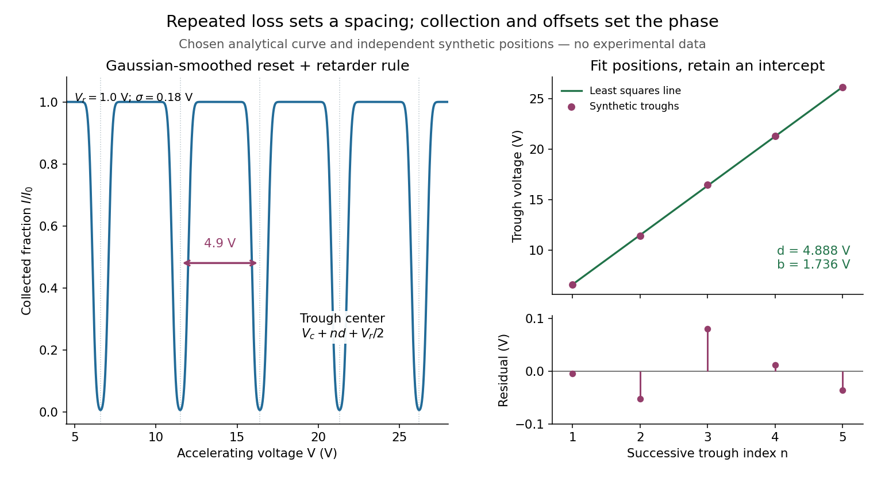

# Franck-Hertz repeated-loss collection model

↑ **Parent:** [Franck-Hertz energy-loss model](franck-hertz-energy-loss-model.md)

Define a signed offset $V_c$ so that the accelerating region adds [kinetic energy](kinetic-energy.md) $e(V-V_c)$. This convention concerns this gap; collector contact fields belong in the effective $V_r$. An [electron](electron.md) emitted with initial [kinetic energy](kinetic-energy.md) $E_0$ and undergoing $n$ identical excitation losses reaches the grid with

$$
E_n=E_0+e(V-V_c)-n\Delta.
$$

Each loss excites a fresh [chemical atom](atom-physics.md) initially in its [ground state](ground-state.md). These are repeated payments of the same excitation cost. The index $n$ counts events along an [electron](electron.md) trajectory, not the ordinal number of an atomic [excited state](excited-state.md). The outgoing [energy](energy-split.md) also does not locate the last collision: after an early collision an [electron](electron.md) can regain enough [kinetic energy](kinetic-energy.md) to cross the barrier.

At fixed $V$, let $g(E_0)$ be the normalized initial-[energy](energy-split.md) [probability density function](probability-density-function.md) within the ensemble of [electrons](electron.md) reaching the grid, and $w_n(E_0,V)$ the [conditional probabilities](conditional-probability.md) for $n$ losses within that ensemble. Then the ideal collection law is

$$
\frac{I(V,V_r)}{I_0}=\int_0^\infty g(E_0)\sum_{n=0}^\infty w_n(E_0,V)H\bigl(E_0+e(V-V_c)-n\Delta-eV_r\bigr)\,dE_0.
$$

Take $\sum_n w_n=1$ and exclude paths with insufficient [kinetic energy](kinetic-energy.md) for a loss at its actual collision position. The weights contain collision positions and rates, [mean free paths](mean-free-path.md) and angular acceptance. This equation is a bookkeeping model, not a derivation of those weights. Multiplying all incident particles by one constant transmission is an additional approximation; real transmission and $I_0$ can vary with $V$.

One analytical extreme assumes $E_0=0$, one-dimensional motion and an immediate loss whenever the [kinetic energy](kinetic-energy.md) reaches $\Delta$. With $d=\Delta/e$, $x=V-V_c\geq0$ and $0<V_r<d$, the number of losses and remaining [kinetic energy](kinetic-energy.md) are

$$
n=\left\lfloor\frac{x}{d}\right\rfloor,\qquad \frac{E_n}{e}=r=x-d\left\lfloor\frac{x}{d}\right\rfloor,\qquad \frac{I}{I_0}=H(r-V_r).
$$

Here $\lfloor\cdot\rfloor$ is the [floor function](floor-function.md). Collection switches off for an interval of width $V_r$ after each reset, then recovers; the pattern repeats every $d$. For $d=4.9\,\mathrm V$, $V_c=1.2\,\mathrm V$ and $V_r=1.0\,\mathrm V$, an applied $V=11.4\,\mathrm V$ gives $n=2$, $r=0.4\,\mathrm V$ and rejection, whereas $V=12.2\,\mathrm V$ gives $n=2$, $r=1.2\,\mathrm V$ and collection. With $V_r=0$ the dips disappear in this idealization. With no collisions, there is only a single collection onset. Both limits expose the separate roles of loss and filtering.

To draw a smooth illustrative curve, extend this periodic rule mathematically to all $x$ and convolve it with a chosen [normal distribution](normal-distribution.md) of voltage jitter, of [standard deviation](standard-deviation.md) $\sigma$:

$$
C_\sigma(x)=\sum_{k\in\mathbb Z}\left[\Phi\!\left(\frac{x-kd-V_r}{\sigma}\right)-\Phi\!\left(\frac{x-(k+1)d}{\sigma}\right)\right].
$$

Here $\Phi$ is the [standard normal cumulative distribution function](standard-normal-distribution-function.md). Each summand is the smoothed indicator of the accepted interval $kd+V_r<x<(k+1)d$. The result satisfies $0\leq C_\sigma\leq1$ and has period $d$. For the figure choose $\sigma=0.18\,\mathrm V$ and plot only well beyond the startup region. This is a chosen phenomenological curve, not a [Boltzmann equation](boltzmann-equation-split.md) transport prediction or a fit to measured [electric current](electric-current.md). Its symmetric troughs center on $V_c+nd+V_r/2$, rather than the reset voltages $V_c+nd$. Finite excitation rates, several loss channels, [space charge](space-charge.md), initial angular and [energy](energy-split.md) spreads, and real electrode geometry can change the trough shape and phase; a single convolution does not solve these effects.

**[Figure 3](#image-illustrative-repeated-loss-collection-and-an-independent-synthetic-spacing-fit). Illustrative repeated-loss collection and an independent synthetic spacing fit**. [Source](franck-hertz-repeated-loss-spacing-fit.py). Left: the chosen Gaussian-smoothed threshold model, with $d=4.9\,\mathrm V$, $V_c=1.2\,\mathrm V$, $V_r=1.0\,\mathrm V$ and $\sigma=0.18\,\mathrm V$. Right: separately chosen synthetic trough positions, their [ordinary least squares](ordinary-least-squares.md) fit and residuals. The points are not extracted from the left curve or a historical trace.

## ↑ Ancestors (8)

1. [Franck-Hertz energy-loss model](franck-hertz-energy-loss-model.md)
2. [Franck-Hertz experiment](franck-hertz-experiment.md)
3. [Excited state](excited-state.md)
4. [Energy eigenvalue](energy-eigenvalue-split.md)
5. [Quantum mechanics](quantum-mechanics-split.md)
6. [Branches of physics](branches-of-physics.md)
7. [Physics](physics-split.md)
8. [Codex Wiki](split.md)
