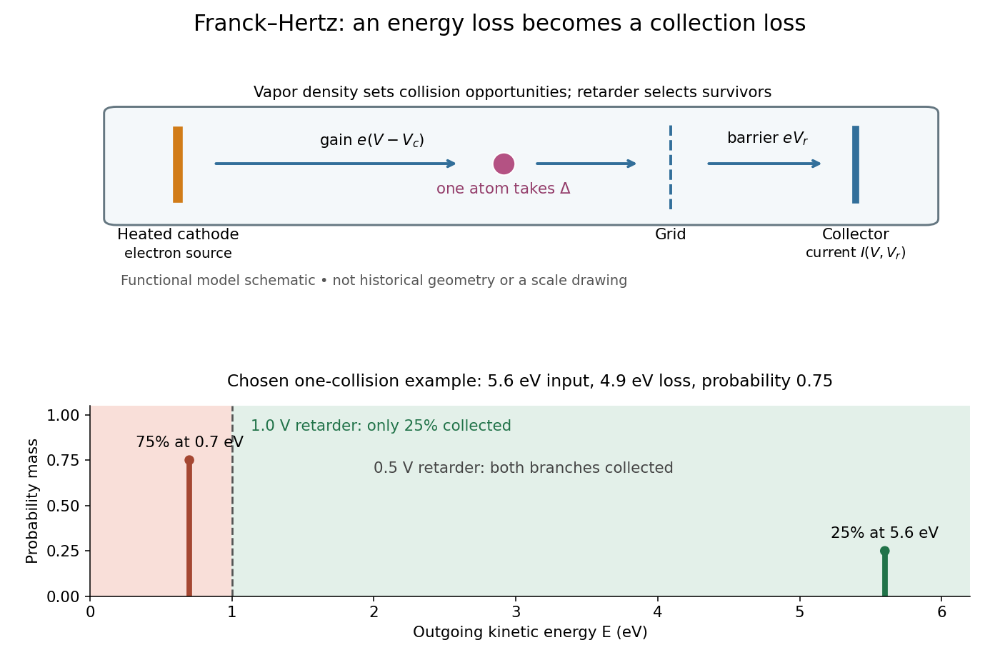

# Franck-Hertz retarding collector transfer

↑ **Parent:** [Franck-Hertz energy-loss model](franck-hertz-energy-loss-model.md)

For [electrons](electron.md) directed normally toward an ideal planar collector, a retarding [electric potential difference](electric-potential-difference.md) $V_r>0$ imposes the barrier $eV_r$. Write its transfer as $T(E)=H(E-eV_r)$, where $H$ is the [Heaviside step function](heaviside-step-function.md) and $e$ the positive [elementary charge](elementary-charge.md). Thus a perfectly sharp loss need not produce a sharp drop in [electric current](electric-current.md): the drop also depends on where the outgoing [energy](energy-split.md) lies relative to the barrier. For an oblique incident [electron](electron.md) at angle $\theta$ to the normal, the same planar model instead tests $E\cos^2\theta>eV_r$; angular scattering can change collection even at unchanged total [kinetic energy](kinetic-energy.md).

**[Figure 2](#image-franck-hertz-energy-loss-model-separate-acceleration-loss-and-collection). Franck-Hertz energy-loss model: separate acceleration, loss and collection**. [Source](franck-hertz-collector-threshold.py). Original functional schematic, not a scale reconstruction of a historical tube. The lower panel applies an ideal normally incident retarder to the explicitly chosen one-collision example. Equal vertical strokes mark outgoing [energies](energy-split.md); their labeled weights give [probabilities](probability.md).

For example, choose a monoenergetic incoming beam with $u=5.6\,\mathrm{eV}$, $p=0.75$ and $\Delta=4.9\,\mathrm{eV}$. After one encounter, $25\%$ have $5.6\,\mathrm{eV}$ and $75\%$ have $0.7\,\mathrm{eV}$. A $1.0\,\mathrm V$ retarder collects only $0.25I_0$, whereas a $0.5\,\mathrm V$ retarder collects $I_0$; here $I_0$ is the incident [electric current](electric-current.md) with fixed geometrical acceptance and no background. The mean outgoing [kinetic energy](kinetic-energy.md) is $1.925\,\mathrm{eV}$, independently checked by $5.6-0.75(4.9)$. These are chosen inputs and calculated fractions, not historical measurements.

More generally, let $f(E;V)$ be the normalized outgoing [probability density function](probability-density-function.md) at a fixed accelerating [electric potential difference](electric-potential-difference.md) $V$, for the normally incident idealization. A retarding scan gives

$$
\frac{I(V,V_r)}{I_0}=\int_{eV_r}^{\infty}f(E;V)\,dE,\qquad
f(eV_r;V)=-\frac{1}{eI_0}\frac{\partial I}{\partial V_r}.
$$

The second equation follows by differentiating the lower integration limit, with [Dirac delta functions](dirac-delta-function.md) understood for sharp beams. It explains why an integrated collector readout can reveal an [energy](energy-split.md) distribution. With angles present it probes the distribution of normal [kinetic energy](kinetic-energy.md); finite instrumental resolution smooths it, and numerical [differentiation](differentiation.md) amplifies noise. Keep the incoming beam fixed during this scan. A scan of $V$ changes $f$ itself and cannot be differentiated by the same inversion formula.

## ↑ Ancestors (8)

1. [Franck-Hertz energy-loss model](franck-hertz-energy-loss-model.md)
2. [Franck-Hertz experiment](franck-hertz-experiment.md)
3. [Excited state](excited-state.md)
4. [Energy eigenvalue](energy-eigenvalue-split.md)
5. [Quantum mechanics](quantum-mechanics-split.md)
6. [Branches of physics](branches-of-physics.md)
7. [Physics](physics-split.md)
8. [Codex Wiki](split.md)
