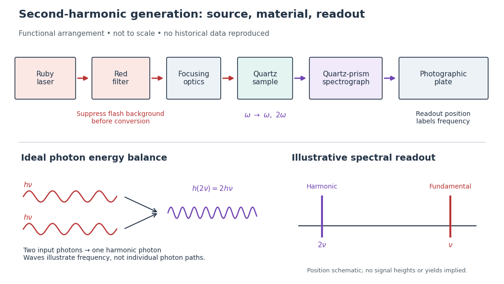

# Franken and colleagues frequency-doubling experiment

↑ **Parent:** [Second-harmonic generation](second-harmonic-generation.md)

In 1961, [Peter Alden Franken](peter-alden-franken.md), [Alan Hill](alan-hill.md), [C. Wilbur Peters](c-wilbur-peters.md) and [Gabriel Weinreich](gabriel-weinreich.md) focused a pulsed [ruby laser](ruby-laser.md) through a red [optical filter](optical-filter.md) into [quartz](quartz.md). The filter suppressed xenon-flash background. A quartz-prism [spectrograph](spectrograph.md) used red-insensitive Eastman Type 103 plates. A single shot recorded a feature near $347.2\,\mathrm{nm}$ from $694.3\,\mathrm{nm}$ input. Removing the [quartz](quartz.md) or substituting glass removed the feature; changing [polarization of waves](polarization-waves.md) and orientation followed their predicted pattern. These controls supported [second-harmonic generation](second-harmonic-generation.md); photographic density gave an estimated yield.[pp. 118–119, Table I, Fig. 1 and controls](generation-of-optical-harmonics-by-peter-alden-franken-and-others.md)

**[Figure 23](#image-functional-second-harmonic-generation-experiment-and-photon-energy-relation). Functional second-harmonic generation experiment and photon energy relation**. [Source](second-harmonic-generation-functional-experiment.py). Original functional diagram; the output strip is illustrative, with no measured line heights. The red [optical filter](optical-filter.md) precedes the generating [quartz](quartz.md); it cleans the input rather than isolating the ultraviolet output. The [spectrograph](spectrograph.md) separates output [frequencies](frequency.md). This is a functional arrangement, not a scaled reconstruction or historical plate. The ideal [photon](photon.md) panel illustrates [conservation of energy](conservation-of-energy.md).

A [spectrograph](spectrograph.md) turns output [frequency](frequency.md) into a recording position. Its spectral separation makes a faint new component distinguishable from bright input [light](light.md). The reported rounded [wavelengths](wavelength.md) do not constitute an independent precision measurement of the ratio two. Nor do these observations demonstrate perfect [phase matching](phase-matching.md) or complete conversion. The experiment and [Nicolaas Bloembergen's](nicolaas-bloembergen.md) later theoretical account are distinct contributions to [nonlinear optics](nonlinear-optics.md).

## ↑ Ancestors (6)

1. [Second-harmonic generation](second-harmonic-generation.md)
2. [Nonlinear optics](nonlinear-optics.md)
3. [Optics](optics-split.md)
4. [Branches of physics](branches-of-physics.md)
5. [Physics](physics-split.md)
6. [Codex Wiki](split.md)

## ← Incoming links (1)

- [Nonlinear optics](nonlinear-optics.md)
