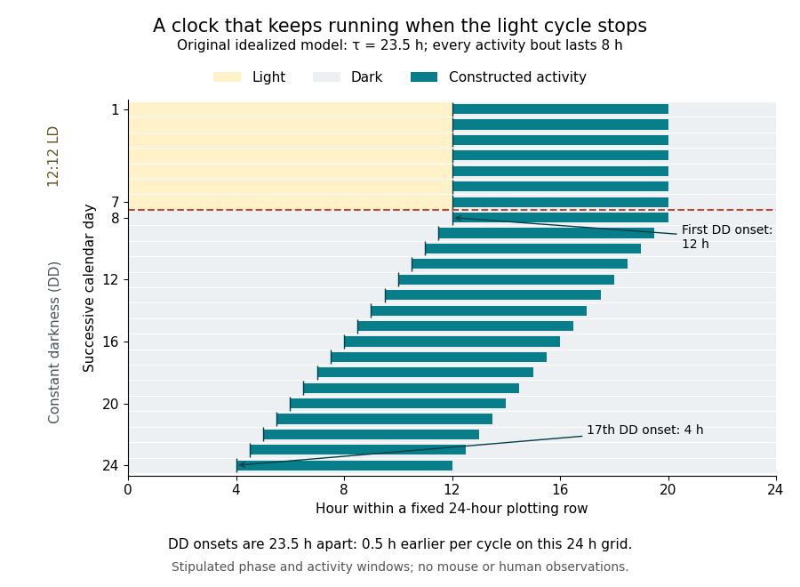

# Free-running circadian rhythm

↑ **Parent:** [Circadian rhythm](circadian-rhythm.md)

A [free-running circadian rhythm](free-running-circadian-rhythm.md) persists without an entraining cycle. Its [period](period-of-a-function.md) $\tau$ separates corresponding [circadian phases](circadian-phase.md), such as successive activity onsets, under specified constant conditions.[pp. 86–87, Figure 1A; p. 92, Free running](overview-of-circadian-rhythms-by-martha-hotz-vitaterna-and-others.md) A [circadian phase](circadian-phase.md) tells where the system is within its cycle; a [period](period-of-a-function.md) tells how long one cycle takes. Choosing onset rather than peak as the reference changes the phase label, not the [period](period-of-a-function.md) of an ideal repeating signal.

Consider an original, deliberately idealized model with $\tau=23.5\,\mathrm h$. For seven days prescribe a 12:12 LD cycle with activity starting at hour 12 of each 24-hour day. Then omit the next scheduled dawn and keep the environment dark. Stipulate that the first DD onset retains hour 12, and that every later onset is exactly $23.5\,\mathrm h$ after the previous one. Activity lasts eight hours after each onset. These are chosen model values, not recorded mouse or human data, and the fixed activity window represents an output of the model rather than the molecular mechanism of a [circadian clock](circadian-clock.md).

**[Figure 4](#image-circadian-free-running-actogram). An idealized circadian rhythm under 12:12 LD followed by constant darkness**. Original stipulated [actogram](actogram.md): each row is a fixed 24-hour calendar day, with successive days running downwards. Yellow denotes light, pale gray denotes darkness, and teal denotes the chosen activity window. The DD [period](period-of-a-function.md) is $23.5\,\mathrm h$, so successive activity onsets move earlier on the plotting grid. No biological measurements are plotted.

An [actogram](actogram.md) displays activity against time in successive rows. Here each row spans $T=24\,\mathrm h$, regardless of the [circadian rhythm](circadian-rhythm.md)'s [period](period-of-a-function.md). If $t_0$ is the first DD onset and $n$ counts completed free-running cycles, then

$$
t_n=t_0+n\tau,\qquad t_{n+1}-t_n=\tau,\qquad x_n=t_n-(t_0+nT)=n(\tau-T).
$$

The unwrapped onset displacement $x_n$ is therefore $-0.5n\,\mathrm h$. After eight cycles the onset is four hours earlier than a 24-hour continuation would predict; after sixteen cycles it is eight hours earlier. Because these onsets remain within successive calendar rows in the displayed interval, their row positions are $12,11.5,11,\ldots,4$ hours. The visual slant comes from comparing two different [periods](period-of-a-function.md), not from cessation of the [oscillation](oscillation.md).

An alternative [phase oscillator](phase-oscillator.md) description makes the same distinction explicit. Set the [circadian phase](circadian-phase.md) to zero at $t_0$ and define

$$
\theta(t)=\frac{2\pi(t-t_0)}{\tau}\pmod{2\pi},\qquad \omega=\frac{2\pi}{\tau}.
$$

The [angular frequency](angular-frequency.md) $\omega$ is constant in this model. Onset occurs whenever the unwrapped [circadian phase](circadian-phase.md) completes another turn. A [period](period-of-a-function.md) longer than $T$ would instead produce later onsets; equality would produce aligned rows even without [entrainment of circadian rhythm](entrainment-of-circadian-rhythm.md). Thus aligned rows by themselves do not identify the cause of a daily pattern. Real activity can be noisy, and a [free-running circadian rhythm](free-running-circadian-rhythm.md)'s [period](period-of-a-function.md) can vary with conditions or with time after release; the stipulated straight line assumes a stationary [period](period-of-a-function.md).

## ↑ Ancestors (4)

1. [Circadian rhythm](circadian-rhythm.md)
2. [Physiology](physiology-split.md)
3. [Biology](biology-split.md)
4. [Codex Wiki](split.md)

## ← Incoming links (3)

- [Circadian rhythm](circadian-rhythm.md)
- [Free-running circadian rhythm](free-running-circadian-rhythm.md)
- [Solution](past-exam-of-the-plant-sciences-course-of-the-university-of-cambridge/2024/paper-plm1/3/solution.md)
