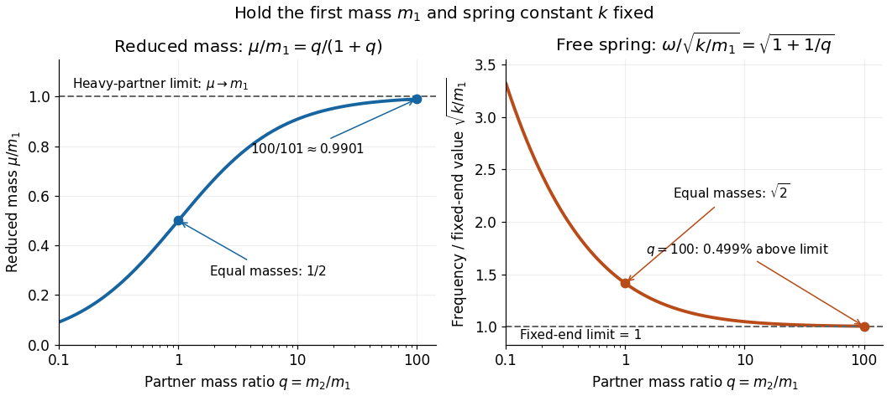

# Free two-mass spring

↑ **Parent:** [Reduced mass](reduced-mass.md)

Take two [point masses](point-mass.md) joined by a massless [spring](spring.md) of [spring constant](spring-constant.md) $k>0$ and equilibrium length $\ell>0$. Assume one-dimensional motion along the [spring](spring.md), no external [force](force-split.md), no [damping](damping.md), and an extension $s=x_2-x_1-\ell$ satisfying [Hooke's law](hooke-s-law.md); keep $x_2>x_1$. For a real [spring](spring.md) this is a model within its elastic range. Its [potential energy](potential-energy.md) is $U=ks^2/2$, so

$$
\mu\ddot s=-ks,\qquad s(t)=A\cos(\omega t+\phi),\qquad
\omega=\sqrt{\frac{k}{\mu}}=\sqrt{k\left(\frac1{m_1}+\frac1{m_2}\right)},\qquad \nu=\frac\omega{2\pi}.
$$

Here $\omega$ is [angular frequency](angular-frequency.md) and $\nu$ is [frequency](frequency.md). Choose $|A|<\ell$ so the model bodies do not cross. The internal [normal mode](normal-mode.md) has [displacements](displacement.md) $u_1=-m_2s/M$ and $u_2=m_1s/M$ about equilibrium offsets from the [centre of mass](center-of-mass.md); its [amplitude](wave-amplitude.md) ratio is $|u_1|/|u_2|=m_2/m_1$. The other [normal mode](normal-mode.md) is collective translation with zero [frequency](frequency.md) and no [spring](spring.md) extension. This free pair has different boundary conditions from [normal modes of two equal masses between three springs](normal-modes-of-two-equal-masses-between-three-springs.md).

For $k=10\,\mathrm{N/m}$ and two $1\,\mathrm{kg}$ [masses](mass.md), $\omega=\sqrt{20}\,\mathrm{s^{-1}}\approx4.47214\,\mathrm{s^{-1}}$ and $\nu\approx0.711763\,\mathrm{Hz}$. Replacing the second [mass](mass.md) by $100\,\mathrm{kg}$ gives $\omega=\sqrt{10.1}\,\mathrm{s^{-1}}\approx3.17805\,\mathrm{s^{-1}}$ and $\nu\approx0.505802\,\mathrm{Hz}$. Fixing the second endpoint instead would give $\sqrt{10}\,\mathrm{s^{-1}}$: the free heavy partner still moves. The free pair's [angular frequency](angular-frequency.md) exceeds that fixed-end limit by the factor $\sqrt{1+1/q}$, about $1.004988$ at $q=100$.

**[Figure 14](#image-reduced-mass-ratio-spring-frequency). Reduced mass and free two-mass spring angular frequency as the partner becomes heavier**. Original dimensionless model with $m_1$ and $k$ held fixed, $q=m_2/m_1>0$, $\mu/m_1=q/(1+q)$ and $\omega/\sqrt{k/m_1}=\sqrt{1+1/q}$. The marks at $q=1$ and $q=100$ correspond to the computed examples; curves are predictions, not measured data.

## ↑ Ancestors (6)

1. [Reduced mass](reduced-mass.md)
2. [Center of mass](center-of-mass.md)
3. [Classical mechanics](classical-mechanics-split.md)
4. [Branches of physics](branches-of-physics.md)
5. [Physics](physics-split.md)
6. [Codex Wiki](split.md)

## ← Incoming links (3)

- [Free two-mass spring](free-two-mass-spring.md)
- [Reduced mass](reduced-mass.md)
- [Two-particle relative coordinate](two-particle-relative-coordinate.md)
