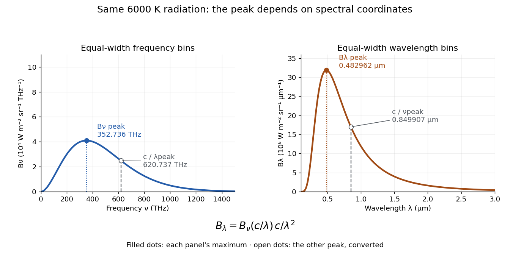

<h1 id="frequency-and-wavelength-peaks-of-planck-s-law">Frequency and wavelength peaks of Planck's law</h1>

↑ **Parent:** [Planck's law](planck-s-law.md)

At a fixed [temperature](temperature.md), the [frequency](frequency.md) maximizing $B_\nu$ and the [wavelength](wavelength.md) maximizing $B_\lambda$ in [Planck's law](planck-s-law.md) are different ways of describing the same [black-body radiation](black-body-radiation.md). They are maxima of different densities. The inverse relation between [frequency](frequency.md) and [wavelength](wavelength.md) does not preserve those maxima because its interval-conversion factor varies with [wavelength](wavelength.md).

For a short extremum calculation, substitute $x=h\nu/(k_BT)$ into $B_\nu$, leaving a positive constant times $x^3/(e^x-1)$. Substitute $x=hc/(\lambda k_BT)$ into $B_\lambda$, leaving a positive constant times $x^5/(e^x-1)$. Setting each [derivative](derivative.md) to zero gives

$$
3(1-e^{-x_\nu})=x_\nu,\qquad 5(1-e^{-x_\lambda})=x_\lambda.
$$

Select the positive roots: $x_\nu=2.821439372\ldots$ and $x_\lambda=4.965114232\ldots$. Although $x=0$ solves the rearranged equations, it is an endpoint, not either peak. For $m=3$ or $5$, the function $m(1-e^{-x})-x$ initially increases, its [derivative](derivative.md) $me^{-x}-1$ crosses zero once, and it eventually becomes negative. Hence it has exactly one positive root. Each density tends to zero at both ends, so this root gives its unique maximum. The [bisection method](bisection-method.md) brackets these roots in $(1,3)$ and $(1,5)$.

Consequently [Wien's displacement law](wien-s-displacement-law.md) gives

$$
\lambda_{\max}T=\frac{hc}{k_Bx_\lambda}=b\approx2.897771955\times10^{-3}\,\mathrm{m\,K},
\qquad \frac{\nu_{\max}}T=\frac{k_Bx_\nu}{h}\approx5.878925758\times10^{10}\,\mathrm{Hz\,K^{-1}}.
$$

These constants agree with NIST's tabulation. [Fundamental Physical Constants — Complete Listing by National Institute of Standards and Technology and others](fundamental-physical-constants-complete-listing-by-national-institute-of-standards-and-technology-and-others.md) The [wavelength](wavelength.md) peaks at $3000$, $4500$, and $6000\,\mathrm K$ are $965.924$, $643.949$, and $482.962\,\mathrm{nm}$. Doubling [temperature](temperature.md) halves this peak [wavelength](wavelength.md).

At $6000\,\mathrm K$, the [frequency](frequency.md) peak is $\nu_{\max}\approx352.736\,\mathrm{THz}$, whose converted [wavelength](wavelength.md) is $c/\nu_{\max}\approx0.849907\,\mu\mathrm m$. The $B_\lambda$ peak is instead $0.482962\,\mu\mathrm m$, corresponding to about $620.737\,\mathrm{THz}$. These numbers are compatible: equal-width [frequency](frequency.md) bins and equal-width [wavelength](wavelength.md) bins partition the same radiation differently. Specifying which density was maximized is essential when using a peak to infer [temperature](temperature.md).

**[Figure 19](#image-one-6000-mathrm-k-spectrum-two-spectral-coordinate-peaks). One $6000\,\mathrm K$ spectrum, two spectral-coordinate peaks**. The left panel plots the [Planck function](planck-function.md) per terahertz and marks its [frequency](frequency.md) peak. The right panel plots the same [black-body radiation](black-body-radiation.md) per micrometre and marks its [wavelength](wavelength.md) peak. Dashed lines locate the counterpart of the other panel's peak. The converted [frequency](frequency.md) peak at $0.849907\,\mu\mathrm m$ is not the $B_\lambda$ peak at $0.482962\,\mu\mathrm m$: the [change of variables](change-of-variables-formula.md) changes density heights through $c/\lambda^2$.

## ↑ Ancestors (5)

1. [Planck's law](planck-s-law.md)
2. [Statistical physics](statistical-physics-split.md)
3. [Branches of physics](branches-of-physics.md)
4. [Physics](physics-split.md)
5. [Codex Wiki](split.md)

## ← Incoming links (3)

- [Frequency and wavelength spectral radiance conversion](frequency-and-wavelength-spectral-radiance-conversion.md)
- [Planck's law](planck-s-law.md)
- [Spectral radiance](spectral-radiance.md)
