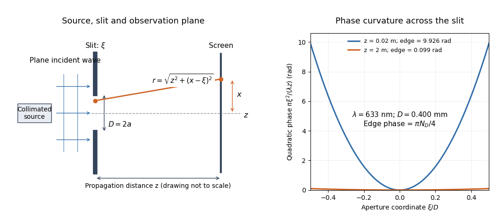

# Fresnel diffraction

↑ **Parent:** [Physical optics](physical-optics-split.md)  
ⓦ [Wiki](https://en.wikipedia.org/wiki/Fresnel_diffraction)

[Fresnel diffraction](fresnel-diffraction.md) describes [diffraction](diffraction.md) when the quadratic propagation [wave phase](phase-waves.md) across an [aperture](aperture.md) must be retained. Its [Fresnel propagator](fresnel-propagator.md) becomes the [Fraunhofer diffraction](fraunhofer-diffraction.md) description when that curvature is negligible.

A [Fresnel diffraction](fresnel-diffraction.md) pattern is a map of how propagation changes the [wave interference](interference-wave-propagation.md) of [light](light.md) from an [aperture](aperture.md). It can resemble the opening, develop bright and dark structure near its edges, and eventually approach a [Fraunhofer diffraction](fraunhofer-diffraction.md) pattern. The controlling comparison involves [wavelength](wavelength.md), opening size and propagation distance together; a distance large compared with the opening need not give the far field.

For a [monochromatic wave](monochromatic-wave.md), use time dependence $e^{-i\omega t}$, [wavenumber](wavenumber.md) $k=2\pi/\lambda$ and [complex amplitude](complex-amplitude.md) $U$. Let $U_0(\xi,\eta)$ be the transmitted field immediately behind an [aperture](aperture.md) in the [plane](plane.md) $z=0$. In a homogeneous medium, the scalar [paraxial approximation](paraxial-approximation.md) gives

$$
U(x,y,z)\simeq\frac{e^{ikz}}{i\lambda z}\iint_{\mathbb R^2}U_0(\xi,\eta)\exp\!\left[\frac{i\pi}{\lambda z}\bigl((x-\xi)^2+(y-\eta)^2\bigr)\right]d\xi\,d\eta,\qquad z>0.
$$

This is the two-transverse-coordinate [Fresnel propagator](fresnel-propagator.md), with its carrier $e^{ikz}$ restored. It adds [complex amplitudes](complex-amplitude.md) before taking their squared [complex modulus](complex-modulus.md) to obtain [light intensity](light-intensity.md). It is a scalar [paraxial approximation](paraxial-approximation.md), rather than a full vector solution of [Maxwell equations](maxwell-equations-split.md).[Interactive Optics by Sander Konijnenberg, Aurèle J.L. Adam and H. Paul Urbach; Fresnel Approximation, equations (381)–(385), and the following paraxial-wave-equation remark](interactive-optics-by-sander-konijnenberg-aurele-j-l-adam-and-h-paul-urbach/scalar-diffraction-optics.md)

**[Figure 1](#image-fresnel-diffraction-geometry-and-the-distance-dependent-quadratic-wave-phase-across-a-uniform-slit). Fresnel diffraction geometry and the distance-dependent quadratic wave phase across a uniform slit**.

The source in this constructed geometry supplies a [plane wave](plane-wave.md); the observation screen is a [plane](plane.md) perpendicular to the [optical axis](optical-axis.md). The right panel isolates the aperture-dependent [wave phase](phase-waves.md) that distinguishes [Fresnel diffraction](fresnel-diffraction.md) from [Fraunhofer diffraction](fraunhofer-diffraction.md). Its vertical scale is in [radians](radian.md), and the drawing's lengths are schematic.

Keeping this [wave phase](phase-waves.md) is useful when transporting a field between nearby optical components: both the shape and the [complex amplitude](complex-amplitude.md) matter for subsequent [wave interference](interference-wave-propagation.md). A particularly striking feature is that propagation can create a dark centre even from a uniformly illuminated symmetric [aperture](aperture.md); the incident [wave amplitudes](wave-amplitude.md) need not be unequal for their outgoing contributions to cancel.

**Table of contents**

- [Cornu chord power normalization](cornu-chord-power-normalization.md)
  - [Largest contiguous Fresnel aperture](largest-contiguous-fresnel-aperture.md)
    - [Pointwise Fresnel gain versus integrated transmitted power](pointwise-fresnel-gain-versus-integrated-transmitted-power.md)
    - [Existing-opening constraint in Fresnel aperture optimization](existing-opening-constraint-in-fresnel-aperture-optimization.md)
- [Knife-edge diffraction](knife-edge-diffraction.md)
  - [Geometric spreading in a moving-receiver diffraction measurement](geometric-spreading-in-a-moving-receiver-diffraction-measurement.md)
- [Fresnel-Kirchhoff diffraction integral](fresnel-kirchhoff-diffraction-integral.md)
- [Zone plate](zone-plate.md)
  - [Exact half-period zone radii](exact-half-period-zone-radii.md)
  - [Axial intensity gain of an amplitude zone plate](axial-intensity-gain-of-an-amplitude-zone-plate.md)
- [Half-plane shadow-boundary intensity](half-plane-shadow-boundary-intensity.md)
- [Arago spot](arago-spot.md)
- [Fresnel diffraction by an opaque disk](fresnel-diffraction-by-an-opaque-disk.md)
- [Fresnel diffraction by a circular aperture](fresnel-diffraction-by-a-circular-aperture.md)
- [Fresnel half-period zone](fresnel-half-period-zone.md)
- [Square-aperture Fresnel diffraction](square-aperture-fresnel-diffraction.md)
- [Fresnel diffraction phase curvature](fresnel-diffraction-phase-curvature.md)
- [Fresnel number](fresnel-number.md)
- [Fresnel slit propagation](fresnel-slit-propagation.md)
- [Near-field diffraction laboratory experiment](near-field-diffraction-laboratory-experiment.md)

## ↑ Ancestors (5)

1. [Physical optics](physical-optics-split.md)
2. [Optics](optics-split.md)
3. [Branches of physics](branches-of-physics.md)
4. [Physics](physics-split.md)
5. [Codex Wiki](split.md)

## ← Incoming links (22)

- [Babinet's principle](babinet-s-principle.md)
- [Circular-aperture diffraction laboratory experiment](circular-aperture-diffraction-laboratory-experiment.md)
- [Euler spiral](euler-spiral.md)
- [Fresnel diffraction](fresnel-diffraction.md)
- [Fresnel diffraction by a circular aperture](fresnel-diffraction-by-a-circular-aperture.md)
- [Fresnel-Kirchhoff diffraction integral](fresnel-kirchhoff-diffraction-integral.md)
- [Fresnel number](fresnel-number.md)
- [Fresnel slit propagation](fresnel-slit-propagation.md)
- [Near-field diffraction laboratory experiment](near-field-diffraction-laboratory-experiment.md)
- [Solution](past-exam-of-the-mphil-in-micro-and-nanotechnology-enterprise-course-of-the-university-of-cambridge/2020/paper-1/section-a-ii/3/i/solution.md)
- [Solution](past-exam-of-the-physics-a-course-of-the-university-of-cambridge/2010/paper-1/section-b/b9/solution.md)
- [Solution](past-exam-of-the-physics-a-course-of-the-university-of-cambridge/2012/paper-2/section-a/1/solution.md)
- [Solution](past-exam-of-the-physics-a-course-of-the-university-of-cambridge/2016/paper-2/section-d/d12/solution.md)
- [Solution](past-exam-of-the-physics-a-course-of-the-university-of-cambridge/2017/paper-2/section-a/3/solution.md)
- [Solution](past-exam-of-the-physics-a-course-of-the-university-of-cambridge/2017/paper-2/section-d/d12/solution.md)
- [Solution](past-exam-of-the-physics-a-course-of-the-university-of-cambridge/2019/paper-2/section-b/b8/a/solution.md)
- [Solution](past-exam-of-the-physics-a-course-of-the-university-of-cambridge/2021/paper-2/section-b/b7/a/solution.md)
- [Solution](past-exam-of-the-physics-a-course-of-the-university-of-cambridge/2021/paper-2/section-b/b7/b/solution.md)
- [Solution](past-exam-of-the-physics-a-course-of-the-university-of-cambridge/2021/paper-2/section-b/b7/d/solution.md)
- [Solution](past-exam-of-the-physics-a-course-of-the-university-of-cambridge/2022/paper-2/section-a/1/solution.md)
- [Solution](past-exam-of-the-physics-course-of-the-year-4-of-the-natural-sciences-course-of-the-university-of-cambridge/2014/paper-1/b7/solution.md)
- [Proximity photolithography](proximity-photolithography.md)
