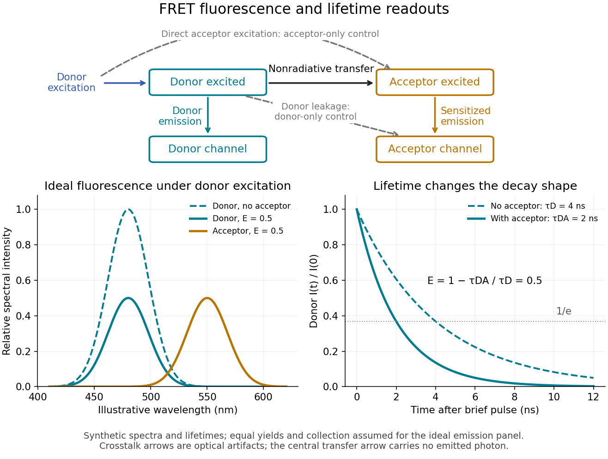

# FRET donor lifetime

↑ **Parent:** [FRET efficiency](fret-efficiency.md)

The [FRET donor lifetime](fret-donor-lifetime.md) is the mean time spent in the [excited state](excited-state.md). For the constant-rate model of [FRET efficiency](fret-efficiency.md),

$$
\tau_D=\frac1{k_D},\qquad \tau_{DA}=\frac1{k_D+k_T},\qquad E=1-\frac{\tau_{DA}}{\tau_D}.
$$

After a sufficiently brief excitation pulse, the [FRET donor](fret-donor.md)'s [fluorescence](fluorescence-split.md) follows [exponential decay](exponential-decay.md), $I(t)=I(0)e^{-t/\tau}$. With the illustrative values $\tau_D=4$ nanoseconds and $\tau_{DA}=2$ nanoseconds, the inferred [FRET efficiency](fret-efficiency.md) is $1/2$. Multiplying $I(0)$ changes brightness without changing this decay time.

The lifetime comparison requires the same nontransfer decay rates in the reference and paired samples. Changes in the [FRET donor](fret-donor.md)'s environment or a different nonradiative loss can also shorten the [FRET donor lifetime](fret-donor-lifetime.md). Heterogeneous [FRET efficiencies](fret-efficiency.md) or slowly varying [FRET dipole orientation factors](fret-dipole-orientation-factor.md) need an appropriate decay model; substituting any fitted average lifetime into the single-pair formula can mislead. [Quantitative time domain analysis of lifetime-based Förster resonant energy transfer measurements with fluorescent proteins: Static random isotropic fluorophore orientation distributions by Yuriy Alexandrov and others](quantitative-time-domain-analysis-of-lifetime-based-forster-resonant-energy-transfer-measurements-with-fluorescent-proteins-static-random-isotropic-fluorophore-orientation-distributions-by-yuriy-alexandrov-and-others.md)

**[Figure 25](#image-fret-sensitized-emission-optical-controls-and-the-fret-donor-lifetime). FRET sensitized emission, optical controls and the FRET donor lifetime**. Original schematic and synthetic curves. The spectral panel assumes equal [fluorescence](fluorescence-split.md) yields and collection efficiencies for the two labels; its amplitudes are illustrative, not a calibration or measured cyan/yellow spectra. The lifetime panel uses $\tau_D=4$ and $\tau_{DA}=2$ nanoseconds. Dashed optical paths require [FRET optical crosstalk](fret-optical-crosstalk.md) controls; they do not represent the nonradiative transfer mechanism.

## ↑ Ancestors (5)

1. [FRET efficiency](fret-efficiency.md)
2. [Förster resonance energy transfer](forster-resonance-energy-transfer.md)
3. [Biophysical measurement](biophysical-measurement.md)
4. [Biology](biology-split.md)
5. [Codex Wiki](split.md)

## ← Incoming links (5)

- [Fluorescence lifetime](fluorescence-lifetime.md)
- [FRET acceptor](fret-acceptor.md)
- [FRET dipole orientation factor](fret-dipole-orientation-factor.md)
- [FRET donor](fret-donor.md)
- [FRET donor lifetime](fret-donor-lifetime.md)
