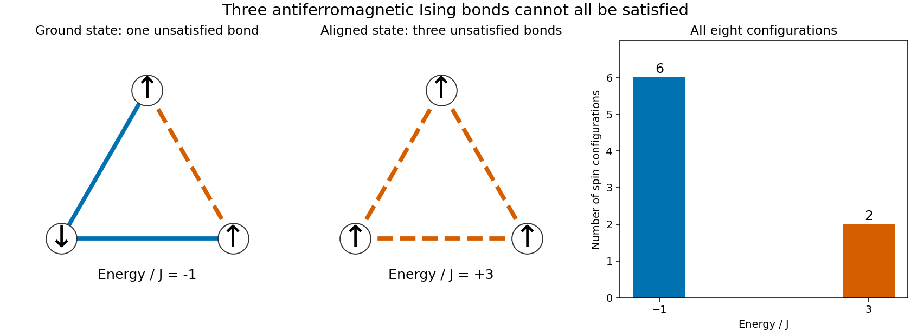

# Frustrated Ising triangle

↑ **Parent:** [Spin glass](spin-glass.md)

Take three [Ising spins](ising-spin-variable.md) $s_i\in\{-1,1\}$, with an [antiferromagnetic](antiferromagnetism.md) interaction of [energy](energy-split.md) scale $J$ on each [edge](edge-of-a-graph.md) of a triangle. An individually satisfied bond has $s_is_j=-1$. But multiplying all three bond products gives $(s_1s_2)(s_2s_3)(s_3s_1)=1$, whereas three satisfied bonds would give $-1$. At least one bond must therefore remain unsatisfied. This is an exactly finite example of [geometrical frustration](geometrical-frustration.md).

There are six [ground states](ground-state.md) with one unsatisfied bond and **ground-state energy $-J$**. The two all-aligned [microstates](microstate.md) have [energy](energy-split.md) $3J$. No interaction is switched off in a [ground state](ground-state.md): the system minimizes their sum by accepting one local disappointment. Allowing continuous three-component [spins](spin.md) instead of [Ising spins](ising-spin-variable.md) changes this optimization problem and permits the $120$-degree arrangement described under [geometrical frustration](geometrical-frustration.md).

**[Figure 1](#image-an-antiferromagnetic-ising-triangle-and-its-complete-finite-energy-spectrum). An antiferromagnetic Ising triangle and its complete finite energy spectrum**. [Source](frustrated-ising-triangle-states.py). The blue solid bonds are satisfied and the orange dashed bonds are unsatisfied. The histogram counts all eight configurations of the stipulated three-spin model. It contains no experimental measurements.

Writing $\beta=1/(k_BT)$ for [inverse temperature](inverse-temperature.md), the exact [partition function](canonical-partition-function.md) and mean [internal energy](internal-energy-split.md) are

$$
Z=6e^{\beta J}+2e^{-3\beta J},\qquad
\langle H\rangle=\frac{-6Je^{\beta J}+6Je^{-3\beta J}}{6e^{\beta J}+2e^{-3\beta J}}.
$$

At $T>0$ these expressions are smooth: **a finite triangle has no thermodynamic phase transition**. In zero [magnetic field](magnetic-field-split.md), [spin inversion symmetry](spin-inversion-symmetry.md) also gives $\langle s_i\rangle=0$ at every site, even as the [Boltzmann distribution](boltzmann-distribution.md) concentrates on the six frustrated [ground states](ground-state.md).

## ↑ Ancestors (6)

1. [Spin glass](spin-glass.md)
2. [Spin model](spin-model-split.md)
3. [Statistical physics](statistical-physics-split.md)
4. [Branches of physics](branches-of-physics.md)
5. [Physics](physics-split.md)
6. [Codex Wiki](split.md)

## ← Incoming links (2)

- [Spin glass](spin-glass.md)
- [Spin overlap](spin-overlap.md)
